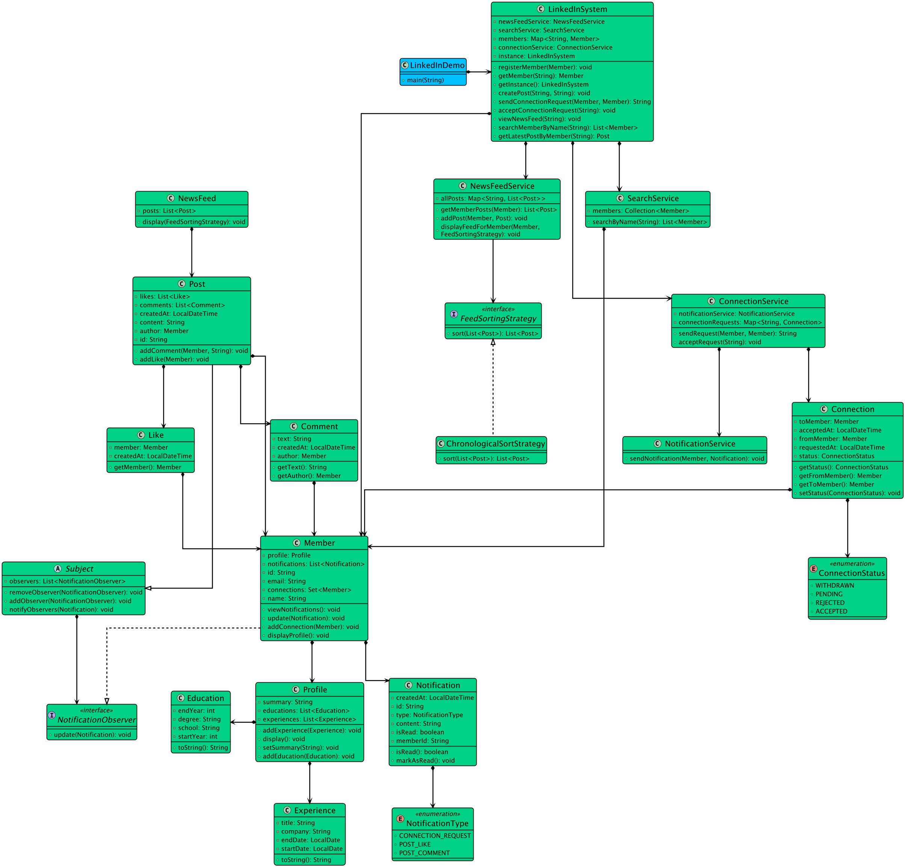

# Low-level design problem: linkedin

> Copied from <https://github.com/ashishps1/awesome-low-level-design/blob/main/problems/linkedin.md> (GPL-3.0, by Ashish Pratap Singh). Questions and answers are the source's own; nothing was answered or rewritten here.


# Designing a Professional Networking Platform like LinkedIn

## Requirements
#### User Registration and Authentication:
- Users should be able to create an account with their professional information, such as name, email, and password.
- Users should be able to log in and log out of their accounts securely.
#### User Profiles:
- Each user should have a profile with their professional information, such as profile picture, headline, summary, experience, education, and skills.
- Users should be able to update their profile information.
#### Connections:
- Users should be able to send connection requests to other users.
- Users should be able to accept or decline connection requests.
- Users should be able to view their list of connections.
#### Messaging:
- Users should be able to send messages to their connections.
- Users should be able to view their inbox and sent messages.
#### Job Postings:
- Employers should be able to post job listings with details such as title, description, requirements, and location.
- Users should be able to view and apply for job postings.
#### Search Functionality:
- Users should be able to search for other users, companies, and job postings based on relevant criteria.
- Search results should be ranked based on relevance and user preferences.
#### Notifications:
- Users should receive notifications for events such as connection requests, messages, and job postings.
- Notifications should be delivered in real-time.
#### Scalability and Performance:
- The system should be designed to handle a large number of concurrent users and high traffic load.
- The system should be scalable and efficient in terms of resource utilization.

## UML Class Diagram



## Implementations
#### [Java Implementation](https://github.com/ashishps1/awesome-low-level-design/blob/main/solutions/java/src/linkedin) 
#### [Python Implementation](https://github.com/ashishps1/awesome-low-level-design/blob/main/solutions/python/linkedin)
#### [C++ Implementation](https://github.com/ashishps1/awesome-low-level-design/blob/main/solutions/cpp/linkedin)
#### [C# Implementation](https://github.com/ashishps1/awesome-low-level-design/blob/main/solutions/csharp/linkedin)
#### [Go Implementation](https://github.com/ashishps1/awesome-low-level-design/blob/main/solutions/golang/linkedin)

## Classes, Interfaces and Enumerations
1. The **User** class represents a user in the LinkedIn system, containing properties such as ID, name, email, password, profile, connections, inbox, and sent messages.
2. The **Profile** class represents a user's profile, containing properties such as profile picture, headline, summary, experiences, educations, and skills.
3. The **Experience**, **Education**, and **Skill** classes represent different components of a user's profile.
4. The **Connection** class represents a connection between two users, containing the user and the connection date.
5. The **Message** class represents a message sent between users, containing properties such as ID, sender, receiver, content, and timestamp.
6. The **JobPosting** class represents a job listing posted by an employer, containing properties such as ID, title, description, requirements, location, and post date.
7. The **Notification** class represents a notification generated for a user, containing properties such as ID, user, notification type, content, and timestamp.
8. The **NotificationType** enum defines the different types of notifications, such as connection request, message, and job posting.
9. The **LinkedInService** class is the main class that manages the LinkedIn system. It follows the Singleton pattern to ensure only one instance of the service exists.
10. The **LinkedInService** class provides methods for user registration, login, profile updates, connection requests, job postings, user and job search, messaging, and notifications.
11. Multi-threading is achieved using concurrent data structures such as ConcurrentHashMap and CopyOnWriteArrayList to handle concurrent access to shared resources.
12. The **LinkedInDemo** class demonstrates the usage of the LinkedIn system by registering users, logging in, updating profiles, sending connection requests, posting job listings, searching for users and jobs, sending messages, and retrieving notifications.

---

## Official solutions from the repository

<details><summary><b>java</b> (23 files)</summary>


**LinkedInDemo.java**

```java
package linkedin;

import linkedin.entities.Education;
import linkedin.entities.Experience;
import linkedin.entities.Member;
import linkedin.entities.Post;

import java.time.LocalDate;
import java.util.List;

public class LinkedInDemo {
    public static void main(String[] args) {
        LinkedInSystem system = LinkedInSystem.getInstance();

        // --- 1. Create Members using the Builder Pattern ---
        System.out.println("--- 1. Member Registration ---");
        Member alice = new Member.Builder("Alice", "alice@example.com")
                .withSummary("Senior Software Engineer with 10 years of experience.")
                .addExperience(new Experience("Sr. Software Engineer", "Google", LocalDate.of(2018, 1, 1), null))
                .addExperience(new Experience("Software Engineer", "Microsoft", LocalDate.of(2014, 6, 1), LocalDate.of(2017, 12, 31)))
                .addEducation(new Education("Princeton University", "M.S. in Computer Science", 2012, 2014))
                .build();

        Member bob = new Member.Builder("Bob", "bob@example.com")
                .withSummary("Product Manager at Stripe.")
                .addExperience(new Experience("Product Manager", "Stripe", LocalDate.of(2020, 2, 1), null))
                .addEducation(new Education("MIT", "B.S. in Business Analytics", 2015, 2019))
                .build();

        Member charlie = new Member.Builder("Charlie", "charlie@example.com").build();

        system.registerMember(alice);
        system.registerMember(bob);
        system.registerMember(charlie);

        alice.displayProfile();

        // --- 2. Connection Management ---
        System.out.println("\n--- 2. Connection Management ---");
        // Alice sends requests to Bob and Charlie
        String requestId1 = system.sendConnectionRequest(alice, bob);
        String requestId2 = system.sendConnectionRequest(alice, charlie);

        bob.viewNotifications(); // Bob sees Alice's request.

        System.out.println("\nBob accepts Alice's request.");
        system.acceptConnectionRequest(requestId1);
        System.out.println("Alice and Bob are now connected.");

        // --- 3. Posting and News Feed ---
        System.out.println("\n--- 3. Posting & News Feed ---");
        bob.displayProfile(); // Bob has 1 connection
        system.createPost(bob.getId(), "Excited to share we've launched our new feature! #productmanagement");

        // Alice views her news feed. She should see Bob's post.
        system.viewNewsFeed(alice.getId());

        // Charlie views his feed. It should be empty as he is not connected to anyone.
        system.viewNewsFeed(charlie.getId());

        // --- 4. Interacting with a Post (Observer Pattern in action) ---
        System.out.println("\n--- 4. Post Interaction & Notifications ---");
        Post bobsPost = system.getLatestPostByMember(bob.getId());
        if (bobsPost != null) {
            bobsPost.addLike(alice);
            bobsPost.addComment(alice, "This looks amazing! Great work!");
        }

        // Bob checks his notifications. He should see a like and a comment from Alice.
        bob.viewNotifications();

        // --- 5. Searching for Members ---
        System.out.println("\n--- 5. Member Search ---");
        List<Member> searchResults = system.searchMemberByName("ali");
        System.out.println("Search results for 'ali':");
        searchResults.forEach(m -> System.out.println(" - " + m.getName()));
    }
}
```


**LinkedInSystem.java**

```java
package linkedin;

import linkedin.entities.Member;
import linkedin.entities.Post;
import linkedin.services.ConnectionService;
import linkedin.services.NewsFeedService;
import linkedin.services.NotificationService;
import linkedin.services.SearchService;
import linkedin.strategy.ChronologicalSortStrategy;

import java.util.List;
import java.util.Map;
import java.util.concurrent.ConcurrentHashMap;

public class LinkedInSystem {
    private static volatile LinkedInSystem instance;

    // Data stores (simulating databases)
    private final Map<String, Member> members = new ConcurrentHashMap<>();

    // Services
    private final ConnectionService connectionService;
    private final NewsFeedService newsFeedService;
    private final SearchService searchService;

    private LinkedInSystem() {
        // Initialize services
        this.connectionService = new ConnectionService(new NotificationService());
        this.newsFeedService = new NewsFeedService();
        this.searchService = new SearchService(members.values());
    }

    public static LinkedInSystem getInstance() {
        if (instance == null) {
            synchronized (LinkedInSystem.class) {
                if (instance == null) {
                    instance = new LinkedInSystem();
                }
            }
        }
        return instance;
    }

    public void registerMember(Member member) {
        members.put(member.getId(), member);
        System.out.println("New member registered: " + member.getName());
    }

    public Member getMember(String name) {
        return members.values().stream().filter(m -> m.getName().equals(name)).findFirst().orElse(null);
    }

    public String sendConnectionRequest(Member from, Member to) {
        return connectionService.sendRequest(from, to);
    }

    public void acceptConnectionRequest(String requestId) {
        connectionService.acceptRequest(requestId);
    }

    public void createPost(String memberId, String content) {
        Member author = members.get(memberId);
        Post post = new Post(author, content);
        newsFeedService.addPost(author, post);
        System.out.printf("%s created a new post.%n", author.getName());
    }

    public Post getLatestPostByMember(String memberId) {
        List<Post> memberPosts = newsFeedService.getMemberPosts(members.get(memberId));
        if (memberPosts == null || memberPosts.isEmpty()) return null;
        return memberPosts.get(memberPosts.size() - 1);
    }

    public void viewNewsFeed(String memberId) {
        Member member = members.get(memberId);
        System.out.println("\n--- News Feed for " + member.getName() + " ---");
        // Using the default chronological strategy
        newsFeedService.displayFeedForMember(member, new ChronologicalSortStrategy());
    }

    public List<Member> searchMemberByName(String name) {
        return searchService.searchByName(name);
    }
}
```


**README.md**

```md
# LinkedIn (LLD)

## Problem Statement

Design and implement a LinkedIn-like professional networking platform that allows users to create profiles, connect with others, post jobs, send messages, and receive notifications.

---

## Requirements

- **User Management:** Users can register, log in, and manage their profiles.
- **Profile Management:** Users can add education, experience, and skills to their profiles.
- **Connections:** Users can send and accept connection requests.
- **Job Posting:** Users (or companies) can post job openings.
- **Messaging:** Users can send direct messages to their connections.
- **Notifications:** The system notifies users of connection requests, job matches, messages, and other events.
- **Extensibility:** Easy to add new features such as endorsements, recommendations, or company pages.

---

## Core Entities

- **LinkedInService:** Main class that manages users, connections, job postings, messages, and notifications.
- **User:** Represents a user with profile, connections, messages, and notifications.
- **Profile:** Represents a user's professional profile, including education, experience, and skills.
- **Connection:** Represents a connection between two users.
- **JobPosting:** Represents a job posted by a user or company.
- **Message:** Represents a direct message between users.
- **Notification:** Represents a notification sent to a user.
- **NotificationType (enum):** Types of notifications (e.g., CONNECTION_REQUEST, JOB_MATCH, MESSAGE).
- **Skill:** Represents a skill in a user's profile.
- **Education:** Represents an education entry in a user's profile.
- **Experience:** Represents a work experience entry in a user's profile.

---

## Class Design

## UML Class Diagram


### 1. LinkedInService
- **Fields:** List<User> users, List<JobPosting> jobPostings, List<Connection> connections, List<Notification> notifications
- **Methods:** registerUser(User), addConnection(User, User), postJob(JobPosting), sendMessage(User, User, String), sendNotification(Notification), searchUsers(String), searchJobs(String), etc.

### 2. User
- **Fields:** int id, String name, Profile profile, List<Connection> connections, List<Message> messages, List<Notification> notifications
- **Methods:** sendConnectionRequest(User), acceptConnection(Connection), sendMessage(User, String), addSkill(Skill), addEducation(Education), addExperience(Experience), etc.

### 3. Profile
- **Fields:** List<Skill> skills, List<Education> education, List<Experience> experience

### 4. Connection
- **Fields:** int id, User user1, User user2, boolean isAccepted

### 5. JobPosting
- **Fields:** int id, String title, String description, User postedBy

### 6. Message
- **Fields:** int id, User sender, User receiver, String content

### 7. Notification
- **Fields:** int id, User recipient, String message, NotificationType type

### 8. NotificationType (enum)
- Values: CONNECTION_REQUEST, JOB_MATCH, MESSAGE, etc.

### 9. Skill
- **Fields:** String name

### 10. Education
- **Fields:** String institution, String degree, String fieldOfStudy, int startYear, int endYear

### 11. Experience
- **Fields:** String company, String title, int startYear, int endYear

---

## Example Usage

```java
LinkedInService service = new LinkedInService();
User alice = new User(1, "Alice");
User bob = new User(2, "Bob");
service.registerUser(alice);
service.registerUser(bob);

alice.sendConnectionRequest(bob);
service.addConnection(alice, bob);

Profile profile = alice.getProfile();
profile.addSkill(new Skill("Java"));
profile.addEducation(new Education("MIT", "BSc", "CS", 2010, 2014));
profile.addExperience(new Experience("Google", "Software Engineer", 2014, 2018));

JobPosting job = new JobPosting(1, "Backend Developer", "Work on scalable systems", alice);
service.postJob(job);

service.sendMessage(alice, bob, "Hi Bob, let's connect!");
```

---

## Demo

See `LinkedInDemo.java` for a sample usage and simulation of the LinkedIn system.

---

## Extending the Framework

- **Add endorsements:** Allow users to endorse each other's skills.
- **Add recommendations:** Support written recommendations for users.
- **Add company pages:** Allow companies to create and manage their own pages.

---
```


**entities/Comment.java**

```java
package linkedin.entities;

import java.time.LocalDateTime;

public class Comment {
    private final Member author;
    private final String text;
    private final LocalDateTime createdAt;

    public Comment(Member author, String text) {
        this.author = author;
        this.text = text;
        this.createdAt = LocalDateTime.now();
    }
    public Member getAuthor() { return author; }
    public String getText() { return text; }
}
```


**entities/Connection.java**

```java
package linkedin.entities;

import linkedin.enums.ConnectionStatus;

import java.time.LocalDateTime;

public class Connection {
    private final Member fromMember;
    private final Member toMember;
    private ConnectionStatus status;
    private final LocalDateTime requestedAt;
    private LocalDateTime acceptedAt;

    public Connection(Member fromMember, Member toMember) {
        this.fromMember = fromMember;
        this.toMember = toMember;
        this.status = ConnectionStatus.PENDING;
        this.requestedAt = LocalDateTime.now();
    }

    public Member getFromMember() { return fromMember; }
    public Member getToMember() { return toMember; }
    public ConnectionStatus getStatus() { return status; }

    public void setStatus(ConnectionStatus status) {
        this.status = status;
        if (status == ConnectionStatus.ACCEPTED) {
            this.acceptedAt = LocalDateTime.now();
        }
    }
}
```


**entities/Education.java**

```java
package linkedin.entities;

public class Education {
    private final String school;
    private final String degree;
    private final int startYear;
    private final int endYear;

    public Education(String school, String degree, int startYear, int endYear) {
        this.school = school;
        this.degree = degree;
        this.startYear = startYear;
        this.endYear = endYear;
    }

    @Override
    public String toString() {
        return String.format("%s, %s (%d - %d)", degree, school, startYear, endYear);
    }
}
```


**entities/Experience.java**

```java
package linkedin.entities;

import java.time.LocalDate;

public class Experience {
    private final String title;
    private final String company;
    private final LocalDate startDate;
    private final LocalDate endDate; // Can be null for current job

    public Experience(String title, String company, LocalDate startDate, LocalDate endDate) {
        this.title = title;
        this.company = company;
        this.startDate = startDate;
        this.endDate = endDate;
    }

    @Override
    public String toString() {
        return String.format("%s at %s (%s to %s)", title, company, startDate, endDate == null ? "Present" : endDate);
    }
}
```


**entities/Like.java**

```java
package linkedin.entities;

import java.time.LocalDateTime;

public class Like {
    private final Member member;
    private final LocalDateTime createdAt;

    public Like(Member member) {
        this.member = member;
        this.createdAt = LocalDateTime.now();
    }
    public Member getMember() { return member; }
}
```


**entities/Member.java**

```java
package linkedin.entities;

import linkedin.observer.NotificationObserver;

import java.util.*;

public class Member implements NotificationObserver {
    private final String id;
    private final String name;
    private final String email;
    private final Profile profile;
    private final Set<Member> connections = new HashSet<>();
    private final List<Notification> notifications = new ArrayList<>();

    private Member(String id, String name, String email, Profile profile) {
        this.id = id;
        this.name = name;
        this.email = email;
        this.profile = profile;
    }

    public String getId() { return id; }
    public String getName() { return name; }
    public String getEmail() { return email; }
    public Set<Member> getConnections() { return connections; }
    public Profile getProfile() { return profile; }

    public void addConnection(Member member) {
        connections.add(member);
    }

    public void displayProfile() {
        System.out.println("\n--- Profile for " + name + " (" + email + ") ---");
        profile.display();
        System.out.println("  Connections: " + connections.size());
    }

    public void viewNotifications() {
        System.out.println("\n--- Notifications for " + name + " ---");
        if (notifications.isEmpty()) {
            System.out.println("  No new notifications.");
            return;
        }
        notifications.stream()
                .filter(n -> !n.isRead())
                .forEach(n -> {
                    System.out.println("  - " + n.getContent());
                    n.markAsRead(); // Mark as read after viewing
                });
    }

    @Override
    public void update(Notification notification) {
        this.notifications.add(notification);
        System.out.printf("Notification pushed to %s: %s%n", this.name, notification.getContent());
    }

    // Builder Class
    public static class Builder {
        private final String id;
        private final String name;
        private final String email;
        private final Profile profile = new Profile();

        public Builder(String name, String email) {
            this.id = UUID.randomUUID().toString();
            this.name = name;
            this.email = email;
        }

        public Builder withSummary(String summary) {
            this.profile.setSummary(summary);
            return this;
        }

        public Builder addExperience(Experience experience) {
            this.profile.addExperience(experience);
            return this;
        }

        public Builder addEducation(Education education) {
            this.profile.addEducation(education);
            return this;
        }

        public Member build() {
            return new Member(id, name, email, profile);
        }
    }
}
```


**entities/NewsFeed.java**

```java
package linkedin.entities;

import linkedin.strategy.FeedSortingStrategy;

import java.util.List;

public class NewsFeed {
    private final List<Post> posts;

    public NewsFeed(List<Post> posts) {
        this.posts = posts;
    }

    public void display(FeedSortingStrategy strategy) {
        List<Post> sortedPosts = strategy.sort(posts);
        if (sortedPosts.isEmpty()) {
            System.out.println("  Your news feed is empty.");
            return;
        }
        sortedPosts.forEach(post -> {
            System.out.println("----------------------------------------");
            System.out.printf("Post by: %s (at %s)%n", post.getAuthor().getName(), post.getCreatedAt().toLocalDate());
            System.out.println("Content: " + post.getContent());
            System.out.printf("Likes: %d, Comments: %d%n", post.getLikes().size(), post.getComments().size());
            System.out.println("----------------------------------------");
        });
    }
}
```


**entities/Notification.java**

```java
package linkedin.entities;

import linkedin.enums.NotificationType;

import java.time.LocalDateTime;
import java.util.UUID;

public class Notification {
    private final String id;
    private final String memberId; // The ID of the member to notify
    private final NotificationType type;
    private final String content;
    private final LocalDateTime createdAt;
    private boolean isRead = false;

    public Notification(String memberId, NotificationType type, String content) {
        this.id = UUID.randomUUID().toString();
        this.memberId = memberId;
        this.type = type;
        this.content = content;
        this.createdAt = LocalDateTime.now();
    }

    public String getContent() { return content; }
    public void markAsRead() { this.isRead = true; }
    public boolean isRead() { return isRead; }
}
```


**entities/Post.java**

```java
package linkedin.entities;

import linkedin.enums.NotificationType;
import linkedin.observer.Subject;

import java.time.LocalDateTime;
import java.util.ArrayList;
import java.util.List;
import java.util.UUID;

public class Post extends Subject {
    private final String id;
    private final Member author;
    private final String content;
    private final LocalDateTime createdAt;
    private final List<Like> likes = new ArrayList<>();
    private final List<Comment> comments = new ArrayList<>();

    public Post(Member author, String content) {
        this.id = UUID.randomUUID().toString();
        this.author = author;
        this.content = content;
        this.createdAt = LocalDateTime.now();
        // The author should be notified of interactions with their own post
        this.addObserver(author);
    }

    public void addLike(Member member) {
        likes.add(new Like(member));
        String notificationContent = member.getName() + " liked your post.";
        Notification notification = new Notification(author.getId(), NotificationType.POST_LIKE, notificationContent);
        notifyObservers(notification);
    }

    public void addComment(Member member, String text) {
        comments.add(new Comment(member, text));
        String notificationContent = member.getName() + " commented on your post: \"" + text + "\"";
        Notification notification = new Notification(author.getId(), NotificationType.POST_COMMENT, notificationContent);
        notifyObservers(notification);
    }

    public String getId() { return id; }
    public Member getAuthor() { return author; }
    public String getContent() { return content; }
    public LocalDateTime getCreatedAt() { return createdAt; }
    public List<Like> getLikes() { return likes; }
    public List<Comment> getComments() { return comments; }
}
```


**entities/Profile.java**

```java
package linkedin.entities;

import java.util.ArrayList;
import java.util.List;

public class Profile {
    private String summary;
    private final List<Experience> experiences = new ArrayList<>();
    private final List<Education> educations = new ArrayList<>();

    public void setSummary(String summary) { this.summary = summary; }
    public void addExperience(Experience experience) { experiences.add(experience); }
    public void addEducation(Education education) { educations.add(education); }

    public void display() {
        System.out.println("  Summary: " + (summary != null ? summary : "N/A"));

        System.out.println("  Experience:");
        if (experiences.isEmpty())
            System.out.println("    - None");
        else
            experiences.forEach(exp -> System.out.println("    - " + exp));

        System.out.println("  Education:");
        if (educations.isEmpty())
            System.out.println("    - None");
        else
            educations.forEach(edu -> System.out.println("    - " + edu));
    }
}
```


**enums/ConnectionStatus.java**

```java
package linkedin.enums;

public enum ConnectionStatus {
    PENDING,
    ACCEPTED,
    REJECTED,
    WITHDRAWN
}
```


**enums/NotificationType.java**

```java
package linkedin.enums;

public enum NotificationType {
    CONNECTION_REQUEST,
    POST_LIKE,
    POST_COMMENT
}
```


**observer/NotificationObserver.java**

```java
package linkedin.observer;

import linkedin.entities.Notification;

public interface NotificationObserver {
    void update(Notification notification);
}
```


**observer/Subject.java**

```java
package linkedin.observer;

import linkedin.entities.Notification;

import java.util.ArrayList;
import java.util.List;

public abstract class Subject {
    private final List<NotificationObserver> observers = new ArrayList<>();

    public void addObserver(NotificationObserver observer) {
        observers.add(observer);
    }

    public void removeObserver(NotificationObserver observer) {
        observers.remove(observer);
    }

    public void notifyObservers(Notification notification) {
        for (NotificationObserver observer : observers) {
            observer.update(notification);
        }
    }
}
```


**services/ConnectionService.java**

```java
package linkedin.services;

import linkedin.enums.ConnectionStatus;
import linkedin.enums.NotificationType;
import linkedin.entities.Connection;
import linkedin.entities.Member;
import linkedin.entities.Notification;

import java.util.Map;
import java.util.UUID;
import java.util.concurrent.ConcurrentHashMap;

public class ConnectionService {
    private final NotificationService notificationService;
    // Simulates a DB table for connection requests
    private final Map<String, Connection> connectionRequests = new ConcurrentHashMap<>();

    public ConnectionService(NotificationService notificationService) {
        this.notificationService = notificationService;
    }

    public String sendRequest(Member from, Member to) {
        Connection connection = new Connection(from, to);
        String requestId = UUID.randomUUID().toString();
        connectionRequests.put(requestId, connection);

        System.out.printf("%s sent a connection request to %s.%n", from.getName(), to.getName());

        Notification notification = new Notification(
                to.getId(),
                NotificationType.CONNECTION_REQUEST,
                from.getName() + " wants to connect with you. Request ID: " + requestId
        );
        notificationService.sendNotification(to, notification);

        return requestId;
    }

    public void acceptRequest(String requestId) {
        Connection request = connectionRequests.get(requestId);
        if (request != null && request.getStatus() == ConnectionStatus.PENDING) {
            request.setStatus(ConnectionStatus.ACCEPTED);

            Member from = request.getFromMember();
            Member to = request.getToMember();

            from.addConnection(to);
            to.addConnection(from);

            System.out.printf("%s accepted the connection request from %s.%n", to.getName(), from.getName());
            connectionRequests.remove(requestId); // Clean up
        } else {
            System.out.println("Invalid or already handled request ID.");
        }
    }
}
```


**services/NewsFeedService.java**

```java
package linkedin.services;

import linkedin.entities.Member;
import linkedin.entities.NewsFeed;
import linkedin.entities.Post;
import linkedin.strategy.FeedSortingStrategy;

import java.util.ArrayList;
import java.util.List;
import java.util.Map;
import java.util.concurrent.ConcurrentHashMap;

public class NewsFeedService {
    private final Map<String, List<Post>> allPosts; // A map of memberId -> list of their posts

    public NewsFeedService() {
        this.allPosts = new ConcurrentHashMap<>();
    }

    public void addPost(Member member, Post post) {
        String memberId = member.getId();
        if(!allPosts.containsKey(memberId)) {
            allPosts.put(memberId, new ArrayList<>());
        }
        allPosts.get(memberId).add(post);
    }

    public List<Post> getMemberPosts(Member member) {
        return allPosts.getOrDefault(member.getId(), new ArrayList<>());
    }

    public void displayFeedForMember(Member member, FeedSortingStrategy feedSortingStrategy) {
        List<Post> feedPosts = new ArrayList<>();
        // Add posts from the member's connections
        for (Member connection : member.getConnections()) {
            List<Post> connectionPosts = allPosts.get(connection.getId());
            if (connectionPosts != null) {
                feedPosts.addAll(connectionPosts);
            }
        }

        NewsFeed feed = new NewsFeed(feedPosts);
        feed.display(feedSortingStrategy);
    }
}
```


**services/NotificationService.java**

```java
package linkedin.services;

import linkedin.entities.Member;
import linkedin.entities.Notification;

public class NotificationService {
    public void sendNotification(Member member, Notification notification) {
        // In a real system, this would push to a queue or a websocket.
        // Here, we directly call the member's update method.
        member.update(notification);
    }
}
```


**services/SearchService.java**

```java
package linkedin.services;

import linkedin.entities.Member;

import java.util.ArrayList;
import java.util.Collection;
import java.util.List;

public class SearchService {
    private final Collection<Member> members;

    public SearchService(Collection<Member> members) {
        this.members = members;
    }

    public List<Member> searchByName(String name) {
        List<Member> result = new ArrayList<>();
        members.stream()
            .filter(member -> member.getName().toLowerCase().contains(name.toLowerCase())) // substring search
            .forEach(result::add);
        return result;
    }
}
```


**strategy/ChronologicalSortStrategy.java**

```java
package linkedin.strategy;

import linkedin.entities.Post;

import java.util.ArrayList;
import java.util.Comparator;
import java.util.List;

public class ChronologicalSortStrategy implements FeedSortingStrategy {
    @Override
    public List<Post> sort(List<Post> posts) {
        List<Post> result = new ArrayList<>();
        posts.stream()
            .sorted(Comparator.comparing(Post::getCreatedAt).reversed())
            .forEach(result::add);
        return result;
    }
}
```


**strategy/FeedSortingStrategy.java**

```java
package linkedin.strategy;

import linkedin.entities.Post;

import java.util.List;

public interface FeedSortingStrategy {
    List<Post> sort(List<Post> posts);
}
```

</details>

<details><summary><b>python</b> (18 files)</summary>


**README.md**

```md
# Designing a Professional Networking Platform like LinkedIn

## Requirements
#### User Registration and Authentication:
- Users should be able to create an account with their professional information, such as name, email, and password.
- Users should be able to log in and log out of their accounts securely.
#### User Profiles:
- Each user should have a profile with their professional information, such as profile picture, headline, summary, experience, education, and skills.
- Users should be able to update their profile information.
#### Connections:
- Users should be able to send connection requests to other users.
- Users should be able to accept or decline connection requests.
- Users should be able to view their list of connections.
#### Messaging:
- Users should be able to send messages to their connections.
- Users should be able to view their inbox and sent messages.
#### Job Postings:
- Employers should be able to post job listings with details such as title, description, requirements, and location.
- Users should be able to view and apply for job postings.
#### Search Functionality:
- Users should be able to search for other users, companies, and job postings based on relevant criteria.
- Search results should be ranked based on relevance and user preferences.
#### Notifications:
- Users should receive notifications for events such as connection requests, messages, and job postings.
- Notifications should be delivered in real-time.
#### Scalability and Performance:
- The system should be designed to handle a large number of concurrent users and high traffic load.
- The system should be scalable and efficient in terms of resource utilization.


## Classes, Interfaces and Enumerations
1. The **User** class represents a user in the LinkedIn system, containing properties such as ID, name, email, password, profile, connections, inbox, and sent messages.
2. The **Profile** class represents a user's profile, containing properties such as profile picture, headline, summary, experiences, educations, and skills.
3. The **Experience**, **Education**, and **Skill** classes represent different components of a user's profile.
4. The **Connection** class represents a connection between two users, containing the user and the connection date.
5. The **Message** class represents a message sent between users, containing properties such as ID, sender, receiver, content, and timestamp.
6. The **JobPosting** class represents a job listing posted by an employer, containing properties such as ID, title, description, requirements, location, and post date.
7. The **Notification** class represents a notification generated for a user, containing properties such as ID, user, notification type, content, and timestamp.
8. The **NotificationType** enum defines the different types of notifications, such as connection request, message, and job posting.
9. The **LinkedInService** class is the main class that manages the LinkedIn system. It follows the Singleton pattern to ensure only one instance of the service exists.
10. The **LinkedInService** class provides methods for user registration, login, profile updates, connection requests, job postings, user and job search, messaging, and notifications.
11. Multi-threading is achieved using concurrent data structures such as ConcurrentHashMap and CopyOnWriteArrayList to handle concurrent access to shared resources.
12. The **LinkedInDemo** class demonstrates the usage of the LinkedIn system by registering users, logging in, updating profiles, sending connection requests, posting job listings, searching for users and jobs, sending messages, and retrieving notifications.
```


**connection.py**

```py
from datetime import datetime
from typing import Optional
from member import Member
from enums import ConnectionStatus

class Connection:
    def __init__(self, from_member: Member, to_member: Member):
        self.from_member = from_member
        self.to_member = to_member
        self.status = ConnectionStatus.PENDING
        self.requested_at = datetime.now()
        self.accepted_at: Optional[datetime] = None

    def get_from_member(self) -> Member:
        return self.from_member

    def get_to_member(self) -> Member:
        return self.to_member

    def get_status(self) -> ConnectionStatus:
        return self.status

    def set_status(self, status: ConnectionStatus) -> None:
        self.status = status
        if status == ConnectionStatus.ACCEPTED:
            self.accepted_at = datetime.now()
```


**connection_service.py**

```py
from typing import Dict
from member import Member
from connection import Connection
from notification_service import NotificationService
from enums import ConnectionStatus, NotificationType
import uuid
import threading
from notification import Notification

class ConnectionService:
    def __init__(self, notification_service: NotificationService):
        self.notification_service = notification_service
        self.connection_requests: Dict[str, Connection] = {}
        self.lock = threading.Lock()

    def send_request(self, from_member: Member, to_member: Member) -> str:
        connection = Connection(from_member, to_member)
        request_id = str(uuid.uuid4())
        
        with self.lock:
            self.connection_requests[request_id] = connection

        print(f"{from_member.get_name()} sent a connection request to {to_member.get_name()}.")

        notification = Notification(
            to_member.get_id(),
            NotificationType.CONNECTION_REQUEST,
            f"{from_member.get_name()} wants to connect with you. Request ID: {request_id}"
        )
        self.notification_service.send_notification(to_member, notification)

        return request_id

    def accept_request(self, request_id: str) -> None:
        with self.lock:
            request = self.connection_requests.get(request_id)
            
            if request and request.get_status() == ConnectionStatus.PENDING:
                request.set_status(ConnectionStatus.ACCEPTED)

                from_member = request.get_from_member()
                to_member = request.get_to_member()

                from_member.add_connection(to_member)
                to_member.add_connection(from_member)

                print(f"{to_member.get_name()} accepted the connection request from {from_member.get_name()}.")
                del self.connection_requests[request_id]
            else:
                print("Invalid or already handled request ID.")
```


**education.py**

```py
class Education:
    def __init__(self, school: str, degree: str, start_year: int, end_year: int):
        self.school = school
        self.degree = degree
        self.start_year = start_year
        self.end_year = end_year

    def __str__(self) -> str:
        return f"{self.degree}, {self.school} ({self.start_year} - {self.end_year})"
```


**enums.py**

```py
from enum import Enum

class ConnectionStatus(Enum):
    PENDING = "PENDING"
    ACCEPTED = "ACCEPTED"
    REJECTED = "REJECTED"
    WITHDRAWN = "WITHDRAWN"

class NotificationType(Enum):
    CONNECTION_REQUEST = "CONNECTION_REQUEST"
    POST_LIKE = "POST_LIKE"
    POST_COMMENT = "POST_COMMENT"
```


**experience.py**

```py
from datetime import date
from typing import Optional

class Experience:
    def __init__(self, title: str, company: str, start_date: date, end_date: Optional[date]):
        self.title = title
        self.company = company
        self.start_date = start_date
        self.end_date = end_date

    def __str__(self) -> str:
        end_str = "Present" if self.end_date is None else str(self.end_date)
        return f"{self.title} at {self.company} ({self.start_date} to {end_str})"
```


**feed_sorting_strategy.py**

```py
from abc import ABC, abstractmethod
from typing import List
from post import Post

class FeedSortingStrategy(ABC):
    @abstractmethod
    def sort(self, posts: List[Post]) -> List[Post]:
        pass

class ChronologicalSortStrategy(FeedSortingStrategy):
    def sort(self, posts: List[Post]) -> List[Post]:
        return sorted(posts, key=lambda post: post.get_created_at(), reverse=True)
```


**linkedin_demo.py**

```py
from linkedin_system import LinkedInSystem
from member import Member
from experience import Experience
from education import Education
from datetime import date

class LinkedInDemo:
    @staticmethod
    def main():
        system = LinkedInSystem.get_instance()

        # 1. Create Members using the Builder Pattern
        print("--- 1. Member Registration ---")
        alice = Member.Builder("Alice", "alice@example.com") \
            .with_summary("Senior Software Engineer with 10 years of experience.") \
            .add_experience(Experience("Sr. Software Engineer", "Google", date(2018, 1, 1), None)) \
            .add_experience(Experience("Software Engineer", "Microsoft", date(2014, 6, 1), date(2017, 12, 31))) \
            .add_education(Education("Princeton University", "M.S. in Computer Science", 2012, 2014)) \
            .build()

        bob = Member.Builder("Bob", "bob@example.com") \
            .with_summary("Product Manager at Stripe.") \
            .add_experience(Experience("Product Manager", "Stripe", date(2020, 2, 1), None)) \
            .add_education(Education("MIT", "B.S. in Business Analytics", 2015, 2019)) \
            .build()

        charlie = Member.Builder("Charlie", "charlie@example.com").build()

        system.register_member(alice)
        system.register_member(bob)
        system.register_member(charlie)

        alice.display_profile()

        # 2. Connection Management
        print("\n--- 2. Connection Management ---")
        # Alice sends requests to Bob and Charlie
        request_id1 = system.send_connection_request(alice, bob)
        request_id2 = system.send_connection_request(alice, charlie)

        bob.view_notifications()  # Bob sees Alice's request

        print("\nBob accepts Alice's request.")
        system.accept_connection_request(request_id1)
        print("Alice and Bob are now connected.")

        # 3. Posting and News Feed
        print("\n--- 3. Posting & News Feed ---")
        bob.display_profile()  # Bob has 1 connection
        system.create_post(bob.get_id(), "Excited to share we've launched our new feature! #productmanagement")

        # Alice views her news feed. She should see Bob's post.
        system.view_news_feed(alice.get_id())

        # Charlie views his feed. It should be empty as he is not connected to anyone.
        system.view_news_feed(charlie.get_id())

        # 4. Interacting with a Post (Observer Pattern in action)
        print("\n--- 4. Post Interaction & Notifications ---")
        bobs_post = system.get_latest_post_by_member(bob.get_id())
        if bobs_post:
            bobs_post.add_like(alice)
            bobs_post.add_comment(alice, "This looks amazing! Great work!")

        # Bob checks his notifications. He should see a like and a comment from Alice.
        bob.view_notifications()

        # 5. Searching for Members
        print("\n--- 5. Member Search ---")
        search_results = system.search_member_by_name("ali")
        print("Search results for 'ali':")
        for member in search_results:
            print(f" - {member.get_name()}")

if __name__ == "__main__":
    LinkedInDemo.main()
```


**linkedin_system.py**

```py
import threading
from typing import Dict, List, Optional
from member import Member
from connection_service import ConnectionService
from newsfeed_service import NewsFeedService
from search_service import SearchService
from notification_service import NotificationService
from feed_sorting_strategy import ChronologicalSortStrategy
from post import Post

class LinkedInSystem:
    _instance: Optional['LinkedInSystem'] = None
    _lock = threading.Lock()

    def __new__(cls):
        if cls._instance is None:
            with cls._lock:
                if cls._instance is None:
                    cls._instance = super().__new__(cls)
        return cls._instance

    def __init__(self):
        if hasattr(self, 'initialized'):
            return

        self.members: Dict[str, Member] = {}
        self.connection_service = ConnectionService(NotificationService())
        self.news_feed_service = NewsFeedService()
        self.search_service = SearchService(self.members.values())
        self.initialized = True

    @classmethod
    def get_instance(cls) -> 'LinkedInSystem':
        return cls()

    def register_member(self, member: Member) -> None:
        self.members[member.get_id()] = member
        print(f"New member registered: {member.get_name()}")

    def get_member(self, name: str) -> Optional[Member]:
        for member in self.members.values():
            if member.get_name() == name:
                return member
        return None

    def send_connection_request(self, from_member: Member, to_member: Member) -> str:
        return self.connection_service.send_request(from_member, to_member)

    def accept_connection_request(self, request_id: str) -> None:
        self.connection_service.accept_request(request_id)

    def create_post(self, member_id: str, content: str) -> None:
        author = self.members[member_id]
        post = Post(author, content)
        self.news_feed_service.add_post(author, post)
        print(f"{author.get_name()} created a new post.")

    def get_latest_post_by_member(self, member_id: str) -> Optional[Post]:
        member_posts = self.news_feed_service.get_member_posts(self.members[member_id])
        if not member_posts:
            return None
        return member_posts[-1]

    def view_news_feed(self, member_id: str) -> None:
        member = self.members[member_id]
        print(f"\n--- News Feed for {member.get_name()} ---")
        self.news_feed_service.display_feed_for_member(member, ChronologicalSortStrategy())

    def search_member_by_name(self, name: str) -> List[Member]:
        return self.search_service.search_by_name(name)
```


**member.py**

```py
from typing import List, Set
from profile import Profile
from notification import Notification
from notification_observer import NotificationObserver
from experience import Experience
from education import Education
import uuid

class Member(NotificationObserver):
    def __init__(self, member_id: str, name: str, email: str, profile: Profile):
        self.id = member_id
        self.name = name
        self.email = email
        self.profile = profile
        self.connections: Set['Member'] = set()
        self.notifications: List['Notification'] = []

    def get_id(self) -> str:
        return self.id

    def get_name(self) -> str:
        return self.name

    def get_email(self) -> str:
        return self.email

    def get_connections(self) -> Set['Member']:
        return self.connections

    def get_profile(self) -> Profile:
        return self.profile

    def add_connection(self, member: 'Member') -> None:
        self.connections.add(member)

    def display_profile(self) -> None:
        print(f"\n--- Profile for {self.name} ({self.email}) ---")
        self.profile.display()
        print(f"  Connections: {len(self.connections)}")

    def view_notifications(self) -> None:
        print(f"\n--- Notifications for {self.name} ---")
        unread_notifications = [n for n in self.notifications if not n.is_read()]
        
        if not unread_notifications:
            print("  No new notifications.")
            return

        for notification in unread_notifications:
            print(f"  - {notification.get_content()}")
            notification.mark_as_read()

    def update(self, notification: 'Notification') -> None:
        self.notifications.append(notification)
        print(f"Notification pushed to {self.name}: {notification.get_content()}")

    class Builder:
        def __init__(self, name: str, email: str):
            self.id = str(uuid.uuid4())
            self.name = name
            self.email = email
            self.profile = Profile()

        def with_summary(self, summary: str) -> 'Member.Builder':
            self.profile.set_summary(summary)
            return self

        def add_experience(self, experience: Experience) -> 'Member.Builder':
            self.profile.add_experience(experience)
            return self

        def add_education(self, education: Education) -> 'Member.Builder':
            self.profile.add_education(education)
            return self

        def build(self) -> 'Member':
            return Member(self.id, self.name, self.email, self.profile)
```


**newsfeed.py**

```py
from typing import List
from post import Post
from feed_sorting_strategy import FeedSortingStrategy

class NewsFeed:
    def __init__(self, posts: List[Post]):
        self.posts = posts

    def display(self, strategy: FeedSortingStrategy) -> None:
        sorted_posts = strategy.sort(self.posts)
        if not sorted_posts:
            print("  Your news feed is empty.")
            return

        for post in sorted_posts:
            print("----------------------------------------")
            print(f"Post by: {post.get_author().get_name()} (at {post.get_created_at().date()})")
            print(f"Content: {post.get_content()}")
            print(f"Likes: {len(post.get_likes())}, Comments: {len(post.get_comments())}")
            print("----------------------------------------")
```


**newsfeed_service.py**

```py
from typing import Dict, List
from member import Member
from post import Post
from feed_sorting_strategy import FeedSortingStrategy
from newsfeed import NewsFeed
from collections import defaultdict
import threading

class NewsFeedService:
    def __init__(self):
        self.all_posts: Dict[str, List[Post]] = defaultdict(list)
        self.lock = threading.Lock()

    def add_post(self, member: Member, post: Post) -> None:
        with self.lock:
            self.all_posts[member.get_id()].append(post)

    def get_member_posts(self, member: Member) -> List[Post]:
        return self.all_posts.get(member.get_id(), [])

    def display_feed_for_member(self, member: Member, feed_sorting_strategy: FeedSortingStrategy) -> None:
        feed_posts = []
        
        for connection in member.get_connections():
            connection_posts = self.all_posts.get(connection.get_id(), [])
            feed_posts.extend(connection_posts)

        news_feed = NewsFeed(feed_posts)
        news_feed.display(feed_sorting_strategy)
```


**notification.py**

```py
from enums import NotificationType
import uuid
from datetime import datetime

class Notification:
    def __init__(self, member_id: str, notification_type: NotificationType, content: str):
        self.id = str(uuid.uuid4())
        self.member_id = member_id
        self.type = notification_type
        self.content = content
        self.created_at = datetime.now()
        self._is_read = False

    def get_content(self) -> str:
        return self.content

    def mark_as_read(self) -> None:
        self._is_read = True

    def is_read(self) -> bool:
        return self._is_read
```


**notification_observer.py**

```py
from abc import ABC, abstractmethod
from typing import List
from notification import Notification

class NotificationObserver(ABC):
    @abstractmethod
    def update(self, notification: 'Notification') -> None:
        pass

class Subject:
    def __init__(self):
        self.observers: List[NotificationObserver] = []

    def add_observer(self, observer: NotificationObserver) -> None:
        self.observers.append(observer)

    def remove_observer(self, observer: NotificationObserver) -> None:
        if observer in self.observers:
            self.observers.remove(observer)

    def notify_observers(self, notification: 'Notification') -> None:
        for observer in self.observers:
            observer.update(notification)
```


**notification_service.py**

```py
from member import Member
from notification import Notification

class NotificationService:
    def send_notification(self, member: Member, notification: Notification) -> None:
        member.update(notification)
```


**post.py**

```py
from typing import List
from member import Member
from notification import Notification
from notification_observer import Subject
from enums import NotificationType
import uuid
from datetime import datetime

class Like:
    def __init__(self, member: Member):
        self.member = member
        self.created_at = datetime.now()

    def get_member(self) -> Member:
        return self.member

class Comment:
    def __init__(self, author: Member, text: str):
        self.author = author
        self.text = text
        self.created_at = datetime.now()

    def get_author(self) -> Member:
        return self.author

    def get_text(self) -> str:
        return self.text

class Post(Subject):
    def __init__(self, author: Member, content: str):
        super().__init__()
        self.id = str(uuid.uuid4())
        self.author = author
        self.content = content
        self.created_at = datetime.now()
        self.likes: List[Like] = []
        self.comments: List[Comment] = []
        self.add_observer(author)

    def add_like(self, member: Member) -> None:
        self.likes.append(Like(member))
        notification_content = f"{member.get_name()} liked your post."
        notification = Notification(self.author.get_id(), NotificationType.POST_LIKE, notification_content)
        self.notify_observers(notification)

    def add_comment(self, member: Member, text: str) -> None:
        self.comments.append(Comment(member, text))
        notification_content = f"{member.get_name()} commented on your post: \"{text}\""
        notification = Notification(self.author.get_id(), NotificationType.POST_COMMENT, notification_content)
        self.notify_observers(notification)

    def get_id(self) -> str:
        return self.id

    def get_author(self) -> Member:
        return self.author

    def get_content(self) -> str:
        return self.content

    def get_created_at(self) -> datetime:
        return self.created_at

    def get_likes(self) -> List[Like]:
        return self.likes

    def get_comments(self) -> List[Comment]:
        return self.comments
```


**profile.py**

```py
from typing import List, Optional
from experience import Experience
from education import Education

class Profile:
    def __init__(self):
        self.summary: Optional[str] = None
        self.experiences: List[Experience] = []
        self.educations: List[Education] = []

    def set_summary(self, summary: str) -> None:
        self.summary = summary

    def add_experience(self, experience: Experience) -> None:
        self.experiences.append(experience)

    def add_education(self, education: Education) -> None:
        self.educations.append(education)

    def display(self) -> None:
        print(f"  Summary: {self.summary if self.summary else 'N/A'}")

        print("  Experience:")
        if not self.experiences:
            print("    - None")
        else:
            for exp in self.experiences:
                print(f"    - {exp}")

        print("  Education:")
        if not self.educations:
            print("    - None")
        else:
            for edu in self.educations:
                print(f"    - {edu}")
```


**search_service.py**

```py
from typing import Collection, List
from member import Member

class SearchService:
    def __init__(self, members: Collection[Member]):
        self.members = members

    def search_by_name(self, name: str) -> List[Member]:
        return [member for member in self.members if name.lower() in member.get_name().lower()]
```

</details>

<details><summary><b>cpp</b> (10 files)</summary>


**LinkedInDemo.cpp**

```cpp
#include "LinkedInManager.hpp"
#include <iostream>

int main() {
    LinkedInManager linkedin;
    
    // Create users
    User* user1 = new User("U001", "john@example.com", "password123");
    User* user2 = new User("U002", "jane@example.com", "password456");
    
    // Create profiles
    Profile* profile1 = new Profile("John Doe", "Software Engineer");
    Profile* profile2 = new Profile("Jane Smith", "Product Manager");
    
    user1->setProfile(profile1);
    user2->setProfile(profile2);
    
    // Add skills
    profile1->addSkill("C++");
    profile1->addSkill("Python");
    profile2->addSkill("Product Management");
    profile2->addSkill("Agile");
    
    // Add experience
    Experience exp1{"Tech Corp", "Software Engineer", "2020", "Present",
                   "Developing enterprise applications"};
    profile1->addExperience(exp1);
    
    // Add education
    Education edu1{"University of Tech", "BS", "Computer Science",
                  "2016", "2020"};
    profile1->addEducation(edu1);
    
    linkedin.addUser(user1);
    linkedin.addUser(user2);
    
    // Create connection
    linkedin.addConnection("U001", "U002");
    
    // Create posts
    Post* post = linkedin.createPost("U001", "Hello LinkedIn!",
                                   PostType::TEXT, "2024-01-01");
    if (post) {
        linkedin.likePost("U002", post->getPostId());
        linkedin.commentOnPost("U002", post->getPostId(),
                             "Great to see you here!");
    }
    
    // Display information
    std::cout << "User Profiles:" << std::endl;
    linkedin.displayUserProfile("U001");
    linkedin.displayUserProfile("U002");
    
    std::cout << "\nUser Connections:" << std::endl;
    linkedin.displayUserConnections("U001");
    
    std::cout << "\nUser Posts:" << std::endl;
    linkedin.displayUserPosts("U001");
    
    return 0;
}
```


**LinkedInManager.cpp**

```cpp
#include "LinkedInManager.hpp"
#include <iostream>

LinkedInManager::LinkedInManager() : postIdCounter(1) {}

LinkedInManager::~LinkedInManager() {
    for (auto user : users) delete user;
    for (auto post : posts) delete post;
}

void LinkedInManager::addUser(User* user) {
    users.push_back(user);
}

Post* LinkedInManager::createPost(std::string userId, std::string content,
                                PostType type, std::string timestamp) {
    User* user = findUser(userId);
    if (!user || !user->isActive()) return nullptr;
    
    Post* post = new Post(generatePostId(), user, content, type, timestamp);
    posts.push_back(post);
    user->addPost(post);
    return post;
}

bool LinkedInManager::addConnection(std::string userId1, std::string userId2) {
    User* user1 = findUser(userId1);
    User* user2 = findUser(userId2);
    
    if (!user1 || !user2 || !user1->isActive() || !user2->isActive()) {
        return false;
    }
    
    user1->addConnection(user2);
    return true;
}

bool LinkedInManager::removeConnection(std::string userId1, std::string userId2) {
    User* user1 = findUser(userId1);
    User* user2 = findUser(userId2);
    
    if (!user1 || !user2) return false;
    
    user1->removeConnection(user2);
    return true;
}

bool LinkedInManager::likePost(std::string userId, std::string postId) {
    User* user = findUser(userId);
    Post* post = findPost(postId);
    
    if (!user || !post || !user->isActive()) return false;
    
    post->addLike(user);
    return true;
}

bool LinkedInManager::unlikePost(std::string userId, std::string postId) {
    User* user = findUser(userId);
    Post* post = findPost(postId);
    
    if (!user || !post) return false;
    
    post->removeLike(user);
    return true;
}

bool LinkedInManager::commentOnPost(std::string userId, std::string postId,
                                  const std::string& comment) {
    User* user = findUser(userId);
    Post* post = findPost(postId);
    
    if (!user || !post || !user->isActive()) return false;
    
    post->addComment(comment);
    return true;
}

void LinkedInManager::displayUserProfile(std::string userId) const {
    User* user = findUser(userId);
    if (user) {
        user->displayInfo();
    }
}

void LinkedInManager::displayUserConnections(std::string userId) const {
    User* user = findUser(userId);
    if (!user) return;
    
    std::cout << "\nConnections for " << user->getEmail() << ":" << std::endl;
    for (const auto& connection : user->getConnections()) {
        connection->displayInfo();
        std::cout << "------------------------" << std::endl;
    }
}

void LinkedInManager::displayUserPosts(std::string userId) const {
    User* user = findUser(userId);
    if (!user) return;
    
    std::cout << "\nPosts by " << user->getEmail() << ":" << std::endl;
    for (const auto& post : user->getPosts()) {
        post->displayInfo();
        std::cout << "------------------------" << std::endl;
    }
}

void LinkedInManager::displayAllUsers() const {
    std::cout << "\nAll Users:" << std::endl;
    for (const auto& user : users) {
        user->displayInfo();
        std::cout << "------------------------" << std::endl;
    }
}

User* LinkedInManager::findUser(const std::string& userId) const {
    for (auto user : users) {
        if (user->getUserId() == userId) return user;
    }
    return nullptr;
}

Post* LinkedInManager::findPost(const std::string& postId) const {
    for (auto post : posts) {
        if (post->getPostId() == postId) return post;
    }
    return nullptr;
}

std::string LinkedInManager::generatePostId() {
    return "P" + std::to_string(postIdCounter++);
}
```


**LinkedInManager.hpp**

```hpp
#ifndef LINKEDIN_MANAGER_HPP
#define LINKEDIN_MANAGER_HPP

#include <vector>
#include <string>
#include "User.hpp"
#include "Post.hpp"

class LinkedInManager {
private:
    std::vector<User*> users;
    std::vector<Post*> posts;
    int postIdCounter;

public:
    LinkedInManager();
    ~LinkedInManager();
    
    void addUser(User* user);
    Post* createPost(std::string userId, std::string content,
                    PostType type, std::string timestamp);
    
    bool addConnection(std::string userId1, std::string userId2);
    bool removeConnection(std::string userId1, std::string userId2);
    
    bool likePost(std::string userId, std::string postId);
    bool unlikePost(std::string userId, std::string postId);
    bool commentOnPost(std::string userId, std::string postId,
                      const std::string& comment);
    
    void displayUserProfile(std::string userId) const;
    void displayUserConnections(std::string userId) const;
    void displayUserPosts(std::string userId) const;
    void displayAllUsers() const;
    
private:
    User* findUser(const std::string& userId) const;
    Post* findPost(const std::string& postId) const;
    std::string generatePostId();
};

#endif
```


**Post.cpp**

```cpp
#include "Post.hpp"
#include <iostream>
#include <algorithm>

Post::Post(std::string postId, User* author, std::string content,
           PostType type, std::string timestamp)
    : postId(postId), author(author), content(content),
      type(type), timestamp(timestamp) {}

std::string Post::getPostId() const { return postId; }
User* Post::getAuthor() const { return author; }
std::string Post::getContent() const { return content; }
PostType Post::getType() const { return type; }
std::string Post::getTimestamp() const { return timestamp; }
const std::vector<User*>& Post::getLikes() const { return likes; }
const std::vector<std::string>& Post::getComments() const { return comments; }

void Post::addLike(User* user) {
    if (user && std::find(likes.begin(), likes.end(), user) == likes.end()) {
        likes.push_back(user);
    }
}

void Post::removeLike(User* user) {
    auto it = std::find(likes.begin(), likes.end(), user);
    if (it != likes.end()) {
        likes.erase(it);
    }
}

void Post::addComment(const std::string& comment) {
    comments.push_back(comment);
}

void Post::displayInfo() const {
    std::cout << "\nPost Details:" << std::endl;
    std::cout << "ID: " << postId << std::endl;
    std::cout << "Author: " << author->getProfile()->getName() << std::endl;
    std::cout << "Type: ";
    switch (type) {
        case PostType::TEXT: std::cout << "Text"; break;
        case PostType::IMAGE: std::cout << "Image"; break;
        case PostType::VIDEO: std::cout << "Video"; break;
        case PostType::ARTICLE: std::cout << "Article"; break;
    }
    std::cout << std::endl;
    std::cout << "Content: " << content << std::endl;
    std::cout << "Timestamp: " << timestamp << std::endl;
    std::cout << "Likes: " << likes.size() << std::endl;
    std::cout << "Comments: " << comments.size() << std::endl;
    
    if (!comments.empty()) {
        std::cout << "\nComments:" << std::endl;
        for (const auto& comment : comments) {
            std::cout << "- " << comment << std::endl;
        }
    }
}
```


**Post.hpp**

```hpp
#ifndef POST_HPP
#define POST_HPP

#include <string>
#include <vector>
#include "User.hpp"

enum class PostType {
    TEXT,
    IMAGE,
    VIDEO,
    ARTICLE
};

class Post {
private:
    std::string postId;
    User* author;
    std::string content;
    PostType type;
    std::string timestamp;
    std::vector<User*> likes;
    std::vector<std::string> comments;

public:
    Post(std::string postId, User* author, std::string content, 
         PostType type, std::string timestamp);
    
    std::string getPostId() const;
    User* getAuthor() const;
    std::string getContent() const;
    PostType getType() const;
    std::string getTimestamp() const;
    const std::vector<User*>& getLikes() const;
    const std::vector<std::string>& getComments() const;
    
    void addLike(User* user);
    void removeLike(User* user);
    void addComment(const std::string& comment);
    void displayInfo() const;
};

#endif
```


**Profile.cpp**

```cpp
#include "Profile.hpp"
#include <iostream>

Profile::Profile(std::string name, std::string headline)
    : name(name), headline(headline) {}


std::string Profile::getName() const{
    return name;
}

void Profile::setAbout(const std::string& about) {
    this->about = about;
}

void Profile::setLocation(const std::string& location) {
    this->location = location;
}

void Profile::addSkill(const std::string& skill) {
    skills.push_back(skill);
}

void Profile::addExperience(const Experience& exp) {
    experiences.push_back(exp);
}

void Profile::addEducation(const Education& edu) {
    educations.push_back(edu);
}

void Profile::displayInfo() const {
    std::cout << "\nProfile Information:" << std::endl;
    std::cout << "Name: " << name << std::endl;
    std::cout << "Headline: " << headline << std::endl;
    if (!about.empty()) {
        std::cout << "About: " << about << std::endl;
    }
    if (!location.empty()) {
        std::cout << "Location: " << location << std::endl;
    }
    
    if (!skills.empty()) {
        std::cout << "\nSkills:" << std::endl;
        for (const auto& skill : skills) {
            std::cout << "- " << skill << std::endl;
        }
    }
    
    if (!experiences.empty()) {
        std::cout << "\nExperience:" << std::endl;
        for (const auto& exp : experiences) {
            std::cout << exp.position << " at " << exp.company << std::endl;
            std::cout << exp.startDate << " - " << exp.endDate << std::endl;
            std::cout << exp.description << std::endl;
            std::cout << "------------------------" << std::endl;
        }
    }
    
    if (!educations.empty()) {
        std::cout << "\nEducation:" << std::endl;
        for (const auto& edu : educations) {
            std::cout << edu.degree << " in " << edu.field << std::endl;
            std::cout << edu.school << std::endl;
            std::cout << edu.startDate << " - " << edu.endDate << std::endl;
            std::cout << "------------------------" << std::endl;
        }
    }
}
```


**Profile.hpp**

```hpp
#ifndef PROFILE_HPP
#define PROFILE_HPP

#include <string>
#include <vector>

struct Experience {
    std::string company;
    std::string position;
    std::string startDate;
    std::string endDate;
    std::string description;
};

struct Education {
    std::string school;
    std::string degree;
    std::string field;
    std::string startDate;
    std::string endDate;
};

class Profile {
private:
    std::string name;
    std::string headline;
    std::string about;
    std::string location;
    std::vector<std::string> skills;
    std::vector<Experience> experiences;
    std::vector<Education> educations;

public:
    Profile(std::string name, std::string headline);

    std::string getName() const;
    
    void setAbout(const std::string& about);
    void setLocation(const std::string& location);
    void addSkill(const std::string& skill);
    void addExperience(const Experience& exp);
    void addEducation(const Education& edu);
    void displayInfo() const;
};

#endif
```


**README.md**

```md
# Designing a Professional Networking Platform like LinkedIn

## Requirements
#### User Registration and Authentication:
- Users should be able to create an account with their professional information, such as name, email, and password.
- Users should be able to log in and log out of their accounts securely.
#### User Profiles:
- Each user should have a profile with their professional information, such as profile picture, headline, summary, experience, education, and skills.
- Users should be able to update their profile information.
#### Connections:
- Users should be able to send connection requests to other users.
- Users should be able to accept or decline connection requests.
- Users should be able to view their list of connections.
#### Messaging:
- Users should be able to send messages to their connections.
- Users should be able to view their inbox and sent messages.
#### Job Postings:
- Employers should be able to post job listings with details such as title, description, requirements, and location.
- Users should be able to view and apply for job postings.
#### Search Functionality:
- Users should be able to search for other users, companies, and job postings based on relevant criteria.
- Search results should be ranked based on relevance and user preferences.
#### Notifications:
- Users should receive notifications for events such as connection requests, messages, and job postings.
- Notifications should be delivered in real-time.
#### Scalability and Performance:
- The system should be designed to handle a large number of concurrent users and high traffic load.
- The system should be scalable and efficient in terms of resource utilization.


## Classes, Interfaces and Enumerations
1. The **User** class represents a user in the LinkedIn system, containing properties such as ID, name, email, password, profile, connections, inbox, and sent messages.
2. The **Profile** class represents a user's profile, containing properties such as profile picture, headline, summary, experiences, educations, and skills.
3. The **Experience**, **Education**, and **Skill** classes represent different components of a user's profile.
4. The **Connection** class represents a connection between two users, containing the user and the connection date.
5. The **Message** class represents a message sent between users, containing properties such as ID, sender, receiver, content, and timestamp.
6. The **JobPosting** class represents a job listing posted by an employer, containing properties such as ID, title, description, requirements, location, and post date.
7. The **Notification** class represents a notification generated for a user, containing properties such as ID, user, notification type, content, and timestamp.
8. The **NotificationType** enum defines the different types of notifications, such as connection request, message, and job posting.
9. The **LinkedInService** class is the main class that manages the LinkedIn system. It follows the Singleton pattern to ensure only one instance of the service exists.
10. The **LinkedInService** class provides methods for user registration, login, profile updates, connection requests, job postings, user and job search, messaging, and notifications.
11. Multi-threading is achieved using concurrent data structures such as ConcurrentHashMap and CopyOnWriteArrayList to handle concurrent access to shared resources.
12. The **LinkedInDemo** class demonstrates the usage of the LinkedIn system by registering users, logging in, updating profiles, sending connection requests, posting job listings, searching for users and jobs, sending messages, and retrieving notifications.
```


**User.cpp**

```cpp
#include "User.hpp"
#include <iostream>
#include <algorithm>

User::User(std::string userId, std::string email, std::string password)
    : userId(userId), email(email), password(password), profile(nullptr), active(true) {}

User::~User() {
    delete profile;
    for (auto post : posts) {
        delete post;
    }
}

std::string User::getUserId() const { return userId; }
std::string User::getEmail() const { return email; }
Profile* User::getProfile() const { return profile; }
bool User::isActive() const { return active; }
const std::vector<User*>& User::getConnections() const { return connections; }
const std::vector<Post*>& User::getPosts() const { return posts; }

void User::setProfile(Profile* profile) {
    delete this->profile;
    this->profile = profile;
}

void User::addConnection(User* user) {
    if (user && std::find(connections.begin(), connections.end(), user) == connections.end()) {
        connections.push_back(user);
        user->connections.push_back(this);
    }
}

void User::removeConnection(User* user) {
    auto it = std::find(connections.begin(), connections.end(), user);
    if (it != connections.end()) {
        connections.erase(it);
        auto it2 = std::find(user->connections.begin(), user->connections.end(), this);
        if (it2 != user->connections.end()) {
            user->connections.erase(it2);
        }
    }
}

void User::addPost(Post* post) {
    posts.push_back(post);
}

void User::setActive(bool status) {
    active = status;
}

void User::displayInfo() const {
    std::cout << "User ID: " << userId << std::endl;
    std::cout << "Email: " << email << std::endl;
    std::cout << "Status: " << (active ? "Active" : "Inactive") << std::endl;
    std::cout << "Connections: " << connections.size() << std::endl;
    std::cout << "Posts: " << posts.size() << std::endl;
    if (profile) {
        profile->displayInfo();
    }
}
```


**User.hpp**

```hpp
#ifndef USER_HPP
#define USER_HPP

#include <string>
#include <vector>
#include "Profile.hpp"
#include "Post.hpp"

class User {
private:
    std::string userId;
    std::string email;
    std::string password;
    Profile* profile;
    std::vector<User*> connections;
    std::vector<Post*> posts;
    bool active;

public:
    User(std::string userId, std::string email, std::string password);
    ~User();
    
    std::string getUserId() const;
    std::string getEmail() const;
    Profile* getProfile() const;
    bool isActive() const;
    const std::vector<User*>& getConnections() const;
    const std::vector<Post*>& getPosts() const;
    
    void setProfile(Profile* profile);
    void addConnection(User* user);
    void removeConnection(User* user);
    void addPost(Post* post);
    void setActive(bool status);
    void displayInfo() const;
};

#endif
```

</details>

<details><summary><b>golang</b> (13 files)</summary>


**README.md**

```md
# Designing a Professional Networking Platform like LinkedIn

## Requirements
#### User Registration and Authentication:
- Users should be able to create an account with their professional information, such as name, email, and password.
- Users should be able to log in and log out of their accounts securely.
#### User Profiles:
- Each user should have a profile with their professional information, such as profile picture, headline, summary, experience, education, and skills.
- Users should be able to update their profile information.
#### Connections:
- Users should be able to send connection requests to other users.
- Users should be able to accept or decline connection requests.
- Users should be able to view their list of connections.
#### Messaging:
- Users should be able to send messages to their connections.
- Users should be able to view their inbox and sent messages.
#### Job Postings:
- Employers should be able to post job listings with details such as title, description, requirements, and location.
- Users should be able to view and apply for job postings.
#### Search Functionality:
- Users should be able to search for other users, companies, and job postings based on relevant criteria.
- Search results should be ranked based on relevance and user preferences.
#### Notifications:
- Users should receive notifications for events such as connection requests, messages, and job postings.
- Notifications should be delivered in real-time.
#### Scalability and Performance:
- The system should be designed to handle a large number of concurrent users and high traffic load.
- The system should be scalable and efficient in terms of resource utilization.


## Classes, Interfaces and Enumerations
1. The **User** class represents a user in the LinkedIn system, containing properties such as ID, name, email, password, profile, connections, inbox, and sent messages.
2. The **Profile** class represents a user's profile, containing properties such as profile picture, headline, summary, experiences, educations, and skills.
3. The **Experience**, **Education**, and **Skill** classes represent different components of a user's profile.
4. The **Connection** class represents a connection between two users, containing the user and the connection date.
5. The **Message** class represents a message sent between users, containing properties such as ID, sender, receiver, content, and timestamp.
6. The **JobPosting** class represents a job listing posted by an employer, containing properties such as ID, title, description, requirements, location, and post date.
7. The **Notification** class represents a notification generated for a user, containing properties such as ID, user, notification type, content, and timestamp.
8. The **NotificationType** enum defines the different types of notifications, such as connection request, message, and job posting.
9. The **LinkedInService** class is the main class that manages the LinkedIn system. It follows the Singleton pattern to ensure only one instance of the service exists.
10. The **LinkedInService** class provides methods for user registration, login, profile updates, connection requests, job postings, user and job search, messaging, and notifications.
11. Multi-threading is achieved using concurrent data structures such as ConcurrentHashMap and CopyOnWriteArrayList to handle concurrent access to shared resources.
12. The **LinkedInDemo** class demonstrates the usage of the LinkedIn system by registering users, logging in, updating profiles, sending connection requests, posting job listings, searching for users and jobs, sending messages, and retrieving notifications.
```


**connection.go**

```go
package linkedin

import "time"

type Connection struct {
	User           *User
	ConnectionDate time.Time
}

func NewConnection(user *User) *Connection {
	return &Connection{
		User:           user,
		ConnectionDate: time.Now(),
	}
}
```


**education.go**

```go
package linkedin

type Education struct {
	School       string
	Degree       string
	FieldOfStudy string
	StartDate    string
	EndDate      string
}
```


**experience.go**

```go
package linkedin

type Experience struct {
	Title       string
	Company     string
	StartDate   string
	EndDate     string
	Description string
}
```


**job_posting.go**

```go
package linkedin

import "time"

type JobPosting struct {
	ID           string
	Title        string
	Description  string
	Requirements []string
	Location     string
	PostDate     time.Time
}

func NewJobPosting(id, title, description string, requirements []string, location string) *JobPosting {
	return &JobPosting{
		ID:           id,
		Title:        title,
		Description:  description,
		Requirements: requirements,
		Location:     location,
		PostDate:     time.Now(),
	}
}
```


**linkedin_service.go**

```go
package linkedin

import (
	"fmt"
	"strings"
	"sync"
	"time"
)

type LinkedInService struct {
	users         map[string]*User
	jobPostings   map[string]*JobPosting
	notifications map[string][]*Notification
	mu            sync.RWMutex
}

var (
	instance *LinkedInService
	once     sync.Once
)

func GetLinkedInService() *LinkedInService {
	once.Do(func() {
		instance = &LinkedInService{
			users:         make(map[string]*User),
			jobPostings:   make(map[string]*JobPosting),
			notifications: make(map[string][]*Notification),
		}
	})
	return instance
}

func (s *LinkedInService) RegisterUser(user *User) {
	s.mu.Lock()
	defer s.mu.Unlock()
	s.users[user.ID] = user
}

func (s *LinkedInService) LoginUser(email, password string) (*User, error) {
	s.mu.RLock()
	defer s.mu.RUnlock()

	for _, user := range s.users {
		if user.Email == email && user.Password == password {
			return user, nil
		}
	}
	return nil, fmt.Errorf("invalid email or password")
}

func (s *LinkedInService) UpdateUserProfile(user *User) {
	s.mu.Lock()
	defer s.mu.Unlock()
	s.users[user.ID] = user
}

func (s *LinkedInService) SendConnectionRequest(sender, receiver *User) {
	connection := NewConnection(sender)
	receiver.AddConnection(connection)

	notification := NewNotification(
		fmt.Sprintf("NOTIF-%d", time.Now().UnixNano()),
		receiver,
		NotificationTypeConnectionRequest,
		fmt.Sprintf("New connection request from %s", sender.Name),
	)
	s.addNotification(receiver.ID, notification)
}

func (s *LinkedInService) AcceptConnectionRequest(user, connectionUser *User) {
	user.AddConnection(NewConnection(connectionUser))
}

func (s *LinkedInService) SearchUsers(keyword string) []*User {
	s.mu.RLock()
	defer s.mu.RUnlock()

	var results []*User
	keyword = strings.ToLower(keyword)

	for _, user := range s.users {
		if strings.Contains(strings.ToLower(user.Name), keyword) {
			results = append(results, user)
		}
	}
	return results
}

func (s *LinkedInService) PostJobListing(jobPosting *JobPosting) {
	s.mu.Lock()
	s.jobPostings[jobPosting.ID] = jobPosting
	s.mu.Unlock()

	// Notify all users about new job posting
	for _, user := range s.users {
		notification := NewNotification(
			fmt.Sprintf("NOTIF-%d", time.Now().UnixNano()),
			user,
			NotificationTypeJobPosting,
			fmt.Sprintf("New job posting: %s", jobPosting.Title),
		)
		s.addNotification(user.ID, notification)
	}
}

func (s *LinkedInService) SearchJobPostings(keyword string) []*JobPosting {
	s.mu.RLock()
	defer s.mu.RUnlock()

	var results []*JobPosting
	keyword = strings.ToLower(keyword)

	for _, posting := range s.jobPostings {
		if strings.Contains(strings.ToLower(posting.Title), keyword) ||
			strings.Contains(strings.ToLower(posting.Description), keyword) {
			results = append(results, posting)
		}
	}
	return results
}

func (s *LinkedInService) SendMessage(sender, receiver *User, content string) {
	message := NewMessage(
		fmt.Sprintf("MSG-%d", time.Now().UnixNano()),
		sender,
		receiver,
		content,
	)

	receiver.AddMessage(message, false)
	sender.AddMessage(message, true)

	notification := NewNotification(
		fmt.Sprintf("NOTIF-%d", time.Now().UnixNano()),
		receiver,
		NotificationTypeMessage,
		fmt.Sprintf("New message from %s", sender.Name),
	)
	s.addNotification(receiver.ID, notification)
}

func (s *LinkedInService) addNotification(userID string, notification *Notification) {
	s.mu.Lock()
	defer s.mu.Unlock()
	s.notifications[userID] = append(s.notifications[userID], notification)
}

func (s *LinkedInService) GetNotifications(userID string) []*Notification {
	s.mu.RLock()
	defer s.mu.RUnlock()
	return s.notifications[userID]
}
```


**linkedin_service_demo.go**

```go
package linkedin

import (
	"fmt"
)

func Run() {
	service := GetLinkedInService()

	// Create users
	user1 := NewUser("1", "John Doe", "john@example.com", "password")
	user2 := NewUser("2", "Jane Smith", "jane@example.com", "password")

	service.RegisterUser(user1)
	service.RegisterUser(user2)

	// Login
	loggedInUser, err := service.LoginUser("john@example.com", "password")
	if err != nil {
		fmt.Printf("Login failed: %v\n", err)
		return
	}
	fmt.Printf("User logged in: %s\n", loggedInUser.Name)

	// Update profile
	loggedInUser.Profile.SetHeadline("Software Engineer")
	loggedInUser.Profile.SetSummary("Passionate about coding and problem-solving.")
	service.UpdateUserProfile(loggedInUser)

	// Send connection request
	service.SendConnectionRequest(user1, user2)

	// Accept connection request
	service.AcceptConnectionRequest(user2, user1)

	// Post job listing
	jobPosting := NewJobPosting(
		"1",
		"Software Developer",
		"We are hiring!",
		[]string{"Java", "Python"},
		"San Francisco",
	)
	service.PostJobListing(jobPosting)

	// Search users
	searchResults := service.SearchUsers("John")
	fmt.Println("\nSearch Results:")
	for _, user := range searchResults {
		fmt.Printf("Name: %s\n", user.Name)
		fmt.Printf("Headline: %s\n\n", user.Profile.Headline)
	}

	// Search job postings
	jobResults := service.SearchJobPostings("Software")
	fmt.Println("Job Posting Results:")
	for _, posting := range jobResults {
		fmt.Printf("Title: %s\n", posting.Title)
		fmt.Printf("Description: %s\n\n", posting.Description)
	}

	// Send message
	service.SendMessage(user1, user2, "Hi Jane, hope you're doing well!")

	// Get notifications
	notifications := service.GetNotifications(user2.ID)
	fmt.Println("Notifications:")
	for _, notification := range notifications {
		fmt.Printf("Type: %v\n", notification.Type)
		fmt.Printf("Content: %s\n\n", notification.Content)
	}
}
```


**message.go**

```go
package linkedin

import "time"

type Message struct {
	ID        string
	Sender    *User
	Receiver  *User
	Content   string
	Timestamp time.Time
}

func NewMessage(id string, sender, receiver *User, content string) *Message {
	return &Message{
		ID:        id,
		Sender:    sender,
		Receiver:  receiver,
		Content:   content,
		Timestamp: time.Now(),
	}
}
```


**notification.go**

```go
package linkedin

import "time"

type Notification struct {
	ID        string
	User      *User
	Type      NotificationType
	Content   string
	Timestamp time.Time
}

func NewNotification(id string, user *User, notifType NotificationType, content string) *Notification {
	return &Notification{
		ID:        id,
		User:      user,
		Type:      notifType,
		Content:   content,
		Timestamp: time.Now(),
	}
}
```


**profile.go**

```go
package linkedin

import "sync"

type Profile struct {
	ProfilePicture string
	Headline       string
	Summary        string
	Experiences    []*Experience
	Educations     []*Education
	Skills         []*Skill
	mu             sync.RWMutex
}

func NewProfile() *Profile {
	return &Profile{
		Experiences: make([]*Experience, 0),
		Educations:  make([]*Education, 0),
		Skills:      make([]*Skill, 0),
	}
}

func (p *Profile) SetSummary(summary string) {
	p.mu.Lock()
	defer p.mu.Unlock()
	p.Summary = summary
}

func (p *Profile) SetHeadline(headline string) {
	p.mu.Lock()
	defer p.mu.Unlock()
	p.Headline = headline
}
```


**skill.go**

```go
package linkedin

type Skill struct {
	Name string
}
```


**types.go**

```go
package linkedin

type NotificationType int

const (
	NotificationTypeConnectionRequest NotificationType = iota
	NotificationTypeMessage
	NotificationTypeJobPosting
)
```


**user.go**

```go
package linkedin

import "sync"

type User struct {
	ID           string
	Name         string
	Email        string
	Password     string
	Profile      *Profile
	connections  []*Connection
	inbox        []*Message
	sentMessages []*Message
	mu           sync.RWMutex
}

func NewUser(id, name, email, password string) *User {
	return &User{
		ID:           id,
		Name:         name,
		Email:        email,
		Password:     password,
		Profile:      NewProfile(),
		connections:  make([]*Connection, 0),
		inbox:        make([]*Message, 0),
		sentMessages: make([]*Message, 0),
	}
}

func (u *User) AddConnection(connection *Connection) {
	u.mu.Lock()
	defer u.mu.Unlock()
	u.connections = append(u.connections, connection)
}

func (u *User) AddMessage(message *Message, isSent bool) {
	u.mu.Lock()
	defer u.mu.Unlock()
	if isSent {
		u.sentMessages = append(u.sentMessages, message)
	} else {
		u.inbox = append(u.inbox, message)
	}
}
```

</details>

<details><summary><b>csharp</b> (23 files)</summary>


**Enums/ConnectionStatus.cs**

```cs
enum ConnectionStatus
{
    PENDING,
    ACCEPTED,
    REJECTED,
    WITHDRAWN
}
```


**Enums/NotificationType.cs**

```cs
enum NotificationType
{
    CONNECTION_REQUEST,
    POST_LIKE,
    POST_COMMENT
}
```


**LinkedInDemo.cs**

```cs
using System;
using System.Collections.Generic;
using System.Linq;
using System.Threading;

public class LinkedInDemo
{
    public static void Main(string[] args)
    {
        var system = LinkedInSystem.GetInstance();

        // 1. Create Members using the Builder Pattern
        Console.WriteLine("--- 1. Member Registration ---");
        var alice = new MemberBuilder("Alice", "alice@example.com")
            .WithSummary("Senior Software Engineer with 10 years of experience.")
            .AddExperience(new Experience("Sr. Software Engineer", "Google", "2018-01-01", null))
            .AddExperience(new Experience("Software Engineer", "Microsoft", "2014-06-01", "2017-12-31"))
            .AddEducation(new Education("Princeton University", "M.S. in Computer Science", 2012, 2014))
            .Build();

        var bob = new MemberBuilder("Bob", "bob@example.com")
            .WithSummary("Product Manager at Stripe.")
            .AddExperience(new Experience("Product Manager", "Stripe", "2020-02-01", null))
            .AddEducation(new Education("MIT", "B.S. in Business Analytics", 2015, 2019))
            .Build();

        var charlie = new MemberBuilder("Charlie", "charlie@example.com").Build();

        system.RegisterMember(alice);
        system.RegisterMember(bob);
        system.RegisterMember(charlie);

        alice.DisplayProfile();

        // 2. Connection Management
        Console.WriteLine("\n--- 2. Connection Management ---");
        string requestId1 = system.SendConnectionRequest(alice, bob);
        string requestId2 = system.SendConnectionRequest(alice, charlie);

        bob.ViewNotifications();

        Console.WriteLine("\nBob accepts Alice's request.");
        system.AcceptConnectionRequest(requestId1);
        Console.WriteLine("Alice and Bob are now connected.");

        // 3. Posting and News Feed
        Console.WriteLine("\n--- 3. Posting & News Feed ---");
        bob.DisplayProfile();
        system.CreatePost(bob.GetId(), "Excited to share we've launched our new feature! #productmanagement");

        system.ViewNewsFeed(alice.GetId());
        system.ViewNewsFeed(charlie.GetId());

        // 4. Interacting with a Post
        Console.WriteLine("\n--- 4. Post Interaction & Notifications ---");
        var bobsPost = system.GetLatestPostByMember(bob.GetId());
        if (bobsPost != null)
        {
            bobsPost.AddLike(alice);
            bobsPost.AddComment(alice, "This looks amazing! Great work!");
        }

        bob.ViewNotifications();

        // 5. Searching for Members
        Console.WriteLine("\n--- 5. Member Search ---");
        var searchResults = system.SearchMemberByName("ali");
        Console.WriteLine("Search results for 'ali':");
        foreach (var member in searchResults)
        {
            Console.WriteLine($" - {member.GetName()}");
        }
    }
}
```


**LinkedInSystem.cs**

```cs
class LinkedInSystem
{
    private static volatile LinkedInSystem instance;
    private static readonly object syncRoot = new object();

    private readonly Dictionary<string, Member> members = new Dictionary<string, Member>();
    private readonly ConnectionService connectionService;
    private readonly NewsFeedService newsFeedService;
    private readonly SearchService searchService;

    private LinkedInSystem()
    {
        connectionService = new ConnectionService(new NotificationService());
        newsFeedService = new NewsFeedService();
        searchService = new SearchService(members.Values);
    }

    public static LinkedInSystem GetInstance()
    {
        if (instance == null)
        {
            lock (syncRoot)
            {
                if (instance == null)
                {
                    instance = new LinkedInSystem();
                }
            }
        }
        return instance;
    }

    public void RegisterMember(Member member)
    {
        members[member.GetId()] = member;
        Console.WriteLine($"New member registered: {member.GetName()}");
    }

    public Member GetMember(string name)
    {
        return members.Values.FirstOrDefault(m => m.GetName() == name);
    }

    public string SendConnectionRequest(Member from, Member to)
    {
        return connectionService.SendRequest(from, to);
    }

    public void AcceptConnectionRequest(string requestId)
    {
        connectionService.AcceptRequest(requestId);
    }

    public void CreatePost(string memberId, string content)
    {
        var author = members[memberId];
        var post = new Post(author, content);
        newsFeedService.AddPost(author, post);
        Console.WriteLine($"{author.GetName()} created a new post.");
    }

    public Post GetLatestPostByMember(string memberId)
    {
        var memberPosts = newsFeedService.GetMemberPosts(members[memberId]);
        return memberPosts.LastOrDefault();
    }

    public void ViewNewsFeed(string memberId)
    {
        var member = members[memberId];
        Console.WriteLine($"\n--- News Feed for {member.GetName()} ---");
        newsFeedService.DisplayFeedForMember(member, new ChronologicalSortStrategy());
    }

    public List<Member> SearchMemberByName(string name)
    {
        return searchService.SearchByName(name);
    }
}
```


**Models/Comment.cs**

```cs
class Comment
{
    private readonly Member author;
    private readonly string text;
    private readonly DateTime createdAt;

    public Comment(Member author, string text)
    {
        this.author = author;
        this.text = text;
        this.createdAt = DateTime.Now;
    }

    public Member GetAuthor() { return author; }
    public string GetText() { return text; }
}
```


**Models/Connection.cs**

```cs
class Connection
{
    private readonly Member fromMember;
    private readonly Member toMember;
    private ConnectionStatus status;
    private readonly DateTime requestedAt;
    private DateTime acceptedAt;

    public Connection(Member fromMember, Member toMember)
    {
        this.fromMember = fromMember;
        this.toMember = toMember;
        this.status = ConnectionStatus.PENDING;
        this.requestedAt = DateTime.Now;
    }

    public Member GetFromMember() { return fromMember; }
    public Member GetToMember() { return toMember; }
    public ConnectionStatus GetStatus() { return status; }

    public void SetStatus(ConnectionStatus status)
    {
        this.status = status;
        if (status == ConnectionStatus.ACCEPTED)
        {
            this.acceptedAt = DateTime.Now;
        }
    }
}
```


**Models/Education.cs**

```cs
class Education
{
    private readonly string school;
    private readonly string degree;
    private readonly int startYear;
    private readonly int endYear;

    public Education(string school, string degree, int startYear, int endYear)
    {
        this.school = school;
        this.degree = degree;
        this.startYear = startYear;
        this.endYear = endYear;
    }

    public override string ToString()
    {
        return $"{degree}, {school} ({startYear} - {endYear})";
    }
}
```


**Models/Experience.cs**

```cs
class Experience
{
    private readonly string title;
    private readonly string company;
    private readonly string startDate;
    private readonly string endDate; // null for current job

    public Experience(string title, string company, string startDate, string endDate)
    {
        this.title = title;
        this.company = company;
        this.startDate = startDate;
        this.endDate = endDate;
    }

    public override string ToString()
    {
        string end = string.IsNullOrEmpty(endDate) ? "Present" : endDate;
        return $"{title} at {company} ({startDate} to {end})";
    }
}
```


**Models/Like.cs**

```cs
class Like
{
    private readonly Member member;
    private readonly DateTime createdAt;

    public Like(Member member)
    {
        this.member = member;
        this.createdAt = DateTime.Now;
    }

    public Member GetMember() { return member; }
}
```


**Models/Member.cs**

```cs
class Member : INotificationObserver
{
    private readonly string id;
    private readonly string name;
    private readonly string email;
    private readonly Profile profile;
    private readonly HashSet<Member> connections = new HashSet<Member>();
    private readonly List<Notification> notifications = new List<Notification>();

    public Member(string id, string name, string email, Profile profile)
    {
        this.id = id;
        this.name = name;
        this.email = email;
        this.profile = profile;
    }

    public string GetId() { return id; }
    public string GetName() { return name; }
    public string GetEmail() { return email; }
    public HashSet<Member> GetConnections() { return connections; }
    public Profile GetProfile() { return profile; }

    public void AddConnection(Member member)
    {
        connections.Add(member);
    }

    public void DisplayProfile()
    {
        Console.WriteLine($"\n--- Profile for {name} ({email}) ---");
        profile.Display();
        Console.WriteLine($"  Connections: {connections.Count}");
    }

    public void ViewNotifications()
    {
        Console.WriteLine($"\n--- Notifications for {name} ---");
        var unreadNotifications = notifications.Where(n => !n.IsRead()).ToList();

        if (!unreadNotifications.Any())
        {
            Console.WriteLine("  No new notifications.");
            return;
        }

        foreach (var notification in unreadNotifications)
        {
            Console.WriteLine($"  - {notification.GetContent()}");
            notification.MarkAsRead();
        }
    }

    public void Update(Notification notification)
    {
        notifications.Add(notification);
        Console.WriteLine($"Notification pushed to {name}: {notification.GetContent()}");
    }
}

class MemberBuilder
{
    private readonly string id;
    private readonly string name;
    private readonly string email;
    private readonly Profile profile = new Profile();

    public MemberBuilder(string name, string email)
    {
        this.id = Guid.NewGuid().ToString();
        this.name = name;
        this.email = email;
    }

    public MemberBuilder WithSummary(string summary)
    {
        profile.SetSummary(summary);
        return this;
    }

    public MemberBuilder AddExperience(Experience experience)
    {
        profile.AddExperience(experience);
        return this;
    }

    public MemberBuilder AddEducation(Education education)
    {
        profile.AddEducation(education);
        return this;
    }

    public Member Build()
    {
        return new Member(id, name, email, profile);
    }
}
```


**Models/NewsFeed.cs**

```cs
class NewsFeed
{
    private readonly List<Post> posts;

    public NewsFeed(List<Post> posts)
    {
        this.posts = posts;
    }

    public void Display(IFeedSortingStrategy strategy)
    {
        var sortedPosts = strategy.Sort(posts);
        if (!sortedPosts.Any())
        {
            Console.WriteLine("  Your news feed is empty.");
            return;
        }

        foreach (var post in sortedPosts)
        {
            Console.WriteLine("----------------------------------------");
            Console.WriteLine($"Post by: {post.GetAuthor().GetName()} (at {post.GetCreatedAt().ToShortDateString()})");
            Console.WriteLine($"Content: {post.GetContent()}");
            Console.WriteLine($"Likes: {post.GetLikes().Count}, Comments: {post.GetComments().Count}");
            Console.WriteLine("----------------------------------------");
        }
    }
}
```


**Models/Notification.cs**

```cs
class Notification
{
    private readonly string id;
    private readonly string memberId;
    private readonly NotificationType type;
    private readonly string content;
    private readonly DateTime createdAt;
    private bool isRead = false;

    public Notification(string memberId, NotificationType type, string content)
    {
        this.id = Guid.NewGuid().ToString();
        this.memberId = memberId;
        this.type = type;
        this.content = content;
        this.createdAt = DateTime.Now;
    }

    public string GetContent() { return content; }
    public void MarkAsRead() { isRead = true; }
    public bool IsRead() { return isRead; }
}
```


**Models/Post.cs**

```cs
class Post : Subject
{
    private readonly string id;
    private readonly Member author;
    private readonly string content;
    private readonly DateTime createdAt;
    private readonly List<Like> likes = new List<Like>();
    private readonly List<Comment> comments = new List<Comment>();

    public Post(Member author, string content)
    {
        this.id = Guid.NewGuid().ToString();
        this.author = author;
        this.content = content;
        this.createdAt = DateTime.Now;
        AddObserver(author);
    }

    public void AddLike(Member member)
    {
        likes.Add(new Like(member));
        string notificationContent = $"{member.GetName()} liked your post.";
        var notification = new Notification(author.GetId(), NotificationType.POST_LIKE, notificationContent);
        NotifyObservers(notification);
    }

    public void AddComment(Member member, string text)
    {
        comments.Add(new Comment(member, text));
        string notificationContent = $"{member.GetName()} commented on your post: \"{text}\"";
        var notification = new Notification(author.GetId(), NotificationType.POST_COMMENT, notificationContent);
        NotifyObservers(notification);
    }

    public string GetId() { return id; }
    public Member GetAuthor() { return author; }
    public string GetContent() { return content; }
    public DateTime GetCreatedAt() { return createdAt; }
    public List<Like> GetLikes() { return likes; }
    public List<Comment> GetComments() { return comments; }
}
```


**Models/Profile.cs**

```cs
class Profile
{
    private string summary;
    private readonly List<Experience> experiences = new List<Experience>();
    private readonly List<Education> educations = new List<Education>();

    public void SetSummary(string summary) { this.summary = summary; }
    public void AddExperience(Experience experience) { experiences.Add(experience); }
    public void AddEducation(Education education) { educations.Add(education); }

    public void Display()
    {
        Console.WriteLine($"  Summary: {(summary ?? "N/A")}");

        Console.WriteLine("  Experience:");
        if (!experiences.Any())
        {
            Console.WriteLine("    - None");
        }
        else
        {
            foreach (var exp in experiences)
            {
                Console.WriteLine($"    - {exp}");
            }
        }

        Console.WriteLine("  Education:");
        if (!educations.Any())
        {
            Console.WriteLine("    - None");
        }
        else
        {
            foreach (var edu in educations)
            {
                Console.WriteLine($"    - {edu}");
            }
        }
    }
}
```


**Observer/INotificationObserver.cs**

```cs
interface INotificationObserver
{
    void Update(Notification notification);
}
```


**Observer/Subject.cs**

```cs
abstract class Subject
{
    private readonly List<INotificationObserver> observers = new List<INotificationObserver>();

    public void AddObserver(INotificationObserver observer)
    {
        observers.Add(observer);
    }

    public void RemoveObserver(INotificationObserver observer)
    {
        observers.Remove(observer);
    }

    public void NotifyObservers(Notification notification)
    {
        foreach (var observer in observers)
        {
            observer.Update(notification);
        }
    }
}
```


**README.md**

```md
# Designing a Professional Networking Platform like LinkedIn

## Requirements
#### User Registration and Authentication:
- Users should be able to create an account with their professional information, such as name, email, and password.
- Users should be able to log in and log out of their accounts securely.
#### User Profiles:
- Each user should have a profile with their professional information, such as profile picture, headline, summary, experience, education, and skills.
- Users should be able to update their profile information.
#### Connections:
- Users should be able to send connection requests to other users.
- Users should be able to accept or decline connection requests.
- Users should be able to view their list of connections.
#### Messaging:
- Users should be able to send messages to their connections.
- Users should be able to view their inbox and sent messages.
#### Job Postings:
- Employers should be able to post job listings with details such as title, description, requirements, and location.
- Users should be able to view and apply for job postings.
#### Search Functionality:
- Users should be able to search for other users, companies, and job postings based on relevant criteria.
- Search results should be ranked based on relevance and user preferences.
#### Notifications:
- Users should receive notifications for events such as connection requests, messages, and job postings.
- Notifications should be delivered in real-time.
#### Scalability and Performance:
- The system should be designed to handle a large number of concurrent users and high traffic load.
- The system should be scalable and efficient in terms of resource utilization.


## Classes, Interfaces and Enumerations
1. The **User** class represents a user in the LinkedIn system, containing properties such as ID, name, email, password, profile, connections, inbox, and sent messages.
2. The **Profile** class represents a user's profile, containing properties such as profile picture, headline, summary, experiences, educations, and skills.
3. The **Experience**, **Education**, and **Skill** classes represent different components of a user's profile.
4. The **Connection** class represents a connection between two users, containing the user and the connection date.
5. The **Message** class represents a message sent between users, containing properties such as ID, sender, receiver, content, and timestamp.
6. The **JobPosting** class represents a job listing posted by an employer, containing properties such as ID, title, description, requirements, location, and post date.
7. The **Notification** class represents a notification generated for a user, containing properties such as ID, user, notification type, content, and timestamp.
8. The **NotificationType** enum defines the different types of notifications, such as connection request, message, and job posting.
9. The **LinkedInService** class is the main class that manages the LinkedIn system. It follows the Singleton pattern to ensure only one instance of the service exists.
10. The **LinkedInService** class provides methods for user registration, login, profile updates, connection requests, job postings, user and job search, messaging, and notifications.
11. Multi-threading is achieved using concurrent data structures such as ConcurrentHashMap and CopyOnWriteArrayList to handle concurrent access to shared resources.
12. The **LinkedInDemo** class demonstrates the usage of the LinkedIn system by registering users, logging in, updating profiles, sending connection requests, posting job listings, searching for users and jobs, sending messages, and retrieving notifications.
```


**Services/ConnectionService.cs**

```cs
class ConnectionService
{
    private readonly NotificationService notificationService;
    private readonly Dictionary<string, Connection> connectionRequests = new Dictionary<string, Connection>();
    private readonly object lockObj = new object();

    public ConnectionService(NotificationService notificationService)
    {
        this.notificationService = notificationService;
    }

    public string SendRequest(Member from, Member to)
    {
        var connection = new Connection(from, to);
        string requestId = Guid.NewGuid().ToString();
        
        lock (lockObj)
        {
            connectionRequests[requestId] = connection;
        }

        Console.WriteLine($"{from.GetName()} sent a connection request to {to.GetName()}.");

        var notification = new Notification(
            to.GetId(),
            NotificationType.CONNECTION_REQUEST,
            $"{from.GetName()} wants to connect with you. Request ID: {requestId}"
        );
        notificationService.SendNotification(to, notification);

        return requestId;
    }

    public void AcceptRequest(string requestId)
    {
        lock (lockObj)
        {
            if (connectionRequests.TryGetValue(requestId, out var request) && 
                request.GetStatus() == ConnectionStatus.PENDING)
            {
                request.SetStatus(ConnectionStatus.ACCEPTED);

                var from = request.GetFromMember();
                var to = request.GetToMember();

                from.AddConnection(to);
                to.AddConnection(from);

                Console.WriteLine($"{to.GetName()} accepted the connection request from {from.GetName()}.");
                connectionRequests.Remove(requestId);
            }
            else
            {
                Console.WriteLine("Invalid or already handled request ID.");
            }
        }
    }
}
```


**Services/NewsFeedService.cs**

```cs
class NewsFeedService
{
    private readonly Dictionary<string, List<Post>> allPosts = new Dictionary<string, List<Post>>();
    private readonly object lockObj = new object();

    public void AddPost(Member member, Post post)
    {
        lock (lockObj)
        {
            if (!allPosts.ContainsKey(member.GetId()))
            {
                allPosts[member.GetId()] = new List<Post>();
            }
            allPosts[member.GetId()].Add(post);
        }
    }

    public List<Post> GetMemberPosts(Member member)
    {
        lock (lockObj)
        {
            return allPosts.TryGetValue(member.GetId(), out var posts) ? posts : new List<Post>();
        }
    }

    public void DisplayFeedForMember(Member member, IFeedSortingStrategy feedSortingStrategy)
    {
        var feedPosts = new List<Post>();

        foreach (var connection in member.GetConnections())
        {
            var connectionPosts = GetMemberPosts(connection);
            feedPosts.AddRange(connectionPosts);
        }

        var feed = new NewsFeed(feedPosts);
        feed.Display(feedSortingStrategy);
    }
}
```


**Services/NotificationService.cs**

```cs
class NotificationService
{
    public void SendNotification(Member member, Notification notification)
    {
        member.Update(notification);
    }
}
```


**Services/SearchService.cs**

```cs
class SearchService
{
    private readonly ICollection<Member> members;

    public SearchService(ICollection<Member> members)
    {
        this.members = members;
    }

    public List<Member> SearchByName(string name)
    {
        return members
            .Where(member => member.GetName().ToLower().Contains(name.ToLower()))
            .ToList();
    }
}
```


**Strategy/ChronologicalSortStrategy.cs**

```cs
class ChronologicalSortStrategy : IFeedSortingStrategy
{
    public List<Post> Sort(List<Post> posts)
    {
        return posts.OrderByDescending(post => post.GetCreatedAt()).ToList();
    }
}
```


**Strategy/IFeedSortingStrategy.cs**

```cs
interface IFeedSortingStrategy
{
    List<Post> Sort(List<Post> posts);
}
```

</details>
