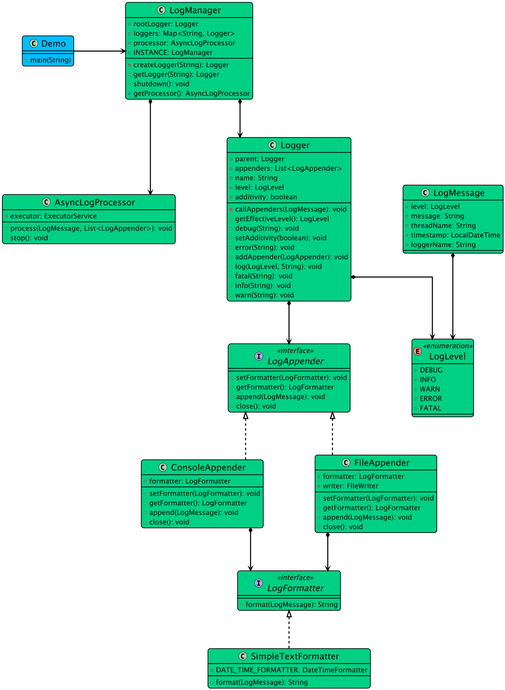

# Low-level design problem: logging framework

> Copied from <https://github.com/ashishps1/awesome-low-level-design/blob/main/problems/logging-framework.md> (GPL-3.0, by Ashish Pratap Singh). Questions and answers are the source's own; nothing was answered or rewritten here.


# Designing a Logging Framework

## Requirements
1. The logging framework should support different log levels, such as DEBUG, INFO, WARNING, ERROR, and FATAL.
2. It should allow logging messages with a timestamp, log level, and message content.
3. The framework should support multiple output destinations, such as console, file, and database.
4. It should provide a configuration mechanism to set the log level and output destination.
5. The logging framework should be thread-safe to handle concurrent logging from multiple threads.
6. It should be extensible to accommodate new log levels and output destinations in the future.

## UML Class Diagram



## Implementations
#### [Java Implementation](https://github.com/ashishps1/awesome-low-level-design/blob/main/solutions/java/src/loggingframework) 
#### [Python Implementation](https://github.com/ashishps1/awesome-low-level-design/blob/main/solutions/python/loggingframework)
#### [C++ Implementation](https://github.com/ashishps1/awesome-low-level-design/blob/main/solutions/cpp/loggingframework)
#### [C# Implementation](https://github.com/ashishps1/awesome-low-level-design/blob/main/solutions/csharp/loggingframework)
#### [Go Implementation](https://github.com/ashishps1/awesome-low-level-design/blob/main/solutions/golang/loggingframework)
#### [TypeScript Implementation](https://github.com/ashishps1/awesome-low-level-design/blob/main/solutions/typescript/src/LoggingFramework)

## Classes, Interfaces and Enumerations
1. The **LogLevel** enum defines the different log levels supported by the logging framework.
2. The **LogMessage** class represents a log message with a timestamp, log level, and message content.
3. The **LogAppender** interface defines the contract for appending log messages to different output destinations.
4. The **ConsoleAppender**, **FileAppender**, and **DatabaseAppender** classes are concrete implementations of the LogAppender interface, supporting logging to the console, file, and database, respectively.
5. The **LoggerConfig** class holds the configuration settings for the logger, including the log level and the selected log appender.
6. The **Logger** class is a singleton that provides the main logging functionality. It allows setting the configuration, logging messages at different levels, and provides convenience methods for each log level.
7. The **LoggingExample** class demonstrates the usage of the logging framework, showcasing different log levels, changing the configuration, and logging from multiple threads.

---

## Official solutions from the repository

<details><summary><b>java</b> (12 files)</summary>


**AsyncLogProcessor.java**

```java
package loggingframework;

import loggingframework.entities.LogMessage;
import loggingframework.strategies.appender.LogAppender;

import java.util.List;
import java.util.concurrent.*;

class AsyncLogProcessor {
    private final ExecutorService executor;

    public AsyncLogProcessor() {
        this.executor = Executors.newSingleThreadExecutor(runnable -> {
            Thread thread = new Thread(runnable, "AsyncLogProcessor");
            thread.setDaemon(true); // Don't prevent JVM exit
            return thread;
        });
    }

    public void process(LogMessage logMessage, List<LogAppender> appenders) {
        if (executor.isShutdown()) {
            System.err.println("Logger is shut down. Cannot process log message.");
            return;
        }

        // Submit a new task to the executor.
        executor.submit(() -> {
            for (LogAppender appender : appenders) {
                appender.append(logMessage);
            }
        });
    }

    public void stop() {
        // Disable new tasks from being submitted
        executor.shutdown();
        try {
            if (!executor.awaitTermination(2, TimeUnit.SECONDS)) {
                System.err.println("Logger executor did not terminate in the specified time.");
                // Forcibly shut down any still-running tasks.
                executor.shutdownNow();
            }
        } catch (InterruptedException e) {
            executor.shutdownNow();
            // Preserve interrupt status
            Thread.currentThread().interrupt();
        }
    }
}
```


**LogManager.java**

```java
package loggingframework;

import loggingframework.strategies.appender.LogAppender;

import java.util.Map;
import java.util.concurrent.ConcurrentHashMap;

public class LogManager {
    private static final LogManager INSTANCE = new LogManager();
    private final Map<String, Logger> loggers = new ConcurrentHashMap<>();
    private final Logger rootLogger;
    private final AsyncLogProcessor processor;

    private LogManager() {
        this.rootLogger = new Logger("root", null);
        this.loggers.put("root", rootLogger);
        this.processor = new AsyncLogProcessor();
    }

    public static LogManager getInstance() {
        return INSTANCE;
    }

    public Logger getLogger(String name) {
        return loggers.computeIfAbsent(name, this::createLogger);
    }

    private Logger createLogger(String name) {
        if (name.equals("root")) {
            return rootLogger;
        }
        int lastDot = name.lastIndexOf('.');
        String parentName = (lastDot == -1) ? "root" : name.substring(0, lastDot);
        Logger parent = getLogger(parentName);
        return new Logger(name, parent);
    }

    public Logger getRootLogger() {
        return rootLogger;
    }

    AsyncLogProcessor getProcessor() {
        return processor;
    }

    public void shutdown() {
        // Stop the processor first to ensure all logs are written.
        processor.stop();

        // Then, close all appenders.
        loggers.values().stream()
                .flatMap(logger -> logger.getAppenders().stream())
                .distinct()
                .forEach(LogAppender::close);
        System.out.println("Logging framework shut down gracefully.");
    }
}
```


**Logger.java**

```java
package loggingframework;

import loggingframework.entities.LogMessage;
import loggingframework.enums.LogLevel;
import loggingframework.strategies.appender.LogAppender;
import java.util.List;
import java.util.concurrent.CopyOnWriteArrayList;

public class Logger {
    private final String name;
    private LogLevel level;
    private final Logger parent;
    private final List<LogAppender> appenders;
    private boolean additivity = true;

    Logger(String name, Logger parent) {
        this.name = name;
        this.parent = parent;
        this.appenders = new CopyOnWriteArrayList<>();
    }

    public void addAppender(LogAppender appender) {
        appenders.add(appender);
    }

    public List<LogAppender> getAppenders() {
        return appenders;
    }

    public void setLevel(LogLevel minLevel) {
        this.level = minLevel;
    }

    public void setAdditivity(boolean additivity) {
        this.additivity = additivity;
    }

    public LogLevel getEffectiveLevel() {
        for (Logger logger = this; logger != null; logger = logger.parent) {
            LogLevel currentLevel = logger.level;
            if (currentLevel != null) {
                return currentLevel;
            }
        }
        return LogLevel.DEBUG; // Default root level
    }

    public void log(LogLevel messageLevel, String message) {
        if (messageLevel.isGreaterOrEqual(getEffectiveLevel())) {
            LogMessage logMessage = new LogMessage(messageLevel, this.name, message);
            callAppenders(logMessage);
        }
    }

    private void callAppenders(LogMessage logMessage) {
        if (!appenders.isEmpty()) {
            LogManager.getInstance().getProcessor().process(logMessage, this.appenders);
        }
        if (additivity && parent != null) {
            parent.callAppenders(logMessage);
        }
    }

    public void debug(String message) {
        log(LogLevel.DEBUG, message);
    }
    public void info(String message) {
        log(LogLevel.INFO, message);
    }
    public void warn(String message) {
        log(LogLevel.WARN, message);
    }
    public void error(String message) {
        log(LogLevel.ERROR, message);
    }
    public void fatal(String message) {
        log(LogLevel.FATAL, message);
    }
}
```


**LoggingFrameworkDemo.java**

```java
package loggingframework;

import loggingframework.enums.LogLevel;
import loggingframework.strategies.appender.ConsoleAppender;

public class LoggingFrameworkDemo {
    public static void main(String[] args) {
        // --- 1. Initial Configuration ---
        LogManager logManager = LogManager.getInstance();
        Logger rootLogger = logManager.getRootLogger();
        rootLogger.setLevel(LogLevel.INFO); // Set global minimum level to INFO

        // Add a console appender to the root logger
        rootLogger.addAppender(new ConsoleAppender());

        System.out.println("--- Initial Logging Demo ---");
        Logger mainLogger = logManager.getLogger("com.example.Main");
        mainLogger.info("Application starting up.");
        mainLogger.debug("This is a debug message, it should NOT appear."); // Below root level
        mainLogger.warn("This is a warning message.");

        // --- 2. Hierarchy and Additivity Demo ---
        System.out.println("\n--- Logger Hierarchy Demo ---");
        Logger dbLogger = logManager.getLogger("com.example.db");
        // dbLogger inherits level and appenders from root
        dbLogger.info("Database connection pool initializing.");

        // Let's create a more specific logger and override its level
        Logger serviceLogger = logManager.getLogger("com.example.service.UserService");
        serviceLogger.setLevel(LogLevel.DEBUG); // More verbose logging for this specific service
        serviceLogger.info("User service starting.");
        serviceLogger.debug("This debug message SHOULD now appear for the service logger.");

        // --- 3. Dynamic Configuration Change ---
        System.out.println("\n--- Dynamic Configuration Demo ---");
        System.out.println("Changing root log level to DEBUG...");
        rootLogger.setLevel(LogLevel.DEBUG);
        mainLogger.debug("This debug message should now be visible.");

        try {
            Thread.sleep(500);
            logManager.shutdown();
        } catch (Exception e) {
            System.out.println("Caught exception");
        }
    }
}
```


**README.md**

```md
# Logging Framework (LLD)

## Problem Statement

Design and implement a flexible and extensible logging framework that can be used by applications to log messages at different levels (INFO, DEBUG, ERROR, etc.), support multiple output destinations (console, file, etc.), and allow for custom formatting of log messages.

---

## Requirements

- **Log Levels:** Support for multiple log levels (INFO, DEBUG, ERROR, etc.).
- **Multiple Appenders:** Ability to log to different destinations (console, file, etc.).
- **Custom Formatting:** Support for custom log message formatting.
- **Configuration:** Ability to configure loggers and appenders.
- **Thread Safety:** Should be thread-safe for concurrent logging.
- **Extensibility:** Easy to add new log levels, appenders, or formatters.

---

## Core Entities

- **Logger:** Main class used by clients to log messages.
- **LogLevel:** Enum representing different log levels.
- **LogMessage:** Encapsulates the details of a log event.
- **LogFormatter:** Interface for formatting log messages.
- **DefaultFormatter:** Default implementation of `LogFormatter`.
- **LoggerConfig:** Holds configuration for the logger (appenders, formatters, etc.).
- **LogAppender (in `logappender/`):** Interface and implementations for output destinations (e.g., ConsoleAppender, FileAppender).

---

## Class Design

## UML Class Diagram


### 1. Logger
- **Methods:**
  - `log(LogLevel level, String message)`
  - `info(String message)`
  - `debug(String message)`
  - `error(String message)`
  - `setConfig(LoggerConfig config)`

### 2. LogLevel
- Enum for log levels (INFO, DEBUG, ERROR, etc.)

### 3. LogMessage
- Fields: `level`, `message`, `timestamp`, etc.

### 4. LogFormatter (Interface)
- `String format(LogMessage message)`

### 5. DefaultFormatter
- Implements `LogFormatter` with a default format.

### 6. LoggerConfig
- Holds configuration for loggers (appenders, formatters, log level).

### 7. LogAppender (in `logappender/`)
- Interface for appenders.
- Implementations: `ConsoleAppender`, `FileAppender`, etc.

---

## Design Patterns Used

- **Strategy Pattern:** For interchangeable log formatters and appenders.
- **Singleton Pattern:** (If used) For global logger instance.
- **Factory Pattern:** (Optional) For creating appenders/formatters based on config.
- **Observer Pattern:** (Conceptually, for notifying multiple appenders.)

---

## Example Usage

```java
Logger logger = new Logger();
logger.setConfig(new LoggerConfig(...));
logger.info("Application started");
logger.error("An error occurred");
```

---

## Demo

See `LoggingFrameworkDemo.java` for a sample usage of the logging framework.

---

## Extending the Framework

- **Add a new log level:** Update `LogLevel.java`.
- **Add a new appender:** Implement the `LogAppender` interface in `logappender/`.
- **Add a new formatter:** Implement the `LogFormatter` interface.

---
```


**entities/LogMessage.java**

```java
package loggingframework.entities;

import loggingframework.enums.LogLevel;

import java.time.LocalDateTime;

public final class LogMessage {
    private final LocalDateTime timestamp;
    private final LogLevel level;
    private final String loggerName;
    private final String threadName;
    private final String message;

    public LogMessage(LogLevel level, String loggerName, String message) {
        this.timestamp = LocalDateTime.now();
        this.level = level;
        this.loggerName = loggerName;
        this.message = message;
        this.threadName = Thread.currentThread().getName();
    }

    // Getters for all fields
    public LocalDateTime getTimestamp() { return timestamp; }
    public LogLevel getLevel() { return level; }
    public String getLoggerName() { return loggerName; }
    public String getThreadName() { return threadName; }
    public String getMessage() { return message; }
}
```


**enums/LogLevel.java**

```java
package loggingframework.enums;

public enum LogLevel {
    DEBUG(1), INFO(2), WARN(3), ERROR(4), FATAL(5);

    private final int level;

    LogLevel(int level) {
        this.level = level;
    }

    public boolean isGreaterOrEqual(LogLevel other) {
        return this.level >= other.level;
    }
}
```


**strategies/appender/ConsoleAppender.java**

```java
package loggingframework.strategies.appender;

import loggingframework.strategies.formatter.LogFormatter;
import loggingframework.entities.LogMessage;
import loggingframework.strategies.formatter.SimpleTextFormatter;

public class ConsoleAppender implements LogAppender {
    private LogFormatter formatter;

    public ConsoleAppender() {
        this.formatter = new SimpleTextFormatter();
    }

    @Override
    public void append(LogMessage logMessage) {
        System.out.println(formatter.format(logMessage));
    }

    @Override
    public void close() {}

    @Override
    public void setFormatter(LogFormatter formatter) {
        this.formatter = formatter;
    }

    @Override
    public LogFormatter getFormatter() {
        return formatter;
    }
}
```


**strategies/appender/FileAppender.java**

```java
package loggingframework.strategies.appender;

import loggingframework.strategies.formatter.LogFormatter;
import loggingframework.entities.LogMessage;
import loggingframework.strategies.formatter.SimpleTextFormatter;

import java.io.FileWriter;
import java.io.IOException;

public class FileAppender implements LogAppender {
    private FileWriter writer;
    private LogFormatter formatter;

    public FileAppender(String filePath) {
        this.formatter = new SimpleTextFormatter();
        try {
            this.writer = new FileWriter(filePath, true);
        } catch (Exception e) {
            System.out.println("Failed to create writer for file logs, exception: " + e.getMessage());
        }
    }

    @Override
    public synchronized void append(LogMessage logMessage) {
        try {
            writer.write(formatter.format(logMessage) + "\n");
            writer.flush();
        } catch (IOException e) {
            System.out.println("Failed to write logs to file, exception: " + e.getMessage());
        }
    }

    @Override
    public void close() {
        try {
            writer.close();
        } catch (IOException e) {
            System.out.println("Failed to close logs file, exception: " + e.getMessage());
        }
    }

    @Override
    public void setFormatter(LogFormatter formatter) {
        this.formatter = formatter;
    }

    @Override
    public LogFormatter getFormatter() {
        return formatter;
    }
}
```


**strategies/appender/LogAppender.java**

```java
package loggingframework.strategies.appender;

import loggingframework.entities.LogMessage;
import loggingframework.strategies.formatter.LogFormatter;

public interface LogAppender {
    void append(LogMessage logMessage);
    void close();
    LogFormatter getFormatter();
    void setFormatter(LogFormatter formatter);
}
```


**strategies/formatter/LogFormatter.java**

```java
package loggingframework.strategies.formatter;

import loggingframework.entities.LogMessage;

public interface LogFormatter {
    String format(LogMessage logMessage);
}
```


**strategies/formatter/SimpleTextFormatter.java**

```java
package loggingframework.strategies.formatter;

import loggingframework.entities.LogMessage;

import java.time.format.DateTimeFormatter;

public class SimpleTextFormatter implements LogFormatter {
    private static final DateTimeFormatter DATE_TIME_FORMATTER =
            DateTimeFormatter.ofPattern("yyyy-MM-dd HH:mm:ss.SSS");

    @Override
    public String format(LogMessage logMessage) {
        return String.format("%s [%s] %s - %s: %s\n",
                logMessage.getTimestamp().format(DATE_TIME_FORMATTER),
                logMessage.getThreadName(),
                logMessage.getLevel(),
                logMessage.getLoggerName(),
                logMessage.getMessage());
    }
}
```

</details>

<details><summary><b>python</b> (9 files)</summary>


**README.md**

```md
# Designing a Logging Framework

## Requirements
1. The logging framework should support different log levels, such as DEBUG, INFO, WARNING, ERROR, and FATAL.
2. It should allow logging messages with a timestamp, log level, and message content.
3. The framework should support multiple output destinations, such as console, file, and database.
4. It should provide a configuration mechanism to set the log level and output destination.
5. The logging framework should be thread-safe to handle concurrent logging from multiple threads.
6. It should be extensible to accommodate new log levels and output destinations in the future.

## Classes, Interfaces and Enumerations
1. The **LogLevel** enum defines the different log levels supported by the logging framework.
2. The **LogMessage** class represents a log message with a timestamp, log level, and message content.
3. The **LogAppender** interface defines the contract for appending log messages to different output destinations.
4. The **ConsoleAppender**, **FileAppender**, and **DatabaseAppender** classes are concrete implementations of the LogAppender interface, supporting logging to the console, file, and database, respectively.
5. The **LoggerConfig** class holds the configuration settings for the logger, including the log level and the selected log appender.
6. The **Logger** class is a singleton that provides the main logging functionality. It allows setting the configuration, logging messages at different levels, and provides convenience methods for each log level.
7. The **LoggingExample** class demonstrates the usage of the logging framework, showcasing different log levels, changing the configuration, and logging from multiple threads.
```


**async_log_processor.py**

```py
from log_message import LogMessage
from log_appender import LogAppender
from typing import List
from concurrent.futures import ThreadPoolExecutor
import sys

class AsyncLogProcessor:
    def __init__(self):
        self.executor = ThreadPoolExecutor(max_workers=1, thread_name_prefix="AsyncLogProcessor")
        self.shutdown_flag = False

    def process(self, log_message: LogMessage, appenders: List[LogAppender]):
        if self.shutdown_flag:
            print("Logger is shut down. Cannot process log message.", file=sys.stderr)
            return

        def process_task():
            for appender in appenders:
                appender.append(log_message)

        self.executor.submit(process_task)

    def stop(self):
        self.shutdown_flag = True
        self.executor.shutdown(wait=True, timeout=2)
        if not self.executor._shutdown:
            print("Logger executor did not terminate in the specified time.", file=sys.stderr)
```


**log_appender.py**

```py
import threading
from abc import ABC, abstractmethod
from log_formatter import LogFormatter
from log_message import LogMessage
from log_formatter import SimpleTextFormatter

class LogAppender(ABC):
    @abstractmethod
    def append(self, log_message: LogMessage):
        pass

    @abstractmethod
    def close(self):
        pass

    @abstractmethod
    def get_formatter(self) -> LogFormatter:
        pass

    @abstractmethod
    def set_formatter(self, formatter: LogFormatter):
        pass

class ConsoleAppender(LogAppender):
    def __init__(self):
        self.formatter = SimpleTextFormatter()

    def append(self, log_message: LogMessage):
        print(self.formatter.format(log_message), end='')

    def close(self):
        pass

    def set_formatter(self, formatter: LogFormatter):
        self.formatter = formatter

    def get_formatter(self) -> LogFormatter:
        return self.formatter

class FileAppender(LogAppender):
    def __init__(self, file_path: str):
        self.formatter = SimpleTextFormatter()
        self._lock = threading.Lock()
        try:
            self.writer = open(file_path, 'a')
        except Exception as e:
            print(f"Failed to create writer for file logs, exception: {e}")
            self.writer = None

    def append(self, log_message: LogMessage):
        with self._lock:
            if self.writer:
                try:
                    self.writer.write(self.formatter.format(log_message) + "\n")
                    self.writer.flush()
                except Exception as e:
                    print(f"Failed to write logs to file, exception: {e}")

    def close(self):
        if self.writer:
            try:
                self.writer.close()
            except Exception as e:
                print(f"Failed to close logs file, exception: {e}")

    def set_formatter(self, formatter: LogFormatter):
        self.formatter = formatter

    def get_formatter(self) -> LogFormatter:
        return self.formatter
```


**log_formatter.py**

```py
from abc import ABC, abstractmethod
from log_message import LogMessage

class LogFormatter(ABC):
    @abstractmethod
    def format(self, log_message: LogMessage) -> str:
        pass

class SimpleTextFormatter(LogFormatter):
    def format(self, log_message: LogMessage) -> str:
        timestamp_str = log_message.get_timestamp().strftime("%Y-%m-%d %H:%M:%S.%f")[:-3]
        return f"{timestamp_str} [{log_message.get_thread_name()}] {log_message.get_level().name} - {log_message.get_logger_name()}: {log_message.get_message()}\n"
```


**log_level.py**

```py
from enum import Enum

class LogLevel(Enum):
    DEBUG = 1
    INFO = 2
    WARN = 3
    ERROR = 4
    FATAL = 5

    def is_greater_or_equal(self, other: 'LogLevel') -> bool:
        return self.value >= other.value
```


**log_manager.py**

```py
import threading
from typing import Dict
from log_message import LogMessage
from log_appender import LogAppender
from async_log_processor import AsyncLogProcessor
from log_formatter import LogFormatter
from log_appender import ConsoleAppender, FileAppender
from logger import Logger

class LogManager:
    _instance = None
    _lock = threading.Lock()

    def __init__(self):
        if LogManager._instance is not None:
            raise Exception("This class is a singleton!")
        self.loggers: Dict[str, 'Logger'] = {}
        self.root_logger = Logger("root", None)
        self.loggers["root"] = self.root_logger
        self.processor = AsyncLogProcessor()

    @staticmethod
    def get_instance():
        if LogManager._instance is None:
            with LogManager._lock:
                if LogManager._instance is None:
                    LogManager._instance = LogManager()
        return LogManager._instance

    def get_logger(self, name: str) -> 'Logger':
        if name not in self.loggers:
            self.loggers[name] = self._create_logger(name)
        return self.loggers[name]

    def _create_logger(self, name: str) -> 'Logger':
        if name == "root":
            return self.root_logger
        
        last_dot = name.rfind('.')
        parent_name = "root" if last_dot == -1 else name[:last_dot]
        parent = self.get_logger(parent_name)
        return Logger(name, parent)

    def get_root_logger(self) -> 'Logger':
        return self.root_logger

    def get_processor(self) -> AsyncLogProcessor:
        return self.processor

    def shutdown(self):
        # Stop the processor first to ensure all logs are written
        self.processor.stop()

        # Then, close all appenders
        all_appenders = set()
        for logger in self.loggers.values():
            for appender in logger.get_appenders():
                all_appenders.add(appender)
        
        for appender in all_appenders:
            appender.close()
        
        print("Logging framework shut down gracefully.")
```


**log_message.py**

```py
import threading
from datetime import datetime
from log_level import LogLevel

class LogMessage:
    def __init__(self, level: LogLevel, logger_name: str, message: str):
        self.timestamp = datetime.now()
        self.level = level
        self.logger_name = logger_name
        self.message = message
        self.thread_name = threading.current_thread().name

    def get_timestamp(self) -> datetime:
        return self.timestamp

    def get_level(self) -> LogLevel:
        return self.level

    def get_logger_name(self) -> str:
        return self.logger_name

    def get_thread_name(self) -> str:
        return self.thread_name

    def get_message(self) -> str:
        return self.message
```


**logger.py**

```py
from log_level import LogLevel
from log_message import LogMessage
from log_appender import LogAppender
from typing import List, Optional
from typing import TYPE_CHECKING

if TYPE_CHECKING:
    from log_manager import LogManager

class Logger:
    def __init__(self, name: str, parent: Optional['Logger']):
        self.name = name
        self.level: Optional[LogLevel] = None
        self.parent = parent
        self.appenders: List[LogAppender] = []
        self.additivity = True

    def add_appender(self, appender: LogAppender):
        self.appenders.append(appender)

    def get_appenders(self) -> List[LogAppender]:
        return self.appenders

    def set_level(self, min_level: LogLevel):
        self.level = min_level

    def set_additivity(self, additivity: bool):
        self.additivity = additivity

    def get_effective_level(self) -> LogLevel:
        logger = self
        while logger is not None:
            current_level = logger.level
            if current_level is not None:
                return current_level
            logger = logger.parent
        return LogLevel.DEBUG  # Default root level

    def log(self, message_level: LogLevel, message: str):
        if message_level.is_greater_or_equal(self.get_effective_level()):
            log_message = LogMessage(message_level, self.name, message)
            self._call_appenders(log_message)

    def _call_appenders(self, log_message: LogMessage):
        if self.appenders:
            from log_manager import LogManager
            LogManager.get_instance().get_processor().process(log_message, self.appenders)
        
        if self.additivity and self.parent is not None:
            self.parent._call_appenders(log_message)

    def debug(self, message: str):
        self.log(LogLevel.DEBUG, message)

    def info(self, message: str):
        self.log(LogLevel.INFO, message)

    def warn(self, message: str):
        self.log(LogLevel.WARN, message)

    def error(self, message: str):
        self.log(LogLevel.ERROR, message)

    def fatal(self, message: str):
        self.log(LogLevel.FATAL, message)
```


**logging_framework_demo.py**

```py
from log_manager import LogManager
from log_level import LogLevel
from log_appender import ConsoleAppender
import time

class LoggingFrameworkDemo:
    @staticmethod
    def main():
        # --- 1. Initial Configuration ---
        log_manager = LogManager.get_instance()
        root_logger = log_manager.get_root_logger()
        root_logger.set_level(LogLevel.INFO)  # Set global minimum level to INFO

        # Add a console appender to the root logger
        root_logger.add_appender(ConsoleAppender())

        print("--- Initial Logging Demo ---")
        main_logger = log_manager.get_logger("com.example.Main")
        main_logger.info("Application starting up.")
        main_logger.debug("This is a debug message, it should NOT appear.")  # Below root level
        main_logger.warn("This is a warning message.")

        # --- 2. Hierarchy and Additivity Demo ---
        print("\n--- Logger Hierarchy Demo ---")
        db_logger = log_manager.get_logger("com.example.db")
        # db_logger inherits level and appenders from root
        db_logger.info("Database connection pool initializing.")

        # Let's create a more specific logger and override its level
        service_logger = log_manager.get_logger("com.example.service.UserService")
        service_logger.set_level(LogLevel.DEBUG)  # More verbose logging for this specific service
        service_logger.info("User service starting.")
        service_logger.debug("This debug message SHOULD now appear for the service logger.")

        # --- 3. Dynamic Configuration Change ---
        print("\n--- Dynamic Configuration Demo ---")
        print("Changing root log level to DEBUG...")
        root_logger.set_level(LogLevel.DEBUG)
        main_logger.debug("This debug message should now be visible.")

        try:
            time.sleep(0.5)
            log_manager.shutdown()
        except Exception as e:
            print("Caught exception")

if __name__ == "__main__":
    LoggingFrameworkDemo.main()
```

</details>

<details><summary><b>cpp</b> (12 files)</summary>


**ConsoleAppender.cpp**

```cpp
#include "ConsoleAppender.hpp"
#include <iostream>

void ConsoleAppender::append(const LogMessage& message) {
    std::cout << message.getFormattedMessage() << std::endl;
}
```


**ConsoleAppender.hpp**

```hpp
#ifndef CONSOLE_APPENDER_HPP
#define CONSOLE_APPENDER_HPP

#include "LogAppender.hpp"

class ConsoleAppender : public LogAppender {
public:
    void append(const LogMessage& message) override;
};

#endif
```


**FileAppender.cpp**

```cpp
#include "FileAppender.hpp"

FileAppender::FileAppender(const std::string& filename) 
    : filename(filename) {
    file.open(filename, std::ios::app);
}

FileAppender::~FileAppender() {
    if (file.is_open()) {
        file.close();
    }
}

void FileAppender::append(const LogMessage& message) {
    if (file.is_open()) {
        file << message.getFormattedMessage() << std::endl;
    }
}
```


**FileAppender.hpp**

```hpp
#ifndef FILE_APPENDER_HPP
#define FILE_APPENDER_HPP

#include <string>
#include <fstream>
#include "LogAppender.hpp"

class FileAppender : public LogAppender {
private:
    std::string filename;
    std::ofstream file;

public:
    FileAppender(const std::string& filename);
    ~FileAppender();
    void append(const LogMessage& message) override;
};

#endif
```


**LogAppender.hpp**

```hpp
#ifndef LOG_APPENDER_HPP
#define LOG_APPENDER_HPP

#include "LogMessage.hpp"

class LogAppender {
public:
    virtual ~LogAppender() = default;
    virtual void append(const LogMessage& message) = 0;
};

#endif
```


**LogLevel.hpp**

```hpp
#ifndef LOG_LEVEL_HPP
#define LOG_LEVEL_HPP

enum class LogLevel {
    TRACE,
    DEBUG,
    INFO,
    WARN,
    ERROR,
    FATAL
};

// Helper function to convert LogLevel to string
inline std::string logLevelToString(LogLevel level) {
    switch (level) {
        case LogLevel::TRACE: return "TRACE";
        case LogLevel::DEBUG: return "DEBUG";
        case LogLevel::INFO: return "INFO";
        case LogLevel::WARN: return "WARN";
        case LogLevel::ERROR: return "ERROR";
        case LogLevel::FATAL: return "FATAL";
        default: return "UNKNOWN";
    }
}

#endif
```


**LogMessage.cpp**

```cpp
#include "LogMessage.hpp"
#include <sstream>
#include <iomanip>

LogMessage::LogMessage(LogLevel level, const std::string& message, 
                      const std::string& source)
    : level(level), message(message), source(source) {
    // Get current timestamp
    auto now = std::time(nullptr);
    auto tm = *std::localtime(&now);
    std::ostringstream oss;
    oss << std::put_time(&tm, "%Y-%m-%d %H:%M:%S");
    timestamp = oss.str();
}

LogLevel LogMessage::getLevel() const { return level; }
std::string LogMessage::getMessage() const { return message; }
std::string LogMessage::getTimestamp() const { return timestamp; }
std::string LogMessage::getSource() const { return source; }

std::string LogMessage::getFormattedMessage() const {
    std::ostringstream oss;
    oss << "[" << timestamp << "] "
        << "[" << logLevelToString(level) << "] "
        << "[" << source << "] "
        << message;
    return oss.str();
}
```


**LogMessage.hpp**

```hpp
#ifndef LOG_MESSAGE_HPP
#define LOG_MESSAGE_HPP

#include <string>
#include <ctime>
#include "LogLevel.hpp"

class LogMessage {
private:
    LogLevel level;
    std::string message;
    std::string timestamp;
    std::string source;

public:
    LogMessage(LogLevel level, const std::string& message, 
               const std::string& source);
    
    LogLevel getLevel() const;
    std::string getMessage() const;
    std::string getTimestamp() const;
    std::string getSource() const;
    std::string getFormattedMessage() const;
};

#endif
```


**Logger.cpp**

```cpp
#include "Logger.hpp"

Logger::Logger(const std::string& name, LogLevel minLevel)
    : name(name), minLevel(minLevel) {}

void Logger::addAppender(std::shared_ptr<LogAppender> appender) {
    appenders.push_back(appender);
}

void Logger::setMinLevel(LogLevel level) {
    minLevel = level;
}

bool Logger::isLevelEnabled(LogLevel level) const {
    return static_cast<int>(level) >= static_cast<int>(minLevel);
}

void Logger::log(LogLevel level, const std::string& message) {
    if (!isLevelEnabled(level)) return;
    
    LogMessage logMessage(level, message, name);
    for (const auto& appender : appenders) {
        appender->append(logMessage);
    }
}

void Logger::trace(const std::string& message) {
    log(LogLevel::TRACE, message);
}

void Logger::debug(const std::string& message) {
    log(LogLevel::DEBUG, message);
}

void Logger::info(const std::string& message) {
    log(LogLevel::INFO, message);
}

void Logger::warn(const std::string& message) {
    log(LogLevel::WARN, message);
}

void Logger::error(const std::string& message) {
    log(LogLevel::ERROR, message);
}

void Logger::fatal(const std::string& message) {
    log(LogLevel::FATAL, message);
}
```


**Logger.hpp**

```hpp
#ifndef LOGGER_HPP
#define LOGGER_HPP

#include <string>
#include <vector>
#include <memory>
#include "LogLevel.hpp"
#include "LogMessage.hpp"
#include "LogAppender.hpp"

class Logger {
private:
    std::string name;
    LogLevel minLevel;
    std::vector<std::shared_ptr<LogAppender>> appenders;

public:
    Logger(const std::string& name, LogLevel minLevel = LogLevel::INFO);
    
    void addAppender(std::shared_ptr<LogAppender> appender);
    void setMinLevel(LogLevel level);
    
    void log(LogLevel level, const std::string& message);
    void trace(const std::string& message);
    void debug(const std::string& message);
    void info(const std::string& message);
    void warn(const std::string& message);
    void error(const std::string& message);
    void fatal(const std::string& message);

private:
    bool isLevelEnabled(LogLevel level) const;
};

#endif
```


**LoggingDemo.cpp**

```cpp
#include "Logger.hpp"
#include "ConsoleAppender.hpp"
#include "FileAppender.hpp"
#include <memory>

int main() {
    // Create logger
    Logger logger("MyApp");
    
    // Add console appender
    auto consoleAppender = std::make_shared<ConsoleAppender>();
    logger.addAppender(consoleAppender);
    
    // Add file appender
    auto fileAppender = std::make_shared<FileAppender>("app.log");
    logger.addAppender(fileAppender);
    
    // Log messages at different levels
    logger.trace("This is a trace message");  // Won't be logged (below INFO)
    logger.debug("This is a debug message");  // Won't be logged (below INFO)
    logger.info("Application started");
    logger.warn("This is a warning message");
    logger.error("An error occurred");
    logger.fatal("Fatal error: application shutting down");
    
    // Change minimum log level
    logger.setMinLevel(LogLevel::DEBUG);
    logger.debug("Now debug messages will be logged");
    
    return 0;
}
```


**README.md**

```md
# Designing a Logging Framework

## Requirements
1. The logging framework should support different log levels, such as DEBUG, INFO, WARNING, ERROR, and FATAL.
2. It should allow logging messages with a timestamp, log level, and message content.
3. The framework should support multiple output destinations, such as console, file, and database.
4. It should provide a configuration mechanism to set the log level and output destination.
5. The logging framework should be thread-safe to handle concurrent logging from multiple threads.
6. It should be extensible to accommodate new log levels and output destinations in the future.

## Classes, Interfaces and Enumerations
1. The **LogLevel** enum defines the different log levels supported by the logging framework.
2. The **LogMessage** class represents a log message with a timestamp, log level, and message content.
3. The **LogAppender** interface defines the contract for appending log messages to different output destinations.
4. The **ConsoleAppender**, **FileAppender**, and **DatabaseAppender** classes are concrete implementations of the LogAppender interface, supporting logging to the console, file, and database, respectively.
5. The **LoggerConfig** class holds the configuration settings for the logger, including the log level and the selected log appender.
6. The **Logger** class is a singleton that provides the main logging functionality. It allows setting the configuration, logging messages at different levels, and provides convenience methods for each log level.
7. The **LoggingExample** class demonstrates the usage of the logging framework, showcasing different log levels, changing the configuration, and logging from multiple threads.
```

</details>

<details><summary><b>golang</b> (10 files)</summary>


**README.md**

```md
# Designing a Logging Framework

## Requirements
1. The logging framework should support different log levels, such as DEBUG, INFO, WARNING, ERROR, and FATAL.
2. It should allow logging messages with a timestamp, log level, and message content.
3. The framework should support multiple output destinations, such as console, file, and database.
4. It should provide a configuration mechanism to set the log level and output destination.
5. The logging framework should be thread-safe to handle concurrent logging from multiple threads.
6. It should be extensible to accommodate new log levels and output destinations in the future.

## Classes, Interfaces and Enumerations
1. The **LogLevel** enum defines the different log levels supported by the logging framework.
2. The **LogMessage** class represents a log message with a timestamp, log level, and message content.
3. The **LogAppender** interface defines the contract for appending log messages to different output destinations.
4. The **ConsoleAppender**, **FileAppender**, and **DatabaseAppender** classes are concrete implementations of the LogAppender interface, supporting logging to the console, file, and database, respectively.
5. The **LoggerConfig** class holds the configuration settings for the logger, including the log level and the selected log appender.
6. The **Logger** class is a singleton that provides the main logging functionality. It allows setting the configuration, logging messages at different levels, and provides convenience methods for each log level.
7. The **LoggingExample** class demonstrates the usage of the logging framework, showcasing different log levels, changing the configuration, and logging from multiple threads.
```


**console_appender.go**

```go
package loggingframework

import "fmt"

type ConsoleAppender struct{}

func NewConsoleAppender() *ConsoleAppender {
	return &ConsoleAppender{}
}

func (a *ConsoleAppender) Append(message *LogMessage) error {
	fmt.Println(message.String())
	return nil
}
```


**database_appender.go**

```go
package loggingframework

import (
	"database/sql"
	"fmt"
)

type DatabaseAppender struct {
	db *sql.DB
}

func NewDatabaseAppender(jdbcURL, username, password string) (*DatabaseAppender, error) {
	db, err := sql.Open("mysql", fmt.Sprintf("%s:%s@%s", username, password, jdbcURL))
	if err != nil {
		return nil, err
	}

	return &DatabaseAppender{
		db: db,
	}, nil
}

func (a *DatabaseAppender) Append(message *LogMessage) error {
	stmt, err := a.db.Prepare("INSERT INTO logs (level, message, timestamp) VALUES (?, ?, ?)")
	if err != nil {
		return err
	}
	defer stmt.Close()

	_, err = stmt.Exec(message.Level.String(), message.Message, message.Timestamp)
	return err
}
```


**file_appender.go**

```go
package loggingframework

import (
	"os"
)

type FileAppender struct {
	filePath string
}

func NewFileAppender(filePath string) *FileAppender {
	return &FileAppender{
		filePath: filePath,
	}
}

func (a *FileAppender) Append(message *LogMessage) error {
	f, err := os.OpenFile(a.filePath, os.O_APPEND|os.O_CREATE|os.O_WRONLY, 0644)
	if err != nil {
		return err
	}
	defer f.Close()

	_, err = f.WriteString(message.String() + "\n")
	return err
}
```


**log_appender.go**

```go
package loggingframework

type LogAppender interface {
	Append(message *LogMessage) error
}
```


**log_level.go**

```go
package loggingframework

type LogLevel int

const (
	LogLevelDebug LogLevel = iota
	LogLevelInfo
	LogLevelWarning
	LogLevelError
	LogLevelFatal
)

func (l LogLevel) String() string {
	return [...]string{"DEBUG", "INFO", "WARNING", "ERROR", "FATAL"}[l]
}
```


**log_message.go**

```go
package loggingframework

import (
	"fmt"
	"time"
)

type LogMessage struct {
	Level     LogLevel
	Message   string
	Timestamp int64
}

func NewLogMessage(level LogLevel, message string) *LogMessage {
	return &LogMessage{
		Level:     level,
		Message:   message,
		Timestamp: time.Now().UnixMilli(),
	}
}

func (m *LogMessage) String() string {
	return fmt.Sprintf("[%s] %d - %s", m.Level, m.Timestamp, m.Message)
}
```


**logger.go**

```go
package loggingframework

import (
	"sync"
)

type Logger struct {
	config *LoggerConfig
	mu     sync.RWMutex
}

var (
	instance *Logger
	once     sync.Once
)

func GetLogger() *Logger {
	once.Do(func() {
		instance = &Logger{
			config: NewLoggerConfig(LogLevelInfo, NewConsoleAppender()),
		}
	})
	return instance
}

func (l *Logger) SetConfig(config *LoggerConfig) {
	l.mu.Lock()
	defer l.mu.Unlock()
	l.config = config
}

func (l *Logger) log(level LogLevel, message string) error {
	l.mu.RLock()
	if level < l.config.Level {
		l.mu.RUnlock()
		return nil
	}
	appender := l.config.Appender
	l.mu.RUnlock()

	logMessage := NewLogMessage(level, message)
	return appender.Append(logMessage)
}

func (l *Logger) Debug(message string) error {
	return l.log(LogLevelDebug, message)
}

func (l *Logger) Info(message string) error {
	return l.log(LogLevelInfo, message)
}

func (l *Logger) Warning(message string) error {
	return l.log(LogLevelWarning, message)
}

func (l *Logger) Error(message string) error {
	return l.log(LogLevelError, message)
}

func (l *Logger) Fatal(message string) error {
	return l.log(LogLevelFatal, message)
}
```


**logger_config.go**

```go
package loggingframework

type LoggerConfig struct {
	Level    LogLevel
	Appender LogAppender
}

func NewLoggerConfig(level LogLevel, appender LogAppender) *LoggerConfig {
	return &LoggerConfig{
		Level:    level,
		Appender: appender,
	}
}
```


**logging_framework_demo.go**

```go
package loggingframework

import (
	"fmt"
)

func Run() {
	logger := GetLogger()

	// Logging with default configuration
	logger.Info("This is an information message")
	logger.Warning("This is a warning message")
	logger.Error("This is an error message")

	// Changing log level and appender
	fileAppender := NewFileAppender("app.log")
	config := NewLoggerConfig(LogLevelDebug, fileAppender)
	logger.SetConfig(config)

	if err := logger.Debug("This is a debug message"); err != nil {
		fmt.Printf("Error logging debug message: %v\n", err)
	}

	if err := logger.Info("This is an information message"); err != nil {
		fmt.Printf("Error logging info message: %v\n", err)
	}
}
```

</details>

<details><summary><b>csharp</b> (12 files)</summary>


**Appenders/ConsoleAppender.cs**

```cs
class ConsoleAppender : ILogAppender
{
    private ILogFormatter formatter;

    public ConsoleAppender()
    {
        this.formatter = new SimpleTextFormatter();
    }

    public void Append(LogMessage logMessage)
    {
        Console.Write(formatter.Format(logMessage));
    }

    public void Close() { }

    public void SetFormatter(ILogFormatter formatter)
    {
        this.formatter = formatter;
    }

    public ILogFormatter GetFormatter()
    {
        return formatter;
    }
}
```


**Appenders/FileAppender.cs**

```cs
class FileAppender : ILogAppender
{
    private StreamWriter writer;
    private ILogFormatter formatter;
    private readonly object fileLock = new object();

    public FileAppender(string filePath)
    {
        this.formatter = new SimpleTextFormatter();
        try
        {
            this.writer = new StreamWriter(filePath, true);
        }
        catch (Exception e)
        {
            Console.WriteLine($"Failed to create writer for file logs, exception: {e.Message}");
            this.writer = null;
        }
    }

    public void Append(LogMessage logMessage)
    {
        lock (fileLock)
        {
            if (writer != null)
            {
                try
                {
                    writer.Write(formatter.Format(logMessage) + "\n");
                    writer.Flush();
                }
                catch (Exception e)
                {
                    Console.WriteLine($"Failed to write logs to file, exception: {e.Message}");
                }
            }
        }
    }

    public void Close()
    {
        if (writer != null)
        {
            try
            {
                writer.Close();
            }
            catch (Exception e)
            {
                Console.WriteLine($"Failed to close logs file, exception: {e.Message}");
            }
        }
    }

    public void SetFormatter(ILogFormatter formatter)
    {
        this.formatter = formatter;
    }

    public ILogFormatter GetFormatter()
    {
        return formatter;
    }
}
```


**Appenders/ILogAppender.cs**

```cs
interface ILogAppender
{
    void Append(LogMessage logMessage);
    void Close();
    ILogFormatter GetFormatter();
    void SetFormatter(ILogFormatter formatter);
}
```


**AsyncLogProcessor.cs**

```cs
using System.Collections.Concurrent;

class AsyncLogProcessor
{
    private readonly ConcurrentQueue<Action> taskQueue = new ConcurrentQueue<Action>();
    private readonly AutoResetEvent signal = new AutoResetEvent(false);
    private volatile bool shutdownFlag = false;
    private readonly Thread workerThread;

    public AsyncLogProcessor()
    {
        workerThread = new Thread(WorkerLoop)
        {
            Name = "AsyncLogProcessor",
            IsBackground = true
        };
        workerThread.Start();
    }

    private void WorkerLoop()
    {
        while (!shutdownFlag)
        {
            signal.WaitOne();
            
            while (taskQueue.TryDequeue(out Action task))
            {
                try
                {
                    task();
                }
                catch (Exception e)
                {
                    Console.WriteLine($"Error processing log task: {e.Message}");
                }
            }
        }
    }

    public void Process(LogMessage logMessage, List<ILogAppender> appenders)
    {
        if (shutdownFlag)
        {
            Console.Error.WriteLine("Logger is shut down. Cannot process log message.");
            return;
        }

        taskQueue.Enqueue(() =>
        {
            foreach (var appender in appenders)
            {
                appender.Append(logMessage);
            }
        });
        signal.Set();
    }

    public void Stop()
    {
        shutdownFlag = true;
        signal.Set();
        
        if (!workerThread.Join(TimeSpan.FromSeconds(2)))
        {
            Console.Error.WriteLine("Logger executor did not terminate in the specified time.");
            workerThread.Abort();
        }
    }
}
```


**Enum/LogLevel.cs**

```cs
enum LogLevel
{
    DEBUG = 1,
    INFO = 2,
    WARN = 3,
    ERROR = 4,
    FATAL = 5
}

static class LogLevelExtensions
{
    public static bool IsGreaterOrEqual(this LogLevel level, LogLevel other)
    {
        return (int)level >= (int)other;
    }
}
```


**Formatters/ILogFormatter.cs**

```cs
interface ILogFormatter
{
    string Format(LogMessage logMessage);
}
```


**Formatters/SimpleTextFormatter.cs**

```cs
class SimpleTextFormatter : ILogFormatter
{
    public string Format(LogMessage logMessage)
    {
        return $"{logMessage.GetTimestamp():yyyy-MM-dd HH:mm:ss.fff} [{logMessage.GetThreadName()}] {logMessage.GetLevel()} - {logMessage.GetLoggerName()}: {logMessage.GetMessage()}\n";
    }
}
```


**LogManager.cs**

```cs
using System.Collections.Concurrent;

class LogManager
{
    private static volatile LogManager instance;
    private static readonly object lockObject = new object();
    private readonly ConcurrentDictionary<string, Logger> loggers = new ConcurrentDictionary<string, Logger>();
    private readonly Logger rootLogger;
    private readonly AsyncLogProcessor processor;

    private LogManager()
    {
        this.rootLogger = new Logger("root", null);
        this.loggers.TryAdd("root", rootLogger);
        this.processor = new AsyncLogProcessor();
    }

    public static LogManager GetInstance()
    {
        if (instance == null)
        {
            lock (lockObject)
            {
                if (instance == null)
                    instance = new LogManager();
            }
        }
        return instance;
    }

    public Logger GetLogger(string name)
    {
        return loggers.GetOrAdd(name, CreateLogger);
    }

    private Logger CreateLogger(string name)
    {
        if (name.Equals("root"))
        {
            return rootLogger;
        }
        int lastDot = name.LastIndexOf('.');
        string parentName = (lastDot == -1) ? "root" : name.Substring(0, lastDot);
        Logger parent = GetLogger(parentName);
        return new Logger(name, parent);
    }

    public Logger GetRootLogger()
    {
        return rootLogger;
    }

    public AsyncLogProcessor GetProcessor()
    {
        return processor;
    }

    public void Shutdown()
    {
        // Stop the processor first to ensure all logs are written
        processor.Stop();

        // Then, close all appenders
        var allAppenders = loggers.Values
            .SelectMany(logger => logger.GetAppenders())
            .Distinct()
            .ToList();

        foreach (var appender in allAppenders)
        {
            appender.Close();
        }

        Console.WriteLine("Logging framework shut down gracefully.");
    }
}
```


**Logger.cs**

```cs
class Logger
{
    private readonly string name;
    private LogLevel? level;
    private readonly Logger parent;
    private readonly List<ILogAppender> appenders;
    private bool additivity = true;

    public Logger(string name, Logger parent)
    {
        this.name = name;
        this.parent = parent;
        this.appenders = new List<ILogAppender>();
    }

    public void AddAppender(ILogAppender appender)
    {
        appenders.Add(appender);
    }

    public List<ILogAppender> GetAppenders()
    {
        return new List<ILogAppender>(appenders);
    }

    public void SetLevel(LogLevel minLevel)
    {
        this.level = minLevel;
    }

    public void SetAdditivity(bool additivity)
    {
        this.additivity = additivity;
    }

    public LogLevel GetEffectiveLevel()
    {
        for (Logger logger = this; logger != null; logger = logger.parent)
        {
            LogLevel? currentLevel = logger.level;
            if (currentLevel.HasValue)
            {
                return currentLevel.Value;
            }
        }
        return LogLevel.DEBUG; // Default root level
    }

    public void Log(LogLevel messageLevel, string message)
    {
        if (messageLevel.IsGreaterOrEqual(GetEffectiveLevel()))
        {
            LogMessage logMessage = new LogMessage(messageLevel, this.name, message);
            CallAppenders(logMessage);
        }
    }

    private void CallAppenders(LogMessage logMessage)
    {
        if (appenders.Count > 0)
        {
            LogManager.GetInstance().GetProcessor().Process(logMessage, this.appenders);
        }
        if (additivity && parent != null)
        {
            parent.CallAppenders(logMessage);
        }
    }

    public void Debug(string message)
    {
        Log(LogLevel.DEBUG, message);
    }

    public void Info(string message)
    {
        Log(LogLevel.INFO, message);
    }

    public void Warn(string message)
    {
        Log(LogLevel.WARN, message);
    }

    public void Error(string message)
    {
        Log(LogLevel.ERROR, message);
    }

    public void Fatal(string message)
    {
        Log(LogLevel.FATAL, message);
    }
}
```


**LoggingFrameworkDemo.cs**

```cs
using System;
using System.Collections.Generic;
using System.IO;
using System.Threading;
using System.Threading.Tasks;
using System.Linq;

public class LoggingFrameworkDemo
{
    public static void Main(string[] args)
    {
        // --- 1. Initial Configuration ---
        LogManager logManager = LogManager.GetInstance();
        Logger rootLogger = logManager.GetRootLogger();
        rootLogger.SetLevel(LogLevel.INFO); // Set global minimum level to INFO

        // Add a console appender to the root logger
        rootLogger.AddAppender(new ConsoleAppender());

        Console.WriteLine("--- Initial Logging Demo ---");
        Logger mainLogger = logManager.GetLogger("com.example.Main");
        mainLogger.Info("Application starting up.");
        mainLogger.Debug("This is a debug message, it should NOT appear."); // Below root level
        mainLogger.Warn("This is a warning message.");

        // --- 2. Hierarchy and Additivity Demo ---
        Console.WriteLine("\n--- Logger Hierarchy Demo ---");
        Logger dbLogger = logManager.GetLogger("com.example.db");
        // dbLogger inherits level and appenders from root
        dbLogger.Info("Database connection pool initializing.");

        // Let's create a more specific logger and override its level
        Logger serviceLogger = logManager.GetLogger("com.example.service.UserService");
        serviceLogger.SetLevel(LogLevel.DEBUG); // More verbose logging for this specific service
        serviceLogger.Info("User service starting.");
        serviceLogger.Debug("This debug message SHOULD now appear for the service logger.");

        // --- 3. Dynamic Configuration Change ---
        Console.WriteLine("\n--- Dynamic Configuration Demo ---");
        Console.WriteLine("Changing root log level to DEBUG...");
        rootLogger.SetLevel(LogLevel.DEBUG);
        mainLogger.Debug("This debug message should now be visible.");

        try
        {
            Thread.Sleep(500);
            logManager.Shutdown();
        }
        catch (Exception e)
        {
            Console.WriteLine("Caught exception");
        }
    }
}
```


**Models/LogMessage.cs**

```cs
class LogMessage
{
    private readonly DateTime timestamp;
    private readonly LogLevel level;
    private readonly string loggerName;
    private readonly string threadName;
    private readonly string message;

    public LogMessage(LogLevel level, string loggerName, string message)
    {
        this.timestamp = DateTime.Now;
        this.level = level;
        this.loggerName = loggerName;
        this.message = message;
        this.threadName = Thread.CurrentThread.Name ?? Thread.CurrentThread.ManagedThreadId.ToString();
    }

    public DateTime GetTimestamp() { return timestamp; }
    public LogLevel GetLevel() { return level; }
    public string GetLoggerName() { return loggerName; }
    public string GetThreadName() { return threadName; }
    public string GetMessage() { return message; }
}
```


**README.md**

```md
# Designing a Logging Framework

## Requirements
1. The logging framework should support different log levels, such as DEBUG, INFO, WARNING, ERROR, and FATAL.
2. It should allow logging messages with a timestamp, log level, and message content.
3. The framework should support multiple output destinations, such as console, file, and database.
4. It should provide a configuration mechanism to set the log level and output destination.
5. The logging framework should be thread-safe to handle concurrent logging from multiple threads.
6. It should be extensible to accommodate new log levels and output destinations in the future.

## Classes, Interfaces and Enumerations
1. The **LogLevel** enum defines the different log levels supported by the logging framework.
2. The **LogMessage** class represents a log message with a timestamp, log level, and message content.
3. The **LogAppender** interface defines the contract for appending log messages to different output destinations.
4. The **ConsoleAppender**, **FileAppender**, and **DatabaseAppender** classes are concrete implementations of the LogAppender interface, supporting logging to the console, file, and database, respectively.
5. The **LoggerConfig** class holds the configuration settings for the logger, including the log level and the selected log appender.
6. The **Logger** class is a singleton that provides the main logging functionality. It allows setting the configuration, logging messages at different levels, and provides convenience methods for each log level.
7. The **LoggingExample** class demonstrates the usage of the logging framework, showcasing different log levels, changing the configuration, and logging from multiple threads.
```

</details>

<details><summary><b>typescript</b> (11 files)</summary>


**Appender/ConsoleLogAppender.ts**

```ts
import LogFormatter from "../LogFormatter/LogFormatter";
import LogMessage from "../LogMessage";
import LogAppender from "./LogAppender";

export default class ConsoleLogAppender implements LogAppender {
  private formatter: LogFormatter;

  constructor(formatter: LogFormatter) {
    this.formatter = formatter;
  }

  append(logMessage: LogMessage) {
    console.log(this.formatter.format(logMessage));
  }
}
```


**Appender/FileLogAppender.ts**

```ts
import * as fs from "fs";
import * as path from "path";
import LogAppender from "./LogAppender";
import LogMessage from "../LogMessage";
import LogFormatter from "../LogFormatter/LogFormatter";

export default class FileLogAppender implements LogAppender {
  private writer!: fs.WriteStream;
  private formatter: LogFormatter;

  constructor(filePath: string, formatter: LogFormatter) {
    this.formatter = formatter;
    const dir = path.dirname(filePath);

    if (!fs.existsSync(dir)) {
      fs.mkdirSync(dir, { recursive: true });
    }

    try {
      this.writer = fs.createWriteStream(filePath, { flags: "a" });
    } catch (e) {
      console.error("Failed to create writer for file logs, exception:", e);
    }
  }

  public append(logMessage: LogMessage): void {
    try {
      const formattedMessage = this.formatter.format(logMessage);
      this.writer.write(formattedMessage + "\n");
    } catch (e) {
      console.error("Failed to write logs to file, exception:", e);
    }
  }
}
```


**Appender/LogAppender.ts**

```ts
import LogMessage from "../LogMessage";

export default interface LogAppender {
  append(logMessage: LogMessage): void;
}
```


**LogFormatter/LogFormatter.ts**

```ts
import LogMessage from "../LogMessage";

export default interface LogFormatter {
  format(message: LogMessage): string;
}
```


**LogFormatter/SimpleLogFormatter.ts**

```ts
import LogMessage from "../LogMessage";
import LogFormatter from "./LogFormatter";

export default class SimpleLogFormatter implements LogFormatter {
  format(message: LogMessage): string {
    return `[${message.getTimeStamp()}] - [${message.getLogLevel()}] - [${message.getMessage()}]`;
  }
}
```


**LogLevel.ts**

```ts
export enum LogLevelEnum {
  DEBUG, // 0
  INFO, // 1
  WARN, // 2
  ERROR, // 3
  FATAL, // 4
}

export function isAsSevereAs(
  level1: LogLevelEnum,
  level2: LogLevelEnum,
): boolean {
  return level1 >= level2;
}
```


**LogManager.ts**

```ts
import ConsoleLogAppender from "./Appender/ConsoleLogAppender";
import FileLogAppender from "./Appender/FileLogAppender";
import LogAppender from "./Appender/LogAppender";
import SimpleLogFormatter from "./LogFormatter/SimpleLogFormatter";
import Logger from "./Logger";
import { LogLevelEnum } from "./LogLevel";

export default class LogManager {
    private static logger: Logger;

    static getLogger() {
        if (this.logger == null) {
            this.logger = new LogManager.LoggerBuilder()
                .setLevel(LogLevelEnum.DEBUG)
                .addAppender(new ConsoleLogAppender(new SimpleLogFormatter()))
                .addAppender(
                    new FileLogAppender("log.txt", new SimpleLogFormatter()),
                )
                .build();
        }
        return this.logger;
    }

    static LoggerBuilder = class {
        private level: LogLevelEnum = LogLevelEnum.INFO;
        private appenders: LogAppender[] = [];

        setLevel(level: LogLevelEnum): this {
            this.level = level;
            return this;
        }

        addAppender(appender: LogAppender): this {
            this.appenders.push(appender);
            return this;
        }

        build(): Logger {
            return new Logger(this.level, this.appenders);
        }
    };
}
```


**LogMessage.ts**

```ts
import { LogLevelEnum } from "./LogLevel";

export default class LogMessage {
  private logLevel: LogLevelEnum;
  private message: string;
  private timestamp: number;

  constructor(logLevel: LogLevelEnum, message: string) {
    this.logLevel = logLevel;
    this.message = message;
    this.timestamp = Date.now();
  }

  getMessage() {
    return this.message;
  }

  getLogLevel() {
    return this.logLevel;
  }

  getTimeStamp() {
    return this.timestamp;
  }

  toString() {
    return "[" + this.logLevel + "] " + this.timestamp + " - " + this.message;
  }
}
```


**Logger.ts**

```ts
import LogAppender from "./Appender/LogAppender";
import { isAsSevereAs, LogLevelEnum } from "./LogLevel";
import LogMessage from "./LogMessage";

export default class Logger {
  private minLevel: LogLevelEnum;
  private appenders: LogAppender[];

  public constructor(minLevel: LogLevelEnum, appenders: LogAppender[]) {
    this.minLevel = minLevel;
    this.appenders = appenders;
  }

  log(level: LogLevelEnum, msg: string) {
    if (!isAsSevereAs( level,this.minLevel)) return;
    const message = new LogMessage(level, msg);
    this.appenders.forEach((a) => a.append(message));
  }

  setMinLevel(minLevel: LogLevelEnum) {
    this.minLevel = minLevel;
  }

  debug(message: string) {
    this.log(LogLevelEnum.DEBUG, message);
  }
  info(message: string) {
    this.log(LogLevelEnum.INFO, message);
  }
  warn(message: string) {
    this.log(LogLevelEnum.WARN, message);
  }
  error(message: string) {
    this.log(LogLevelEnum.ERROR, message);
  }
  fatal(message: string) {
    this.log(LogLevelEnum.FATAL, message);
  }
}
```


**LoggingFrameworkDemo.ts**

```ts
import { LogLevelEnum } from "./LogLevel";
import LogManager from "./LogManager";

export default class LogginFrameworkDemo {
  static run() {
    const logger = LogManager.getLogger();

    // Logging with default configuration
    // Should log debug and above log levels
    logger.info("This is an information message");
    logger.warn("This is a warning message");
    logger.error("This is an error message");

    // Changing log level
    logger.setMinLevel(LogLevelEnum.WARN);

    // Should only log warn and above
    logger.debug("This is a debug message");
    logger.info("This is an information message");
    logger.warn("This is a warning message");
  }
}
```


**README.md**

```md
# Logging Framework (LLD)

## Problem Statement

Design and implement a flexible and extensible logging framework that can be used by applications to log messages at different levels (INFO, DEBUG, ERROR, etc.), support multiple output destinations (console, file, etc.), and allow for custom formatting of log messages.

---

## Requirements

- **Log Levels:** Support for multiple log levels (INFO, DEBUG, ERROR, etc.).
- **Multiple Appenders:** Ability to log to different destinations (console, file, etc.).
- **Custom Formatting:** Support for custom log message formatting.
- **Configuration:** Ability to configure loggers and appenders.
- **Thread Safety:** Should be thread-safe for concurrent logging.
- **Extensibility:** Easy to add new log levels, appenders, or formatters.

---

## Core Entities

- **Logger:** Main class used by clients to log messages.
- **LogLevel:** Enum representing different log levels.
- **LogMessage:** Encapsulates the details of a log event.
- **LogFormatter:** Interface for formatting log messages.
- **DefaultFormatter:** Default implementation of `LogFormatter`.
- **LoggerConfig:** Holds configuration for the logger (appenders, formatters, etc.).
- **LogAppender (in `logappender/`):** Interface and implementations for output destinations (e.g., ConsoleAppender, FileAppender).

---

## Class Design

## UML Class Diagram


### 1. Logger
- **Methods:**
  - `log(LogLevel level, String message)`
  - `info(String message)`
  - `debug(String message)`
  - `error(String message)`
  - `setConfig(LoggerConfig config)`

### 2. LogLevel
- Enum for log levels (INFO, DEBUG, ERROR, etc.)

### 3. LogMessage
- Fields: `level`, `message`, `timestamp`, etc.

### 4. LogFormatter (Interface)
- `String format(LogMessage message)`

### 5. DefaultFormatter
- Implements `LogFormatter` with a default format.

### 6. LoggerConfig
- Holds configuration for loggers (appenders, formatters, log level).

### 7. LogAppender (in `logappender/`)
- Interface for appenders.
- Implementations: `ConsoleAppender`, `FileAppender`, etc.

---

## Design Patterns Used

- **Strategy Pattern:** For interchangeable log formatters and appenders.
- **Singleton Pattern:** For global logger instance.
- **Factory Pattern:** (Optional) For creating appenders/formatters based on config.
- **Observer Pattern:** (Conceptually, for notifying multiple appenders.)

---

## Example Usage

```ts
const logger = LogManager.getLogger();
logger.info("This is an information message");
logger.setMinLevel(LogLevelEnum.WARN);
logger.warn("This is a warning message");
```

---

## Demo

See `LoggingFrameworkDemo.ts` for a sample usage of the logging framework.

---

## Extending the Framework

- **Add a new log level:** Update `LogLevel.java`.
- **Add a new appender:** Implement the `LogAppender` interface in `logappender/`.
- **Add a new formatter:** Implement the `LogFormatter` interface.

---
```

</details>
