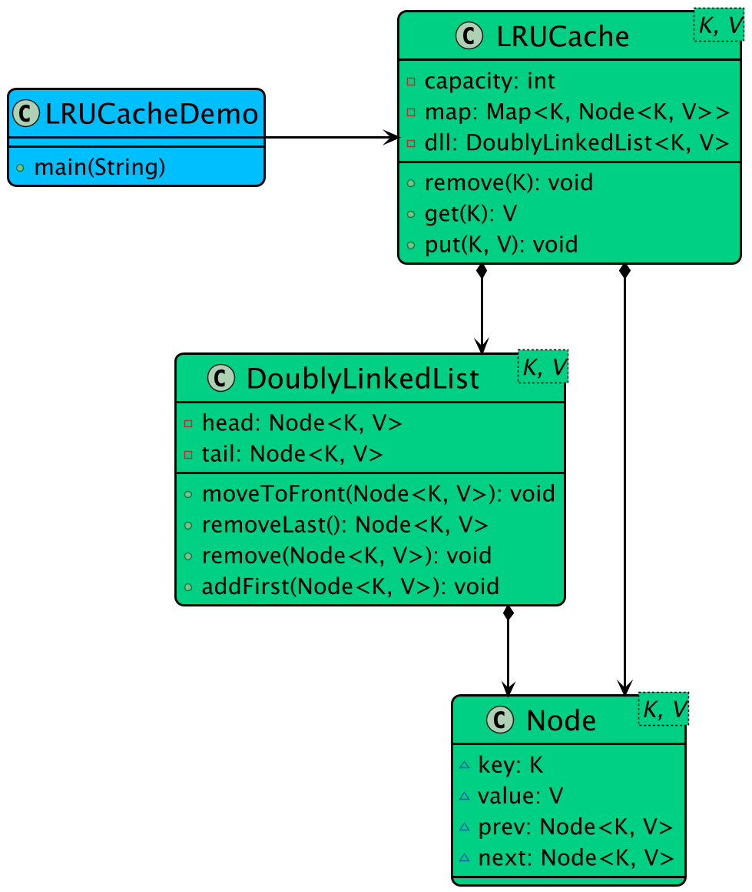

# Low-level design problem: lru cache

> Copied from <https://github.com/ashishps1/awesome-low-level-design/blob/main/problems/lru-cache.md> (GPL-3.0, by Ashish Pratap Singh). Questions and answers are the source's own; nothing was answered or rewritten here.


# Designing a LRU Cache

## Requirements
1. The LRU cache should support the following operations:
- put(key, value): Insert a key-value pair into the cache. If the cache is at capacity, remove the least recently used item before inserting the new item.
- get(key): Get the value associated with the given key. If the key exists in the cache, move it to the front of the cache (most recently used) and return its value. If the key does not exist, return -1.
2. The cache should have a fixed capacity, specified during initialization.
3. The cache should be thread-safe, allowing concurrent access from multiple threads.
4. The cache should be efficient in terms of time complexity for both put and get operations, ideally O(1).

## UML Class Diagram



## Implementations
#### [Java Implementation](https://github.com/ashishps1/awesome-low-level-design/blob/main/solutions/java/src/lrucache) 
#### [Python Implementation](https://github.com/ashishps1/awesome-low-level-design/blob/main/solutions/python/lrucache)
#### [C++ Implementation](https://github.com/ashishps1/awesome-low-level-design/blob/main/solutions/cpp/lrucache)
#### [C# Implementation](https://github.com/ashishps1/awesome-low-level-design/blob/main/solutions/csharp/lrucache)
#### [Go Implementation](https://github.com/ashishps1/awesome-low-level-design/blob/main/solutions/golang/lrucache)

## Classes, Interfaces and Enumerations
1. The **Node** class represents a node in the doubly linked list, containing the key, value, and references to the previous and next nodes.
2. The **LRUCache** class implements the LRU cache functionality using a combination of a hash map (cache) and a doubly linked list (head and tail).
3. The get method retrieves the value associated with a given key. If the key exists in the cache, it is moved to the head of the linked list (most recently used) and its value is returned. If the key does not exist, null is returned.
4. The put method inserts a key-value pair into the cache. If the key already exists, its value is updated, and the node is moved to the head of the linked list. If the key does not exist and the cache is at capacity, the least recently used item (at the tail of the linked list) is removed, and the new item is inserted at the head.
5. The addToHead, removeNode, moveToHead, and removeTail methods are helper methods to manipulate the doubly linked list.
6. The synchronized keyword is used on the get and put methods to ensure thread safety, allowing concurrent access from multiple threads.
7. The **LRUCacheDemo** class demonstrates the usage of the LRU cache by creating an instance of LRUCache with a capacity of 3, performing various put and get operations, and printing the results.

---

## Official solutions from the repository

<details><summary><b>java</b> (5 files)</summary>


**DoublyLinkedList.java**

```java
package lrucache;

class DoublyLinkedList<K, V> {
    private final Node<K, V> head;
    private final Node<K, V> tail;

    public DoublyLinkedList() {
        head = new Node<>(null, null); // Dummy head
        tail = new Node<>(null, null); // Dummy tail
        head.next = tail;
        tail.prev = head;
    }

    public void addFirst(Node<K, V> node) {
        node.next = head.next;
        node.prev = head;
        head.next.prev = node;
        head.next = node;
    }

    public void remove(Node<K, V> node) {
        node.prev.next = node.next;
        node.next.prev = node.prev;
    }

    public void moveToFront(Node<K, V> node) {
        remove(node);
        addFirst(node);
    }

    public Node<K, V> removeLast() {
        if (tail.prev == head) return null;
        Node<K, V> last = tail.prev;
        remove(last);
        return last;
    }
}
```


**LRUCache.java**

```java
package lrucache;

import java.util.HashMap;
import java.util.Map;

public class LRUCache<K, V> {
    private final int capacity;
    private final Map<K, Node<K, V>> map;
    private final DoublyLinkedList<K, V> dll;

    public LRUCache(int capacity) {
        this.capacity = capacity;
        this.map = new HashMap<>();
        this.dll = new DoublyLinkedList<>();
    }

    public synchronized V get(K key) {
        if (!map.containsKey(key)) return null;
        Node<K, V> node = map.get(key);
        dll.moveToFront(node);
        return node.value;
    }

    public synchronized void put(K key, V value) {
        if (map.containsKey(key)) {
            Node<K, V> node = map.get(key);
            node.value = value;
            dll.moveToFront(node);
        } else {
            if (map.size() == capacity) {
                Node<K, V> lru = dll.removeLast();
                if (lru != null) map.remove(lru.key);
            }
            Node<K, V> newNode = new Node<>(key, value);
            dll.addFirst(newNode);
            map.put(key, newNode);
        }
    }

    public synchronized void remove(K key) {
        if (!map.containsKey(key)) return;
        Node<K, V> node = map.get(key);
        dll.remove(node);
        map.remove(key);
    }
}
```


**LRUCacheDemo.java**

```java
package lrucache;

public class LRUCacheDemo {
    public static void run() {
        LRUCache<String, Integer> cache = new LRUCache<>(3);

        cache.put("a", 1);
        cache.put("b", 2);
        cache.put("c", 3);

        System.out.println(cache.get("a")); // 1

        cache.put("d", 4);
        
        System.out.println(cache.get("b")); // null
    }
}
```


**Node.java**

```java
package lrucache;

class Node<K, V> {
    K key;
    V value;
    Node<K, V> prev, next;

    public Node(K key, V value) {
        this.key = key;
        this.value = value;
    }
}
```


**README.md**

```md
# LRU Cache (LLD)

## Problem Statement

Design and implement an LRU (Least Recently Used) Cache with a fixed capacity. The cache should support fast retrieval and insertion, and automatically evict the least recently used item when the capacity is exceeded.

---

## Requirements

- **Fixed Capacity:** The cache has a maximum size. When full, the least recently used item is evicted on insertion.
- **Fast Operations:** Both `get(key)` and `put(key, value)` operations should be O(1).
- **Eviction Policy:** The least recently used item is removed when the cache exceeds its capacity.
- **Extensibility:** Easy to change the eviction policy or underlying data structures.

---

## Core Entities

- **LRUCache:** Main class implementing the cache logic, manages storage and eviction.
- **Node:** Represents a doubly-linked list node for fast removal and insertion.

---

## Class Design

## UML Class Diagram


### 1. LRUCache
- **Fields:** capacity, Map<K, Node<K, V>>, head/tail pointers for the doubly-linked list
- **Methods:**
  - `get(K key)`: Returns the value for the key if present, else -1/null. Moves the node to the front (most recently used).
  - `put(K key, V value)`: Inserts or updates the value for the key. Moves the node to the front. If the cache exceeds capacity, evicts the least recently used node.
  - `removeNode(Node)`, `addToFront(Node)`, `moveToFront(Node)`, `evictLRU()`: Helper methods for list management.

### 2. Node
- **Fields:** key, value, prev, next

---

## Design Patterns Used

- **Doubly Linked List:** For O(1) removal and insertion of nodes.
- **Hash Map:** For O(1) access to nodes by key.
- **Separation of Concerns:** Node and cache logic are separated.

---

## Example Usage

```java
LRUCache cache = new LRUCache(2);
cache.put(1, 1); // cache: {1=1}
cache.put(2, 2); // cache: {1=1, 2=2}
cache.get(1);    // returns 1, cache: {2=2, 1=1}
cache.put(3, 3); // evicts key 2, cache: {1=1, 3=3}
cache.get(2);    // returns -1 (not found)
```

---

## Demo

See `LRUCacheDemo.java` for a sample usage and simulation of the LRU cache.

---

## Extending the Framework

- **Change eviction policy:** Implement a different policy (e.g., LFU) by modifying the eviction logic.
- **Change data structures:** Use other structures for different performance characteristics.

---
```

</details>

<details><summary><b>python</b> (5 files)</summary>


**README.md**

```md
# Designing a LRU Cache

## Requirements
1. The LRU cache should support the following operations:
- put(key, value): Insert a key-value pair into the cache. If the cache is at capacity, remove the least recently used item before inserting the new item.
- get(key): Get the value associated with the given key. If the key exists in the cache, move it to the front of the cache (most recently used) and return its value. If the key does not exist, return -1.
2. The cache should have a fixed capacity, specified during initialization.
3. The cache should be thread-safe, allowing concurrent access from multiple threads.
4. The cache should be efficient in terms of time complexity for both put and get operations, ideally O(1).

## Classes, Interfaces and Enumerations
1. The **Node** class represents a node in the doubly linked list, containing the key, value, and references to the previous and next nodes.
2. The **LRUCache** class implements the LRU cache functionality using a combination of a hash map (cache) and a doubly linked list (head and tail).
3. The get method retrieves the value associated with a given key. If the key exists in the cache, it is moved to the head of the linked list (most recently used) and its value is returned. If the key does not exist, null is returned.
4. The put method inserts a key-value pair into the cache. If the key already exists, its value is updated, and the node is moved to the head of the linked list. If the key does not exist and the cache is at capacity, the least recently used item (at the tail of the linked list) is removed, and the new item is inserted at the head.
5. The addToHead, removeNode, moveToHead, and removeTail methods are helper methods to manipulate the doubly linked list.
6. The synchronized keyword is used on the get and put methods to ensure thread safety, allowing concurrent access from multiple threads.
7. The **LRUCacheDemo** class demonstrates the usage of the LRU cache by creating an instance of LRUCache with a capacity of 3, performing various put and get operations, and printing the results.
```


**dll.py**

```py
from typing import TypeVar, Generic, Optional
from node import Node

K = TypeVar('K')
V = TypeVar('V')

class DoublyLinkedList(Generic[K, V]):
    def __init__(self):
        self.head: Node[K, V] = Node(None, None)  # Dummy head
        self.tail: Node[K, V] = Node(None, None)  # Dummy tail
        self.head.next = self.tail
        self.tail.prev = self.head

    def add_first(self, node: Node[K, V]) -> None:
        node.next = self.head.next
        node.prev = self.head
        self.head.next.prev = node
        self.head.next = node

    def remove(self, node: Node[K, V]) -> None:
        node.prev.next = node.next
        node.next.prev = node.prev

    def move_to_front(self, node: Node[K, V]) -> None:
        self.remove(node)
        self.add_first(node)

    def remove_last(self) -> Optional[Node[K, V]]:
        if self.tail.prev == self.head:
            return None
        last = self.tail.prev
        self.remove(last)
        return last
```


**lru_cache.py**

```py
import threading
from typing import TypeVar, Generic, Optional, Dict
from dll import DoublyLinkedList
from node import Node

K = TypeVar('K')
V = TypeVar('V')

class LRUCache(Generic[K, V]):
    def __init__(self, capacity: int):
        self.capacity = capacity
        self.map: Dict[K, Node[K, V]] = {}
        self.dll: DoublyLinkedList[K, V] = DoublyLinkedList()
        self.lock = threading.Lock()

    def get(self, key: K) -> Optional[V]:
        with self.lock:
            if key not in self.map:
                return None
            node = self.map[key]
            self.dll.move_to_front(node)
            return node.value

    def put(self, key: K, value: V) -> None:
        with self.lock:
            if key in self.map:
                node = self.map[key]
                node.value = value
                self.dll.move_to_front(node)
            else:
                if len(self.map) == self.capacity:
                    lru = self.dll.remove_last()
                    if lru is not None:
                        del self.map[lru.key]
                new_node = Node(key, value)
                self.dll.add_first(new_node)
                self.map[key] = new_node

    def remove(self, key: K) -> None:
        with self.lock:
            if key not in self.map:
                return
            node = self.map[key]
            self.dll.remove(node)
            del self.map[key]
```


**lru_cache_demo.py**

```py
from lru_cache import LRUCache

class LRUCacheDemo:
    @staticmethod
    def main():
        cache: LRUCache[str, int] = LRUCache(3)

        cache.put("a", 1)
        cache.put("b", 2)
        cache.put("c", 3)

        # Accessing 'a' makes it the most recently used
        print(cache.get("a"))  # 1

        # Adding 'd' will cause 'b' (the current LRU item) to be evicted
        cache.put("d", 4)

        # Trying to get 'b' should now return None
        print(cache.get("b"))  # None

if __name__ == "__main__":
    LRUCacheDemo.main()
```


**node.py**

```py
from typing import TypeVar, Generic, Optional

K = TypeVar('K')
V = TypeVar('V')

class Node(Generic[K, V]):
    def __init__(self, key: K, value: V):
        self.key = key
        self.value = value
        self.prev: Optional['Node[K, V]'] = None
        self.next: Optional['Node[K, V]'] = None
```

</details>

<details><summary><b>cpp</b> (4 files)</summary>


**DoublyLinkedList.hpp**

```hpp
#ifndef DOUBLY_LINKED_LIST_HPP
#define DOUBLY_LINKED_LIST_HPP

template<typename K, typename V>
struct Node {
    K key;
    V value;
    Node* prev;
    Node* next;
    
    Node(K key, V value) : key(key), value(value), prev(nullptr), next(nullptr) {}
};

template<typename K, typename V>
class DoublyLinkedList {
private:
    Node<K,V>* head;
    Node<K,V>* tail;
    int size;

public:
    DoublyLinkedList() : head(nullptr), tail(nullptr), size(0) {}
    ~DoublyLinkedList() {
        while (head) {
            Node<K,V>* temp = head;
            head = head->next;
            delete temp;
        }
    }
    
    Node<K,V>* addToFront(K key, V value) {
        Node<K,V>* node = new Node<K,V>(key, value);
        
        if (!head) {
            head = tail = node;
        } else {
            node->next = head;
            head->prev = node;
            head = node;
        }
        
        size++;
        return node;
    }
    
    void moveToFront(Node<K,V>* node) {
        if (node == head) return;
        
        if (node == tail) {
            tail = node->prev;
            tail->next = nullptr;
        } else {
            node->prev->next = node->next;
            node->next->prev = node->prev;
        }
        
        node->prev = nullptr;
        node->next = head;
        head->prev = node;
        head = node;
    }
    
    void removeNode(Node<K,V>* node) {
        if (node == head) {
            head = node->next;
            if (head) head->prev = nullptr;
        } else if (node == tail) {
            tail = node->prev;
            tail->next = nullptr;
        } else {
            node->prev->next = node->next;
            node->next->prev = node->prev;
        }
        
        delete node;
        size--;
        
        if (size == 0) {
            head = tail = nullptr;
        }
    }
    
    Node<K,V>* removeLast() {
        if (!tail) return nullptr;
        
        Node<K,V>* node = tail;
        tail = tail->prev;
        if (tail) {
            tail->next = nullptr;
        } else {
            head = nullptr;
        }
        
        size--;
        return node;
    }
    
    int getSize() const { return size; }
    bool isEmpty() const { return size == 0; }
    Node<K,V>* getHead() const { return head; }
    Node<K,V>* getTail() const { return tail; }
};

#endif
```


**LRUCache.hpp**

```hpp
#ifndef LRU_CACHE_HPP
#define LRU_CACHE_HPP

#include <unordered_map>
#include "DoublyLinkedList.hpp"

template<typename K, typename V>
class LRUCache {
private:
    int capacity;
    DoublyLinkedList<K,V> dll;
    std::unordered_map<K, Node<K,V>*> cache;

public:
    LRUCache(int capacity) : capacity(capacity) {}
    
    V get(K key) {
        auto it = cache.find(key);
        if (it == cache.end()) {
            throw std::runtime_error("Key not found");
        }
        
        Node<K,V>* node = it->second;
        dll.moveToFront(node);
        return node->value;
    }
    
    void put(K key, V value) {
        auto it = cache.find(key);
        if (it != cache.end()) {
            // Key exists, update value and move to front
            Node<K,V>* node = it->second;
            node->value = value;
            dll.moveToFront(node);
        } else {
            // Key doesn't exist, add new entry
            if (cache.size() >= capacity) {
                // Remove least recently used item
                Node<K,V>* lastNode = dll.getTail();
                cache.erase(lastNode->key);
                dll.removeNode(lastNode);
            }
            
            // Add new item to front
            Node<K,V>* newNode = dll.addToFront(key, value);
            cache[key] = newNode;
        }
    }
    
    bool contains(K key) const {
        return cache.find(key) != cache.end();
    }
    
    int getSize() const {
        return cache.size();
    }
    
    bool isEmpty() const {
        return cache.empty();
    }
    
    void clear() {
        while (!dll.isEmpty()) {
            Node<K,V>* node = dll.removeLast();
            cache.erase(node->key);
            delete node;
        }
    }
    
    void display() const {
        std::cout << "\nLRU Cache Contents:" << std::endl;
        Node<K,V>* current = dll.getHead();
        while (current) {
            std::cout << current->key << " -> " << current->value << std::endl;
            current = current->next;
        }
        std::cout << "Cache size: " << cache.size() << "/" << capacity << std::endl;
    }
};

#endif
```


**LRUCacheDemo.cpp**

```cpp
#include "LRUCache.hpp"
#include <iostream>
#include <string>

int main() {
    // Create LRU cache with capacity 3
    LRUCache<int, std::string> cache(3);
    
    // Add some entries
    std::cout << "Adding entries to cache..." << std::endl;
    cache.put(1, "One");
    cache.put(2, "Two");
    cache.put(3, "Three");
    cache.display();
    
    // Try to get an entry
    std::cout << "\nGetting value for key 2..." << std::endl;
    std::cout << "Value: " << cache.get(2) << std::endl;
    cache.display();  // 2 should move to front
    
    // Add new entry when cache is full
    std::cout << "\nAdding new entry when cache is full..." << std::endl;
    cache.put(4, "Four");  // Should evict least recently used item
    cache.display();
    
    // Try to access non-existent key
    std::cout << "\nTrying to access non-existent key..." << std::endl;
    try {
        cache.get(1);  // Should throw exception
    } catch (const std::runtime_error& e) {
        std::cout << "Error: " << e.what() << std::endl;
    }
    
    // Update existing entry
    std::cout << "\nUpdating existing entry..." << std::endl;
    cache.put(2, "Two Updated");
    cache.display();
    
    // Clear cache
    std::cout << "\nClearing cache..." << std::endl;
    cache.clear();
    cache.display();
    
    return 0;
}
```


**README.md**

```md
# Designing a LRU Cache

## Requirements
1. The LRU cache should support the following operations:
- put(key, value): Insert a key-value pair into the cache. If the cache is at capacity, remove the least recently used item before inserting the new item.
- get(key): Get the value associated with the given key. If the key exists in the cache, move it to the front of the cache (most recently used) and return its value. If the key does not exist, return -1.
2. The cache should have a fixed capacity, specified during initialization.
3. The cache should be thread-safe, allowing concurrent access from multiple threads.
4. The cache should be efficient in terms of time complexity for both put and get operations, ideally O(1).

## Classes, Interfaces and Enumerations
1. The **Node** class represents a node in the doubly linked list, containing the key, value, and references to the previous and next nodes.
2. The **LRUCache** class implements the LRU cache functionality using a combination of a hash map (cache) and a doubly linked list (head and tail).
3. The get method retrieves the value associated with a given key. If the key exists in the cache, it is moved to the head of the linked list (most recently used) and its value is returned. If the key does not exist, null is returned.
4. The put method inserts a key-value pair into the cache. If the key already exists, its value is updated, and the node is moved to the head of the linked list. If the key does not exist and the cache is at capacity, the least recently used item (at the tail of the linked list) is removed, and the new item is inserted at the head.
5. The addToHead, removeNode, moveToHead, and removeTail methods are helper methods to manipulate the doubly linked list.
6. The synchronized keyword is used on the get and put methods to ensure thread safety, allowing concurrent access from multiple threads.
7. The **LRUCacheDemo** class demonstrates the usage of the LRU cache by creating an instance of LRUCache with a capacity of 3, performing various put and get operations, and printing the results.
```

</details>

<details><summary><b>golang</b> (3 files)</summary>


**README.md**

```md
# Designing a LRU Cache

## Requirements
1. The LRU cache should support the following operations:
- put(key, value): Insert a key-value pair into the cache. If the cache is at capacity, remove the least recently used item before inserting the new item.
- get(key): Get the value associated with the given key. If the key exists in the cache, move it to the front of the cache (most recently used) and return its value. If the key does not exist, return -1.
2. The cache should have a fixed capacity, specified during initialization.
3. The cache should be thread-safe, allowing concurrent access from multiple threads.
4. The cache should be efficient in terms of time complexity for both put and get operations, ideally O(1).

## Classes, Interfaces and Enumerations
1. The **Node** class represents a node in the doubly linked list, containing the key, value, and references to the previous and next nodes.
2. The **LRUCache** class implements the LRU cache functionality using a combination of a hash map (cache) and a doubly linked list (head and tail).
3. The get method retrieves the value associated with a given key. If the key exists in the cache, it is moved to the head of the linked list (most recently used) and its value is returned. If the key does not exist, null is returned.
4. The put method inserts a key-value pair into the cache. If the key already exists, its value is updated, and the node is moved to the head of the linked list. If the key does not exist and the cache is at capacity, the least recently used item (at the tail of the linked list) is removed, and the new item is inserted at the head.
5. The addToHead, removeNode, moveToHead, and removeTail methods are helper methods to manipulate the doubly linked list.
6. The synchronized keyword is used on the get and put methods to ensure thread safety, allowing concurrent access from multiple threads.
7. The **LRUCacheDemo** class demonstrates the usage of the LRU cache by creating an instance of LRUCache with a capacity of 3, performing various put and get operations, and printing the results.
```


**lru_cache.go**

```go
package lrucache

import (
	"sync"
)

// Node represents a node in the doubly linked list
type Node[K comparable, V any] struct {
	key   K
	value V
	prev  *Node[K, V]
	next  *Node[K, V]
}

// LRUCache represents a thread-safe LRU cache implementation
type LRUCache[K comparable, V any] struct {
	capacity int
	cache    map[K]*Node[K, V]
	head     *Node[K, V]
	tail     *Node[K, V]
	mu       sync.RWMutex
}

// NewLRUCache creates a new LRU cache with the specified capacity
func NewLRUCache[K comparable, V any](capacity int) *LRUCache[K, V] {
	cache := &LRUCache[K, V]{
		capacity: capacity,
		cache:    make(map[K]*Node[K, V]),
	}
	// Initialize dummy head and tail nodes
	cache.head = &Node[K, V]{}
	cache.tail = &Node[K, V]{}
	cache.head.next = cache.tail
	cache.tail.prev = cache.head
	return cache
}

// Get retrieves a value from the cache
func (c *LRUCache[K, V]) Get(key K) (V, bool) {
	c.mu.Lock()
	defer c.mu.Unlock()

	if node, exists := c.cache[key]; exists {
		c.moveToHead(node)
		return node.value, true
	}

	var zero V
	return zero, false
}

// Put adds or updates a value in the cache
func (c *LRUCache[K, V]) Put(key K, value V) {
	c.mu.Lock()
	defer c.mu.Unlock()

	if node, exists := c.cache[key]; exists {
		node.value = value
		c.moveToHead(node)
		return
	}

	newNode := &Node[K, V]{
		key:   key,
		value: value,
	}
	c.cache[key] = newNode
	c.addToHead(newNode)

	if len(c.cache) > c.capacity {
		lastNode := c.removeTail()
		delete(c.cache, lastNode.key)
	}
}

// addToHead adds a node right after the head
func (c *LRUCache[K, V]) addToHead(node *Node[K, V]) {
	node.prev = c.head
	node.next = c.head.next
	c.head.next.prev = node
	c.head.next = node
}

// removeNode removes a node from the list
func (c *LRUCache[K, V]) removeNode(node *Node[K, V]) {
	node.prev.next = node.next
	node.next.prev = node.prev
}

// moveToHead moves an existing node to the front of the list
func (c *LRUCache[K, V]) moveToHead(node *Node[K, V]) {
	c.removeNode(node)
	c.addToHead(node)
}

// removeTail removes and returns the last node before the tail
func (c *LRUCache[K, V]) removeTail() *Node[K, V] {
	node := c.tail.prev
	c.removeNode(node)
	return node
}

// Size returns the current number of items in the cache
func (c *LRUCache[K, V]) Size() int {
	c.mu.RLock()
	defer c.mu.RUnlock()
	return len(c.cache)
}

// Clear removes all items from the cache
func (c *LRUCache[K, V]) Clear() {
	c.mu.Lock()
	defer c.mu.Unlock()

	c.cache = make(map[K]*Node[K, V])
	c.head.next = c.tail
	c.tail.prev = c.head
}
```


**lru_cache_demo.go**

```go
package lrucache

import (
	"fmt"
)

func Run() {
	// Create a new cache with capacity 3
	lruCache := NewLRUCache[int, string](3)

	// Add some values
	lruCache.Put(1, "Value 1")
	lruCache.Put(2, "Value 2")
	lruCache.Put(3, "Value 3")

	// Get values and print them
	if val, exists := lruCache.Get(1); exists {
		fmt.Println(val) // Output: Value 1
	}
	if val, exists := lruCache.Get(2); exists {
		fmt.Println(val) // Output: Value 2
	}

	// Add a new value that should evict the least recently used one
	lruCache.Put(4, "Value 4")

	// Try to get the evicted value
	if val, exists := lruCache.Get(3); exists {
		fmt.Println(val)
	} else {
		fmt.Println("Value 3 was evicted") // Output: Value 3 was evicted
	}

	// Get the newly added value
	if val, exists := lruCache.Get(4); exists {
		fmt.Println(val) // Output: Value 4
	}

	// Update an existing value
	lruCache.Put(2, "Updated Value 2")

	// Get the values again
	if val, exists := lruCache.Get(1); exists {
		fmt.Println(val) // Output: Value 1
	}
	if val, exists := lruCache.Get(2); exists {
		fmt.Println(val) // Output: Updated Value 2
	}
}
```

</details>

<details><summary><b>csharp</b> (5 files)</summary>


**DoublyLinkedList.cs**

```cs
class DoublyLinkedList<K, V>
{
    private readonly Node<K, V> head;
    private readonly Node<K, V> tail;

    public DoublyLinkedList()
    {
        head = new Node<K, V>(default(K), default(V));
        tail = new Node<K, V>(default(K), default(V));
        head.next = tail;
        tail.prev = head;
    }

    public void AddFirst(Node<K, V> node)
    {
        node.next = head.next;
        node.prev = head;
        head.next.prev = node;
        head.next = node;
    }

    public void Remove(Node<K, V> node)
    {
        node.prev.next = node.next;
        node.next.prev = node.prev;
    }

    public void MoveToFront(Node<K, V> node)
    {
        Remove(node);
        AddFirst(node);
    }

    public Node<K, V> RemoveLast()
    {
        if (tail.prev == head) return null;
        Node<K, V> last = tail.prev;
        Remove(last);
        return last;
    }
}
```


**LRUCache.cs**

```cs
class LRUCache<K, V>
{
    private readonly int capacity;
    private readonly Dictionary<K, Node<K, V>> map;
    private readonly DoublyLinkedList<K, V> dll;
    private readonly object lockObject = new object();

    public LRUCache(int capacity)
    {
        this.capacity = capacity;
        this.map = new Dictionary<K, Node<K, V>>();
        this.dll = new DoublyLinkedList<K, V>();
    }

    public V Get(K key)
    {
        lock (lockObject)
        {
            if (!map.ContainsKey(key)) return default(V);
            Node<K, V> node = map[key];
            dll.MoveToFront(node);
            return node.value;
        }
    }

    public void Put(K key, V value)
    {
        lock (lockObject)
        {
            if (map.ContainsKey(key))
            {
                Node<K, V> node = map[key];
                node.value = value;
                dll.MoveToFront(node);
            }
            else
            {
                if (map.Count == capacity)
                {
                    Node<K, V> lru = dll.RemoveLast();
                    if (lru != null) map.Remove(lru.key);
                }
                Node<K, V> newNode = new Node<K, V>(key, value);
                dll.AddFirst(newNode);
                map[key] = newNode;
            }
        }
    }

    public void Remove(K key)
    {
        lock (lockObject)
        {
            if (!map.ContainsKey(key)) return;
            Node<K, V> node = map[key];
            dll.Remove(node);
            map.Remove(key);
        }
    }
}
```


**LRUCacheDemo.cs**

```cs
using System;
using System.Collections.Generic;

public class LRUCacheDemo
{
    public static void Main()
    {
        LRUCache<string, int> cache = new LRUCache<string, int>(3);

        cache.Put("a", 1);
        cache.Put("b", 2);
        cache.Put("c", 3);

        Console.WriteLine(cache.Get("a")); // 1

        cache.Put("d", 4);

        Console.WriteLine(cache.Get("b")); // 0 (default for int when null)
    }
}
```


**Node.cs**

```cs
class Node<K, V>
{
    public K key;
    public V value;
    public Node<K, V> prev;
    public Node<K, V> next;

    public Node(K key, V value)
    {
        this.key = key;
        this.value = value;
    }
}
```


**README.md**

```md
# Designing a LRU Cache

## Requirements
1. The LRU cache should support the following operations:
- put(key, value): Insert a key-value pair into the cache. If the cache is at capacity, remove the least recently used item before inserting the new item.
- get(key): Get the value associated with the given key. If the key exists in the cache, move it to the front of the cache (most recently used) and return its value. If the key does not exist, return -1.
2. The cache should have a fixed capacity, specified during initialization.
3. The cache should be thread-safe, allowing concurrent access from multiple threads.
4. The cache should be efficient in terms of time complexity for both put and get operations, ideally O(1).

## Classes, Interfaces and Enumerations
1. The **Node** class represents a node in the doubly linked list, containing the key, value, and references to the previous and next nodes.
2. The **LRUCache** class implements the LRU cache functionality using a combination of a hash map (cache) and a doubly linked list (head and tail).
3. The get method retrieves the value associated with a given key. If the key exists in the cache, it is moved to the head of the linked list (most recently used) and its value is returned. If the key does not exist, null is returned.
4. The put method inserts a key-value pair into the cache. If the key already exists, its value is updated, and the node is moved to the head of the linked list. If the key does not exist and the cache is at capacity, the least recently used item (at the tail of the linked list) is removed, and the new item is inserted at the head.
5. The addToHead, removeNode, moveToHead, and removeTail methods are helper methods to manipulate the doubly linked list.
6. The synchronized keyword is used on the get and put methods to ensure thread safety, allowing concurrent access from multiple threads.
7. The **LRUCacheDemo** class demonstrates the usage of the LRU cache by creating an instance of LRUCache with a capacity of 3, performing various put and get operations, and printing the results.
```

</details>
