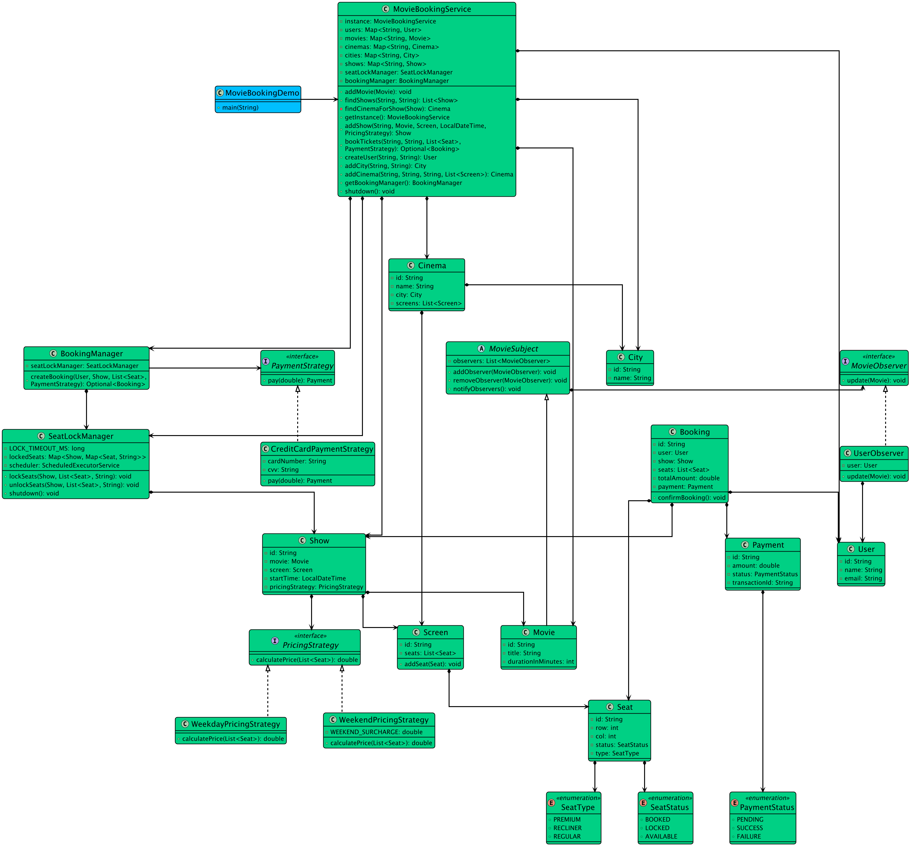

# Low-level design problem: movie ticket booking system

> Copied from <https://github.com/ashishps1/awesome-low-level-design/blob/main/problems/movie-ticket-booking-system.md> (GPL-3.0, by Ashish Pratap Singh). Questions and answers are the source's own; nothing was answered or rewritten here.


# Designing a Movie Ticket Booking System like BookMyShow

## Requirements
1. The system should allow users to view the list of movies playing in different theaters.
2. Users should be able to select a movie, theater, and show timing to book tickets.
3. The system should display the seating arrangement of the selected show and allow users to choose seats.
4. Users should be able to make payments and confirm their booking.
5. The system should handle concurrent bookings and ensure seat availability is updated in real-time.
6. The system should support different types of seats (e.g., normal, premium) and pricing.
7. The system should allow theater administrators to add, update, and remove movies, shows, and seating arrangements.
8. The system should be scalable to handle a large number of concurrent users and bookings.

## UML Class Diagram



## Implementations
#### [Java Implementation](https://github.com/ashishps1/awesome-low-level-design/blob/main/solutions/java/src/movieticketbookingsystem) 
#### [Python Implementation](https://github.com/ashishps1/awesome-low-level-design/blob/main/solutions/python/movieticketbookingsystem)
#### [C++ Implementation](https://github.com/ashishps1/awesome-low-level-design/blob/main/solutions/cpp/movieticketbookingsystem)
#### [C# Implementation](https://github.com/ashishps1/awesome-low-level-design/blob/main/solutions/csharp/movieticketbookingsystem)
#### [Go Implementation](https://github.com/ashishps1/awesome-low-level-design/blob/main/solutions/golang/movieticketbookingsystem)

## Classes, Interfaces and Enumerations
1. The **Movie** class represents a movie with properties such as ID, title, description, and duration.
2. The **Theater** class represents a theater with properties such as ID, name, location, and a list of shows.
3. The **Show** class represents a movie show in a theater, with properties such as ID, movie, theater, start time, end time, and a map of seats.
4. The **Seat** class represents a seat in a show, with properties such as ID, row, column, type, price, and status.
5. The **SeatType** enum defines the different types of seats (normal or premium).
6. The **SeatStatus** enum defines the different statuses of a seat (available or booked).
7. The **Booking** class represents a booking made by a user, with properties such as ID, user, show, selected seats, total price, and status.
8. The **BookingStatus** enum defines the different statuses of a booking (pending, confirmed, or cancelled).
9. The **User** class represents a user of the booking system, with properties such as ID, name, and email.
10. The **MovieTicketBookingSystem** class is the main class that manages the movie ticket booking system. It follows the Singleton pattern to ensure only one instance of the system exists.
11. The MovieTicketBookingSystem class provides methods for adding movies, theaters, and shows, as well as booking tickets, confirming bookings, and cancelling bookings.
12. Multi-threading is achieved using concurrent data structures such as ConcurrentHashMap to handle concurrent access to shared resources like shows and bookings.
13. The **MovieTicketBookingDemo** class demonstrates the usage of the movie ticket booking system by adding movies, theaters, shows, booking tickets, and confirming or cancelling bookings.

---

## Official solutions from the repository

<details><summary><b>java</b> (25 files)</summary>


**BookingManager.java**

```java
package movieticketbookingsystem;

import movieticketbookingsystem.enums.PaymentStatus;
import movieticketbookingsystem.entities.*;
import movieticketbookingsystem.strategy.payment.PaymentStrategy;

import java.util.List;
import java.util.Optional;

public class BookingManager {
    private final SeatLockManager seatLockManager;

    public BookingManager(SeatLockManager seatLockManager) {
        this.seatLockManager = seatLockManager;
    }

    public Optional<Booking> createBooking(User user, Show show, List<Seat> seats, PaymentStrategy paymentStrategy) {
        // 1. Lock the seats
        seatLockManager.lockSeats(show, seats, user.getId());

        // 2. Calculate the total price
        double totalAmount = show.getPricingStrategy().calculatePrice(seats);

        // 3. Process Payment
        Payment payment = paymentStrategy.pay(totalAmount);

        // 4. If payment is successful, create the booking
        if (payment.getStatus() == PaymentStatus.SUCCESS) {
            Booking booking = new Booking.BookingBuilder()
                    .setUser(user)
                    .setShow(show)
                    .setSeats(seats)
                    .setTotalAmount(totalAmount)
                    .setPayment(payment)
                    .build();

            // 5. Confirm the booking (mark seats as BOOKED)
            booking.confirmBooking();

            // Clean up the lock map
            seatLockManager.unlockSeats(show, seats, user.getId());

            return Optional.of(booking);
        } else {
            System.out.println("Payment failed. Please try again.");
            return Optional.empty();
        }
    }
}
```


**MovieBookingDemo.java**

```java
package movieticketbookingsystem;

import movieticketbookingsystem.enums.SeatStatus;
import movieticketbookingsystem.enums.SeatType;
import movieticketbookingsystem.entities.*;
import movieticketbookingsystem.observer.UserObserver;
import movieticketbookingsystem.strategy.payment.CreditCardPaymentStrategy;
import movieticketbookingsystem.strategy.pricing.WeekdayPricingStrategy;

import java.time.LocalDateTime;
import java.util.*;
import java.util.stream.Collectors;

public class MovieBookingDemo {
    public static void main (String[]args){
        // Setup
        MovieBookingService service = MovieBookingService.getInstance();

        City nyc = service.addCity("city1", "New York");
        City la = service.addCity("city2", "Los Angeles");

        // 2. Add movies
        Movie matrix = new Movie("M1", "The Matrix", 120);
        Movie avengers = new Movie("M2", "Avengers: Endgame", 170);
        service.addMovie(matrix);
        service.addMovie(avengers);

        // Add Seats for a Screen
        Screen screen1 = new Screen("S1");

        for (int i = 1; i <= 10; i++) {
            screen1.addSeat(new Seat("A" + i, 1, i, i <= 5 ? SeatType.REGULAR : SeatType.PREMIUM));
            screen1.addSeat(new Seat("B" + i, 2, i, i <= 5 ? SeatType.REGULAR : SeatType.PREMIUM));
        }

        // Add Cinemas
        Cinema amcNYC = service.addCinema("cinema1", "AMC Times Square", nyc.getId(), List.of(screen1));

        // Add Shows
        Show matrixShow = service.addShow("show1", matrix, screen1, LocalDateTime.now().plusHours(2), new WeekdayPricingStrategy());
        Show avengersShow = service.addShow("show2", avengers, screen1, LocalDateTime.now().plusHours(5), new WeekdayPricingStrategy());

        // --- User and Observer Setup ---
        User alice = service.createUser("Alice", "alice@example.com");
        UserObserver aliceObserver = new UserObserver(alice);
        avengers.addObserver(aliceObserver);

        // Simulate movie release
        System.out.println("\n--- Notifying Observers about Movie Release ---");
        avengers.notifyObservers();

        // --- User Story: Alice books tickets ---
        System.out.println("\n--- Alice's Booking Flow ---");
        String cityName = "New York";
        String movieTitle = "Avengers: Endgame";

        // 1. Search for shows
        List<Show> availableShows = service.findShows(movieTitle, cityName);
        if (availableShows.isEmpty()) {
            System.out.println("No shows found for " + movieTitle + " in " + cityName);
            return;
        }
        Show selectedShow = availableShows.get(0); // Alice selects the first show

        // 2. View available seats
        List<Seat> availableSeats = selectedShow.getScreen().getSeats().stream()
                .filter(seat -> seat.getStatus() == SeatStatus.AVAILABLE)
                .toList();
        System.out.printf("Available seats for '%s' at %s: %s%n",
                selectedShow.getMovie().getTitle(),
                selectedShow.getStartTime(),
                availableSeats.stream().map(Seat::getId).collect(Collectors.toList()));

        // 3. Select seats
        List<Seat> desiredSeats = List.of(availableSeats.get(2), availableSeats.get(3));
        System.out.println("Alice selects seats: " + desiredSeats.stream().map(Seat::getId).toList());

        // 4. Book Tickets
        Optional<Booking> bookingOpt = service.bookTickets(
                alice.getId(),
                selectedShow.getId(),
                desiredSeats,
                new CreditCardPaymentStrategy("1234-5678-9876-5432", "123")
        );

        if (bookingOpt.isPresent()) {
            Booking booking = bookingOpt.get();
            System.out.println("\n--- Booking Successful! ---");
            System.out.println("Booking ID: " + booking.getId());
            System.out.println("User: " + booking.getUser().getName());
            System.out.println("Movie: " + booking.getShow().getMovie().getTitle());
            System.out.println("Seats: " + booking.getSeats().stream().map(Seat::getId).toList());
            System.out.println("Total Amount: $" + booking.getTotalAmount());
            System.out.println("Payment Status: " + booking.getPayment().getStatus());
        } else {
            System.out.println("Booking failed.");
        }

        // 5. Verify seat status after booking
        System.out.println("\nSeat status after Alice's booking:");
        desiredSeats.forEach(seat -> System.out.printf("Seat %s status: %s%n", seat.getId(), seat.getStatus()));

        // 6. Shut down the system to release resources like the scheduler.
        service.shutdown();
    }
}
```


**MovieBookingService.java**

```java
package movieticketbookingsystem;

import movieticketbookingsystem.entities.*;
import movieticketbookingsystem.strategy.payment.PaymentStrategy;
import movieticketbookingsystem.strategy.pricing.PricingStrategy;

import java.time.LocalDateTime;
import java.util.ArrayList;
import java.util.List;
import java.util.Map;
import java.util.Optional;
import java.util.concurrent.ConcurrentHashMap;

public class MovieBookingService {
    private static volatile MovieBookingService instance;

    private final Map<String, City> cities;
    private final Map<String, Cinema> cinemas;
    private final Map<String, Movie> movies;
    private final Map<String, User> users;
    private final Map<String, Show> shows;

    // Core services - managed by the system
    private final SeatLockManager seatLockManager;
    private final BookingManager bookingManager;


    private MovieBookingService() {
        this.cities = new ConcurrentHashMap<>();
        this.cinemas = new ConcurrentHashMap<>();
        this.movies = new ConcurrentHashMap<>();
        this.users = new ConcurrentHashMap<>();
        this.shows = new ConcurrentHashMap<>();

        this.seatLockManager = new SeatLockManager();
        this.bookingManager = new BookingManager(seatLockManager);
    }

    public static MovieBookingService getInstance() {
        if (instance == null) {
            synchronized (MovieBookingService.class) {
                if (instance == null) {
                    instance = new MovieBookingService();
                }
            }
        }
        return instance;
    }

    public BookingManager getBookingManager() {
        return bookingManager;
    }

    // --- Data Management Methods ---
    public City addCity(String id, String name) {
        City city = new City(id, name);
        cities.put(city.getId(), city);
        return city;
    }

    public Cinema addCinema(String id, String name, String cityId, List<Screen> screens) {
        City city = cities.get(cityId);
        Cinema cinema = new Cinema(id, name, city, screens);
        cinemas.put(cinema.getId(), cinema);
        return cinema;
    }

    public void addMovie(Movie movie) {
        this.movies.put(movie.getId(), movie);
    }

    public Show addShow(String id, Movie movie, Screen screen, LocalDateTime startTime, PricingStrategy pricingStrategy) {
        Show show = new Show(id, movie, screen, startTime, pricingStrategy);
        shows.put(show.getId(), show);
        return show;
    }

    public User createUser(String name, String email) {
        User user = new User(name, email);
        users.put(user.getId(), user);
        return user;
    }

    public Optional<Booking> bookTickets(String userId, String showId, List<Seat> desiredSeats, PaymentStrategy paymentStrategy) {
        return bookingManager.createBooking(
                users.get(userId),
                shows.get(showId),
                desiredSeats,
                paymentStrategy
        );
    }

    // --- Search Functionality ---
    public List<Show> findShows(String movieTitle, String cityName) {
        List<Show> result = new ArrayList<>();
        shows.values().stream()
            .filter(show -> show.getMovie().getTitle().equalsIgnoreCase(movieTitle))
            .filter(show -> {
                Cinema cinema = findCinemaForShow(show);
                return cinema != null && cinema.getCity().getName().equalsIgnoreCase(cityName);
            })
            .forEach(result::add);
        return result;
    }

    private Cinema findCinemaForShow(Show show) {
        // This is inefficient. In a real system, shows would have a direct link to the cinema.
        // For this example, we traverse the cinema list.
        return cinemas.values().stream()
                .filter(cinema -> cinema.getScreens().contains(show.getScreen()))
                .findFirst()
                .orElse(null);
    }

    public void shutdown() {
        this.seatLockManager.shutdown();
        System.out.println("MovieTicketBookingSystem has been shut down.");
    }
}
```


**README.md**

```md
# Movie Ticket Booking System (LLD)

## Problem Statement

Design and implement a Movie Ticket Booking System that allows users to book movie tickets, select seats, and manage shows. The system should handle movie schedules, theater management, and seat reservations.

---

## Requirements

1. **Movie Management:**
   - Store movie information (title, duration, language)
   - Manage movie schedules and shows
   - Track movie availability

2. **Theater Management:**
   - Manage theater information
   - Handle multiple shows per theater
   - Track theater capacity

3. **Show Management:**
   - Schedule shows for movies
   - Manage show timings
   - Handle show availability

4. **Seat Management:**
   - Track seat availability
   - Handle seat selection
   - Manage different seat types

5. **Booking Management:**
   - Process parkingTicket bookings
   - Handle booking cancellations
   - Manage booking status

---

## Core Entities

### 1. MovieTicketBookingSystem
- **Fields:** List<Movie> movies, List<Theater> theaters, List<Show> shows
- **Methods:** 
  - addMovie()
  - addTheater()
  - addShow()
  - bookTicket()
  - cancelBooking()
  - getAvailableShows()

### 2. Movie
- **Fields:** String id, String title, int duration, String language
- **Methods:** 
  - getShows()
  - isAvailable()

### 3. Theater
- **Fields:** String id, String name, String location
- **Methods:** 
  - addShow()
  - getShows()
  - getCapacity()

### 4. Show
- **Fields:** String id, Movie movie, Theater theater, Date showTime, List<Seat> seats
- **Methods:** 
  - getAvailableSeats()
  - bookSeat()
  - cancelSeat()

### 5. User
- **Fields:** String id, String name, String email
- **Methods:** 
  - getBookings()
  - updateProfile()

## UML Class Diagram


---

## Example Usage

```java
MovieTicketBookingSystem system = new MovieTicketBookingSystem();

// Add a movie
Movie movie = system.addMovie("Inception", 150, "English");

// Add a theater
Theater theater = system.addTheater("Cineplex", "Downtown");

// Add a show
Show show = system.addShow(movie, theater, showTime);

// Book tickets
User user = new User("John Doe", "john@example.com");
Booking booking = system.bookTicket(user, show, seats);
```

---

## Demo

See `MovieTicketBookingDemo.java` for a sample usage and simulation of the movie parkingTicket booking system.

---

## Extending the Framework

- **Add payment processing:** Integrate payment gateway for parkingTicket purchases
- **Add seat selection UI:** Implement interactive seat selection interface
- **Add pricing tiers:** Support different pricing for different seat types
- **Add show scheduling:** Implement advanced show scheduling algorithms
- **Add notification system:** Send booking confirmations and reminders
- **Add user reviews:** Allow users to rate and review movies

---

## Design Patterns Used

- **Singleton Pattern:** For the booking system instance
- **Factory Pattern:** For creating different types of seats
- **Observer Pattern:** For seat availability updates
- **Strategy Pattern:** For different pricing strategies

---

## Exception Handling

- **SeatNotAvailableException:** Thrown when trying to book an unavailable seat
- **InvalidShowException:** Thrown when show details are invalid
- **BookingFailedException:** Thrown when booking process fails
- **CancellationFailedException:** Thrown when cancellation process fails

---
```


**SeatLockManager.java**

```java
package movieticketbookingsystem;

import movieticketbookingsystem.enums.SeatStatus;
import movieticketbookingsystem.entities.Show;
import movieticketbookingsystem.entities.Seat;

import java.util.List;
import java.util.Map;
import java.util.concurrent.ConcurrentHashMap;
import java.util.concurrent.Executors;
import java.util.concurrent.ScheduledExecutorService;
import java.util.concurrent.TimeUnit;

public class SeatLockManager {
    private final Map<Show, Map<Seat, String>> lockedSeats = new ConcurrentHashMap<>();
    private final ScheduledExecutorService scheduler = Executors.newScheduledThreadPool(1);
    private static final long LOCK_TIMEOUT_MS = 500; // 0.5 seconds. In real world, timeout would be in minutes

    public void lockSeats(Show show, List<Seat> seats, String userId) {
        synchronized (show) { // Synchronize on the show to ensure atomicity for that specific show
            // Check if any of the requested seats are already locked or booked
            for (Seat seat : seats) {
                if (seat.getStatus() != SeatStatus.AVAILABLE) {
                    System.out.println("Seat " + seat.getId() + " is not available.");
                    return;
                }
            }

            // Lock the seats
            for (Seat seat : seats) {
                seat.setStatus(SeatStatus.LOCKED);
            }

            lockedSeats.computeIfAbsent(show, k -> new ConcurrentHashMap<>());
            for (Seat seat : seats) {
                lockedSeats.get(show).put(seat, userId);
            }

            // Schedule a task to unlock the seats after a timeout
            scheduler.schedule(() -> unlockSeats(show, seats, userId), LOCK_TIMEOUT_MS, TimeUnit.MILLISECONDS);
            System.out.println("Locked seats: " + seats.stream().map(Seat::getId).toList() + " for user " + userId);
        }
    }

    public void unlockSeats(Show show, List<Seat> seats, String userId) {
        synchronized (show) {
            Map<Seat, String> showLocks = lockedSeats.get(show);
            if (showLocks != null) {
                for (Seat seat : seats) {
                    // Only unlock if it's still locked by the same user (prevents race conditions)
                    if (showLocks.containsKey(seat) && showLocks.get(seat).equals(userId)) {
                        showLocks.remove(seat);
                        if(seat.getStatus() == SeatStatus.LOCKED) {
                            seat.setStatus(SeatStatus.AVAILABLE);
                            System.out.println("Unlocked seat: " + seat.getId() + " due to timeout.");
                        } else {
                            showLocks.remove(seat);
                            System.out.println("Unlocked seat: " + seat.getId() + " due to booking completion.");
                        }
                    }
                }
                if (showLocks.isEmpty()) {
                    lockedSeats.remove(show);
                }
            }
        }
    }

    public void shutdown() {
        System.out.println("Shutting down SeatLockProvider scheduler.");
        scheduler.shutdown();
        try {
            if (!scheduler.awaitTermination(5, TimeUnit.SECONDS)) {
                scheduler.shutdownNow();
            }
        } catch (InterruptedException e) {
            scheduler.shutdownNow();
            Thread.currentThread().interrupt();
        }
    }
}
```


**entities/Booking.java**

```java
package movieticketbookingsystem.entities;

import movieticketbookingsystem.enums.SeatStatus;

import java.util.List;

public class Booking {
    private final String id;
    private final User user;
    private final Show show;
    private final List<Seat> seats;
    private final double totalAmount;
    private final Payment payment;

    // Private constructor to be used by the Builder
    private Booking(String id, User user, Show show, List<Seat> seats, double totalAmount, Payment payment) {
        this.id = id;
        this.user = user;
        this.show = show;
        this.seats = seats;
        this.totalAmount = totalAmount;
        this.payment = payment;
    }

    // Marks seats as BOOKED upon successful booking creation
    public void confirmBooking() {
        for (Seat seat : seats) {
            seat.setStatus(SeatStatus.BOOKED);
        }
    }

    public String getId() { return id; }
    public User getUser() { return user; }
    public Show getShow() { return show; }
    public List<Seat> getSeats() { return seats; }
    public double getTotalAmount() { return totalAmount; }
    public Payment getPayment() { return payment; }

    // Static inner Builder class
    public static class BookingBuilder {
        private String id;
        private User user;
        private Show show;
        private List<Seat> seats;
        private double totalAmount;
        private Payment payment;

        public BookingBuilder setId(String id) {
            this.id = id;
            return this;
        }

        public BookingBuilder setUser(User user) {
            this.user = user;
            return this;
        }

        public BookingBuilder setShow(Show show) {
            this.show = show;
            return this;
        }

        public BookingBuilder setSeats(List<Seat> seats) {
            this.seats = seats;
            return this;
        }

        public BookingBuilder setTotalAmount(double totalAmount) {
            this.totalAmount = totalAmount;
            return this;
        }

        public BookingBuilder setPayment(Payment payment) {
            this.payment = payment;
            return this;
        }

        public Booking build() {
            // Validations can be added here
            return new Booking(id, user, show, seats, totalAmount, payment);
        }
    }
}
```


**entities/Cinema.java**

```java
package movieticketbookingsystem.entities;

import java.util.List;

public class Cinema {
    private final String id;
    private final String name;
    private final City city;
    private final List<Screen> screens;

    public Cinema(String id, String name, City city, List<Screen> screens) {
        this.id = id;
        this.name = name;
        this.city = city;
        this.screens = screens;
    }

    public String getId() { return id; }
    public String getName() { return name; }
    public City getCity() { return city; }
    public List<Screen> getScreens() { return screens; }
}
```


**entities/City.java**

```java
package movieticketbookingsystem.entities;

public class City {
    private final String id;
    private final String name;

    public City(String id, String name) {
        this.id = id;
        this.name = name;
    }

    public String getId() {
        return id;
    }

    public String getName() {
        return name;
    }
}
```


**entities/Movie.java**

```java
package movieticketbookingsystem.entities;

import movieticketbookingsystem.observer.MovieSubject;

public class Movie extends MovieSubject {
    private final String id;
    private final String title;
    private final int durationInMinutes;

    public Movie(String id, String title, int durationInMinutes) {
        this.id = id;
        this.title = title;
        this.durationInMinutes = durationInMinutes;
    }

    public String getId() {
        return id;
    }

    public String getTitle() {
        return title;
    }

    // Additional movie details like genre, language etc. can be added here
}
```


**entities/Payment.java**

```java
package movieticketbookingsystem.entities;

import movieticketbookingsystem.enums.PaymentStatus;

import java.util.UUID;

public class Payment {
    private final String id;
    private final double amount;
    private final PaymentStatus status;
    private final String transactionId;

    public Payment(double amount, PaymentStatus status, String transactionId) {
        this.id = UUID.randomUUID().toString();
        this.amount = amount;
        this.status = status;
        this.transactionId = transactionId;
    }

    public PaymentStatus getStatus() { return status; }
}
```


**entities/Screen.java**

```java
package movieticketbookingsystem.entities;

import java.util.ArrayList;
import java.util.List;

public class Screen {
    private final String id;
    private final List<Seat> seats;

    public Screen(String id) {
        this.id = id;
        this.seats = new ArrayList<>();
    }

    public void addSeat(Seat seat) {
        seats.add(seat);
    }

    public String getId() { return id; }
    public List<Seat> getSeats() { return seats; }
}
```


**entities/Seat.java**

```java
package movieticketbookingsystem.entities;

import movieticketbookingsystem.enums.SeatStatus;
import movieticketbookingsystem.enums.SeatType;

public class Seat {
    private final String id;
    private final int row;
    private final int col;
    private final SeatType type;
    private SeatStatus status;

    public Seat(String id, int row, int col, SeatType type) {
        this.id = id;
        this.row = row;
        this.col = col;
        this.type = type;
        this.status = SeatStatus.AVAILABLE;
    }

    // Getters and a setter for status
    public String getId() { return id; }
    public int getRow() { return row; }
    public int getCol() { return col; }
    public SeatType getType() { return type; }
    public SeatStatus getStatus() { return status; }
    public void setStatus(SeatStatus status) { this.status = status; }
}
```


**entities/Show.java**

```java
package movieticketbookingsystem.entities;

import movieticketbookingsystem.strategy.pricing.PricingStrategy;

import java.time.LocalDateTime;

public class Show {
    private final String id;
    private final Movie movie;
    private final Screen screen;
    private final LocalDateTime startTime;
    private final PricingStrategy pricingStrategy;

    public Show(String id, Movie movie, Screen screen, LocalDateTime startTime, PricingStrategy pricingStrategy) {
        this.id = id;
        this.movie = movie;
        this.screen = screen;
        this.startTime = startTime;
        this.pricingStrategy = pricingStrategy;
    }

    public String getId() { return id; }
    public Movie getMovie() { return movie; }
    public Screen getScreen() { return screen; }
    public LocalDateTime getStartTime() { return startTime; }
    public PricingStrategy getPricingStrategy() { return pricingStrategy; }
}
```


**entities/User.java**

```java
package movieticketbookingsystem.entities;

import java.util.UUID;

public class User {
    private final String id;
    private final String name;
    private final String email;

    public User(String name, String email) {
        this.id = UUID.randomUUID().toString();
        this.name = name;
        this.email = email;
    }

    public String getId() {
        return id;
    }

    public String getName() {
        return name;
    }
}
```


**enums/PaymentStatus.java**

```java
package movieticketbookingsystem.enums;

public enum PaymentStatus {
    SUCCESS,
    FAILURE,
    PENDING
}
```


**enums/SeatStatus.java**

```java
package movieticketbookingsystem.enums;

public enum SeatStatus {
    AVAILABLE,
    BOOKED,
    LOCKED // Temporarily held during booking process
}
```


**enums/SeatType.java**

```java
package movieticketbookingsystem.enums;

public enum SeatType {
    REGULAR(50.0),
    PREMIUM(80.0),
    RECLINER(120.0);

    private final double price;

    SeatType(double price) {
        this.price = price;
    }

    public double getPrice() {
        return price;
    }
}
```


**observer/MovieObserver.java**

```java
package movieticketbookingsystem.observer;

import movieticketbookingsystem.entities.Movie;

public interface MovieObserver {
    void update(Movie movie);
}
```


**observer/MovieSubject.java**

```java
package movieticketbookingsystem.observer;

import movieticketbookingsystem.entities.Movie;

import java.util.ArrayList;
import java.util.List;

public abstract class MovieSubject {
    private final List<MovieObserver> observers = new ArrayList<>();

    public void addObserver(MovieObserver observer) {
        observers.add(observer);
    }

    public void removeObserver(MovieObserver observer) {
        observers.remove(observer);
    }

    public void notifyObservers() {
        for (MovieObserver observer : observers) {
            observer.update((Movie) this);
        }
    }
}
```


**observer/UserObserver.java**

```java
package movieticketbookingsystem.observer;

import movieticketbookingsystem.entities.Movie;
import movieticketbookingsystem.entities.User;

public class UserObserver implements MovieObserver {
    private final User user;

    public UserObserver(User user) {
        this.user = user;
    }

    @Override
    public void update(Movie movie) {
        System.out.printf("Notification for %s (%s): Movie '%s' is now available for booking!%n",
                user.getName(), user.getId(), movie.getTitle());
    }
}
```


**strategy/payment/CreditCardPaymentStrategy.java**

```java
package movieticketbookingsystem.strategy.payment;

import movieticketbookingsystem.enums.PaymentStatus;
import movieticketbookingsystem.entities.Payment;

import java.util.UUID;

public class CreditCardPaymentStrategy implements PaymentStrategy {
    private final String cardNumber;
    private final String cvv;

    public CreditCardPaymentStrategy(String cardNumber, String cvv) {
        this.cardNumber = cardNumber;
        this.cvv = cvv;
    }

    @Override
    public Payment pay(double amount) {
        System.out.printf("Processing credit card payment of $%.2f%n", amount);
        // Simulate payment gateway interaction
        boolean paymentSuccess = Math.random() > 0.05; // 95% success rate
        return new Payment(
                amount,
                paymentSuccess ? PaymentStatus.SUCCESS : PaymentStatus.FAILURE,
                "TXN_" + UUID.randomUUID()
        );
    }
}
```


**strategy/payment/PaymentStrategy.java**

```java
package movieticketbookingsystem.strategy.payment;

import movieticketbookingsystem.entities.Payment;

public interface PaymentStrategy {
    Payment pay(double amount);
}
```


**strategy/pricing/PricingStrategy.java**

```java
package movieticketbookingsystem.strategy.pricing;

import movieticketbookingsystem.entities.Seat;

import java.util.List;

public interface PricingStrategy {
    double calculatePrice(List<Seat> seats);
}
```


**strategy/pricing/WeekdayPricingStrategy.java**

```java
package movieticketbookingsystem.strategy.pricing;

import movieticketbookingsystem.entities.Seat;

import java.util.List;

public class WeekdayPricingStrategy implements PricingStrategy {
    @Override
    public double calculatePrice(List<Seat> seats) {
        return seats.stream().mapToDouble(seat -> seat.getType().getPrice()).sum();
    }
}
```


**strategy/pricing/WeekendPricingStrategy.java**

```java
package movieticketbookingsystem.strategy.pricing;

import movieticketbookingsystem.entities.Seat;

import java.util.List;

public class WeekendPricingStrategy implements PricingStrategy {
    private static final double WEEKEND_SURCHARGE = 1.2; // 20% surcharge

    @Override
    public double calculatePrice(List<Seat> seats) {
        double basePrice = seats.stream().mapToDouble(seat -> seat.getType().getPrice()).sum();
        return basePrice * WEEKEND_SURCHARGE;
    }
}
```

</details>

<details><summary><b>python</b> (18 files)</summary>


**README.md**

```md
# Designing a Movie Ticket Booking System like BookMyShow

## Requirements
1. The system should allow users to view the list of movies playing in different theaters.
2. Users should be able to select a movie, theater, and show timing to book tickets.
3. The system should display the seating arrangement of the selected show and allow users to choose seats.
4. Users should be able to make payments and confirm their booking.
5. The system should handle concurrent bookings and ensure seat availability is updated in real-time.
6. The system should support different types of seats (e.g., normal, premium) and pricing.
7. The system should allow theater administrators to add, update, and remove movies, shows, and seating arrangements.
8. The system should be scalable to handle a large number of concurrent users and bookings.

## Classes, Interfaces and Enumerations
1. The **Movie** class represents a movie with properties such as ID, title, description, and duration.
2. The **Theater** class represents a theater with properties such as ID, name, location, and a list of shows.
3. The **Show** class represents a movie show in a theater, with properties such as ID, movie, theater, start time, end time, and a map of seats.
4. The **Seat** class represents a seat in a show, with properties such as ID, row, column, type, price, and status.
5. The **SeatType** enum defines the different types of seats (normal or premium).
6. The **SeatStatus** enum defines the different statuses of a seat (available or booked).
7. The **Booking** class represents a booking made by a user, with properties such as ID, user, show, selected seats, total price, and status.
8. The **BookingStatus** enum defines the different statuses of a booking (pending, confirmed, or cancelled).
9. The **User** class represents a user of the booking system, with properties such as ID, name, and email.
10. The **MovieTicketBookingSystem** class is the main class that manages the movie ticket booking system. It follows the Singleton pattern to ensure only one instance of the system exists.
11. The MovieTicketBookingSystem class provides methods for adding movies, theaters, and shows, as well as booking tickets, confirming bookings, and cancelling bookings.
12. Multi-threading is achieved using concurrent data structures such as ConcurrentHashMap to handle concurrent access to shared resources like shows and bookings.
13. The **MovieTicketBookingDemo** class demonstrates the usage of the movie ticket booking system by adding movies, theaters, shows, booking tickets, and confirming or cancelling bookings.
```


**booking.py**

```py
from typing import List, Optional
from user import User
from show import Show
from seat import Seat
from payment import Payment
from enums import SeatStatus

class Booking:
    def __init__(self, booking_id: str, user: User, show: Show, seats: List[Seat], total_amount: float, payment: Payment):
        self.id = booking_id
        self.user = user
        self.show = show
        self.seats = seats
        self.total_amount = total_amount
        self.payment = payment

    def confirm_booking(self) -> None:
        """Marks seats as BOOKED upon successful booking creation"""
        for seat in self.seats:
            seat.set_status(SeatStatus.BOOKED)

    def get_id(self) -> str:
        return self.id

    def get_user(self) -> User:
        return self.user

    def get_show(self) -> Show:
        return self.show

    def get_seats(self) -> List[Seat]:
        return self.seats

    def get_total_amount(self) -> float:
        return self.total_amount

    def get_payment(self) -> Payment:
        return self.payment

    class BookingBuilder:
        def __init__(self):
            self.id: Optional[str] = None
            self.user: Optional[User] = None
            self.show: Optional[Show] = None
            self.seats: Optional[List[Seat]] = None
            self.total_amount: Optional[float] = None
            self.payment: Optional[Payment] = None

        def set_id(self, booking_id: str) -> 'Booking.BookingBuilder':
            self.id = booking_id
            return self

        def set_user(self, user: User) -> 'Booking.BookingBuilder':
            self.user = user
            return self

        def set_show(self, show: Show) -> 'Booking.BookingBuilder':
            self.show = show
            return self

        def set_seats(self, seats: List[Seat]) -> 'Booking.BookingBuilder':
            self.seats = seats
            return self

        def set_total_amount(self, total_amount: float) -> 'Booking.BookingBuilder':
            self.total_amount = total_amount
            return self

        def set_payment(self, payment: Payment) -> 'Booking.BookingBuilder':
            self.payment = payment
            return self

        def build(self) -> 'Booking':
            # Validations can be added here
            return Booking(self.id, self.user, self.show, self.seats, self.total_amount, self.payment)
```


**booking_manager.py**

```py
from typing import List, Optional
from user import User
from show import Show
from seat import Seat
from payment_strategy import PaymentStrategy
from seat_lock_manager import SeatLockManager
from enums import PaymentStatus
from booking import Booking

class BookingManager:
    def __init__(self, seat_lock_manager: SeatLockManager):
        self.seat_lock_manager = seat_lock_manager

    def create_booking(self, user: User, show: Show, seats: List[Seat], payment_strategy: PaymentStrategy) -> Optional[Booking]:
        # 1. Lock the seats
        self.seat_lock_manager.lock_seats(show, seats, user.get_id())

        # 2. Calculate the total price
        total_amount = show.get_pricing_strategy().calculate_price(seats)

        # 3. Process Payment
        payment = payment_strategy.pay(total_amount)

        # 4. If payment is successful, create the booking
        if payment.get_status() == PaymentStatus.SUCCESS:
            booking = Booking.BookingBuilder() \
                .set_user(user) \
                .set_show(show) \
                .set_seats(seats) \
                .set_total_amount(total_amount) \
                .set_payment(payment) \
                .build()

            # 5. Confirm the booking (mark seats as BOOKED)
            booking.confirm_booking()

            # Clean up the lock map
            self.seat_lock_manager.unlock_seats(show, seats, user.get_id())

            return booking
        else:
            print("Payment failed. Please try again.")
            return None
```


**cinema.py**

```py
from typing import List
from city import City
from screen import Screen

class Cinema:
    def __init__(self, cinema_id: str, name: str, city: City, screens: List[Screen]):
        self.id = cinema_id
        self.name = name
        self.city = city
        self.screens = screens

    def get_id(self) -> str:
        return self.id

    def get_name(self) -> str:
        return self.name

    def get_city(self) -> City:
        return self.city

    def get_screens(self) -> List[Screen]:
        return self.screens
```


**city.py**

```py
class City:
    def __init__(self, city_id: str, name: str):
        self.id = city_id
        self.name = name

    def get_id(self) -> str:
        return self.id

    def get_name(self) -> str:
        return self.name
```


**enums.py**

```py
from enum import Enum

class PaymentStatus(Enum):
    SUCCESS = "SUCCESS"
    FAILURE = "FAILURE"
    PENDING = "PENDING"

class SeatStatus(Enum):
    AVAILABLE = "AVAILABLE"
    LOCKED = "LOCKED"  # Temporarily held during booking process
    BOOKED = "BOOKED"

class SeatType(Enum):
    REGULAR = 50.0
    PREMIUM = 80.0
    RECLINER = 120.0

    def get_price(self) -> float:
        return self.value
```


**movie.py**

```py
from movie_observer import MovieSubject

class Movie(MovieSubject):
    def __init__(self, movie_id: str, title: str, duration_in_minutes: int):
        super().__init__()
        self.id = movie_id
        self.title = title
        self.duration_in_minutes = duration_in_minutes

    def get_id(self) -> str:
        return self.id

    def get_title(self) -> str:
        return self.title
```


**movie_booking_demo.py**

```py
from movie_booking_service import MovieBookingService
from movie import Movie
from screen import Screen
from seat import Seat, SeatType
from enums import SeatStatus
from payment_strategy import CreditCardPaymentStrategy
from movie_observer import UserObserver
from datetime import datetime, timedelta
from pricing_strategy import WeekdayPricingStrategy

class MovieBookingDemo:
  @staticmethod
  def main():
      # Setup
      service = MovieBookingService.get_instance()

      nyc = service.add_city("city1", "New York")
      la = service.add_city("city2", "Los Angeles")

      # 2. Add movies
      matrix = Movie("M1", "The Matrix", 120)
      avengers = Movie("M2", "Avengers: Endgame", 170)
      service.add_movie(matrix)
      service.add_movie(avengers)

      # Add Seats for a Screen
      screen1 = Screen("S1")

      for i in range(1, 11):
          seat_type = SeatType.REGULAR if i <= 5 else SeatType.PREMIUM
          screen1.add_seat(Seat(f"A{i}", 1, i, seat_type))
          screen1.add_seat(Seat(f"B{i}", 2, i, seat_type))

      # Add Cinemas
      amc_nyc = service.add_cinema("cinema1", "AMC Times Square", nyc.get_id(), [screen1])

      # Add Shows
      matrix_show = service.add_show("show1", matrix, screen1, datetime.now() + timedelta(hours=2), WeekdayPricingStrategy())
      avengers_show = service.add_show("show2", avengers, screen1, datetime.now() + timedelta(hours=5), WeekdayPricingStrategy())

      # User and Observer Setup
      alice = service.create_user("Alice", "alice@example.com")
      alice_observer = UserObserver(alice)
      avengers.add_observer(alice_observer)

      # Simulate movie release
      print("\n--- Notifying Observers about Movie Release ---")
      avengers.notify_observers()

      # User Story: Alice books tickets
      print("\n--- Alice's Booking Flow ---")
      city_name = "New York"
      movie_title = "Avengers: Endgame"

      # 1. Search for shows
      available_shows = service.find_shows(movie_title, city_name)
      if not available_shows:
          print(f"No shows found for {movie_title} in {city_name}")
          return
      
      selected_show = available_shows[0]  # Alice selects the first show

      # 2. View available seats
      available_seats = [seat for seat in selected_show.get_screen().get_seats() if seat.get_status() == SeatStatus.AVAILABLE]
      print(f"Available seats for '{selected_show.get_movie().get_title()}' at {selected_show.get_start_time()}: {[seat.get_id() for seat in available_seats]}")

      # 3. Select seats
      desired_seats = [available_seats[2], available_seats[3]]
      print(f"Alice selects seats: {[seat.get_id() for seat in desired_seats]}")

      # 4. Book Tickets
      booking = service.book_tickets(
          alice.get_id(),
          selected_show.get_id(),
          desired_seats,
          CreditCardPaymentStrategy("1234-5678-9876-5432", "123")
      )

      if booking:
          print("\n--- Booking Successful! ---")
          print(f"Booking ID: {booking.get_id()}")
          print(f"User: {booking.get_user().get_name()}")
          print(f"Movie: {booking.get_show().get_movie().get_title()}")
          print(f"Seats: {[seat.get_id() for seat in booking.get_seats()]}")
          print(f"Total Amount: ${booking.get_total_amount()}")
          print(f"Payment Status: {booking.get_payment().get_status().value}")
      else:
          print("Booking failed.")

      # 5. Verify seat status after booking
      print("\nSeat status after Alice's booking:")
      for seat in desired_seats:
          print(f"Seat {seat.get_id()} status: {seat.get_status().value}")

      # 6. Shut down the system to release resources like the scheduler.
      service.shutdown()


if __name__ == "__main__":
    MovieBookingDemo.main()
```


**movie_booking_service.py**

```py
from typing import Dict, List, Optional
from city import City
from cinema import Cinema
from movie import Movie
from screen import Screen
from show import Show
from user import User
from seat_lock_manager import SeatLockManager
from booking_manager import BookingManager
from payment_strategy import PaymentStrategy
from datetime import datetime
from booking import Booking
import threading
from pricing_strategy import PricingStrategy
from seat import Seat

class MovieBookingService:
    _instance: Optional['MovieBookingService'] = None
    _lock = threading.Lock()

    def __new__(cls):
        if cls._instance is None:
            with cls._lock:
                if cls._instance is None:
                    cls._instance = super().__new__(cls)
        return cls._instance

    def __init__(self):
        if hasattr(self, 'initialized'):
            return

        self.cities: Dict[str, City] = {}
        self.cinemas: Dict[str, Cinema] = {}
        self.movies: Dict[str, Movie] = {}
        self.users: Dict[str, User] = {}
        self.shows: Dict[str, Show] = {}

        self.seat_lock_manager = SeatLockManager()
        self.booking_manager = BookingManager(self.seat_lock_manager)
        self.initialized = True

    @classmethod
    def get_instance(cls) -> 'MovieBookingService':
        return cls()

    def get_booking_manager(self) -> BookingManager:
        return self.booking_manager

    # Data Management Methods
    def add_city(self, city_id: str, name: str) -> City:
        city = City(city_id, name)
        self.cities[city.get_id()] = city
        return city

    def add_cinema(self, cinema_id: str, name: str, city_id: str, screens: List[Screen]) -> Cinema:
        city = self.cities[city_id]
        cinema = Cinema(cinema_id, name, city, screens)
        self.cinemas[cinema.get_id()] = cinema
        return cinema

    def add_movie(self, movie: Movie) -> None:
        self.movies[movie.get_id()] = movie

    def add_show(self, show_id: str, movie: Movie, screen: Screen, start_time: datetime, pricing_strategy: PricingStrategy) -> Show:
        show = Show(show_id, movie, screen, start_time, pricing_strategy)
        self.shows[show.get_id()] = show
        return show

    def create_user(self, name: str, email: str) -> User:
        user = User(name, email)
        self.users[user.get_id()] = user
        return user

    def book_tickets(self, user_id: str, show_id: str, desired_seats: List[Seat], payment_strategy: PaymentStrategy) -> Optional[Booking]:
        return self.booking_manager.create_booking(
            self.users[user_id],
            self.shows[show_id],
            desired_seats,
            payment_strategy
        )

    # Search Functionality
    def find_shows(self, movie_title: str, city_name: str) -> List[Show]:
        result = []
        for show in self.shows.values():
            if show.get_movie().get_title().lower() == movie_title.lower():
                cinema = self._find_cinema_for_show(show)
                if cinema and cinema.get_city().get_name().lower() == city_name.lower():
                    result.append(show)
        return result

    def _find_cinema_for_show(self, show: Show) -> Optional[Cinema]:
        # This is inefficient. In a real system, shows would have a direct link to the cinema.
        # For this example, we traverse the cinema list.
        for cinema in self.cinemas.values():
            if show.get_screen() in cinema.get_screens():
                return cinema
        return None

    def shutdown(self) -> None:
        self.seat_lock_manager.shutdown()
        print("MovieTicketBookingSystem has been shut down.")
```


**movie_observer.py**

```py
from abc import ABC, abstractmethod
from typing import List
from user import User
from typing import TYPE_CHECKING

if TYPE_CHECKING:
    from movie import Movie

class MovieObserver(ABC):
    @abstractmethod
    def update(self, movie: 'Movie') -> None:
        pass

class MovieSubject:
    def __init__(self):
        self.observers: List[MovieObserver] = []

    def add_observer(self, observer: MovieObserver) -> None:
        self.observers.append(observer)

    def remove_observer(self, observer: MovieObserver) -> None:
        if observer in self.observers:
            self.observers.remove(observer)

    def notify_observers(self) -> None:
        for observer in self.observers:
            observer.update(self)

class UserObserver(MovieObserver):
    def __init__(self, user: User):
        self.user = user

    def update(self, movie: 'Movie') -> None:
        print(f"Notification for {self.user.get_name()} ({self.user.get_id()}): Movie '{movie.get_title()}' is now available for booking!")
```


**payment.py**

```py
import uuid
from enums import PaymentStatus

class Payment:
    def __init__(self, amount: float, status: PaymentStatus, transaction_id: str):
        self.id = str(uuid.uuid4())
        self.amount = amount
        self.status = status
        self.transaction_id = transaction_id

    def get_status(self) -> PaymentStatus:
        return self.status
```


**payment_strategy.py**

```py
from abc import ABC, abstractmethod
from payment import Payment
from enums import PaymentStatus
import random
import uuid

class PaymentStrategy(ABC):
    @abstractmethod
    def pay(self, amount: float) -> Payment:
        pass

class CreditCardPaymentStrategy(PaymentStrategy):
    def __init__(self, card_number: str, cvv: str):
        self.card_number = card_number
        self.cvv = cvv

    def pay(self, amount: float) -> Payment:
        print(f"Processing credit card payment of ${amount:.2f}")
        # Simulate payment gateway interaction
        payment_success = random.random() > 0.05  # 95% success rate
        return Payment(
            amount,
            PaymentStatus.SUCCESS if payment_success else PaymentStatus.FAILURE,
            f"TXN_{uuid.uuid4()}"
        )
```


**pricing_strategy.py**

```py
from abc import ABC, abstractmethod
from typing import List
from seat import Seat

class PricingStrategy(ABC):
    @abstractmethod
    def calculate_price(self, seats: List[Seat]) -> float:
        pass

class WeekdayPricingStrategy(PricingStrategy):
    def calculate_price(self, seats: List[Seat]) -> float:
        return sum(seat.get_type().get_price() for seat in seats)

class WeekendPricingStrategy(PricingStrategy):
    WEEKEND_SURCHARGE = 1.2  # 20% surcharge

    def calculate_price(self, seats: List[Seat]) -> float:
        base_price = sum(seat.get_type().get_price() for seat in seats)
        return base_price * self.WEEKEND_SURCHARGE
```


**screen.py**

```py
from typing import List
from seat import Seat

class Screen:
    def __init__(self, screen_id: str):
        self.id = screen_id
        self.seats: List[Seat] = []

    def add_seat(self, seat: Seat) -> None:
        self.seats.append(seat)

    def get_id(self) -> str:
        return self.id

    def get_seats(self) -> List[Seat]:
        return self.seats
```


**seat.py**

```py
from enums import SeatStatus, SeatType

class Seat:
    def __init__(self, seat_id: str, row: int, col: int, seat_type: SeatType):
        self.id = seat_id
        self.row = row
        self.col = col
        self.type = seat_type
        self.status = SeatStatus.AVAILABLE

    def get_id(self) -> str:
        return self.id

    def get_row(self) -> int:
        return self.row

    def get_col(self) -> int:
        return self.col

    def get_type(self) -> SeatType:
        return self.type

    def get_status(self) -> SeatStatus:
        return self.status

    def set_status(self, status: SeatStatus) -> None:
        self.status = status
```


**seat_lock_manager.py**

```py
from typing import Dict, List
from show import Show
from seat import Seat
from enums import SeatStatus
import threading
from concurrent.futures import ThreadPoolExecutor
import time

class SeatLockManager:
    def __init__(self):
        self.locked_seats: Dict[Show, Dict[Seat, str]] = {}
        self.executor = ThreadPoolExecutor(max_workers=5)
        self.LOCK_TIMEOUT_SECONDS = 0.5  # 0.5 seconds. In real world, timeout would be in minutes

    def lock_seats(self, show: Show, seats: List[Seat], user_id: str) -> None:
        # Use a lock per show to ensure atomicity for that specific show
        show_lock = getattr(show, '_lock', None)
        if show_lock is None:
            show._lock = threading.Lock()
            show_lock = show._lock

        with show_lock:
            # Check if any of the requested seats are already locked or booked
            for seat in seats:
                if seat.get_status() != SeatStatus.AVAILABLE:
                    print(f"Seat {seat.get_id()} is not available.")
                    return

            # Lock the seats
            for seat in seats:
                seat.set_status(SeatStatus.LOCKED)

            if show not in self.locked_seats:
                self.locked_seats[show] = {}
            
            for seat in seats:
                self.locked_seats[show][seat] = user_id

            # Schedule a task to unlock the seats after a timeout
            self.executor.submit(self._unlock_after_timeout, show, seats, user_id)
            print(f"Locked seats: {[seat.get_id() for seat in seats]} for user {user_id}")

    def _unlock_after_timeout(self, show: Show, seats: List[Seat], user_id: str) -> None:
        time.sleep(self.LOCK_TIMEOUT_SECONDS)
        self.unlock_seats(show, seats, user_id)

    def unlock_seats(self, show: Show, seats: List[Seat], user_id: str) -> None:
        show_lock = getattr(show, '_lock', None)
        if show_lock is None:
            return

        with show_lock:
            show_locks = self.locked_seats.get(show)
            if show_locks is not None:
                for seat in seats:
                    # Only unlock if it's still locked by the same user (prevents race conditions)
                    if seat in show_locks and show_locks[seat] == user_id:
                        del show_locks[seat]
                        if seat.get_status() == SeatStatus.LOCKED:
                            seat.set_status(SeatStatus.AVAILABLE)
                            print(f"Unlocked seat: {seat.get_id()} due to timeout.")
                        else:
                            print(f"Unlocked seat: {seat.get_id()} due to booking completion.")
                
                if not show_locks:
                    del self.locked_seats[show]

    def shutdown(self) -> None:
        print("Shutting down SeatLockProvider scheduler.")
        self.executor.shutdown(wait=True)
```


**show.py**

```py
from datetime import datetime
from movie import Movie
from screen import Screen
from pricing_strategy import PricingStrategy

class Show:
    def __init__(self, show_id: str, movie: Movie, screen: Screen, start_time: datetime, pricing_strategy: PricingStrategy):
        self.id = show_id
        self.movie = movie
        self.screen = screen
        self.start_time = start_time
        self.pricing_strategy = pricing_strategy

    def get_id(self) -> str:
        return self.id

    def get_movie(self) -> Movie:
        return self.movie

    def get_screen(self) -> Screen:
        return self.screen

    def get_start_time(self) -> datetime:
        return self.start_time

    def get_pricing_strategy(self) -> PricingStrategy:
        return self.pricing_strategy
```


**user.py**

```py
import uuid

class User:
    def __init__(self, name: str, email: str):
        self.id = str(uuid.uuid4())
        self.name = name
        self.email = email

    def get_id(self) -> str:
        return self.id

    def get_name(self) -> str:
        return self.name
```

</details>

<details><summary><b>cpp</b> (12 files)</summary>


**Booking.cpp**

```cpp
#include "Booking.hpp"
#include <iostream>
#include <iomanip>
#include <ctime>

Booking::Booking(std::string bookingId, Show* show, std::string customerName,
                std::string customerPhone, const std::vector<int>& seatNumbers)
    : bookingId(bookingId), show(show), customerName(customerName),
      customerPhone(customerPhone), seatNumbers(seatNumbers),
      status(BookingStatus::PENDING) {
    // Get current timestamp
    auto now = std::time(nullptr);
    auto tm = *std::localtime(&now);
    std::ostringstream oss;
    oss << std::put_time(&tm, "%Y-%m-%d %H:%M:%S");
    timestamp = oss.str();
    
    calculateTotalAmount();
}

std::string Booking::getBookingId() const { return bookingId; }
Show* Booking::getShow() const { return show; }
std::string Booking::getCustomerName() const { return customerName; }
std::string Booking::getCustomerPhone() const { return customerPhone; }
const std::vector<int>& Booking::getSeatNumbers() const { return seatNumbers; }
double Booking::getTotalAmount() const { return totalAmount; }
BookingStatus Booking::getStatus() const { return status; }
std::string Booking::getTimestamp() const { return timestamp; }

void Booking::calculateTotalAmount() {
    totalAmount = show->getTicketPrice() * seatNumbers.size();
}

void Booking::setStatus(BookingStatus status) {
    this->status = status;
}

void Booking::displayInfo() const {
    std::cout << "\nBooking Details:" << std::endl;
    std::cout << "Booking ID: " << bookingId << std::endl;
    std::cout << "Customer Name: " << customerName << std::endl;
    std::cout << "Customer Phone: " << customerPhone << std::endl;
    show->displayInfo();
    std::cout << "Seats: ";
    for (int seat : seatNumbers) {
        std::cout << seat << " ";
    }
    std::cout << std::endl;
    std::cout << "Total Amount: $" << std::fixed << std::setprecision(2) 
              << totalAmount << std::endl;
    std::cout << "Status: ";
    switch (status) {
        case BookingStatus::PENDING: std::cout << "Pending"; break;
        case BookingStatus::CONFIRMED: std::cout << "Confirmed"; break;
        case BookingStatus::CANCELLED: std::cout << "Cancelled"; break;
    }
    std::cout << std::endl;
    std::cout << "Booking Time: " << timestamp << std::endl;
}
```


**Booking.hpp**

```hpp
#ifndef BOOKING_HPP
#define BOOKING_HPP

#include <string>
#include <vector>
#include "Show.hpp"

enum class BookingStatus {
    PENDING,
    CONFIRMED,
    CANCELLED
};

class Booking {
private:
    std::string bookingId;
    Show* show;
    std::string customerName;
    std::string customerPhone;
    std::vector<int> seatNumbers;
    double totalAmount;
    BookingStatus status;
    std::string timestamp;

public:
    Booking(std::string bookingId, Show* show, std::string customerName,
           std::string customerPhone, const std::vector<int>& seatNumbers);
    
    std::string getBookingId() const;
    Show* getShow() const;
    std::string getCustomerName() const;
    std::string getCustomerPhone() const;
    const std::vector<int>& getSeatNumbers() const;
    double getTotalAmount() const;
    BookingStatus getStatus() const;
    std::string getTimestamp() const;
    
    void calculateTotalAmount();
    void setStatus(BookingStatus status);
    void displayInfo() const;
};

#endif
```


**BookingDemo.cpp**

```cpp
#include "BookingSystem.hpp"
#include <iostream>

int main() {
    BookingSystem system;
    
    // Create movies
    Movie* movie1 = new Movie("M001", "The Matrix", "A sci-fi action movie",
                             MovieGenre::SCIFI, 136, "English");
    movie1->addCastMember("Keanu Reeves");
    movie1->addCastMember("Laurence Fishburne");
    
    Movie* movie2 = new Movie("M002", "Inception", "A mind-bending thriller",
                             MovieGenre::THRILLER, 148, "English");
    movie2->addCastMember("Leonardo DiCaprio");
    movie2->addCastMember("Ellen Page");
    
    system.addMovie(movie1);
    system.addMovie(movie2);
    
    // Create theaters
    Theater* theater1 = new Theater("T001", "Cineplex", "Downtown", 100);
    Theater* theater2 = new Theater("T002", "MovieMax", "Uptown", 150);
    
    system.addTheater(theater1);
    system.addTheater(theater2);
    
    // Create shows
    Show* show1 = new Show("S001", movie1, "2024-01-01", "18:00", 12.99, 100);
    Show* show2 = new Show("S002", movie2, "2024-01-01", "20:00", 14.99, 150);
    
    theater1->addShow(show1);
    theater2->addShow(show2);
    
    // Display available movies and shows
    system.displayMovies();
    system.displayShows("M001");
    
    // Create a booking
    std::vector<int> seats = {1, 2, 3};
    Booking* booking = system.createBooking("S001", "John Doe", "+1-555-0123", seats);
    
    if (booking) {
        std::cout << "\nBooking created successfully!" << std::endl;
        system.displayBooking(booking->getBookingId());
        
        // Try to book same seats again
        std::cout << "\nTrying to book same seats again..." << std::endl;
        Booking* failedBooking = system.createBooking("S001", "Jane Smith", 
                                                     "+1-555-0124", seats);
        if (!failedBooking) {
            std::cout << "Booking failed: Seats already taken" << std::endl;
        }
        
        // Cancel booking
        std::cout << "\nCancelling booking..." << std::endl;
        if (system.cancelBooking(booking->getBookingId())) {
            std::cout << "Booking cancelled successfully!" << std::endl;
            system.displayBooking(booking->getBookingId());
        }
    }
    
    return 0;
}
```


**BookingSystem.cpp**

```cpp
#include "BookingSystem.hpp"
#include <iostream>
#include <algorithm>

BookingSystem::BookingSystem() : bookingIdCounter(1) {}

BookingSystem::~BookingSystem() {
    for (auto movie : movies) delete movie;
    for (auto theater : theaters) delete theater;
    for (auto booking : bookings) delete booking;
}

void BookingSystem::addMovie(Movie* movie) {
    movies.push_back(movie);
}

void BookingSystem::addTheater(Theater* theater) {
    theaters.push_back(theater);
}

Booking* BookingSystem::createBooking(std::string showId, std::string customerName,
                                    std::string customerPhone, const std::vector<int>& seats) {
    Show* show = findShow(showId);
    if (!show || show->getStatus() != ShowStatus::SCHEDULED) {
        return nullptr;
    }
    
    // Check if all seats are available
    for (int seatNumber : seats) {
        if (!show->isSeatAvailable(seatNumber)) {
            return nullptr;
        }
    }
    
    // Book all seats
    for (int seatNumber : seats) {
        show->bookSeat(seatNumber);
    }
    
    // Create booking
    Booking* booking = new Booking(generateBookingId(), show, customerName,
                                 customerPhone, seats);
    booking->setStatus(BookingStatus::CONFIRMED);
    bookings.push_back(booking);
    return booking;
}

bool BookingSystem::cancelBooking(std::string bookingId) {
    Booking* booking = findBooking(bookingId);
    if (!booking || booking->getStatus() == BookingStatus::CANCELLED) {
        return false;
    }
    
    // Cancel seat bookings
    Show* show = booking->getShow();
    for (int seatNumber : booking->getSeatNumbers()) {
        show->cancelSeatBooking(seatNumber);
    }
    
    booking->setStatus(BookingStatus::CANCELLED);
    return true;
}

void BookingSystem::displayMovies() const {
    std::cout << "\nAvailable Movies:" << std::endl;
    for (const auto& movie : movies) {
        if (movie->isActive()) {
            movie->displayInfo();
            std::cout << "------------------------" << std::endl;
        }
    }
}

void BookingSystem::displayTheaters() const {
    std::cout << "\nTheaters:" << std::endl;
    for (const auto& theater : theaters) {
        if (theater->isActive()) {
            theater->displayInfo();
            std::cout << "------------------------" << std::endl;
        }
    }
}

void BookingSystem::displayShows(std::string movieId) const {
    std::cout << "\nShows for Movie ID " << movieId << ":" << std::endl;
    for (const auto& theater : theaters) {
        for (const auto& show : theater->getShows()) {
            if (show->getMovie()->getMovieId() == movieId) {
                show->displayInfo();
                std::cout << "------------------------" << std::endl;
            }
        }
    }
}

void BookingSystem::displayBooking(std::string bookingId) const {
    Booking* booking = findBooking(bookingId);
    if (booking) {
        booking->displayInfo();
    }
}

Show* BookingSystem::findShow(const std::string& showId) const {
    for (const auto& theater : theaters) {
        for (const auto& show : theater->getShows()) {
            if (show->getShowId() == showId) {
                return show;
            }
        }
    }
    return nullptr;
}

Booking* BookingSystem::findBooking(const std::string& bookingId) const {
    for (auto booking : bookings) {
        if (booking->getBookingId() == bookingId) {
            return booking;
        }
    }
    return nullptr;
}

std::string BookingSystem::generateBookingId() {
    return "B" + std::to_string(bookingIdCounter++);
}
```


**BookingSystem.hpp**

```hpp
#ifndef BOOKING_SYSTEM_HPP
#define BOOKING_SYSTEM_HPP

#include <vector>
#include <string>
#include "Movie.hpp"
#include "Theater.hpp"
#include "Show.hpp"
#include "Booking.hpp"

class BookingSystem {
private:
    std::vector<Movie*> movies;
    std::vector<Theater*> theaters;
    std::vector<Booking*> bookings;
    int bookingIdCounter;

public:
    BookingSystem();
    ~BookingSystem();
    
    void addMovie(Movie* movie);
    void addTheater(Theater* theater);
    
    Booking* createBooking(std::string showId, std::string customerName,
                          std::string customerPhone, const std::vector<int>& seats);
    bool cancelBooking(std::string bookingId);
    
    void displayMovies() const;
    void displayTheaters() const;
    void displayShows(std::string movieId) const;
    void displayBooking(std::string bookingId) const;
    
private:
    Show* findShow(const std::string& showId) const;
    Booking* findBooking(const std::string& bookingId) const;
    std::string generateBookingId();
};

#endif
```


**Movie.cpp**

```cpp
#include "Movie.hpp"
#include <iostream>

Movie::Movie(std::string movieId, std::string title, std::string description,
             MovieGenre genre, int durationMinutes, std::string language)
    : movieId(movieId), title(title), description(description),
      genre(genre), durationMinutes(durationMinutes), language(language),
      active(true) {}

std::string Movie::getMovieId() const { return movieId; }
std::string Movie::getTitle() const { return title; }
std::string Movie::getDescription() const { return description; }
MovieGenre Movie::getGenre() const { return genre; }
int Movie::getDurationMinutes() const { return durationMinutes; }
std::string Movie::getLanguage() const { return language; }
bool Movie::isActive() const { return active; }
const std::vector<std::string>& Movie::getCast() const { return cast; }

void Movie::addCastMember(const std::string& actor) {
    cast.push_back(actor);
}

void Movie::setActive(bool status) {
    active = status;
}

void Movie::displayInfo() const {
    std::cout << "Movie: " << title << " (ID: " << movieId << ")" << std::endl;
    std::cout << "Description: " << description << std::endl;
    std::cout << "Genre: ";
    switch (genre) {
        case MovieGenre::ACTION: std::cout << "Action"; break;
        case MovieGenre::COMEDY: std::cout << "Comedy"; break;
        case MovieGenre::DRAMA: std::cout << "Drama"; break;
        case MovieGenre::HORROR: std::cout << "Horror"; break;
        case MovieGenre::SCIFI: std::cout << "Sci-Fi"; break;
        case MovieGenre::THRILLER: std::cout << "Thriller"; break;
    }
    std::cout << std::endl;
    std::cout << "Duration: " << durationMinutes << " minutes" << std::endl;
    std::cout << "Language: " << language << std::endl;
    std::cout << "Status: " << (active ? "Active" : "Inactive") << std::endl;
    
    if (!cast.empty()) {
        std::cout << "Cast:" << std::endl;
        for (const auto& actor : cast) {
            std::cout << "- " << actor << std::endl;
        }
    }
}
```


**Movie.hpp**

```hpp
#ifndef MOVIE_HPP
#define MOVIE_HPP

#include <string>
#include <vector>

enum class MovieGenre {
    ACTION,
    COMEDY,
    DRAMA,
    HORROR,
    SCIFI,
    THRILLER
};

class Movie {
private:
    std::string movieId;
    std::string title;
    std::string description;
    MovieGenre genre;
    int durationMinutes;
    std::string language;
    std::vector<std::string> cast;
    bool active;

public:
    Movie(std::string movieId, std::string title, std::string description,
          MovieGenre genre, int durationMinutes, std::string language);
    
    std::string getMovieId() const;
    std::string getTitle() const;
    std::string getDescription() const;
    MovieGenre getGenre() const;
    int getDurationMinutes() const;
    std::string getLanguage() const;
    bool isActive() const;
    const std::vector<std::string>& getCast() const;
    
    void addCastMember(const std::string& actor);
    void setActive(bool status);
    void displayInfo() const;
};

#endif
```


**README.md**

```md
# Designing a Movie Ticket Booking System like BookMyShow

## Requirements
1. The system should allow users to view the list of movies playing in different theaters.
2. Users should be able to select a movie, theater, and show timing to book tickets.
3. The system should display the seating arrangement of the selected show and allow users to choose seats.
4. Users should be able to make payments and confirm their booking.
5. The system should handle concurrent bookings and ensure seat availability is updated in real-time.
6. The system should support different types of seats (e.g., normal, premium) and pricing.
7. The system should allow theater administrators to add, update, and remove movies, shows, and seating arrangements.
8. The system should be scalable to handle a large number of concurrent users and bookings.

## Classes, Interfaces and Enumerations
1. The **Movie** class represents a movie with properties such as ID, title, description, and duration.
2. The **Theater** class represents a theater with properties such as ID, name, location, and a list of shows.
3. The **Show** class represents a movie show in a theater, with properties such as ID, movie, theater, start time, end time, and a map of seats.
4. The **Seat** class represents a seat in a show, with properties such as ID, row, column, type, price, and status.
5. The **SeatType** enum defines the different types of seats (normal or premium).
6. The **SeatStatus** enum defines the different statuses of a seat (available or booked).
7. The **Booking** class represents a booking made by a user, with properties such as ID, user, show, selected seats, total price, and status.
8. The **BookingStatus** enum defines the different statuses of a booking (pending, confirmed, or cancelled).
9. The **User** class represents a user of the booking system, with properties such as ID, name, and email.
10. The **MovieTicketBookingSystem** class is the main class that manages the movie ticket booking system. It follows the Singleton pattern to ensure only one instance of the system exists.
11. The MovieTicketBookingSystem class provides methods for adding movies, theaters, and shows, as well as booking tickets, confirming bookings, and cancelling bookings.
12. Multi-threading is achieved using concurrent data structures such as ConcurrentHashMap to handle concurrent access to shared resources like shows and bookings.
13. The **MovieTicketBookingDemo** class demonstrates the usage of the movie ticket booking system by adding movies, theaters, shows, booking tickets, and confirming or cancelling bookings.
```


**Show.cpp**

```cpp
#include "Show.hpp"
#include <iostream>
#include <iomanip>

Show::Show(std::string showId, Movie* movie, std::string date,
           std::string startTime, double ticketPrice, int totalSeats)
    : showId(showId), movie(movie), date(date), startTime(startTime),
      ticketPrice(ticketPrice), seats(totalSeats, false),
      status(ShowStatus::SCHEDULED) {}

std::string Show::getShowId() const { return showId; }
Movie* Show::getMovie() const { return movie; }
std::string Show::getDate() const { return date; }
std::string Show::getStartTime() const { return startTime; }
double Show::getTicketPrice() const { return ticketPrice; }
ShowStatus Show::getStatus() const { return status; }

bool Show::isSeatAvailable(int seatNumber) const {
    if (seatNumber < 1 || seatNumber > seats.size()) return false;
    return !seats[seatNumber - 1];
}

bool Show::bookSeat(int seatNumber) {
    if (!isSeatAvailable(seatNumber)) return false;
    seats[seatNumber - 1] = true;
    return true;
}

void Show::cancelSeatBooking(int seatNumber) {
    if (seatNumber >= 1 && seatNumber <= seats.size()) {
        seats[seatNumber - 1] = false;
    }
}

void Show::setStatus(ShowStatus status) {
    this->status = status;
}

int Show::getAvailableSeats() const {
    int count = 0;
    for (bool seat : seats) {
        if (!seat) count++;
    }
    return count;
}

void Show::displayInfo() const {
    std::cout << "\nShow Details:" << std::endl;
    std::cout << "Show ID: " << showId << std::endl;
    movie->displayInfo();
    std::cout << "Date: " << date << std::endl;
    std::cout << "Start Time: " << startTime << std::endl;
    std::cout << "Ticket Price: $" << std::fixed << std::setprecision(2) 
              << ticketPrice << std::endl;
    std::cout << "Available Seats: " << getAvailableSeats() 
              << "/" << seats.size() << std::endl;
    std::cout << "Status: ";
    switch (status) {
        case ShowStatus::SCHEDULED: std::cout << "Scheduled"; break;
        case ShowStatus::RUNNING: std::cout << "Running"; break;
        case ShowStatus::COMPLETED: std::cout << "Completed"; break;
        case ShowStatus::CANCELLED: std::cout << "Cancelled"; break;
    }
    std::cout << std::endl;
}
```


**Show.hpp**

```hpp
#ifndef SHOW_HPP
#define SHOW_HPP

#include <string>
#include <vector>
#include "Movie.hpp"

enum class ShowStatus {
    SCHEDULED,
    RUNNING,
    COMPLETED,
    CANCELLED
};

class Show {
private:
    std::string showId;
    Movie* movie;
    std::string date;
    std::string startTime;
    double ticketPrice;
    std::vector<bool> seats;  // true if seat is booked
    ShowStatus status;

public:
    Show(std::string showId, Movie* movie, std::string date,
         std::string startTime, double ticketPrice, int totalSeats);
    
    std::string getShowId() const;
    Movie* getMovie() const;
    std::string getDate() const;
    std::string getStartTime() const;
    double getTicketPrice() const;
    ShowStatus getStatus() const;
    
    bool isSeatAvailable(int seatNumber) const;
    bool bookSeat(int seatNumber);
    void cancelSeatBooking(int seatNumber);
    void setStatus(ShowStatus status);
    int getAvailableSeats() const;
    void displayInfo() const;
};

#endif
```


**Theater.cpp**

```cpp
#include "Theater.hpp"
#include <iostream>
#include <algorithm>

Theater::Theater(std::string theaterId, std::string name, std::string location,
                int totalSeats)
    : theaterId(theaterId), name(name), location(location),
      totalSeats(totalSeats), active(true) {}

Theater::~Theater() {
    for (auto show : shows) {
        delete show;
    }
}

std::string Theater::getTheaterId() const { return theaterId; }
std::string Theater::getName() const { return name; }
std::string Theater::getLocation() const { return location; }
int Theater::getTotalSeats() const { return totalSeats; }
bool Theater::isActive() const { return active; }
const std::vector<Show*>& Theater::getShows() const { return shows; }

void Theater::addShow(Show* show) {
    shows.push_back(show);
}

void Theater::removeShow(Show* show) {
    auto it = std::find(shows.begin(), shows.end(), show);
    if (it != shows.end()) {
        shows.erase(it);
    }
}

void Theater::setActive(bool status) {
    active = status;
}

void Theater::displayInfo() const {
    std::cout << "Theater: " << name << " (ID: " << theaterId << ")" << std::endl;
    std::cout << "Location: " << location << std::endl;
    std::cout << "Total Seats: " << totalSeats << std::endl;
    std::cout << "Status: " << (active ? "Active" : "Inactive") << std::endl;
    std::cout << "Number of Shows: " << shows.size() << std::endl;
}
```


**Theater.hpp**

```hpp
#ifndef THEATER_HPP
#define THEATER_HPP

#include <string>
#include <vector>
#include "Show.hpp"

class Theater {
private:
    std::string theaterId;
    std::string name;
    std::string location;
    int totalSeats;
    std::vector<Show*> shows;
    bool active;

public:
    Theater(std::string theaterId, std::string name, std::string location,
           int totalSeats);
    ~Theater();
    
    std::string getTheaterId() const;
    std::string getName() const;
    std::string getLocation() const;
    int getTotalSeats() const;
    bool isActive() const;
    const std::vector<Show*>& getShows() const;
    
    void addShow(Show* show);
    void removeShow(Show* show);
    void setActive(bool status);
    void displayInfo() const;
};

#endif
```

</details>

<details><summary><b>golang</b> (10 files)</summary>


**README.md**

```md
# Designing a Movie Ticket Booking System like BookMyShow

## Requirements
1. The system should allow users to view the list of movies playing in different theaters.
2. Users should be able to select a movie, theater, and show timing to book tickets.
3. The system should display the seating arrangement of the selected show and allow users to choose seats.
4. Users should be able to make payments and confirm their booking.
5. The system should handle concurrent bookings and ensure seat availability is updated in real-time.
6. The system should support different types of seats (e.g., normal, premium) and pricing.
7. The system should allow theater administrators to add, update, and remove movies, shows, and seating arrangements.
8. The system should be scalable to handle a large number of concurrent users and bookings.

## Classes, Interfaces and Enumerations
1. The **Movie** class represents a movie with properties such as ID, title, description, and duration.
2. The **Theater** class represents a theater with properties such as ID, name, location, and a list of shows.
3. The **Show** class represents a movie show in a theater, with properties such as ID, movie, theater, start time, end time, and a map of seats.
4. The **Seat** class represents a seat in a show, with properties such as ID, row, column, type, price, and status.
5. The **SeatType** enum defines the different types of seats (normal or premium).
6. The **SeatStatus** enum defines the different statuses of a seat (available or booked).
7. The **Booking** class represents a booking made by a user, with properties such as ID, user, show, selected seats, total price, and status.
8. The **BookingStatus** enum defines the different statuses of a booking (pending, confirmed, or cancelled).
9. The **User** class represents a user of the booking system, with properties such as ID, name, and email.
10. The **MovieTicketBookingSystem** class is the main class that manages the movie ticket booking system. It follows the Singleton pattern to ensure only one instance of the system exists.
11. The MovieTicketBookingSystem class provides methods for adding movies, theaters, and shows, as well as booking tickets, confirming bookings, and cancelling bookings.
12. Multi-threading is achieved using concurrent data structures such as ConcurrentHashMap to handle concurrent access to shared resources like shows and bookings.
13. The **MovieTicketBookingDemo** class demonstrates the usage of the movie ticket booking system by adding movies, theaters, shows, booking tickets, and confirming or cancelling bookings.
```


**booking.go**

```go
package movieticketbookingsystem

import "sync"

type Booking struct {
	ID         string
	User       *User
	Show       *Show
	Seats      []*Seat
	TotalPrice float64
	Status     BookingStatus
	mu         sync.RWMutex
}

func NewBooking(id string, user *User, show *Show, seats []*Seat, totalPrice float64, status BookingStatus) *Booking {
	return &Booking{
		ID:         id,
		User:       user,
		Show:       show,
		Seats:      seats,
		TotalPrice: totalPrice,
		Status:     status,
	}
}

func (b *Booking) GetStatus() BookingStatus {
	b.mu.RLock()
	defer b.mu.RUnlock()
	return b.Status
}

func (b *Booking) SetStatus(status BookingStatus) {
	b.mu.Lock()
	defer b.mu.Unlock()
	b.Status = status
}
```


**movie.go**

```go
package movieticketbookingsystem

type Movie struct {
	ID              string
	Title           string
	Description     string
	DurationMinutes int
}

func NewMovie(id, title, description string, durationMinutes int) *Movie {
	return &Movie{
		ID:              id,
		Title:           title,
		Description:     description,
		DurationMinutes: durationMinutes,
	}
}
```


**movie_ticket_booking_system.go**

```go
package movieticketbookingsystem

import (
	"fmt"
	"sync"
	"sync/atomic"
	"time"
)

type MovieTicketBookingSystem struct {
	movies       []*Movie
	theaters     []*Theater
	shows        map[string]*Show
	bookings     map[string]*Booking
	mu           sync.RWMutex
	bookingCount int64
}

var (
	instance *MovieTicketBookingSystem
	once     sync.Once
)

func GetBookingSystem() *MovieTicketBookingSystem {
	once.Do(func() {
		instance = &MovieTicketBookingSystem{
			movies:   make([]*Movie, 0),
			theaters: make([]*Theater, 0),
			shows:    make(map[string]*Show),
			bookings: make(map[string]*Booking),
		}
	})
	return instance
}

func (bs *MovieTicketBookingSystem) AddMovie(movie *Movie) {
	bs.mu.Lock()
	defer bs.mu.Unlock()
	bs.movies = append(bs.movies, movie)
}

func (bs *MovieTicketBookingSystem) AddTheater(theater *Theater) {
	bs.mu.Lock()
	defer bs.mu.Unlock()
	bs.theaters = append(bs.theaters, theater)
}

func (bs *MovieTicketBookingSystem) AddShow(show *Show) {
	bs.mu.Lock()
	defer bs.mu.Unlock()
	bs.shows[show.ID] = show
}

func (bs *MovieTicketBookingSystem) GetShow(showID string) *Show {
	bs.mu.RLock()
	defer bs.mu.RUnlock()
	return bs.shows[showID]
}

func (bs *MovieTicketBookingSystem) BookTickets(user *User, show *Show, selectedSeats []*Seat) (*Booking, error) {
	bs.mu.Lock()
	defer bs.mu.Unlock()

	// Check seat availability
	for _, seat := range selectedSeats {
		showSeat, exists := show.Seats[seat.ID]
		if !exists || showSeat.GetStatus() != SeatStatusAvailable {
			return nil, fmt.Errorf("seat %s is not available", seat.ID)
		}
	}

	// Mark seats as booked
	for _, seat := range selectedSeats {
		show.Seats[seat.ID].SetStatus(SeatStatusBooked)
	}

	// Calculate total price
	var totalPrice float64
	for _, seat := range selectedSeats {
		totalPrice += seat.GetPrice()
	}

	// Generate booking ID
	bookingID := bs.generateBookingID()

	// Create booking
	booking := NewBooking(bookingID, user, show, selectedSeats, totalPrice, BookingStatusPending)
	bs.bookings[bookingID] = booking

	return booking, nil
}

func (bs *MovieTicketBookingSystem) ConfirmBooking(bookingID string) error {
	bs.mu.Lock()
	defer bs.mu.Unlock()

	booking, exists := bs.bookings[bookingID]
	if !exists {
		return fmt.Errorf("booking not found")
	}

	if booking.GetStatus() != BookingStatusPending {
		return fmt.Errorf("booking is not in pending state")
	}

	booking.SetStatus(BookingStatusConfirmed)
	return nil
}

func (bs *MovieTicketBookingSystem) CancelBooking(bookingID string) error {
	bs.mu.Lock()
	defer bs.mu.Unlock()

	booking, exists := bs.bookings[bookingID]
	if !exists {
		return fmt.Errorf("booking not found")
	}

	if booking.GetStatus() == BookingStatusCancelled {
		return fmt.Errorf("booking is already cancelled")
	}

	booking.SetStatus(BookingStatusCancelled)

	// Release seats
	for _, seat := range booking.Seats {
		booking.Show.Seats[seat.ID].SetStatus(SeatStatusAvailable)
	}

	return nil
}

func (bs *MovieTicketBookingSystem) generateBookingID() string {
	count := atomic.AddInt64(&bs.bookingCount, 1)
	return fmt.Sprintf("BKG%s%06d", time.Now().Format("20060102150405"), count)
}

// Create utility function for demo
func CreateSeats(rows, columns int) map[string]*Seat {
	seats := make(map[string]*Seat)
	for row := 1; row <= rows; row++ {
		for col := 1; col <= columns; col++ {
			seatID := fmt.Sprintf("%d-%d", row, col)
			seatType := SeatTypeNormal
			price := 100.0

			if row <= 2 {
				seatType = SeatTypePremium
				price = 150.0
			}

			seats[seatID] = NewSeat(
				seatID,
				row,
				col,
				seatType,
				price,
				SeatStatusAvailable,
			)
		}
	}
	return seats
}
```


**movie_ticket_booking_system_demo.go**

```go
package movieticketbookingsystem

import (
	"fmt"
	"time"
)

func Run() {
	bookingSystem := GetBookingSystem()

	// Add movies
	movie1 := NewMovie("M1", "Movie 1", "Description 1", 120)
	movie2 := NewMovie("M2", "Movie 2", "Description 2", 135)
	bookingSystem.AddMovie(movie1)
	bookingSystem.AddMovie(movie2)

	// Add theaters
	theater1 := NewTheater("T1", "Theater 1", "Location 1")
	theater2 := NewTheater("T2", "Theater 2", "Location 2")
	bookingSystem.AddTheater(theater1)
	bookingSystem.AddTheater(theater2)

	// Add shows
	show1 := NewShow(
		"S1",
		movie1,
		theater1,
		time.Now(),
		time.Now().Add(time.Duration(movie1.DurationMinutes)*time.Minute),
		CreateSeats(10, 10),
	)
	show2 := NewShow(
		"S2",
		movie2,
		theater2,
		time.Now(),
		time.Now().Add(time.Duration(movie2.DurationMinutes)*time.Minute),
		CreateSeats(8, 8),
	)

	bookingSystem.AddShow(show1)
	bookingSystem.AddShow(show2)

	// Create user
	user := NewUser("U1", "John Doe", "john@example.com")

	// Select seats
	selectedSeats := []*Seat{
		show1.Seats["1-5"],
		show1.Seats["1-6"],
	}

	// Book tickets
	booking, err := bookingSystem.BookTickets(user, show1, selectedSeats)
	if err != nil {
		fmt.Printf("Booking failed: %v\n", err)
		return
	}

	fmt.Printf("Booking successful. Booking ID: %s\n", booking.ID)

	// Confirm booking
	if err := bookingSystem.ConfirmBooking(booking.ID); err != nil {
		fmt.Printf("Failed to confirm booking: %v\n", err)
		return
	}
	fmt.Println("Booking confirmed")

	// Cancel booking
	if err := bookingSystem.CancelBooking(booking.ID); err != nil {
		fmt.Printf("Failed to cancel booking: %v\n", err)
		return
	}
	fmt.Printf("Booking canceled. Booking ID: %s\n", booking.ID)
}
```


**seat.go**

```go
package movieticketbookingsystem

import "sync"

type Seat struct {
	ID     string
	Row    int
	Column int
	Type   SeatType
	Price  float64
	status SeatStatus
	mu     sync.RWMutex
}

func NewSeat(id string, row, column int, seatType SeatType, price float64, status SeatStatus) *Seat {
	return &Seat{
		ID:     id,
		Row:    row,
		Column: column,
		Type:   seatType,
		Price:  price,
		status: status,
	}
}

func (s *Seat) GetStatus() SeatStatus {
	s.mu.RLock()
	defer s.mu.RUnlock()
	return s.status
}

func (s *Seat) SetStatus(status SeatStatus) {
	s.mu.Lock()
	defer s.mu.Unlock()
	s.status = status
}

func (s *Seat) GetPrice() float64 {
	return s.Price
}
```


**show.go**

```go
package movieticketbookingsystem

import (
	"sync"
	"time"
)

type Show struct {
	ID        string
	Movie     *Movie
	Theater   *Theater
	StartTime time.Time
	EndTime   time.Time
	Seats     map[string]*Seat
	mu        sync.RWMutex
}

func NewShow(id string, movie *Movie, theater *Theater, startTime, endTime time.Time, seats map[string]*Seat) *Show {
	return &Show{
		ID:        id,
		Movie:     movie,
		Theater:   theater,
		StartTime: startTime,
		EndTime:   endTime,
		Seats:     seats,
	}
}
```


**theater.go**

```go
package movieticketbookingsystem

type Theater struct {
	ID       string
	Name     string
	Location string
	Shows    []*Show
}

func NewTheater(id, name, location string) *Theater {
	return &Theater{
		ID:       id,
		Name:     name,
		Location: location,
		Shows:    make([]*Show, 0),
	}
}
```


**types.go**

```go
package movieticketbookingsystem

type SeatType int
type SeatStatus int
type BookingStatus int

const (
	SeatTypeNormal SeatType = iota
	SeatTypePremium
)

const (
	SeatStatusAvailable SeatStatus = iota
	SeatStatusBooked
)

const (
	BookingStatusPending BookingStatus = iota
	BookingStatusConfirmed
	BookingStatusCancelled
)
```


**user.go**

```go
package movieticketbookingsystem

type User struct {
	ID    string
	Name  string
	Email string
}

func NewUser(id, name, email string) *User {
	return &User{
		ID:    id,
		Name:  name,
		Email: email,
	}
}
```

</details>

<details><summary><b>csharp</b> (26 files)</summary>


**BookingManager.cs**

```cs
class BookingManager
{
    private readonly SeatLockManager seatLockManager;

    public BookingManager(SeatLockManager seatLockManager)
    {
        this.seatLockManager = seatLockManager;
    }

    public Booking CreateBooking(User user, Show show, List<Seat> seats, IPaymentStrategy paymentStrategy)
    {
        // 1. Lock the seats
        seatLockManager.LockSeats(show, seats, user.GetId());

        // 2. Calculate the total price
        double totalAmount = show.GetPricingStrategy().CalculatePrice(seats);

        // 3. Process Payment
        Payment payment = paymentStrategy.Pay(totalAmount);

        // 4. If payment is successful, create the booking
        if (payment.GetStatus() == PaymentStatus.SUCCESS)
        {
            Booking booking = new BookingBuilder()
                .SetUser(user)
                .SetShow(show)
                .SetSeats(seats)
                .SetTotalAmount(totalAmount)
                .SetPayment(payment)
                .Build();

            // 5. Confirm the booking (mark seats as BOOKED)
            booking.ConfirmBooking();

            // Clean up the lock map
            seatLockManager.UnlockSeats(show, seats, user.GetId());

            return booking;
        }
        else
        {
            Console.WriteLine("Payment failed. Please try again.");
            return null;
        }
    }
}
```


**Enums/PaymentStatus.cs**

```cs
enum PaymentStatus
{
    SUCCESS,
    FAILURE,
    PENDING
}
```


**Enums/SeatStatus.cs**

```cs
enum SeatStatus
{
    AVAILABLE,
    BOOKED,
    LOCKED // Temporarily held during booking process
}
```


**Enums/SeatType.cs**

```cs
enum SeatType
{
    REGULAR,
    PREMIUM,
    RECLINER
}

static class SeatTypeExtensions
{
    public static double GetPrice(this SeatType seatType)
    {
        switch (seatType)
        {
            case SeatType.REGULAR: return 50.0;
            case SeatType.PREMIUM: return 80.0;
            case SeatType.RECLINER: return 120.0;
            default: return 50.0;
        }
    }
}
```


**Models/Booking.cs**

```cs
class Booking
{
    private readonly string id;
    private readonly User user;
    private readonly Show show;
    private readonly List<Seat> seats;
    private readonly double totalAmount;
    private readonly Payment payment;

    public Booking(string id, User user, Show show, List<Seat> seats, double totalAmount, Payment payment)
    {
        this.id = id;
        this.user = user;
        this.show = show;
        this.seats = seats;
        this.totalAmount = totalAmount;
        this.payment = payment;
    }

    public void ConfirmBooking()
    {
        foreach (var seat in seats)
        {
            seat.SetStatus(SeatStatus.BOOKED);
        }
    }

    public string GetId() { return id; }
    public User GetUser() { return user; }
    public Show GetShow() { return show; }
    public List<Seat> GetSeats() { return seats; }
    public double GetTotalAmount() { return totalAmount; }
    public Payment GetPayment() { return payment; }
}

class BookingBuilder
{
    private string id;
    private User user;
    private Show show;
    private List<Seat> seats;
    private double totalAmount;
    private Payment payment;

    public BookingBuilder SetId(string id)
    {
        this.id = id;
        return this;
    }

    public BookingBuilder SetUser(User user)
    {
        this.user = user;
        return this;
    }

    public BookingBuilder SetShow(Show show)
    {
        this.show = show;
        return this;
    }

    public BookingBuilder SetSeats(List<Seat> seats)
    {
        this.seats = seats;
        return this;
    }

    public BookingBuilder SetTotalAmount(double totalAmount)
    {
        this.totalAmount = totalAmount;
        return this;
    }

    public BookingBuilder SetPayment(Payment payment)
    {
        this.payment = payment;
        return this;
    }

    public Booking Build()
    {
        // Validations can be added here
        return new Booking(id ?? Guid.NewGuid().ToString(), user, show, seats, totalAmount, payment);
    }
}
```


**Models/Cinema.cs**

```cs
class Cinema
{
    private readonly string id;
    private readonly string name;
    private readonly City city;
    private readonly List<Screen> screens;

    public Cinema(string id, string name, City city, List<Screen> screens)
    {
        this.id = id;
        this.name = name;
        this.city = city;
        this.screens = screens;
    }

    public string GetId() { return id; }
    public string GetName() { return name; }
    public City GetCity() { return city; }
    public List<Screen> GetScreens() { return screens; }
}
```


**Models/City.cs**

```cs
class City
{
    private readonly string id;
    private readonly string name;

    public City(string id, string name)
    {
        this.id = id;
        this.name = name;
    }

    public string GetId() { return id; }
    public string GetName() { return name; }
}
```


**Models/Movie.cs**

```cs
class Movie : MovieSubject
{
    private readonly string id;
    private readonly string title;
    private readonly int durationInMinutes;

    public Movie(string id, string title, int durationInMinutes)
    {
        this.id = id;
        this.title = title;
        this.durationInMinutes = durationInMinutes;
    }

    public string GetId() { return id; }
    public string GetTitle() { return title; }
}
```


**Models/Payment.cs**

```cs
class Payment
{
    private readonly string id;
    private readonly double amount;
    private readonly PaymentStatus status;
    private readonly string transactionId;

    public Payment(double amount, PaymentStatus status, string transactionId)
    {
        this.id = Guid.NewGuid().ToString();
        this.amount = amount;
        this.status = status;
        this.transactionId = transactionId;
    }

    public PaymentStatus GetStatus() { return status; }
}
```


**Models/Screen.cs**

```cs
class Screen
{
    private readonly string id;
    private readonly List<Seat> seats;

    public Screen(string id)
    {
        this.id = id;
        this.seats = new List<Seat>();
    }

    public void AddSeat(Seat seat)
    {
        seats.Add(seat);
    }

    public string GetId() { return id; }
    public List<Seat> GetSeats() { return seats; }
}
```


**Models/Seat.cs**

```cs
class Seat
{
    private readonly string id;
    private readonly int row;
    private readonly int col;
    private readonly SeatType type;
    private SeatStatus status;

    public Seat(string id, int row, int col, SeatType type)
    {
        this.id = id;
        this.row = row;
        this.col = col;
        this.type = type;
        this.status = SeatStatus.AVAILABLE;
    }

    public string GetId() { return id; }
    public int GetRow() { return row; }
    public int GetCol() { return col; }
    public SeatType GetSeatType() { return type; }
    public SeatStatus GetStatus() { return status; }
    public void SetStatus(SeatStatus status) { this.status = status; }
}
```


**Models/Show.cs**

```cs
class Show
{
    private readonly string id;
    private readonly Movie movie;
    private readonly Screen screen;
    private readonly DateTime startTime;
    private readonly IPricingStrategy pricingStrategy;

    public Show(string id, Movie movie, Screen screen, DateTime startTime, IPricingStrategy pricingStrategy)
    {
        this.id = id;
        this.movie = movie;
        this.screen = screen;
        this.startTime = startTime;
        this.pricingStrategy = pricingStrategy;
    }

    public string GetId() { return id; }
    public Movie GetMovie() { return movie; }
    public Screen GetScreen() { return screen; }
    public DateTime GetStartTime() { return startTime; }
    public IPricingStrategy GetPricingStrategy() { return pricingStrategy; }
}
```


**Models/User.cs**

```cs
class User
{
    private readonly string id;
    private readonly string name;
    private readonly string email;

    public User(string name, string email)
    {
        this.id = Guid.NewGuid().ToString();
        this.name = name;
        this.email = email;
    }

    public string GetId() { return id; }
    public string GetName() { return name; }
}
```


**MovieBookingDemo.cs**

```cs
using System;
using System.Collections.Generic;
using System.Linq;
using System.Threading;
using System.Threading.Tasks;

public class MovieBookingDemo
{
    public static void Main(string[] args)
    {
        // Setup
        var service = MovieBookingService.GetInstance();

        var nyc = service.AddCity("city1", "New York");
        var la = service.AddCity("city2", "Los Angeles");

        // 2. Add movies
        var matrix = new Movie("M1", "The Matrix", 120);
        var avengers = new Movie("M2", "Avengers: Endgame", 170);
        service.AddMovie(matrix);
        service.AddMovie(avengers);

        // Add Seats for a Screen
        var screen1 = new Screen("S1");

        for (int i = 1; i <= 10; i++)
        {
            var seatType = i <= 5 ? SeatType.REGULAR : SeatType.PREMIUM;
            screen1.AddSeat(new Seat($"A{i}", 1, i, seatType));
            screen1.AddSeat(new Seat($"B{i}", 2, i, seatType));
        }

        // Add Cinemas
        var amcNYC = service.AddCinema("cinema1", "AMC Times Square", nyc.GetId(), new List<Screen> { screen1 });

        // Add Shows
        var matrixShow = service.AddShow("show1", matrix, screen1, DateTime.Now.AddHours(2), new WeekdayPricingStrategy());
        var avengersShow = service.AddShow("show2", avengers, screen1, DateTime.Now.AddHours(5), new WeekdayPricingStrategy());

        // --- User and Observer Setup ---
        var alice = service.CreateUser("Alice", "alice@example.com");
        var aliceObserver = new UserObserver(alice);
        avengers.AddObserver(aliceObserver);

        // Simulate movie release
        Console.WriteLine("\n--- Notifying Observers about Movie Release ---");
        avengers.NotifyObservers();

        // --- User Story: Alice books tickets ---
        Console.WriteLine("\n--- Alice's Booking Flow ---");
        string cityName = "New York";
        string movieTitle = "Avengers: Endgame";

        // 1. Search for shows
        var availableShows = service.FindShows(movieTitle, cityName);
        if (!availableShows.Any())
        {
            Console.WriteLine($"No shows found for {movieTitle} in {cityName}");
            return;
        }
        var selectedShow = availableShows[0]; // Alice selects the first show

        // 2. View available seats
        var availableSeats = selectedShow.GetScreen().GetSeats()
            .Where(seat => seat.GetStatus() == SeatStatus.AVAILABLE)
            .ToList();
        
        Console.WriteLine($"Available seats for '{selectedShow.GetMovie().GetTitle()}' at {selectedShow.GetStartTime()}: {string.Join(", ", availableSeats.Select(s => s.GetId()))}");

        // 3. Select seats
        var desiredSeats = new List<Seat> { availableSeats[2], availableSeats[3] };
        Console.WriteLine($"Alice selects seats: {string.Join(", ", desiredSeats.Select(s => s.GetId()))}");

        // 4. Book Tickets
        var booking = service.BookTickets(
            alice.GetId(),
            selectedShow.GetId(),
            desiredSeats,
            new CreditCardPaymentStrategy("1234-5678-9876-5432", "123")
        );

        if (booking != null)
        {
            Console.WriteLine("\n--- Booking Successful! ---");
            Console.WriteLine($"Booking ID: {booking.GetId()}");
            Console.WriteLine($"User: {booking.GetUser().GetName()}");
            Console.WriteLine($"Movie: {booking.GetShow().GetMovie().GetTitle()}");
            Console.WriteLine($"Seats: {string.Join(", ", booking.GetSeats().Select(s => s.GetId()))}");
            Console.WriteLine($"Total Amount: ${booking.GetTotalAmount()}");
            Console.WriteLine($"Payment Status: {booking.GetPayment().GetStatus()}");
        }
        else
        {
            Console.WriteLine("Booking failed.");
        }

        // 5. Verify seat status after booking
        Console.WriteLine("\nSeat status after Alice's booking:");
        foreach (var seat in desiredSeats)
        {
            Console.WriteLine($"Seat {seat.GetId()} status: {seat.GetStatus()}");
        }

        // 6. Shut down the system to release resources like the scheduler.
        service.Shutdown();
    }
}
```


**MovieBookingService.cs**

```cs
class MovieBookingService
{
    private static volatile MovieBookingService instance;
    private static readonly object syncRoot = new object();

    private readonly Dictionary<string, City> cities;
    private readonly Dictionary<string, Cinema> cinemas;
    private readonly Dictionary<string, Movie> movies;
    private readonly Dictionary<string, User> users;
    private readonly Dictionary<string, Show> shows;

    private readonly SeatLockManager seatLockManager;
    private readonly BookingManager bookingManager;

    private MovieBookingService()
    {
        this.cities = new Dictionary<string, City>();
        this.cinemas = new Dictionary<string, Cinema>();
        this.movies = new Dictionary<string, Movie>();
        this.users = new Dictionary<string, User>();
        this.shows = new Dictionary<string, Show>();

        this.seatLockManager = new SeatLockManager();
        this.bookingManager = new BookingManager(seatLockManager);
    }

    public static MovieBookingService GetInstance()
    {
        if (instance == null)
        {
            lock (syncRoot)
            {
                if (instance == null)
                {
                    instance = new MovieBookingService();
                }
            }
        }
        return instance;
    }

    public BookingManager GetBookingManager()
    {
        return bookingManager;
    }

    public City AddCity(string id, string name)
    {
        var city = new City(id, name);
        cities[city.GetId()] = city;
        return city;
    }

    public Cinema AddCinema(string id, string name, string cityId, List<Screen> screens)
    {
        var city = cities[cityId];
        var cinema = new Cinema(id, name, city, screens);
        cinemas[cinema.GetId()] = cinema;
        return cinema;
    }

    public void AddMovie(Movie movie)
    {
        movies[movie.GetId()] = movie;
    }

    public Show AddShow(string id, Movie movie, Screen screen, DateTime startTime, IPricingStrategy pricingStrategy)
    {
        var show = new Show(id, movie, screen, startTime, pricingStrategy);
        shows[show.GetId()] = show;
        return show;
    }

    public User CreateUser(string name, string email)
    {
        var user = new User(name, email);
        users[user.GetId()] = user;
        return user;
    }

    public Booking BookTickets(string userId, string showId, List<Seat> desiredSeats, IPaymentStrategy paymentStrategy)
    {
        return bookingManager.CreateBooking(
            users[userId],
            shows[showId],
            desiredSeats,
            paymentStrategy
        );
    }

    public List<Show> FindShows(string movieTitle, string cityName)
    {
        var result = new List<Show>();
        foreach (var show in shows.Values)
        {
            if (show.GetMovie().GetTitle().Equals(movieTitle, StringComparison.OrdinalIgnoreCase))
            {
                var cinema = FindCinemaForShow(show);
                if (cinema != null && cinema.GetCity().GetName().Equals(cityName, StringComparison.OrdinalIgnoreCase))
                {
                    result.Add(show);
                }
            }
        }
        return result;
    }

    private Cinema FindCinemaForShow(Show show)
    {
        return cinemas.Values.FirstOrDefault(cinema => cinema.GetScreens().Contains(show.GetScreen()));
    }

    public void Shutdown()
    {
        seatLockManager.Shutdown();
        Console.WriteLine("MovieTicketBookingSystem has been shut down.");
    }
}
```


**Observer/IMovieObserver.cs**

```cs
interface IMovieObserver
{
    void Update(Movie movie);
}
```


**Observer/MovieSubject.cs**

```cs
abstract class MovieSubject
{
    private readonly List<IMovieObserver> observers = new List<IMovieObserver>();

    public void AddObserver(IMovieObserver observer)
    {
        observers.Add(observer);
    }

    public void RemoveObserver(IMovieObserver observer)
    {
        observers.Remove(observer);
    }

    public void NotifyObservers()
    {
        foreach (var observer in observers)
        {
            observer.Update((Movie)this);
        }
    }
}
```


**Observer/UserObserver.cs**

```cs
class UserObserver : IMovieObserver
{
    private readonly User user;

    public UserObserver(User user)
    {
        this.user = user;
    }

    public void Update(Movie movie)
    {
        Console.WriteLine($"Notification for {user.GetName()} ({user.GetId()}): Movie '{movie.GetTitle()}' is now available for booking!");
    }
}
```


**README.md**

```md
# Designing a Movie Ticket Booking System like BookMyShow

## Requirements
1. The system should allow users to view the list of movies playing in different theaters.
2. Users should be able to select a movie, theater, and show timing to book tickets.
3. The system should display the seating arrangement of the selected show and allow users to choose seats.
4. Users should be able to make payments and confirm their booking.
5. The system should handle concurrent bookings and ensure seat availability is updated in real-time.
6. The system should support different types of seats (e.g., normal, premium) and pricing.
7. The system should allow theater administrators to add, update, and remove movies, shows, and seating arrangements.
8. The system should be scalable to handle a large number of concurrent users and bookings.

## Classes, Interfaces and Enumerations
1. The **Movie** class represents a movie with properties such as ID, title, description, and duration.
2. The **Theater** class represents a theater with properties such as ID, name, location, and a list of shows.
3. The **Show** class represents a movie show in a theater, with properties such as ID, movie, theater, start time, end time, and a map of seats.
4. The **Seat** class represents a seat in a show, with properties such as ID, row, column, type, price, and status.
5. The **SeatType** enum defines the different types of seats (normal or premium).
6. The **SeatStatus** enum defines the different statuses of a seat (available or booked).
7. The **Booking** class represents a booking made by a user, with properties such as ID, user, show, selected seats, total price, and status.
8. The **BookingStatus** enum defines the different statuses of a booking (pending, confirmed, or cancelled).
9. The **User** class represents a user of the booking system, with properties such as ID, name, and email.
10. The **MovieTicketBookingSystem** class is the main class that manages the movie ticket booking system. It follows the Singleton pattern to ensure only one instance of the system exists.
11. The MovieTicketBookingSystem class provides methods for adding movies, theaters, and shows, as well as booking tickets, confirming bookings, and cancelling bookings.
12. Multi-threading is achieved using concurrent data structures such as ConcurrentHashMap to handle concurrent access to shared resources like shows and bookings.
13. The **MovieTicketBookingDemo** class demonstrates the usage of the movie ticket booking system by adding movies, theaters, shows, booking tickets, and confirming or cancelling bookings.
```


**SeatLockManager.cs**

```cs
class SeatLockManager
{
    private readonly Dictionary<Show, Dictionary<Seat, string>> lockedSeats = new Dictionary<Show, Dictionary<Seat, string>>();
    private readonly object lockObj = new object();
    private const int LOCK_TIMEOUT_MS = 500; // 0.5 seconds

    public void LockSeats(Show show, List<Seat> seats, string userId)
    {
        lock (lockObj)
        {
            // Check if any of the requested seats are already locked or booked
            foreach (var seat in seats)
            {
                if (seat.GetStatus() != SeatStatus.AVAILABLE)
                {
                    Console.WriteLine($"Seat {seat.GetId()} is not available.");
                    return;
                }
            }

            // Lock the seats
            foreach (var seat in seats)
            {
                seat.SetStatus(SeatStatus.LOCKED);
            }

            if (!lockedSeats.ContainsKey(show))
            {
                lockedSeats[show] = new Dictionary<Seat, string>();
            }

            foreach (var seat in seats)
            {
                lockedSeats[show][seat] = userId;
            }

            // Schedule a task to unlock the seats after a timeout
            Task.Delay(LOCK_TIMEOUT_MS).ContinueWith(_ => UnlockSeats(show, seats, userId));

            Console.WriteLine($"Locked seats: {string.Join(", ", seats.Select(s => s.GetId()))} for user {userId}");
        }
    }

    public void UnlockSeats(Show show, List<Seat> seats, string userId)
    {
        lock (lockObj)
        {
            if (lockedSeats.TryGetValue(show, out var showLocks))
            {
                foreach (var seat in seats)
                {
                    if (showLocks.TryGetValue(seat, out var lockedUserId) && lockedUserId == userId)
                    {
                        showLocks.Remove(seat);
                        if (seat.GetStatus() == SeatStatus.LOCKED)
                        {
                            seat.SetStatus(SeatStatus.AVAILABLE);
                            Console.WriteLine($"Unlocked seat: {seat.GetId()} due to timeout.");
                        }
                        else
                        {
                            Console.WriteLine($"Unlocked seat: {seat.GetId()} due to booking completion.");
                        }
                    }
                }

                if (!showLocks.Any())
                {
                    lockedSeats.Remove(show);
                }
            }
        }
    }

    public void Shutdown()
    {
        Console.WriteLine("Shutting down SeatLockProvider scheduler.");
    }
}
```


**Strategies/Payment/CreditCardPaymentStrategy.cs**

```cs
class CreditCardPaymentStrategy : IPaymentStrategy
{
    private readonly string cardNumber;
    private readonly string cvv;

    public CreditCardPaymentStrategy(string cardNumber, string cvv)
    {
        this.cardNumber = cardNumber;
        this.cvv = cvv;
    }

    public Payment Pay(double amount)
    {
        Console.WriteLine($"Processing credit card payment of ${amount:F2}");
        // Simulate payment gateway interaction
        var random = new Random();
        bool paymentSuccess = random.NextDouble() > 0.05; // 95% success rate
        
        return new Payment(
            amount,
            paymentSuccess ? PaymentStatus.SUCCESS : PaymentStatus.FAILURE,
            $"TXN_{Guid.NewGuid()}"
        );
    }
}
```


**Strategies/Payment/IPaymentStrategy.cs**

```cs
interface IPaymentStrategy
{
    Payment Pay(double amount);
}
```


**Strategies/Pricing/IPricingStrategy.cs**

```cs
interface IPricingStrategy
{
    double CalculatePrice(List<Seat> seats);
}
```


**Strategies/Pricing/WeekdayPricingStrategy.cs**

```cs
class WeekdayPricingStrategy : IPricingStrategy
{
    public double CalculatePrice(List<Seat> seats)
    {
        return seats.Sum(seat => seat.GetSeatType().GetPrice());
    }
}
```


**Strategies/Pricing/WeekendPricingStrategy.cs**

```cs
class WeekendPricingStrategy : IPricingStrategy
{
    private const double WEEKEND_SURCHARGE = 1.2; // 20% surcharge

    public double CalculatePrice(List<Seat> seats)
    {
        double basePrice = seats.Sum(seat => seat.GetSeatType().GetPrice());
        return basePrice * WEEKEND_SURCHARGE;
    }
}
```


**movieticketbookingsystem.csproj**

```csproj
<Project Sdk="Microsoft.NET.Sdk">

  <PropertyGroup>
    <OutputType>Exe</OutputType>
    <TargetFramework>net8.0</TargetFramework>
    <ImplicitUsings>enable</ImplicitUsings>
    <Nullable>enable</Nullable>
  </PropertyGroup>

</Project>
```

</details>
