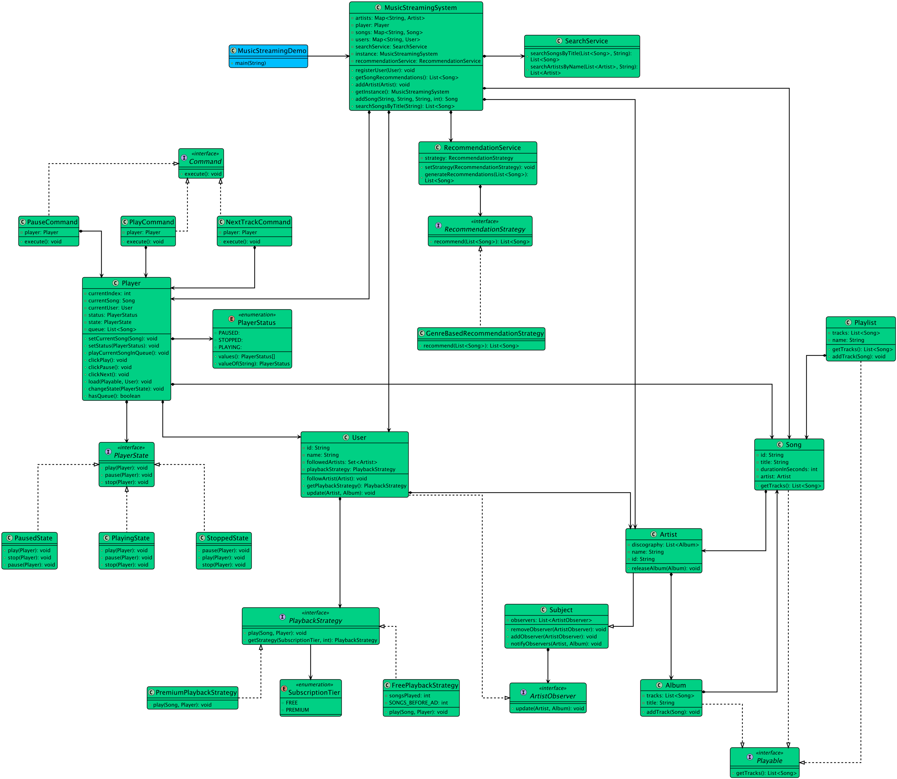

# Low-level design problem: music streaming service

> Copied from <https://github.com/ashishps1/awesome-low-level-design/blob/main/problems/music-streaming-service.md> (GPL-3.0, by Ashish Pratap Singh). Questions and answers are the source's own; nothing was answered or rewritten here.


# Designing an Online Music Streaming Service Like Spotify

## Requirements
1. The music streaming service should allow users to browse and search for songs, albums, and artists.
2. Users should be able to create and manage playlists.
3. The system should support user authentication and authorization.
4. Users should be able to play, pause, skip, and seek within songs.
5. The system should recommend songs and playlists based on user preferences and listening history.
6. The system should handle concurrent requests and ensure smooth streaming experience for multiple users.
7. The system should be scalable and handle a large volume of songs and users.
8. The system should be extensible to support additional features such as social sharing and offline playback.

## UML Class Diagram



## Implementations
#### [Java Implementation](https://github.com/ashishps1/awesome-low-level-design/blob/main/solutions/java/src/musicstreamingservice) 
#### [Python Implementation](https://github.com/ashishps1/awesome-low-level-design/blob/main/solutions/python/musicstreamingservice)
#### [C++ Implementation](https://github.com/ashishps1/awesome-low-level-design/blob/main/solutions/cpp/musicstreamingservice)
#### [C# Implementation](https://github.com/ashishps1/awesome-low-level-design/blob/main/solutions/csharp/musicstreamingservice)
#### [Go Implementation](https://github.com/ashishps1/awesome-low-level-design/blob/main/solutions/golang/musicstreamingservice)

## Classes, Interfaces and Enumerations
1. The **Song**, **Album**, and **Artist** classes represent the basic entities in the music streaming service, with properties such as ID, title, artist, album, duration, and relationships between them.
2. The **User** class represents a user of the music streaming service, with properties like ID, username, password, and a list of playlists.
3. The **Playlist** class represents a user-created playlist, containing a list of songs.
4. The **MusicLibrary** class serves as a central repository for storing and managing songs, albums, and artists. It follows the Singleton pattern to ensure a single instance of the music library.
5. The **UserManager** class handles user registration, login, and other user-related operations. It also follows the Singleton pattern.
6. The **MusicPlayer** class represents the music playback functionality, allowing users to play, pause, skip, and seek within songs.
7. The **MusicRecommender** class generates song recommendations based on user preferences and listening history. It follows the Singleton pattern.
8. The **MusicStreamingService** class is the main entry point of the music streaming service. It initializes the necessary components, handles user requests, and manages the overall functionality of the service.

---

## Official solutions from the repository

<details><summary><b>java</b> (29 files)</summary>


**MusicStreamingDemo.java**

```java
package musicstreamingservice;


import musicstreamingservice.command.NextTrackCommand;
import musicstreamingservice.command.PauseCommand;
import musicstreamingservice.command.PlayCommand;
import musicstreamingservice.enums.SubscriptionTier;
import musicstreamingservice.entities.*;

import java.util.List;

public class MusicStreamingDemo {
    public static void main(String[] args) throws InterruptedException {
        MusicStreamingSystem system = MusicStreamingSystem.getInstance();

        // --- Setup Catalog ---
        Artist daftPunk = new Artist("art1", "Daft Punk");
        system.addArtist(daftPunk);

        Album discovery = new Album("Discovery");
        Song s1 = system.addSong("s1", "One More Time", daftPunk.getId(), 320);
        Song s2 = system.addSong("s2", "Aerodynamic", daftPunk.getId(), 212);
        Song s3 = system.addSong("s3", "Digital Love", daftPunk.getId(), 301);
        Song s4 = system.addSong("s4", "Radioactive", daftPunk.getId(), 311);
        discovery.addTrack(s1);
        discovery.addTrack(s2);
        discovery.addTrack(s3);
        discovery.addTrack(s4);

        // --- Register Users (Builder Pattern) ---
        User freeUser = new User.Builder("Alice").withSubscription(SubscriptionTier.FREE, 0).build();
        User premiumUser = new User.Builder("Bob").withSubscription(SubscriptionTier.PREMIUM, 0).build();
        system.registerUser(freeUser);
        system.registerUser(premiumUser);

        // --- Observer Pattern: User follows artist ---
        System.out.println("--- Observer Pattern Demo ---");
        premiumUser.followArtist(daftPunk);
        daftPunk.releaseAlbum(discovery); // This will notify Bob
        System.out.println();

        // --- Strategy Pattern: Playback behavior ---
        System.out.println("--- Strategy Pattern (Free vs Premium) & State Pattern (Player) Demo ---");
        Player player = system.getPlayer();
        player.load(discovery, freeUser);

        // --- Command Pattern: Controlling the player ---
        PlayCommand play = new PlayCommand(player);
        PauseCommand pause = new PauseCommand(player);
        NextTrackCommand next = new NextTrackCommand(player);

        play.execute(); // Plays song 1
        next.execute(); // Plays song 2
        pause.execute(); // Pauses song 2
        play.execute(); // Resumes song 2
        next.execute(); // Plays song 3
        next.execute(); // Plays song 4 (ad for free user)
        System.out.println();

        // --- Premium user experience (no ads) ---
        System.out.println("--- Premium User Experience ---");
        player.load(discovery, premiumUser);
        play.execute();
        next.execute();
        System.out.println();

        // --- Composite Pattern: Play a playlist ---
        System.out.println("--- Composite Pattern Demo ---");
        Playlist myPlaylist = new Playlist("My Awesome Mix");
        myPlaylist.addTrack(s3); // Digital Love
        myPlaylist.addTrack(s1); // One More Time

        player.load(myPlaylist, premiumUser);
        play.execute();
        next.execute();
        System.out.println();

        // --- Search and Recommendation ---
        System.out.println("--- Search and Recommendation Service Demo ---");
        List<Song> searchResults = system.searchSongsByTitle("love");
        System.out.println("Search results for 'love': " + searchResults);

        List<Song> recommendations = system.getSongRecommendations();
        System.out.println("Your daily recommendations: " + recommendations);
    }
}
```


**MusicStreamingSystem.java**

```java
package musicstreamingservice;

import musicstreamingservice.entities.Artist;
import musicstreamingservice.entities.Player;
import musicstreamingservice.entities.Song;
import musicstreamingservice.entities.User;
import musicstreamingservice.services.RecommendationService;
import musicstreamingservice.services.SearchService;
import musicstreamingservice.strategies.recommendation.GenreBasedRecommendationStrategy;

import java.util.ArrayList;
import java.util.HashMap;
import java.util.List;
import java.util.Map;

public class MusicStreamingSystem {
    private static volatile MusicStreamingSystem instance;

    private final Map<String, User> users = new HashMap<>();
    private final Map<String, Song> songs = new HashMap<>();
    private final Map<String, Artist> artists = new HashMap<>();

    private final Player player;
    private final SearchService searchService;
    private final RecommendationService recommendationService;

    private MusicStreamingSystem() {
        this.player = new Player();
        this.searchService = new SearchService();
        this.recommendationService = new RecommendationService(new GenreBasedRecommendationStrategy());
    }
    public static MusicStreamingSystem getInstance() {
        if (instance == null) {
            synchronized (MusicStreamingSystem.class) {
                if (instance == null) {
                    instance = new MusicStreamingSystem();
                }
            }
        }
        return instance;
    }

    public void registerUser(User user) {
        users.put(user.getId(), user);
    }

    public Song addSong(String id, String title, String artistId, int duration) {
        Song song = new Song(id, title, artists.get(artistId), duration);
        songs.put(song.getId(), song);
        return song;
    }

    public void addArtist(Artist artist) {
        artists.put(artist.getId(), artist);
    }

    public List<Song> searchSongsByTitle(String title) {
        return searchService.searchSongsByTitle(new ArrayList<>(songs.values()), title);
    }

    public List<Song> getSongRecommendations() {
        return recommendationService.generateRecommendations(new ArrayList<>(songs.values()));
    }

    public Player getPlayer() { return player; }
}
```


**README.md**

```md
# Music Streaming Service (LLD)

## Problem Statement

Design and implement an online music streaming service (like Spotify) that allows users to browse, search, and play songs, manage playlists, follow artists, and receive recommendations.

---

## Requirements

- **User Management:** Users can register, log in, and manage their profiles.
- **Browse & Search:** Users can browse and search for songs, albums, and artists.
- **Playlists:** Users can create, update, and manage playlists.
- **Playback Controls:** Users can play, pause, skip, and seek within songs.
- **Recommendations:** The system recommends songs and playlists based on user preferences and listening history.
- **Follow Artists:** Users can follow artists to get updates and recommendations.
- **Concurrency:** The system handles concurrent requests and smooth streaming for multiple users.
- **Scalability:** The system is scalable to handle a large volume of songs and users.
- **Extensibility:** Easy to add features like social sharing, offline playback, or collaborative playlists.

---

## Core Entities

- **Song:** Represents a song with properties like ID, title, artist, album, and duration.
- **Album:** Represents an album containing multiple songs and associated with an artist.
- **Artist:** Represents a music artist, with a list of albums and songs.
- **User:** Represents a user with ID, username, password, playlists, and listening history.
- **Playlist:** Represents a user-created playlist containing a list of songs.
- **MusicLibrary:** Central repository for storing and managing songs, albums, and artists (Singleton).
- **UserManager:** Handles user registration, login, and user-related operations (Singleton).
- **MusicPlayer:** Handles music playback (play, pause, skip, seek).
- **MusicRecommender:** Generates song and playlist recommendations based on user preferences and history (Singleton).
- **MusicStreamingService:** Main entry point, initializes components, handles user requests, and manages overall functionality.

---

## Class Design

## UML Class Diagram


### 1. Song
- **Fields:** int id, String title, Artist artist, Album album, int duration
- **Methods:** getId(), getTitle(), getArtist(), getAlbum(), getDuration()

### 2. Album
- **Fields:** int id, String title, Artist artist, List<Song> songs
- **Methods:** getId(), getTitle(), getArtist(), getSongs()

### 3. Artist
- **Fields:** int id, String name, List<Album> albums, List<Song> songs
- **Methods:** getId(), getName(), getAlbums(), getSongs()

### 4. User
- **Fields:** int id, String username, String password, List<Playlist> playlists, List<Song> listeningHistory, List<Artist> followedArtists
- **Methods:** getId(), getUsername(), getPlaylists(), followArtist(Artist), etc.

### 5. Playlist
- **Fields:** int id, String name, List<Song> songs
- **Methods:** addSong(Song), removeSong(Song), getSongs()

### 6. MusicLibrary (Singleton)
- **Fields:** Map<Integer, Song> songs, Map<Integer, Album> albums, Map<Integer, Artist> artists
- **Methods:** addSong(Song), addAlbum(Album), addArtist(Artist), searchSongs(String), searchAlbums(String), searchArtists(String)

### 7. UserManager (Singleton)
- **Fields:** Map<Integer, User> users
- **Methods:** registerUser(...), login(...), getUser(int id)

### 8. MusicPlayer
- **Fields:** Song currentSong, int currentPosition, boolean isPlaying
- **Methods:** play(Song), pause(), skip(), seek(int position)

### 9. MusicRecommender (Singleton)
- **Methods:** recommendSongs(User), recommendPlaylists(User)

### 10. MusicStreamingService
- **Fields:** MusicLibrary library, UserManager userManager, MusicPlayer player, MusicRecommender recommender
- **Methods:** initialize(), handleUserRequest(...), etc.

---

## Design Patterns Used

- **Singleton Pattern:** For `MusicLibrary`, `UserManager`, and `MusicRecommender` to ensure a single instance.
---

## Example Usage

```java
MusicStreamingService service = new MusicStreamingService();
service.initialize();

User alice = service.getUserManager().registerUser("alice", "password");
Artist artist = new Artist(1, "The Beatles");
Album album = new Album(1, "Abbey Road", artist);
Song song = new Song(1, "Come Together", artist, album, 259);

service.getLibrary().addArtist(artist);
service.getLibrary().addAlbum(album);
service.getLibrary().addSong(song);

alice.getPlaylists().add(new Playlist(1, "Favorites"));
alice.getPlaylists().get(0).addSong(song);

service.getPlayer().play(song);
```

---

## Demo

See `MusicStreamingServiceDemo.java` for a sample usage and simulation of the music streaming service.

---

## Extending the Framework

- **Add social features:** Allow users to share playlists or follow each other.
- **Add offline playback:** Support downloading songs for offline listening.
- **Add collaborative playlists:** Allow multiple users to edit a playlist.

---
```


**command/Command.java**

```java
package musicstreamingservice.command;

public interface Command {
    void execute();
}
```


**command/NextTrackCommand.java**

```java
package musicstreamingservice.command;

import musicstreamingservice.entities.Player;

public class NextTrackCommand implements Command {
    private final Player player;

    public NextTrackCommand(Player player) { this.player = player; }

    @Override
    public void execute() { player.clickNext(); }
}
```


**command/PauseCommand.java**

```java
package musicstreamingservice.command;

import musicstreamingservice.entities.Player;

public class PauseCommand implements Command {
    private final Player player;

    public PauseCommand(Player player) { this.player = player; }

    @Override
    public void execute() { player.clickPause(); }
}
```


**command/PlayCommand.java**

```java
package musicstreamingservice.command;

import musicstreamingservice.entities.Player;

public class PlayCommand implements Command {
    private final Player player;

    public PlayCommand(Player player) { this.player = player; }

    @Override
    public void execute() { player.clickPlay(); }
}
```


**entities/Album.java**

```java
package musicstreamingservice.entities;

import java.util.ArrayList;
import java.util.List;

public class Album implements Playable {
    private final String title;
    private final List<Song> tracks = new ArrayList<>();

    public Album(String title) {
        this.title = title;
    }
    public void addTrack(Song song) { tracks.add(song); }

    @Override
    public List<Song> getTracks() { return List.copyOf(tracks); }

    public String getTitle() { return title; }
}
```


**entities/Artist.java**

```java
package musicstreamingservice.entities;

import musicstreamingservice.observer.Subject;

import java.util.ArrayList;
import java.util.List;

public class Artist extends Subject {
    private final String id;
    private final String name;
    private final List<Album> discography = new ArrayList<>();

    public Artist(String id, String name) {
        this.id = id;
        this.name = name;
    }
    public void releaseAlbum(Album album) {
        discography.add(album);
        System.out.printf("[System] Artist %s has released a new album: %s%n", name, album.getTitle());
        notifyObservers(this, album);
    }

    public String getId() { return id; }
    public String getName() { return name; }
}
```


**entities/Playable.java**

```java
package musicstreamingservice.entities;

import java.util.List;

public interface Playable {
    List<Song> getTracks();
}
```


**entities/Player.java**

```java
package musicstreamingservice.entities;

import musicstreamingservice.enums.PlayerStatus;
import musicstreamingservice.state.PlayerState;
import musicstreamingservice.state.StoppedState;

import java.util.ArrayList;
import java.util.List;

public class Player {
    private PlayerState state;
    private PlayerStatus status;
    private List<Song> queue = new ArrayList<>();
    private int currentIndex = -1;
    private Song currentSong;
    private User currentUser;

    public Player() {
        this.state = new StoppedState();
        this.status = PlayerStatus.STOPPED;
    }

    public void load(Playable playable, User user) {
        this.currentUser = user;
        this.queue = playable.getTracks();
        this.currentIndex = 0;
        System.out.printf("Loaded %d tracks for user %s.%n", queue.size(), user.getName());
        this.state = new StoppedState();
    }

    public void playCurrentSongInQueue() {
        if (currentIndex >= 0 && currentIndex < queue.size()) {
            Song songToPlay = queue.get(currentIndex);
            currentUser.getPlaybackStrategy().play(songToPlay, this);
        }
    }

    // Methods for state transitions
    public void clickPlay() { state.play(this); }
    public void clickPause() { state.pause(this); }

    public void clickNext() {
        if (currentIndex < queue.size() - 1) {
            currentIndex++;
            playCurrentSongInQueue();
        } else {
            System.out.println("End of queue.");
            state.stop(this);
        }
    }

    // Getters and Setters used by States
    public void changeState(PlayerState state) { this.state = state; }
    public void setStatus(PlayerStatus status) { this.status = status; }
    public void setCurrentSong(Song song) { this.currentSong = song; }
    public boolean hasQueue() { return !queue.isEmpty(); }
}
```


**entities/Playlist.java**

```java
package musicstreamingservice.entities;

import java.util.ArrayList;
import java.util.List;

public class Playlist implements Playable {
    private final String name;
    private final List<Song> tracks = new ArrayList<>();

    public Playlist(String name) { this.name = name; }

    public void addTrack(Song song) { tracks.add(song); }

    @Override
    public List<Song> getTracks() { return List.copyOf(tracks); }
}
```


**entities/Song.java**

```java
package musicstreamingservice.entities;

import java.util.Collections;
import java.util.List;

public class Song implements Playable {
    private final String id;
    private final String title;
    private final Artist artist;
    private final int durationInSeconds;

    public Song(String id, String title, Artist artist, int durationInSeconds) {
        this.id = id;
        this.title = title;
        this.artist = artist;
        this.durationInSeconds = durationInSeconds;
    }

    @Override
    public List<Song> getTracks() {
        return Collections.singletonList(this);
    }

    @Override
    public String toString() {
        return String.format("'%s' by %s", title, artist.getName());
    }

    public String getId() { return id; }
    public String getTitle() { return title; }
    public Artist getArtist() { return artist; }
}
```


**entities/User.java**

```java
package musicstreamingservice.entities;

import musicstreamingservice.enums.SubscriptionTier;
import musicstreamingservice.observer.ArtistObserver;
import musicstreamingservice.strategies.playback.PlaybackStrategy;

import java.util.HashSet;
import java.util.Set;
import java.util.UUID;

public class User implements ArtistObserver {
    private final String id;
    private final String name;
    private final PlaybackStrategy playbackStrategy;
    private final Set<Artist> followedArtists = new HashSet<>();

    private User(String id, String name, PlaybackStrategy strategy) {
        this.id = id;
        this.name = name;
        this.playbackStrategy = strategy;
    }

    public void followArtist(Artist artist) {
        followedArtists.add(artist);
        artist.addObserver(this);
    }

    @Override
    public void update(Artist artist, Album newAlbum) {
        System.out.printf("[Notification for %s] Your followed artist %s just released a new album: %s!%n",
                this.name, artist.getName(), newAlbum.getTitle());
    }

    public PlaybackStrategy getPlaybackStrategy() { return playbackStrategy; }

    public String getId() { return id; }
    public String getName() { return name; }

    // Builder Pattern
    public static class Builder {
        private final String id;
        private final String name;
        private PlaybackStrategy playbackStrategy;

        public Builder(String name) {
            this.id = UUID.randomUUID().toString();
            this.name = name;
        }
        public Builder withSubscription(SubscriptionTier tier, int songsPlayed) {
            this.playbackStrategy = PlaybackStrategy.getStrategy(tier, songsPlayed);
            return this;
        }
        public User build() {
            return new User(id, name, playbackStrategy);
        }
    }
}
```


**enums/PlayerStatus.java**

```java
package musicstreamingservice.enums;

public enum PlayerStatus {
    PLAYING,
    PAUSED,
    STOPPED
}
```


**enums/SubscriptionTier.java**

```java
package musicstreamingservice.enums;

public enum SubscriptionTier {
    FREE,
    PREMIUM
}
```


**observer/ArtistObserver.java**

```java
package musicstreamingservice.observer;

import musicstreamingservice.entities.Album;
import musicstreamingservice.entities.Artist;

public interface ArtistObserver {
    void update(Artist artist, Album newAlbum);
}
```


**observer/Subject.java**

```java
package musicstreamingservice.observer;

import musicstreamingservice.entities.Album;
import musicstreamingservice.entities.Artist;

import java.util.ArrayList;
import java.util.List;

public abstract class Subject {
    private final List<ArtistObserver> observers = new ArrayList<>();

    public void addObserver(ArtistObserver observer) { observers.add(observer); }

    public void removeObserver(ArtistObserver observer) { observers.remove(observer); }

    public void notifyObservers(Artist artist, Album album) {
        for (ArtistObserver observer : observers) {
            observer.update(artist, album);
        }
    }
}
```


**services/RecommendationService.java**

```java
package musicstreamingservice.services;

import musicstreamingservice.entities.Song;
import musicstreamingservice.strategies.recommendation.RecommendationStrategy;

import java.util.List;

public class RecommendationService {
    private RecommendationStrategy strategy;

    public RecommendationService(RecommendationStrategy strategy) { this.strategy = strategy; }

    public void setStrategy(RecommendationStrategy strategy) { this.strategy = strategy; }

    public List<Song> generateRecommendations(List<Song> allSongs) {
        return strategy.recommend(allSongs);
    }
}
```


**services/SearchService.java**

```java
package musicstreamingservice.services;

import musicstreamingservice.entities.Artist;
import musicstreamingservice.entities.Song;

import java.util.List;
import java.util.stream.Collectors;

public class SearchService {
    public List<Song> searchSongsByTitle(List<Song> songs, String query) {
        return songs.stream()
                .filter(s -> s.getTitle().toLowerCase().contains(query.toLowerCase()))
                .collect(Collectors.toList());
    }
    public List<Artist> searchArtistsByName(List<Artist> artists, String query) {
        return artists.stream()
                .filter(a -> a.getName().toLowerCase().contains(query.toLowerCase()))
                .collect(Collectors.toList());
    }
}
```


**state/PausedState.java**

```java
package musicstreamingservice.state;

import musicstreamingservice.enums.PlayerStatus;
import musicstreamingservice.entities.Player;

public class PausedState implements PlayerState {
    @Override
    public void play(Player player) {
        System.out.println("Resuming playback.");
        player.changeState(new PlayingState());
        player.setStatus(PlayerStatus.PLAYING);
    }

    @Override
    public void pause(Player player) { System.out.println("Already paused."); }

    @Override
    public void stop(Player player) {
        System.out.println("Stopping playback from paused state.");
        player.changeState(new StoppedState());
        player.setStatus(PlayerStatus.STOPPED);
    }
}
```


**state/PlayerState.java**

```java
package musicstreamingservice.state;

import musicstreamingservice.entities.Player;

public interface PlayerState {
    void play(Player player);
    void pause(Player player);
    void stop(Player player);
}
```


**state/PlayingState.java**

```java
package musicstreamingservice.state;

import musicstreamingservice.enums.PlayerStatus;
import musicstreamingservice.entities.Player;

public class PlayingState implements PlayerState {
    @Override
    public void play(Player player) { System.out.println("Already playing."); }

    @Override
    public void pause(Player player) {
        System.out.println("Pausing playback." + player);
        player.changeState(new PausedState());
        player.setStatus(PlayerStatus.PAUSED);
    }

    @Override
    public void stop(Player player) {
        System.out.println("Stopping playback.");
        player.changeState(new StoppedState());
        player.setStatus(PlayerStatus.STOPPED);
    }
}
```


**state/StoppedState.java**

```java
package musicstreamingservice.state;

import musicstreamingservice.enums.PlayerStatus;
import musicstreamingservice.entities.Player;

public class StoppedState implements PlayerState {
    @Override
    public void play(Player player) {
        if (player.hasQueue()) {
            System.out.println("Starting playback.");
            player.changeState(new PlayingState());
            player.setStatus(PlayerStatus.PLAYING);
            player.playCurrentSongInQueue();
        } else {
            System.out.println("Queue is empty. Load songs to play.");
        }
    }

    @Override
    public void pause(Player player) { System.out.println("Cannot pause. Player is stopped."); }

    @Override
    public void stop(Player player) { System.out.println("Already stopped."); }
}
```


**strategies/playback/FreePlaybackStrategy.java**

```java
package musicstreamingservice.strategies.playback;

import musicstreamingservice.entities.Player;
import musicstreamingservice.entities.Song;

public class FreePlaybackStrategy implements PlaybackStrategy {
    private int songsPlayed;
    private static final int SONGS_BEFORE_AD = 3;

    public FreePlaybackStrategy(int initialSongsPlayed) {
        this.songsPlayed = initialSongsPlayed;
    }

    @Override
    public void play(Song song, Player player) {
        if (songsPlayed > 0 && songsPlayed % SONGS_BEFORE_AD == 0) {
            System.out.println("\n>>> Playing Advertisement: 'Buy Spotify Premium for ad-free music!' <<<\n");
        }
        player.setCurrentSong(song);
        System.out.printf("Free User is now playing: %s%n", song);
        songsPlayed++;
    }
}
```


**strategies/playback/PlaybackStrategy.java**

```java
package musicstreamingservice.strategies.playback;

import musicstreamingservice.enums.SubscriptionTier;
import musicstreamingservice.entities.Player;
import musicstreamingservice.entities.Song;

public interface PlaybackStrategy {
    void play(Song song, Player player);

    // Simple Factory method to get the correct strategy
    static PlaybackStrategy getStrategy(SubscriptionTier tier, int songsPlayed) {
        return tier == SubscriptionTier.PREMIUM ? new PremiumPlaybackStrategy() : new FreePlaybackStrategy(songsPlayed);
    }
}
```


**strategies/playback/PremiumPlaybackStrategy.java**

```java
package musicstreamingservice.strategies.playback;

import musicstreamingservice.entities.Player;
import musicstreamingservice.entities.Song;

public class PremiumPlaybackStrategy implements PlaybackStrategy {
    @Override
    public void play(Song song, Player player) {
        player.setCurrentSong(song);
        System.out.printf("Premium User is now playing: %s%n", song);
    }
}
```


**strategies/recommendation/GenreBasedRecommendationStrategy.java**

```java
package musicstreamingservice.strategies.recommendation;

import musicstreamingservice.entities.Song;

import java.util.Collections;
import java.util.List;
import java.util.stream.Collectors;

public class GenreBasedRecommendationStrategy implements RecommendationStrategy {
    // In a real system, songs would have genres. We simulate this.
    @Override
    public List<Song> recommend(List<Song> allSongs) {
        System.out.println("Generating genre-based recommendations (simulated)...");
        List<Song> shuffled = new java.util.ArrayList<>(allSongs);
        Collections.shuffle(shuffled);
        return shuffled.stream().limit(5).collect(Collectors.toList());
    }
}
```


**strategies/recommendation/RecommendationStrategy.java**

```java
package musicstreamingservice.strategies.recommendation;

import musicstreamingservice.entities.Song;

import java.util.List;

public interface RecommendationStrategy {
    List<Song> recommend(List<Song> allSongs);
}
```

</details>

<details><summary><b>python</b> (16 files)</summary>


**README.md**

```md
# Designing an Online Music Streaming Service Like Spotify

## Requirements
1. The music streaming service should allow users to browse and search for songs, albums, and artists.
2. Users should be able to create and manage playlists.
3. The system should support user authentication and authorization.
4. Users should be able to play, pause, skip, and seek within songs.
5. The system should recommend songs and playlists based on user preferences and listening history.
6. The system should handle concurrent requests and ensure smooth streaming experience for multiple users.
7. The system should be scalable and handle a large volume of songs and users.
8. The system should be extensible to support additional features such as social sharing and offline playback.

## Classes, Interfaces and Enumerations
1. The **Song**, **Album**, and **Artist** classes represent the basic entities in the music streaming service, with properties such as ID, title, artist, album, duration, and relationships between them.
2. The **User** class represents a user of the music streaming service, with properties like ID, username, password, and a list of playlists.
3. The **Playlist** class represents a user-created playlist, containing a list of songs.
4. The **MusicLibrary** class serves as a central repository for storing and managing songs, albums, and artists. It follows the Singleton pattern to ensure a single instance of the music library.
5. The **UserManager** class handles user registration, login, and other user-related operations. It also follows the Singleton pattern.
6. The **MusicPlayer** class represents the music playback functionality, allowing users to play, pause, skip, and seek within songs.
7. The **MusicRecommender** class generates song recommendations based on user preferences and listening history. It follows the Singleton pattern.
8. The **MusicStreamingService** class is the main entry point of the music streaming service. It initializes the necessary components, handles user requests, and manages the overall functionality of the service.
```


**artist.py**

```py
from playable import Album
from typing import List
from observer import Subject

class Artist(Subject):
    def __init__(self, artist_id: str, name: str):
        super().__init__()
        self._id = artist_id
        self._name = name
        self._discography: List['Album'] = []
    
    def release_album(self, album: 'Album'):
        self._discography.append(album)
        print(f"[System] Artist {self._name} has released a new album: {album.get_title()}")
        self.notify_observers(self, album)
    
    @property
    def id(self) -> str:
        return self._id
    
    def get_name(self) -> str:
        return self._name
```


**command.py**

```py
from abc import ABC, abstractmethod
from player import Player

class Command(ABC):
    @abstractmethod
    def execute(self):
        pass

class PlayCommand(Command):
    def __init__(self, player: Player):
        self._player = player
    
    def execute(self):
        self._player.click_play()

class PauseCommand(Command):
    def __init__(self, player: Player):
        self._player = player
    
    def execute(self):
        self._player.click_pause()

class NextTrackCommand(Command):
    def __init__(self, player: Player):
        self._player = player
    
    def execute(self):
        self._player.click_next()
```


**music_streaming_demo.py**

```py
from music_streaming_system import MusicStreamingSystem
from artist import Artist
from playable import Album
from user import User
from subscription_tier import SubscriptionTier
from command import PlayCommand, PauseCommand, NextTrackCommand
from playable import Playlist

class MusicStreamingDemo:
    @staticmethod
    def main():
        system = MusicStreamingSystem.get_instance()
        
        # --- Setup Catalog ---
        daft_punk = Artist("art1", "Daft Punk")
        system.add_artist(daft_punk)
        
        discovery = Album("Discovery")
        s1 = system.add_song("s1", "One More Time", daft_punk.id, 320)
        s2 = system.add_song("s2", "Aerodynamic", daft_punk.id, 212)
        s3 = system.add_song("s3", "Digital Love", daft_punk.id, 301)
        s4 = system.add_song("s4", "Radioactive", daft_punk.id, 311)
        discovery.add_track(s1)
        discovery.add_track(s2)
        discovery.add_track(s3)
        discovery.add_track(s4)
        
        # --- Register Users (Builder Pattern) ---
        free_user = User.Builder("Alice").with_subscription(SubscriptionTier.FREE, 0).build()
        premium_user = User.Builder("Bob").with_subscription(SubscriptionTier.PREMIUM, 0).build()
        system.register_user(free_user)
        system.register_user(premium_user)
        
        # --- Observer Pattern: User follows artist ---
        print("--- Observer Pattern Demo ---")
        premium_user.follow_artist(daft_punk)
        daft_punk.release_album(discovery)  # This will notify Bob
        print()
        
        # --- Strategy Pattern: Playback behavior ---
        print("--- Strategy Pattern (Free vs Premium) & State Pattern (Player) Demo ---")
        player = system.get_player()
        player.load(discovery, free_user)
        
        # --- Command Pattern: Controlling the player ---
        play = PlayCommand(player)
        pause = PauseCommand(player)
        next_track = NextTrackCommand(player)
        
        play.execute()  # Plays song 1
        next_track.execute()  # Plays song 2
        pause.execute()  # Pauses song 2
        play.execute()  # Resumes song 2
        next_track.execute()  # Plays song 3
        next_track.execute()  # Plays song 4 (ad for free user)
        print()
        
        # --- Premium user experience (no ads) ---
        print("--- Premium User Experience ---")
        player.load(discovery, premium_user)
        play.execute()
        next_track.execute()
        print()
        
        # --- Composite Pattern: Play a playlist ---
        print("--- Composite Pattern Demo ---")
        my_playlist = Playlist("My Awesome Mix")
        my_playlist.add_track(s3)  # Digital Love
        my_playlist.add_track(s1)  # One More Time
        
        player.load(my_playlist, premium_user)
        play.execute()
        next_track.execute()
        print()
        
        # --- Search and Recommendation ---
        print("--- Search and Recommendation Service Demo ---")
        search_results = system.search_songs_by_title("love")
        print(f"Search results for 'love': {search_results}")
        
        recommendations = system.get_song_recommendations()
        print(f"Your daily recommendations: {recommendations}")

if __name__ == "__main__":
    MusicStreamingDemo.main()
```


**music_streaming_system.py**

```py
import threading
from typing import Dict, List
from user import User
from playable import Song
from artist import Artist
from player import Player
from search_service import SearchService
from recommendation_service import RecommendationService
from recommendation_strategy import GenreBasedRecommendationStrategy

class MusicStreamingSystem:
    _instance = None
    _lock = threading.Lock()
    
    def __new__(cls):
        if cls._instance is None:
            with cls._lock:
                if cls._instance is None:
                    cls._instance = super().__new__(cls)
                    cls._instance._initialized = False
        return cls._instance
    
    def __init__(self):
        if not self._initialized:
            self._users: Dict[str, User] = {}
            self._songs: Dict[str, Song] = {}
            self._artists: Dict[str, Artist] = {}
            self._player = Player()
            self._search_service = SearchService()
            self._recommendation_service = RecommendationService(GenreBasedRecommendationStrategy())
            self._initialized = True
    
    @classmethod
    def get_instance(cls):
        return cls()
    
    def register_user(self, user: User):
        self._users[user.id] = user
    
    def add_song(self, song_id: str, title: str, artist_id: str, duration: int) -> Song:
        song = Song(song_id, title, self._artists[artist_id], duration)
        self._songs[song.id] = song
        return song
    
    def add_artist(self, artist: Artist):
        self._artists[artist.id] = artist
    
    def search_songs_by_title(self, title: str) -> List[Song]:
        return self._search_service.search_songs_by_title(list(self._songs.values()), title)
    
    def get_song_recommendations(self) -> List[Song]:
        return self._recommendation_service.generate_recommendations(list(self._songs.values()))
    
    def get_player(self) -> Player:
        return self._player
```


**observer.py**

```py
from abc import ABC, abstractmethod
from typing import List
from typing import TYPE_CHECKING

if TYPE_CHECKING:
    from artist import Artist
    from playable import Album

class ArtistObserver(ABC):
    @abstractmethod
    def update(self, artist: 'Artist', new_album: 'Album'):
        pass

class Subject:
    def __init__(self):
        self._observers: List[ArtistObserver] = []
    
    def add_observer(self, observer: ArtistObserver):
        self._observers.append(observer)
    
    def remove_observer(self, observer: ArtistObserver):
        if observer in self._observers:
            self._observers.remove(observer)
    
    def notify_observers(self, artist: 'Artist', album: 'Album'):
        for observer in self._observers:
            observer.update(artist, album)
```


**playable.py**

```py
from abc import ABC, abstractmethod
from typing import List
from typing import TYPE_CHECKING

if TYPE_CHECKING:
    from artist import Artist

class Playable(ABC):
    @abstractmethod
    def get_tracks(self) -> List['Song']:
        pass

class Song(Playable):
    def __init__(self, song_id: str, title: str, artist: 'Artist', duration_in_seconds: int):
        self._id = song_id
        self._title = title
        self._artist = artist
        self._duration_in_seconds = duration_in_seconds
    
    def get_tracks(self) -> List['Song']:
        return [self]
    
    def __str__(self) -> str:
        return f"'{self._title}' by {self._artist.get_name()}"
    
    @property
    def id(self) -> str:
        return self._id
    
    @property
    def title(self) -> str:
        return self._title
    
    @property
    def artist(self) -> 'Artist':
        return self._artist
    
class Album(Playable):
    def __init__(self, title: str):
        self._title = title
        self._tracks: List[Song] = []
    
    def add_track(self, song: Song):
        self._tracks.append(song)
    
    def get_tracks(self) -> List[Song]:
        return self._tracks.copy()
    
    def get_title(self) -> str:
        return self._title
    
class Playlist(Playable):
    def __init__(self, name: str):
        self._name = name
        self._tracks: List[Song] = []
    
    def add_track(self, song: Song):
        self._tracks.append(song)
    
    def get_tracks(self) -> List[Song]:
        return self._tracks.copy()
```


**playback_strategy.py**

```py
from abc import ABC, abstractmethod
from subscription_tier import SubscriptionTier
from playable import Song
from player import Player
from typing import TYPE_CHECKING

if TYPE_CHECKING:
    from player import Player

class PlaybackStrategy(ABC):
    @abstractmethod
    def play(self, song: Song, player: 'Player'):
        pass
    
    @staticmethod
    def get_strategy(tier: SubscriptionTier, songs_played: int) -> 'PlaybackStrategy':
        if tier == SubscriptionTier.PREMIUM:
            return PremiumPlaybackStrategy()
        else:
            return FreePlaybackStrategy(songs_played)

class FreePlaybackStrategy(PlaybackStrategy):
    SONGS_BEFORE_AD = 3
    
    def __init__(self, initial_songs_played: int):
        self._songs_played = initial_songs_played
    
    def play(self, song: Song, player: 'Player'):
        if self._songs_played > 0 and self._songs_played % self.SONGS_BEFORE_AD == 0:
            print("\n>>> Playing Advertisement: 'Buy Spotify Premium for ad-free music!' <<<\n")
        player.set_current_song(song)
        print(f"Free User is now playing: {song}")
        self._songs_played += 1

class PremiumPlaybackStrategy(PlaybackStrategy):
    def play(self, song: Song, player: 'Player'):
        player.set_current_song(song)
        print(f"Premium User is now playing: {song}")
```


**player.py**

```py
from player_status import PlayerStatus
from playable import Playable, Song
from typing import List, Optional
from player_states import PlayerState, StoppedState
from typing import TYPE_CHECKING

if TYPE_CHECKING:
    from user import User

class Player:
    def __init__(self):
        self._state = StoppedState()
        self._status = PlayerStatus.STOPPED
        self._queue: List[Song] = []
        self._current_index = -1
        self._current_song: Optional[Song] = None
        self._current_user: Optional[User] = None
    
    def load(self, playable: Playable, user: 'User'):
        self._current_user = user
        self._queue = playable.get_tracks()
        self._current_index = 0
        print(f"Loaded {len(self._queue)} tracks for user {user.get_name()}.")
        self._state = StoppedState()
    
    def play_current_song_in_queue(self):
        if 0 <= self._current_index < len(self._queue):
            song_to_play = self._queue[self._current_index]
            self._current_user.playback_strategy.play(song_to_play, self)
    
    def click_play(self):
        self._state.play(self)
    
    def click_pause(self):
        self._state.pause(self)
    
    def click_next(self):
        if self._current_index < len(self._queue) - 1:
            self._current_index += 1
            self.play_current_song_in_queue()
        else:
            print("End of queue.")
            self._state.stop(self)
    
    def change_state(self, state: PlayerState):
        self._state = state
    
    def set_status(self, status: PlayerStatus):
        self._status = status
    
    def set_current_song(self, song: Song):
        self._current_song = song
    
    def has_queue(self) -> bool:
        return len(self._queue) > 0
```


**player_states.py**

```py
from abc import ABC, abstractmethod
from player_status import PlayerStatus
from typing import TYPE_CHECKING

if TYPE_CHECKING:
    from player import Player

class PlayerState(ABC):
    @abstractmethod
    def play(self, player: 'Player'):
        pass
    
    @abstractmethod
    def pause(self, player: 'Player'):
        pass
    
    @abstractmethod
    def stop(self, player: 'Player'):
        pass

class PausedState(PlayerState):
    def play(self, player: 'Player'):
        print("Resuming playback.")
        player.change_state(PlayingState())
        player.set_status(PlayerStatus.PLAYING)
    
    def pause(self, player: 'Player'):
        print("Already paused.")
    
    def stop(self, player: 'Player'):
        print("Stopping playback from paused state.")
        player.change_state(StoppedState())
        player.set_status(PlayerStatus.STOPPED)

class PlayingState(PlayerState):
    def play(self, player: 'Player'):
        print("Already playing.")
    
    def pause(self, player: 'Player'):
        print("Pausing playback.")
        player.change_state(PausedState())
        player.set_status(PlayerStatus.PAUSED)
    
    def stop(self, player: 'Player'):
        print("Stopping playback.")
        player.change_state(StoppedState())
        player.set_status(PlayerStatus.STOPPED)

class StoppedState(PlayerState):
    def play(self, player: 'Player'):
        if player.has_queue():
            print("Starting playback.")
            player.change_state(PlayingState())
            player.set_status(PlayerStatus.PLAYING)
            player.play_current_song_in_queue()
        else:
            print("Queue is empty. Load songs to play.")
    
    def pause(self, player: 'Player'):
        print("Cannot pause. Player is stopped.")
    
    def stop(self, player: 'Player'):
        print("Already stopped.")
```


**player_status.py**

```py
from enum import Enum

class PlayerStatus(Enum):
    PLAYING = "PLAYING"
    PAUSED = "PAUSED"
    STOPPED = "STOPPED"
```


**recommendation_service.py**

```py
from recommendation_strategy import RecommendationStrategy
from playable import Song
from typing import List

class RecommendationService:
    def __init__(self, strategy: RecommendationStrategy):
        self._strategy = strategy
    
    def set_strategy(self, strategy: RecommendationStrategy):
        self._strategy = strategy
    
    def generate_recommendations(self, all_songs: List[Song]) -> List[Song]:
        return self._strategy.recommend(all_songs)
```


**recommendation_strategy.py**

```py
from abc import ABC, abstractmethod
from typing import List
from playable import Song
import random

class RecommendationStrategy(ABC):
    @abstractmethod
    def recommend(self, all_songs: List[Song]) -> List[Song]:
        pass

class GenreBasedRecommendationStrategy(RecommendationStrategy):
    def recommend(self, all_songs: List[Song]) -> List[Song]:
        print("Generating genre-based recommendations (simulated)...")
        shuffled = all_songs.copy()
        random.shuffle(shuffled)
        return shuffled[:5]
```


**search_service.py**

```py
from typing import List
from playable import Song
from artist import Artist

class SearchService:
    def search_songs_by_title(self, songs: List[Song], query: str) -> List[Song]:
        return [s for s in songs if query.lower() in s.title.lower()]
    
    def search_artists_by_name(self, artists: List[Artist], query: str) -> List[Artist]:
        return [a for a in artists if query.lower() in a.get_name().lower()]
```


**subscription_tier.py**

```py
from enum import Enum

class SubscriptionTier(Enum):
    FREE = "FREE"
    PREMIUM = "PREMIUM"
```


**user.py**

```py
from observer import ArtistObserver
from typing import Set
from artist import Artist
from playable import Album
from subscription_tier import SubscriptionTier
from playback_strategy import PlaybackStrategy
import uuid

class User(ArtistObserver):
    def __init__(self, user_id: str, name: str, playback_strategy: PlaybackStrategy):
        self._id = user_id
        self._name = name
        self._playback_strategy = playback_strategy
        self._followed_artists: Set[Artist] = set()
    
    def follow_artist(self, artist: Artist):
        self._followed_artists.add(artist)
        artist.add_observer(self)
    
    def update(self, artist: Artist, new_album: Album):
        print(f"[Notification for {self._name}] Your followed artist {artist.get_name()} "
              f"just released a new album: {new_album.get_title()}!")
    
    @property
    def playback_strategy(self) -> PlaybackStrategy:
        return self._playback_strategy
    
    @property
    def id(self) -> str:
        return self._id
    
    def get_name(self) -> str:
        return self._name
    
    class Builder:
        def __init__(self, name: str):
            self._id = str(uuid.uuid4())
            self._name = name
            self._playback_strategy = None
        
        def with_subscription(self, tier: SubscriptionTier, songs_played: int) -> 'User.Builder':
            self._playback_strategy = PlaybackStrategy.get_strategy(tier, songs_played)
            return self
        
        def build(self) -> 'User':
            return User(self._id, self._name, self._playback_strategy)
```

</details>

<details><summary><b>cpp</b> (12 files)</summary>


**Artist.cpp**

```cpp
#include "Artist.hpp"
#include <iostream>
#include <algorithm>

Artist::Artist(std::string artistId, std::string name, std::string bio)
    : artistId(artistId), name(name), bio(bio), active(true) {}

Artist::~Artist() {
    for (auto song : songs) {
        delete song;
    }
}

std::string Artist::getArtistId() const { return artistId; }
std::string Artist::getName() const { return name; }
std::string Artist::getBio() const { return bio; }
bool Artist::isActive() const { return active; }
const std::vector<Song*>& Artist::getSongs() const { return songs; }

void Artist::addSong(Song* song) {
    songs.push_back(song);
}

void Artist::removeSong(Song* song) {
    auto it = std::find(songs.begin(), songs.end(), song);
    if (it != songs.end()) {
        delete *it;
        songs.erase(it);
    }
}

void Artist::setActive(bool status) {
    active = status;
}

void Artist::displayInfo() const {
    std::cout << "Artist: " << name << " (ID: " << artistId << ")" << std::endl;
    std::cout << "Bio: " << bio << std::endl;
    std::cout << "Status: " << (active ? "Active" : "Inactive") << std::endl;
    std::cout << "Number of Songs: " << songs.size() << std::endl;
    
    if (!songs.empty()) {
        std::cout << "\nSongs:" << std::endl;
        for (const auto& song : songs) {
            std::cout << "- " << song->getTitle() << " (" << song->getAlbum() << ")" << std::endl;
        }
    }
}
```


**Artist.hpp**

```hpp
#ifndef ARTIST_HPP
#define ARTIST_HPP

#include <string>
#include <vector>
#include "Song.hpp"

class Artist {
private:
    std::string artistId;
    std::string name;
    std::string bio;
    std::vector<Song*> songs;
    bool active;

public:
    Artist(std::string artistId, std::string name, std::string bio);
    ~Artist();
    
    std::string getArtistId() const;
    std::string getName() const;
    std::string getBio() const;
    bool isActive() const;
    const std::vector<Song*>& getSongs() const;
    
    void addSong(Song* song);
    void removeSong(Song* song);
    void setActive(bool status);
    void displayInfo() const;
};

#endif
```


**MusicStreamingDemo.cpp**

```cpp
#include "MusicStreamingService.hpp"
#include <iostream>

int main() {
    MusicStreamingService service;
    
    // Create users
    User* user1 = new User("U001", "john_doe", "john@email.com");
    User* user2 = new User("U002", "jane_smith", "jane@email.com", UserType::PREMIUM);
    service.addUser(user1);
    service.addUser(user2);
    
    // Create artists
    Artist* artist1 = new Artist("A001", "The Beatles", "Legendary British rock band");
    Artist* artist2 = new Artist("A002", "Queen", "Iconic rock band led by Freddie Mercury");
    service.addArtist(artist1);
    service.addArtist(artist2);
    
    // Add songs
    Song* song1 = new Song("S001", "Hey Jude", "The Beatles", "The Beatles", 
                          Genre::ROCK, 431, "path/to/hey_jude.mp3");
    Song* song2 = new Song("S002", "Let It Be", "The Beatles", "Let It Be",
                          Genre::ROCK, 243, "path/to/let_it_be.mp3");
    Song* song3 = new Song("S003", "Bohemian Rhapsody", "Queen", "A Night at the Opera",
                          Genre::ROCK, 354, "path/to/bohemian_rhapsody.mp3");
    
    service.addSong(song1, "A001");
    service.addSong(song2, "A001");
    service.addSong(song3, "A002");
    
    // Display all songs and artists
    std::cout << "Initial catalog:" << std::endl;
    service.displayAllSongs();
    service.displayAllArtists();
    
    // Create playlists
    Playlist* playlist1 = service.createPlaylist("U001", "Rock Classics",
                                               "Best rock songs of all time");
    if (playlist1) {
        service.addSongToPlaylist(playlist1->getPlaylistId(), "S001");
        service.addSongToPlaylist(playlist1->getPlaylistId(), "S003");
    }
    
    Playlist* playlist2 = service.createPlaylist("U002", "Beatles Only",
                                               "Beatles songs collection", false);
    if (playlist2) {
        service.addSongToPlaylist(playlist2->getPlaylistId(), "S001");
        service.addSongToPlaylist(playlist2->getPlaylistId(), "S002");
    }
    
    // Display user playlists
    std::cout << "\nUser Playlists:" << std::endl;
    service.displayUserPlaylists("U001");
    service.displayUserPlaylists("U002");
    
    // Search functionality
    std::cout << "\nSearching for 'Beatles':" << std::endl;
    auto songResults = service.searchSongs("Beatles");
    for (const auto& song : songResults) {
        song->displayInfo();
    }
    
    // Remove song from playlist
    std::cout << "\nRemoving 'Hey Jude' from Rock Classics playlist..." << std::endl;
    if (service.removeSongFromPlaylist(playlist1->getPlaylistId(), "S001")) {
        std::cout << "Song removed successfully" << std::endl;
        service.displayUserPlaylists("U001");
    }
    
    // Upgrade user to premium
    std::cout << "\nUpgrading user john_doe to premium..." << std::endl;
    user1->upgradeToPremuim();
    user1->displayInfo();
    
    return 0;
}
```


**MusicStreamingService.cpp**

```cpp
#include "MusicStreamingService.hpp"
#include <iostream>
#include <algorithm>

MusicStreamingService::MusicStreamingService() : playlistIdCounter(1) {}

MusicStreamingService::~MusicStreamingService() {
    for (auto user : users) delete user;
    for (auto artist : artists) delete artist;
    for (auto song : songs) delete song;
}

void MusicStreamingService::addUser(User* user) {
    users.push_back(user);
}

void MusicStreamingService::addArtist(Artist* artist) {
    artists.push_back(artist);
}

void MusicStreamingService::addSong(Song* song, std::string artistId) {
    Artist* artist = findArtist(artistId);
    if (artist && artist->isActive()) {
        songs.push_back(song);
        artist->addSong(song);
    }
}

Playlist* MusicStreamingService::createPlaylist(std::string userId, std::string name,
                                              std::string description, bool isPublic) {
    User* user = findUser(userId);
    if (!user || !user->isActive()) return nullptr;
    
    Playlist* playlist = new Playlist(generatePlaylistId(), name, description, isPublic);
    user->addPlaylist(playlist);
    return playlist;
}

bool MusicStreamingService::addSongToPlaylist(std::string playlistId, std::string songId) {
    Playlist* playlist = findPlaylist(playlistId);
    Song* song = findSong(songId);
    
    if (playlist && song && song->isActive()) {
        playlist->addSong(song);
        return true;
    }
    return false;
}

bool MusicStreamingService::removeSongFromPlaylist(std::string playlistId, std::string songId) {
    Playlist* playlist = findPlaylist(playlistId);
    Song* song = findSong(songId);
    
    if (playlist && song) {
        playlist->removeSong(song);
        return true;
    }
    return false;
}

std::vector<Song*> MusicStreamingService::searchSongs(const std::string& query) const {
    std::vector<Song*> results;
    for (auto song : songs) {
        if (song->isActive() && 
            (song->getTitle().find(query) != std::string::npos ||
             song->getArtist().find(query) != std::string::npos ||
             song->getAlbum().find(query) != std::string::npos)) {
            results.push_back(song);
        }
    }
    return results;
}

std::vector<Artist*> MusicStreamingService::searchArtists(const std::string& query) const {
    std::vector<Artist*> results;
    for (auto artist : artists) {
        if (artist->isActive() && 
            (artist->getName().find(query) != std::string::npos ||
             artist->getBio().find(query) != std::string::npos)) {
            results.push_back(artist);
        }
    }
    return results;
}

std::vector<Playlist*> MusicStreamingService::searchPlaylists(const std::string& query) const {
    std::vector<Playlist*> results;
    for (auto user : users) {
        for (auto playlist : user->getPlaylists()) {
            if (playlist->getIsPublic() && 
                (playlist->getName().find(query) != std::string::npos ||
                 playlist->getDescription().find(query) != std::string::npos)) {
                results.push_back(playlist);
            }
        }
    }
    return results;
}

void MusicStreamingService::displayAllSongs() const {
    std::cout << "\nAll Songs:" << std::endl;
    for (const auto& song : songs) {
        if (song->isActive()) {
            song->displayInfo();
            std::cout << "------------------------" << std::endl;
        }
    }
}

void MusicStreamingService::displayAllArtists() const {
    std::cout << "\nAll Artists:" << std::endl;
    for (const auto& artist : artists) {
        if (artist->isActive()) {
            artist->displayInfo();
            std::cout << "------------------------" << std::endl;
        }
    }
}

void MusicStreamingService::displayUserPlaylists(std::string userId) const {
    User* user = findUser(userId);
    if (user && user->isActive()) {
        std::cout << "\nPlaylists for user " << user->getUsername() << ":" << std::endl;
        for (const auto& playlist : user->getPlaylists()) {
            playlist->displayInfo();
            std::cout << "------------------------" << std::endl;
        }
    }
}

void MusicStreamingService::displayArtistSongs(std::string artistId) const {
    Artist* artist = findArtist(artistId);
    if (artist && artist->isActive()) {
        artist->displayInfo();
    }
}

User* MusicStreamingService::findUser(const std::string& userId) const {
    auto it = std::find_if(users.begin(), users.end(),
        [&userId](const User* user) { return user->getUserId() == userId; });
    return it != users.end() ? *it : nullptr;
}

Artist* MusicStreamingService::findArtist(const std::string& artistId) const {
    auto it = std::find_if(artists.begin(), artists.end(),
        [&artistId](const Artist* artist) { return artist->getArtistId() == artistId; });
    return it != artists.end() ? *it : nullptr;
}

Song* MusicStreamingService::findSong(const std::string& songId) const {
    auto it = std::find_if(songs.begin(), songs.end(),
        [&songId](const Song* song) { return song->getSongId() == songId; });
    return it != songs.end() ? *it : nullptr;
}

Playlist* MusicStreamingService::findPlaylist(const std::string& playlistId) const {
    for (const auto& user : users) {
        for (const auto& playlist : user->getPlaylists()) {
            if (playlist->getPlaylistId() == playlistId) {
                return playlist;
            }
        }
    }
    return nullptr;
}

std::string MusicStreamingService::generatePlaylistId() {
    return "P" + std::to_string(playlistIdCounter++);
}
```


**MusicStreamingService.hpp**

```hpp
#ifndef MUSIC_STREAMING_SERVICE_HPP
#define MUSIC_STREAMING_SERVICE_HPP

#include <vector>
#include <string>
#include "User.hpp"
#include "Artist.hpp"
#include "Song.hpp"
#include "Playlist.hpp"

class MusicStreamingService {
private:
    std::vector<User*> users;
    std::vector<Artist*> artists;
    std::vector<Song*> songs;
    int playlistIdCounter;

public:
    MusicStreamingService();
    ~MusicStreamingService();
    
    void addUser(User* user);
    void addArtist(Artist* artist);
    void addSong(Song* song, std::string artistId);
    
    Playlist* createPlaylist(std::string userId, std::string name,
                           std::string description, bool isPublic = true);
    bool addSongToPlaylist(std::string playlistId, std::string songId);
    bool removeSongFromPlaylist(std::string playlistId, std::string songId);
    
    std::vector<Song*> searchSongs(const std::string& query) const;
    std::vector<Artist*> searchArtists(const std::string& query) const;
    std::vector<Playlist*> searchPlaylists(const std::string& query) const;
    
    void displayAllSongs() const;
    void displayAllArtists() const;
    void displayUserPlaylists(std::string userId) const;
    void displayArtistSongs(std::string artistId) const;
    
private:
    User* findUser(const std::string& userId) const;
    Artist* findArtist(const std::string& artistId) const;
    Song* findSong(const std::string& songId) const;
    Playlist* findPlaylist(const std::string& playlistId) const;
    std::string generatePlaylistId();
};

#endif
```


**Playlist.cpp**

```cpp
#include "Playlist.hpp"
#include <iostream>
#include <iomanip>
#include <algorithm>

Playlist::Playlist(std::string playlistId, std::string name, std::string description,
                  bool isPublic)
    : playlistId(playlistId), name(name), description(description),
      isPublic(isPublic) {}

std::string Playlist::getPlaylistId() const { return playlistId; }
std::string Playlist::getName() const { return name; }
std::string Playlist::getDescription() const { return description; }
bool Playlist::getIsPublic() const { return isPublic; }
const std::vector<Song*>& Playlist::getSongs() const { return songs; }

void Playlist::addSong(Song* song) {
    if (song && song->isActive()) {
        songs.push_back(song);
    }
}

void Playlist::removeSong(Song* song) {
    auto it = std::find(songs.begin(), songs.end(), song);
    if (it != songs.end()) {
        songs.erase(it);
    }
}

void Playlist::setPublic(bool isPublic) {
    this->isPublic = isPublic;
}

int Playlist::getTotalDuration() const {
    int total = 0;
    for (const auto& song : songs) {
        total += song->getDurationSeconds();
    }
    return total;
}

void Playlist::displayInfo() const {
    std::cout << "\nPlaylist: " << name << " (ID: " << playlistId << ")" << std::endl;
    std::cout << "Description: " << description << std::endl;
    std::cout << "Visibility: " << (isPublic ? "Public" : "Private") << std::endl;
    std::cout << "Number of Songs: " << songs.size() << std::endl;
    
    int totalDuration = getTotalDuration();
    int minutes = totalDuration / 60;
    int seconds = totalDuration % 60;
    std::cout << "Total Duration: " << minutes << ":" 
              << std::setfill('0') << std::setw(2) << seconds << std::endl;
    
    if (!songs.empty()) {
        std::cout << "\nSongs:" << std::endl;
        for (const auto& song : songs) {
            std::cout << "- " << song->getTitle() << " by " << song->getArtist() << std::endl;
        }
    }
}
```


**Playlist.hpp**

```hpp
#ifndef PLAYLIST_HPP
#define PLAYLIST_HPP

#include <string>
#include <vector>
#include "Song.hpp"

class Playlist {
private:
    std::string playlistId;
    std::string name;
    std::string description;
    std::vector<Song*> songs;
    bool isPublic;

public:
    Playlist(std::string playlistId, std::string name, std::string description,
            bool isPublic = true);
    
    std::string getPlaylistId() const;
    std::string getName() const;
    std::string getDescription() const;
    bool getIsPublic() const;
    const std::vector<Song*>& getSongs() const;
    
    void addSong(Song* song);
    void removeSong(Song* song);
    void setPublic(bool isPublic);
    int getTotalDuration() const;
    void displayInfo() const;
};

#endif
```


**README.md**

```md
# Designing an Online Music Streaming Service Like Spotify

## Requirements
1. The music streaming service should allow users to browse and search for songs, albums, and artists.
2. Users should be able to create and manage playlists.
3. The system should support user authentication and authorization.
4. Users should be able to play, pause, skip, and seek within songs.
5. The system should recommend songs and playlists based on user preferences and listening history.
6. The system should handle concurrent requests and ensure smooth streaming experience for multiple users.
7. The system should be scalable and handle a large volume of songs and users.
8. The system should be extensible to support additional features such as social sharing and offline playback.

## Classes, Interfaces and Enumerations
1. The **Song**, **Album**, and **Artist** classes represent the basic entities in the music streaming service, with properties such as ID, title, artist, album, duration, and relationships between them.
2. The **User** class represents a user of the music streaming service, with properties like ID, username, password, and a list of playlists.
3. The **Playlist** class represents a user-created playlist, containing a list of songs.
4. The **MusicLibrary** class serves as a central repository for storing and managing songs, albums, and artists. It follows the Singleton pattern to ensure a single instance of the music library.
5. The **UserManager** class handles user registration, login, and other user-related operations. It also follows the Singleton pattern.
6. The **MusicPlayer** class represents the music playback functionality, allowing users to play, pause, skip, and seek within songs.
7. The **MusicRecommender** class generates song recommendations based on user preferences and listening history. It follows the Singleton pattern.
8. The **MusicStreamingService** class is the main entry point of the music streaming service. It initializes the necessary components, handles user requests, and manages the overall functionality of the service.
```


**Song.cpp**

```cpp
#include "Song.hpp"
#include <iostream>
#include <iomanip>

Song::Song(std::string songId, std::string title, std::string artist,
           std::string album, Genre genre, int durationSeconds,
           std::string filePath)
    : songId(songId), title(title), artist(artist), album(album),
      genre(genre), durationSeconds(durationSeconds), filePath(filePath),
      active(true) {}

std::string Song::getSongId() const { return songId; }
std::string Song::getTitle() const { return title; }
std::string Song::getArtist() const { return artist; }
std::string Song::getAlbum() const { return album; }
Genre Song::getGenre() const { return genre; }
int Song::getDurationSeconds() const { return durationSeconds; }
std::string Song::getFilePath() const { return filePath; }
bool Song::isActive() const { return active; }

void Song::setActive(bool status) {
    active = status;
}

void Song::displayInfo() const {
    std::cout << "Song: " << title << " (ID: " << songId << ")" << std::endl;
    std::cout << "Artist: " << artist << std::endl;
    std::cout << "Album: " << album << std::endl;
    std::cout << "Genre: ";
    switch (genre) {
        case Genre::POP: std::cout << "Pop"; break;
        case Genre::ROCK: std::cout << "Rock"; break;
        case Genre::JAZZ: std::cout << "Jazz"; break;
        case Genre::CLASSICAL: std::cout << "Classical"; break;
        case Genre::HIPHOP: std::cout << "Hip Hop"; break;
        case Genre::ELECTRONIC: std::cout << "Electronic"; break;
    }
    std::cout << std::endl;
    
    int minutes = durationSeconds / 60;
    int seconds = durationSeconds % 60;
    std::cout << "Duration: " << minutes << ":" 
              << std::setfill('0') << std::setw(2) << seconds << std::endl;
    std::cout << "Status: " << (active ? "Active" : "Inactive") << std::endl;
}
```


**Song.hpp**

```hpp
#ifndef SONG_HPP
#define SONG_HPP

#include <string>
#include <vector>

enum class Genre {
    POP,
    ROCK,
    JAZZ,
    CLASSICAL,
    HIPHOP,
    ELECTRONIC
};

class Song {
private:
    std::string songId;
    std::string title;
    std::string artist;
    std::string album;
    Genre genre;
    int durationSeconds;
    std::string filePath;
    bool active;

public:
    Song(std::string songId, std::string title, std::string artist,
         std::string album, Genre genre, int durationSeconds,
         std::string filePath);
    
    std::string getSongId() const;
    std::string getTitle() const;
    std::string getArtist() const;
    std::string getAlbum() const;
    Genre getGenre() const;
    int getDurationSeconds() const;
    std::string getFilePath() const;
    bool isActive() const;
    
    void setActive(bool status);
    void displayInfo() const;
};

#endif
```


**User.cpp**

```cpp
#include "User.hpp"
#include <iostream>
#include <algorithm>

User::User(std::string userId, std::string username, std::string email,
           UserType type)
    : userId(userId), username(username), email(email), type(type),
      active(true) {}

User::~User() {
    for (auto playlist : playlists) {
        delete playlist;
    }
}

std::string User::getUserId() const { return userId; }
std::string User::getUsername() const { return username; }
std::string User::getEmail() const { return email; }
UserType User::getType() const { return type; }
bool User::isActive() const { return active; }
const std::vector<Playlist*>& User::getPlaylists() const { return playlists; }

void User::addPlaylist(Playlist* playlist) {
    playlists.push_back(playlist);
}

void User::removePlaylist(Playlist* playlist) {
    auto it = std::find(playlists.begin(), playlists.end(), playlist);
    if (it != playlists.end()) {
        delete *it;
        playlists.erase(it);
    }
}

void User::upgradeToPremuim() {
    type = UserType::PREMIUM;
}

void User::setActive(bool status) {
    active = status;
}

void User::displayInfo() const {
    std::cout << "User: " << username << " (ID: " << userId << ")" << std::endl;
    std::cout << "Email: " << email << std::endl;
    std::cout << "Type: " << (type == UserType::PREMIUM ? "Premium" : "Free") << std::endl;
    std::cout << "Status: " << (active ? "Active" : "Inactive") << std::endl;
    std::cout << "Number of Playlists: " << playlists.size() << std::endl;
}
```


**User.hpp**

```hpp
#ifndef USER_HPP
#define USER_HPP

#include <string>
#include <vector>
#include "Playlist.hpp"

enum class UserType {
    FREE,
    PREMIUM
};

class User {
private:
    std::string userId;
    std::string username;
    std::string email;
    UserType type;
    std::vector<Playlist*> playlists;
    bool active;

public:
    User(std::string userId, std::string username, std::string email,
         UserType type = UserType::FREE);
    ~User();
    
    std::string getUserId() const;
    std::string getUsername() const;
    std::string getEmail() const;
    UserType getType() const;
    bool isActive() const;
    const std::vector<Playlist*>& getPlaylists() const;
    
    void addPlaylist(Playlist* playlist);
    void removePlaylist(Playlist* playlist);
    void upgradeToPremuim();
    void setActive(bool status);
    void displayInfo() const;
};

#endif
```

</details>

<details><summary><b>golang</b> (12 files)</summary>


**README.md**

```md
# Designing an Online Music Streaming Service Like Spotify

## Requirements
1. The music streaming service should allow users to browse and search for songs, albums, and artists.
2. Users should be able to create and manage playlists.
3. The system should support user authentication and authorization.
4. Users should be able to play, pause, skip, and seek within songs.
5. The system should recommend songs and playlists based on user preferences and listening history.
6. The system should handle concurrent requests and ensure smooth streaming experience for multiple users.
7. The system should be scalable and handle a large volume of songs and users.
8. The system should be extensible to support additional features such as social sharing and offline playback.

## Classes, Interfaces and Enumerations
1. The **Song**, **Album**, and **Artist** classes represent the basic entities in the music streaming service, with properties such as ID, title, artist, album, duration, and relationships between them.
2. The **User** class represents a user of the music streaming service, with properties like ID, username, password, and a list of playlists.
3. The **Playlist** class represents a user-created playlist, containing a list of songs.
4. The **MusicLibrary** class serves as a central repository for storing and managing songs, albums, and artists. It follows the Singleton pattern to ensure a single instance of the music library.
5. The **UserManager** class handles user registration, login, and other user-related operations. It also follows the Singleton pattern.
6. The **MusicPlayer** class represents the music playback functionality, allowing users to play, pause, skip, and seek within songs.
7. The **MusicRecommender** class generates song recommendations based on user preferences and listening history. It follows the Singleton pattern.
8. The **MusicStreamingService** class is the main entry point of the music streaming service. It initializes the necessary components, handles user requests, and manages the overall functionality of the service.
```


**album.go**

```go
package musicstreamingservice

type Album struct {
	ID     string
	Title  string
	Artist string
	Songs  []*Song
}
```


**artist.go**

```go
package musicstreamingservice

type Artist struct {
	ID     string
	Name   string
	Albums []*Album
}
```


**music_library.go**

```go
package musicstreamingservice

import (
	"strings"
	"sync"
)

type MusicLibrary struct {
	songs   map[string]*Song
	albums  map[string]*Album
	artists map[string]*Artist
	mu      sync.RWMutex
}

var (
	libraryInstance *MusicLibrary
	libraryOnce     sync.Once
)

func GetMusicLibrary() *MusicLibrary {
	libraryOnce.Do(func() {
		libraryInstance = &MusicLibrary{
			songs:   make(map[string]*Song),
			albums:  make(map[string]*Album),
			artists: make(map[string]*Artist),
		}
	})
	return libraryInstance
}

func (ml *MusicLibrary) AddSong(song *Song) {
	ml.mu.Lock()
	defer ml.mu.Unlock()
	ml.songs[song.ID] = song
}

func (ml *MusicLibrary) AddAlbum(album *Album) {
	ml.mu.Lock()
	defer ml.mu.Unlock()
	ml.albums[album.ID] = album
	for _, song := range album.Songs {
		ml.songs[song.ID] = song
	}
}

func (ml *MusicLibrary) AddArtist(artist *Artist) {
	ml.mu.Lock()
	defer ml.mu.Unlock()
	ml.artists[artist.ID] = artist
	for _, album := range artist.Albums {
		ml.albums[album.ID] = album
		for _, song := range album.Songs {
			ml.songs[song.ID] = song
		}
	}
}

func (ml *MusicLibrary) SearchSongs(query string) []*Song {
	ml.mu.RLock()
	defer ml.mu.RUnlock()

	query = strings.ToLower(query)
	var results []*Song

	for _, song := range ml.songs {
		if strings.Contains(strings.ToLower(song.Title), query) ||
			strings.Contains(strings.ToLower(song.Artist), query) ||
			strings.Contains(strings.ToLower(song.Album), query) {
			results = append(results, song)
		}
	}
	return results
}
```


**music_player.go**

```go
package musicstreamingservice

import "sync"

type MusicPlayer struct {
	CurrentSong *Song
	IsPlaying   bool
	CurrentTime int
	mu          sync.Mutex
}

func NewMusicPlayer() *MusicPlayer {
	return &MusicPlayer{}
}

func (p *MusicPlayer) PlaySong(song *Song) {
	p.mu.Lock()
	defer p.mu.Unlock()
	p.CurrentSong = song
	p.IsPlaying = true
	p.CurrentTime = 0
	// Implement actual playback logic here
}

func (p *MusicPlayer) PauseSong() {
	p.mu.Lock()
	defer p.mu.Unlock()
	p.IsPlaying = false
	// Implement actual pause logic here
}

func (p *MusicPlayer) SeekTo(time int) {
	p.mu.Lock()
	defer p.mu.Unlock()
	p.CurrentTime = time
	// Implement actual seek logic here
}
```


**music_recommender.go**

```go
package musicstreamingservice

import (
	"sync"
)

type MusicRecommender struct {
	userRecommendations map[string][]*Song
	mu                  sync.RWMutex
}

var (
	recommenderInstance *MusicRecommender
	recommenderOnce     sync.Once
)

func GetMusicRecommender() *MusicRecommender {
	recommenderOnce.Do(func() {
		recommenderInstance = &MusicRecommender{
			userRecommendations: make(map[string][]*Song),
		}
	})
	return recommenderInstance
}

func (mr *MusicRecommender) RecommendSongs(user *User) []*Song {
	mr.mu.RLock()
	defer mr.mu.RUnlock()

	if recommendations, exists := mr.userRecommendations[user.ID]; exists {
		return recommendations
	}
	return make([]*Song, 0)
}
```


**music_streaming_service.go**

```go
package musicstreamingservice

type MusicStreamingService struct {
	MusicLibrary     *MusicLibrary
	UserManager      *UserManager
	MusicRecommender *MusicRecommender
}

func NewMusicStreamingService() *MusicStreamingService {
	return &MusicStreamingService{
		MusicLibrary:     GetMusicLibrary(),
		UserManager:      GetUserManager(),
		MusicRecommender: GetMusicRecommender(),
	}
}
```


**music_streaming_service_demo.go**

```go
package musicstreamingservice

import (
	"fmt"
)

func Run() {
	service := NewMusicStreamingService()

	// Create users
	user1 := NewUser("1", "john@example.com", "password123")
	user2 := NewUser("2", "jane@example.com", "password456")

	// Create songs
	song1 := &Song{ID: "1", Title: "Song 1", Artist: "Artist 1", Album: "Album 1", Duration: 180}
	song2 := &Song{ID: "2", Title: "Song 2", Artist: "Artist 2", Album: "Album 2", Duration: 200}
	song3 := &Song{ID: "3", Title: "Song 3", Artist: "Artist 3", Album: "Album 3", Duration: 210}

	// Create albums
	album1 := &Album{ID: "1", Title: "Album 1", Artist: "Artist 1", Songs: []*Song{song1}}
	album2 := &Album{ID: "2", Title: "Album 2", Artist: "Artist 2", Songs: []*Song{song2}}
	album3 := &Album{ID: "3", Title: "Album 3", Artist: "Artist 3", Songs: []*Song{song3}}

	// Create artists
	artist1 := &Artist{ID: "1", Name: "Artist 1", Albums: []*Album{album1}}
	artist2 := &Artist{ID: "2", Name: "Artist 2", Albums: []*Album{album2}}
	artist3 := &Artist{ID: "3", Name: "Artist 3", Albums: []*Album{album3}}

	// Add artists to library
	service.MusicLibrary.AddArtist(artist1)
	service.MusicLibrary.AddArtist(artist2)
	service.MusicLibrary.AddArtist(artist3)

	// Register users
	service.UserManager.RegisterUser(user1)
	service.UserManager.RegisterUser(user2)

	// Login user
	loggedInUser := service.UserManager.LoginUser("john@example.com", "password123")
	if loggedInUser != nil {
		fmt.Printf("User logged in: %s\n", loggedInUser.Username)
	} else {
		fmt.Println("Invalid username or password.")
	}

	// Search songs
	searchResults := service.MusicLibrary.SearchSongs("Song")
	fmt.Println("\nSearch Results:")
	for _, song := range searchResults {
		fmt.Printf("Song: %s - %s\n", song.Title, song.Artist)
	}

	// Create playlist
	playlist := NewPlaylist("1", "My Playlist", loggedInUser)
	playlist.AddSong(song1)
	playlist.AddSong(song2)
	loggedInUser.AddPlaylist(playlist)

	// Get recommendations
	recommendations := service.MusicRecommender.RecommendSongs(loggedInUser)
	fmt.Println("\nRecommended Songs:")
	for _, song := range recommendations {
		fmt.Printf("Song: %s - %s\n", song.Title, song.Artist)
	}

	// Create and use music player
	player := NewMusicPlayer()
	player.PlaySong(song1)
	player.PauseSong()
	player.SeekTo(60)

	// Display user playlists
	fmt.Println("\nUser Playlists:")
	for _, p := range loggedInUser.Playlists {
		fmt.Printf("Playlist: %s\n", p.Name)
		fmt.Println("Songs:")
		for _, s := range p.Songs {
			fmt.Printf("- %s\n", s.Title)
		}
	}
}
```


**playlist.go**

```go
package musicstreamingservice

type Playlist struct {
	ID    string
	Name  string
	Owner *User
	Songs []*Song
}

func NewPlaylist(id, name string, owner *User) *Playlist {
	return &Playlist{
		ID:    id,
		Name:  name,
		Owner: owner,
		Songs: make([]*Song, 0),
	}
}

func (p *Playlist) AddSong(song *Song) {
	p.Songs = append(p.Songs, song)
}

func (p *Playlist) RemoveSong(song *Song) {
	for i, s := range p.Songs {
		if s.ID == song.ID {
			p.Songs = append(p.Songs[:i], p.Songs[i+1:]...)
			return
		}
	}
}
```


**song.go**

```go
package musicstreamingservice

type Song struct {
	ID       string
	Title    string
	Artist   string
	Album    string
	Duration int
}
```


**user.go**

```go
package musicstreamingservice

import "sync"

type User struct {
	ID        string
	Username  string
	Password  string
	Playlists []*Playlist
	mu        sync.RWMutex
}

func NewUser(id, username, password string) *User {
	return &User{
		ID:        id,
		Username:  username,
		Password:  password,
		Playlists: make([]*Playlist, 0),
	}
}

func (u *User) AddPlaylist(playlist *Playlist) {
	u.mu.Lock()
	defer u.mu.Unlock()
	u.Playlists = append(u.Playlists, playlist)
}

func (u *User) RemovePlaylist(playlist *Playlist) {
	u.mu.Lock()
	defer u.mu.Unlock()
	for i, p := range u.Playlists {
		if p.ID == playlist.ID {
			u.Playlists = append(u.Playlists[:i], u.Playlists[i+1:]...)
			return
		}
	}
}
```


**userManager.go**

```go
package musicstreamingservice

import (
	"sync"
)

type UserManager struct {
	users map[string]*User
	mu    sync.RWMutex
}

var (
	userManagerInstance *UserManager
	userManagerOnce     sync.Once
)

func GetUserManager() *UserManager {
	userManagerOnce.Do(func() {
		userManagerInstance = &UserManager{
			users: make(map[string]*User),
		}
	})
	return userManagerInstance
}

func (um *UserManager) RegisterUser(user *User) {
	um.mu.Lock()
	defer um.mu.Unlock()
	um.users[user.ID] = user
}

func (um *UserManager) LoginUser(username, password string) *User {
	um.mu.RLock()
	defer um.mu.RUnlock()

	for _, user := range um.users {
		if user.Username == username && user.Password == password {
			return user
		}
	}
	return nil
}
```

</details>

<details><summary><b>csharp</b> (30 files)</summary>


**Commands/ICommand.cs**

```cs
interface ICommand
{
    void Execute();
}
```


**Commands/NextTrackCommand.cs**

```cs
class NextTrackCommand : ICommand
{
    private readonly Player player;

    public NextTrackCommand(Player player)
    {
        this.player = player;
    }

    public void Execute()
    {
        player.ClickNext();
    }
}
```


**Commands/PauseCommand.cs**

```cs
class PauseCommand : ICommand
{
    private readonly Player player;

    public PauseCommand(Player player)
    {
        this.player = player;
    }

    public void Execute()
    {
        player.ClickPause();
    }
}
```


**Commands/PlayCommand.cs**

```cs
class PlayCommand : ICommand
{
    private readonly Player player;

    public PlayCommand(Player player)
    {
        this.player = player;
    }

    public void Execute()
    {
        player.ClickPlay();
    }
}
```


**Enums/PlayerStatus.cs**

```cs
enum PlayerStatus
{
    PLAYING,
    PAUSED,
    STOPPED
}
```


**Enums/SubscriptionTier.cs**

```cs
enum SubscriptionTier
{
    FREE,
    PREMIUM
}
```


**Models/Album.cs**

```cs
class Album : IPlayable
{
    private readonly string title;
    private readonly List<Song> tracks = new List<Song>();

    public Album(string title)
    {
        this.title = title;
    }

    public void AddTrack(Song song)
    {
        tracks.Add(song);
    }

    public List<Song> GetTracks()
    {
        return new List<Song>(tracks);
    }

    public string GetTitle() => title;
}
```


**Models/Artist.cs**

```cs
class Artist : Subject
{
    private readonly string id;
    private readonly string name;
    private readonly List<Album> discography = new List<Album>();

    public Artist(string id, string name)
    {
        this.id = id;
        this.name = name;
    }

    public void ReleaseAlbum(Album album)
    {
        discography.Add(album);
        Console.WriteLine($"[System] Artist {name} has released a new album: {album.GetTitle()}");
        NotifyObservers(this, album);
    }

    public string GetId() => id;
    public string GetName() => name;
}
```


**Models/IPlayable.cs**

```cs
interface IPlayable
{
    List<Song> GetTracks();
}
```


**Models/Player.cs**

```cs
class Player
{
    private PlayerState state;
    private PlayerStatus status;
    private List<Song> queue = new List<Song>();
    private int currentIndex = -1;
    private Song currentSong;
    private User currentUser;

    public Player()
    {
        this.state = new StoppedState();
        this.status = PlayerStatus.STOPPED;
    }

    public void Load(IPlayable playable, User user)
    {
        this.currentUser = user;
        this.queue = playable.GetTracks();
        this.currentIndex = 0;
        Console.WriteLine($"Loaded {queue.Count} tracks for user {user.GetName()}.");
        this.state = new StoppedState();
    }

    public void PlayCurrentSongInQueue()
    {
        if (currentIndex >= 0 && currentIndex < queue.Count)
        {
            Song songToPlay = queue[currentIndex];
            currentUser.GetPlaybackStrategy().Play(songToPlay, this);
        }
    }

    public void ClickPlay() => state.Play(this);
    public void ClickPause() => state.Pause(this);

    public void ClickNext()
    {
        if (currentIndex < queue.Count - 1)
        {
            currentIndex++;
            PlayCurrentSongInQueue();
        }
        else
        {
            Console.WriteLine("End of queue.");
            state.Stop(this);
        }
    }

    public void ChangeState(PlayerState state) => this.state = state;
    public void SetStatus(PlayerStatus status) => this.status = status;
    public void SetCurrentSong(Song song) => this.currentSong = song;
    public bool HasQueue() => queue.Count > 0;
}
```


**Models/Playlist.cs**

```cs
class Playlist : IPlayable
{
    private readonly string name;
    private readonly List<Song> tracks = new List<Song>();

    public Playlist(string name)
    {
        this.name = name;
    }

    public void AddTrack(Song song)
    {
        tracks.Add(song);
    }

    public List<Song> GetTracks()
    {
        return new List<Song>(tracks);
    }
}
```


**Models/Song.cs**

```cs
class Song : IPlayable
{
    private readonly string id;
    private readonly string title;
    private readonly Artist artist;
    private readonly int durationInSeconds;

    public Song(string id, string title, Artist artist, int durationInSeconds)
    {
        this.id = id;
        this.title = title;
        this.artist = artist;
        this.durationInSeconds = durationInSeconds;
    }

    public List<Song> GetTracks()
    {
        return new List<Song> { this };
    }

    public override string ToString()
    {
        return $"'{title}' by {artist.GetName()}";
    }

    public string GetId() => id;
    public string GetTitle() => title;
    public Artist GetArtist() => artist;
}
```


**Models/User.cs**

```cs
class User : IArtistObserver
{
    private readonly string id;
    private readonly string name;
    private readonly PlaybackStrategy playbackStrategy;
    private readonly HashSet<Artist> followedArtists = new HashSet<Artist>();

    public User(string id, string name, PlaybackStrategy strategy)
    {
        this.id = id;
        this.name = name;
        this.playbackStrategy = strategy;
    }

    public void FollowArtist(Artist artist)
    {
        followedArtists.Add(artist);
        artist.AddObserver(this);
    }

    public void Update(Artist artist, Album newAlbum)
    {
        Console.WriteLine($"[Notification for {name}] Your followed artist {artist.GetName()} " +
                         $"just released a new album: {newAlbum.GetTitle()}!");
    }

    public PlaybackStrategy GetPlaybackStrategy() => playbackStrategy;
    public string GetId() => id;
    public string GetName() => name;
}

class UserBuilder
{
    private readonly string id;
    private readonly string name;
    private PlaybackStrategy playbackStrategy;

    public UserBuilder(string name)
    {
        this.id = Guid.NewGuid().ToString();
        this.name = name;
    }

    public UserBuilder WithSubscription(SubscriptionTier tier, int songsPlayed)
    {
        this.playbackStrategy = PlaybackStrategy.GetStrategy(tier, songsPlayed);
        return this;
    }

    public User Build()
    {
        return new User(id, name, playbackStrategy);
    }
}
```


**MusicStreamingDemo.cs**

```cs
using System;
using System.Collections.Generic;
using System.Linq;
using System.Threading;

public class MusicStreamingDemo
{
    public static void Main(string[] args)
    {
        MusicStreamingSystem system = MusicStreamingSystem.GetInstance();

        // --- Setup Catalog ---
        Artist daftPunk = new Artist("art1", "Daft Punk");
        system.AddArtist(daftPunk);

        Album discovery = new Album("Discovery");
        Song s1 = system.AddSong("s1", "One More Time", daftPunk.GetId(), 320);
        Song s2 = system.AddSong("s2", "Aerodynamic", daftPunk.GetId(), 212);
        Song s3 = system.AddSong("s3", "Digital Love", daftPunk.GetId(), 301);
        Song s4 = system.AddSong("s4", "Radioactive", daftPunk.GetId(), 311);
        discovery.AddTrack(s1);
        discovery.AddTrack(s2);
        discovery.AddTrack(s3);
        discovery.AddTrack(s4);

        // --- Register Users (Builder Pattern) ---
        User freeUser = new UserBuilder("Alice").WithSubscription(SubscriptionTier.FREE, 0).Build();
        User premiumUser = new UserBuilder("Bob").WithSubscription(SubscriptionTier.PREMIUM, 0).Build();
        system.RegisterUser(freeUser);
        system.RegisterUser(premiumUser);

        // --- Observer Pattern: User follows artist ---
        Console.WriteLine("--- Observer Pattern Demo ---");
        premiumUser.FollowArtist(daftPunk);
        daftPunk.ReleaseAlbum(discovery); // This will notify Bob
        Console.WriteLine();

        // --- Strategy Pattern: Playback behavior ---
        Console.WriteLine("--- Strategy Pattern (Free vs Premium) & State Pattern (Player) Demo ---");
        Player player = system.GetPlayer();
        player.Load(discovery, freeUser);

        // --- Command Pattern: Controlling the player ---
        ICommand play = new PlayCommand(player);
        ICommand pause = new PauseCommand(player);
        ICommand nextTrack = new NextTrackCommand(player);

        play.Execute(); // Plays song 1
        nextTrack.Execute(); // Plays song 2
        pause.Execute(); // Pauses song 2
        play.Execute(); // Resumes song 2
        nextTrack.Execute(); // Plays song 3
        nextTrack.Execute(); // Plays song 4 (ad for free user)
        Console.WriteLine();

        // --- Premium user experience (no ads) ---
        Console.WriteLine("--- Premium User Experience ---");
        player.Load(discovery, premiumUser);
        play.Execute();
        nextTrack.Execute();
        Console.WriteLine();

        // --- Composite Pattern: Play a playlist ---
        Console.WriteLine("--- Composite Pattern Demo ---");
        Playlist myPlaylist = new Playlist("My Awesome Mix");
        myPlaylist.AddTrack(s3); // Digital Love
        myPlaylist.AddTrack(s1); // One More Time

        player.Load(myPlaylist, premiumUser);
        play.Execute();
        nextTrack.Execute();
        Console.WriteLine();

        // --- Search and Recommendation ---
        Console.WriteLine("--- Search and Recommendation Service Demo ---");
        List<Song> searchResults = system.SearchSongsByTitle("love");
        Console.WriteLine($"Search results for 'love': {string.Join(", ", searchResults)}");

        List<Song> recommendations = system.GetSongRecommendations();
        Console.WriteLine($"Your daily recommendations: {string.Join(", ", recommendations)}");
    }
}
```


**MusicStreamingSystem.cs**

```cs
class MusicStreamingSystem
{
    private static MusicStreamingSystem instance;
    private static readonly object lockObject = new object();
    private readonly Dictionary<string, User> users = new Dictionary<string, User>();
    private readonly Dictionary<string, Song> songs = new Dictionary<string, Song>();
    private readonly Dictionary<string, Artist> artists = new Dictionary<string, Artist>();
    private readonly Player player;
    private readonly SearchService searchService;
    private readonly RecommendationService recommendationService;

    private MusicStreamingSystem()
    {
        this.player = new Player();
        this.searchService = new SearchService();
        this.recommendationService = new RecommendationService(new GenreBasedRecommendationStrategy());
    }

    public static MusicStreamingSystem GetInstance()
    {
        if (instance == null)
        {
            lock (lockObject)
            {
                if (instance == null)
                {
                    instance = new MusicStreamingSystem();
                }
            }
        }
        return instance;
    }

    public void RegisterUser(User user)
    {
        users[user.GetId()] = user;
    }

    public Song AddSong(string id, string title, string artistId, int duration)
    {
        Song song = new Song(id, title, artists[artistId], duration);
        songs[song.GetId()] = song;
        return song;
    }

    public void AddArtist(Artist artist)
    {
        artists[artist.GetId()] = artist;
    }

    public List<Song> SearchSongsByTitle(string title)
    {
        return searchService.SearchSongsByTitle(songs.Values.ToList(), title);
    }

    public List<Song> GetSongRecommendations()
    {
        return recommendationService.GenerateRecommendations(songs.Values.ToList());
    }

    public Player GetPlayer() => player;
}
```


**Observer/IArtistObserver.cs**

```cs
interface IArtistObserver
{
    void Update(Artist artist, Album newAlbum);
}
```


**Observer/Subject.cs**

```cs
abstract class Subject
{
    private readonly List<IArtistObserver> observers = new List<IArtistObserver>();

    public void AddObserver(IArtistObserver observer)
    {
        observers.Add(observer);
    }

    public void RemoveObserver(IArtistObserver observer)
    {
        observers.Remove(observer);
    }

    public void NotifyObservers(Artist artist, Album album)
    {
        foreach (var observer in observers)
        {
            observer.Update(artist, album);
        }
    }
}
```


**README.md**

```md
# Designing an Online Music Streaming Service Like Spotify

## Requirements
1. The music streaming service should allow users to browse and search for songs, albums, and artists.
2. Users should be able to create and manage playlists.
3. The system should support user authentication and authorization.
4. Users should be able to play, pause, skip, and seek within songs.
5. The system should recommend songs and playlists based on user preferences and listening history.
6. The system should handle concurrent requests and ensure smooth streaming experience for multiple users.
7. The system should be scalable and handle a large volume of songs and users.
8. The system should be extensible to support additional features such as social sharing and offline playback.

## Classes, Interfaces and Enumerations
1. The **Song**, **Album**, and **Artist** classes represent the basic entities in the music streaming service, with properties such as ID, title, artist, album, duration, and relationships between them.
2. The **User** class represents a user of the music streaming service, with properties like ID, username, password, and a list of playlists.
3. The **Playlist** class represents a user-created playlist, containing a list of songs.
4. The **MusicLibrary** class serves as a central repository for storing and managing songs, albums, and artists. It follows the Singleton pattern to ensure a single instance of the music library.
5. The **UserManager** class handles user registration, login, and other user-related operations. It also follows the Singleton pattern.
6. The **MusicPlayer** class represents the music playback functionality, allowing users to play, pause, skip, and seek within songs.
7. The **MusicRecommender** class generates song recommendations based on user preferences and listening history. It follows the Singleton pattern.
8. The **MusicStreamingService** class is the main entry point of the music streaming service. It initializes the necessary components, handles user requests, and manages the overall functionality of the service.
```


**Services/RecommendationService.cs**

```cs
class RecommendationService
{
    private RecommendationStrategy strategy;

    public RecommendationService(RecommendationStrategy strategy)
    {
        this.strategy = strategy;
    }

    public void SetStrategy(RecommendationStrategy strategy)
    {
        this.strategy = strategy;
    }

    public List<Song> GenerateRecommendations(List<Song> allSongs)
    {
        return strategy.Recommend(allSongs);
    }
}
```


**Services/SearchService.cs**

```cs
class SearchService
{
    public List<Song> SearchSongsByTitle(List<Song> songs, string query)
    {
        return songs.Where(s => s.GetTitle().ToLower().Contains(query.ToLower())).ToList();
    }

    public List<Artist> SearchArtistsByName(List<Artist> artists, string query)
    {
        return artists.Where(a => a.GetName().ToLower().Contains(query.ToLower())).ToList();
    }
}
```


**States/PausedState.cs**

```cs
class PausedState : PlayerState
{
    public override void Play(Player player)
    {
        Console.WriteLine("Resuming playback.");
        player.ChangeState(new PlayingState());
        player.SetStatus(PlayerStatus.PLAYING);
    }

    public override void Pause(Player player)
    {
        Console.WriteLine("Already paused.");
    }

    public override void Stop(Player player)
    {
        Console.WriteLine("Stopping playback from paused state.");
        player.ChangeState(new StoppedState());
        player.SetStatus(PlayerStatus.STOPPED);
    }
}
```


**States/PlayerState.cs**

```cs
abstract class PlayerState
{
    public abstract void Play(Player player);
    public abstract void Pause(Player player);
    public abstract void Stop(Player player);
}
```


**States/PlayingState.cs**

```cs
class PlayingState : PlayerState
{
    public override void Play(Player player)
    {
        Console.WriteLine("Already playing.");
    }

    public override void Pause(Player player)
    {
        Console.WriteLine("Pausing playback.");
        player.ChangeState(new PausedState());
        player.SetStatus(PlayerStatus.PAUSED);
    }

    public override void Stop(Player player)
    {
        Console.WriteLine("Stopping playback.");
        player.ChangeState(new StoppedState());
        player.SetStatus(PlayerStatus.STOPPED);
    }
}
```


**States/StoppedState.cs**

```cs
class StoppedState : PlayerState
{
    public override void Play(Player player)
    {
        if (player.HasQueue())
        {
            Console.WriteLine("Starting playback.");
            player.ChangeState(new PlayingState());
            player.SetStatus(PlayerStatus.PLAYING);
            player.PlayCurrentSongInQueue();
        }
        else
        {
            Console.WriteLine("Queue is empty. Load songs to play.");
        }
    }

    public override void Pause(Player player)
    {
        Console.WriteLine("Cannot pause. Player is stopped.");
    }

    public override void Stop(Player player)
    {
        Console.WriteLine("Already stopped.");
    }
}
```


**Strategies/Playback/FreePlaybackStrategy.cs**

```cs
class FreePlaybackStrategy : PlaybackStrategy
{
    private int songsPlayed;
    private const int SONGS_BEFORE_AD = 3;

    public FreePlaybackStrategy(int initialSongsPlayed)
    {
        this.songsPlayed = initialSongsPlayed;
    }

    public override void Play(Song song, Player player)
    {
        if (songsPlayed > 0 && songsPlayed % SONGS_BEFORE_AD == 0)
        {
            Console.WriteLine("\n>>> Playing Advertisement: 'Buy Spotify Premium for ad-free music!' <<<\n");
        }
        player.SetCurrentSong(song);
        Console.WriteLine($"Free User is now playing: {song}");
        songsPlayed++;
    }
}
```


**Strategies/Playback/PlaybackStrategy.cs**

```cs
abstract class PlaybackStrategy
{
    public abstract void Play(Song song, Player player);

    public static PlaybackStrategy GetStrategy(SubscriptionTier tier, int songsPlayed)
    {
        if (tier == SubscriptionTier.PREMIUM)
        {
            return new PremiumPlaybackStrategy();
        }
        else
        {
            return new FreePlaybackStrategy(songsPlayed);
        }
    }
}
```


**Strategies/Playback/PremiumPlaybackStrategy.cs**

```cs
class PremiumPlaybackStrategy : PlaybackStrategy
{
    public override void Play(Song song, Player player)
    {
        player.SetCurrentSong(song);
        Console.WriteLine($"Premium User is now playing: {song}");
    }
}
```


**Strategies/Recommendation/GenreBasedRecommendationStrategy.cs**

```cs
class GenreBasedRecommendationStrategy : RecommendationStrategy
{
    public override List<Song> Recommend(List<Song> allSongs)
    {
        Console.WriteLine("Generating genre-based recommendations (simulated)...");
        var shuffled = new List<Song>(allSongs);
        var random = new Random();
        for (int i = shuffled.Count - 1; i > 0; i--)
        {
            int j = random.Next(i + 1);
            var temp = shuffled[i];
            shuffled[i] = shuffled[j];
            shuffled[j] = temp;
        }
        return shuffled.Take(Math.Min(5, shuffled.Count)).ToList();
    }
}
```


**Strategies/Recommendation/RecommendationStrategy.cs**

```cs
abstract class RecommendationStrategy
{
    public abstract List<Song> Recommend(List<Song> allSongs);
}
```


**musicstreamingservice.csproj**

```csproj
<Project Sdk="Microsoft.NET.Sdk">

  <PropertyGroup>
    <OutputType>Exe</OutputType>
    <TargetFramework>net8.0</TargetFramework>
    <ImplicitUsings>enable</ImplicitUsings>
    <Nullable>enable</Nullable>
  </PropertyGroup>

</Project>
```

</details>
