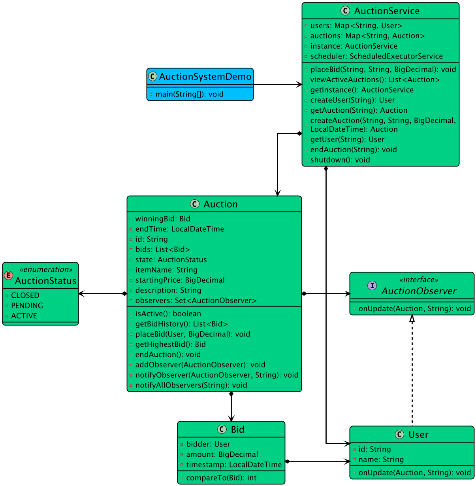

# Low-level design problem: online auction system

> Copied from <https://github.com/ashishps1/awesome-low-level-design/blob/main/problems/online-auction-system.md> (GPL-3.0, by Ashish Pratap Singh). Questions and answers are the source's own; nothing was answered or rewritten here.


# Designing an Online Auction System
In this article, we delve into the object-oriented design and implementation of an Online Auction System using Java. 

This system allows for the creation and management of auctions, user participation in bidding, and handling transactions.

## Requirements
1. The online auction system should allow users to register and log in to their accounts.
2. Users should be able to create new auction listings with details such as item name, description, starting price, and auction duration.
3. Users should be able to browse and search for auction listings based on various criteria (e.g., item name, category, price range).
4. Users should be able to place bids on active auction listings.
5. The system should automatically update the current highest bid and notify the bidders accordingly.
6. The auction should end when the specified duration is reached, and the highest bidder should be declared the winner.
7. The system should handle concurrent access to auction listings and ensure data consistency.
8. The system should be extensible to accommodate future enhancements and new features.

## UML Class Diagram



## Implementations
#### [Java Implementation](https://github.com/ashishps1/awesome-low-level-design/blob/main/solutions/java/src/onlineauctionsystem) 
#### [Python Implementation](https://github.com/ashishps1/awesome-low-level-design/blob/main/solutions/python/onlineauctionsystem)
#### [C++ Implementation](https://github.com/ashishps1/awesome-low-level-design/blob/main/solutions/cpp/onlineauctionsystem)
#### [C# Implementation](https://github.com/ashishps1/awesome-low-level-design/blob/main/solutions/csharp/onlineauctionsystem)
#### [Go Implementation](https://github.com/ashishps1/awesome-low-level-design/blob/main/solutions/golang/onlineauctionsystem)

## Classes, Interfaces and Enumerations
1. The **User** class represents a user in the online auction system, with properties such as id, username, and email.
2. The **AuctionStatus** enum defines the possible states of an auction listing, such as active and closed.
3. The **AuctionListing** class represents an auction listing in the system, with properties like id, item name, description, starting price, duration, seller, current highest bid, and a list of bids.
4. The **Bid** class represents a bid placed by a user on an auction listing, with properties such as id, bidder, amount, and timestamp.
5. The **AuctionSystem** class is the core of the online auction system and follows the Singleton pattern to ensure a single instance of the auction system.
6. The AuctionSystem class uses concurrent data structures (ConcurrentHashMap and CopyOnWriteArrayList) to handle concurrent access to auction listings and ensure thread safety.
7. The AuctionSystem class provides methods for registering users, creating auction listings, searching auction listings, and placing bids.
8. The **AuctionSystemDemo** class serves as the entry point of the application and demonstrates the usage of the online auction system.

---

## Official solutions from the repository

<details><summary><b>java</b> (8 files)</summary>


**AuctionService.java**

```java
package onlineauctionsystem;

import onlineauctionsystem.entities.Auction;
import onlineauctionsystem.entities.User;

import java.math.BigDecimal;
import java.time.LocalDateTime;
import java.util.*;
import java.util.concurrent.ConcurrentHashMap;
import java.util.concurrent.Executors;
import java.util.concurrent.ScheduledExecutorService;
import java.util.concurrent.TimeUnit;

public class AuctionService {
    private static AuctionService instance;
    private final Map<String, User> users;
    private final Map<String, Auction> auctions;
    private final ScheduledExecutorService scheduler;

    private AuctionService() {
        users = new ConcurrentHashMap<>();
        auctions = new ConcurrentHashMap<>();
        this.scheduler = Executors.newScheduledThreadPool(1);
    }

    public static synchronized AuctionService getInstance() {
        if (instance == null) {
            instance = new AuctionService();
        }
        return instance;
    }

    public User createUser(String name) {
        User user = new User(name);
        users.put(user.getId(), user);
        return user;
    }

    public User getUser(String userId) {
        return users.get(userId);
    }

    public Auction createAuction(String itemName, String description, BigDecimal startingPrice, LocalDateTime endTime) {
        Auction auction = new Auction(itemName, description, startingPrice, endTime);
        auctions.put(auction.getId(), auction);

        // In a real system, you'd use a scheduler to automatically end auctions.
        // This demonstrates how it would be done.
        long delay = java.time.Duration.between(LocalDateTime.now(), endTime).toMillis();
        scheduler.schedule(() -> endAuction(auction.getId()), delay, TimeUnit.MILLISECONDS);

        System.out.printf("New auction created for '%s' (ID: %s), ending at %s.\n", itemName, auction.getId(), endTime);
        return auction;
    }

    public List<Auction> viewActiveAuctions() {
        return auctions.values().stream().filter(Auction::isActive).toList();
    }

    public void placeBid(String auctionId, String bidderId, BigDecimal amount) {
        Auction auction = getAuction(auctionId);
        auction.placeBid(users.get(bidderId), amount);
    }

    public void endAuction(String auctionId) {
        Auction auction = getAuction(auctionId);
        auction.endAuction();
    }

    public Auction getAuction(String auctionId) {
        Auction auction = auctions.get(auctionId);
        if (auction == null) {
            throw new NoSuchElementException("Auction with ID " + auctionId + " not found.");
        }
        return auction;
    }

    public void shutdown() {
        scheduler.shutdown();
    }
}
```


**AuctionSystemDemo.java**

```java
package onlineauctionsystem;

import onlineauctionsystem.entities.Auction;
import onlineauctionsystem.entities.User;

import java.math.BigDecimal;
import java.time.LocalDateTime;

public class AuctionSystemDemo {
    public static void main(String[] args) {
        AuctionService auctionService = AuctionService.getInstance();

        // Create users
        User alice = auctionService.createUser("Alice");
        User bob = auctionService.createUser("Bob");
        User carol = auctionService.createUser("Carol");

        System.out.println("=============================================");
        System.out.println("        Online Auction System Demo           ");
        System.out.println("=============================================");

        // 2. Create an auction that will last for a short duration
        LocalDateTime endTime = LocalDateTime.now().plusSeconds(10);
        Auction laptopAuction = auctionService.createAuction(
                "Vintage Laptop",
                "A rare 1990s laptop, in working condition.",
                new BigDecimal("100.00"),
                endTime
        );
        System.out.println();

        // 3. Bidding war starts
        try {
            auctionService.placeBid(laptopAuction.getId(), alice.getId(), new BigDecimal("110.00"));
            Thread.sleep(500); // Simulate time passing

            auctionService.placeBid(laptopAuction.getId(), bob.getId(), new BigDecimal("120.00")); // Alice gets an outbid notification
            Thread.sleep(500);

            auctionService.placeBid(laptopAuction.getId(), carol.getId(), new BigDecimal("125.00")); // Bob gets an outbid notification
            Thread.sleep(500);                                                               // (Charlie's bid is earlier for the same amount, making him the highest bidder)

            auctionService.placeBid(laptopAuction.getId(), alice.getId(), new BigDecimal("150.00")); // Charlie gets an outbid notification

            // 4. Wait for the auction to end automatically via the scheduler
            System.out.println("\n--- Waiting for auction to end automatically... ---");
            Thread.sleep(2 * 1000); // Wait longer than the auction duration
        } catch (Exception e) {
            System.err.println("An error occurred during bidding: " + e.getMessage());
        }

        // 5. Post-auction actions
        System.out.println("\n--- Post-Auction Information ---");
        Auction endedAuction = auctionService.getAuction(laptopAuction.getId());

        // Display winner
        if (endedAuction.getWinningBid() != null) {
            System.out.printf("Final Winner: %s\n", endedAuction.getWinningBid().getBidder().getName());
            System.out.printf("Winning Price: $%.2f\n", endedAuction.getWinningBid().getAmount());
        } else {
            System.out.println("The auction ended with no winner.");
        }

        // Display bid history
        System.out.println("\nFull Bid History:");
        endedAuction.getBidHistory().forEach(System.out::println);

        // 6. Try to bid on an ended auction
        System.out.println("\n--- Attempting to bid on an ended auction ---");
        try {
            auctionService.placeBid(laptopAuction.getId(), bob.getId(), new BigDecimal("200.00"));
        } catch (IllegalStateException e) {
            System.out.println("CAUGHT EXPECTED ERROR: " + e.getMessage());
        }

        // 7. Shutdown the scheduler
        auctionService.shutdown();
    }
}
```


**README.md**

```md
# Online Auction System (LLD)

## Problem Statement

Design and implement an Online Auction System that allows users to create auctions, place bids on items, track auction status, and determine winners.

---

## Requirements

- **User Management:** Users can register and participate in auctions.
- **Item Management:** The system manages items that can be auctioned.
- **Auction Creation:** Users can create auctions for items, specifying start and end times.
- **Bidding:** Users can place bids on active auctions.
- **Auction Status Tracking:** The system tracks the status of each auction (e.g., ACTIVE, ENDED).
- **Winner Determination:** The system determines the winning bid and user when an auction ends.
- **Extensibility:** Easy to add new features such as reserve prices, buy-now options, or notifications.

---

## Core Entities

- **AuctionSystem:** Main class that manages users, items, auctions, and bidding.
- **User:** Represents a user who can create auctions and place bids.
- **Item:** Represents an item to be auctioned.
- **Auction:** Represents an auction for an item, including bids, status, and winner.
- **Bid:** Represents a bid placed by a user on an auction.
- **AuctionStatus:** Enum for auction status (ACTIVE, ENDED).

---

## Class Design

## UML Class Diagram


### 1. AuctionSystem
- **Fields:** List<User> users, List<Item> items, List<Auction> auctions
- **Methods:** registerUser(User), addItem(Item), createAuction(Item, User, Date startTime, Date endTime), placeBid(Auction, User, double amount), endAuction(Auction), getActiveAuctions(), getEndedAuctions(), etc.

### 2. User
- **Fields:** int id, String name

### 3. Item
- **Fields:** int id, String name, String description

### 4. Auction
- **Fields:** int id, Item item, User seller, List<Bid> bids, AuctionStatus status, User winner, Date startTime, Date endTime
- **Methods:** addBid(Bid), endAuction(), getHighestBid(), getWinner()

### 5. Bid
- **Fields:** int id, User bidder, double amount, Date bidTime

### 6. AuctionStatus (enum)
- Values: ACTIVE, ENDED

---

## Example Usage

```java
AuctionSystem system = new AuctionSystem();
User alice = new User(1, "Alice");
User bob = new User(2, "Bob");
system.registerUser(alice);
system.registerUser(bob);

Item painting = new Item(1, "Painting", "Beautiful landscape painting");
system.addItem(painting);

Auction auction = system.createAuction(painting, alice, new Date(), new Date(System.currentTimeMillis() + 3600000));
system.placeBid(auction, bob, 100.0);
system.placeBid(auction, alice, 120.0);

system.endAuction(auction);
User winner = auction.getWinner();
System.out.println("Winner: " + (winner != null ? winner.getName() : "No winner"));
```

---

## Demo

See `AuctionSystemDemo.java` for a sample usage and simulation of the online auction system.

---

## Extending the Framework

- **Add reserve prices:** Only sell if the highest bid meets the minimum price.
- **Add buy-now options:** Allow instant purchase at a set price.
- **Add notifications:** Notify users of auction events or outbids.

---
```


**entities/Auction.java**

```java
package onlineauctionsystem.entities;

import onlineauctionsystem.enums.AuctionStatus;
import onlineauctionsystem.observer.AuctionObserver;

import java.math.BigDecimal;
import java.time.LocalDateTime;
import java.util.*;
import java.util.concurrent.ConcurrentHashMap;

public class Auction {
    private final String id;
    private final String itemName;
    private final String description;
    private final BigDecimal startingPrice;
    private final LocalDateTime endTime;

    private final List<Bid> bids;
    private final Set<AuctionObserver> observers;
    private AuctionStatus state;
    private Bid winningBid;

    public Auction(String itemName, String description, BigDecimal startingPrice, LocalDateTime endTime) {
        this.id = UUID.randomUUID().toString();
        this.itemName = itemName;
        this.description = description;
        this.startingPrice = startingPrice;
        this.endTime = endTime;
        this.bids = new ArrayList<>();
        this.observers = ConcurrentHashMap.newKeySet(); // Thread-safe set
        this.state = AuctionStatus.ACTIVE;
    }

    // --- Core Bidding and Auction Logic ---

    public synchronized void placeBid(User bidder, BigDecimal amount) {
        if (state != AuctionStatus.ACTIVE) {
            throw new IllegalStateException("Auction is not active.");
        }
        if (LocalDateTime.now().isAfter(endTime)) {
            endAuction();
            throw new IllegalStateException("Auction has already ended.");
        }

        Bid highestBid = getHighestBid();
        BigDecimal currentMaxAmount = (highestBid == null) ? startingPrice : highestBid.getAmount();

        if (amount.compareTo(currentMaxAmount) <= 0) {
            throw new IllegalArgumentException("Bid must be higher than the current highest bid.");
        }

        User previousHighestBidder = (highestBid != null) ? highestBid.getBidder() : null;

        Bid newBid = new Bid(bidder, amount);
        bids.add(newBid);
        addObserver(bidder); // The new bidder is now an observer

        System.out.printf("SUCCESS: %s placed a bid of $%.2f on '%s'.\n", bidder.getName(), amount, itemName);

        // Notify the previous highest bidder that they have been outbid
        if (previousHighestBidder != null && !previousHighestBidder.equals(bidder)) {
            notifyObserver(previousHighestBidder, String.format("You have been outbid on '%s'! The new highest bid is $%.2f.", itemName, amount));
        }
    }

    public synchronized void endAuction() {
        if (state != AuctionStatus.ACTIVE) {
            return; // Already ended
        }

        this.state = AuctionStatus.CLOSED;
        this.winningBid = getHighestBid();

        String endMessage;
        if (winningBid != null) {
            endMessage = String.format("Auction for '%s' has ended. Winner is %s with a bid of $%.2f!",
                    itemName, winningBid.getBidder().getName(), winningBid.getAmount());
        } else {
            endMessage = String.format("Auction for '%s' has ended. There were no bids.", itemName);
        }

        System.out.println("\n" + endMessage.toUpperCase());
        notifyAllObservers(endMessage);
    }

    public Bid getHighestBid() {
        if (bids.isEmpty()) {
            return null;
        }
        return Collections.max(bids);
    }

    public boolean isActive() {
        return state == AuctionStatus.ACTIVE;
    }

    // --- Observer Pattern Methods ---

    private void addObserver(AuctionObserver observer) {
        observers.add(observer);
    }

    private void notifyAllObservers(String message) {
        for (AuctionObserver observer : observers) {
            observer.onUpdate(this, message);
        }
    }

    private void notifyObserver(AuctionObserver observer, String message) {
        observer.onUpdate(this, message);
    }

    // --- Getters ---
    public String getId() { return id; }
    public String getItemName() { return itemName; }
    public List<Bid> getBidHistory() { return Collections.unmodifiableList(bids); }
    public AuctionStatus getState() { return state; }
    public Bid getWinningBid() { return winningBid; }
}
```


**entities/Bid.java**

```java
package onlineauctionsystem.entities;

import java.math.BigDecimal;
import java.time.LocalDateTime;

public class Bid implements Comparable<Bid> {
    private final User bidder;
    private final BigDecimal amount;
    private final LocalDateTime timestamp;

    public Bid(User bidder, BigDecimal amount) {
        this.bidder = bidder;
        this.amount = amount;
        this.timestamp = LocalDateTime.now();
    }

    public User getBidder() {
        return bidder;
    }

    public BigDecimal getAmount() {
        return amount;
    }

    public LocalDateTime getTimestamp() {
        return timestamp;
    }

    @Override
    public int compareTo(Bid other) {
        int amountComparison = this.amount.compareTo(other.amount);
        if (amountComparison != 0) {
            return amountComparison;
        }
        return other.timestamp.compareTo(this.timestamp);
    }

    @Override
    public String toString() {
        return String.format("Bidder: %s, Amount: %.2f, Time: %s", bidder.getName(), amount, timestamp);
    }
}
```


**entities/User.java**

```java
package onlineauctionsystem.entities;

import onlineauctionsystem.observer.AuctionObserver;

import java.util.UUID;

public class User implements AuctionObserver {
    private final String id;
    private final String name;

    public User(String name) {
        this.id = UUID.randomUUID().toString();
        this.name = name;
    }

    public String getId() {
        return id;
    }

    public String getName() {
        return name;
    }

    @Override
    public void onUpdate(Auction auction, String message) {
        System.out.printf("--- Notification for %s ---\n", this.name);
        System.out.printf("Auction: %s\n", auction.getItemName());
        System.out.printf("Message: %s\n", message);
        System.out.println("---------------------------\n");
    }
}
```


**enums/AuctionStatus.java**

```java
package onlineauctionsystem.enums;

public enum AuctionStatus {
    PENDING,
    ACTIVE,
    CLOSED
}
```


**observer/AuctionObserver.java**

```java
package onlineauctionsystem.observer;

import onlineauctionsystem.entities.Auction;

public interface AuctionObserver {
    void onUpdate(Auction auction, String message);
}
```

</details>

<details><summary><b>python</b> (8 files)</summary>


**README.md**

```md
# Designing an Online Auction System
In this article, we delve into the object-oriented design and implementation of an Online Auction System using Java. 

This system allows for the creation and management of auctions, user participation in bidding, and handling transactions.

## Requirements
1. The online auction system should allow users to register and log in to their accounts.
2. Users should be able to create new auction listings with details such as item name, description, starting price, and auction duration.
3. Users should be able to browse and search for auction listings based on various criteria (e.g., item name, category, price range).
4. Users should be able to place bids on active auction listings.
5. The system should automatically update the current highest bid and notify the bidders accordingly.
6. The auction should end when the specified duration is reached, and the highest bidder should be declared the winner.
7. The system should handle concurrent access to auction listings and ensure data consistency.
8. The system should be extensible to accommodate future enhancements and new features.

## Classes, Interfaces and Enumerations
1. The **User** class represents a user in the online auction system, with properties such as id, username, and email.
2. The **AuctionStatus** enum defines the possible states of an auction listing, such as active and closed.
3. The **AuctionListing** class represents an auction listing in the system, with properties like id, item name, description, starting price, duration, seller, current highest bid, and a list of bids.
4. The **Bid** class represents a bid placed by a user on an auction listing, with properties such as id, bidder, amount, and timestamp.
5. The **AuctionSystem** class is the core of the online auction system and follows the Singleton pattern to ensure a single instance of the auction system.
6. The AuctionSystem class uses concurrent data structures (ConcurrentHashMap and CopyOnWriteArrayList) to handle concurrent access to auction listings and ensure thread safety.
7. The AuctionSystem class provides methods for registering users, creating auction listings, searching auction listings, and placing bids.
8. The **AuctionSystemDemo** class serves as the entry point of the application and demonstrates the usage of the online auction system.
```


**auction.py**

```py
from typing import List, Set, Optional
from bid import Bid
from auction_state import AuctionState
from datetime import datetime
from decimal import Decimal
import uuid
import threading
from typing import TYPE_CHECKING

if TYPE_CHECKING:
    from user import User
    from auction_observer import AuctionObserver

class Auction:
    def __init__(self, item_name: str, description: str, starting_price: Decimal, end_time: datetime):
        self.id = str(uuid.uuid4())
        self.item_name = item_name
        self.description = description
        self.starting_price = starting_price
        self.end_time = end_time
        self.bids: List[Bid] = []
        self.observers: Set[AuctionObserver] = set()
        self.state = AuctionState.ACTIVE
        self.winning_bid: Optional[Bid] = None
        self._lock = threading.RLock()

    def place_bid(self, bidder: 'User', amount: Decimal):
        with self._lock:
            if self.state != AuctionState.ACTIVE:
                raise Exception("Auction is not active.")
            if datetime.now() > self.end_time:
                self.end_auction()
                raise Exception("Auction has already ended.")

            highest_bid = self.get_highest_bid()
            current_max_amount = self.starting_price if highest_bid is None else highest_bid.get_amount()

            if amount <= current_max_amount:
                raise ValueError("Bid must be higher than the current highest bid.")

            previous_highest_bidder = highest_bid.get_bidder() if highest_bid is not None else None

            new_bid = Bid(bidder, amount)
            self.bids.append(new_bid)
            self.add_observer(bidder)

            print(f"SUCCESS: {bidder.get_name()} placed a bid of ${amount:.2f} on '{self.item_name}'.")

            if previous_highest_bidder is not None and previous_highest_bidder != bidder:
                self.notify_observer(previous_highest_bidder, 
                    f"You have been outbid on '{self.item_name}'! The new highest bid is ${amount:.2f}.")

    def end_auction(self):
        with self._lock:
            if self.state != AuctionState.ACTIVE:
                return

            self.state = AuctionState.CLOSED
            self.winning_bid = self.get_highest_bid()

            if self.winning_bid is not None:
                end_message = f"Auction for '{self.item_name}' has ended. Winner is {self.winning_bid.get_bidder().get_name()} with a bid of ${self.winning_bid.get_amount():.2f}!"
            else:
                end_message = f"Auction for '{self.item_name}' has ended. There were no bids."

            print(f"\n{end_message.upper()}")
            self.notify_all_observers(end_message)

    def get_highest_bid(self) -> Optional[Bid]:
        if not self.bids:
            return None
        return max(self.bids)

    def is_active(self) -> bool:
        return self.state == AuctionState.ACTIVE

    def add_observer(self, observer: 'AuctionObserver'):
        self.observers.add(observer)

    def notify_all_observers(self, message: str):
        for observer in self.observers:
            observer.on_update(self, message)

    def notify_observer(self, observer: 'AuctionObserver', message: str):
        observer.on_update(self, message)

    def get_id(self) -> str:
        return self.id

    def get_item_name(self) -> str:
        return self.item_name

    def get_bid_history(self) -> List[Bid]:
        return self.bids.copy()

    def get_state(self) -> AuctionState:
        return self.state

    def get_winning_bid(self) -> Optional[Bid]:
        return self.winning_bid
```


**auction_observer.py**

```py
from abc import ABC, abstractmethod
from auction import Auction

class AuctionObserver(ABC):
    @abstractmethod
    def on_update(self, auction: 'Auction', message: str):
        pass
```


**auction_service.py**

```py
from user import User
from auction import Auction
from typing import Dict, List
from decimal import Decimal
from datetime import datetime
import threading
from concurrent.futures import ThreadPoolExecutor
import time

class AuctionService:
    _instance = None
    _lock = threading.Lock()

    def __init__(self):
        if AuctionService._instance is not None:
            raise Exception("This class is a singleton!")
        self.users: Dict[str, User] = {}
        self.auctions: Dict[str, Auction] = {}
        self.scheduler = ThreadPoolExecutor(max_workers=10)
        self._shutdown = False

    @staticmethod
    def get_instance():
        if AuctionService._instance is None:
            with AuctionService._lock:
                if AuctionService._instance is None:
                    AuctionService._instance = AuctionService()
        return AuctionService._instance

    def create_user(self, name: str) -> User:
        user = User(name)
        self.users[user.get_id()] = user
        return user

    def get_user(self, user_id: str) -> User:
        return self.users[user_id]

    def create_auction(self, item_name: str, description: str, starting_price: Decimal, end_time: datetime) -> Auction:
        auction = Auction(item_name, description, starting_price, end_time)
        self.auctions[auction.get_id()] = auction

        delay = (end_time - datetime.now()).total_seconds()
        if delay > 0:
            self.scheduler.submit(self._scheduled_end_auction, auction.get_id(), delay)

        print(f"New auction created for '{item_name}' (ID: {auction.get_id()}), ending at {end_time}.")
        return auction

    def _scheduled_end_auction(self, auction_id: str, delay: float):
        time.sleep(delay)
        if not self._shutdown:
            self.end_auction(auction_id)

    def view_active_auctions(self) -> List[Auction]:
        return [auction for auction in self.auctions.values() if auction.is_active()]

    def place_bid(self, auction_id: str, bidder_id: str, amount: Decimal):
        auction = self.get_auction(auction_id)
        auction.place_bid(self.users[bidder_id], amount)

    def end_auction(self, auction_id: str):
        auction = self.get_auction(auction_id)
        auction.end_auction()

    def get_auction(self, auction_id: str) -> Auction:
        auction = self.auctions.get(auction_id)
        if auction is None:
            raise KeyError(f"Auction with ID {auction_id} not found.")
        return auction

    def shutdown(self):
        self._shutdown = True
        self.scheduler.shutdown(wait=True)
```


**auction_state.py**

```py
from enum import Enum

class AuctionState(Enum):
    PENDING = "PENDING"
    ACTIVE = "ACTIVE"
    CLOSED = "CLOSED"
```


**auction_system_demo.py**

```py
from auction_service import AuctionService
from user import User
from auction import Auction
from bid import Bid
from typing import List
from decimal import Decimal
from datetime import datetime, timedelta
import time

class AuctionSystemDemo:
    @staticmethod
    def main():
        auction_service = AuctionService.get_instance()

        alice = auction_service.create_user("Alice")
        bob = auction_service.create_user("Bob")
        carol = auction_service.create_user("Carol")

        print("=============================================")
        print("        Online Auction System Demo           ")
        print("=============================================")

        end_time = datetime.now() + timedelta(seconds=10)
        laptop_auction = auction_service.create_auction(
            "Vintage Laptop",
            "A rare 1990s laptop, in working condition.",
            Decimal("100.00"),
            end_time
        )
        print()

        try:
            auction_service.place_bid(laptop_auction.get_id(), alice.get_id(), Decimal("110.00"))
            time.sleep(0.5)

            auction_service.place_bid(laptop_auction.get_id(), bob.get_id(), Decimal("120.00"))
            time.sleep(0.5)

            auction_service.place_bid(laptop_auction.get_id(), carol.get_id(), Decimal("125.00"))
            time.sleep(0.5)

            auction_service.place_bid(laptop_auction.get_id(), alice.get_id(), Decimal("150.00"))

            print("\n--- Waiting for auction to end automatically... ---")
            time.sleep(2)
        except Exception as e:
            print(f"An error occurred during bidding: {e}")

        print("\n--- Post-Auction Information ---")
        ended_auction = auction_service.get_auction(laptop_auction.get_id())

        if ended_auction.get_winning_bid() is not None:
            print(f"Final Winner: {ended_auction.get_winning_bid().get_bidder().get_name()}")
            print(f"Winning Price: ${ended_auction.get_winning_bid().get_amount():.2f}")
        else:
            print("The auction ended with no winner.")

        print("\nFull Bid History:")
        for bid in ended_auction.get_bid_history():
            print(bid)

        print("\n--- Attempting to bid on an ended auction ---")
        try:
            auction_service.place_bid(laptop_auction.get_id(), bob.get_id(), Decimal("200.00"))
        except Exception as e:
            print(f"CAUGHT EXPECTED ERROR: {e}")

        auction_service.shutdown()


if __name__ == "__main__":
    AuctionSystemDemo.main()
```


**bid.py**

```py
from datetime import datetime
from decimal import Decimal
from typing import TYPE_CHECKING

if TYPE_CHECKING:
    from user import User

class Bid:
    def __init__(self, bidder: 'User', amount: Decimal):
        self.bidder = bidder
        self.amount = amount
        self.timestamp = datetime.now()

    def get_bidder(self) -> 'User':
        return self.bidder

    def get_amount(self) -> Decimal:
        return self.amount

    def get_timestamp(self) -> datetime:
        return self.timestamp

    def __lt__(self, other: 'Bid') -> bool:
        if self.amount != other.amount:
            return self.amount < other.amount
        return self.timestamp > other.timestamp

    def __eq__(self, other: 'Bid') -> bool:
        return self.amount == other.amount and self.timestamp == other.timestamp

    def __le__(self, other: 'Bid') -> bool:
        return self < other or self == other

    def __gt__(self, other: 'Bid') -> bool:
        return not self <= other

    def __ge__(self, other: 'Bid') -> bool:
        return not self < other

    def __ne__(self, other: 'Bid') -> bool:
        return not self == other

    def __str__(self) -> str:
        return f"Bidder: {self.bidder.get_name()}, Amount: {self.amount:.2f}, Time: {self.timestamp}"
```


**user.py**

```py
import uuid
from auction_observer import AuctionObserver
from auction import Auction

class User(AuctionObserver):
    def __init__(self, name: str):
        self.id = str(uuid.uuid4())
        self.name = name

    def get_id(self) -> str:
        return self.id

    def get_name(self) -> str:
        return self.name

    def on_update(self, auction: 'Auction', message: str):
        print(f"--- Notification for {self.name} ---")
        print(f"Auction: {auction.get_item_name()}")
        print(f"Message: {message}")
        print("---------------------------\n")
```

</details>

<details><summary><b>cpp</b> (10 files)</summary>


**Auction.cpp**

```cpp
#include "Auction.hpp"
#include <iostream>
#include <iomanip>

Auction::Auction(std::string auctionId, Item* item, std::time_t startTime,
                std::time_t endTime)
    : auctionId(auctionId), item(item), startTime(startTime), endTime(endTime),
      currentPrice(item->getStartingPrice()), status(AuctionStatus::PENDING) {}

std::string Auction::getAuctionId() const { return auctionId; }
Item* Auction::getItem() const { return item; }
std::time_t Auction::getStartTime() const { return startTime; }
std::time_t Auction::getEndTime() const { return endTime; }
double Auction::getCurrentPrice() const { return currentPrice; }
AuctionStatus Auction::getStatus() const { return status; }
std::string Auction::getWinnerId() const { return winnerId; }
const std::vector<Bid>& Auction::getBids() const { return bids; }

bool Auction::placeBid(const std::string& bidderId, double amount) {
    if (status != AuctionStatus::ACTIVE || amount <= currentPrice) {
        return false;
    }
    
    bids.emplace_back(bidderId, amount);
    currentPrice = amount;
    winnerId = bidderId;
    return true;
}

void Auction::start() {
    if (status == AuctionStatus::PENDING) {
        status = AuctionStatus::ACTIVE;
        item->setStatus(ItemStatus::IN_AUCTION);
    }
}

void Auction::end() {
    if (status == AuctionStatus::ACTIVE) {
        status = AuctionStatus::ENDED;
        item->setStatus(ItemStatus::SOLD);
    }
}

void Auction::cancel() {
    status = AuctionStatus::CANCELLED;
    item->setStatus(ItemStatus::AVAILABLE);
    winnerId.clear();
}

bool Auction::isActive() const {
    return status == AuctionStatus::ACTIVE;
}

void Auction::displayInfo() const {
    std::cout << "\nAuction Details:" << std::endl;
    std::cout << "Auction ID: " << auctionId << std::endl;
    item->displayInfo();
    
    std::cout << "Start Time: " << std::ctime(&startTime);
    std::cout << "End Time: " << std::ctime(&endTime);
    std::cout << "Current Price: $" << std::fixed << std::setprecision(2) 
              << currentPrice << std::endl;
    
    std::cout << "Status: ";
    switch (status) {
        case AuctionStatus::PENDING: std::cout << "Pending"; break;
        case AuctionStatus::ACTIVE: std::cout << "Active"; break;
        case AuctionStatus::ENDED: std::cout << "Ended"; break;
        case AuctionStatus::CANCELLED: std::cout << "Cancelled"; break;
    }
    std::cout << std::endl;
    
    if (!bids.empty()) {
        std::cout << "\nBid History:" << std::endl;
        for (const auto& bid : bids) {
            std::cout << "Bidder: " << bid.bidderId 
                      << ", Amount: $" << std::fixed << std::setprecision(2) 
                      << bid.amount 
                      << ", Time: " << std::ctime(&bid.timestamp);
        }
    }
    
    if (!winnerId.empty()) {
        std::cout << "Winner ID: " << winnerId << std::endl;
    }
}
```


**Auction.hpp**

```hpp
#ifndef AUCTION_HPP
#define AUCTION_HPP

#include <string>
#include <vector>
#include <ctime>
#include "Item.hpp"
#include "User.hpp"

struct Bid {
    std::string bidderId;
    double amount;
    std::time_t timestamp;
    
    Bid(std::string bidderId, double amount)
        : bidderId(bidderId), amount(amount), timestamp(std::time(nullptr)) {}
};

enum class AuctionStatus {
    PENDING,
    ACTIVE,
    ENDED,
    CANCELLED
};

class Auction {
private:
    std::string auctionId;
    Item* item;
    std::time_t startTime;
    std::time_t endTime;
    double currentPrice;
    std::vector<Bid> bids;
    AuctionStatus status;
    std::string winnerId;

public:
    Auction(std::string auctionId, Item* item, std::time_t startTime,
           std::time_t endTime);
    
    std::string getAuctionId() const;
    Item* getItem() const;
    std::time_t getStartTime() const;
    std::time_t getEndTime() const;
    double getCurrentPrice() const;
    AuctionStatus getStatus() const;
    std::string getWinnerId() const;
    const std::vector<Bid>& getBids() const;
    
    bool placeBid(const std::string& bidderId, double amount);
    void start();
    void end();
    void cancel();
    bool isActive() const;
    void displayInfo() const;
};

#endif
```


**AuctionSystem.cpp**

```cpp
#include "AuctionSystem.hpp"
#include <iostream>
#include <algorithm>

AuctionSystem::AuctionSystem() : itemIdCounter(1), auctionIdCounter(1) {}

AuctionSystem::~AuctionSystem() {
    for (auto user : users) delete user;
    for (auto item : items) delete item;
    for (auto auction : auctions) delete auction;
}

User* AuctionSystem::registerUser(std::string username, std::string email) {
    std::string userId = "U" + std::to_string(users.size() + 1);
    User* user = new User(userId, username, email);
    users.push_back(user);
    return user;
}

Item* AuctionSystem::createItem(std::string sellerId, std::string name, std::string description,
                              ItemCategory category, double startingPrice) {
    User* seller = findUser(sellerId);
    if (!seller || !seller->isActive()) return nullptr;
    
    Item* item = new Item(generateItemId(), name, description, category,
                         startingPrice, sellerId);
    items.push_back(item);
    seller->addListedItem(item);
    return item;
}

Auction* AuctionSystem::createAuction(std::string itemId, std::time_t startTime,
                                    std::time_t endTime) {
    Item* item = findItem(itemId);
    if (!item || item->getStatus() != ItemStatus::AVAILABLE) return nullptr;
    
    Auction* auction = new Auction(generateAuctionId(), item, startTime, endTime);
    auctions.push_back(auction);
    return auction;
}

bool AuctionSystem::placeBid(std::string auctionId, std::string bidderId, double amount) {
    Auction* auction = findAuction(auctionId);
    User* bidder = findUser(bidderId);
    
    if (!auction || !bidder || !bidder->isActive() || !auction->isActive() ||
        bidder->getBalance() < amount) {
        return false;
    }
    
    if (auction->placeBid(bidderId, amount)) {
        bidder->deductBalance(amount);
        return true;
    }
    return false;
}

bool AuctionSystem::addUserBalance(std::string userId, double amount) {
    User* user = findUser(userId);
    if (user && user->isActive()) {
        user->addBalance(amount);
        return true;
    }
    return false;
}

void AuctionSystem::startAuction(std::string auctionId) {
    Auction* auction = findAuction(auctionId);
    if (auction) auction->start();
}

void AuctionSystem::endAuction(std::string auctionId) {
    Auction* auction = findAuction(auctionId);
    if (auction) {
        auction->end();
        if (!auction->getWinnerId().empty()) {
            User* winner = findUser(auction->getWinnerId());
            if (winner) {
                winner->addPurchasedItem(auction->getItem());
            }
        }
    }
}

void AuctionSystem::cancelAuction(std::string auctionId) {
    Auction* auction = findAuction(auctionId);
    if (auction) auction->cancel();
}

std::vector<Auction*> AuctionSystem::getActiveAuctions() const {
    std::vector<Auction*> activeAuctions;
    for (auto auction : auctions) {
        if (auction->isActive()) {
            activeAuctions.push_back(auction);
        }
    }
    return activeAuctions;
}

std::vector<Item*> AuctionSystem::searchItems(const std::string& query) const {
    std::vector<Item*> results;
    for (auto item : items) {
        if (item->getStatus() == ItemStatus::AVAILABLE &&
            (item->getName().find(query) != std::string::npos ||
             item->getDescription().find(query) != std::string::npos)) {
            results.push_back(item);
        }
    }
    return results;
}

void AuctionSystem::displayUserInfo(std::string userId) const {
    User* user = findUser(userId);
    if (user) user->displayInfo();
}

void AuctionSystem::displayItemInfo(std::string itemId) const {
    Item* item = findItem(itemId);
    if (item) item->displayInfo();
}

void AuctionSystem::displayAuctionInfo(std::string auctionId) const {
    Auction* auction = findAuction(auctionId);
    if (auction) auction->displayInfo();
}

void AuctionSystem::displayAllAuctions() const {
    std::cout << "\nAll Auctions:" << std::endl;
    for (const auto& auction : auctions) {
        auction->displayInfo();
        std::cout << "------------------------" << std::endl;
    }
}

User* AuctionSystem::findUser(const std::string& userId) const {
    auto it = std::find_if(users.begin(), users.end(),
        [&userId](const User* user) { return user->getUserId() == userId; });
    return it != users.end() ? *it : nullptr;
}

Item* AuctionSystem::findItem(const std::string& itemId) const {
    auto it = std::find_if(items.begin(), items.end(),
        [&itemId](const Item* item) { return item->getItemId() == itemId; });
    return it != items.end() ? *it : nullptr;
}

Auction* AuctionSystem::findAuction(const std::string& auctionId) const {
    auto it = std::find_if(auctions.begin(), auctions.end(),
        [&auctionId](const Auction* auction) { return auction->getAuctionId() == auctionId; });
    return it != auctions.end() ? *it : nullptr;
}

std::string AuctionSystem::generateItemId() {
    return "I" + std::to_string(itemIdCounter++);
}

std::string AuctionSystem::generateAuctionId() {
    return "A" + std::to_string(auctionIdCounter++);
}
```


**AuctionSystem.hpp**

```hpp
#ifndef AUCTION_SYSTEM_HPP
#define AUCTION_SYSTEM_HPP

#include <vector>
#include <string>
#include "User.hpp"
#include "Item.hpp"
#include "Auction.hpp"

class AuctionSystem {
private:
    std::vector<User*> users;
    std::vector<Item*> items;
    std::vector<Auction*> auctions;
    int itemIdCounter;
    int auctionIdCounter;

public:
    AuctionSystem();
    ~AuctionSystem();
    
    User* registerUser(std::string username, std::string email);
    Item* createItem(std::string sellerId, std::string name, std::string description,
                    ItemCategory category, double startingPrice);
    Auction* createAuction(std::string itemId, std::time_t startTime, std::time_t endTime);
    
    bool placeBid(std::string auctionId, std::string bidderId, double amount);
    bool addUserBalance(std::string userId, double amount);
    void startAuction(std::string auctionId);
    void endAuction(std::string auctionId);
    void cancelAuction(std::string auctionId);
    
    std::vector<Auction*> getActiveAuctions() const;
    std::vector<Item*> searchItems(const std::string& query) const;
    
    void displayUserInfo(std::string userId) const;
    void displayItemInfo(std::string itemId) const;
    void displayAuctionInfo(std::string auctionId) const;
    void displayAllAuctions() const;
    
private:
    User* findUser(const std::string& userId) const;
    Item* findItem(const std::string& itemId) const;
    Auction* findAuction(const std::string& auctionId) const;
    std::string generateItemId();
    std::string generateAuctionId();
};

#endif
```


**AuctionSystemDemo.cpp**

```cpp
#include "AuctionSystem.hpp"
#include <iostream>
#include <ctime>

int main() {
    AuctionSystem system;
    
    // Register users
    User* seller = system.registerUser("john_seller", "john@email.com");
    User* bidder1 = system.registerUser("alice_bidder", "alice@email.com");
    User* bidder2 = system.registerUser("bob_bidder", "bob@email.com");
    
    // Add balance to bidders
    system.addUserBalance(bidder1->getUserId(), 1000.0);
    system.addUserBalance(bidder2->getUserId(), 1500.0);
    
    std::cout << "Initial user balances:" << std::endl;
    system.displayUserInfo(bidder1->getUserId());
    system.displayUserInfo(bidder2->getUserId());
    
    // Create items
    Item* phone = system.createItem(seller->getUserId(), "Smartphone", 
                                  "Latest model smartphone", 
                                  ItemCategory::ELECTRONICS, 500.0);
    Item* watch = system.createItem(seller->getUserId(), "Luxury Watch",
                                  "Vintage luxury timepiece",
                                  ItemCategory::FASHION, 1000.0);
    
    if (phone && watch) {
        std::cout << "\nCreated items:" << std::endl;
        system.displayItemInfo(phone->getItemId());
        system.displayItemInfo(watch->getItemId());
        
        // Create auctions
        std::time_t now = std::time(nullptr);
        std::time_t oneHourLater = now + 3600;
        
        Auction* phoneAuction = system.createAuction(phone->getItemId(), now, oneHourLater);
        Auction* watchAuction = system.createAuction(watch->getItemId(), now, oneHourLater);
        
        if (phoneAuction && watchAuction) {
            // Start auctions
            system.startAuction(phoneAuction->getAuctionId());
            system.startAuction(watchAuction->getAuctionId());
            
            std::cout << "\nActive auctions:" << std::endl;
            system.displayAllAuctions();
            
            // Place bids
            std::cout << "\nPlacing bids..." << std::endl;
            if (system.placeBid(phoneAuction->getAuctionId(), 
                              bidder1->getUserId(), 600.0)) {
                std::cout << "Bid placed successfully by " 
                         << bidder1->getUsername() << std::endl;
            }
            
            if (system.placeBid(phoneAuction->getAuctionId(), 
                              bidder2->getUserId(), 700.0)) {
                std::cout << "Bid placed successfully by " 
                         << bidder2->getUsername() << std::endl;
            }
            
            if (system.placeBid(watchAuction->getAuctionId(), 
                              bidder2->getUserId(), 1200.0)) {
                std::cout << "Bid placed successfully by " 
                         << bidder2->getUsername() << std::endl;
            }
            
            // Display auction status
            std::cout << "\nCurrent auction status:" << std::endl;
            system.displayAuctionInfo(phoneAuction->getAuctionId());
            system.displayAuctionInfo(watchAuction->getAuctionId());
            
            // End auctions
            std::cout << "\nEnding auctions..." << std::endl;
            system.endAuction(phoneAuction->getAuctionId());
            system.endAuction(watchAuction->getAuctionId());
            
            // Display final results
            std::cout << "\nFinal auction results:" << std::endl;
            system.displayAuctionInfo(phoneAuction->getAuctionId());
            system.displayAuctionInfo(watchAuction->getAuctionId());
            
            // Display updated user balances
            std::cout << "\nFinal user balances:" << std::endl;
            system.displayUserInfo(bidder1->getUserId());
            system.displayUserInfo(bidder2->getUserId());
        }
    }
    
    return 0;
}
```


**Item.cpp**

```cpp
#include "Item.hpp"
#include <iostream>
#include <iomanip>

Item::Item(std::string itemId, std::string name, std::string description,
           ItemCategory category, double startingPrice, std::string sellerId)
    : itemId(itemId), name(name), description(description), category(category),
      startingPrice(startingPrice), sellerId(sellerId), status(ItemStatus::AVAILABLE) {}

std::string Item::getItemId() const { return itemId; }
std::string Item::getName() const { return name; }
std::string Item::getDescription() const { return description; }
ItemCategory Item::getCategory() const { return category; }
double Item::getStartingPrice() const { return startingPrice; }
ItemStatus Item::getStatus() const { return status; }
std::string Item::getSellerId() const { return sellerId; }

void Item::setStatus(ItemStatus status) {
    this->status = status;
}

void Item::displayInfo() const {
    std::cout << "Item: " << name << " (ID: " << itemId << ")" << std::endl;
    std::cout << "Description: " << description << std::endl;
    std::cout << "Category: ";
    switch (category) {
        case ItemCategory::ELECTRONICS: std::cout << "Electronics"; break;
        case ItemCategory::FASHION: std::cout << "Fashion"; break;
        case ItemCategory::HOME: std::cout << "Home"; break;
        case ItemCategory::SPORTS: std::cout << "Sports"; break;
        case ItemCategory::BOOKS: std::cout << "Books"; break;
        case ItemCategory::COLLECTIBLES: std::cout << "Collectibles"; break;
        case ItemCategory::OTHER: std::cout << "Other"; break;
    }
    std::cout << std::endl;
    
    std::cout << "Starting Price: $" << std::fixed << std::setprecision(2) 
              << startingPrice << std::endl;
    std::cout << "Status: ";
    switch (status) {
        case ItemStatus::AVAILABLE: std::cout << "Available"; break;
        case ItemStatus::IN_AUCTION: std::cout << "In Auction"; break;
        case ItemStatus::SOLD: std::cout << "Sold"; break;
        case ItemStatus::WITHDRAWN: std::cout << "Withdrawn"; break;
    }
    std::cout << std::endl;
    std::cout << "Seller ID: " << sellerId << std::endl;
}
```


**Item.hpp**

```hpp
#ifndef ITEM_HPP
#define ITEM_HPP

#include <string>

enum class ItemCategory {
    ELECTRONICS,
    FASHION,
    HOME,
    SPORTS,
    BOOKS,
    COLLECTIBLES,
    OTHER
};

enum class ItemStatus {
    AVAILABLE,
    IN_AUCTION,
    SOLD,
    WITHDRAWN
};

class Item {
private:
    std::string itemId;
    std::string name;
    std::string description;
    ItemCategory category;
    double startingPrice;
    ItemStatus status;
    std::string sellerId;

public:
    Item(std::string itemId, std::string name, std::string description,
         ItemCategory category, double startingPrice, std::string sellerId);
    
    std::string getItemId() const;
    std::string getName() const;
    std::string getDescription() const;
    ItemCategory getCategory() const;
    double getStartingPrice() const;
    ItemStatus getStatus() const;
    std::string getSellerId() const;
    
    void setStatus(ItemStatus status);
    void displayInfo() const;
};

#endif
```


**README.md**

```md
# Designing an Online Auction System
In this article, we delve into the object-oriented design and implementation of an Online Auction System using Java. 

This system allows for the creation and management of auctions, user participation in bidding, and handling transactions.

## Requirements
1. The online auction system should allow users to register and log in to their accounts.
2. Users should be able to create new auction listings with details such as item name, description, starting price, and auction duration.
3. Users should be able to browse and search for auction listings based on various criteria (e.g., item name, category, price range).
4. Users should be able to place bids on active auction listings.
5. The system should automatically update the current highest bid and notify the bidders accordingly.
6. The auction should end when the specified duration is reached, and the highest bidder should be declared the winner.
7. The system should handle concurrent access to auction listings and ensure data consistency.
8. The system should be extensible to accommodate future enhancements and new features.

## Classes, Interfaces and Enumerations
1. The **User** class represents a user in the online auction system, with properties such as id, username, and email.
2. The **AuctionStatus** enum defines the possible states of an auction listing, such as active and closed.
3. The **AuctionListing** class represents an auction listing in the system, with properties like id, item name, description, starting price, duration, seller, current highest bid, and a list of bids.
4. The **Bid** class represents a bid placed by a user on an auction listing, with properties such as id, bidder, amount, and timestamp.
5. The **AuctionSystem** class is the core of the online auction system and follows the Singleton pattern to ensure a single instance of the auction system.
6. The AuctionSystem class uses concurrent data structures (ConcurrentHashMap and CopyOnWriteArrayList) to handle concurrent access to auction listings and ensure thread safety.
7. The AuctionSystem class provides methods for registering users, creating auction listings, searching auction listings, and placing bids.
8. The **AuctionSystemDemo** class serves as the entry point of the application and demonstrates the usage of the online auction system.
```


**User.cpp**

```cpp
#include "User.hpp"
#include <iostream>
#include <iomanip>

User::User(std::string userId, std::string username, std::string email)
    : userId(userId), username(username), email(email), balance(0.0), active(true) {}

User::~User() {
    // Note: Items are managed by the auction system
    listedItems.clear();
    purchasedItems.clear();
}

std::string User::getUserId() const { return userId; }
std::string User::getUsername() const { return username; }
std::string User::getEmail() const { return email; }
double User::getBalance() const { return balance; }
bool User::isActive() const { return active; }
const std::vector<Item*>& User::getListedItems() const { return listedItems; }
const std::vector<Item*>& User::getPurchasedItems() const { return purchasedItems; }

void User::addBalance(double amount) {
    if (amount > 0) {
        balance += amount;
    }
}

bool User::deductBalance(double amount) {
    if (amount > 0 && balance >= amount) {
        balance -= amount;
        return true;
    }
    return false;
}

void User::addListedItem(Item* item) {
    listedItems.push_back(item);
}

void User::addPurchasedItem(Item* item) {
    purchasedItems.push_back(item);
}

void User::setActive(bool status) {
    active = status;
}

void User::displayInfo() const {
    std::cout << "User: " << username << " (ID: " << userId << ")" << std::endl;
    std::cout << "Email: " << email << std::endl;
    std::cout << "Balance: $" << std::fixed << std::setprecision(2) << balance << std::endl;
    std::cout << "Status: " << (active ? "Active" : "Inactive") << std::endl;
    std::cout << "Listed Items: " << listedItems.size() << std::endl;
    std::cout << "Purchased Items: " << purchasedItems.size() << std::endl;
}
```


**User.hpp**

```hpp
#ifndef USER_HPP
#define USER_HPP

#include <string>
#include <vector>
#include "Item.hpp"

class User {
private:
    std::string userId;
    std::string username;
    std::string email;
    double balance;
    std::vector<Item*> listedItems;
    std::vector<Item*> purchasedItems;
    bool active;

public:
    User(std::string userId, std::string username, std::string email);
    ~User();
    
    std::string getUserId() const;
    std::string getUsername() const;
    std::string getEmail() const;
    double getBalance() const;
    bool isActive() const;
    const std::vector<Item*>& getListedItems() const;
    const std::vector<Item*>& getPurchasedItems() const;
    
    void addBalance(double amount);
    bool deductBalance(double amount);
    void addListedItem(Item* item);
    void addPurchasedItem(Item* item);
    void setActive(bool status);
    void displayInfo() const;
};

#endif
```

</details>

<details><summary><b>golang</b> (7 files)</summary>


**README.md**

```md
# Designing an Online Auction System
In this article, we delve into the object-oriented design and implementation of an Online Auction System using Java. 

This system allows for the creation and management of auctions, user participation in bidding, and handling transactions.

## Requirements
1. The online auction system should allow users to register and log in to their accounts.
2. Users should be able to create new auction listings with details such as item name, description, starting price, and auction duration.
3. Users should be able to browse and search for auction listings based on various criteria (e.g., item name, category, price range).
4. Users should be able to place bids on active auction listings.
5. The system should automatically update the current highest bid and notify the bidders accordingly.
6. The auction should end when the specified duration is reached, and the highest bidder should be declared the winner.
7. The system should handle concurrent access to auction listings and ensure data consistency.
8. The system should be extensible to accommodate future enhancements and new features.

## Classes, Interfaces and Enumerations
1. The **User** class represents a user in the online auction system, with properties such as id, username, and email.
2. The **AuctionStatus** enum defines the possible states of an auction listing, such as active and closed.
3. The **AuctionListing** class represents an auction listing in the system, with properties like id, item name, description, starting price, duration, seller, current highest bid, and a list of bids.
4. The **Bid** class represents a bid placed by a user on an auction listing, with properties such as id, bidder, amount, and timestamp.
5. The **AuctionSystem** class is the core of the online auction system and follows the Singleton pattern to ensure a single instance of the auction system.
6. The AuctionSystem class uses concurrent data structures (ConcurrentHashMap and CopyOnWriteArrayList) to handle concurrent access to auction listings and ensure thread safety.
7. The AuctionSystem class provides methods for registering users, creating auction listings, searching auction listings, and placing bids.
8. The **AuctionSystemDemo** class serves as the entry point of the application and demonstrates the usage of the online auction system.
```


**auction_listing.go**

```go
package onlineauctionsystem

import (
	"sync"
	"time"
)

type AuctionListing struct {
	ID                   string
	ItemName             string
	Description          string
	StartingPrice        float64
	Duration             time.Duration
	Seller               *User
	Status               AuctionStatus
	CurrentHighestBid    float64
	CurrentHighestBidder *User
	Bids                 []*Bid
	mu                   sync.Mutex
	observers            []chan struct{} // Simple channel-based observer pattern
}

func NewAuctionListing(id, itemName, description string, startingPrice float64, duration time.Duration, seller *User) *AuctionListing {
	return &AuctionListing{
		ID:                id,
		ItemName:          itemName,
		Description:       description,
		StartingPrice:     startingPrice,
		Duration:          duration,
		Seller:            seller,
		Status:            StatusActive,
		CurrentHighestBid: startingPrice,
		Bids:              make([]*Bid, 0),
		observers:         make([]chan struct{}, 0),
	}
}

func (a *AuctionListing) PlaceBid(bid *Bid) bool {
	a.mu.Lock()
	defer a.mu.Unlock()

	if a.Status == StatusActive && bid.Amount > a.CurrentHighestBid {
		a.CurrentHighestBid = bid.Amount
		a.CurrentHighestBidder = bid.Bidder
		a.Bids = append(a.Bids, bid)
		a.notifyObservers()
		return true
	}
	return false
}

func (a *AuctionListing) CloseAuction() {
	a.mu.Lock()
	defer a.mu.Unlock()

	if a.Status == StatusActive {
		a.Status = StatusClosed
		a.notifyObservers()
	}
}

func (a *AuctionListing) notifyObservers() {
	for _, observer := range a.observers {
		select {
		case observer <- struct{}{}: // Non-blocking send
		default:
		}
	}
}
```


**auction_status.go**

```go
package onlineauctionsystem

type AuctionStatus int

const (
	StatusActive AuctionStatus = iota
	StatusClosed
)
```


**auction_system.go**

```go
package onlineauctionsystem

import (
	"strings"
	"sync"
	"time"
)

type AuctionSystem struct {
	users           map[string]*User
	auctionListings map[string]*AuctionListing
	mu              sync.RWMutex
}

var (
	instance *AuctionSystem
	once     sync.Once
)

func GetInstance() *AuctionSystem {
	once.Do(func() {
		instance = &AuctionSystem{
			users:           make(map[string]*User),
			auctionListings: make(map[string]*AuctionListing),
		}
	})
	return instance
}

func (as *AuctionSystem) RegisterUser(user *User) {
	as.mu.Lock()
	defer as.mu.Unlock()
	as.users[user.ID] = user
}

func (as *AuctionSystem) GetUser(userID string) *User {
	as.mu.RLock()
	defer as.mu.RUnlock()
	return as.users[userID]
}

func (as *AuctionSystem) CreateAuctionListing(listing *AuctionListing) {
	as.mu.Lock()
	as.auctionListings[listing.ID] = listing
	as.mu.Unlock()

	// Start auction timer
	go func() {
		time.Sleep(listing.Duration)
		listing.CloseAuction()
	}()
}

func (as *AuctionSystem) SearchAuctionListings(keyword string) []*AuctionListing {
	as.mu.RLock()
	defer as.mu.RUnlock()

	var matchingListings []*AuctionListing
	keyword = strings.ToLower(keyword)

	for _, listing := range as.auctionListings {
		if strings.Contains(strings.ToLower(listing.ItemName), keyword) ||
			strings.Contains(strings.ToLower(listing.Description), keyword) {
			matchingListings = append(matchingListings, listing)
		}
	}
	return matchingListings
}

func (as *AuctionSystem) PlaceBid(auctionListingID string, bid *Bid) bool {
	as.mu.RLock()
	listing, exists := as.auctionListings[auctionListingID]
	as.mu.RUnlock()

	if exists {
		return listing.PlaceBid(bid)
	}
	return false
}
```


**bid.go**

```go
package onlineauctionsystem

import "time"

type Bid struct {
	ID        string
	Bidder    *User
	Amount    float64
	Timestamp time.Time
}

func NewBid(id string, bidder *User, amount float64) *Bid {
	return &Bid{
		ID:        id,
		Bidder:    bidder,
		Amount:    amount,
		Timestamp: time.Now(),
	}
}
```


**main.go**

```go
package onlineauctionsystem

import (
	"fmt"
	"time"
)

func Run() {
	auctionSystem := GetInstance()

	// Register users
	user1 := NewUser("1", "John Doe", "john@example.com")
	user2 := NewUser("2", "Jane Smith", "jane@example.com")
	auctionSystem.RegisterUser(user1)
	auctionSystem.RegisterUser(user2)

	// Create auction listings
	listing1 := NewAuctionListing("1", "Item 1", "Description 1", 100.0, 60*time.Second, user1)
	listing2 := NewAuctionListing("2", "Item 2", "Description 2", 50.0, 120*time.Second, user2)
	auctionSystem.CreateAuctionListing(listing1)
	auctionSystem.CreateAuctionListing(listing2)

	// Search auction listings
	searchResults := auctionSystem.SearchAuctionListings("Item")
	fmt.Println("Search Results:")
	for _, listing := range searchResults {
		fmt.Println(listing.ItemName)
	}

	// Place bids
	bid1 := NewBid("1", user2, 150.0)
	bid2 := NewBid("2", user1, 200.0)
	auctionSystem.PlaceBid(listing1.ID, bid1)
	auctionSystem.PlaceBid(listing1.ID, bid2)

	// Wait for a while to see the auction close
	time.Sleep(65 * time.Second)
	fmt.Printf("Auction 1 status: %v\n", listing1.Status)
}
```


**user.go**

```go
package onlineauctionsystem

type User struct {
	ID       string
	Username string
	Email    string
}

func NewUser(id, username, email string) *User {
	return &User{
		ID:       id,
		Username: username,
		Email:    email,
	}
}
```

</details>

<details><summary><b>csharp</b> (8 files)</summary>


**AuctionService.cs**

```cs
using System.Collections.Concurrent;

class AuctionService
{
    private static AuctionService instance;
    private static readonly object lockObject = new object();
    private readonly ConcurrentDictionary<string, User> users;
    private readonly ConcurrentDictionary<string, Auction> auctions;
    private readonly List<Task> scheduledTasks;
    private bool shutdown;

    private AuctionService()
    {
        users = new ConcurrentDictionary<string, User>();
        auctions = new ConcurrentDictionary<string, Auction>();
        scheduledTasks = new List<Task>();
        shutdown = false;
    }

    public static AuctionService GetInstance()
    {
        if (instance == null)
        {
            lock (lockObject)
            {
                if (instance == null)
                {
                    instance = new AuctionService();
                }
            }
        }
        return instance;
    }

    public User CreateUser(string name)
    {
        User user = new User(name);
        users.TryAdd(user.GetId(), user);
        return user;
    }

    public User GetUser(string userId)
    {
        users.TryGetValue(userId, out User user);
        return user;
    }

    public Auction CreateAuction(string itemName, string description, decimal startingPrice, DateTime endTime)
    {
        Auction auction = new Auction(itemName, description, startingPrice, endTime);
        auctions.TryAdd(auction.GetId(), auction);

        TimeSpan delay = endTime - DateTime.Now;
        if (delay.TotalMilliseconds > 0)
        {
            Task scheduledTask = Task.Run(async () =>
            {
                await Task.Delay(delay);
                if (!shutdown)
                {
                    EndAuction(auction.GetId());
                }
            });
            scheduledTasks.Add(scheduledTask);
        }

        Console.WriteLine($"New auction created for '{itemName}' (ID: {auction.GetId()}), ending at {endTime}.");
        return auction;
    }

    public List<Auction> ViewActiveAuctions()
    {
        return auctions.Values.Where(auction => auction.IsActive()).ToList();
    }

    public void PlaceBid(string auctionId, string bidderId, decimal amount)
    {
        Auction auction = GetAuction(auctionId);
        auction.PlaceBid(users[bidderId], amount);
    }

    public void EndAuction(string auctionId)
    {
        Auction auction = GetAuction(auctionId);
        auction.EndAuction();
    }

    public Auction GetAuction(string auctionId)
    {
        if (!auctions.TryGetValue(auctionId, out Auction auction))
        {
            throw new KeyNotFoundException($"Auction with ID {auctionId} not found.");
        }
        return auction;
    }

    public void Shutdown()
    {
        shutdown = true;
        Task.WaitAll(scheduledTasks.ToArray());
    }
}
```


**AuctionSystemDemo.cs**

```cs
using System;
using System.Collections.Generic;
using System.Linq;
using System.Threading;
using System.Threading.Tasks;

public class AuctionSystemDemo
{
    public static void Main(string[] args)
    {
        AuctionService auctionService = AuctionService.GetInstance();

        User alice = auctionService.CreateUser("Alice");
        User bob = auctionService.CreateUser("Bob");
        User carol = auctionService.CreateUser("Carol");

        Console.WriteLine("=============================================");
        Console.WriteLine("        Online Auction System Demo           ");
        Console.WriteLine("=============================================");

        DateTime endTime = DateTime.Now.AddSeconds(10);
        Auction laptopAuction = auctionService.CreateAuction(
            "Vintage Laptop",
            "A rare 1990s laptop, in working condition.",
            100.00m,
            endTime
        );
        Console.WriteLine();

        try
        {
            auctionService.PlaceBid(laptopAuction.GetId(), alice.GetId(), 110.00m);
            Thread.Sleep(500);

            auctionService.PlaceBid(laptopAuction.GetId(), bob.GetId(), 120.00m);
            Thread.Sleep(500);

            auctionService.PlaceBid(laptopAuction.GetId(), carol.GetId(), 125.00m);
            Thread.Sleep(500);

            auctionService.PlaceBid(laptopAuction.GetId(), alice.GetId(), 150.00m);

            Console.WriteLine("\n--- Waiting for auction to end automatically... ---");
            Thread.Sleep(2000);
        }
        catch (Exception e)
        {
            Console.WriteLine($"An error occurred during bidding: {e.Message}");
        }

        Console.WriteLine("\n--- Post-Auction Information ---");
        Auction endedAuction = auctionService.GetAuction(laptopAuction.GetId());

        if (endedAuction.GetWinningBid() != null)
        {
            Console.WriteLine($"Final Winner: {endedAuction.GetWinningBid().GetBidder().GetName()}");
            Console.WriteLine($"Winning Price: ${endedAuction.GetWinningBid().GetAmount():F2}");
        }
        else
        {
            Console.WriteLine("The auction ended with no winner.");
        }

        Console.WriteLine("\nFull Bid History:");
        foreach (Bid bid in endedAuction.GetBidHistory())
        {
            Console.WriteLine(bid.ToString());
        }

        Console.WriteLine("\n--- Attempting to bid on an ended auction ---");
        try
        {
            auctionService.PlaceBid(laptopAuction.GetId(), bob.GetId(), 200.00m);
        }
        catch (Exception e)
        {
            Console.WriteLine($"CAUGHT EXPECTED ERROR: {e.Message}");
        }

        auctionService.Shutdown();
    }
}
```


**Enum/AuctionState.cs**

```cs
enum AuctionState
{
    PENDING,
    ACTIVE,
    CLOSED
}
```


**Models/Auction.cs**

```cs
class Auction
{
    private readonly string id;
    private readonly string itemName;
    private readonly string description;
    private readonly decimal startingPrice;
    private readonly DateTime endTime;
    private readonly List<Bid> bids;
    private readonly HashSet<IAuctionObserver> observers;
    private AuctionState state;
    private Bid winningBid;
    private readonly object lockObject = new object();

    public Auction(string itemName, string description, decimal startingPrice, DateTime endTime)
    {
        this.id = Guid.NewGuid().ToString();
        this.itemName = itemName;
        this.description = description;
        this.startingPrice = startingPrice;
        this.endTime = endTime;
        this.bids = new List<Bid>();
        this.observers = new HashSet<IAuctionObserver>();
        this.state = AuctionState.ACTIVE;
    }

    public void PlaceBid(User bidder, decimal amount)
    {
        lock (lockObject)
        {
            if (state != AuctionState.ACTIVE)
            {
                throw new InvalidOperationException("Auction is not active.");
            }
            if (DateTime.Now > endTime)
            {
                EndAuction();
                throw new InvalidOperationException("Auction has already ended.");
            }

            Bid highestBid = GetHighestBid();
            decimal currentMaxAmount = (highestBid == null) ? startingPrice : highestBid.GetAmount();

            if (amount <= currentMaxAmount)
            {
                throw new ArgumentException("Bid must be higher than the current highest bid.");
            }

            User previousHighestBidder = (highestBid != null) ? highestBid.GetBidder() : null;

            Bid newBid = new Bid(bidder, amount);
            bids.Add(newBid);
            AddObserver(bidder);

            Console.WriteLine($"SUCCESS: {bidder.GetName()} placed a bid of ${amount:F2} on '{itemName}'.");

            if (previousHighestBidder != null && !previousHighestBidder.Equals(bidder))
            {
                NotifyObserver(previousHighestBidder, $"You have been outbid on '{itemName}'! The new highest bid is ${amount:F2}.");
            }
        }
    }

    public void EndAuction()
    {
        lock (lockObject)
        {
            if (state != AuctionState.ACTIVE)
            {
                return;
            }

            state = AuctionState.CLOSED;
            winningBid = GetHighestBid();

            string endMessage;
            if (winningBid != null)
            {
                endMessage = $"Auction for '{itemName}' has ended. Winner is {winningBid.GetBidder().GetName()} with a bid of ${winningBid.GetAmount():F2}!";
            }
            else
            {
                endMessage = $"Auction for '{itemName}' has ended. There were no bids.";
            }

            Console.WriteLine($"\n{endMessage.ToUpper()}");
            NotifyAllObservers(endMessage);
        }
    }

    public Bid GetHighestBid()
    {
        if (bids.Count == 0)
        {
            return null;
        }
        return bids.Max();
    }

    public bool IsActive()
    {
        return state == AuctionState.ACTIVE;
    }

    private void AddObserver(IAuctionObserver observer)
    {
        observers.Add(observer);
    }

    private void NotifyAllObservers(string message)
    {
        foreach (IAuctionObserver observer in observers)
        {
            observer.OnUpdate(this, message);
        }
    }

    private void NotifyObserver(IAuctionObserver observer, string message)
    {
        observer.OnUpdate(this, message);
    }

    public string GetId() { return id; }
    public string GetItemName() { return itemName; }
    public List<Bid> GetBidHistory() { return new List<Bid>(bids); }
    public AuctionState GetState() { return state; }
    public Bid GetWinningBid() { return winningBid; }
}
```


**Models/Bid.cs**

```cs
class Bid : IComparable<Bid>
{
    private readonly User bidder;
    private readonly decimal amount;
    private readonly DateTime timestamp;

    public Bid(User bidder, decimal amount)
    {
        this.bidder = bidder;
        this.amount = amount;
        this.timestamp = DateTime.Now;
    }

    public User GetBidder()
    {
        return bidder;
    }

    public decimal GetAmount()
    {
        return amount;
    }

    public DateTime GetTimestamp()
    {
        return timestamp;
    }

    public int CompareTo(Bid other)
    {
        int amountComparison = amount.CompareTo(other.amount);
        if (amountComparison != 0)
        {
            return amountComparison;
        }
        return other.timestamp.CompareTo(timestamp);
    }

    public override string ToString()
    {
        return $"Bidder: {bidder.GetName()}, Amount: {amount:F2}, Time: {timestamp}";
    }
}
```


**Models/User.cs**

```cs
class User : IAuctionObserver
{
    private readonly string id;
    private readonly string name;

    public User(string name)
    {
        this.id = Guid.NewGuid().ToString();
        this.name = name;
    }

    public string GetId()
    {
        return id;
    }

    public string GetName()
    {
        return name;
    }

    public void OnUpdate(Auction auction, string message)
    {
        Console.WriteLine($"--- Notification for {name} ---");
        Console.WriteLine($"Auction: {auction.GetItemName()}");
        Console.WriteLine($"Message: {message}");
        Console.WriteLine("---------------------------\n");
    }

    public override bool Equals(object obj)
    {
        if (this == obj) return true;
        if (obj == null || GetType() != obj.GetType()) return false;
        User user = (User)obj;
        return id.Equals(user.id);
    }

    public override int GetHashCode()
    {
        return id.GetHashCode();
    }
}
```


**Observer/IAuctionObserver.cs**

```cs
interface IAuctionObserver
{
    void OnUpdate(Auction auction, string message);
}
```


**README.md**

```md
# Designing an Online Auction System
In this article, we delve into the object-oriented design and implementation of an Online Auction System using Java. 

This system allows for the creation and management of auctions, user participation in bidding, and handling transactions.

## Requirements
1. The online auction system should allow users to register and log in to their accounts.
2. Users should be able to create new auction listings with details such as item name, description, starting price, and auction duration.
3. Users should be able to browse and search for auction listings based on various criteria (e.g., item name, category, price range).
4. Users should be able to place bids on active auction listings.
5. The system should automatically update the current highest bid and notify the bidders accordingly.
6. The auction should end when the specified duration is reached, and the highest bidder should be declared the winner.
7. The system should handle concurrent access to auction listings and ensure data consistency.
8. The system should be extensible to accommodate future enhancements and new features.

## Classes, Interfaces and Enumerations
1. The **User** class represents a user in the online auction system, with properties such as id, username, and email.
2. The **AuctionStatus** enum defines the possible states of an auction listing, such as active and closed.
3. The **AuctionListing** class represents an auction listing in the system, with properties like id, item name, description, starting price, duration, seller, current highest bid, and a list of bids.
4. The **Bid** class represents a bid placed by a user on an auction listing, with properties such as id, bidder, amount, and timestamp.
5. The **AuctionSystem** class is the core of the online auction system and follows the Singleton pattern to ensure a single instance of the auction system.
6. The AuctionSystem class uses concurrent data structures (ConcurrentHashMap and CopyOnWriteArrayList) to handle concurrent access to auction listings and ensure thread safety.
7. The AuctionSystem class provides methods for registering users, creating auction listings, searching auction listings, and placing bids.
8. The **AuctionSystemDemo** class serves as the entry point of the application and demonstrates the usage of the online auction system.
```

</details>
