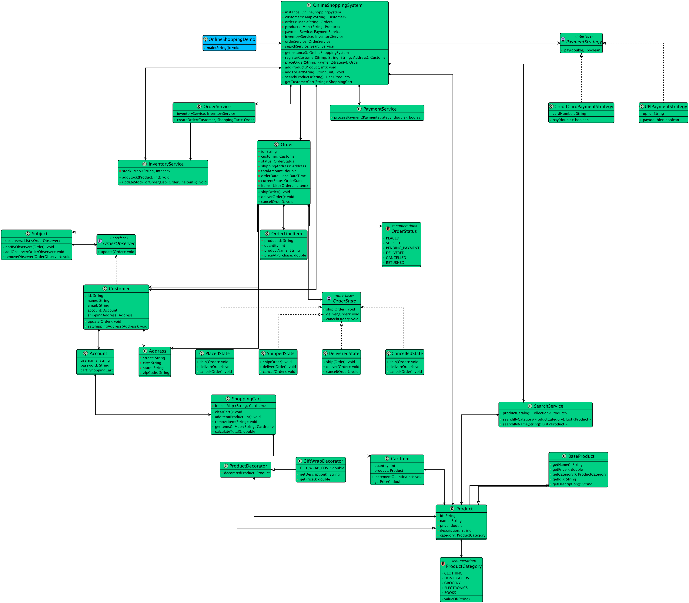

# Low-level design problem: online shopping service

> Copied from <https://github.com/ashishps1/awesome-low-level-design/blob/main/problems/online-shopping-service.md> (GPL-3.0, by Ashish Pratap Singh). Questions and answers are the source's own; nothing was answered or rewritten here.


# Designing an Online Shopping System Like Amazon

## Requirements
1. The online shopping service should allow users to browse products, add them to the shopping cart, and place orders.
2. The system should support multiple product categories and provide search functionality.
3. Users should be able to manage their profiles, view order history, and track order status.
4. The system should handle inventory management and update product availability accordingly.
5. The system should support multiple payment methods and ensure secure transactions.
6. The system should handle concurrent user requests and ensure data consistency.
7. The system should be scalable to handle a large number of products and users.
8. The system should provide a user-friendly interface for a seamless shopping experience.

## UML Class Diagram



## Implementations
#### [Java Implementation](https://github.com/ashishps1/awesome-low-level-design/blob/main/solutions/java/src/onlineshoppingservice)
#### [Python Implementation](https://github.com/ashishps1/awesome-low-level-design/blob/main/solutions/python/onlineshoppingservice)
#### [C++ Implementation](https://github.com/ashishps1/awesome-low-level-design/blob/main/solutions/cpp/onlineshoppingservice)
#### [C# Implementation](https://github.com/ashishps1/awesome-low-level-design/blob/main/solutions/csharp/onlineshoppingservice)
#### [Go Implementation](https://github.com/ashishps1/awesome-low-level-design/blob/main/solutions/golang/onlineshoppingservice)

## Classes, Interfaces and Enumerations
1. The **User** class represents a user in the online shopping service, with properties such as ID, name, email, password, and a list of orders.
2. The **Product** class represents a product available for purchase, with properties like ID, name, description, price, and quantity. It provides methods to update the quantity and check product availability.
3. The **Order** class represents an order placed by a user, containing properties such as ID, user, order items, total amount, and order status. It calculates the total amount based on the order items.
4. The **OrderItem** class represents an item within an order, consisting of the product and the quantity ordered.
5. The **OrderStatus** enum represents the different statuses an order can have, such as pending, processing, shipped, delivered, or cancelled.
6. The **ShoppingCart** class represents the user's shopping cart, allowing them to add, remove, and update item quantities. It maintains a map of product IDs and order items.
7. The **Payment** interface defines the contract for processing payments, with a concrete implementation CreditCardPayment.
8. The **OnlineShoppingService** class is the central component of the online shopping service. It follows the Singleton pattern to ensure only one instance of the service exists. It provides methods to register users, add products, search products, place orders, and retrieve order information. It handles concurrent access to shared resources using synchronization.
9. The **OnlineShoppingServiceDemo** class demonstrates the usage of the online shopping service by registering users, adding products, searching for products, placing orders, and viewing order history.

---

## Official solutions from the repository

<details><summary><b>java</b> (30 files)</summary>


**OnlineShoppingDemo.java**

```java
package onlineshoppingservice;

import onlineshoppingservice.decorator.GiftWrapDecorator;
import onlineshoppingservice.enums.ProductCategory;
import onlineshoppingservice.models.*;
import onlineshoppingservice.strategy.CreditCardPaymentStrategy;
import onlineshoppingservice.strategy.UPIPaymentStrategy;

public class OnlineShoppingDemo {
    public static void main(String[] args) {
        // --- System Setup (Singleton and Services) ---
        OnlineShoppingSystem system = OnlineShoppingSystem.getInstance();

        // --- Create and Add Products to Catalog (Builder Pattern) ---
        Product laptop = new Product.Builder("Dell XPS 15", 1499.99)
                .withDescription("A powerful and sleek laptop.")
                .withCategory(ProductCategory.ELECTRONICS)
                .build();
        Product book = new Product.Builder("The Pragmatic Programmer", 45.50)
                .withDescription("A classic book for software developers.")
                .withCategory(ProductCategory.BOOKS)
                .build();

        system.addProduct(laptop, 10); // 10 laptops in stock
        system.addProduct(book, 50);   // 50 books in stock

        // --- Register a Customer ---
        Address aliceAddress = new Address("123 Main St", "Anytown", "CA", "12345");
        Customer alice = system.registerCustomer("Alice", "alice@example.com", "password123", aliceAddress);

        // --- Alice Shops ---
        System.out.println("--- Alice starts shopping ---");

        // Alice adds a laptop to her cart
        system.addToCart(alice.getId(), laptop.getId(), 1);
        System.out.println("Alice added a laptop to her cart.");

        // Alice decides to gift-wrap the book (Decorator Pattern)
        Product giftWrappedBook = new GiftWrapDecorator(book);
        system.addToCart(alice.getId(), giftWrappedBook.getId(), 1);
        System.out.printf("Alice added a gift-wrapped book. Original price: $%.2f, New price: $%.2f%n",
                book.getPrice(), giftWrappedBook.getPrice());

        ShoppingCart aliceCart = system.getCustomerCart(alice.getId());
        System.out.printf("Alice's cart total: $%.2f%n", aliceCart.calculateTotal());

        // --- Alice Checks Out ---
        System.out.println("\n--- Alice proceeds to checkout ---");
        Order aliceOrder = system.placeOrder(alice.getId(), new CreditCardPaymentStrategy("1234-5678-9876-5432"));
        if (aliceOrder == null) {
            System.out.println("Order placement failed.");
            return;
        }

        System.out.printf("Order #%s placed successfully for Alice.%n", aliceOrder.getId());

        // --- Order State and Notifications (State, Observer Patterns) ---
        System.out.println("\n--- Order processing starts ---");

        // The warehouse ships the order
        aliceOrder.shipOrder(); // This will trigger a notification to Alice

        // The delivery service marks the order as delivered
        aliceOrder.deliverOrder(); // This will also trigger a notification

        // Try to cancel a delivered order (State pattern prevents this)
        aliceOrder.cancelOrder();

        System.out.println("\n--- Out of Stock Scenario ---");
        Customer bob = system.registerCustomer("Bob", "bob@example.com", "pass123", aliceAddress);

        // Bob tries to buy 15 laptops, but only 9 are left (1 was bought by Alice)
        system.addToCart(bob.getId(), laptop.getId(), 15);

        Order bobOrder = system.placeOrder(bob.getId(), new UPIPaymentStrategy("testupi@hdfc"));
        if (bobOrder == null) {
            System.out.println("Bob's order was correctly prevented due to insufficient stock.");
        }
    }
}
```


**OnlineShoppingSystem.java**

```java
package onlineshoppingservice;

import onlineshoppingservice.models.*;
import onlineshoppingservice.services.InventoryService;
import onlineshoppingservice.services.OrderService;
import onlineshoppingservice.services.PaymentService;
import onlineshoppingservice.services.SearchService;
import onlineshoppingservice.strategy.PaymentStrategy;

import java.util.List;
import java.util.Map;
import java.util.concurrent.ConcurrentHashMap;

public class OnlineShoppingSystem {
    private static volatile OnlineShoppingSystem instance;

    // Data stores
    private final Map<String, Product> products = new ConcurrentHashMap<>();
    private final Map<String, Customer> customers = new ConcurrentHashMap<>();
    private final Map<String, Order> orders = new ConcurrentHashMap<>();

    // Services
    private final InventoryService inventoryService;
    private final PaymentService paymentService;
    private final OrderService orderService;
    private final SearchService searchService;

    private OnlineShoppingSystem() {
        this.inventoryService = new InventoryService();
        this.paymentService = new PaymentService();
        this.orderService = new OrderService(inventoryService);
        this.searchService = new SearchService(products.values());
    }

    public static OnlineShoppingSystem getInstance() {
        if (instance == null) {
            synchronized (OnlineShoppingSystem.class) {
                if (instance == null) {
                    instance = new OnlineShoppingSystem();
                }
            }
        }
        return instance;
    }

    // --- Facade Methods for simplified interaction ---
    public void addProduct(Product product, int initialStock) {
        products.put(product.getId(), product);
        inventoryService.addStock(product, initialStock);
    }

    public Customer registerCustomer(String name, String email, String password, Address address) {
        Customer customer = new Customer(name, email, password, address);
        customers.put(customer.getId(), customer);
        return customer;
    }

    public void addToCart(String customerId, String productId, int quantity) {
        Customer customer = customers.get(customerId);
        Product product = products.get(productId);
        customer.getAccount().getCart().addItem(product, quantity);
    }

    public ShoppingCart getCustomerCart(String customerId) {
        Customer customer = customers.get(customerId);
        return customer.getAccount().getCart();
    }

    public List<Product> searchProducts(String name) {
        return searchService.searchByName(name);
    }

    public Order placeOrder(String customerId, PaymentStrategy paymentStrategy) {
        Customer customer = customers.get(customerId);
        ShoppingCart cart = customer.getAccount().getCart();
        if (cart.getItems().isEmpty()) {
            System.out.println("Cannot place an order with an empty cart.");
            return null;
        }

        // 1. Process payment
        boolean paymentSuccess = paymentService.processPayment(paymentStrategy, cart.calculateTotal());
        if (!paymentSuccess) {
            System.out.println("Payment failed. Please try again.");
            return null;
        }

        // 2. Create order and update inventory
        try {
            Order order = orderService.createOrder(customer, cart);
            orders.put(order.getId(), order);

            // 3. Clear the cart
            cart.clearCart();

            return order;
        } catch (Exception e) {
            System.err.println("Order placement failed: " + e.getMessage());
            // In a real system, we would trigger a refund here.
            return null;
        }
    }
}
```


**README.md**

```md
# Online Shopping Service (LLD)

## Problem Statement

Design and implement an Online Shopping Service that allows users to browse products, add items to a cart, place orders, make payments, and track order status.

---

## Requirements

- **User Management:** Users can register, log in, and manage their profiles.
- **Product Catalog:** The system manages a catalog of products with details and prices.
- **Cart Management:** Users can add, update, or remove products in their shopping cart.
- **Order Placement:** Users can place orders for products in their cart.
- **Order Tracking:** The system tracks the status of each order (e.g., PLACED, SHIPPED, DELIVERED, CANCELLED).
- **Payment Processing:** Users can pay for their orders using different payment methods.
- **Extensibility:** Easy to add new features such as discounts, reviews, or wishlists.

---

## Core Entities

- **OnlineShoppingService:** Main class that manages users, products, carts, orders, and payments.
- **User:** Represents a user with a unique ID, name, and cart.
- **Product:** Represents a product with ID, name, description, and price.
- **Cart:** Represents a user's shopping cart containing order items.
- **Order:** Represents an order placed by a user, including items, status, and payment.
- **OrderItem:** Represents an item in an order or cart.
- **OrderStatus:** Enum for order status (PLACED, SHIPPED, DELIVERED, CANCELLED).
- **Payment (in payment/):** Represents a payment transaction for an order.
- **PaymentProcessor (in payment/):** Handles payment logic and validation.

---

## Class Design

## UML Class Diagram


### 1. OnlineShoppingService
- **Fields:** List<User> users, List<Product> products, List<Order> orders, PaymentProcessor paymentProcessor
- **Methods:** registerUser(User), addProduct(Product), addToCart(User, Product, int quantity), placeOrder(User), processPayment(Order, Payment), updateOrderStatus(Order, OrderStatus), etc.

### 2. User
- **Fields:** int id, String name, Cart cart

### 3. Product
- **Fields:** int id, String name, String description, double price

### 4. Cart
- **Fields:** List<OrderItem> items
- **Methods:** addItem(Product, int quantity), removeItem(Product), updateQuantity(Product, int quantity), getItems()

### 5. Order
- **Fields:** int id, User user, List<OrderItem> items, OrderStatus status, Payment payment

### 6. OrderItem
- **Fields:** Product product, int quantity

### 7. OrderStatus (enum)
- Values: PLACED, SHIPPED, DELIVERED, CANCELLED

### 8. Payment (in payment/)
- **Fields:** int id, double amount, String method, PaymentStatus status

### 9. PaymentProcessor (in payment/)
- **Methods:** process(Payment), validate(Payment)

---

## Example Usage

```java
OnlineShoppingService service = new OnlineShoppingService();
User alice = new User(1, "Alice");
Product phone = new Product(1, "Smartphone", "Latest model", 699.0);

service.registerUser(alice);
service.addProduct(phone);
service.addToCart(alice, phone, 1);

Order order = service.placeOrder(alice);
Payment payment = new Payment(1, 699.0, "CREDIT_CARD");
service.processPayment(order, payment);
```

---

## Demo

See `OnlineShoppingServiceDemo.java` for a sample usage and simulation of the online shopping service.

---

## Extending the Framework

- **Add discounts or coupons:** Support promotional pricing.
- **Add product reviews:** Allow users to review and rate products.
- **Add wishlists:** Allow users to save products for later.

---
```


**decorator/GiftWrapDecorator.java**

```java
package onlineshoppingservice.decorator;

import onlineshoppingservice.models.Product;

public class GiftWrapDecorator extends ProductDecorator {
    private static final double GIFT_WRAP_COST = 5.00;

    public GiftWrapDecorator(Product product) {
        super(product);
    }

    @Override
    public double getPrice() {
        return super.getPrice() + GIFT_WRAP_COST;
    }

    @Override
    public String getDescription() {
        return super.getDescription() + " (Gift Wrapped)";
    }
}
```


**decorator/ProductDecorator.java**

```java
package onlineshoppingservice.decorator;

import onlineshoppingservice.enums.ProductCategory;
import onlineshoppingservice.models.Product;

public abstract class ProductDecorator extends Product {
    protected Product decoratedProduct;

    public ProductDecorator(Product product) {
        this.decoratedProduct = product;
    }

    @Override public String getId() { return decoratedProduct.getId(); }

    @Override public String getName() { return decoratedProduct.getName(); }

    @Override public double getPrice() { return decoratedProduct.getPrice(); }

    @Override public String getDescription() { return decoratedProduct.getDescription(); }

    @Override public ProductCategory getCategory() { return decoratedProduct.getCategory(); }
}
```


**enums/OrderStatus.java**

```java
package onlineshoppingservice.enums;

public enum OrderStatus {
    PENDING_PAYMENT,
    PLACED,
    SHIPPED,
    DELIVERED,
    CANCELLED,
    RETURNED
}
```


**enums/ProductCategory.java**

```java
package onlineshoppingservice.enums;

public enum ProductCategory {
    ELECTRONICS,
    BOOKS,
    CLOTHING,
    HOME_GOODS,
    GROCERY
}
```


**exceptions/OutOfStockException.java**

```java
package onlineshoppingservice.exceptions;

public class OutOfStockException extends RuntimeException {
    public OutOfStockException(String message) {
        super(message);
    }
}
```


**models/Account.java**

```java
package onlineshoppingservice.models;

public class Account {
    private final String username;
    private final String password; // Hashed password in real system
    private final ShoppingCart cart;

    public Account(String username, String password) {
        this.username = username;
        this.password = password;
        this.cart = new ShoppingCart();
    }
    public ShoppingCart getCart() { return cart; }
}
```


**models/Address.java**

```java
package onlineshoppingservice.models;

public class Address {
    private final String street;
    private final String city;
    private final String state;
    private final String zipCode;

    public Address(String street, String city, String state, String zipCode) {
        this.street = street;
        this.city = city;
        this.state = state;
        this.zipCode = zipCode;
    }

    @Override
    public String toString() {
        return String.format("%s, %s, %s %s", street, city, state, zipCode);
    }
}
```


**models/CartItem.java**

```java
package onlineshoppingservice.models;

public class CartItem {
    private final Product product;
    private int quantity;

    public CartItem(Product product, int quantity) {
        this.product = product;
        this.quantity = quantity;
    }

    public Product getProduct() { return product; }
    public int getQuantity() { return quantity; }
    public void incrementQuantity(int amount) { this.quantity += amount; }
    public double getPrice() { return product.getPrice() * quantity; }
}
```


**models/Customer.java**

```java
package onlineshoppingservice.models;

import onlineshoppingservice.observer.OrderObserver;

import java.util.UUID;

public class Customer implements OrderObserver {
    private final String id;
    private final String name;
    private final String email;
    private final Account account;
    private Address shippingAddress;

    public Customer(String name, String email, String password, Address shippingAddress) {
        this.id = UUID.randomUUID().toString();
        this.name = name;
        this.email = email;
        this.account = new Account(email, password);
        this.shippingAddress = shippingAddress;
    }

    @Override
    public void update(Order order) {
        System.out.printf("[Notification for %s]: Your order #%s status has been updated to: %s.%n",
                this.name, order.getId(), order.getStatus());
    }

    public String getId() { return id; }
    public String getName() { return name; }
    public Account getAccount() { return account; }
    public Address getShippingAddress() { return shippingAddress; }
    public void setShippingAddress(Address address) { this.shippingAddress = address; }
}
```


**models/Order.java**

```java
package onlineshoppingservice.models;

import onlineshoppingservice.enums.OrderStatus;
import onlineshoppingservice.observer.Subject;
import onlineshoppingservice.state.OrderState;
import onlineshoppingservice.state.PlacedState;

import java.time.LocalDateTime;
import java.util.List;
import java.util.UUID;

public class Order extends Subject {
    private final String id;
    private final Customer customer;
    private final List<OrderLineItem> items;
    private final Address shippingAddress;
    private final double totalAmount;
    private final LocalDateTime orderDate;
    private OrderStatus status;
    private OrderState currentState;

    public Order(Customer customer, List<OrderLineItem> items, Address shippingAddress, double totalAmount) {
        this.id = UUID.randomUUID().toString().substring(0, 8);
        this.customer = customer;
        this.items = items;
        this.shippingAddress = shippingAddress;
        this.totalAmount = totalAmount;
        this.orderDate = LocalDateTime.now();
        this.status = OrderStatus.PLACED;
        this.currentState = new PlacedState();
        addObserver(customer);
    }

    // State Pattern methods
    public void shipOrder() { currentState.ship(this); }
    public void deliverOrder() { currentState.deliver(this); }
    public void cancelOrder() { currentState.cancel(this); }

    // Getters and Setters
    public String getId() { return id; }
    public OrderStatus getStatus() { return status; }
    public void setState(OrderState state) { this.currentState = state; }
    public void setStatus(OrderStatus status) {
        this.status = status;
        notifyObservers(this);
    }
    public List<OrderLineItem> getItems() { return items; }
}
```


**models/OrderLineItem.java**

```java
package onlineshoppingservice.models;

public class OrderLineItem {
    private final String productId;
    private final String productName;
    private final int quantity;
    private final double priceAtPurchase;

    public OrderLineItem(String productId, String productName, int quantity, double priceAtPurchase) {
        this.productId = productId;
        this.productName = productName;
        this.quantity = quantity;
        this.priceAtPurchase = priceAtPurchase;
    }

    public String getProductId() { return productId; }
    public int getQuantity() { return quantity; }
}
```


**models/Product.java**

```java
package onlineshoppingservice.models;

import onlineshoppingservice.enums.ProductCategory;

import java.util.UUID;

public abstract class Product {
    protected String id;
    protected String name;
    protected String description;
    protected double price;
    protected ProductCategory category;

    public abstract String getId();
    public abstract String getName();
    public abstract String getDescription();
    public abstract double getPrice();
    public abstract ProductCategory getCategory();

    // Base implementation for the Builder
    public static class BaseProduct extends Product {
        private BaseProduct(String id, String name, String description, double price, ProductCategory category) {
            this.id = id;
            this.name = name;
            this.description = description;
            this.price = price;
            this.category = category;
        }
        @Override public String getId() { return id; }
        @Override public String getName() { return name; }
        @Override public String getDescription() { return description; }
        @Override public double getPrice() { return price; }
        @Override public ProductCategory getCategory() { return category; }
    }

    // Builder Pattern for creating products
    public static class Builder {
        private final String name;
        private final double price;
        private String description = "";
        private ProductCategory category;

        public Builder(String name, double price) {
            this.name = name;
            this.price = price;
        }
        public Builder withDescription(String description) { this.description = description; return this; }
        public Builder withCategory(ProductCategory category) { this.category = category; return this; }
        public Product build() {
            return new BaseProduct(UUID.randomUUID().toString(), name, description, price, category);
        }
    }
}
```


**models/ShoppingCart.java**

```java
package onlineshoppingservice.models;

import java.util.HashMap;
import java.util.Map;

public class ShoppingCart {
    private final Map<String, CartItem> items = new HashMap<>();

    public void addItem(Product product, int quantity) {
        if (items.containsKey(product.getId())) {
            items.get(product.getId()).incrementQuantity(quantity);
        } else {
            items.put(product.getId(), new CartItem(product, quantity));
        }
    }

    public void removeItem(String productId) {
        items.remove(productId);
    }

    public Map<String, CartItem> getItems() { return Map.copyOf(items); }

    public double calculateTotal() {
        return items.values().stream().mapToDouble(CartItem::getPrice).sum();
    }

    public void clearCart() {
        items.clear();
    }
}
```


**observer/OrderObserver.java**

```java
package onlineshoppingservice.observer;

import onlineshoppingservice.models.Order;

public interface OrderObserver {
    void update(Order order);
}
```


**observer/Subject.java**

```java
package onlineshoppingservice.observer;

import onlineshoppingservice.models.Order;

import java.util.ArrayList;
import java.util.List;

public abstract class Subject {
    private final List<OrderObserver> observers = new ArrayList<>();

    public void addObserver(OrderObserver observer) { observers.add(observer); }
    public void removeObserver(OrderObserver observer) { observers.remove(observer); }
    public void notifyObservers(Order order) {
        for (OrderObserver observer : observers) {
            observer.update(order);
        }
    }
}
```


**services/InventoryService.java**

```java
package onlineshoppingservice.services;

import onlineshoppingservice.exceptions.OutOfStockException;
import onlineshoppingservice.models.OrderLineItem;
import onlineshoppingservice.models.Product;

import java.util.List;
import java.util.Map;
import java.util.concurrent.ConcurrentHashMap;

public class InventoryService {
    private final Map<String, Integer> stock; // productId -> quantity

    public InventoryService() {
        this.stock = new ConcurrentHashMap<>();
    }

    public void addStock(Product product, int quantity) {
        stock.put(product.getId(), stock.getOrDefault(product.getId(), 0) + quantity);
    }

    public synchronized void updateStockForOrder(List<OrderLineItem> items) {
        // First, check if all items are in stock
        for (OrderLineItem item : items) {
            if (stock.getOrDefault(item.getProductId(), 0) < item.getQuantity()) {
                throw new OutOfStockException("Not enough stock for product ID: " + item.getProductId());
            }
        }
        // If all checks pass, deduct the stock
        for (OrderLineItem item : items) {
            stock.compute(item.getProductId(), (id, currentStock) -> currentStock - item.getQuantity());
        }
    }
}
```


**services/OrderService.java**

```java
package onlineshoppingservice.services;

import onlineshoppingservice.models.Customer;
import onlineshoppingservice.models.Order;
import onlineshoppingservice.models.OrderLineItem;
import onlineshoppingservice.models.ShoppingCart;

import java.util.ArrayList;
import java.util.List;

public class OrderService {
    private final InventoryService inventoryService;

    public OrderService(InventoryService inventoryService) {
        this.inventoryService = inventoryService;
    }

    public Order createOrder(Customer customer, ShoppingCart cart) {
        List<OrderLineItem> result = new ArrayList<>();
        cart.getItems().values().stream()
            .map(cartItem -> new OrderLineItem(
                    cartItem.getProduct().getId(),
                    cartItem.getProduct().getName(),
                    cartItem.getQuantity(),
                    cartItem.getProduct().getPrice()))
            .forEach(result::add);

        inventoryService.updateStockForOrder(result);

        return new Order(customer, result, customer.getShippingAddress(), cart.calculateTotal());
    }
}
```


**services/PaymentService.java**

```java
package onlineshoppingservice.services;

import onlineshoppingservice.strategy.PaymentStrategy;

public class PaymentService {
    public boolean processPayment(PaymentStrategy strategy, double amount) {
        return strategy.pay(amount);
    }
}
```


**services/SearchService.java**

```java
package onlineshoppingservice.services;

import onlineshoppingservice.enums.ProductCategory;
import onlineshoppingservice.models.Product;

import java.util.ArrayList;
import java.util.Collection;
import java.util.List;

public class SearchService {
    private final Collection<Product> productCatalog;

    public SearchService(Collection<Product> productCatalog) { this.productCatalog = productCatalog; }

    public List<Product> searchByName(String name) {
        List<Product> result = new ArrayList<>();
        productCatalog.stream()
            .filter(p -> p.getName().toLowerCase().contains(name.toLowerCase()))
            .forEach(result::add);
        return result;
    }

    public List<Product> searchByCategory(ProductCategory category) {
        List<Product> result = new ArrayList<>();
        productCatalog.stream()
            .filter(p -> p.getCategory() == category)
            .forEach(result::add);
        return result;
    }
}
```


**state/CancelledState.java**

```java
package onlineshoppingservice.state;

import onlineshoppingservice.models.Order;

public class CancelledState implements OrderState {
    @Override
    public void ship(Order order) { System.out.println("Cannot ship a cancelled order."); }

    @Override
    public void deliver(Order order) { System.out.println("Cannot deliver a cancelled order."); }

    @Override
    public void cancel(Order order) { System.out.println("Order is already cancelled."); }
}
```


**state/DeliveredState.java**

```java
package onlineshoppingservice.state;

import onlineshoppingservice.models.Order;

public class DeliveredState implements OrderState {
    @Override
    public void ship(Order order) { System.out.println("Order already delivered."); }

    @Override
    public void deliver(Order order) { System.out.println("Order already delivered."); }

    @Override
    public void cancel(Order order) { System.out.println("Cannot cancel a delivered order."); }
}
```


**state/OrderState.java**

```java
package onlineshoppingservice.state;

import onlineshoppingservice.models.Order;

public interface OrderState {
    void ship(Order order);
    void deliver(Order order);
    void cancel(Order order);
}
```


**state/PlacedState.java**

```java
package onlineshoppingservice.state;

import onlineshoppingservice.enums.OrderStatus;
import onlineshoppingservice.models.Order;

public class PlacedState implements OrderState {
    @Override
    public void ship(Order order) {
        System.out.println("Shipping order " + order.getId());
        order.setStatus(OrderStatus.SHIPPED);
        order.setState(new ShippedState());
    }

    @Override
    public void deliver(Order order) { System.out.println("Cannot deliver an order that has not been shipped."); }

    @Override
    public void cancel(Order order) {
        System.out.println("Cancelling order " + order.getId());
        order.setStatus(OrderStatus.CANCELLED);
        order.setState(new CancelledState());
    }
}
```


**state/ShippedState.java**

```java
package onlineshoppingservice.state;

import onlineshoppingservice.enums.OrderStatus;
import onlineshoppingservice.models.Order;

public class ShippedState implements OrderState {
    @Override
    public void ship(Order order) { System.out.println("Order is already shipped."); }

    @Override
    public void deliver(Order order) {
        System.out.println("Delivering order " + order.getId());
        order.setStatus(OrderStatus.DELIVERED);
        order.setState(new DeliveredState());
    }

    @Override
    public void cancel(Order order) { System.out.println("Cannot cancel a shipped order."); }
}
```


**strategy/CreditCardPaymentStrategy.java**

```java
package onlineshoppingservice.strategy;

public class CreditCardPaymentStrategy implements PaymentStrategy {
    private final String cardNumber;

    public CreditCardPaymentStrategy(String cardNumber) { this.cardNumber = cardNumber; }

    @Override
    public boolean pay(double amount) {
        System.out.printf("Processing credit card payment of $%.2f with card %s.%n", amount, cardNumber);
        // Simulate payment gateway logic
        return true;
    }
}
```


**strategy/PaymentStrategy.java**

```java
package onlineshoppingservice.strategy;

public interface PaymentStrategy {
    boolean pay(double amount);
}
```


**strategy/UPIPaymentStrategy.java**

```java
package onlineshoppingservice.strategy;

public class UPIPaymentStrategy implements PaymentStrategy{
    private final String upiId;

    public UPIPaymentStrategy(String upiId) { this.upiId = upiId; }

    @Override
    public boolean pay(double amount) {
        System.out.printf("Processing UPI payment of $%.2f with upi id %s.%n", amount, upiId);
        // Simulate payment gateway logic
        return true;
    }
}
```

</details>

<details><summary><b>python</b> (22 files)</summary>


**account.py**

```py
from shopping_cart import ShoppingCart

class Account:
    def __init__(self, username: str, password: str):
        self.username = username
        self.password = password
        self.cart = ShoppingCart()

    def get_cart(self) -> ShoppingCart:
        return self.cart
```


**address.py**

```py
class Address:
    def __init__(self, street: str, city: str, state: str, zip_code: str):
        self.street = street
        self.city = city
        self.state = state
        self.zip_code = zip_code

    def __str__(self) -> str:
        return f"{self.street}, {self.city}, {self.state} {self.zip_code}"
```


**cart_item.py**

```py
from product import Product
from typing import TYPE_CHECKING

if TYPE_CHECKING:
    from product import Product

class CartItem:
    def __init__(self, product: Product, quantity: int):
        self.product = product
        self.quantity = quantity

    def get_product(self) -> Product:
        return self.product

    def get_quantity(self) -> int:
        return self.quantity

    def increment_quantity(self, amount: int) -> None:
        self.quantity += amount

    def get_price(self) -> float:
        return self.product.get_price() * self.quantity
```


**customer.py**

```py
from order_observer import OrderObserver
from address import Address
from account import Account
import uuid
from typing import TYPE_CHECKING

if TYPE_CHECKING:
    from order import Order

class Customer(OrderObserver):
    def __init__(self, name: str, email: str, password: str, shipping_address: Address):
        self.id = str(uuid.uuid4())
        self.name = name
        self.email = email
        self.account = Account(email, password)
        self.shipping_address = shipping_address

    def update(self, order: 'Order') -> None:
        print(f"[Notification for {self.name}]: Your order #{order.get_id()} status has been updated to: {order.get_status().value}.")

    def get_id(self) -> str:
        return self.id

    def get_name(self) -> str:
        return self.name

    def get_account(self) -> 'Account':
        return self.account

    def get_shipping_address(self) -> Address:
        return self.shipping_address

    def set_shipping_address(self, address: Address) -> None:
        self.shipping_address = address
```


**enums.py**

```py
from enum import Enum

class OrderStatus(Enum):
    PENDING_PAYMENT = "PENDING_PAYMENT"
    PLACED = "PLACED"
    SHIPPED = "SHIPPED"
    DELIVERED = "DELIVERED"
    CANCELLED = "CANCELLED"
    RETURNED = "RETURNED"

class ProductCategory(Enum):
    ELECTRONICS = "ELECTRONICS"
    BOOKS = "BOOKS"
    CLOTHING = "CLOTHING"
    HOME_GOODS = "HOME_GOODS"
    GROCERY = "GROCERY"
```


**exceptions.py**

```py
class OutOfStockException(Exception):
    def __init__(self, message: str):
        super().__init__(message)
```


**inventory_service.py**

```py
from typing import Dict
from collections import defaultdict
from threading import Lock
from product import Product
from order_line_item import OrderLineItem
from exceptions import OutOfStockException
from typing import List
import threading

class InventoryService:
    def __init__(self):
        self.stock: Dict[str, int] = defaultdict(int)
        self.lock = threading.Lock()

    def add_stock(self, product: Product, quantity: int) -> None:
        with self.lock:
            self.stock[product.get_id()] += quantity

    def update_stock_for_order(self, items: List[OrderLineItem]) -> None:
        with self.lock:
            # First, check if all items are in stock
            for item in items:
                if self.stock[item.get_product_id()] < item.get_quantity():
                    raise OutOfStockException(f"Not enough stock for product ID: {item.get_product_id()}")
            
            # If all checks pass, deduct the stock
            for item in items:
                self.stock[item.get_product_id()] -= item.get_quantity()
```


**online_shopping_demo.py**

```py
from online_shopping_system import OnlineShoppingSystem
from product import Product
from product_decorators import GiftWrapDecorator
from enums import ProductCategory
from address import Address
from payment_strategy import CreditCardPaymentStrategy, UPIPaymentStrategy

class OnlineShoppingDemo:
    @staticmethod
    def main():
        # System Setup (Singleton and Services)
        system = OnlineShoppingSystem.get_instance()

        # Create and Add Products to Catalog (Builder Pattern)
        laptop = Product.Builder("Dell XPS 15", 1499.99) \
            .with_description("A powerful and sleek laptop.") \
            .with_category(ProductCategory.ELECTRONICS) \
            .build()
        
        book = Product.Builder("The Pragmatic Programmer", 45.50) \
            .with_description("A classic book for software developers.") \
            .with_category(ProductCategory.BOOKS) \
            .build()

        system.add_product(laptop, 10)  # 10 laptops in stock
        system.add_product(book, 50)    # 50 books in stock

        # Register a Customer
        alice_address = Address("123 Main St", "Anytown", "CA", "12345")
        alice = system.register_customer("Alice", "alice@example.com", "password123", alice_address)

        # Alice Shops
        print("--- Alice starts shopping ---")

        # Alice adds a laptop to her cart
        system.add_to_cart(alice.get_id(), laptop.get_id(), 1)
        print("Alice added a laptop to her cart.")

        # Alice decides to gift-wrap the book (Decorator Pattern)
        gift_wrapped_book = GiftWrapDecorator(book)
        system.add_to_cart(alice.get_id(), gift_wrapped_book.get_id(), 1)
        print(f"Alice added a gift-wrapped book. Original price: ${book.get_price():.2f}, New price: ${gift_wrapped_book.get_price():.2f}")

        alice_cart = system.get_customer_cart(alice.get_id())
        print(f"Alice's cart total: ${alice_cart.calculate_total():.2f}")

        # Alice Checks Out
        print("\n--- Alice proceeds to checkout ---")
        alice_order = system.place_order(alice.get_id(), CreditCardPaymentStrategy("1234-5678-9876-5432"))
        if alice_order is None:
            print("Order placement failed.")
            return

        print(f"Order #{alice_order.get_id()} placed successfully for Alice.")

        # Order State and Notifications (State, Observer Patterns)
        print("\n--- Order processing starts ---")

        # The warehouse ships the order
        alice_order.ship_order()  # This will trigger a notification to Alice

        # The delivery service marks the order as delivered
        alice_order.deliver_order()  # This will also trigger a notification

        # Try to cancel a delivered order (State pattern prevents this)
        alice_order.cancel_order()

        print("\n--- Out of Stock Scenario ---")
        bob = system.register_customer("Bob", "bob@example.com", "pass123", alice_address)

        # Bob tries to buy 15 laptops, but only 9 are left (1 was bought by Alice)
        system.add_to_cart(bob.get_id(), laptop.get_id(), 15)

        bob_order = system.place_order(bob.get_id(), UPIPaymentStrategy("testupi@hdfc"))
        if bob_order is None:
            print("Bob's order was correctly prevented due to insufficient stock.")


if __name__ == "__main__":
    OnlineShoppingDemo.main()
```


**online_shopping_system.py**

```py
from typing import Dict, List, Optional
from product import Product
from customer import Customer
from order import Order
from inventory_service import InventoryService
from payment_service import PaymentService
from order_service import OrderService
from search_service import SearchService
from payment_strategy import PaymentStrategy
from address import Address
import threading
from shopping_cart import ShoppingCart

class OnlineShoppingSystem:
    _instance = None
    _lock = threading.Lock()

    def __new__(cls):
        if cls._instance is None:
            with cls._lock:
                if cls._instance is None:
                    cls._instance = super().__new__(cls)
        return cls._instance

    def __init__(self):
        if hasattr(self, 'initialized'):
            return
        
        self.products: Dict[str, Product] = {}
        self.customers: Dict[str, Customer] = {}
        self.orders: Dict[str, Order] = {}
        
        self.inventory_service = InventoryService()
        self.payment_service = PaymentService()
        self.order_service = OrderService(self.inventory_service)
        self.search_service = SearchService(self.products.values())
        
        self.initialized = True

    @classmethod
    def get_instance(cls) -> 'OnlineShoppingSystem':
        return cls()

    def add_product(self, product: Product, initial_stock: int) -> None:
        self.products[product.get_id()] = product
        self.inventory_service.add_stock(product, initial_stock)

    def register_customer(self, name: str, email: str, password: str, address: Address) -> Customer:
        customer = Customer(name, email, password, address)
        self.customers[customer.get_id()] = customer
        return customer

    def add_to_cart(self, customer_id: str, product_id: str, quantity: int) -> None:
        customer = self.customers[customer_id]
        product = self.products[product_id]
        customer.get_account().get_cart().add_item(product, quantity)

    def get_customer_cart(self, customer_id: str) -> ShoppingCart:
        customer = self.customers[customer_id]
        return customer.get_account().get_cart()

    def search_products(self, name: str) -> List[Product]:
        return self.search_service.search_by_name(name)

    def place_order(self, customer_id: str, payment_strategy: PaymentStrategy) -> Optional[Order]:
        customer = self.customers[customer_id]
        cart = customer.get_account().get_cart()
        
        if not cart.get_items():
            print("Cannot place an order with an empty cart.")
            return None

        # 1. Process payment
        payment_success = self.payment_service.process_payment(payment_strategy, cart.calculate_total())
        if not payment_success:
            print("Payment failed. Please try again.")
            return None

        # 2. Create order and update inventory
        try:
            order = self.order_service.create_order(customer, cart)
            self.orders[order.get_id()] = order

            # 3. Clear the cart
            cart.clear_cart()

            return order
        except Exception as e:
            print(f"Order placement failed: {e}")
            return None
```


**order.py**

```py
import uuid
from order_observer import OrderObserver
from order_line_item import OrderLineItem
from enums import OrderStatus
from typing import List
from datetime import datetime
from customer import Customer
from address import Address
from order_states import OrderState, PlacedState
from order_observer import Subject

class Order(Subject):
    def __init__(self, customer: Customer, items: List[OrderLineItem], shipping_address: Address, total_amount: float):
        super().__init__()
        self.id = str(uuid.uuid4())[:8]
        self.customer = customer
        self.items = items
        self.shipping_address = shipping_address
        self.total_amount = total_amount
        self.order_date = datetime.now()
        self.status = OrderStatus.PLACED
        self.current_state = PlacedState()
        self.add_observer(customer)

    def ship_order(self) -> None:
        self.current_state.ship(self)

    def deliver_order(self) -> None:
        self.current_state.deliver(self)

    def cancel_order(self) -> None:
        self.current_state.cancel(self)

    def get_id(self) -> str:
        return self.id

    def get_status(self) -> OrderStatus:
        return self.status

    def set_state(self, state: OrderState) -> None:
        self.current_state = state

    def set_status(self, status: OrderStatus) -> None:
        self.status = status
        self.notify_observers(self)

    def get_items(self) -> List[OrderLineItem]:
        return self.items
```


**order_line_item.py**

```py
class OrderLineItem:
    def __init__(self, product_id: str, product_name: str, quantity: int, price_at_purchase: float):
        self.product_id = product_id
        self.product_name = product_name
        self.quantity = quantity
        self.price_at_purchase = price_at_purchase

    def get_product_id(self) -> str:
        return self.product_id

    def get_quantity(self) -> int:
        return self.quantity
```


**order_observer.py**

```py
from abc import ABC, abstractmethod
from typing import List
from typing import TYPE_CHECKING

if TYPE_CHECKING:
    from order import Order

class OrderObserver(ABC):
    @abstractmethod
    def update(self, order: 'Order') -> None:
        pass

class Subject:
    def __init__(self):
        self.observers: List[OrderObserver] = []

    def add_observer(self, observer: OrderObserver) -> None:
        self.observers.append(observer)

    def remove_observer(self, observer: OrderObserver) -> None:
        if observer in self.observers:
            self.observers.remove(observer)

    def notify_observers(self, order: 'Order') -> None:
        for observer in self.observers:
            observer.update(order)
```


**order_service.py**

```py
from inventory_service import InventoryService
from shopping_cart import ShoppingCart
from order import Order
from order_line_item import OrderLineItem
from customer import Customer
from typing import TYPE_CHECKING

if TYPE_CHECKING:
    from customer import Customer
    from shopping_cart import ShoppingCart
    from order import Order
    from order_line_item import OrderLineItem
    from inventory_service import InventoryService

class OrderService:
    def __init__(self, inventory_service: InventoryService):
        self.inventory_service = inventory_service

    def create_order(self, customer: Customer, cart: ShoppingCart) -> Order:
        order_items = [
            OrderLineItem(
                cart_item.get_product().get_id(),
                cart_item.get_product().get_name(),
                cart_item.get_quantity(),
                cart_item.get_product().get_price()
            )
            for cart_item in cart.get_items().values()
        ]

        self.inventory_service.update_stock_for_order(order_items)

        return Order(customer, order_items, customer.get_shipping_address(), cart.calculate_total())
```


**order_states.py**

```py
from abc import ABC, abstractmethod
from enums import OrderStatus
from typing import TYPE_CHECKING

if TYPE_CHECKING:
    from order import Order

class OrderState(ABC):
    @abstractmethod
    def ship(self, order: 'Order') -> None:
        pass

    @abstractmethod
    def deliver(self, order: 'Order') -> None:
        pass

    @abstractmethod
    def cancel(self, order: 'Order') -> None:
        pass

class PlacedState(OrderState):
    def ship(self, order: 'Order') -> None:
        print(f"Shipping order {order.get_id()}")
        order.set_status(OrderStatus.SHIPPED)
        order.set_state(ShippedState())

    def deliver(self, order: 'Order') -> None:
        print("Cannot deliver an order that has not been shipped.")

    def cancel(self, order: 'Order') -> None:
        print(f"Cancelling order {order.get_id()}")
        order.set_status(OrderStatus.CANCELLED)
        order.set_state(CancelledState())

class ShippedState(OrderState):
    def ship(self, order: 'Order') -> None:
        print("Order is already shipped.")

    def deliver(self, order: 'Order') -> None:
        print(f"Delivering order {order.get_id()}")
        order.set_status(OrderStatus.DELIVERED)
        order.set_state(DeliveredState())

    def cancel(self, order: 'Order') -> None:
        print("Cannot cancel a shipped order.")

class DeliveredState(OrderState):
    def ship(self, order: 'Order') -> None:
        print("Order already delivered.")

    def deliver(self, order: 'Order') -> None:
        print("Order already delivered.")

    def cancel(self, order: 'Order') -> None:
        print("Cannot cancel a delivered order.")

class CancelledState(OrderState):
    def ship(self, order: 'Order') -> None:
        print("Cannot ship a cancelled order.")

    def deliver(self, order: 'Order') -> None:
        print("Cannot deliver a cancelled order.")

    def cancel(self, order: 'Order') -> None:
        print("Order is already cancelled.")
```


**order_status.py**

```py
from enum import Enum

class OrderStatus(Enum):
    PENDING = "PENDING"
    PROCESSING = "PROCESSING"
    SHIPPED = "SHIPPED"
    DELIVERED = "DELIVERED"
    CANCELLED = "CANCELLED"
```


**payment.py**

```py
from abc import ABC, abstractmethod

class Payment(ABC):
    @abstractmethod
    def process_payment(self, amount: float) -> bool:
        pass
```


**payment_service.py**

```py
from payment_strategy import PaymentStrategy

class PaymentService:
    def process_payment(self, strategy: PaymentStrategy, amount: float) -> bool:
        return strategy.pay(amount)
```


**payment_strategy.py**

```py
from abc import ABC, abstractmethod

class PaymentStrategy(ABC):
    @abstractmethod
    def pay(self, amount: float) -> bool:
        pass

class UPIPaymentStrategy(PaymentStrategy):
    def __init__(self, upi_id: str):
        self.upi_id = upi_id

    def pay(self, amount: float) -> bool:
        print(f"Processing UPI payment of ${amount:.2f} with upi id {self.upi_id}.")
        return True

class CreditCardPaymentStrategy(PaymentStrategy):
    def __init__(self, card_number: str):
        self.card_number = card_number

    def pay(self, amount: float) -> bool:
        print(f"Processing credit card payment of ${amount:.2f} with card {self.card_number}.")
        return True
```


**product.py**

```py
from abc import ABC, abstractmethod
from enums import ProductCategory
import uuid

class Product(ABC):
    def __init__(self):
        self.id: str = ""
        self.name: str = ""
        self.description: str = ""
        self.price: float = 0.0
        self.category: ProductCategory = None

    @abstractmethod
    def get_id(self) -> str:
        pass

    @abstractmethod
    def get_name(self) -> str:
        pass

    @abstractmethod
    def get_description(self) -> str:
        pass

    @abstractmethod
    def get_price(self) -> float:
        pass

    @abstractmethod
    def get_category(self) -> ProductCategory:
        pass

    class BaseProduct:
        def __init__(self, product_id: str, name: str, description: str, price: float, category: ProductCategory):
            self.id = product_id
            self.name = name
            self.description = description
            self.price = price
            self.category = category

        def get_id(self) -> str:
            return self.id

        def get_name(self) -> str:
            return self.name

        def get_description(self) -> str:
            return self.description

        def get_price(self) -> float:
            return self.price

        def get_category(self) -> ProductCategory:
            return self.category

    class Builder:
        def __init__(self, name: str, price: float):
            self.name = name
            self.price = price
            self.description = ""
            self.category = None

        def with_description(self, description: str) -> 'Product.Builder':
            self.description = description
            return self

        def with_category(self, category: ProductCategory) -> 'Product.Builder':
            self.category = category
            return self

        def build(self) -> 'Product':
            return Product.BaseProduct(str(uuid.uuid4()), self.name, self.description, self.price, self.category)
```


**product_decorators.py**

```py
from product import Product
from enums import ProductCategory

class ProductDecorator(Product):
    def __init__(self, decorated_product: Product):
        super().__init__()
        self.decorated_product = decorated_product

    def get_id(self) -> str:
        return self.decorated_product.get_id()

    def get_name(self) -> str:
        return self.decorated_product.get_name()

    def get_price(self) -> float:
        return self.decorated_product.get_price()

    def get_description(self) -> str:
        return self.decorated_product.get_description()

    def get_category(self) -> ProductCategory:
        return self.decorated_product.get_category()

class GiftWrapDecorator(ProductDecorator):
    GIFT_WRAP_COST = 5.00

    def __init__(self, product: Product):
        super().__init__(product)

    def get_price(self) -> float:
        return super().get_price() + self.GIFT_WRAP_COST

    def get_description(self) -> str:
        return super().get_description() + " (Gift Wrapped)"
```


**search_service.py**

```py
from typing import Collection, List
from product import Product
from enums import ProductCategory

class SearchService:
    def __init__(self, product_catalog: Collection[Product]):
        self.product_catalog = product_catalog

    def search_by_name(self, name: str) -> List[Product]:
        return [p for p in self.product_catalog if name.lower() in p.get_name().lower()]

    def search_by_category(self, category: ProductCategory) -> List[Product]:
        return [p for p in self.product_catalog if p.get_category() == category]
```


**shopping_cart.py**

```py
from typing import Dict
from cart_item import CartItem
from product import Product

class ShoppingCart:
    def __init__(self):
        self.items: Dict[str, CartItem] = {}

    def add_item(self, product: Product, quantity: int) -> None:
        if product.get_id() in self.items:
            self.items[product.get_id()].increment_quantity(quantity)
        else:
            self.items[product.get_id()] = CartItem(product, quantity)

    def remove_item(self, product_id: str) -> None:
        if product_id in self.items:
            del self.items[product_id]

    def get_items(self) -> Dict[str, CartItem]:
        return self.items.copy()

    def calculate_total(self) -> float:
        return sum(item.get_price() for item in self.items.values())

    def clear_cart(self) -> None:
        self.items.clear()
```

</details>

<details><summary><b>cpp</b> (14 files)</summary>


**Cart.cpp**

```cpp
#include "Cart.hpp"
#include <iostream>
#include <iomanip>
#include <algorithm>

Cart::Cart(User* user) : user(user), total(0.0) {}

Cart::~Cart() {
    clear();
}

User* Cart::getUser() const { return user; }
const std::vector<CartItem*>& Cart::getItems() const { return items; }
double Cart::getTotal() const { return total; }

bool Cart::addItem(Product* product, int quantity) {
    if (!product->isAvailable() || quantity <= 0 || 
        quantity > product->getStockQuantity()) {
        return false;
    }

    // Check if product already exists in cart
    for (auto item : items) {
        if (item->getProduct() == product) {
            return updateItemQuantity(product, item->getQuantity() + quantity);
        }
    }

    items.push_back(new CartItem(product, quantity));
    calculateTotal();
    return true;
}

bool Cart::updateItemQuantity(Product* product, int quantity) {
    if (quantity <= 0 || quantity > product->getStockQuantity()) {
        return false;
    }

    for (auto item : items) {
        if (item->getProduct() == product) {
            item->setQuantity(quantity);
            calculateTotal();
            return true;
        }
    }
    return false;
}

bool Cart::removeItem(Product* product) {
    auto it = std::find_if(items.begin(), items.end(),
        [product](CartItem* item) { return item->getProduct() == product; });
    
    if (it != items.end()) {
        delete *it;
        items.erase(it);
        calculateTotal();
        return true;
    }
    return false;
}

void Cart::clear() {
    for (auto item : items) {
        delete item;
    }
    items.clear();
    total = 0.0;
}

void Cart::calculateTotal() {
    total = 0.0;
    for (const auto& item : items) {
        total += item->getSubtotal();
    }
}

void Cart::displayInfo() const {
    std::cout << "\nShopping Cart for " << user->getUsername() << ":" << std::endl;
    std::cout << "Items:" << std::endl;
    for (const auto& item : items) {
        item->displayInfo();
    }
    std::cout << "------------------------" << std::endl;
    std::cout << "Total: $" << std::fixed << std::setprecision(2) << total << std::endl;
}
```


**Cart.hpp**

```hpp
#ifndef CART_HPP
#define CART_HPP

#include <vector>
#include "CartItem.hpp"
#include "User.hpp"

class Cart {
private:
    User* user;
    std::vector<CartItem*> items;
    double total;

public:
    Cart(User* user);
    ~Cart();
    
    User* getUser() const;
    const std::vector<CartItem*>& getItems() const;
    double getTotal() const;
    
    bool addItem(Product* product, int quantity);
    bool updateItemQuantity(Product* product, int quantity);
    bool removeItem(Product* product);
    void clear();
    void calculateTotal();
    void displayInfo() const;
};

#endif
```


**CartItem.cpp**

```cpp
#include "CartItem.hpp"
#include <iostream>
#include <iomanip>

CartItem::CartItem(Product* product, int quantity)
    : product(product), quantity(quantity) {}

Product* CartItem::getProduct() const { return product; }
int CartItem::getQuantity() const { return quantity; }

double CartItem::getSubtotal() const {
    return product->getPrice() * quantity;
}

void CartItem::setQuantity(int quantity) {
    if (quantity > 0) {
        this->quantity = quantity;
    }
}

void CartItem::displayInfo() const {
    std::cout << product->getName() << " x " << quantity 
              << " = $" << std::fixed << std::setprecision(2) 
              << getSubtotal() << std::endl;
}
```


**CartItem.hpp**

```hpp
#ifndef CART_ITEM_HPP
#define CART_ITEM_HPP

#include "Product.hpp"

class CartItem {
private:
    Product* product;
    int quantity;

public:
    CartItem(Product* product, int quantity);
    
    Product* getProduct() const;
    int getQuantity() const;
    double getSubtotal() const;
    
    void setQuantity(int quantity);
    void displayInfo() const;
};

#endif
```


**Order.cpp**

```cpp
#include "Order.hpp"
#include <iostream>
#include <iomanip>

Order::Order(std::string orderId, User* user, const std::vector<CartItem*>& cartItems)
    : orderId(orderId), user(user), status(OrderStatus::PENDING), totalAmount(0.0) {
    
    // Deep copy cart items
    for (const auto& cartItem : cartItems) {
        items.push_back(new CartItem(cartItem->getProduct(), cartItem->getQuantity()));
        totalAmount += cartItem->getSubtotal();
    }
    
    // Set order date to current time
    orderDate = std::time(nullptr);
}

Order::~Order() {
    for (auto item : items) {
        delete item;
    }
}

std::string Order::getOrderId() const { return orderId; }
User* Order::getUser() const { return user; }
const std::vector<CartItem*>& Order::getItems() const { return items; }
double Order::getTotalAmount() const { return totalAmount; }
std::time_t Order::getOrderDate() const { return orderDate; }
OrderStatus Order::getStatus() const { return status; }

void Order::setStatus(OrderStatus status) {
    this->status = status;
}

void Order::displayInfo() const {
    std::cout << "\nOrder Details:" << std::endl;
    std::cout << "Order ID: " << orderId << std::endl;
    std::cout << "Customer: " << user->getUsername() << std::endl;
    std::cout << "Date: " << std::ctime(&orderDate);
    std::cout << "Status: ";
    switch (status) {
        case OrderStatus::PENDING: std::cout << "Pending"; break;
        case OrderStatus::CONFIRMED: std::cout << "Confirmed"; break;
        case OrderStatus::SHIPPED: std::cout << "Shipped"; break;
        case OrderStatus::DELIVERED: std::cout << "Delivered"; break;
        case OrderStatus::CANCELLED: std::cout << "Cancelled"; break;
    }
    std::cout << std::endl;
    
    std::cout << "\nItems:" << std::endl;
    for (const auto& item : items) {
        item->displayInfo();
    }
    std::cout << "------------------------" << std::endl;
    std::cout << "Total Amount: $" << std::fixed << std::setprecision(2) << totalAmount << std::endl;
}
```


**Order.hpp**

```hpp
#ifndef ORDER_HPP
#define ORDER_HPP

#include <string>
#include <vector>
#include <ctime>
#include "CartItem.hpp"

enum class OrderStatus {
    PENDING,
    CONFIRMED,
    SHIPPED,
    DELIVERED,
    CANCELLED
};

class Order {
private:
    std::string orderId;
    User* user;
    std::vector<CartItem*> items;
    double totalAmount;
    std::time_t orderDate;
    OrderStatus status;

public:
    Order(std::string orderId, User* user, const std::vector<CartItem*>& items);
    ~Order();
    
    std::string getOrderId() const;
    User* getUser() const;
    const std::vector<CartItem*>& getItems() const;
    double getTotalAmount() const;
    std::time_t getOrderDate() const;
    OrderStatus getStatus() const;
    
    void setStatus(OrderStatus status);
    void displayInfo() const;
};

#endif
```


**Product.cpp**

```cpp
#include "Product.hpp"
#include <iostream>
#include <iomanip>

Product::Product(std::string productId, std::string name, std::string description, 
                double price, int stockQuantity)
    : productId(productId), name(name), description(description), 
      price(price), stockQuantity(stockQuantity), available(true) {}

std::string Product::getProductId() const { return productId; }
std::string Product::getName() const { return name; }
std::string Product::getDescription() const { return description; }
double Product::getPrice() const { return price; }
int Product::getStockQuantity() const { return stockQuantity; }
bool Product::isAvailable() const { return available; }

void Product::setPrice(double newPrice) {
    if (newPrice >= 0) {
        price = newPrice;
    }
}

void Product::setStockQuantity(int quantity) {
    if (quantity >= 0) {
        stockQuantity = quantity;
        available = (quantity > 0);
    }
}

void Product::setAvailable(bool status) {
    available = status;
}

bool Product::updateStock(int quantity) {
    if (stockQuantity + quantity >= 0) {
        stockQuantity += quantity;
        available = (stockQuantity > 0);
        return true;
    }
    return false;
}

void Product::displayInfo() const {
    std::cout << "Product: " << name << " (ID: " << productId << ")" << std::endl;
    std::cout << "Description: " << description << std::endl;
    std::cout << "Price: $" << std::fixed << std::setprecision(2) << price << std::endl;
    std::cout << "Stock: " << stockQuantity << std::endl;
    std::cout << "Status: " << (available ? "Available" : "Out of Stock") << std::endl;
}
```


**Product.hpp**

```hpp
#ifndef PRODUCT_HPP
#define PRODUCT_HPP

#include <string>

class Product {
private:
    std::string productId;
    std::string name;
    std::string description;
    double price;
    int stockQuantity;
    bool available;

public:
    Product(std::string productId, std::string name, std::string description, 
            double price, int stockQuantity);
    
    std::string getProductId() const;
    std::string getName() const;
    std::string getDescription() const;
    double getPrice() const;
    int getStockQuantity() const;
    bool isAvailable() const;
    
    void setPrice(double newPrice);
    void setStockQuantity(int quantity);
    void setAvailable(bool status);
    bool updateStock(int quantity);
    void displayInfo() const;
};

#endif
```


**README.md**

```md
# Designing an Online Shopping System Like Amazon

## Requirements
1. The online shopping service should allow users to browse products, add them to the shopping cart, and place orders.
2. The system should support multiple product categories and provide search functionality.
3. Users should be able to manage their profiles, view order history, and track order status.
4. The system should handle inventory management and update product availability accordingly.
5. The system should support multiple payment methods and ensure secure transactions.
6. The system should handle concurrent user requests and ensure data consistency.
7. The system should be scalable to handle a large number of products and users.
8. The system should provide a user-friendly interface for a seamless shopping experience.

## Classes, Interfaces and Enumerations
1. The **User** class represents a user in the online shopping service, with properties such as ID, name, email, password, and a list of orders.
2. The **Product** class represents a product available for purchase, with properties like ID, name, description, price, and quantity. It provides methods to update the quantity and check product availability.
3. The **Order** class represents an order placed by a user, containing properties such as ID, user, order items, total amount, and order status. It calculates the total amount based on the order items.
4. The **OrderItem** class represents an item within an order, consisting of the product and the quantity ordered.
5. The **OrderStatus** enum represents the different statuses an order can have, such as pending, processing, shipped, delivered, or cancelled.
6. The **ShoppingCart** class represents the user's shopping cart, allowing them to add, remove, and update item quantities. It maintains a map of product IDs and order items.
7. The **Payment** interface defines the contract for processing payments, with a concrete implementation CreditCardPayment.
8. The **OnlineShoppingService** class is the central component of the online shopping service. It follows the Singleton pattern to ensure only one instance of the service exists. It provides methods to register users, add products, search products, place orders, and retrieve order information. It handles concurrent access to shared resources using synchronization.
9. The **OnlineShoppingServiceDemo** class demonstrates the usage of the online shopping service by registering users, adding products, searching for products, placing orders, and viewing order history.
```


**ShoppingDemo.cpp**

```cpp
#include "ShoppingSystem.hpp"
#include <iostream>

int main() {
    ShoppingSystem shop;
    
    // Add products
    Product* laptop = shop.addProduct("Laptop", "High-performance laptop", 999.99, 10);
    Product* phone = shop.addProduct("Smartphone", "Latest model smartphone", 599.99, 20);
    Product* tablet = shop.addProduct("Tablet", "10-inch tablet", 299.99, 15);
    
    std::cout << "Initial Products:" << std::endl;
    shop.displayProducts();
    
    // Register users
    User* user1 = shop.registerUser("john_doe", "john@email.com", "123 Main St");
    User* user2 = shop.registerUser("jane_smith", "jane@email.com", "456 Oak Ave");
    
    std::cout << "\nRegistered Users:" << std::endl;
    shop.displayUsers();
    
    // Add items to cart
    std::cout << "\nAdding items to John's cart..." << std::endl;
    shop.addToCart(user1->getUserId(), laptop->getProductId(), 1);
    shop.addToCart(user1->getUserId(), phone->getProductId(), 2);
    shop.displayCart(user1->getUserId());
    
    // Update cart
    std::cout << "\nUpdating phone quantity..." << std::endl;
    shop.updateCartItem(user1->getUserId(), phone->getProductId(), 1);
    shop.displayCart(user1->getUserId());
    
    // Place order
    std::cout << "\nPlacing order..." << std::endl;
    Order* order = shop.placeOrder(user1->getUserId());
    if (order) {
        std::cout << "Order placed successfully!" << std::endl;
        order->displayInfo();
        
        // Update order status
        shop.updateOrderStatus(order->getOrderId(), OrderStatus::CONFIRMED);
        shop.updateOrderStatus(order->getOrderId(), OrderStatus::SHIPPED);
        
        std::cout << "\nUpdated order status:" << std::endl;
        order->displayInfo();
    }
    
    // Check updated product stock
    std::cout << "\nUpdated product stock:" << std::endl;
    shop.displayProducts();
    
    return 0;
}
```


**ShoppingSystem.cpp**

```cpp
#include "ShoppingSystem.hpp"
#include <iostream>
#include <algorithm>

ShoppingSystem::ShoppingSystem() : orderIdCounter(1) {}

ShoppingSystem::~ShoppingSystem() {
    for (auto user : users) delete user;
    for (auto product : products) delete product;
    for (auto order : orders) delete order;
    for (auto& pair : userCarts) delete pair.second;
}

User* ShoppingSystem::registerUser(const std::string& username, const std::string& email, 
                                 const std::string& address) {
    std::string userId = "U" + std::to_string(users.size() + 1);
    User* user = new User(userId, username, email, address);
    users.push_back(user);
    return user;
}

void ShoppingSystem::removeUser(const std::string& userId) {
    auto it = std::find_if(users.begin(), users.end(),
        [userId](User* user) { return user->getUserId() == userId; });
    
    if (it != users.end()) {
        delete *it;
        users.erase(it);
        
        // Remove user's cart
        auto cartIt = userCarts.find(userId);
        if (cartIt != userCarts.end()) {
            delete cartIt->second;
            userCarts.erase(cartIt);
        }
    }
}

Product* ShoppingSystem::addProduct(const std::string& name, const std::string& description,
                                  double price, int stockQuantity) {
    std::string productId = "P" + std::to_string(products.size() + 1);
    Product* product = new Product(productId, name, description, price, stockQuantity);
    products.push_back(product);
    return product;
}

void ShoppingSystem::removeProduct(const std::string& productId) {
    auto it = std::find_if(products.begin(), products.end(),
        [productId](Product* product) { return product->getProductId() == productId; });
    
    if (it != products.end()) {
        delete *it;
        products.erase(it);
    }
}

void ShoppingSystem::updateProductStock(const std::string& productId, int quantity) {
    if (Product* product = findProduct(productId)) {
        product->updateStock(quantity);
    }
}

bool ShoppingSystem::addToCart(const std::string& userId, const std::string& productId, int quantity) {
    User* user = findUser(userId);
    Product* product = findProduct(productId);
    
    if (!user || !product) return false;
    
    Cart* cart = getCart(userId);
    return cart->addItem(product, quantity);
}

bool ShoppingSystem::updateCartItem(const std::string& userId, const std::string& productId, int quantity) {
    User* user = findUser(userId);
    Product* product = findProduct(productId);
    
    if (!user || !product) return false;
    
    Cart* cart = getCart(userId);
    return cart->updateItemQuantity(product, quantity);
}

bool ShoppingSystem::removeFromCart(const std::string& userId, const std::string& productId) {
    User* user = findUser(userId);
    Product* product = findProduct(productId);
    
    if (!user || !product) return false;
    
    Cart* cart = getCart(userId);
    return cart->removeItem(product);
}

void ShoppingSystem::clearCart(const std::string& userId) {
    if (Cart* cart = getCart(userId)) {
        cart->clear();
    }
}

Order* ShoppingSystem::placeOrder(const std::string& userId) {
    User* user = findUser(userId);
    Cart* cart = getCart(userId);
    
    if (!user || !cart || cart->getItems().empty()) return nullptr;
    
    // Check stock availability and update stock
    for (const auto& item : cart->getItems()) {
        Product* product = item->getProduct();
        if (!product->updateStock(-item->getQuantity())) {
            return nullptr;
        }
    }
    
    // Create order
    std::string orderId = generateOrderId();
    Order* order = new Order(orderId, user, cart->getItems());
    orders.push_back(order);
    user->addOrder(order);
    
    // Clear cart after successful order
    cart->clear();
    
    return order;
}

bool ShoppingSystem::updateOrderStatus(const std::string& orderId, OrderStatus status) {
    if (Order* order = findOrder(orderId)) {
        order->setStatus(status);
        return true;
    }
    return false;
}

void ShoppingSystem::displayProducts() const {
    std::cout << "\nAvailable Products:" << std::endl;
    for (const auto& product : products) {
        product->displayInfo();
        std::cout << "------------------------" << std::endl;
    }
}

void ShoppingSystem::displayUsers() const {
    std::cout << "\nRegistered Users:" << std::endl;
    for (const auto& user : users) {
        user->displayInfo();
        std::cout << "------------------------" << std::endl;
    }
}

void ShoppingSystem::displayCart(const std::string& userId) const {
    auto it = userCarts.find(userId);
    if (it != userCarts.end()) {
        it->second->displayInfo();
    }
}

void ShoppingSystem::displayOrders(const std::string& userId) const {
    if (User* user = findUser(userId)) {
        user->displayOrders();
    }
}

void ShoppingSystem::displayAllOrders() const {
    std::cout << "\nAll Orders:" << std::endl;
    for (const auto& order : orders) {
        order->displayInfo();
        std::cout << "------------------------" << std::endl;
    }
}

User* ShoppingSystem::findUser(const std::string& userId) const {
    auto it = std::find_if(users.begin(), users.end(),
        [userId](User* user) { return user->getUserId() == userId; });
    return it != users.end() ? *it : nullptr;
}

Product* ShoppingSystem::findProduct(const std::string& productId) const {
    auto it = std::find_if(products.begin(), products.end(),
        [productId](Product* product) { return product->getProductId() == productId; });
    return it != products.end() ? *it : nullptr;
}

Order* ShoppingSystem::findOrder(const std::string& orderId) const {
    auto it = std::find_if(orders.begin(), orders.end(),
        [orderId](Order* order) { return order->getOrderId() == orderId; });
    return it != orders.end() ? *it : nullptr;
}

Cart* ShoppingSystem::getCart(const std::string& userId) {
    auto it = userCarts.find(userId);
    if (it == userCarts.end()) {
        User* user = findUser(userId);
        if (!user) return nullptr;
        
        Cart* cart = new Cart(user);
        userCarts[userId] = cart;
        return cart;
    }
    return it->second;
}

std::string ShoppingSystem::generateOrderId() {
    return "O" + std::to_string(orderIdCounter++);
}
```


**ShoppingSystem.hpp**

```hpp
#ifndef SHOPPING_SYSTEM_HPP
#define SHOPPING_SYSTEM_HPP

#include <vector>
#include <string>
#include <map>
#include "User.hpp"
#include "Product.hpp"
#include "Cart.hpp"
#include "Order.hpp"

class ShoppingSystem {
private:
    std::vector<User*> users;
    std::vector<Product*> products;
    std::vector<Order*> orders;
    std::map<std::string, Cart*> userCarts;
    int orderIdCounter;

public:
    ShoppingSystem();
    ~ShoppingSystem();
    
    // User management
    User* registerUser(const std::string& username, const std::string& email, 
                      const std::string& address);
    void removeUser(const std::string& userId);
    
    // Product management
    Product* addProduct(const std::string& name, const std::string& description,
                       double price, int stockQuantity);
    void removeProduct(const std::string& productId);
    void updateProductStock(const std::string& productId, int quantity);
    
    // Cart operations
    bool addToCart(const std::string& userId, const std::string& productId, int quantity);
    bool updateCartItem(const std::string& userId, const std::string& productId, int quantity);
    bool removeFromCart(const std::string& userId, const std::string& productId);
    void clearCart(const std::string& userId);
    
    // Order operations
    Order* placeOrder(const std::string& userId);
    bool updateOrderStatus(const std::string& orderId, OrderStatus status);
    
    // Display functions
    void displayProducts() const;
    void displayUsers() const;
    void displayCart(const std::string& userId) const;
    void displayOrders(const std::string& userId) const;
    void displayAllOrders() const;
    
private:
    User* findUser(const std::string& userId) const;
    Product* findProduct(const std::string& productId) const;
    Order* findOrder(const std::string& orderId) const;
    Cart* getCart(const std::string& userId);
    std::string generateOrderId();
};

#endif
```


**User.cpp**

```cpp
#include "User.hpp"
#include <iostream>

User::User(std::string userId, std::string username, std::string email, std::string address)
    : userId(userId), username(username), email(email), address(address), active(true) {}

User::~User() {
    for (auto order : orders) {
        delete order;
    }
}

std::string User::getUserId() const { return userId; }
std::string User::getUsername() const { return username; }
std::string User::getEmail() const { return email; }
std::string User::getAddress() const { return address; }
bool User::isActive() const { return active; }
const std::vector<Order*>& User::getOrders() const { return orders; }

void User::addOrder(Order* order) {
    orders.push_back(order);
}

void User::setActive(bool status) {
    active = status;
}

void User::displayInfo() const {
    std::cout << "User: " << username << " (ID: " << userId << ")" << std::endl;
    std::cout << "Email: " << email << std::endl;
    std::cout << "Address: " << address << std::endl;
    std::cout << "Status: " << (active ? "Active" : "Inactive") << std::endl;
    std::cout << "Total Orders: " << orders.size() << std::endl;
}

void User::displayOrders() const {
    std::cout << "\nOrder History for " << username << ":" << std::endl;
    for (const auto& order : orders) {
        order->displayInfo();
        std::cout << "------------------------" << std::endl;
    }
}
```


**User.hpp**

```hpp
#ifndef USER_HPP
#define USER_HPP

#include <string>
#include <vector>
#include "Order.hpp"

class User {
private:
    std::string userId;
    std::string username;
    std::string email;
    std::string address;
    std::vector<Order*> orders;
    bool active;

public:
    User(std::string userId, std::string username, std::string email, std::string address);
    ~User();
    
    std::string getUserId() const;
    std::string getUsername() const;
    std::string getEmail() const;
    std::string getAddress() const;
    bool isActive() const;
    const std::vector<Order*>& getOrders() const;
    
    void addOrder(Order* order);
    void setActive(bool status);
    void displayInfo() const;
    void displayOrders() const;
};

#endif
```

</details>

<details><summary><b>golang</b> (11 files)</summary>


**README.md**

```md
# Designing an Online Shopping System Like Amazon

## Requirements
1. The online shopping service should allow users to browse products, add them to the shopping cart, and place orders.
2. The system should support multiple product categories and provide search functionality.
3. Users should be able to manage their profiles, view order history, and track order status.
4. The system should handle inventory management and update product availability accordingly.
5. The system should support multiple payment methods and ensure secure transactions.
6. The system should handle concurrent user requests and ensure data consistency.
7. The system should be scalable to handle a large number of products and users.
8. The system should provide a user-friendly interface for a seamless shopping experience.

## Classes, Interfaces and Enumerations
1. The **User** class represents a user in the online shopping service, with properties such as ID, name, email, password, and a list of orders.
2. The **Product** class represents a product available for purchase, with properties like ID, name, description, price, and quantity. It provides methods to update the quantity and check product availability.
3. The **Order** class represents an order placed by a user, containing properties such as ID, user, order items, total amount, and order status. It calculates the total amount based on the order items.
4. The **OrderItem** class represents an item within an order, consisting of the product and the quantity ordered.
5. The **OrderStatus** enum represents the different statuses an order can have, such as pending, processing, shipped, delivered, or cancelled.
6. The **ShoppingCart** class represents the user's shopping cart, allowing them to add, remove, and update item quantities. It maintains a map of product IDs and order items.
7. The **Payment** interface defines the contract for processing payments, with a concrete implementation CreditCardPayment.
8. The **OnlineShoppingService** class is the central component of the online shopping service. It follows the Singleton pattern to ensure only one instance of the service exists. It provides methods to register users, add products, search products, place orders, and retrieve order information. It handles concurrent access to shared resources using synchronization.
9. The **OnlineShoppingServiceDemo** class demonstrates the usage of the online shopping service by registering users, adding products, searching for products, placing orders, and viewing order history.
```


**credit_card_payment.go**

```go
package onlineshopping

type CreditCardPayment struct{}

func (c *CreditCardPayment) ProcessPayment(amount float64) bool {
	return true
}
```


**online_shopping_service.go**

```go
package onlineshopping

import (
	"errors"
	"fmt"
	"strings"
)

type OnlineShoppingService struct {
	Users    map[string]*User
	Products map[string]*Product
	Orders   map[string]*Order
}

var instance *OnlineShoppingService

func GetInstance() *OnlineShoppingService {
	if instance == nil {
		instance = &OnlineShoppingService{
			Users:    make(map[string]*User),
			Products: make(map[string]*Product),
			Orders:   make(map[string]*Order),
		}
	}
	return instance
}

func (s *OnlineShoppingService) RegisterUser(user *User) {
	s.Users[user.ID] = user
}

func (s *OnlineShoppingService) AddProduct(product *Product) {
	s.Products[product.ID] = product
}

func (s *OnlineShoppingService) SearchProducts(keyword string) []*Product {
	var results []*Product
	for _, product := range s.Products {
		if strings.Contains(strings.ToLower(product.Name), strings.ToLower(keyword)) {
			results = append(results, product)
		}
	}
	return results
}

func (s *OnlineShoppingService) PlaceOrder(user *User, cart *ShoppingCart, paymentMethod Payment) (*Order, error) {
	var orderItems []OrderItem
	for _, item := range cart.GetItems() {
		product := item.Product
		quantity := item.Quantity
		if product.IsAvailable(quantity) {
			product.UpdateQuantity(-quantity)
			orderItems = append(orderItems, item)
		}
	}

	if len(orderItems) == 0 {
		return nil, errors.New("no available products in the cart")
	}

	order := NewOrder(fmt.Sprintf("ORDER-%s", user.ID), user, orderItems)
	s.Orders[order.ID] = order
	user.AddOrder(*order)
	cart.Clear()

	if paymentMethod.ProcessPayment(order.TotalAmount) {
		order.SetStatus(Processing)
	} else {
		order.SetStatus(Cancelled)
		for _, item := range orderItems {
			item.Product.UpdateQuantity(item.Quantity)
		}
	}

	return order, nil
}
```


**online_shopping_service_demo.go**

```go
package onlineshopping

import (
	"fmt"
)

func Run() {
	shoppingService := GetInstance()

	user1 := NewUser("U001", "John Doe", "john@example.com", "password123")
	user2 := NewUser("U002", "Jane Smith", "jane@example.com", "password456")
	shoppingService.RegisterUser(user1)
	shoppingService.RegisterUser(user2)

	product1 := NewProduct("P001", "Smartphone", "High-end smartphone", 999.99, 10)
	product2 := NewProduct("P002", "Laptop", "Powerful gaming laptop", 1999.99, 5)
	shoppingService.AddProduct(product1)
	shoppingService.AddProduct(product2)

	cart1 := NewShoppingCart()
	cart1.AddItem(product1, 2)
	cart1.AddItem(product2, 1)
	payment1 := &CreditCardPayment{}
	order1, err := shoppingService.PlaceOrder(user1, cart1, payment1)
	if err == nil {
		fmt.Println("Order placed:", order1.ID)
	} else {
		fmt.Println("Failed to place order:", err)
	}

	searchResults := shoppingService.SearchProducts("laptop")
	fmt.Println("Search Results:")
	for _, product := range searchResults {
		fmt.Println(product.Name)
	}

	cart2 := NewShoppingCart()
	cart2.AddItem(searchResults[0], 1)
	payment2 := &CreditCardPayment{}
	order2, err := shoppingService.PlaceOrder(user2, cart2, payment2)
	if err == nil {
		fmt.Println("Order placed:", order2.ID)
	} else {
		fmt.Println("Failed to place order:", err)
	}

	fmt.Println("User 1 Order History:")
	for _, order := range user1.Orders {
		fmt.Printf("Order ID: %s, Total Amount: $%.2f, Status: %v\n", order.ID, order.TotalAmount, order.Status)
	}
}
```


**order.go**

```go
package onlineshopping

type Order struct {
	ID          string
	User        *User
	Items       []OrderItem
	TotalAmount float64
	Status      OrderStatus
}

func NewOrder(id string, user *User, items []OrderItem) *Order {
	order := &Order{
		ID:     id,
		User:   user,
		Items:  items,
		Status: Pending,
	}
	order.TotalAmount = order.calculateTotalAmount()
	return order
}

func (o *Order) calculateTotalAmount() float64 {
	total := 0.0
	for _, item := range o.Items {
		total += item.Product.Price * float64(item.Quantity)
	}
	return total
}

func (o *Order) SetStatus(status OrderStatus) {
	o.Status = status
}
```


**order_item.go**

```go
package onlineshopping

type OrderItem struct {
	Product  *Product
	Quantity int
}

func NewOrderItem(product *Product, quantity int) OrderItem {
	return OrderItem{Product: product, Quantity: quantity}
}
```


**order_status.go**

```go
package onlineshopping

type OrderStatus int

const (
	Pending OrderStatus = iota
	Processing
	Shipped
	Delivered
	Cancelled
)
```


**payment.go**

```go
package onlineshopping

type Payment interface {
	ProcessPayment(amount float64) bool
}
```


**product.go**

```go
package onlineshopping

type Product struct {
	ID          string
	Name        string
	Description string
	Price       float64
	Quantity    int
}

func NewProduct(id, name, description string, price float64, quantity int) *Product {
	return &Product{
		ID:          id,
		Name:        name,
		Description: description,
		Price:       price,
		Quantity:    quantity,
	}
}

func (p *Product) UpdateQuantity(quantity int) {
	p.Quantity += quantity
}

func (p *Product) IsAvailable(quantity int) bool {
	return p.Quantity >= quantity
}
```


**shopping_cart.go**

```go
package onlineshopping

type ShoppingCart struct {
	items map[string]OrderItem
}

func NewShoppingCart() *ShoppingCart {
	return &ShoppingCart{items: make(map[string]OrderItem)}
}

func (c *ShoppingCart) AddItem(product *Product, quantity int) {
	item := c.items[product.ID]
	item.Quantity += quantity
	c.items[product.ID] = OrderItem{Product: product, Quantity: item.Quantity}
}

func (c *ShoppingCart) RemoveItem(productId string) {
	delete(c.items, productId)
}

func (c *ShoppingCart) GetItems() []OrderItem {
	items := []OrderItem{}
	for _, item := range c.items {
		items = append(items, item)
	}
	return items
}

func (c *ShoppingCart) Clear() {
	c.items = make(map[string]OrderItem)
}
```


**user.go**

```go
package onlineshopping

type User struct {
	ID       string
	Name     string
	Email    string
	Password string
	Orders   []Order
}

func NewUser(id, name, email, password string) *User {
	return &User{
		ID:       id,
		Name:     name,
		Email:    email,
		Password: password,
		Orders:   []Order{},
	}
}

func (u *User) AddOrder(order Order) {
	u.Orders = append(u.Orders, order)
}
```

</details>

<details><summary><b>csharp</b> (31 files)</summary>


**Decorators/GiftWrapDecorator.cs**

```cs
class GiftWrapDecorator : ProductDecorator
{
    private const double GIFT_WRAP_COST = 5.00;

    public GiftWrapDecorator(Product product) : base(product) { }

    public override double GetPrice()
    {
        return base.GetPrice() + GIFT_WRAP_COST;
    }

    public override string GetDescription()
    {
        return base.GetDescription() + " (Gift Wrapped)";
    }
}
```


**Decorators/ProductDecorator.cs**

```cs
abstract class ProductDecorator : Product
{
    protected Product decoratedProduct;

    public ProductDecorator(Product product)
    {
        decoratedProduct = product;
    }

    public override string GetId() { return decoratedProduct.GetId(); }
    public override string GetName() { return decoratedProduct.GetName(); }
    public override double GetPrice() { return decoratedProduct.GetPrice(); }
    public override string GetDescription() { return decoratedProduct.GetDescription(); }
    public override ProductCategory GetCategory() { return decoratedProduct.GetCategory(); }
}
```


**Enums/OrderStatus.cs**

```cs
enum OrderStatus
{
    PENDING_PAYMENT,
    PLACED,
    SHIPPED,
    DELIVERED,
    CANCELLED,
    RETURNED
}
```


**Enums/ProductCategory.cs**

```cs
enum ProductCategory
{
    ELECTRONICS,
    BOOKS,
    CLOTHING,
    HOME_GOODS,
    GROCERY
}
```


**Exceptions/OutOfStockException.cs**

```cs
class OutOfStockException : Exception
{
    public OutOfStockException(string message) : base(message) { }
}
```


**Models/Account.cs**

```cs
class Account
{
    private readonly string username;
    private readonly string password;
    private readonly ShoppingCart cart;

    public Account(string username, string password)
    {
        this.username = username;
        this.password = password;
        this.cart = new ShoppingCart();
    }

    public ShoppingCart GetCart() { return cart; }
}
```


**Models/Address.cs**

```cs
class Address
{
    private readonly string street;
    private readonly string city;
    private readonly string state;
    private readonly string zipCode;

    public Address(string street, string city, string state, string zipCode)
    {
        this.street = street;
        this.city = city;
        this.state = state;
        this.zipCode = zipCode;
    }

    public override string ToString()
    {
        return $"{street}, {city}, {state} {zipCode}";
    }
}
```


**Models/CartItem.cs**

```cs
class CartItem
{
    private readonly Product product;
    private int quantity;

    public CartItem(Product product, int quantity)
    {
        this.product = product;
        this.quantity = quantity;
    }

    public Product GetProduct() { return product; }
    public int GetQuantity() { return quantity; }
    public void IncrementQuantity(int amount) { quantity += amount; }
    public double GetPrice() { return product.GetPrice() * quantity; }
}
```


**Models/Customer.cs**

```cs
class Customer : IOrderObserver
{
    private readonly string id;
    private readonly string name;
    private readonly string email;
    private readonly Account account;
    private Address shippingAddress;

    public Customer(string name, string email, string password, Address shippingAddress)
    {
        this.id = Guid.NewGuid().ToString();
        this.name = name;
        this.email = email;
        this.account = new Account(email, password);
        this.shippingAddress = shippingAddress;
    }

    public void Update(Order order)
    {
        Console.WriteLine($"[Notification for {name}]: Your order #{order.GetId()} status has been updated to: {order.GetStatus()}.");
    }

    public string GetId() { return id; }
    public string GetName() { return name; }
    public Account GetAccount() { return account; }
    public Address GetShippingAddress() { return shippingAddress; }
    public void SetShippingAddress(Address address) { shippingAddress = address; }
}
```


**Models/Order.cs**

```cs
class Order : Subject
{
    private readonly string id;
    private readonly Customer customer;
    private readonly List<OrderLineItem> items;
    private readonly Address shippingAddress;
    private readonly double totalAmount;
    private readonly DateTime orderDate;
    private OrderStatus status;
    private IOrderState currentState;

    public Order(Customer customer, List<OrderLineItem> items, Address shippingAddress, double totalAmount)
    {
        this.id = Guid.NewGuid().ToString().Substring(0, 8);
        this.customer = customer;
        this.items = items;
        this.shippingAddress = shippingAddress;
        this.totalAmount = totalAmount;
        this.orderDate = DateTime.Now;
        this.status = OrderStatus.PLACED;
        this.currentState = new PlacedState();
        AddObserver(customer);
    }

    public void ShipOrder() { currentState.Ship(this); }
    public void DeliverOrder() { currentState.Deliver(this); }
    public void CancelOrder() { currentState.Cancel(this); }

    public string GetId() { return id; }
    public OrderStatus GetStatus() { return status; }
    public void SetState(IOrderState state) { currentState = state; }
    public void SetStatus(OrderStatus status)
    {
        this.status = status;
        NotifyObservers(this);
    }
    public List<OrderLineItem> GetItems() { return items; }
}
```


**Models/OrderLineItem.cs**

```cs
class OrderLineItem
{
    private readonly string productId;
    private readonly string productName;
    private readonly int quantity;
    private readonly double priceAtPurchase;

    public OrderLineItem(string productId, string productName, int quantity, double priceAtPurchase)
    {
        this.productId = productId;
        this.productName = productName;
        this.quantity = quantity;
        this.priceAtPurchase = priceAtPurchase;
    }

    public string GetProductId() { return productId; }
    public int GetQuantity() { return quantity; }
}
```


**Models/Product.cs**

```cs
abstract class Product
{
    protected string id;
    protected string name;
    protected string description;
    protected double price;
    protected ProductCategory category;

    public abstract string GetId();
    public abstract string GetName();
    public abstract string GetDescription();
    public abstract double GetPrice();
    public abstract ProductCategory GetCategory();
}

class BaseProduct : Product
{
    public BaseProduct(string id, string name, string description, double price, ProductCategory category)
    {
        this.id = id;
        this.name = name;
        this.description = description;
        this.price = price;
        this.category = category;
    }

    public override string GetId() { return id; }
    public override string GetName() { return name; }
    public override string GetDescription() { return description; }
    public override double GetPrice() { return price; }
    public override ProductCategory GetCategory() { return category; }
}

class ProductBuilder
{
    private readonly string name;
    private readonly double price;
    private string description = "";
    private ProductCategory category;

    public ProductBuilder(string name, double price)
    {
        this.name = name;
        this.price = price;
    }

    public ProductBuilder WithDescription(string description)
    {
        this.description = description;
        return this;
    }

    public ProductBuilder WithCategory(ProductCategory category)
    {
        this.category = category;
        return this;
    }

    public Product Build()
    {
        return new BaseProduct(Guid.NewGuid().ToString(), name, description, price, category);
    }
}
```


**Models/ShoppingCart.cs**

```cs
class ShoppingCart
{
    private readonly Dictionary<string, CartItem> items = new Dictionary<string, CartItem>();

    public void AddItem(Product product, int quantity)
    {
        if (items.ContainsKey(product.GetId()))
        {
            items[product.GetId()].IncrementQuantity(quantity);
        }
        else
        {
            items[product.GetId()] = new CartItem(product, quantity);
        }
    }

    public void RemoveItem(string productId)
    {
        items.Remove(productId);
    }

    public Dictionary<string, CartItem> GetItems()
    {
        return new Dictionary<string, CartItem>(items);
    }

    public double CalculateTotal()
    {
        return items.Values.Sum(item => item.GetPrice());
    }

    public void ClearCart()
    {
        items.Clear();
    }
}
```


**Observer/IOrderObserver.cs**

```cs
interface IOrderObserver
{
    void Update(Order order);
}
```


**Observer/Subject.cs**

```cs
abstract class Subject
{
    private readonly List<IOrderObserver> observers = new List<IOrderObserver>();

    public void AddObserver(IOrderObserver observer)
    {
        observers.Add(observer);
    }

    public void RemoveObserver(IOrderObserver observer)
    {
        observers.Remove(observer);
    }

    public void NotifyObservers(Order order)
    {
        foreach (var observer in observers)
        {
            observer.Update(order);
        }
    }
}
```


**OnlineShoppingDemo.cs**

```cs
using System;
using System.Collections.Generic;
using System.Linq;
using System.Threading;

public class OnlineShoppingDemo
{
    public static void Main()
    {
        // System Setup (Singleton and Services)
        var system = OnlineShoppingSystem.GetInstance();

        // Create and Add Products to Catalog (Builder Pattern)
        var laptop = new ProductBuilder("Dell XPS 15", 1499.99)
            .WithDescription("A powerful and sleek laptop.")
            .WithCategory(ProductCategory.ELECTRONICS)
            .Build();

        var book = new ProductBuilder("The Pragmatic Programmer", 45.50)
            .WithDescription("A classic book for software developers.")
            .WithCategory(ProductCategory.BOOKS)
            .Build();

        system.AddProduct(laptop, 10); // 10 laptops in stock
        system.AddProduct(book, 50);   // 50 books in stock

        // Register a Customer
        var aliceAddress = new Address("123 Main St", "Anytown", "CA", "12345");
        var alice = system.RegisterCustomer("Alice", "alice@example.com", "password123", aliceAddress);

        // Alice Shops
        Console.WriteLine("--- Alice starts shopping ---");

        // Alice adds a laptop to her cart
        system.AddToCart(alice.GetId(), laptop.GetId(), 1);
        Console.WriteLine("Alice added a laptop to her cart.");

        // Alice decides to gift-wrap the book (Decorator Pattern)
        var giftWrappedBook = new GiftWrapDecorator(book);
        system.AddToCart(alice.GetId(), giftWrappedBook.GetId(), 1);
        Console.WriteLine($"Alice added a gift-wrapped book. Original price: ${book.GetPrice():F2}, New price: ${giftWrappedBook.GetPrice():F2}");

        var aliceCart = system.GetCustomerCart(alice.GetId());
        Console.WriteLine($"Alice's cart total: ${aliceCart.CalculateTotal():F2}");

        // Alice Checks Out
        Console.WriteLine("\n--- Alice proceeds to checkout ---");
        var aliceOrder = system.PlaceOrder(alice.GetId(), new CreditCardPaymentStrategy("1234-5678-9876-5432"));
        if (aliceOrder == null)
        {
            Console.WriteLine("Order placement failed.");
            return;
        }

        Console.WriteLine($"Order #{aliceOrder.GetId()} placed successfully for Alice.");

        // Order State and Notifications (State, Observer Patterns)
        Console.WriteLine("\n--- Order processing starts ---");

        // The warehouse ships the order
        aliceOrder.ShipOrder(); // This will trigger a notification to Alice

        // The delivery service marks the order as delivered
        aliceOrder.DeliverOrder(); // This will also trigger a notification

        // Try to cancel a delivered order (State pattern prevents this)
        aliceOrder.CancelOrder();

        Console.WriteLine("\n--- Out of Stock Scenario ---");
        var bob = system.RegisterCustomer("Bob", "bob@example.com", "pass123", aliceAddress);

        // Bob tries to buy 15 laptops, but only 9 are left (1 was bought by Alice)
        system.AddToCart(bob.GetId(), laptop.GetId(), 15);

        var bobOrder = system.PlaceOrder(bob.GetId(), new UPIPaymentStrategy("testupi@hdfc"));
        if (bobOrder == null)
        {
            Console.WriteLine("Bob's order was correctly prevented due to insufficient stock.");
        }
    }
}
```


**OnlineShoppingSystem.cs**

```cs
class OnlineShoppingSystem
{
    private static volatile OnlineShoppingSystem instance;
    private static readonly object syncRoot = new object();

    private readonly Dictionary<string, Product> products = new Dictionary<string, Product>();
    private readonly Dictionary<string, Customer> customers = new Dictionary<string, Customer>();
    private readonly Dictionary<string, Order> orders = new Dictionary<string, Order>();

    private readonly InventoryService inventoryService;
    private readonly PaymentService paymentService;
    private readonly OrderService orderService;
    private readonly SearchService searchService;

    private OnlineShoppingSystem()
    {
        inventoryService = new InventoryService();
        paymentService = new PaymentService();
        orderService = new OrderService(inventoryService);
        searchService = new SearchService(products.Values);
    }

    public static OnlineShoppingSystem GetInstance()
    {
        if (instance == null)
        {
            lock (syncRoot)
            {
                if (instance == null)
                {
                    instance = new OnlineShoppingSystem();
                }
            }
        }
        return instance;
    }

    public void AddProduct(Product product, int initialStock)
    {
        products[product.GetId()] = product;
        inventoryService.AddStock(product, initialStock);
    }

    public Customer RegisterCustomer(string name, string email, string password, Address address)
    {
        var customer = new Customer(name, email, password, address);
        customers[customer.GetId()] = customer;
        return customer;
    }

    public void AddToCart(string customerId, string productId, int quantity)
    {
        var customer = customers[customerId];
        var product = products[productId];
        customer.GetAccount().GetCart().AddItem(product, quantity);
    }

    public ShoppingCart GetCustomerCart(string customerId)
    {
        var customer = customers[customerId];
        return customer.GetAccount().GetCart();
    }

    public List<Product> SearchProducts(string name)
    {
        return searchService.SearchByName(name);
    }

    public Order PlaceOrder(string customerId, IPaymentStrategy paymentStrategy)
    {
        var customer = customers[customerId];
        var cart = customer.GetAccount().GetCart();

        if (!cart.GetItems().Any())
        {
            Console.WriteLine("Cannot place an order with an empty cart.");
            return null;
        }

        // 1. Process payment
        bool paymentSuccess = paymentService.ProcessPayment(paymentStrategy, cart.CalculateTotal());
        if (!paymentSuccess)
        {
            Console.WriteLine("Payment failed. Please try again.");
            return null;
        }

        // 2. Create order and update inventory
        try
        {
            var order = orderService.CreateOrder(customer, cart);
            orders[order.GetId()] = order;

            // 3. Clear the cart
            cart.ClearCart();

            return order;
        }
        catch (Exception e)
        {
            Console.WriteLine($"Order placement failed: {e.Message}");
            return null;
        }
    }
}
```


**README.md**

```md
# Designing an Online Shopping System Like Amazon

## Requirements
1. The online shopping service should allow users to browse products, add them to the shopping cart, and place orders.
2. The system should support multiple product categories and provide search functionality.
3. Users should be able to manage their profiles, view order history, and track order status.
4. The system should handle inventory management and update product availability accordingly.
5. The system should support multiple payment methods and ensure secure transactions.
6. The system should handle concurrent user requests and ensure data consistency.
7. The system should be scalable to handle a large number of products and users.
8. The system should provide a user-friendly interface for a seamless shopping experience.

## Classes, Interfaces and Enumerations
1. The **User** class represents a user in the online shopping service, with properties such as ID, name, email, password, and a list of orders.
2. The **Product** class represents a product available for purchase, with properties like ID, name, description, price, and quantity. It provides methods to update the quantity and check product availability.
3. The **Order** class represents an order placed by a user, containing properties such as ID, user, order items, total amount, and order status. It calculates the total amount based on the order items.
4. The **OrderItem** class represents an item within an order, consisting of the product and the quantity ordered.
5. The **OrderStatus** enum represents the different statuses an order can have, such as pending, processing, shipped, delivered, or cancelled.
6. The **ShoppingCart** class represents the user's shopping cart, allowing them to add, remove, and update item quantities. It maintains a map of product IDs and order items.
7. The **Payment** interface defines the contract for processing payments, with a concrete implementation CreditCardPayment.
8. The **OnlineShoppingService** class is the central component of the online shopping service. It follows the Singleton pattern to ensure only one instance of the service exists. It provides methods to register users, add products, search products, place orders, and retrieve order information. It handles concurrent access to shared resources using synchronization.
9. The **OnlineShoppingServiceDemo** class demonstrates the usage of the online shopping service by registering users, adding products, searching for products, placing orders, and viewing order history.
```


**Services/InventoryService.cs**

```cs
class InventoryService
{
    private readonly Dictionary<string, int> stock = new Dictionary<string, int>();
    private readonly object lockObj = new object();

    public void AddStock(Product product, int quantity)
    {
        lock (lockObj)
        {
            if (!stock.ContainsKey(product.GetId()))
            {
                stock[product.GetId()] = 0;
            }
            stock[product.GetId()] += quantity;
        }
    }

    public void UpdateStockForOrder(List<OrderLineItem> items)
    {
        lock (lockObj)
        {
            // First, check if all items are in stock
            foreach (var item in items)
            {
                if (!stock.ContainsKey(item.GetProductId()) || stock[item.GetProductId()] < item.GetQuantity())
                {
                    throw new OutOfStockException($"Not enough stock for product ID: {item.GetProductId()}");
                }
            }

            // If all checks pass, deduct the stock
            foreach (var item in items)
            {
                stock[item.GetProductId()] -= item.GetQuantity();
            }
        }
    }
}
```


**Services/OrderService.cs**

```cs
class OrderService
{
    private readonly InventoryService inventoryService;

    public OrderService(InventoryService inventoryService)
    {
        this.inventoryService = inventoryService;
    }

    public Order CreateOrder(Customer customer, ShoppingCart cart)
    {
        var orderItems = cart.GetItems().Values
            .Select(cartItem => new OrderLineItem(
                cartItem.GetProduct().GetId(),
                cartItem.GetProduct().GetName(),
                cartItem.GetQuantity(),
                cartItem.GetProduct().GetPrice()))
            .ToList();

        inventoryService.UpdateStockForOrder(orderItems);

        return new Order(customer, orderItems, customer.GetShippingAddress(), cart.CalculateTotal());
    }
}
```


**Services/PaymentService.cs**

```cs
class PaymentService
{
    public bool ProcessPayment(IPaymentStrategy strategy, double amount)
    {
        return strategy.Pay(amount);
    }
}
```


**Services/SearchService.cs**

```cs
class SearchService
{
    private readonly ICollection<Product> productCatalog;

    public SearchService(ICollection<Product> productCatalog)
    {
        this.productCatalog = productCatalog;
    }

    public List<Product> SearchByName(string name)
    {
        return productCatalog
            .Where(p => p.GetName().ToLower().Contains(name.ToLower()))
            .ToList();
    }

    public List<Product> SearchByCategory(ProductCategory category)
    {
        return productCatalog
            .Where(p => p.GetCategory() == category)
            .ToList();
    }
}
```


**States/CancelledState.cs**

```cs
class CancelledState : IOrderState
{
    public void Ship(Order order)
    {
        Console.WriteLine("Cannot ship a cancelled order.");
    }

    public void Deliver(Order order)
    {
        Console.WriteLine("Cannot deliver a cancelled order.");
    }

    public void Cancel(Order order)
    {
        Console.WriteLine("Order is already cancelled.");
    }
}
```


**States/DeliveredState.cs**

```cs
class DeliveredState : IOrderState
{
    public void Ship(Order order)
    {
        Console.WriteLine("Order already delivered.");
    }

    public void Deliver(Order order)
    {
        Console.WriteLine("Order already delivered.");
    }

    public void Cancel(Order order)
    {
        Console.WriteLine("Cannot cancel a delivered order.");
    }
}
```


**States/IOrderState.cs**

```cs
interface IOrderState
{
    void Ship(Order order);
    void Deliver(Order order);
    void Cancel(Order order);
}
```


**States/PlacedState.cs**

```cs
class PlacedState : IOrderState
{
    public void Ship(Order order)
    {
        Console.WriteLine($"Shipping order {order.GetId()}");
        order.SetStatus(OrderStatus.SHIPPED);
        order.SetState(new ShippedState());
    }

    public void Deliver(Order order)
    {
        Console.WriteLine("Cannot deliver an order that has not been shipped.");
    }

    public void Cancel(Order order)
    {
        Console.WriteLine($"Cancelling order {order.GetId()}");
        order.SetStatus(OrderStatus.CANCELLED);
        order.SetState(new CancelledState());
    }
}
```


**States/ShippedState.cs**

```cs
class ShippedState : IOrderState
{
    public void Ship(Order order)
    {
        Console.WriteLine("Order is already shipped.");
    }

    public void Deliver(Order order)
    {
        Console.WriteLine($"Delivering order {order.GetId()}");
        order.SetStatus(OrderStatus.DELIVERED);
        order.SetState(new DeliveredState());
    }

    public void Cancel(Order order)
    {
        Console.WriteLine("Cannot cancel a shipped order.");
    }
}
```


**Strategy/CreditCardPaymentStrategy.cs**

```cs
class CreditCardPaymentStrategy : IPaymentStrategy
{
    private readonly string cardNumber;

    public CreditCardPaymentStrategy(string cardNumber)
    {
        this.cardNumber = cardNumber;
    }

    public bool Pay(double amount)
    {
        Console.WriteLine($"Processing credit card payment of ${amount:F2} with card {cardNumber}.");
        return true;
    }
}
```


**Strategy/IPaymentStrategy.cs**

```cs
interface IPaymentStrategy
{
    bool Pay(double amount);
}
```


**Strategy/UPIPaymentStrategy.cs**

```cs
class UPIPaymentStrategy : IPaymentStrategy
{
    private readonly string upiId;

    public UPIPaymentStrategy(string upiId)
    {
        this.upiId = upiId;
    }

    public bool Pay(double amount)
    {
        Console.WriteLine($"Processing UPI payment of ${amount:F2} with upi id {upiId}.");
        return true;
    }
}
```


**onlineshoppingservice.csproj**

```csproj
<Project Sdk="Microsoft.NET.Sdk">

  <PropertyGroup>
    <OutputType>Exe</OutputType>
    <TargetFramework>net8.0</TargetFramework>
    <ImplicitUsings>enable</ImplicitUsings>
    <Nullable>enable</Nullable>
  </PropertyGroup>

</Project>
```

</details>
