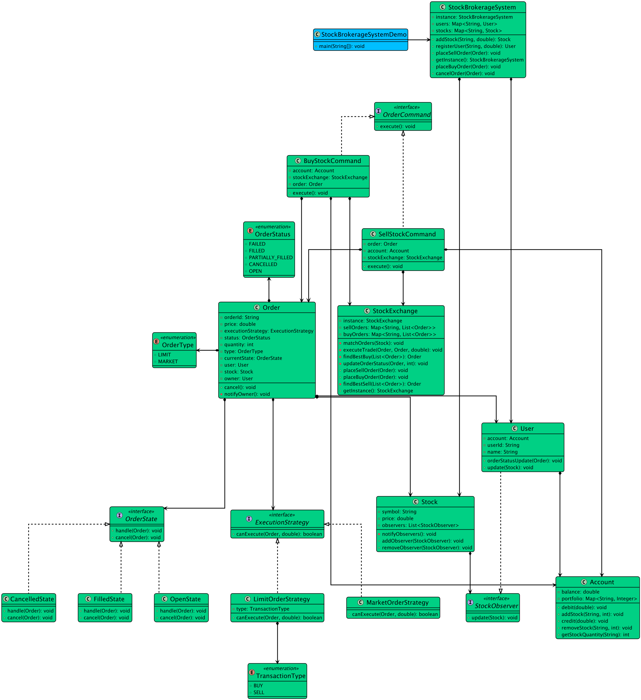

# Low-level design problem: online stock brokerage system

> Copied from <https://github.com/ashishps1/awesome-low-level-design/blob/main/problems/online-stock-brokerage-system.md> (GPL-3.0, by Ashish Pratap Singh). Questions and answers are the source's own; nothing was answered or rewritten here.


# Designing an Online Stock Brokerage System

## Requirements
1. The online stock brokerage system should allow users to create and manage their trading accounts.
2. Users should be able to buy and sell stocks, as well as view their portfolio and transaction history.
3. The system should provide real-time stock quotes and market data to users.
4. The system should handle order placement, execution, and settlement processes.
5. The system should enforce various business rules and validations, such as checking account balances and stock availability.
6. The system should handle concurrent user requests and ensure data consistency and integrity.
7. The system should be scalable and able to handle a large number of users and transactions.
8. The system should be secure and protect sensitive user information.

## UML Class Diagram



## Implementations
#### [Java Implementation](https://github.com/ashishps1/awesome-low-level-design/blob/main/solutions/java/src/onlinestockbrokeragesystem) 
#### [Python Implementation](https://github.com/ashishps1/awesome-low-level-design/blob/main/solutions/python/onlinestockbrokeragesystem)
#### [C++ Implementation](https://github.com/ashishps1/awesome-low-level-design/blob/main/solutions/cpp/onlinestockbrokeragesystem)
#### [C# Implementation](https://github.com/ashishps1/awesome-low-level-design/blob/main/solutions/csharp/onlinestockbrokeragesystem)
#### [Go Implementation](https://github.com/ashishps1/awesome-low-level-design/blob/main/solutions/golang/onlinestockbrokeragesystem)

## Classes, Interfaces and Enumerations
1. The **User** class represents a user of the stock brokerage system, with properties such as user ID, name, and email.
2. The **Account** class represents a user's trading account, with properties like account ID, associated user, and balance. It provides methods for depositing and withdrawing funds.
3. The **Stock** class represents a stock that can be traded, with properties such as symbol, name, and price. It provides a method for updating the stock price.
4. The **Order** class is an abstract base class representing an order placed by a user. It contains common properties such as order ID, associated account, stock, quantity, price, and order status. The execute() method is declared as abstract, to be implemented by concrete order classes.
5. The **BuyOrder** and **SellOrder** classes are concrete implementations of the Order class, representing buy and sell orders respectively. They provide the implementation for the execute() method specific to each order type.
6. The **OrderStatus** enum represents the possible statuses of an order, such as PENDING, EXECUTED, or REJECTED.
7. The **Portfolio** class represents a user's portfolio, which holds the stocks owned by the user. It provides methods for adding and removing stocks from the portfolio.
8. The **StockBroker** class is the central component of the stock brokerage system. It follows the Singleton pattern to ensure a single instance of the stock broker. It manages user accounts, stocks, and order processing. It provides methods for creating accounts, adding stocks, placing orders, and processing orders.
9. The **InsufficientFundsException** and **InsufficientStockException** classes are custom exceptions used to handle insufficient funds and insufficient stock scenarios respectively.
10. The **StockBrokerageSystem** class serves as the entry point of the application and demonstrates the usage of the stock brokerage system.

---

## Official solutions from the repository

<details><summary><b>java</b> (27 files)</summary>


**BuyOrder.java**

```java
package onlinestockbrokeragesystem;

public class BuyOrder extends Order {
    public BuyOrder(String orderId, Account account, Stock stock, int quantity, double price) {
        super(orderId, account, stock, quantity, price);
    }

    @Override
    public void execute() {
        double totalCost = quantity * price;
        if (account.getBalance() >= totalCost) {
            account.withdraw(totalCost);
            // Update portfolio and perform necessary actions
            account.getPortfolio().addStock(stock, quantity);
            status = OrderStatus.EXECUTED;
        } else {
            status = OrderStatus.REJECTED;
            throw new InsufficientFundsException("Insufficient funds to execute the buy order.");
        }
    }
}
```


**README.md**

```md
# Online Stock Brokerage System (LLD)

## Problem Statement

Design and implement an Online Stock Brokerage System that allows users to buy and sell stocks, manage their portfolio, and track their investments. The system should handle order processing, account management, and stock trading.

---

## Requirements

1. **Account Management:**
   - Create and manage user accounts
   - Track account balance
   - Handle fund deposits and withdrawals

2. **Stock Management:**
   - Track available stocks
   - Maintain stock prices
   - Handle stock information

3. **Order Management:**
   - Process buy and sell orders
   - Track order status
   - Handle order execution

4. **Portfolio Management:**
   - Track user's stock holdings
   - Calculate portfolio value
   - Monitor investment performance

5. **Trading Rules:**
   - Validate order amounts
   - Check sufficient funds
   - Verify stock availability

---

## Core Entities

### 1. StockBroker
- **Fields:** List<Account> accounts, List<Stock> stocks, List<Order> orders
- **Methods:** 
  - createAccount()
  - placeBuyOrder()
  - placeSellOrder()
  - getPortfolio()
  - getStockPrice()

### 2. Account
- **Fields:** String id, User user, double balance, Portfolio portfolio
- **Methods:** 
  - deposit()
  - withdraw()
  - getBalance()
  - getPortfolio()

### 3. User
- **Fields:** String id, String name, String email
- **Methods:** 
  - getAccount()
  - updateProfile()

### 4. Stock
- **Fields:** String symbol, String name, double currentPrice
- **Methods:** 
  - updatePrice()
  - getPrice()

### 5. Order
- **Fields:** String id, Account account, Stock stock, int quantity, OrderStatus status
- **Methods:** 
  - execute()
  - cancel()
  - getStatus()

### 6. BuyOrder
- **Fields:** double price
- **Methods:** 
  - validateFunds()
  - execute()

### 7. SellOrder
- **Fields:** double price
- **Methods:** 
  - validateStocks()
  - execute()

### 8. Portfolio
- **Fields:** Map<Stock, Integer> holdings
- **Methods:** 
  - addStock()
  - removeStock()
  - getValue()

### 9. OrderStatus (Enum)
- **Values:** PENDING, EXECUTED, CANCELLED, FAILED

## Class Design

## UML Class Diagram


---

## Example Usage

```java
StockBroker pubSubService = new StockBroker();

// Create a user account
User user = new User("John Doe", "john@example.com");
Account account = pubSubService.createAccount(user);

// Deposit funds
account.deposit(10000.0);

// Place a buy order
Stock stock = pubSubService.getStock("AAPL");
BuyOrder buyOrder = pubSubService.placeBuyOrder(account, stock, 10);

// Place a sell order
SellOrder sellOrder = pubSubService.placeSellOrder(account, stock, 5);

// Get portfolio
Portfolio portfolio = account.getPortfolio();
```

---

## Demo

See `StockBrokerageSystemDemo.java` for a sample usage and simulation of the stock brokerage system.

---

## Extending the Framework

- **Add real-time market data:** Integrate with market data providers
- **Add order types:** Support limit orders, stop-loss orders
- **Add trading strategies:** Implement automated trading strategies
- **Add transaction history:** Track all trading activities
- **Add reporting system:** Generate investment reports
- **Add notification system:** Send price alerts and order updates

---

## Design Patterns Used

- **Singleton Pattern:** For the stock pubSubService instance
- **Factory Pattern:** For creating different types of orders
- **Observer Pattern:** For stock price updates
- **Strategy Pattern:** For different order execution strategies

---

## Exception Handling

- **InsufficientFundsException:** Thrown when account has insufficient funds
- **InsufficientStockException:** Thrown when portfolio has insufficient stocks
- **InvalidOrderException:** Thrown when order details are invalid
- **OrderExecutionException:** Thrown when order execution fails

---
```


**SellOrder.java**

```java
package onlinestockbrokeragesystem;

public class SellOrder extends Order {
    public SellOrder(String orderId, Account account, Stock stock, int quantity, double price) {
        super(orderId, account, stock, quantity, price);
    }

    @Override
    public void execute() {
        // Check if the user has sufficient quantity of the stock to sell
        // Update portfolio and perform necessary actions
        double totalProceeds = quantity * price;
        account.deposit(totalProceeds);
        status = OrderStatus.EXECUTED;
    }
}
```


**StockBrokerageSystem.java**

```java
package onlinestockbrokeragesystem;

import onlinestockbrokeragesystem.command.BuyStockCommand;
import onlinestockbrokeragesystem.command.OrderCommand;
import onlinestockbrokeragesystem.command.SellStockCommand;
import onlinestockbrokeragesystem.entities.Order;
import onlinestockbrokeragesystem.entities.Stock;
import onlinestockbrokeragesystem.entities.User;

import java.util.Map;
import java.util.concurrent.ConcurrentHashMap;

public class StockBrokerageSystem {
    private static volatile StockBrokerageSystem instance;
    private final Map<String, User> users;
    private final Map<String, Stock> stocks;

    private StockBrokerageSystem() {
        this.users = new ConcurrentHashMap<>();
        this.stocks = new ConcurrentHashMap<>();
    }

    public static StockBrokerageSystem getInstance() {
        if (instance == null) {
            synchronized (StockBrokerageSystem.class) {
                if (instance == null) {
                    instance = new StockBrokerageSystem();
                }
            }
        }
        return instance;
    }

    public User registerUser(String name, double initialAmount) {
        User user = new User(name, initialAmount);
        users.put(user.getUserId(), user);
        return user;
    }

    public Stock addStock(String symbol, double initialPrice) {
        Stock stock = new Stock(symbol, initialPrice);
        stocks.put(stock.getSymbol(), stock);
        return stock;
    }

    public void placeBuyOrder(Order order) {
        User user = order.getUser();
        OrderCommand command = new BuyStockCommand(user.getAccount(), order);
        command.execute();
    }

    public void placeSellOrder(Order order) {
        User user = order.getUser();
        OrderCommand command = new SellStockCommand(user.getAccount(), order);
        command.execute();
    }

    public void cancelOrder(Order order) {
        order.cancel();
    }
}
```


**StockBrokerageSystemDemo.java**

```java
package onlinestockbrokeragesystem;

import onlinestockbrokeragesystem.entities.Order;
import onlinestockbrokeragesystem.entities.OrderBuilder;
import onlinestockbrokeragesystem.entities.Stock;
import onlinestockbrokeragesystem.entities.User;

public class StockBrokerageSystemDemo {
    public static void main(String[] args) throws InterruptedException {
        // --- System Setup ---
        StockBrokerageSystem system = StockBrokerageSystem.getInstance();

        // --- Create Stocks ---
        Stock apple = system.addStock("AAPL", 150.00);
        Stock google = system.addStock("GOOG", 2800.00);

        // --- Create Members (Users) ---
        User alice = system.registerUser("Alice", 20000.00);
        User bob = system.registerUser("Bob", 25000.00);

        // Bob already owns some Apple stock
        bob.getAccount().addStock("AAPL", 50);

        // --- Members subscribe to stock notifications (Observer Pattern) ---
        apple.addObserver(alice);
        google.addObserver(alice);
        apple.addObserver(bob);

        System.out.println("--- Initial State ---");
        printAccountStatus(alice);
        printAccountStatus(bob);

        System.out.println("\n--- Trading Simulation Starts ---\n");

        // --- SCENARIO 1: Limit Order Match ---
        System.out.println("--- SCENARIO 1: Alice places a limit buy, Bob places a limit sell that matches ---");

        // Alice wants to buy 10 shares of AAPL if the price is $150.50 or less
        Order aliceBuyOrder = new OrderBuilder()
                .forUser(alice)
                .buy(10)
                .withStock(apple)
                .withLimit(150.50)
                .build();
        system.placeBuyOrder(aliceBuyOrder);

        // Bob wants to sell 20 of his shares if the price is $150.50 or more
        Order bobSellOrder = new OrderBuilder()
                .forUser(bob)
                .sell(20)
                .withStock(apple)
                .withLimit(150.50)
                .build();
        system.placeSellOrder(bobSellOrder);

        // The exchange will automatically match and execute this trade.
        // Let's check the status after the trade.
        Thread.sleep(100); // Give time for notifications to print
        System.out.println("\n--- Account Status After Trade 1 ---");
        printAccountStatus(alice);
        printAccountStatus(bob);

        // --- SCENARIO 2: Price Update triggers notifications ---
        System.out.println("\n--- SCENARIO 2: Market price of GOOG changes ---");
        google.setPrice(2850.00); // Alice will get a notification

        // --- SCENARIO 3: Order Cancellation (State Pattern) ---
        System.out.println("\n--- SCENARIO 3: Alice places an order and then cancels it ---");
        Order aliceCancelOrder = new OrderBuilder()
                .forUser(alice)
                .buy(5)
                .withStock(google)
                .withLimit(2700.00) // Price is too low, so it won't execute immediately
                .build();
        system.placeBuyOrder(aliceCancelOrder);

        System.out.println("Order status before cancellation: " + aliceCancelOrder.getStatus());
        system.cancelOrder(aliceCancelOrder);
        System.out.println("Order status after cancellation attempt: " + aliceCancelOrder.getStatus());

        // Now try to cancel an already filled order
        System.out.println("\n--- Trying to cancel an already FILLED order (State Pattern) ---");
        System.out.println("Bob's sell order status: " + bobSellOrder.getStatus());
        system.cancelOrder(bobSellOrder); // This should fail
        System.out.println("Bob's sell order status after cancel attempt: " + bobSellOrder.getStatus());
    }

    private static void printAccountStatus(User user) {
        System.out.printf("Member: %s, Cash: $%.2f, Portfolio: %s%n",
                user.getName(),
                user.getAccount().getBalance(),
                user.getAccount().getPortfolio());
    }
}
```


**StockExchange.java**

```java
package onlinestockbrokeragesystem;

import onlinestockbrokeragesystem.enums.OrderStatus;
import onlinestockbrokeragesystem.enums.OrderType;
import onlinestockbrokeragesystem.entities.Order;
import onlinestockbrokeragesystem.entities.Stock;
import onlinestockbrokeragesystem.entities.User;
import onlinestockbrokeragesystem.state.FilledState;

import java.util.Comparator;
import java.util.List;
import java.util.Map;
import java.util.concurrent.ConcurrentHashMap;
import java.util.concurrent.CopyOnWriteArrayList;

public class StockExchange {
    private static volatile StockExchange instance;
    private final Map<String, List<Order>> buyOrders;
    private final Map<String, List<Order>> sellOrders;

    private StockExchange() {
        this.buyOrders = new ConcurrentHashMap<>();
        this.sellOrders = new ConcurrentHashMap<>();
    }

    public static StockExchange getInstance() {
        if (instance == null) {
            synchronized (StockExchange.class) {
                if (instance == null) {
                    instance = new StockExchange();
                }
            }
        }
        return instance;
    }

    public void placeBuyOrder(Order order) {
        buyOrders.computeIfAbsent(order.getStock().getSymbol(), k -> new CopyOnWriteArrayList<>()).add(order);
        matchOrders(order.getStock());
    }

    public void placeSellOrder(Order order) {
        sellOrders.computeIfAbsent(order.getStock().getSymbol(), k -> new CopyOnWriteArrayList<>()).add(order);
        matchOrders(order.getStock());
    }

    private void matchOrders(Stock stock) {
        synchronized (this) { // Critical section to prevent race conditions during matching
            List<Order> buys = buyOrders.get(stock.getSymbol());
            List<Order> sells = sellOrders.get(stock.getSymbol());

            if (buys == null || sells == null) return;

            boolean matchFound;
            do {
                matchFound = false;
                Order bestBuy = findBestBuy(buys);
                Order bestSell = findBestSell(sells);

                if (bestBuy != null && bestSell != null) {
                    double buyPrice = bestBuy.getType() == OrderType.MARKET ? stock.getPrice() : bestBuy.getPrice();
                    double sellPrice = bestSell.getType() == OrderType.MARKET ? stock.getPrice() : bestSell.getPrice();

                    if (buyPrice >= sellPrice) {
                        executeTrade(bestBuy, bestSell, sellPrice); // Trade at the seller's asking price
                        matchFound = true;
                    }
                }
            } while (matchFound);
        }
    }

    private void executeTrade(Order buyOrder, Order sellOrder, double tradePrice) {
        System.out.printf("--- Executing Trade for %s at $%.2f ---%n", buyOrder.getStock(), tradePrice);

        User buyer = buyOrder.getUser();
        User seller = sellOrder.getUser();

        int tradeQuantity = Math.min(buyOrder.getQuantity(), sellOrder.getQuantity());
        double totalCost = tradeQuantity * tradePrice;

        // Perform transaction
        buyer.getAccount().debit(totalCost);
        buyer.getAccount().addStock(buyOrder.getStock().getSymbol(), tradeQuantity);

        seller.getAccount().credit(totalCost);
        seller.getAccount().removeStock(sellOrder.getStock().getSymbol(), tradeQuantity);

        // Update orders
        updateOrderStatus(buyOrder, tradeQuantity);
        updateOrderStatus(sellOrder, tradeQuantity);

        // Update stock's market price to last traded price
        buyOrder.getStock().setPrice(tradePrice);

        System.out.println("--- Trade Complete ---");
    }

    private void updateOrderStatus(Order order, int quantityTraded) {
        // This is a simplified update logic. A real system would handle partial fills.
        order.setStatus(OrderStatus.FILLED);
        order.setState(new FilledState());
        String stockSymbol = order.getStock().getSymbol();
        // Remove from books
        if (buyOrders.get(stockSymbol) != null)
            buyOrders.get(stockSymbol).remove(order);
        if (sellOrders.get(stockSymbol) != null)
            sellOrders.get(stockSymbol).remove(order);
    }

    private Order findBestBuy(List<Order> buys) {
        return buys.stream()
                .filter(o -> o.getStatus() == OrderStatus.OPEN)
                .max(Comparator.comparingDouble(Order::getPrice)) // Highest limit price is best
                .orElse(null);
    }

    private Order findBestSell(List<Order> sells) {
        return sells.stream()
                .filter(o -> o.getStatus() == OrderStatus.OPEN)
                .min(Comparator.comparingDouble(Order::getPrice)) // Lowest limit price is best
                .orElse(null);
    }
}
```


**command/BuyStockCommand.java**

```java
package onlinestockbrokeragesystem.command;

import onlinestockbrokeragesystem.StockExchange;
import onlinestockbrokeragesystem.entities.Account;
import onlinestockbrokeragesystem.entities.Order;
import onlinestockbrokeragesystem.enums.OrderType;
import onlinestockbrokeragesystem.exceptions.InsufficientFundsException;

public class BuyStockCommand implements OrderCommand {
    private final Account account;
    private final Order order;
    private final StockExchange stockExchange;

    public BuyStockCommand(Account account, Order order) {
        this.account = account;
        this.order = order;
        this.stockExchange = StockExchange.getInstance();
    }

    @Override
    public void execute() {
        // For market order, we can't pre-check funds perfectly.
        // For limit order, we can pre-authorize the amount.
        double estimatedCost = order.getQuantity() * order.getPrice();
        if (order.getType() == OrderType.LIMIT && account.getBalance() < estimatedCost) {
            throw new InsufficientFundsException("Not enough cash to place limit buy order.");
        }
        System.out.printf("Placing BUY order %s for %d shares of %s.%n", order.getOrderId(), order.getQuantity(), order.getStock());
        stockExchange.placeBuyOrder(order);
    }
}
```


**command/OrderCommand.java**

```java
package onlinestockbrokeragesystem.command;

public interface OrderCommand {
    void execute();
}
```


**command/SellStockCommand.java**

```java
package onlinestockbrokeragesystem.command;

import onlinestockbrokeragesystem.StockExchange;
import onlinestockbrokeragesystem.entities.Account;
import onlinestockbrokeragesystem.entities.Order;
import onlinestockbrokeragesystem.exceptions.InsufficientStockException;

public class SellStockCommand implements OrderCommand {
    private final Account account;
    private final Order order;
    private final StockExchange stockExchange;

    public SellStockCommand(Account account, Order order) {
        this.account = account;
        this.order = order;
        this.stockExchange = StockExchange.getInstance();
    }

    @Override
    public void execute() {
        if (account.getStockQuantity(order.getStock().getSymbol()) < order.getQuantity()) {
            throw new InsufficientStockException("Not enough stock to place sell order.");
        }
        System.out.printf("Placing SELL order %s for %d shares of %s.%n", order.getOrderId(), order.getQuantity(), order.getStock());
        stockExchange.placeSellOrder(order);
    }
}
```


**entities/Account.java**

```java
package onlinestockbrokeragesystem.entities;

import onlinestockbrokeragesystem.exceptions.InsufficientFundsException;
import onlinestockbrokeragesystem.exceptions.InsufficientStockException;

import java.util.Map;
import java.util.concurrent.ConcurrentHashMap;

public class Account {
    private double balance;
    private final Map<String, Integer> portfolio; // Stock symbol -> quantity

    public Account(double initialCash) {
        this.balance = initialCash;
        this.portfolio = new ConcurrentHashMap<>();
    }

    public synchronized void debit(double amount) {
        if (balance < amount) {
            throw new InsufficientFundsException("Insufficient funds to debit " + amount);
        }
        balance -= amount;
    }

    public synchronized void credit(double amount) {
        balance += amount;
    }

    public synchronized void addStock(String symbol, int quantity) {
        portfolio.put(symbol, portfolio.getOrDefault(symbol, 0) + quantity);
    }

    public synchronized void removeStock(String symbol, int quantity) {
        int currentQuantity = portfolio.getOrDefault(symbol, 0);
        if (currentQuantity < quantity) {
            throw new InsufficientStockException("Not enough " + symbol + " stock to sell.");
        }
        portfolio.put(symbol, currentQuantity - quantity);
    }

    public double getBalance() { return balance; }
    public Map<String, Integer> getPortfolio() { return Map.copyOf(portfolio); }
    public int getStockQuantity(String symbol) { return portfolio.getOrDefault(symbol, 0); }
}
```


**entities/Order.java**

```java
package onlinestockbrokeragesystem.entities;

import onlinestockbrokeragesystem.enums.OrderStatus;
import onlinestockbrokeragesystem.enums.OrderType;
import onlinestockbrokeragesystem.state.OpenState;
import onlinestockbrokeragesystem.state.OrderState;
import onlinestockbrokeragesystem.strategy.ExecutionStrategy;

public class Order {
    private final String orderId;
    private final User user;
    private final Stock stock;
    private final OrderType type;
    private final int quantity;
    private final double price; // Limit price for Limit orders
    private OrderStatus status;
    private User owner;
    private OrderState currentState;
    private final ExecutionStrategy executionStrategy;

    public Order(String orderId, User user, Stock stock, OrderType type, int quantity, double price, ExecutionStrategy strategy, User owner) {
        this.orderId = orderId;
        this.user = user;
        this.stock = stock;
        this.type = type;
        this.quantity = quantity;
        this.price = price;
        this.executionStrategy = strategy;
        this.owner = owner;
        this.currentState = new OpenState(); // Initial state
        this.status = OrderStatus.OPEN;
    }

    // State pattern methods
    public void cancel() {
        currentState.cancel(this);
    }

    // Getters
    public String getOrderId() { return orderId; }
    public User getUser() { return user; }
    public Stock getStock() { return stock; }
    public OrderType getType() { return type; }
    public int getQuantity() { return quantity; }
    public double getPrice() { return price; }
    public OrderStatus getStatus() { return status; }
    public ExecutionStrategy getExecutionStrategy() { return executionStrategy; }

    // Setters for state transitions
    public void setState(OrderState state) {
        this.currentState = state;
    }

    public void setStatus(OrderStatus status) {
        this.status = status;
        notifyOwner();
    }

    private void notifyOwner() {
        if (owner != null) {
            owner.orderStatusUpdate(this);
        }
    }
}
```


**entities/OrderBuilder.java**

```java
package onlinestockbrokeragesystem.entities;

import onlinestockbrokeragesystem.enums.OrderType;
import onlinestockbrokeragesystem.enums.TransactionType;
import onlinestockbrokeragesystem.strategy.LimitOrderStrategy;
import onlinestockbrokeragesystem.strategy.MarketOrderStrategy;

import java.util.UUID;

public class OrderBuilder {
    private User user;
    private Stock stock;
    private OrderType type;
    private TransactionType transactionType;
    private int quantity;
    private double price;

    public OrderBuilder forUser(User user) {
        this.user = user;
        return this;
    }

    public OrderBuilder withStock(Stock stock) {
        this.stock = stock;
        return this;
    }

    public OrderBuilder buy(int quantity) {
        this.transactionType = TransactionType.BUY;
        this.quantity = quantity;
        return this;
    }

    public OrderBuilder sell(int quantity) {
        this.transactionType = TransactionType.SELL;
        this.quantity = quantity;
        return this;
    }

    public OrderBuilder atMarketPrice() {
        this.type = OrderType.MARKET;
        this.price = 0; // Not needed for market order
        return this;
    }

    public OrderBuilder withLimit(double limitPrice) {
        this.type = OrderType.LIMIT;
        this.price = limitPrice;
        return this;
    }

    public Order build() {
        return new Order(
                UUID.randomUUID().toString(),
                user,
                stock,
                type,
                quantity,
                price,
                type == OrderType.MARKET ? new MarketOrderStrategy() : new LimitOrderStrategy(transactionType),
                user
        );
    }
}
```


**entities/Stock.java**

```java
package onlinestockbrokeragesystem.entities;

import onlinestockbrokeragesystem.observer.StockObserver;

import java.util.ArrayList;
import java.util.List;

public class Stock {
    private final String symbol;
    private double price;
    private final List<StockObserver> observers = new ArrayList<>();

    public Stock(String symbol, double initialPrice) {
        this.symbol = symbol;
        this.price = initialPrice;
    }

    public String getSymbol() {
        return symbol;
    }

    public double getPrice() {
        return price;
    }

    public void setPrice(double newPrice) {
        if (this.price != newPrice) {
            this.price = newPrice;
            notifyObservers();
        }
    }

    public void addObserver(StockObserver observer) {
        observers.add(observer);
    }

    public void removeObserver(StockObserver observer) {
        observers.remove(observer);
    }

    private void notifyObservers() {
        for (StockObserver observer : observers) {
            observer.update(this);
        }
    }
}
```


**entities/User.java**

```java
package onlinestockbrokeragesystem.entities;

import onlinestockbrokeragesystem.observer.StockObserver;

import java.util.UUID;

public class User implements StockObserver {
    private final String userId;
    private final String name;
    private final Account account;

    public User(String name, double initialCash) {
        this.userId = UUID.randomUUID().toString();
        this.name = name;
        this.account = new Account(initialCash);
    }

    public String getUserId() { return userId; }
    public String getName() { return name; }
    public Account getAccount() { return account; }

    @Override
    public void update(Stock stock) {
        System.out.printf("[Notification for %s] Stock %s price updated to: $%.2f%n",
                name, stock.getSymbol(), stock.getPrice());
    }

    public void orderStatusUpdate(Order order) {
        System.out.printf("[Order Notification for %s] Order %s for %s is now %s.%n",
                name, order.getOrderId(), order.getStock(), order.getStatus());
    }
}
```


**enums/OrderStatus.java**

```java
package onlinestockbrokeragesystem.enums;

public enum OrderStatus {
    OPEN,
    PARTIALLY_FILLED,
    FILLED,
    CANCELLED,
    FAILED
}
```


**enums/OrderType.java**

```java
package onlinestockbrokeragesystem.enums;

public enum OrderType {
    MARKET,
    LIMIT
}
```


**enums/TransactionType.java**

```java
package onlinestockbrokeragesystem.enums;

public enum TransactionType {
    BUY,
    SELL
}
```


**exceptions/InsufficientFundsException.java**

```java
package onlinestockbrokeragesystem.exceptions;

public class InsufficientFundsException extends RuntimeException {
    public InsufficientFundsException(String message) {
        super(message);
    }
}
```


**exceptions/InsufficientStockException.java**

```java
package onlinestockbrokeragesystem.exceptions;

public class InsufficientStockException extends RuntimeException {
    public InsufficientStockException(String message) {
        super(message);
    }
}
```


**observer/StockObserver.java**

```java
package onlinestockbrokeragesystem.observer;

import onlinestockbrokeragesystem.entities.Stock;

public interface StockObserver {
    void update(Stock stock);
}
```


**state/CancelledState.java**

```java
package onlinestockbrokeragesystem.state;

import onlinestockbrokeragesystem.entities.Order;

public class CancelledState implements OrderState {
    @Override
    public void handle(Order order) {
        System.out.println("Order is cancelled.");
    }

    @Override
    public void cancel(Order order) {
        System.out.println("Order is already cancelled.");
    }
}
```


**state/FilledState.java**

```java
package onlinestockbrokeragesystem.state;

import onlinestockbrokeragesystem.entities.Order;

public class FilledState implements OrderState {
    @Override
    public void handle(Order order) {
        System.out.println("Order is already filled.");
    }

    @Override
    public void cancel(Order order) {
        System.out.println("Cannot cancel a filled order.");
    }
}
```


**state/OpenState.java**

```java
package onlinestockbrokeragesystem.state;

import onlinestockbrokeragesystem.entities.Order;
import onlinestockbrokeragesystem.enums.OrderStatus;

public class OpenState implements OrderState {
    @Override
    public void handle(Order order) {
        System.out.println("Order is open and waiting for execution.");
    }

    @Override
    public void cancel(Order order) {
        order.setStatus(OrderStatus.CANCELLED);
        order.setState(new CancelledState());
        System.out.println("Order " + order.getOrderId() + " has been cancelled.");
    }
}
```


**state/OrderState.java**

```java
package onlinestockbrokeragesystem.state;

import onlinestockbrokeragesystem.entities.Order;

public interface OrderState {
    void handle(Order order);
    void cancel(Order order);
}
```


**strategy/ExecutionStrategy.java**

```java
package onlinestockbrokeragesystem.strategy;

import onlinestockbrokeragesystem.entities.Order;

public interface ExecutionStrategy {
    boolean canExecute(Order order, double marketPrice);
}
```


**strategy/LimitOrderStrategy.java**

```java
package onlinestockbrokeragesystem.strategy;

import onlinestockbrokeragesystem.entities.Order;
import onlinestockbrokeragesystem.enums.TransactionType;

public class LimitOrderStrategy implements ExecutionStrategy {
    private final TransactionType type;

    public LimitOrderStrategy(TransactionType type) {
        this.type = type;
    }

    @Override
    public boolean canExecute(Order order, double marketPrice) {
        if (type == TransactionType.BUY) {
            // Buy if market price is less than or equal to limit price
            return marketPrice <= order.getPrice();
        } else { // SELL
            // Sell if market price is greater than or equal to limit price
            return marketPrice >= order.getPrice();
        }
    }
}
```


**strategy/MarketOrderStrategy.java**

```java
package onlinestockbrokeragesystem.strategy;

import onlinestockbrokeragesystem.entities.Order;

public class MarketOrderStrategy implements ExecutionStrategy {
    @Override
    public boolean canExecute(Order order, double marketPrice) {
        return true; // Market orders can always execute
    }
}
```

</details>

<details><summary><b>python</b> (15 files)</summary>


**README.md**

```md
# Designing an Online Stock Brokerage System

## Requirements
1. The online stock brokerage system should allow users to create and manage their trading accounts.
2. Users should be able to buy and sell stocks, as well as view their portfolio and transaction history.
3. The system should provide real-time stock quotes and market data to users.
4. The system should handle order placement, execution, and settlement processes.
5. The system should enforce various business rules and validations, such as checking account balances and stock availability.
6. The system should handle concurrent user requests and ensure data consistency and integrity.
7. The system should be scalable and able to handle a large number of users and transactions.
8. The system should be secure and protect sensitive user information.

## Classes, Interfaces and Enumerations
1. The **User** class represents a user of the stock brokerage system, with properties such as user ID, name, and email.
2. The **Account** class represents a user's trading account, with properties like account ID, associated user, and balance. It provides methods for depositing and withdrawing funds.
3. The **Stock** class represents a stock that can be traded, with properties such as symbol, name, and price. It provides a method for updating the stock price.
4. The **Order** class is an abstract base class representing an order placed by a user. It contains common properties such as order ID, associated account, stock, quantity, price, and order status. The execute() method is declared as abstract, to be implemented by concrete order classes.
5. The **BuyOrder** and **SellOrder** classes are concrete implementations of the Order class, representing buy and sell orders respectively. They provide the implementation for the execute() method specific to each order type.
6. The **OrderStatus** enum represents the possible statuses of an order, such as PENDING, EXECUTED, or REJECTED.
7. The **Portfolio** class represents a user's portfolio, which holds the stocks owned by the user. It provides methods for adding and removing stocks from the portfolio.
8. The **StockBroker** class is the central component of the stock brokerage system. It follows the Singleton pattern to ensure a single instance of the stock broker. It manages user accounts, stocks, and order processing. It provides methods for creating accounts, adding stocks, placing orders, and processing orders.
9. The **InsufficientFundsException** and **InsufficientStockException** classes are custom exceptions used to handle insufficient funds and insufficient stock scenarios respectively.
10. The **StockBrokerageSystem** class serves as the entry point of the application and demonstrates the usage of the stock brokerage system.
```


**account.py**

```py
import threading
from typing import Dict
from exceptions import InsufficientFundsException, InsufficientStockException

class Account:
    def __init__(self, initial_cash: float):
        self.balance = initial_cash
        self.portfolio: Dict[str, int] = {}  # Stock symbol -> quantity
        self.lock = threading.Lock()

    def debit(self, amount: float) -> None:
        with self.lock:
            if self.balance < amount:
                raise InsufficientFundsException(f"Insufficient funds to debit {amount}")
            self.balance -= amount

    def credit(self, amount: float) -> None:
        with self.lock:
            self.balance += amount

    def add_stock(self, symbol: str, quantity: int) -> None:
        with self.lock:
            self.portfolio[symbol] = self.portfolio.get(symbol, 0) + quantity

    def remove_stock(self, symbol: str, quantity: int) -> None:
        with self.lock:
            current_quantity = self.portfolio.get(symbol, 0)
            if current_quantity < quantity:
                raise InsufficientStockException(f"Not enough {symbol} stock to sell.")
            self.portfolio[symbol] = current_quantity - quantity

    def get_balance(self) -> float:
        return self.balance

    def get_portfolio(self) -> Dict[str, int]:
        return self.portfolio.copy()

    def get_stock_quantity(self, symbol: str) -> int:
        return self.portfolio.get(symbol, 0)
```


**enums.py**

```py
from enum import Enum

class OrderType(Enum):
    MARKET = "MARKET"
    LIMIT = "LIMIT"

class TransactionType(Enum):
    BUY = "BUY"
    SELL = "SELL"

class OrderStatus(Enum):
    OPEN = "OPEN"
    PARTIALLY_FILLED = "PARTIALLY_FILLED"
    FILLED = "FILLED"
    CANCELLED = "CANCELLED"
    FAILED = "FAILED"
```


**exceptions.py**

```py
class InsufficientFundsException(Exception):
    def __init__(self, message: str):
        super().__init__(message)

class InsufficientStockException(Exception):
    def __init__(self, message: str):
        super().__init__(message)
```


**execution_strategy.py**

```py
from abc import ABC, abstractmethod
from enums import TransactionType
from typing import TYPE_CHECKING

if TYPE_CHECKING:
    from order import Order

class ExecutionStrategy(ABC):
    @abstractmethod
    def can_execute(self, order: 'Order', market_price: float) -> bool:
        pass

class LimitOrderStrategy(ExecutionStrategy):
    def __init__(self, transaction_type: TransactionType):
        self.type = transaction_type

    def can_execute(self, order: 'Order', market_price: float) -> bool:
        if self.type == TransactionType.BUY:
            # Buy if market price is less than or equal to limit price
            return market_price <= order.get_price()
        else:  # SELL
            # Sell if market price is greater than or equal to limit price
            return market_price >= order.get_price()

class MarketOrderStrategy(ExecutionStrategy):
    def can_execute(self, order: 'Order', market_price: float) -> bool:
        return True  # Market orders can always execute
```


**order.py**

```py
from enums import OrderType, OrderStatus
from stock import Stock
from execution_strategy import ExecutionStrategy
from order_states import OrderState, OpenState
from typing import TYPE_CHECKING

if TYPE_CHECKING:
    from user import User

class Order:
    def __init__(self, order_id: str, user: 'User', stock: Stock, order_type: OrderType, 
                 quantity: int, price: float, execution_strategy: ExecutionStrategy, owner: 'User'):
        self.order_id = order_id
        self.user = user
        self.stock = stock
        self.type = order_type
        self.quantity = quantity
        self.price = price  # Limit price for Limit orders
        self.execution_strategy = execution_strategy
        self.owner = owner
        self.current_state = OpenState()  # Initial state
        self.status = OrderStatus.OPEN

    def cancel(self) -> None:
        self.current_state.cancel(self)

    def get_order_id(self) -> str:
        return self.order_id

    def get_user(self) -> 'User':
        return self.user

    def get_stock(self) -> Stock:
        return self.stock

    def get_type(self) -> OrderType:
        return self.type

    def get_quantity(self) -> int:
        return self.quantity

    def get_price(self) -> float:
        return self.price

    def get_status(self) -> OrderStatus:
        return self.status

    def get_execution_strategy(self) -> ExecutionStrategy:
        return self.execution_strategy

    def set_state(self, state: OrderState) -> None:
        self.current_state = state

    def set_status(self, status: OrderStatus) -> None:
        self.status = status
        self._notify_owner()

    def _notify_owner(self) -> None:
        if self.owner:
            self.owner.order_status_update(self)
```


**order_builder.py**

```py
from enums import OrderType, TransactionType
from user import User
from stock import Stock
from order import Order
from execution_strategy import MarketOrderStrategy, LimitOrderStrategy
from typing import Optional
import uuid

class OrderBuilder:
    def __init__(self):
        self.user: Optional[User] = None
        self.stock: Optional[Stock] = None
        self.type: Optional[OrderType] = None
        self.transaction_type: Optional[TransactionType] = None
        self.quantity: int = 0
        self.price: float = 0.0

    def for_user(self, user: User) -> 'OrderBuilder':
        self.user = user
        return self

    def with_stock(self, stock: Stock) -> 'OrderBuilder':
        self.stock = stock
        return self

    def buy(self, quantity: int) -> 'OrderBuilder':
        self.transaction_type = TransactionType.BUY
        self.quantity = quantity
        return self

    def sell(self, quantity: int) -> 'OrderBuilder':
        self.transaction_type = TransactionType.SELL
        self.quantity = quantity
        return self

    def at_market_price(self) -> 'OrderBuilder':
        self.type = OrderType.MARKET
        self.price = 0  # Not needed for market order
        return self

    def with_limit(self, limit_price: float) -> 'OrderBuilder':
        self.type = OrderType.LIMIT
        self.price = limit_price
        return self

    def build(self) -> Order:
        execution_strategy = MarketOrderStrategy() if self.type == OrderType.MARKET else LimitOrderStrategy(self.transaction_type)
        return Order(
            str(uuid.uuid4()),
            self.user,
            self.stock,
            self.type,
            self.quantity,
            self.price,
            execution_strategy,
            self.user
        )
```


**order_command.py**

```py
from abc import ABC, abstractmethod
from account import Account
from order import Order
from enums import OrderType
from exceptions import InsufficientFundsException, InsufficientStockException
from stock_exchange import StockExchange

class OrderCommand(ABC):
    @abstractmethod
    def execute(self) -> None:
        pass

class BuyStockCommand(OrderCommand):
    def __init__(self, account: Account, order: Order):
        self.account = account
        self.order = order
        self.stock_exchange = StockExchange.get_instance()

    def execute(self) -> None:
        # For market order, we can't pre-check funds perfectly.
        # For limit order, we can pre-authorize the amount.
        estimated_cost = self.order.get_quantity() * self.order.get_price()
        if self.order.get_type() == OrderType.LIMIT and self.account.get_balance() < estimated_cost:
            raise InsufficientFundsException("Not enough cash to place limit buy order.")
        print(f"Placing BUY order {self.order.get_order_id()} for {self.order.get_quantity()} shares of {self.order.get_stock().get_symbol()}.")
        self.stock_exchange.place_buy_order(self.order)

class SellStockCommand(OrderCommand):
    def __init__(self, account: Account, order: Order):
        self.account = account
        self.order = order
        self.stock_exchange = StockExchange.get_instance()

    def execute(self) -> None:
        if self.account.get_stock_quantity(self.order.get_stock().get_symbol()) < self.order.get_quantity():
            raise InsufficientStockException("Not enough stock to place sell order.")
        print(f"Placing SELL order {self.order.get_order_id()} for {self.order.get_quantity()} shares of {self.order.get_stock().get_symbol()}.")
        self.stock_exchange.place_sell_order(self.order)
```


**order_states.py**

```py
from abc import ABC, abstractmethod
from enums import OrderStatus
from typing import TYPE_CHECKING

if TYPE_CHECKING:
    from order import Order

class OrderState(ABC):
    @abstractmethod
    def handle(self, order: 'Order') -> None:
        pass

    @abstractmethod
    def cancel(self, order: 'Order') -> None:
        pass

class OpenState(OrderState):
    def handle(self, order: 'Order') -> None:
        print("Order is open and waiting for execution.")

    def cancel(self, order: 'Order') -> None:
        order.set_status(OrderStatus.CANCELLED)
        order.set_state(CancelledState())
        print(f"Order {order.get_order_id()} has been cancelled.")

class FilledState(OrderState):
    def handle(self, order: 'Order') -> None:
        print("Order is already filled.")

    def cancel(self, order: 'Order') -> None:
        print("Cannot cancel a filled order.")

class CancelledState(OrderState):
    def handle(self, order: 'Order') -> None:
        print("Order is cancelled.")

    def cancel(self, order: 'Order') -> None:
        print("Order is already cancelled.")
```


**stock.py**

```py
from typing import List
from stock_observer import StockObserver

class Stock:
    def __init__(self, symbol: str, initial_price: float):
        self.symbol = symbol
        self.price = initial_price
        self.observers: List[StockObserver] = []

    def get_symbol(self) -> str:
        return self.symbol

    def get_price(self) -> float:
        return self.price

    def set_price(self, new_price: float) -> None:
        if self.price != new_price:
            self.price = new_price
            self._notify_observers()

    def add_observer(self, observer: StockObserver) -> None:
        self.observers.append(observer)

    def remove_observer(self, observer: StockObserver) -> None:
        if observer in self.observers:
            self.observers.remove(observer)

    def _notify_observers(self) -> None:
        for observer in self.observers:
            observer.update(self)
```


**stock_brokerage_system.py**

```py
from typing import Dict, Optional
from user import User
from stock import Stock
from order import Order
from order_command import BuyStockCommand, SellStockCommand
import threading

class StockBrokerageSystem:
    _instance: Optional['StockBrokerageSystem'] = None
    _lock = threading.Lock()

    def __new__(cls):
        if cls._instance is None:
            with cls._lock:
                if cls._instance is None:
                    cls._instance = super().__new__(cls)
        return cls._instance

    def __init__(self):
        if hasattr(self, 'initialized'):
            return
        self.users: Dict[str, User] = {}
        self.stocks: Dict[str, Stock] = {}
        self.initialized = True

    @classmethod
    def get_instance(cls) -> 'StockBrokerageSystem':
        return cls()

    def register_user(self, name: str, initial_amount: float) -> User:
        user = User(name, initial_amount)
        self.users[user.get_user_id()] = user
        return user

    def add_stock(self, symbol: str, initial_price: float) -> Stock:
        stock = Stock(symbol, initial_price)
        self.stocks[stock.get_symbol()] = stock
        return stock

    def place_buy_order(self, order: Order) -> None:
        user = order.get_user()
        command = BuyStockCommand(user.get_account(), order)
        command.execute()

    def place_sell_order(self, order: Order) -> None:
        user = order.get_user()
        command = SellStockCommand(user.get_account(), order)
        command.execute()

    def cancel_order(self, order: Order) -> None:
        order.cancel()
```


**stock_brokerage_system_demo.py**

```py
from user import User
from stock_brokerage_system import StockBrokerageSystem
import time
from order_builder import OrderBuilder

def print_account_status(user: User) -> None:
    print(f"Member: {user.get_name()}, Cash: ${user.get_account().get_balance():.2f}, Portfolio: {user.get_account().get_portfolio()}")

class StockBrokerageSystemDemo:
    def run():
        # System Setup
        system = StockBrokerageSystem.get_instance()

        # Create Stocks
        apple = system.add_stock("AAPL", 150.00)
        google = system.add_stock("GOOG", 2800.00)

        # Create Members (Users)
        alice = system.register_user("Alice", 20000.00)
        bob = system.register_user("Bob", 25000.00)

        # Bob already owns some Apple stock
        bob.get_account().add_stock("AAPL", 50)

        # Members subscribe to stock notifications (Observer Pattern)
        apple.add_observer(alice)
        google.add_observer(alice)
        apple.add_observer(bob)

        print("--- Initial State ---")
        print_account_status(alice)
        print_account_status(bob)

        print("\n--- Trading Simulation Starts ---\n")

        # SCENARIO 1: Limit Order Match
        print("--- SCENARIO 1: Alice places a limit buy, Bob places a limit sell that matches ---")

        # Alice wants to buy 10 shares of AAPL if the price is $150.50 or less
        alice_buy_order = OrderBuilder() \
            .for_user(alice) \
            .buy(10) \
            .with_stock(apple) \
            .with_limit(150.50) \
            .build()
        system.place_buy_order(alice_buy_order)

        # Bob wants to sell 20 of his shares if the price is $150.50 or more
        bob_sell_order = OrderBuilder() \
            .for_user(bob) \
            .sell(20) \
            .with_stock(apple) \
            .with_limit(150.50) \
            .build()
        system.place_sell_order(bob_sell_order)

        # The exchange will automatically match and execute this trade.
        # Let's check the status after the trade.
        time.sleep(0.1)  # Give time for notifications to print
        print("\n--- Account Status After Trade 1 ---")
        print_account_status(alice)
        print_account_status(bob)

        # SCENARIO 2: Price Update triggers notifications
        print("\n--- SCENARIO 2: Market price of GOOG changes ---")
        google.set_price(2850.00)  # Alice will get a notification

        # SCENARIO 3: Order Cancellation (State Pattern)
        print("\n--- SCENARIO 3: Alice places an order and then cancels it ---")
        alice_cancel_order = OrderBuilder() \
            .for_user(alice) \
            .buy(5) \
            .with_stock(google) \
            .with_limit(2700.00) \
            .build()  # Price is too low, so it won't execute immediately
        system.place_buy_order(alice_cancel_order)

        print(f"Order status before cancellation: {alice_cancel_order.get_status().value}")
        system.cancel_order(alice_cancel_order)
        print(f"Order status after cancellation attempt: {alice_cancel_order.get_status().value}")

        # Now try to cancel an already filled order
        print("\n--- Trying to cancel an already FILLED order (State Pattern) ---")
        print(f"Bob's sell order status: {bob_sell_order.get_status().value}")
        system.cancel_order(bob_sell_order)  # This should fail
        print(f"Bob's sell order status after cancel attempt: {bob_sell_order.get_status().value}")

if __name__ == "__main__":
    StockBrokerageSystemDemo.run()
```


**stock_exchange.py**

```py
from typing import Dict, List, Optional
from order import Order
from stock import Stock
from enums import OrderType, OrderStatus
from order_states import FilledState
import threading
from collections import defaultdict

class StockExchange:
    _instance: Optional['StockExchange'] = None
    _lock = threading.Lock()

    def __new__(cls):
        if cls._instance is None:
            with cls._lock:
                if cls._instance is None:
                    cls._instance = super().__new__(cls)
        return cls._instance

    def __init__(self):
        if hasattr(self, 'initialized'):
            return
        self.buy_orders: Dict[str, List[Order]] = defaultdict(list)
        self.sell_orders: Dict[str, List[Order]] = defaultdict(list)
        self.match_lock = threading.Lock()
        self.initialized = True

    @classmethod
    def get_instance(cls) -> 'StockExchange':
        return cls()

    def place_buy_order(self, order: Order) -> None:
        self.buy_orders[order.get_stock().get_symbol()].append(order)
        self._match_orders(order.get_stock())

    def place_sell_order(self, order: Order) -> None:
        self.sell_orders[order.get_stock().get_symbol()].append(order)
        self._match_orders(order.get_stock())

    def _match_orders(self, stock: Stock) -> None:
        with self.match_lock:  # Critical section to prevent race conditions during matching
            buys = self.buy_orders.get(stock.get_symbol(), [])
            sells = self.sell_orders.get(stock.get_symbol(), [])

            if not buys or not sells:
                return

            match_found = True
            while match_found:
                match_found = False
                best_buy = self._find_best_buy(buys)
                best_sell = self._find_best_sell(sells)

                if best_buy and best_sell:
                    buy_price = stock.get_price() if best_buy.get_type() == OrderType.MARKET else best_buy.get_price()
                    sell_price = stock.get_price() if best_sell.get_type() == OrderType.MARKET else best_sell.get_price()

                    if buy_price >= sell_price:
                        self._execute_trade(best_buy, best_sell, sell_price)  # Trade at the seller's asking price
                        match_found = True

    def _execute_trade(self, buy_order: Order, sell_order: Order, trade_price: float) -> None:
        print(f"--- Executing Trade for {buy_order.get_stock().get_symbol()} at ${trade_price:.2f} ---")

        buyer = buy_order.get_user()
        seller = sell_order.get_user()

        trade_quantity = min(buy_order.get_quantity(), sell_order.get_quantity())
        total_cost = trade_quantity * trade_price

        # Perform transaction
        buyer.get_account().debit(total_cost)
        buyer.get_account().add_stock(buy_order.get_stock().get_symbol(), trade_quantity)

        seller.get_account().credit(total_cost)
        seller.get_account().remove_stock(sell_order.get_stock().get_symbol(), trade_quantity)

        # Update orders
        self._update_order_status(buy_order, trade_quantity)
        self._update_order_status(sell_order, trade_quantity)

        # Update stock's market price to last traded price
        buy_order.get_stock().set_price(trade_price)

        print("--- Trade Complete ---")

    def _update_order_status(self, order: Order, quantity_traded: int) -> None:
        # This is a simplified update logic. A real system would handle partial fills.
        order.set_status(OrderStatus.FILLED)
        order.set_state(FilledState())
        stock_symbol = order.get_stock().get_symbol()
        
        # Remove from books
        if order in self.buy_orders[stock_symbol]:
            self.buy_orders[stock_symbol].remove(order)
        if order in self.sell_orders[stock_symbol]:
            self.sell_orders[stock_symbol].remove(order)

    def _find_best_buy(self, buys: List[Order]) -> Optional[Order]:
        open_orders = [o for o in buys if o.get_status() == OrderStatus.OPEN]
        if not open_orders:
            return None
        return max(open_orders, key=lambda o: o.get_price())  # Highest limit price is best

    def _find_best_sell(self, sells: List[Order]) -> Optional[Order]:
        open_orders = [o for o in sells if o.get_status() == OrderStatus.OPEN]
        if not open_orders:
            return None
        return min(open_orders, key=lambda o: o.get_price())  # Lowest limit price is best
```


**stock_observer.py**

```py
from abc import ABC, abstractmethod
from typing import TYPE_CHECKING

if TYPE_CHECKING:
    from stock import Stock

class StockObserver(ABC):
    @abstractmethod
    def update(self, stock: 'Stock') -> None:
        pass
```


**user.py**

```py
import uuid
from account import Account
from stock import Stock
from stock_observer import StockObserver
from order import Order

class User(StockObserver):
    def __init__(self, name: str, initial_cash: float):
        self.user_id = str(uuid.uuid4())
        self.name = name
        self.account = Account(initial_cash)

    def get_user_id(self) -> str:
        return self.user_id

    def get_name(self) -> str:
        return self.name

    def get_account(self) -> Account:
        return self.account

    def update(self, stock: Stock) -> None:
        print(f"[Notification for {self.name}] Stock {stock.get_symbol()} price updated to: ${stock.get_price():.2f}")

    def order_status_update(self, order: 'Order') -> None:
        print(f"[Order Notification for {self.name}] Order {order.get_order_id()} for {order.get_stock().get_symbol()} is now {order.get_status().value}.")
```

</details>

<details><summary><b>cpp</b> (12 files)</summary>


**BrokerageDemo.cpp**

```cpp
#include "BrokerageSystem.hpp"
#include <iostream>

int main() {
    BrokerageSystem brokerage;
    
    // Add stocks
    Stock* apple = brokerage.addStock("AAPL", "Apple Inc.", 150.0, 1000);
    Stock* google = brokerage.addStock("GOOGL", "Alphabet Inc.", 2800.0, 500);
    Stock* amazon = brokerage.addStock("AMZN", "Amazon.com Inc.", 3300.0, 300);
    
    std::cout << "Initial Stocks:" << std::endl;
    brokerage.displayStocks();
    
    // Register users
    User* user1 = brokerage.registerUser("john_trader", "john@email.com");
    User* user2 = brokerage.registerUser("jane_investor", "jane@email.com");
    
    // Deposit funds
    brokerage.deposit(user1->getUserId(), 10000.0);
    brokerage.deposit(user2->getUserId(), 15000.0);
    
    std::cout << "\nUsers after deposit:" << std::endl;
    brokerage.displayUsers();
    
    // Perform transactions
    Transaction* trans1 = brokerage.buyStock(user1->getUserId(), "AAPL", 10);
    if (trans1) {
        std::cout << "\nBuy Transaction:" << std::endl;
        trans1->displayInfo();
    }
    
    // Update stock price
    brokerage.updateStockPrice("AAPL", 155.0);
    
    Transaction* trans2 = brokerage.sellStock(user1->getUserId(), "AAPL", 5);
    if (trans2) {
        std::cout << "\nSell Transaction:" << std::endl;
        trans2->displayInfo();
    }
    
    // Display final state
    std::cout << "\nFinal Portfolio for John:" << std::endl;
    brokerage.displayUserPortfolio(user1->getUserId());
    
    std::cout << "\nTransaction History for John:" << std::endl;
    brokerage.displayTransactionHistory(user1->getUserId());
    
    return 0;
}
```


**BrokerageSystem.cpp**

```cpp
#include "BrokerageSystem.hpp"
#include <iostream>
#include <algorithm>

BrokerageSystem::BrokerageSystem() : transactionIdCounter(1) {}

BrokerageSystem::~BrokerageSystem() {
    for (auto user : users) delete user;
    for (auto& pair : stocks) delete pair.second;
    for (auto transaction : transactions) delete transaction;
}

User* BrokerageSystem::registerUser(const std::string& username, const std::string& email) {
    std::string userId = "U" + std::to_string(users.size() + 1);
    User* user = new User(userId, username, email);
    users.push_back(user);
    return user;
}

void BrokerageSystem::removeUser(const std::string& userId) {
    auto it = std::find_if(users.begin(), users.end(),
        [userId](User* user) { return user->getUserId() == userId; });
    
    if (it != users.end()) {
        delete *it;
        users.erase(it);
    }
}

Stock* BrokerageSystem::addStock(const std::string& symbol, const std::string& companyName,
                                double price, int shares) {
    Stock* stock = new Stock(symbol, companyName, price, shares);
    stocks[symbol] = stock;
    return stock;
}

void BrokerageSystem::updateStockPrice(const std::string& symbol, double newPrice) {
    if (Stock* stock = findStock(symbol)) {
        stock->setCurrentPrice(newPrice);
        updatePortfolioValues();
    }
}

bool BrokerageSystem::deposit(const std::string& userId, double amount) {
    if (User* user = findUser(userId)) {
        return user->deposit(amount);
    }
    return false;
}

bool BrokerageSystem::withdraw(const std::string& userId, double amount) {
    if (User* user = findUser(userId)) {
        return user->withdraw(amount);
    }
    return false;
}

Transaction* BrokerageSystem::buyStock(const std::string& userId, const std::string& symbol, int quantity) {
    User* user = findUser(userId);
    Stock* stock = findStock(symbol);
    
    if (!user || !stock || !stock->isActive()) return nullptr;
    
    double totalCost = stock->getCurrentPrice() * quantity;
    if (user->getBalance() < totalCost || stock->getAvailableShares() < quantity) {
        return nullptr;
    }
    
    // Process transaction
    user->withdraw(totalCost);
    stock->updateShares(-quantity);
    user->getPortfolio()->addShares(symbol, quantity);
    
    // Create transaction record
    Transaction* transaction = new Transaction(generateTransactionId(), user, stock,
                                            TransactionType::BUY, quantity,
                                            stock->getCurrentPrice());
    transactions.push_back(transaction);
    
    updatePortfolioValues();
    return transaction;
}

Transaction* BrokerageSystem::sellStock(const std::string& userId, const std::string& symbol, int quantity) {
    User* user = findUser(userId);
    Stock* stock = findStock(symbol);
    
    if (!user || !stock || !stock->isActive()) return nullptr;
    
    Portfolio* portfolio = user->getPortfolio();
    if (portfolio->getShareQuantity(symbol) < quantity) {
        return nullptr;
    }
    
    // Process transaction
    double totalAmount = stock->getCurrentPrice() * quantity;
    user->deposit(totalAmount);
    stock->updateShares(quantity);
    portfolio->removeShares(symbol, quantity);
    
    // Create transaction record
    Transaction* transaction = new Transaction(generateTransactionId(), user, stock,
                                            TransactionType::SELL, quantity,
                                            stock->getCurrentPrice());
    transactions.push_back(transaction);
    
    updatePortfolioValues();
    return transaction;
}

void BrokerageSystem::displayStocks() const {
    std::cout << "\nAvailable Stocks:" << std::endl;
    for (const auto& pair : stocks) {
        pair.second->displayInfo();
        std::cout << "------------------------" << std::endl;
    }
}

void BrokerageSystem::displayUsers() const {
    std::cout << "\nRegistered Users:" << std::endl;
    for (const auto& user : users) {
        user->displayInfo();
        std::cout << "------------------------" << std::endl;
    }
}

void BrokerageSystem::displayUserPortfolio(const std::string& userId) const {
    if (User* user = findUser(userId)) {
        user->getPortfolio()->displayInfo();
    }
}

void BrokerageSystem::displayTransactionHistory(const std::string& userId) const {
    std::cout << "\nTransaction History:" << std::endl;
    for (const auto& transaction : transactions) {
        if (transaction->getUser()->getUserId() == userId) {
            transaction->displayInfo();
            std::cout << "------------------------" << std::endl;
        }
    }
}

User* BrokerageSystem::findUser(const std::string& userId) const {
    auto it = std::find_if(users.begin(), users.end(),
        [userId](User* user) { return user->getUserId() == userId; });
    return it != users.end() ? *it : nullptr;
}

Stock* BrokerageSystem::findStock(const std::string& symbol) const {
    auto it = stocks.find(symbol);
    return it != stocks.end() ? it->second : nullptr;
}

void BrokerageSystem::updatePortfolioValues() {
    for (auto user : users) {
        user->getPortfolio()->updateTotalValue(stocks);
    }
}

std::string BrokerageSystem::generateTransactionId() {
    return "T" + std::to_string(transactionIdCounter++);
}
```


**BrokerageSystem.hpp**

```hpp
#ifndef BROKERAGE_SYSTEM_HPP
#define BROKERAGE_SYSTEM_HPP

#include <vector>
#include <map>
#include <string>
#include "User.hpp"
#include "Stock.hpp"
#include "Transaction.hpp"

class BrokerageSystem {
private:
    std::vector<User*> users;
    std::map<std::string, Stock*> stocks;  // symbol -> Stock*
    std::vector<Transaction*> transactions;
    int transactionIdCounter;

public:
    BrokerageSystem();
    ~BrokerageSystem();
    
    // User management
    User* registerUser(const std::string& username, const std::string& email);
    void removeUser(const std::string& userId);
    
    // Stock management
    Stock* addStock(const std::string& symbol, const std::string& companyName,
                   double price, int shares);
    void updateStockPrice(const std::string& symbol, double newPrice);
    
    // Trading operations
    bool deposit(const std::string& userId, double amount);
    bool withdraw(const std::string& userId, double amount);
    Transaction* buyStock(const std::string& userId, const std::string& symbol, int quantity);
    Transaction* sellStock(const std::string& userId, const std::string& symbol, int quantity);
    
    // Display functions
    void displayStocks() const;
    void displayUsers() const;
    void displayUserPortfolio(const std::string& userId) const;
    void displayTransactionHistory(const std::string& userId) const;
    
private:
    User* findUser(const std::string& userId) const;
    Stock* findStock(const std::string& symbol) const;
    void updatePortfolioValues();
    std::string generateTransactionId();
};

#endif
```


**Portfolio.cpp**

```cpp
#include "Portfolio.hpp"
#include <iostream>
#include <iomanip>

Portfolio::Portfolio(std::string userId) : userId(userId), totalValue(0.0) {}

std::string Portfolio::getUserId() const { return userId; }
const std::map<std::string, int>& Portfolio::getHoldings() const { return holdings; }
double Portfolio::getTotalValue() const { return totalValue; }

int Portfolio::getShareQuantity(const std::string& symbol) const {
    auto it = holdings.find(symbol);
    return it != holdings.end() ? it->second : 0;
}

void Portfolio::addShares(const std::string& symbol, int quantity) {
    if (quantity > 0) {
        holdings[symbol] += quantity;
    }
}

bool Portfolio::removeShares(const std::string& symbol, int quantity) {
    auto it = holdings.find(symbol);
    if (it != holdings.end() && it->second >= quantity) {
        it->second -= quantity;
        if (it->second == 0) {
            holdings.erase(it);
        }
        return true;
    }
    return false;
}

void Portfolio::updateTotalValue(const std::map<std::string, Stock*>& stocks) {
    totalValue = 0.0;
    for (const auto& holding : holdings) {
        auto stockIt = stocks.find(holding.first);
        if (stockIt != stocks.end()) {
            totalValue += stockIt->second->getCurrentPrice() * holding.second;
        }
    }
}

void Portfolio::displayInfo() const {
    std::cout << "\nPortfolio Holdings:" << std::endl;
    if (holdings.empty()) {
        std::cout << "No holdings" << std::endl;
    } else {
        for (const auto& holding : holdings) {
            std::cout << holding.first << ": " << holding.second << " shares" << std::endl;
        }
    }
    std::cout << "Total Value: $" << std::fixed << std::setprecision(2) << totalValue << std::endl;
}
```


**Portfolio.hpp**

```hpp
#ifndef PORTFOLIO_HPP
#define PORTFOLIO_HPP

#include <string>
#include <map>
#include "Stock.hpp"

class Portfolio {
private:
    std::string userId;
    std::map<std::string, int> holdings;  // symbol -> quantity
    double totalValue;

public:
    Portfolio(std::string userId);
    
    std::string getUserId() const;
    const std::map<std::string, int>& getHoldings() const;
    double getTotalValue() const;
    int getShareQuantity(const std::string& symbol) const;
    
    void addShares(const std::string& symbol, int quantity);
    bool removeShares(const std::string& symbol, int quantity);
    void updateTotalValue(const std::map<std::string, Stock*>& stocks);
    void displayInfo() const;
};

#endif
```


**README.md**

```md
# Designing an Online Stock Brokerage System

## Requirements
1. The online stock brokerage system should allow users to create and manage their trading accounts.
2. Users should be able to buy and sell stocks, as well as view their portfolio and transaction history.
3. The system should provide real-time stock quotes and market data to users.
4. The system should handle order placement, execution, and settlement processes.
5. The system should enforce various business rules and validations, such as checking account balances and stock availability.
6. The system should handle concurrent user requests and ensure data consistency and integrity.
7. The system should be scalable and able to handle a large number of users and transactions.
8. The system should be secure and protect sensitive user information.

## Classes, Interfaces and Enumerations
1. The **User** class represents a user of the stock brokerage system, with properties such as user ID, name, and email.
2. The **Account** class represents a user's trading account, with properties like account ID, associated user, and balance. It provides methods for depositing and withdrawing funds.
3. The **Stock** class represents a stock that can be traded, with properties such as symbol, name, and price. It provides a method for updating the stock price.
4. The **Order** class is an abstract base class representing an order placed by a user. It contains common properties such as order ID, associated account, stock, quantity, price, and order status. The execute() method is declared as abstract, to be implemented by concrete order classes.
5. The **BuyOrder** and **SellOrder** classes are concrete implementations of the Order class, representing buy and sell orders respectively. They provide the implementation for the execute() method specific to each order type.
6. The **OrderStatus** enum represents the possible statuses of an order, such as PENDING, EXECUTED, or REJECTED.
7. The **Portfolio** class represents a user's portfolio, which holds the stocks owned by the user. It provides methods for adding and removing stocks from the portfolio.
8. The **StockBroker** class is the central component of the stock brokerage system. It follows the Singleton pattern to ensure a single instance of the stock broker. It manages user accounts, stocks, and order processing. It provides methods for creating accounts, adding stocks, placing orders, and processing orders.
9. The **InsufficientFundsException** and **InsufficientStockException** classes are custom exceptions used to handle insufficient funds and insufficient stock scenarios respectively.
10. The **StockBrokerageSystem** class serves as the entry point of the application and demonstrates the usage of the stock brokerage system.
```


**Stock.cpp**

```cpp
#include "Stock.hpp"
#include <iostream>
#include <iomanip>

Stock::Stock(std::string symbol, std::string companyName, double currentPrice, int availableShares)
    : symbol(symbol), companyName(companyName), currentPrice(currentPrice), 
      availableShares(availableShares), active(true) {}

std::string Stock::getSymbol() const { return symbol; }
std::string Stock::getCompanyName() const { return companyName; }
double Stock::getCurrentPrice() const { return currentPrice; }
int Stock::getAvailableShares() const { return availableShares; }
bool Stock::isActive() const { return active; }

void Stock::setCurrentPrice(double price) {
    if (price > 0) {
        currentPrice = price;
    }
}

void Stock::updateShares(int quantity) {
    if (availableShares + quantity >= 0) {
        availableShares += quantity;
        active = (availableShares > 0);
    }
}

void Stock::setActive(bool status) {
    active = status;
}

void Stock::displayInfo() const {
    std::cout << "Stock: " << companyName << " (" << symbol << ")" << std::endl;
    std::cout << "Current Price: $" << std::fixed << std::setprecision(2) << currentPrice << std::endl;
    std::cout << "Available Shares: " << availableShares << std::endl;
    std::cout << "Status: " << (active ? "Active" : "Inactive") << std::endl;
}
```


**Stock.hpp**

```hpp
#ifndef STOCK_HPP
#define STOCK_HPP

#include <string>

class Stock {
private:
    std::string symbol;
    std::string companyName;
    double currentPrice;
    int availableShares;
    bool active;

public:
    Stock(std::string symbol, std::string companyName, double currentPrice, int availableShares);
    
    std::string getSymbol() const;
    std::string getCompanyName() const;
    double getCurrentPrice() const;
    int getAvailableShares() const;
    bool isActive() const;
    
    void setCurrentPrice(double price);
    void updateShares(int quantity);
    void setActive(bool status);
    void displayInfo() const;
};

#endif
```


**Transaction.cpp**

```cpp
#include "Transaction.hpp"
#include <iostream>
#include <iomanip>

Transaction::Transaction(std::string transactionId, User* user, Stock* stock,
                       TransactionType type, int quantity, double pricePerShare)
    : transactionId(transactionId), user(user), stock(stock), type(type),
      quantity(quantity), pricePerShare(pricePerShare) {
    totalAmount = quantity * pricePerShare;
    timestamp = std::time(nullptr);
}

std::string Transaction::getTransactionId() const { return transactionId; }
User* Transaction::getUser() const { return user; }
Stock* Transaction::getStock() const { return stock; }
TransactionType Transaction::getType() const { return type; }
int Transaction::getQuantity() const { return quantity; }
double Transaction::getPricePerShare() const { return pricePerShare; }
double Transaction::getTotalAmount() const { return totalAmount; }
std::time_t Transaction::getTimestamp() const { return timestamp; }

void Transaction::displayInfo() const {
    std::cout << "\nTransaction Details:" << std::endl;
    std::cout << "ID: " << transactionId << std::endl;
    std::cout << "Type: " << (type == TransactionType::BUY ? "Buy" : "Sell") << std::endl;
    std::cout << "Stock: " << stock->getSymbol() << std::endl;
    std::cout << "Quantity: " << quantity << std::endl;
    std::cout << "Price per Share: $" << std::fixed << std::setprecision(2) << pricePerShare << std::endl;
    std::cout << "Total Amount: $" << std::fixed << std::setprecision(2) << totalAmount << std::endl;
    std::cout << "Time: " << std::ctime(&timestamp);
}
```


**Transaction.hpp**

```hpp
#ifndef TRANSACTION_HPP
#define TRANSACTION_HPP

#include <string>
#include <ctime>
#include "Stock.hpp"
#include "User.hpp"

enum class TransactionType {
    BUY,
    SELL
};

class Transaction {
private:
    std::string transactionId;
    User* user;
    Stock* stock;
    TransactionType type;
    int quantity;
    double pricePerShare;
    double totalAmount;
    std::time_t timestamp;

public:
    Transaction(std::string transactionId, User* user, Stock* stock,
               TransactionType type, int quantity, double pricePerShare);
    
    std::string getTransactionId() const;
    User* getUser() const;
    Stock* getStock() const;
    TransactionType getType() const;
    int getQuantity() const;
    double getPricePerShare() const;
    double getTotalAmount() const;
    std::time_t getTimestamp() const;
    
    void displayInfo() const;
};

#endif
```


**User.cpp**

```cpp
#include "User.hpp"
#include <iostream>
#include <iomanip>

User::User(std::string userId, std::string username, std::string email)
    : userId(userId), username(username), email(email), balance(0.0), active(true) {
    portfolio = new Portfolio(userId);
}

User::~User() {
    delete portfolio;
}

std::string User::getUserId() const { return userId; }
std::string User::getUsername() const { return username; }
std::string User::getEmail() const { return email; }
double User::getBalance() const { return balance; }
Portfolio* User::getPortfolio() const { return portfolio; }
bool User::isActive() const { return active; }

bool User::deposit(double amount) {
    if (amount > 0) {
        balance += amount;
        return true;
    }
    return false;
}

bool User::withdraw(double amount) {
    if (amount > 0 && amount <= balance) {
        balance -= amount;
        return true;
    }
    return false;
}

void User::setActive(bool status) {
    active = status;
}

void User::displayInfo() const {
    std::cout << "User: " << username << " (ID: " << userId << ")" << std::endl;
    std::cout << "Email: " << email << std::endl;
    std::cout << "Balance: $" << std::fixed << std::setprecision(2) << balance << std::endl;
    std::cout << "Status: " << (active ? "Active" : "Inactive") << std::endl;
    portfolio->displayInfo();
}
```


**User.hpp**

```hpp
#ifndef USER_HPP
#define USER_HPP

#include <string>
#include <vector>
#include "Portfolio.hpp"

class User {
private:
    std::string userId;
    std::string username;
    std::string email;
    double balance;
    Portfolio* portfolio;
    bool active;

public:
    User(std::string userId, std::string username, std::string email);
    ~User();
    
    std::string getUserId() const;
    std::string getUsername() const;
    std::string getEmail() const;
    double getBalance() const;
    Portfolio* getPortfolio() const;
    bool isActive() const;
    
    bool deposit(double amount);
    bool withdraw(double amount);
    void setActive(bool status);
    void displayInfo() const;
};

#endif
```

</details>

<details><summary><b>golang</b> (12 files)</summary>


**README.md**

```md
# Designing an Online Stock Brokerage System

## Requirements
1. The online stock brokerage system should allow users to create and manage their trading accounts.
2. Users should be able to buy and sell stocks, as well as view their portfolio and transaction history.
3. The system should provide real-time stock quotes and market data to users.
4. The system should handle order placement, execution, and settlement processes.
5. The system should enforce various business rules and validations, such as checking account balances and stock availability.
6. The system should handle concurrent user requests and ensure data consistency and integrity.
7. The system should be scalable and able to handle a large number of users and transactions.
8. The system should be secure and protect sensitive user information.

## Classes, Interfaces and Enumerations
1. The **User** class represents a user of the stock brokerage system, with properties such as user ID, name, and email.
2. The **Account** class represents a user's trading account, with properties like account ID, associated user, and balance. It provides methods for depositing and withdrawing funds.
3. The **Stock** class represents a stock that can be traded, with properties such as symbol, name, and price. It provides a method for updating the stock price.
4. The **Order** class is an abstract base class representing an order placed by a user. It contains common properties such as order ID, associated account, stock, quantity, price, and order status. The execute() method is declared as abstract, to be implemented by concrete order classes.
5. The **BuyOrder** and **SellOrder** classes are concrete implementations of the Order class, representing buy and sell orders respectively. They provide the implementation for the execute() method specific to each order type.
6. The **OrderStatus** enum represents the possible statuses of an order, such as PENDING, EXECUTED, or REJECTED.
7. The **Portfolio** class represents a user's portfolio, which holds the stocks owned by the user. It provides methods for adding and removing stocks from the portfolio.
8. The **StockBroker** class is the central component of the stock brokerage system. It follows the Singleton pattern to ensure a single instance of the stock broker. It manages user accounts, stocks, and order processing. It provides methods for creating accounts, adding stocks, placing orders, and processing orders.
9. The **InsufficientFundsException** and **InsufficientStockException** classes are custom exceptions used to handle insufficient funds and insufficient stock scenarios respectively.
10. The **StockBrokerageSystem** class serves as the entry point of the application and demonstrates the usage of the stock brokerage system.
```


**account.go**

```go
package onlinestockbrokeragesystem

import "sync"

type Account struct {
	AccountID string
	User      *User
	balance   float64
	Portfolio *Portfolio
	mu        sync.RWMutex
}

func NewAccount(accountID string, user *User, initialBalance float64) *Account {
	account := &Account{
		AccountID: accountID,
		User:      user,
		balance:   initialBalance,
	}
	account.Portfolio = NewPortfolio(account)
	return account
}

func (a *Account) Deposit(amount float64) {
	a.mu.Lock()
	defer a.mu.Unlock()
	a.balance += amount
}

func (a *Account) Withdraw(amount float64) error {
	a.mu.Lock()
	defer a.mu.Unlock()

	if a.balance < amount {
		return NewInsufficientFundsError("insufficient funds in account")
	}

	a.balance -= amount
	return nil
}

func (a *Account) GetBalance() float64 {
	a.mu.RLock()
	defer a.mu.RUnlock()
	return a.balance
}
```


**buy_order.go**

```go
package onlinestockbrokeragesystem

type BuyOrder struct {
	BaseOrder
}

func NewBuyOrder(orderID string, account *Account, stock *Stock, quantity int, price float64) *BuyOrder {
	return &BuyOrder{
		BaseOrder: BaseOrder{
			OrderID:  orderID,
			Account:  account,
			Stock:    stock,
			Quantity: quantity,
			Price:    price,
			Status:   OrderStatusPending,
		},
	}
}

func (o *BuyOrder) Execute() error {
	totalCost := float64(o.Quantity) * o.Price

	if err := o.Account.Withdraw(totalCost); err != nil {
		o.Status = OrderStatusRejected
		return err
	}

	o.Account.Portfolio.AddStock(o.Stock, o.Quantity)
	o.Status = OrderStatusExecuted
	return nil
}
```


**exceptions.go**

```go
package onlinestockbrokeragesystem

type InsufficientFundsError struct {
	message string
}

func NewInsufficientFundsError(message string) *InsufficientFundsError {
	return &InsufficientFundsError{message: message}
}

func (e *InsufficientFundsError) Error() string {
	return e.message
}

type InsufficientStockError struct {
	message string
}

func NewInsufficientStockError(message string) *InsufficientStockError {
	return &InsufficientStockError{message: message}
}

func (e *InsufficientStockError) Error() string {
	return e.message
}
```


**order.go**

```go
package onlinestockbrokeragesystem

type Order interface {
	Execute() error
	GetStatus() OrderStatus
	SetStatus(status OrderStatus)
}

type BaseOrder struct {
	OrderID  string
	Account  *Account
	Stock    *Stock
	Quantity int
	Price    float64
	Status   OrderStatus
}

func (o *BaseOrder) GetStatus() OrderStatus {
	return o.Status
}

func (o *BaseOrder) SetStatus(status OrderStatus) {
	o.Status = status
}
```


**portfolio.go**

```go
package onlinestockbrokeragesystem

import "sync"

type Portfolio struct {
	account  *Account
	holdings map[string]int
	mu       sync.RWMutex
}

func NewPortfolio(account *Account) *Portfolio {
	return &Portfolio{
		account:  account,
		holdings: make(map[string]int),
	}
}

func (p *Portfolio) AddStock(stock *Stock, quantity int) {
	p.mu.Lock()
	defer p.mu.Unlock()
	p.holdings[stock.Symbol] += quantity
}

func (p *Portfolio) RemoveStock(stock *Stock, quantity int) error {
	p.mu.Lock()
	defer p.mu.Unlock()

	currentQuantity, exists := p.holdings[stock.Symbol]
	if !exists {
		return NewInsufficientStockError("stock not found in portfolio")
	}

	if currentQuantity < quantity {
		return NewInsufficientStockError("insufficient stock quantity in portfolio")
	}

	p.holdings[stock.Symbol] -= quantity
	if p.holdings[stock.Symbol] == 0 {
		delete(p.holdings, stock.Symbol)
	}
	return nil
}

func (p *Portfolio) GetHoldings() map[string]int {
	p.mu.RLock()
	defer p.mu.RUnlock()

	holdings := make(map[string]int)
	for symbol, quantity := range p.holdings {
		holdings[symbol] = quantity
	}
	return holdings
}
```


**sell_order.go**

```go
package onlinestockbrokeragesystem

type SellOrder struct {
	BaseOrder
}

func NewSellOrder(orderID string, account *Account, stock *Stock, quantity int, price float64) *SellOrder {
	return &SellOrder{
		BaseOrder: BaseOrder{
			OrderID:  orderID,
			Account:  account,
			Stock:    stock,
			Quantity: quantity,
			Price:    price,
			Status:   OrderStatusPending,
		},
	}
}

func (o *SellOrder) Execute() error {
	if err := o.Account.Portfolio.RemoveStock(o.Stock, o.Quantity); err != nil {
		o.Status = OrderStatusRejected
		return err
	}

	totalProceeds := float64(o.Quantity) * o.Price
	o.Account.Deposit(totalProceeds)
	o.Status = OrderStatusExecuted
	return nil
}
```


**stock.go**

```go
package onlinestockbrokeragesystem

import "sync"

type Stock struct {
	Symbol string
	Name   string
	price  float64
	mu     sync.RWMutex
}

func NewStock(symbol, name string, price float64) *Stock {
	return &Stock{
		Symbol: symbol,
		Name:   name,
		price:  price,
	}
}

func (s *Stock) UpdatePrice(newPrice float64) {
	s.mu.Lock()
	defer s.mu.Unlock()
	s.price = newPrice
}

func (s *Stock) GetPrice() float64 {
	s.mu.RLock()
	defer s.mu.RUnlock()
	return s.price
}
```


**stock_broker.go**

```go
package onlinestockbrokeragesystem

import (
    "fmt"
    "sync"
    "sync/atomic"
)

type StockBroker struct {
    accounts        map[string]*Account
    stocks          map[string]*Stock
    orderQueue      chan Order
    accountIDCount  int64
    mu             sync.RWMutex
}

var (
    instance *StockBroker
    once     sync.Once
)

func GetStockBroker() *StockBroker {
    once.Do(func() {
        instance = &StockBroker{
            accounts:   make(map[string]*Account),
            stocks:    make(map[string]*Stock),
            orderQueue: make(chan Order, 100), // Buffered channel for orders
        }
        go instance.processOrders() // Start order processing goroutine
    })
    return instance
}

func (sb *StockBroker) CreateAccount(user *User, initialBalance float64) {
    sb.mu.Lock()
    defer sb.mu.Unlock()

    accountID := sb.generateAccountID()
    account := NewAccount(accountID, user, initialBalance)
    sb.accounts[accountID] = account
}

func (sb *StockBroker) GetAccount(accountID string) *Account {
    sb.mu.RLock()
    defer sb.mu.RUnlock()
    return sb.accounts[accountID]
}

func (sb *StockBroker) AddStock(stock *Stock) {
    sb.mu.Lock()
    defer sb.mu.Unlock()
    sb.stocks[stock.Symbol] = stock
}

func (sb *StockBroker) GetStock(symbol string) *Stock {
    sb.mu.RLock()
    defer sb.mu.RUnlock()
    return sb.stocks[symbol]
}

func (sb *StockBroker) PlaceOrder(order Order) {
    sb.orderQueue <- order
}

func (sb *StockBroker) processOrders() {
    for order := range sb.orderQueue {
        if err := order.Execute(); err != nil {
            fmt.Printf("Order failed: %v\n", err)
        }
    }
}

func (sb *StockBroker) generateAccountID() string {
    id := atomic.AddInt64(&sb.accountIDCount, 1)
    return fmt.Sprintf("A%03d", id)
}
```


**stock_broker_demo.go**

```go
package onlinestockbrokeragesystem

import "fmt"

func Run() {
    broker := GetStockBroker()

    // Create user and account
    user := NewUser("U001", "John Doe", "john@example.com")
    broker.CreateAccount(user, 10000.0)
    account := broker.GetAccount("A001")

    // Add stocks
    apple := NewStock("AAPL", "Apple Inc.", 150.0)
    google := NewStock("GOOGL", "Alphabet Inc.", 2000.0)
    broker.AddStock(apple)
    broker.AddStock(google)

    // Place buy orders
    buyOrder1 := NewBuyOrder("O001", account, apple, 10, 150.0)
    buyOrder2 := NewBuyOrder("O002", account, google, 5, 2000.0)
    
    broker.PlaceOrder(buyOrder1)
    broker.PlaceOrder(buyOrder2)

    // Give some time for orders to process
    // In a real system, you'd use proper synchronization
    fmt.Println("Processing buy orders...")
    
    // Place sell order
    sellOrder := NewSellOrder("O003", account, apple, 5, 160.0)
    broker.PlaceOrder(sellOrder)
    
    fmt.Println("Processing sell order...")

    // Print account details
    fmt.Printf("Account Balance: $%.2f\n", account.GetBalance())
    fmt.Println("Portfolio Holdings:")
    for symbol, quantity := range account.Portfolio.GetHoldings() {
        fmt.Printf("%s: %d shares\n", symbol, quantity)
    }
}
```


**types.go**

```go
package onlinestockbrokeragesystem

type OrderStatus int

const (
	OrderStatusPending OrderStatus = iota
	OrderStatusExecuted
	OrderStatusRejected
)
```


**user.go**

```go
package onlinestockbrokeragesystem

type User struct {
	UserID string
	Name   string
	Email  string
}

func NewUser(userID, name, email string) *User {
	return &User{
		UserID: userID,
		Name:   name,
		Email:  email,
	}
}
```

</details>

<details><summary><b>csharp</b> (26 files)</summary>


**Commands/BuyStockCommand.cs**

```cs
class BuyStockCommand : IOrderCommand
{
    private readonly Account account;
    private readonly Order order;
    private readonly StockExchange stockExchange;

    public BuyStockCommand(Account account, Order order)
    {
        this.account = account;
        this.order = order;
        this.stockExchange = StockExchange.GetInstance();
    }

    public void Execute()
    {
        double estimatedCost = order.GetQuantity() * order.GetPrice();
        if (order.GetOrderType() == OrderType.LIMIT && account.GetBalance() < estimatedCost)
        {
            throw new InsufficientFundsException("Not enough cash to place limit buy order.");
        }
        Console.WriteLine($"Placing BUY order {order.GetOrderId()} for {order.GetQuantity()} shares of {order.GetStock().GetSymbol()}.");
        stockExchange.PlaceBuyOrder(order);
    }
}
```


**Commands/IOrderCommand.cs**

```cs
interface IOrderCommand
{
    void Execute();
}
```


**Commands/SellStockCommand.cs**

```cs
class SellStockCommand : IOrderCommand
{
    private readonly Account account;
    private readonly Order order;
    private readonly StockExchange stockExchange;

    public SellStockCommand(Account account, Order order)
    {
        this.account = account;
        this.order = order;
        this.stockExchange = StockExchange.GetInstance();
    }

    public void Execute()
    {
        if (account.GetStockQuantity(order.GetStock().GetSymbol()) < order.GetQuantity())
        {
            throw new InsufficientStockException("Not enough stock to place sell order.");
        }
        Console.WriteLine($"Placing SELL order {order.GetOrderId()} for {order.GetQuantity()} shares of {order.GetStock().GetSymbol()}.");
        stockExchange.PlaceSellOrder(order);
    }
}
```


**Enums/OrderStatus.cs**

```cs
enum OrderStatus
{
    OPEN,
    PARTIALLY_FILLED,
    FILLED,
    CANCELLED,
    FAILED
}
```


**Enums/OrderType.cs**

```cs
enum OrderType
{
    MARKET,
    LIMIT
}
```


**Enums/TransactionType.cs**

```cs
enum TransactionType
{
    BUY,
    SELL
}
```


**Exceptions/InsufficientFundsException.cs**

```cs
class InsufficientFundsException : Exception
{
    public InsufficientFundsException(string message) : base(message) { }
}
```


**Exceptions/InsufficientStockException.cs**

```cs
class InsufficientStockException : Exception
{
    public InsufficientStockException(string message) : base(message) { }
}
```


**Models/Account.cs**

```cs
class Account
{
    private double balance;
    private readonly Dictionary<string, int> portfolio; // Stock symbol -> quantity
    private readonly object lockObj = new object();

    public Account(double initialCash)
    {
        this.balance = initialCash;
        this.portfolio = new Dictionary<string, int>();
    }

    public void Debit(double amount)
    {
        lock (lockObj)
        {
            if (balance < amount)
            {
                throw new InsufficientFundsException($"Insufficient funds to debit {amount}");
            }
            balance -= amount;
        }
    }

    public void Credit(double amount)
    {
        lock (lockObj)
        {
            balance += amount;
        }
    }

    public void AddStock(string symbol, int quantity)
    {
        lock (lockObj)
        {
            if (!portfolio.ContainsKey(symbol))
            {
                portfolio[symbol] = 0;
            }
            portfolio[symbol] += quantity;
        }
    }

    public void RemoveStock(string symbol, int quantity)
    {
        lock (lockObj)
        {
            int currentQuantity = portfolio.ContainsKey(symbol) ? portfolio[symbol] : 0;
            if (currentQuantity < quantity)
            {
                throw new InsufficientStockException($"Not enough {symbol} stock to sell.");
            }
            portfolio[symbol] = currentQuantity - quantity;
        }
    }

    public double GetBalance() { return balance; }
    public Dictionary<string, int> GetPortfolio() { return new Dictionary<string, int>(portfolio); }
    public int GetStockQuantity(string symbol) { return portfolio.ContainsKey(symbol) ? portfolio[symbol] : 0; }
}
```


**Models/Order.cs**

```cs
class Order
{
    private readonly string orderId;
    private readonly User user;
    private readonly Stock stock;
    private readonly OrderType type;
    private readonly int quantity;
    private readonly double price; // Limit price for Limit orders
    private OrderStatus status;
    private readonly User owner;
    private IOrderState currentState;
    private readonly IExecutionStrategy executionStrategy;

    public Order(string orderId, User user, Stock stock, OrderType type, int quantity, 
                 double price, IExecutionStrategy strategy, User owner)
    {
        this.orderId = orderId;
        this.user = user;
        this.stock = stock;
        this.type = type;
        this.quantity = quantity;
        this.price = price;
        this.executionStrategy = strategy;
        this.owner = owner;
        this.currentState = new OpenState(); // Initial state
        this.status = OrderStatus.OPEN;
    }

    public void Cancel()
    {
        currentState.Cancel(this);
    }

    // Getters
    public string GetOrderId() { return orderId; }
    public User GetUser() { return user; }
    public Stock GetStock() { return stock; }
    public OrderType GetOrderType() { return type; }
    public int GetQuantity() { return quantity; }
    public double GetPrice() { return price; }
    public OrderStatus GetStatus() { return status; }
    public IExecutionStrategy GetExecutionStrategy() { return executionStrategy; }

    // Setters for state transitions
    public void SetState(IOrderState state)
    {
        this.currentState = state;
    }

    public void SetStatus(OrderStatus status)
    {
        this.status = status;
        NotifyOwner();
    }

    private void NotifyOwner()
    {
        if (owner != null)
        {
            owner.OrderStatusUpdate(this);
        }
    }
}
```


**Models/OrderBuilder.cs**

```cs
class OrderBuilder
{
    private User user;
    private Stock stock;
    private OrderType type;
    private TransactionType transactionType;
    private int quantity;
    private double price;

    public OrderBuilder ForUser(User user)
    {
        this.user = user;
        return this;
    }

    public OrderBuilder WithStock(Stock stock)
    {
        this.stock = stock;
        return this;
    }

    public OrderBuilder Buy(int quantity)
    {
        this.transactionType = TransactionType.BUY;
        this.quantity = quantity;
        return this;
    }

    public OrderBuilder Sell(int quantity)
    {
        this.transactionType = TransactionType.SELL;
        this.quantity = quantity;
        return this;
    }

    public OrderBuilder AtMarketPrice()
    {
        this.type = OrderType.MARKET;
        this.price = 0; // Not needed for market order
        return this;
    }

    public OrderBuilder WithLimit(double limitPrice)
    {
        this.type = OrderType.LIMIT;
        this.price = limitPrice;
        return this;
    }

    public Order Build()
    {
        IExecutionStrategy strategy = type == OrderType.MARKET ? 
            (IExecutionStrategy) new MarketOrderStrategy() : 
            (IExecutionStrategy) new LimitOrderStrategy(transactionType);
        
        return new Order(
            Guid.NewGuid().ToString(),
            user,
            stock,
            type,
            quantity,
            price,
            strategy,
            user
        );
    }
}
```


**Models/Stock.cs**

```cs
class Stock
{
    private readonly string symbol;
    private double price;
    private readonly List<IStockObserver> observers = new List<IStockObserver>();

    public Stock(string symbol, double initialPrice)
    {
        this.symbol = symbol;
        this.price = initialPrice;
    }

    public string GetSymbol() { return symbol; }
    public double GetPrice() { return price; }

    public void SetPrice(double newPrice)
    {
        if (this.price != newPrice)
        {
            this.price = newPrice;
            NotifyObservers();
        }
    }

    public void AddObserver(IStockObserver observer)
    {
        observers.Add(observer);
    }

    public void RemoveObserver(IStockObserver observer)
    {
        observers.Remove(observer);
    }

    private void NotifyObservers()
    {
        foreach (var observer in observers)
        {
            observer.Update(this);
        }
    }
}
```


**Models/User.cs**

```cs
class User : IStockObserver
{
    private readonly string userId;
    private readonly string name;
    private readonly Account account;

    public User(string name, double initialCash)
    {
        this.userId = Guid.NewGuid().ToString();
        this.name = name;
        this.account = new Account(initialCash);
    }

    public string GetUserId() { return userId; }
    public string GetName() { return name; }
    public Account GetAccount() { return account; }

    public void Update(Stock stock)
    {
        Console.WriteLine($"[Notification for {name}] Stock {stock.GetSymbol()} price updated to: ${stock.GetPrice():F2}");
    }

    public void OrderStatusUpdate(Order order)
    {
        Console.WriteLine($"[Order Notification for {name}] Order {order.GetOrderId()} for {order.GetStock().GetSymbol()} is now {order.GetStatus()}.");
    }
}
```


**Observer/IStockObserver.cs**

```cs
interface IStockObserver
{
    void Update(Stock stock);
}
```


**README.md**

```md
# Designing an Online Stock Brokerage System

## Requirements
1. The online stock brokerage system should allow users to create and manage their trading accounts.
2. Users should be able to buy and sell stocks, as well as view their portfolio and transaction history.
3. The system should provide real-time stock quotes and market data to users.
4. The system should handle order placement, execution, and settlement processes.
5. The system should enforce various business rules and validations, such as checking account balances and stock availability.
6. The system should handle concurrent user requests and ensure data consistency and integrity.
7. The system should be scalable and able to handle a large number of users and transactions.
8. The system should be secure and protect sensitive user information.

## Classes, Interfaces and Enumerations
1. The **User** class represents a user of the stock brokerage system, with properties such as user ID, name, and email.
2. The **Account** class represents a user's trading account, with properties like account ID, associated user, and balance. It provides methods for depositing and withdrawing funds.
3. The **Stock** class represents a stock that can be traded, with properties such as symbol, name, and price. It provides a method for updating the stock price.
4. The **Order** class is an abstract base class representing an order placed by a user. It contains common properties such as order ID, associated account, stock, quantity, price, and order status. The execute() method is declared as abstract, to be implemented by concrete order classes.
5. The **BuyOrder** and **SellOrder** classes are concrete implementations of the Order class, representing buy and sell orders respectively. They provide the implementation for the execute() method specific to each order type.
6. The **OrderStatus** enum represents the possible statuses of an order, such as PENDING, EXECUTED, or REJECTED.
7. The **Portfolio** class represents a user's portfolio, which holds the stocks owned by the user. It provides methods for adding and removing stocks from the portfolio.
8. The **StockBroker** class is the central component of the stock brokerage system. It follows the Singleton pattern to ensure a single instance of the stock broker. It manages user accounts, stocks, and order processing. It provides methods for creating accounts, adding stocks, placing orders, and processing orders.
9. The **InsufficientFundsException** and **InsufficientStockException** classes are custom exceptions used to handle insufficient funds and insufficient stock scenarios respectively.
10. The **StockBrokerageSystem** class serves as the entry point of the application and demonstrates the usage of the stock brokerage system.
```


**States/CancelledState.cs**

```cs
class CancelledState : IOrderState
{
    public void Handle(Order order)
    {
        Console.WriteLine("Order is cancelled.");
    }

    public void Cancel(Order order)
    {
        Console.WriteLine("Order is already cancelled.");
    }
}
```


**States/FilledState.cs**

```cs
class FilledState : IOrderState
{
    public void Handle(Order order)
    {
        Console.WriteLine("Order is already filled.");
    }

    public void Cancel(Order order)
    {
        Console.WriteLine("Cannot cancel a filled order.");
    }
}
```


**States/IOrderState.cs**

```cs
interface IOrderState
{
    void Handle(Order order);
    void Cancel(Order order);
}
```


**States/OpenState.cs**

```cs
class OpenState : IOrderState
{
    public void Handle(Order order)
    {
        Console.WriteLine("Order is open and waiting for execution.");
    }

    public void Cancel(Order order)
    {
        order.SetStatus(OrderStatus.CANCELLED);
        order.SetState(new CancelledState());
        Console.WriteLine($"Order {order.GetOrderId()} has been cancelled.");
    }
}
```


**StockBrokerageSystem.cs**

```cs
class StockBrokerageSystem
{
    private static volatile StockBrokerageSystem instance;
    private static readonly object syncRoot = new object();
    private readonly Dictionary<string, User> users;
    private readonly Dictionary<string, Stock> stocks;

    private StockBrokerageSystem()
    {
        this.users = new Dictionary<string, User>();
        this.stocks = new Dictionary<string, Stock>();
    }

    public static StockBrokerageSystem GetInstance()
    {
        if (instance == null)
        {
            lock (syncRoot)
            {
                if (instance == null)
                {
                    instance = new StockBrokerageSystem();
                }
            }
        }
        return instance;
    }

    public User RegisterUser(string name, double initialAmount)
    {
        var user = new User(name, initialAmount);
        users[user.GetUserId()] = user;
        return user;
    }

    public Stock AddStock(string symbol, double initialPrice)
    {
        var stock = new Stock(symbol, initialPrice);
        stocks[stock.GetSymbol()] = stock;
        return stock;
    }

    public void PlaceBuyOrder(Order order)
    {
        var user = order.GetUser();
        IOrderCommand command = new BuyStockCommand(user.GetAccount(), order);
        command.Execute();
    }

    public void PlaceSellOrder(Order order)
    {
        var user = order.GetUser();
        IOrderCommand command = new SellStockCommand(user.GetAccount(), order);
        command.Execute();
    }

    public void CancelOrder(Order order)
    {
        order.Cancel();
    }
}
```


**StockBrokerageSystemDemo.cs**

```cs
using System;
using System.Collections.Generic;
using System.Linq;
using System.Threading;
using System.Threading.Tasks;

public class StockBrokerageSystemDemo
{
    public static void Main(string[] args)
    {
        // System Setup
        var system = StockBrokerageSystem.GetInstance();

        // Create Stocks
        var apple = system.AddStock("AAPL", 150.00);
        var google = system.AddStock("GOOG", 2800.00);

        // Create Members (Users)
        var alice = system.RegisterUser("Alice", 20000.00);
        var bob = system.RegisterUser("Bob", 25000.00);

        // Bob already owns some Apple stock
        bob.GetAccount().AddStock("AAPL", 50);

        // Members subscribe to stock notifications (Observer Pattern)
        apple.AddObserver(alice);
        google.AddObserver(alice);
        apple.AddObserver(bob);

        Console.WriteLine("--- Initial State ---");
        PrintAccountStatus(alice);
        PrintAccountStatus(bob);

        Console.WriteLine("\n--- Trading Simulation Starts ---\n");

        // SCENARIO 1: Limit Order Match
        Console.WriteLine("--- SCENARIO 1: Alice places a limit buy, Bob places a limit sell that matches ---");

        // Alice wants to buy 10 shares of AAPL if the price is $150.50 or less
        var aliceBuyOrder = new OrderBuilder()
            .ForUser(alice)
            .Buy(10)
            .WithStock(apple)
            .WithLimit(150.50)
            .Build();
        system.PlaceBuyOrder(aliceBuyOrder);

        // Bob wants to sell 20 of his shares if the price is $150.50 or more
        var bobSellOrder = new OrderBuilder()
            .ForUser(bob)
            .Sell(20)
            .WithStock(apple)
            .WithLimit(150.50)
            .Build();
        system.PlaceSellOrder(bobSellOrder);

        // The exchange will automatically match and execute this trade.
        Thread.Sleep(100); // Give time for notifications to print
        Console.WriteLine("\n--- Account Status After Trade 1 ---");
        PrintAccountStatus(alice);
        PrintAccountStatus(bob);

        // SCENARIO 2: Price Update triggers notifications
        Console.WriteLine("\n--- SCENARIO 2: Market price of GOOG changes ---");
        google.SetPrice(2850.00); // Alice will get a notification

        // SCENARIO 3: Order Cancellation (State Pattern)
        Console.WriteLine("\n--- SCENARIO 3: Alice places an order and then cancels it ---");
        var aliceCancelOrder = new OrderBuilder()
            .ForUser(alice)
            .Buy(5)
            .WithStock(google)
            .WithLimit(2700.00) // Price is too low, so it won't execute immediately
            .Build();
        system.PlaceBuyOrder(aliceCancelOrder);

        Console.WriteLine($"Order status before cancellation: {aliceCancelOrder.GetStatus()}");
        system.CancelOrder(aliceCancelOrder);
        Console.WriteLine($"Order status after cancellation attempt: {aliceCancelOrder.GetStatus()}");

        // Now try to cancel an already filled order
        Console.WriteLine("\n--- Trying to cancel an already FILLED order (State Pattern) ---");
        Console.WriteLine($"Bob's sell order status: {bobSellOrder.GetStatus()}");
        system.CancelOrder(bobSellOrder); // This should fail
        Console.WriteLine($"Bob's sell order status after cancel attempt: {bobSellOrder.GetStatus()}");
    }

    private static void PrintAccountStatus(User user)
    {
        var portfolio = user.GetAccount().GetPortfolio();
        var portfolioStr = string.Join(", ", portfolio.Select(kvp => $"{kvp.Key}: {kvp.Value}"));
        Console.WriteLine($"Member: {user.GetName()}, Cash: ${user.GetAccount().GetBalance():F2}, Portfolio: {{{portfolioStr}}}");
    }
}
```


**StockExchange.cs**

```cs
class StockExchange
{
    private static volatile StockExchange instance;
    private static readonly object syncRoot = new object();
    private readonly Dictionary<string, List<Order>> buyOrders;
    private readonly Dictionary<string, List<Order>> sellOrders;
    private readonly object matchLock = new object();

    private StockExchange()
    {
        this.buyOrders = new Dictionary<string, List<Order>>();
        this.sellOrders = new Dictionary<string, List<Order>>();
    }

    public static StockExchange GetInstance()
    {
        if (instance == null)
        {
            lock (syncRoot)
            {
                if (instance == null)
                {
                    instance = new StockExchange();
                }
            }
        }
        return instance;
    }

    public void PlaceBuyOrder(Order order)
    {
        if (!buyOrders.ContainsKey(order.GetStock().GetSymbol()))
        {
            buyOrders[order.GetStock().GetSymbol()] = new List<Order>();
        }
        buyOrders[order.GetStock().GetSymbol()].Add(order);
        MatchOrders(order.GetStock());
    }

    public void PlaceSellOrder(Order order)
    {
        if (!sellOrders.ContainsKey(order.GetStock().GetSymbol()))
        {
            sellOrders[order.GetStock().GetSymbol()] = new List<Order>();
        }
        sellOrders[order.GetStock().GetSymbol()].Add(order);
        MatchOrders(order.GetStock());
    }

    private void MatchOrders(Stock stock)
    {
        lock (matchLock) // Critical section to prevent race conditions during matching
        {
            var buys = buyOrders.ContainsKey(stock.GetSymbol()) ? buyOrders[stock.GetSymbol()] : new List<Order>();
            var sells = sellOrders.ContainsKey(stock.GetSymbol()) ? sellOrders[stock.GetSymbol()] : new List<Order>();

            if (!buys.Any() || !sells.Any()) return;

            bool matchFound;
            do
            {
                matchFound = false;
                var bestBuy = FindBestBuy(buys);
                var bestSell = FindBestSell(sells);

                if (bestBuy != null && bestSell != null)
                {
                    double buyPrice = bestBuy.GetOrderType() == OrderType.MARKET ? stock.GetPrice() : bestBuy.GetPrice();
                    double sellPrice = bestSell.GetOrderType() == OrderType.MARKET ? stock.GetPrice() : bestSell.GetPrice();

                    if (buyPrice >= sellPrice)
                    {
                        ExecuteTrade(bestBuy, bestSell, sellPrice); // Trade at the seller's asking price
                        matchFound = true;
                    }
                }
            } while (matchFound);
        }
    }

    private void ExecuteTrade(Order buyOrder, Order sellOrder, double tradePrice)
    {
        Console.WriteLine($"--- Executing Trade for {buyOrder.GetStock().GetSymbol()} at ${tradePrice:F2} ---");

        var buyer = buyOrder.GetUser();
        var seller = sellOrder.GetUser();

        int tradeQuantity = Math.Min(buyOrder.GetQuantity(), sellOrder.GetQuantity());
        double totalCost = tradeQuantity * tradePrice;

        // Perform transaction
        buyer.GetAccount().Debit(totalCost);
        buyer.GetAccount().AddStock(buyOrder.GetStock().GetSymbol(), tradeQuantity);

        seller.GetAccount().Credit(totalCost);
        seller.GetAccount().RemoveStock(sellOrder.GetStock().GetSymbol(), tradeQuantity);

        // Update orders
        UpdateOrderStatus(buyOrder, tradeQuantity);
        UpdateOrderStatus(sellOrder, tradeQuantity);

        // Update stock's market price to last traded price
        buyOrder.GetStock().SetPrice(tradePrice);

        Console.WriteLine("--- Trade Complete ---");
    }

    private void UpdateOrderStatus(Order order, int quantityTraded)
    {
        // This is a simplified update logic. A real system would handle partial fills.
        order.SetStatus(OrderStatus.FILLED);
        order.SetState(new FilledState());
        string stockSymbol = order.GetStock().GetSymbol();
        
        // Remove from books
        if (buyOrders.ContainsKey(stockSymbol))
            buyOrders[stockSymbol].Remove(order);
        if (sellOrders.ContainsKey(stockSymbol))
            sellOrders[stockSymbol].Remove(order);
    }

    private Order FindBestBuy(List<Order> buys)
    {
        return buys
            .Where(o => o.GetStatus() == OrderStatus.OPEN)
            .OrderByDescending(o => o.GetPrice()) // Highest limit price is best
            .FirstOrDefault();
    }

    private Order FindBestSell(List<Order> sells)
    {
        return sells
            .Where(o => o.GetStatus() == OrderStatus.OPEN)
            .OrderBy(o => o.GetPrice()) // Lowest limit price is best
            .FirstOrDefault();
    }
}
```


**Strategy/IExecutionStrategy.cs**

```cs
interface IExecutionStrategy
{
    bool CanExecute(Order order, double marketPrice);
}
```


**Strategy/LimitOrderStrategy.cs**

```cs
class LimitOrderStrategy : IExecutionStrategy
{
    private readonly TransactionType type;

    public LimitOrderStrategy(TransactionType type)
    {
        this.type = type;
    }

    public bool CanExecute(Order order, double marketPrice)
    {
        if (type == TransactionType.BUY)
        {
            // Buy if market price is less than or equal to limit price
            return marketPrice <= order.GetPrice();
        }
        else // SELL
        {
            // Sell if market price is greater than or equal to limit price
            return marketPrice >= order.GetPrice();
        }
    }
}
```


**Strategy/MarketOrderStrategy.cs**

```cs
class MarketOrderStrategy : IExecutionStrategy
{
    public bool CanExecute(Order order, double marketPrice)
    {
        return true; // Market orders can always execute
    }
}
```


**onlinestockbrokeragesystem.csproj**

```csproj
<Project Sdk="Microsoft.NET.Sdk">

  <PropertyGroup>
    <OutputType>Exe</OutputType>
    <TargetFramework>net8.0</TargetFramework>
    <ImplicitUsings>enable</ImplicitUsings>
    <Nullable>enable</Nullable>
  </PropertyGroup>

</Project>
```

</details>
