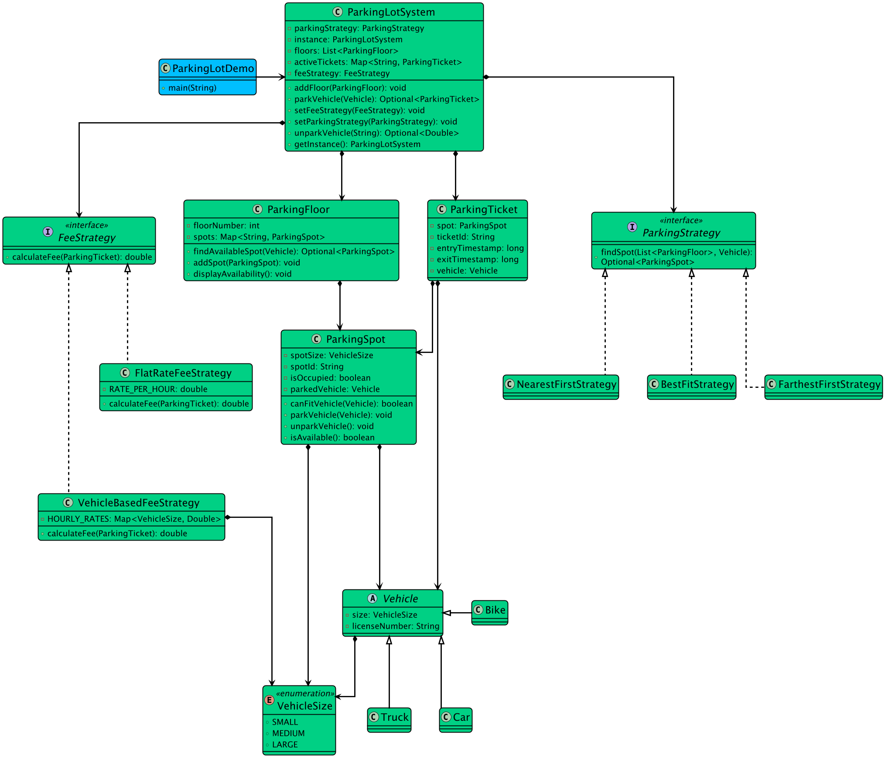

# Low-level design problem: parking lot

> Copied from <https://github.com/ashishps1/awesome-low-level-design/blob/main/problems/parking-lot.md> (GPL-3.0, by Ashish Pratap Singh). Questions and answers are the source's own; nothing was answered or rewritten here.


# Designing a Parking Lot System

## Requirements
1. The parking lot should have multiple levels, each level with a certain number of parking spots.
2. The parking lot should support different types of vehicles, such as cars, motorcycles, and trucks.
3. Each parking spot should be able to accommodate a specific type of vehicle.
4. The system should assign a parking spot to a vehicle upon entry and release it when the vehicle exits.
5. The system should track the availability of parking spots and provide real-time information to customers.
6. The system should handle multiple entry and exit points and support concurrent access.

## UML Class Diagram



## Implementations
#### [Java Implementation](https://github.com/ashishps1/awesome-low-level-design/blob/main/solutions/java/src/parkinglot) 
#### [Python Implementation](https://github.com/ashishps1/awesome-low-level-design/blob/main/solutions/python/parkinglot)
#### [C++ Implementation](https://github.com/ashishps1/awesome-low-level-design/blob/main/solutions/cpp/parkinglot)
#### [C# Implementation](https://github.com/ashishps1/awesome-low-level-design/blob/main/solutions/csharp/parkinglot)
#### [Go Implementation](https://github.com/ashishps1/awesome-low-level-design/blob/main/solutions/golang/parkinglot)
#### [TypeScript Implementation](https://github.com/ashishps1/awesome-low-level-design/blob/main/solutions/typescript/src/ParkingLot)

## Classes, Interfaces and Enumerations
1. The **ParkingLot** class follows the Singleton pattern to ensure only one instance of the parking lot exists. It maintains a list of levels and provides methods to park and unpark vehicles.
2. The **ParkingFloor** class represents a level in the parking lot and contains a list of parking spots. It handles parking and unparking of vehicles within the level.
3. The **ParkingSpot** class represents an individual parking spot and tracks the availability and the parked vehicle.
4. The **Vehicle** class is an abstract base class for different types of vehicles. It is extended by Car, Motorcycle, and Truck classes.
5. The **VehicleSize** enum defines the different types of vehicles supported by the parking lot.
6. Multi-threading is achieved through the use of synchronized keyword on critical sections to ensure thread safety.
7. The **Main** class demonstrates the usage of the parking lot system.

## Design Patterns Used:
1. Singleton Pattern: Ensures only one instance of the ParkingLot class.
2. Factory Pattern (optional extension): Could be used for creating vehicles based on input.
3. Observer Pattern (optional extension): Could notify customers about available spots.


---

## Official solutions from the repository

<details><summary><b>java</b> (18 files)</summary>


**ParkingLot.java**

```java
package parkinglot;

import parkinglot.entities.ParkingFloor;
import parkinglot.entities.ParkingSpot;
import parkinglot.entities.ParkingTicket;
import parkinglot.strategy.fee.FeeStrategy;
import parkinglot.strategy.fee.FlatRateFeeStrategy;
import parkinglot.strategy.parking.BestFitStrategy;
import parkinglot.strategy.parking.ParkingStrategy;
import parkinglot.vehicle.Vehicle;

import java.util.*;
import java.util.concurrent.ConcurrentHashMap;

public class ParkingLot {
    private static ParkingLot instance;
    private final List<ParkingFloor> floors = new ArrayList<>();
    private final Map<String, ParkingTicket> activeTickets;
    private FeeStrategy feeStrategy;
    private ParkingStrategy parkingStrategy;

    private ParkingLot() {
        this.feeStrategy = new FlatRateFeeStrategy();
        this.parkingStrategy = new BestFitStrategy();
        this.activeTickets = new ConcurrentHashMap<>();
    }

    public static synchronized ParkingLot getInstance() {
        if (instance == null) {
            instance = new ParkingLot();
        }
        return instance;
    }

    public void addFloor(ParkingFloor floor) {
        floors.add(floor);
    }

    public void setFeeStrategy (FeeStrategy feeStrategy) {
        this.feeStrategy = feeStrategy;
    }

    public void setParkingStrategy(ParkingStrategy parkingStrategy) {
        this.parkingStrategy = parkingStrategy;
    }

    public Optional<ParkingTicket> parkVehicle(Vehicle vehicle) {
        Optional<ParkingSpot> availableSpot = parkingStrategy.findSpot(floors, vehicle);

        if (availableSpot.isPresent()) {
            ParkingSpot spot = availableSpot.get();
            spot.parkVehicle(vehicle);
            ParkingTicket ticket = new ParkingTicket(vehicle, spot);
            activeTickets.put(vehicle.getLicenseNumber(), ticket);
            System.out.printf("%s parked at %s. Ticket: %s\n", vehicle.getLicenseNumber(), spot.getSpotId(), ticket.getTicketId());
            return Optional.of(ticket);
        }

        System.out.println("No available spot for " + vehicle.getLicenseNumber());
        return Optional.empty();
    }

    public Optional<Double> unparkVehicle(String licenseNumber) {
        ParkingTicket ticket = activeTickets.remove(licenseNumber);
        if (ticket == null) {
            System.out.println("Ticket not found");
            return Optional.empty();
        }

        ticket.setExitTimestamp();
        ticket.getSpot().unparkVehicle();

        Double parkingFee = feeStrategy.calculateFee(ticket);

        return Optional.of(parkingFee);
    }
}
```


**ParkingLotDemo.java**

```java
package parkinglot;

import parkinglot.entities.ParkingFloor;
import parkinglot.entities.ParkingSpot;
import parkinglot.entities.ParkingTicket;
import parkinglot.strategy.fee.VehicleBasedFeeStrategy;
import parkinglot.vehicle.*;

import java.util.Optional;

public class ParkingLotDemo {
    public static void main(String[] args) {
        ParkingLot parkingLot = ParkingLot.getInstance();

        // 1. Initialize the parking lot with floors and spots
        ParkingFloor floor1 = new ParkingFloor(1);
        floor1.addSpot(new ParkingSpot("F1-S1", VehicleSize.SMALL));
        floor1.addSpot(new ParkingSpot("F1-M1", VehicleSize.MEDIUM));
        floor1.addSpot(new ParkingSpot("F1-L1", VehicleSize.LARGE));

        ParkingFloor floor2 = new ParkingFloor(2);
        floor2.addSpot(new ParkingSpot("F2-M1", VehicleSize.MEDIUM));
        floor2.addSpot(new ParkingSpot("F2-M2", VehicleSize.MEDIUM));

        parkingLot.addFloor(floor1);
        parkingLot.addFloor(floor2);

        parkingLot.setFeeStrategy(new VehicleBasedFeeStrategy());

        // 2. Simulate vehicle entries
        System.out.println("\n--- Vehicle Entries ---");
        floor1.displayAvailability();
        floor2.displayAvailability();

        Vehicle bike = new Bike("B-123");
        Vehicle car = new Car("C-456");
        Vehicle truck = new Truck("T-789");

        Optional<ParkingTicket> bikeTicketOpt = parkingLot.parkVehicle(bike);

        Optional<ParkingTicket> carTicketOpt = parkingLot.parkVehicle(car);

        Optional<ParkingTicket> truckTicketOpt = parkingLot.parkVehicle(truck);

        System.out.println("\n--- Availability after parking ---");
        floor1.displayAvailability();
        floor2.displayAvailability();

        // 3. Simulate another car entry (should go to floor 2)
        Vehicle car2 = new Car("C-999");
        Optional<ParkingTicket> car2TicketOpt = parkingLot.parkVehicle(car2);

        // 4. Simulate a vehicle entry that fails (no available spots)
        Vehicle bike2 = new Bike("B-000");
        Optional<ParkingTicket> failedBikeTicketOpt = parkingLot.parkVehicle(bike2);

        // 5. Simulate vehicle exits and fee calculation
        System.out.println("\n--- Vehicle Exits ---");

        if (carTicketOpt.isPresent()) {
            Optional<Double> feeOpt = parkingLot.unparkVehicle(car.getLicenseNumber());
            feeOpt.ifPresent(fee -> System.out.printf("Car C-456 unparked. Fee: $%.2f\n", fee));
        }

        System.out.println("\n--- Availability after one car leaves ---");
        floor1.displayAvailability();
        floor2.displayAvailability();
    }
}
```


**README.md**

```md
# Parking Lot System (LLD)

## Problem Statement

Design and implement a Parking Lot Management System that supports parking and unparking of vehicles, parkingTicket generation, fee calculation, and management of multiple floors and spot types.

---

## Requirements

- **Multiple Floors:** The parking lot can have multiple floors.
- **Parking Spots:** Each floor has multiple parking spots of different types (e.g., car, bike, truck).
- **Vehicle Types:** Support for different vehicle types (see `vehicletype/`).
- **Ticketing:** Generate a parkingTicket when a vehicle is parked.
- **Unparking:** Allow vehicles to unpark and calculate the parking fee.
- **Fee Calculation:** Support for different fee strategies (see `fee/`).
- **Spot Allocation:** Allocate the nearest available spot of the correct type.
- **Extensibility:** Easy to add new vehicle types, spot types, or fee strategies.

---

## Core Entities

- **ParkingLot:** Main class managing the entire parking lot, floors, and overall operations.
- **ParkingFloor:** Represents a single floor in the parking lot, manages its spots.
- **ParkingSpot:** Represents an individual parking spot, knows its type and occupancy.
- **Ticket:** Represents a parking parkingTicket issued when a vehicle is parked.
- **VehicleType (in `vehicletype/`):** Enum or classes for different vehicle types.
- **Fee Calculation (in `fee/`):** Classes for calculating parking fees based on duration and vehicle type.

---

## Class Design

## UML Class Diagram


### 1. ParkingLot
- **Methods:**
  - `parkVehicle(Vehicle vehicle)`
  - `unparkVehicle(String ticketId)`
  - `addFloor(ParkingFloor floor)`
  - `getAvailableSpots()`
- **Fields:** List of floors, mapping of tickets, etc.

### 2. ParkingFloor
- **Methods:**
  - `getAvailableSpot(VehicleType type)`
  - `parkVehicle(Vehicle vehicle)`
  - `unparkVehicle(String spotId)`
- **Fields:** List of spots, floor number.

### 3. ParkingSpot
- **Methods:**
  - `isAvailable()`
  - `assignVehicle(Vehicle vehicle)`
  - `removeVehicle()`
- **Fields:** Spot ID, type, current vehicle.

### 4. Ticket
- **Fields:** Ticket ID, vehicle info, entry time, spot info.

### 5. VehicleType (in `vehicletype/`)
- Enum or classes for vehicle types (Car, Bike, Truck, etc.)

### 6. Fee Calculation (in `fee/`)
- **Methods:** `calculateFee(Ticket parkingTicket, Date exitTime)`
- **Extensible:** Add new strategies for fee calculation.

---

## Design Patterns Used

- **Strategy Pattern:** For fee calculation strategies.
- **Factory Pattern:** (If used) For creating vehicles or spots.
- **Singleton Pattern:** (If used) For ParkingLot instance.

---

## Example Usage

```java
ParkingLot lot = new ParkingLot();
lot.addFloor(new ParkingFloor(...));
Ticket parkingTicket = lot.parkVehicle(new Car("KA-01-1234"));
lot.unparkVehicle(parkingTicket.getId());
```

---

## Demo

See `ParkingLotDemo.java` for a sample usage of the parking lot system.

---

## Extending the Framework

- **Add a new vehicle type:** Update or add to `vehicletype/`.
- **Add a new fee strategy:** Implement a new class in `fee/`.
- **Add new spot types or floors:** Extend `ParkingSpot` or `ParkingFloor`.

---
```


**entities/ParkingFloor.java**

```java
package parkinglot.entities;

import parkinglot.vehicle.Vehicle;
import parkinglot.vehicle.VehicleSize;

import java.util.Comparator;
import java.util.Map;
import java.util.Optional;
import java.util.concurrent.ConcurrentHashMap;
import java.util.stream.Collectors;

public class ParkingFloor {
    private final int floorNumber;
    private final Map<String, ParkingSpot> spots;

    public ParkingFloor(int floorNumber) {
        this.floorNumber = floorNumber;
        this.spots = new ConcurrentHashMap<>();
    }

    public void addSpot(ParkingSpot spot) {
        spots.put(spot.getSpotId(), spot);
    }

    public synchronized Optional<ParkingSpot> findAvailableSpot(Vehicle vehicle) {
        return spots.values().stream()
                .filter(spot -> !spot.isOccupied() && spot.canFitVehicle(vehicle))
                .sorted(Comparator.comparing(ParkingSpot::getSpotSize))
                .findFirst();
    }

    public void displayAvailability() {
        System.out.printf("--- Floor %d Availability ---\n", floorNumber);
        Map<VehicleSize, Long> availableCounts = spots.values().stream()
                .filter(spot -> !spot.isOccupied())
                .collect(Collectors.groupingBy(ParkingSpot::getSpotSize, Collectors.counting()));

        for (VehicleSize size : VehicleSize.values()) {
            System.out.printf("  %s spots: %d\n", size, availableCounts.getOrDefault(size, 0L));
        }
    }
}
```


**entities/ParkingSpot.java**

```java
package parkinglot.entities;

import parkinglot.vehicle.Vehicle;
import parkinglot.vehicle.VehicleSize;

public class ParkingSpot {
    private final String spotId;
    private boolean isOccupied;
    private Vehicle parkedVehicle;
    private final VehicleSize spotSize;

    public ParkingSpot(String spotId, VehicleSize spotSize) {
        this.spotId = spotId;
        this.spotSize = spotSize;
        this.isOccupied = false;
        this.parkedVehicle = null;
    }

    public String getSpotId() {
        return spotId;
    }

    public VehicleSize getSpotSize() {
        return spotSize;
    }

    public synchronized boolean isAvailable() {
        return !isOccupied;
    }

    public boolean isOccupied() {
        return isOccupied;
    }

    public synchronized void parkVehicle(Vehicle vehicle) {
        this.parkedVehicle = vehicle;
        this.isOccupied = true;
    }

    public synchronized void unparkVehicle() {
        this.parkedVehicle = null;
        this.isOccupied = false;
    }

    public boolean canFitVehicle(Vehicle vehicle) {
        if (isOccupied) return false;

        switch (vehicle.getSize()) {
            case SMALL:
                return spotSize == VehicleSize.SMALL;
            case MEDIUM:
                return spotSize == VehicleSize.MEDIUM || spotSize == VehicleSize.LARGE;
            case LARGE:
                return spotSize == VehicleSize.LARGE;
            default:
                return false;
        }
    }
}
```


**entities/ParkingTicket.java**

```java
package parkinglot.entities;

import parkinglot.vehicle.Vehicle;

import java.util.Date;
import java.util.UUID;

public class ParkingTicket {
    private final String ticketId;
    private final Vehicle vehicle;
    private final ParkingSpot spot;
    private final long entryTimestamp;
    private long exitTimestamp;

    public ParkingTicket(Vehicle vehicle, ParkingSpot spot) {
        this.ticketId = UUID.randomUUID().toString();
        this.vehicle = vehicle;
        this.spot = spot;
        this.entryTimestamp = new Date().getTime();
    }

    public String getTicketId() { return ticketId; }
    public Vehicle getVehicle() { return vehicle; }
    public ParkingSpot getSpot() { return spot; }
    public long getEntryTimestamp() { return entryTimestamp; }
    public long getExitTimestamp() { return exitTimestamp; }

    public void setExitTimestamp() {
        this.exitTimestamp = new Date().getTime();
    }
}
```


**strategy/fee/FeeStrategy.java**

```java
package parkinglot.strategy.fee;

import parkinglot.entities.ParkingTicket;

public interface FeeStrategy {
    double calculateFee(ParkingTicket parkingTicket);
}
```


**strategy/fee/FlatRateFeeStrategy.java**

```java
package parkinglot.strategy.fee;

import parkinglot.entities.ParkingTicket;

public class FlatRateFeeStrategy implements FeeStrategy {

    private static final double RATE_PER_HOUR = 10.0;

    @Override
    public double calculateFee(ParkingTicket parkingTicket) {
        long duration = parkingTicket.getExitTimestamp() - parkingTicket.getEntryTimestamp();
        long hours = (duration / (1000 * 60 * 60)) + 1;
        return hours * RATE_PER_HOUR;
    }
}
```


**strategy/fee/VehicleBasedFeeStrategy.java**

```java
package parkinglot.strategy.fee;

import parkinglot.entities.ParkingTicket;
import parkinglot.vehicle.VehicleSize;

import java.util.Map;

public class VehicleBasedFeeStrategy implements FeeStrategy {
    private static final Map<VehicleSize, Double> HOURLY_RATES = Map.of(
            VehicleSize.SMALL, 10.0,
            VehicleSize.MEDIUM, 20.0,
            VehicleSize.LARGE, 30.0
    );

    @Override
    public double calculateFee(ParkingTicket parkingTicket) {
        long duration = parkingTicket.getExitTimestamp() - parkingTicket.getEntryTimestamp();
        long hours = (duration / (1000 * 60 * 60)) + 1;
        return hours * HOURLY_RATES.get(parkingTicket.getVehicle().getSize());
    }
}
```


**strategy/parking/BestFitStrategy.java**

```java
package parkinglot.strategy.parking;

import parkinglot.entities.ParkingFloor;
import parkinglot.entities.ParkingSpot;
import parkinglot.vehicle.Vehicle;

import java.util.List;
import java.util.Optional;

public class BestFitStrategy implements ParkingStrategy {
    @Override
    public Optional<ParkingSpot> findSpot(List<ParkingFloor> floors, Vehicle vehicle) {
        Optional<ParkingSpot> bestSpot = Optional.empty();

        for (ParkingFloor floor : floors) {
            Optional<ParkingSpot> spotOnThisFloor = floor.findAvailableSpot(vehicle);

            if (spotOnThisFloor.isPresent()) {
                if (bestSpot.isEmpty()) {
                    // If this is the first spot we've found, it's the best one so far.
                    bestSpot = spotOnThisFloor;
                } else {
                    // A smaller spot size enum ordinal means a tighter fit.
                    if (spotOnThisFloor.get().getSpotSize().ordinal() < bestSpot.get().getSpotSize().ordinal()) {
                        bestSpot = spotOnThisFloor;
                    }
                }
            }
        }
        return bestSpot;
    }
}
```


**strategy/parking/FarthestFirstStrategy.java**

```java
package parkinglot.strategy.parking;

import parkinglot.entities.ParkingFloor;
import parkinglot.entities.ParkingSpot;
import parkinglot.vehicle.Vehicle;

import java.util.ArrayList;
import java.util.Collections;
import java.util.List;
import java.util.Optional;

public class FarthestFirstStrategy implements ParkingStrategy {
    @Override
    public Optional<ParkingSpot> findSpot(List<ParkingFloor> floors, Vehicle vehicle) {
        // Create a reversed copy of the floors list to search from the top floor down.
        List<ParkingFloor> reversedFloors = new ArrayList<>(floors);
        Collections.reverse(reversedFloors);

        for (ParkingFloor floor : reversedFloors) {
            Optional<ParkingSpot> spot = floor.findAvailableSpot(vehicle);
            if (spot.isPresent()) {
                return spot;
            }
        }
        return Optional.empty();
    }
}
```


**strategy/parking/NearestFirstStrategy.java**

```java
package parkinglot.strategy.parking;

import parkinglot.entities.ParkingFloor;
import parkinglot.entities.ParkingSpot;
import parkinglot.vehicle.Vehicle;

import java.util.List;
import java.util.Optional;

public class NearestFirstStrategy implements ParkingStrategy {
    @Override
    public Optional<ParkingSpot> findSpot(List<ParkingFloor> floors, Vehicle vehicle) {
        for (ParkingFloor floor : floors) {
            Optional<ParkingSpot> spot = floor.findAvailableSpot(vehicle);
            if (spot.isPresent()) {
                return spot;
            }
        }
        return Optional.empty();
    }
}
```


**strategy/parking/ParkingStrategy.java**

```java
package parkinglot.strategy.parking;

import parkinglot.entities.ParkingFloor;
import parkinglot.entities.ParkingSpot;
import parkinglot.vehicle.Vehicle;

import java.util.List;
import java.util.Optional;

public interface ParkingStrategy {
    Optional<ParkingSpot> findSpot(List<ParkingFloor> floors, Vehicle vehicle);
}
```


**vehicle/Bike.java**

```java
package parkinglot.vehicle;

public class Bike extends Vehicle {
    public Bike(String licenseNumber) {
        super(licenseNumber, VehicleSize.SMALL);
    }
}
```


**vehicle/Car.java**

```java
package parkinglot.vehicle;

public class Car extends Vehicle {
    public Car(String licenseNumber) {
        super(licenseNumber, VehicleSize.MEDIUM);
    }
}
```


**vehicle/Truck.java**

```java
package parkinglot.vehicle;

public class Truck extends Vehicle {
    public Truck(String licenseNumber) {
        super(licenseNumber, VehicleSize.LARGE);
    }
}
```


**vehicle/Vehicle.java**

```java
package parkinglot.vehicle;

public abstract class Vehicle {
    private final String licenseNumber;
    private final VehicleSize size;

    public Vehicle(String licenseNumber, VehicleSize size) {
        this.licenseNumber = licenseNumber;
        this.size = size;
    }

    public String getLicenseNumber() { return licenseNumber; }
    public VehicleSize getSize() {
        return size;
    }
}
```


**vehicle/VehicleSize.java**

```java
package parkinglot.vehicle;

public enum VehicleSize {
    SMALL,
    MEDIUM,
    LARGE
}
```

</details>

<details><summary><b>python</b> (13 files)</summary>


**README.md**

```md
# Designing a Parking Lot System

## Requirements
1. The parking lot should have multiple levels, each level with a certain number of parking spots.
2. The parking lot should support different types of vehicles, such as cars, motorcycles, and trucks.
3. Each parking spot should be able to accommodate a specific type of vehicle.
4. The system should assign a parking spot to a vehicle upon entry and release it when the vehicle exits.
5. The system should track the availability of parking spots and provide real-time information to customers.
6. The system should handle multiple entry and exit points and support concurrent access.

## Classes, Interfaces and Enumerations
1. The **ParkingLot** class follows the Singleton pattern to ensure only one instance of the parking lot exists. It maintains a list of levels and provides methods to park and unpark vehicles.
2. The **ParkingFloor** class represents a level in the parking lot and contains a list of parking spots. It handles parking and unparking of vehicles within the level.
3. The **ParkingSpot** class represents an individual parking spot and tracks the availability and the parked vehicle.
4. The **Vehicle** class is an abstract base class for different types of vehicles. It is extended by Car, Motorcycle, and Truck classes.
5. The **VehicleType** enum defines the different types of vehicles supported by the parking lot.
6. Multi-threading is achieved through the use of synchronized keyword on critical sections to ensure thread safety.
7. The **Main** class demonstrates the usage of the parking lot system.

## Design Patterns Used:
1. Singleton Pattern: Ensures only one instance of the ParkingLot class.
2. Factory Pattern (optional extension): Could be used for creating vehicles based on input.
3. Observer Pattern (optional extension): Could notify customers about available spots.
```


**bike.py**

```py
from vehicle import Vehicle
from vehicle_size import VehicleSize

class Bike(Vehicle):
    def __init__(self, license_number: str):
        super().__init__(license_number, VehicleSize.SMALL)
```


**car.py**

```py
from vehicle import Vehicle
from vehicle_size import VehicleSize

class Car(Vehicle):
    def __init__(self, license_number: str):
        super().__init__(license_number, VehicleSize.MEDIUM)
```


**fee_strategy.py**

```py
from abc import ABC, abstractmethod
from parking_ticket import ParkingTicket
from vehicle_size import VehicleSize

class FeeStrategy(ABC):
    @abstractmethod
    def calculate_fee(self, parking_ticket: ParkingTicket) -> float:
        pass

class FlatRateFeeStrategy(FeeStrategy):
    RATE_PER_HOUR = 10.0

    def calculate_fee(self, parking_ticket: ParkingTicket) -> float:
        duration = parking_ticket.get_exit_timestamp() - parking_ticket.get_entry_timestamp()
        hours = (duration // (1000 * 60 * 60)) + 1
        return hours * self.RATE_PER_HOUR

class VehicleBasedFeeStrategy(FeeStrategy):
    HOURLY_RATES = {
        VehicleSize.SMALL: 10.0,
        VehicleSize.MEDIUM: 20.0,
        VehicleSize.LARGE: 30.0
    }

    def calculate_fee(self, parking_ticket: ParkingTicket) -> float:
        duration = parking_ticket.get_exit_timestamp() - parking_ticket.get_entry_timestamp()
        hours = (duration // (1000 * 60 * 60)) + 1
        return hours * self.HOURLY_RATES[parking_ticket.get_vehicle().get_size()]
```


**parking_floor.py**

```py
import threading
from parking_spot import ParkingSpot
from vehicle import Vehicle
from vehicle_size import VehicleSize
from typing import Dict, Optional
from collections import defaultdict

class ParkingFloor:
    def __init__(self, floor_number: int):
        self.floor_number = floor_number
        self.spots: Dict[str, ParkingSpot] = {}
        self._lock = threading.Lock()

    def add_spot(self, spot: ParkingSpot):
        self.spots[spot.get_spot_id()] = spot

    def find_available_spot(self, vehicle: Vehicle) -> Optional[ParkingSpot]:
        with self._lock:
            available_spots = [
                spot for spot in self.spots.values()
                if not spot.is_occupied_spot() and spot.can_fit_vehicle(vehicle)
            ]
            if available_spots:
                # Sort by spot size (smallest first)
                available_spots.sort(key=lambda x: x.get_spot_size().value)
                return available_spots[0]
            return None

    def display_availability(self):
        print(f"--- Floor {self.floor_number} Availability ---")
        available_counts = defaultdict(int)
        
        for spot in self.spots.values():
            if not spot.is_occupied_spot():
                available_counts[spot.get_spot_size()] += 1

        for size in VehicleSize:
            print(f"  {size.value} spots: {available_counts[size]}")
```


**parking_lot.py**

```py
import threading
from parking_floor import ParkingFloor
from parking_ticket import ParkingTicket
from fee_strategy import FlatRateFeeStrategy, FeeStrategy
from parking_strategy import NearestFirstStrategy, ParkingStrategy
from vehicle import Vehicle
from typing import List, Dict, Optional

class ParkingLot:
    _instance = None
    _lock = threading.Lock()

    def __init__(self):
        if ParkingLot._instance is not None:
            raise Exception("This class is a singleton!")
        self.floors: List[ParkingFloor] = []
        self.active_tickets: Dict[str, ParkingTicket] = {}
        self.fee_strategy = FlatRateFeeStrategy()
        self.parking_strategy = NearestFirstStrategy()
        self._main_lock = threading.Lock()

    @staticmethod
    def get_instance():
        if ParkingLot._instance is None:
            with ParkingLot._lock:
                if ParkingLot._instance is None:
                    ParkingLot._instance = ParkingLot()
        return ParkingLot._instance

    def add_floor(self, floor: ParkingFloor):
        self.floors.append(floor)

    def set_fee_strategy(self, fee_strategy: FeeStrategy):
        self.fee_strategy = fee_strategy

    def set_parking_strategy(self, parking_strategy: ParkingStrategy):
        self.parking_strategy = parking_strategy

    def park_vehicle(self, vehicle: Vehicle) -> Optional[ParkingTicket]:
        with self._main_lock:
            spot = self.parking_strategy.find_spot(self.floors, vehicle)
            if spot is not None:
                spot.park_vehicle(vehicle)
                ticket = ParkingTicket(vehicle, spot)
                self.active_tickets[vehicle.get_license_number()] = ticket
                print(f"Vehicle {vehicle.get_license_number()} parked at spot {spot.get_spot_id()}")
                return ticket
            else:
                print(f"No available spot for vehicle {vehicle.get_license_number()}")
                return None

    def unpark_vehicle(self, license_number: str) -> Optional[float]:
        with self._main_lock:
            ticket = self.active_tickets.pop(license_number, None)
            if ticket is None:
                print(f"Ticket not found for vehicle {license_number}")
                return None

            ticket.get_spot().unpark_vehicle()
            ticket.set_exit_timestamp()
            fee = self.fee_strategy.calculate_fee(ticket)
            print(f"Vehicle {license_number} unparked from spot {ticket.get_spot().get_spot_id()}")
            return fee
```


**parking_lot_demo.py**

```py
from parking_lot import ParkingLot
from parking_floor import ParkingFloor
from parking_spot import ParkingSpot
from vehicle_size import VehicleSize
from fee_strategy import VehicleBasedFeeStrategy
from bike import Bike
from car import Car
from truck import Truck

class ParkingLotDemo:
    @staticmethod
    def main():
        parking_lot = ParkingLot.get_instance()

        # 1. Initialize the parking lot with floors and spots
        floor1 = ParkingFloor(1)
        floor1.add_spot(ParkingSpot("F1-S1", VehicleSize.SMALL))
        floor1.add_spot(ParkingSpot("F1-M1", VehicleSize.MEDIUM))
        floor1.add_spot(ParkingSpot("F1-L1", VehicleSize.LARGE))

        floor2 = ParkingFloor(2)
        floor2.add_spot(ParkingSpot("F2-M1", VehicleSize.MEDIUM))
        floor2.add_spot(ParkingSpot("F2-M2", VehicleSize.MEDIUM))

        parking_lot.add_floor(floor1)
        parking_lot.add_floor(floor2)

        parking_lot.set_fee_strategy(VehicleBasedFeeStrategy())

        # 2. Simulate vehicle entries
        print("\n--- Vehicle Entries ---")
        floor1.display_availability()
        floor2.display_availability()

        bike = Bike("B-123")
        car = Car("C-456")
        truck = Truck("T-789")

        bike_ticket = parking_lot.park_vehicle(bike)
        car_ticket = parking_lot.park_vehicle(car)
        truck_ticket = parking_lot.park_vehicle(truck)

        print("\n--- Availability after parking ---")
        floor1.display_availability()
        floor2.display_availability()

        # 3. Simulate another car entry (should go to floor 2)
        car2 = Car("C-999")
        car2_ticket = parking_lot.park_vehicle(car2)

        # 4. Simulate a vehicle entry that fails (no available spots)
        bike2 = Bike("B-000")
        failed_bike_ticket = parking_lot.park_vehicle(bike2)

        # 5. Simulate vehicle exits and fee calculation
        print("\n--- Vehicle Exits ---")

        if car_ticket is not None:
            fee = parking_lot.unpark_vehicle(car.get_license_number())
            if fee is not None:
                print(f"Car C-456 unparked. Fee: ${fee:.2f}")

        print("\n--- Availability after one car leaves ---")
        floor1.display_availability()
        floor2.display_availability()


if __name__ == "__main__":
    ParkingLotDemo.main()
```


**parking_spot.py**

```py
import threading
from vehicle import Vehicle
from vehicle_size import VehicleSize

class ParkingSpot:
    def __init__(self, spot_id: str, spot_size: VehicleSize):
        self.spot_id = spot_id
        self.spot_size = spot_size
        self.is_occupied = False
        self.parked_vehicle = None
        self._lock = threading.Lock()

    def get_spot_id(self) -> str:
        return self.spot_id

    def get_spot_size(self) -> VehicleSize:
        return self.spot_size

    def is_available(self) -> bool:
        with self._lock:
            return not self.is_occupied

    def is_occupied_spot(self) -> bool:
        return self.is_occupied

    def park_vehicle(self, vehicle: Vehicle):
        with self._lock:
            self.parked_vehicle = vehicle
            self.is_occupied = True

    def unpark_vehicle(self):
        with self._lock:
            self.parked_vehicle = None
            self.is_occupied = False

    def can_fit_vehicle(self, vehicle: Vehicle) -> bool:
        if self.is_occupied:
            return False

        if vehicle.get_size() == VehicleSize.SMALL:
            return self.spot_size == VehicleSize.SMALL
        elif vehicle.get_size() == VehicleSize.MEDIUM:
            return self.spot_size == VehicleSize.MEDIUM or self.spot_size == VehicleSize.LARGE
        elif vehicle.get_size() == VehicleSize.LARGE:
            return self.spot_size == VehicleSize.LARGE
        else:
            return False
```


**parking_strategy.py**

```py
from abc import ABC, abstractmethod
from parking_floor import ParkingFloor
from vehicle import Vehicle
from parking_spot import ParkingSpot
from vehicle_size import VehicleSize
from typing import List, Optional

class ParkingStrategy(ABC):
    @abstractmethod
    def find_spot(self, floors: List[ParkingFloor], vehicle: Vehicle) -> Optional[ParkingSpot]:
        pass

class NearestFirstStrategy(ParkingStrategy):
    def find_spot(self, floors: List[ParkingFloor], vehicle: Vehicle) -> Optional[ParkingSpot]:
        for floor in floors:
            spot = floor.find_available_spot(vehicle)
            if spot is not None:
                return spot
        return None

class FarthestFirstStrategy(ParkingStrategy):
    def find_spot(self, floors: List[ParkingFloor], vehicle: Vehicle) -> Optional[ParkingSpot]:
        reversed_floors = list(reversed(floors))
        for floor in reversed_floors:
            spot = floor.find_available_spot(vehicle)
            if spot is not None:
                return spot
        return None

class BestFitStrategy(ParkingStrategy):
    def find_spot(self, floors: List[ParkingFloor], vehicle: Vehicle) -> Optional[ParkingSpot]:
        best_spot = None

        for floor in floors:
            spot_on_this_floor = floor.find_available_spot(vehicle)

            if spot_on_this_floor is not None:
                if best_spot is None:
                    best_spot = spot_on_this_floor
                else:
                    # A smaller spot size enum ordinal means a tighter fit
                    if list(VehicleSize).index(spot_on_this_floor.get_spot_size()) < list(VehicleSize).index(best_spot.get_spot_size()):
                        best_spot = spot_on_this_floor

        return best_spot
```


**parking_ticket.py**

```py
import uuid
import time
from vehicle import Vehicle
from parking_spot import ParkingSpot

class ParkingTicket:
    def __init__(self, vehicle: Vehicle, spot: ParkingSpot):
        self.ticket_id = str(uuid.uuid4())
        self.vehicle = vehicle
        self.spot = spot
        self.entry_timestamp = int(time.time() * 1000)
        self.exit_timestamp = 0

    def get_ticket_id(self) -> str:
        return self.ticket_id

    def get_vehicle(self) -> Vehicle:
        return self.vehicle

    def get_spot(self) -> ParkingSpot:
        return self.spot

    def get_entry_timestamp(self) -> int:
        return self.entry_timestamp

    def get_exit_timestamp(self) -> int:
        return self.exit_timestamp

    def set_exit_timestamp(self):
        self.exit_timestamp = int(time.time() * 1000)
```


**truck.py**

```py
from vehicle import Vehicle
from vehicle_size import VehicleSize

class Truck(Vehicle):
    def __init__(self, license_number: str):
        super().__init__(license_number, VehicleSize.LARGE)
```


**vehicle.py**

```py
from abc import ABC
from vehicle_size import VehicleSize

class Vehicle(ABC):
    def __init__(self, license_number: str, size: VehicleSize):
        self.license_number = license_number
        self.size = size

    def get_license_number(self) -> str:
        return self.license_number

    def get_size(self) -> VehicleSize:
        return self.size
```


**vehicle_size.py**

```py
from enum import Enum

class VehicleSize(Enum):
    SMALL = "SMALL"
    MEDIUM = "MEDIUM"
    LARGE = "LARGE"
```

</details>

<details><summary><b>cpp</b> (8 files)</summary>


**ParkingLot.cpp**

```cpp
#include "ParkingLot.hpp"
#include <iostream>

ParkingLot::ParkingLot(int numCompact, int numRegular, int numLarge) 
    : capacity(numCompact + numRegular + numLarge), availableSpots(capacity) {
    
    int spotNumber = 1;
    
    // Create compact spots
    for (int i = 0; i < numCompact; i++) {
        spots.push_back(new ParkingSpot(spotNumber++, SpotType::COMPACT));
    }
    
    // Create regular spots
    for (int i = 0; i < numRegular; i++) {
        spots.push_back(new ParkingSpot(spotNumber++, SpotType::REGULAR));
    }
    
    // Create large spots
    for (int i = 0; i < numLarge; i++) {
        spots.push_back(new ParkingSpot(spotNumber++, SpotType::LARGE));
    }
}

ParkingLot::~ParkingLot() {
    for (auto spot : spots) {
        delete spot;
    }
}

int ParkingLot::getCapacity() const { return capacity; }
int ParkingLot::getAvailableSpots() const { return availableSpots; }

bool ParkingLot::parkVehicle(Vehicle* vehicle) {
    if (!vehicle) return false;
    
    // Check if vehicle is already parked
    if (occupiedSpots.find(vehicle->getLicensePlate()) != occupiedSpots.end()) {
        return false;
    }
    
    ParkingSpot* spot = findAvailableSpot(vehicle);
    if (!spot) return false;
    
    if (spot->parkVehicle(vehicle)) {
        occupiedSpots[vehicle->getLicensePlate()] = spot;
        availableSpots--;
        return true;
    }
    return false;
}

Vehicle* ParkingLot::removeVehicle(const std::string& licensePlate) {
    auto it = occupiedSpots.find(licensePlate);
    if (it == occupiedSpots.end()) return nullptr;
    
    ParkingSpot* spot = it->second;
    Vehicle* vehicle = spot->removeVehicle();
    if (vehicle) {
        occupiedSpots.erase(it);
        availableSpots++;
    }
    return vehicle;
}

ParkingSpot* ParkingLot::findVehicle(const std::string& licensePlate) const {
    auto it = occupiedSpots.find(licensePlate);
    return it != occupiedSpots.end() ? it->second : nullptr;
}

void ParkingLot::displayInfo() const {
    std::cout << "\nParking Lot Status:" << std::endl;
    std::cout << "Total Capacity: " << capacity << std::endl;
    std::cout << "Available Spots: " << availableSpots << std::endl;
    std::cout << "Occupied Spots: " << (capacity - availableSpots) << std::endl;
}

void ParkingLot::displayOccupancy() const {
    std::cout << "\nDetailed Occupancy:" << std::endl;
    for (const auto& spot : spots) {
        spot->displayInfo();
    }
}

ParkingSpot* ParkingLot::findAvailableSpot(const Vehicle* vehicle) const {
    for (auto spot : spots) {
        if (spot->isAvailable() && spot->canFitVehicle(vehicle)) {
            return spot;
        }
    }
    return nullptr;
}
```


**ParkingLot.hpp**

```hpp
#ifndef PARKING_LOT_HPP
#define PARKING_LOT_HPP

#include <vector>
#include <map>
#include <string>
#include "ParkingSpot.hpp"

class ParkingLot {
private:
    std::vector<ParkingSpot*> spots;
    std::map<std::string, ParkingSpot*> occupiedSpots;  // licensePlate -> spot
    int capacity;
    int availableSpots;

public:
    ParkingLot(int numCompact, int numRegular, int numLarge);
    ~ParkingLot();
    
    int getCapacity() const;
    int getAvailableSpots() const;
    
    bool parkVehicle(Vehicle* vehicle);
    Vehicle* removeVehicle(const std::string& licensePlate);
    ParkingSpot* findVehicle(const std::string& licensePlate) const;
    
    void displayInfo() const;
    void displayOccupancy() const;

private:
    ParkingSpot* findAvailableSpot(const Vehicle* vehicle) const;
};

#endif
```


**ParkingLotDemo.cpp**

```cpp
#include "ParkingLot.hpp"
#include <iostream>

int main() {
    // Create parking lot with different types of spots
    ParkingLot parkingLot(2, 3, 2);  // 2 compact, 3 regular, 2 large spots
    
    std::cout << "Initial parking lot status:" << std::endl;
    parkingLot.displayInfo();
    
    // Create vehicles
    Vehicle* car1 = new Vehicle("CAR001", VehicleType::CAR, "Red");
    Vehicle* car2 = new Vehicle("CAR002", VehicleType::CAR, "Blue");
    Vehicle* motorcycle = new Vehicle("MOTO001", VehicleType::MOTORCYCLE, "Black");
    Vehicle* truck = new Vehicle("TRUCK001", VehicleType::TRUCK, "White");
    
    // Park vehicles
    std::cout << "\nParking vehicles..." << std::endl;
    
    if (parkingLot.parkVehicle(car1)) {
        std::cout << "Parked successfully: ";
        car1->displayInfo();
    }
    
    if (parkingLot.parkVehicle(motorcycle)) {
        std::cout << "Parked successfully: ";
        motorcycle->displayInfo();
    }
    
    if (parkingLot.parkVehicle(truck)) {
        std::cout << "Parked successfully: ";
        truck->displayInfo();
    }
    
    // Display current status
    parkingLot.displayInfo();
    parkingLot.displayOccupancy();
    
    // Remove a vehicle
    std::cout << "\nRemoving vehicle CAR001..." << std::endl;
    Vehicle* removed = parkingLot.removeVehicle("CAR001");
    if (removed) {
        std::cout << "Removed successfully: ";
        removed->displayInfo();
        delete removed;
    }
    
    // Try to park another car
    if (parkingLot.parkVehicle(car2)) {
        std::cout << "Parked successfully: ";
        car2->displayInfo();
    }
    
    // Final status
    std::cout << "\nFinal parking lot status:" << std::endl;
    parkingLot.displayInfo();
    parkingLot.displayOccupancy();
    
    // Cleanup remaining vehicles
    delete car2;
    delete motorcycle;
    delete truck;
    
    return 0;
}
```


**ParkingSpot.cpp**

```cpp
#include "ParkingSpot.hpp"
#include <iostream>

ParkingSpot::ParkingSpot(int spotNumber, SpotType type)
    : spotNumber(spotNumber), type(type), vehicle(nullptr), available(true) {}

int ParkingSpot::getSpotNumber() const { return spotNumber; }
SpotType ParkingSpot::getType() const { return type; }
Vehicle* ParkingSpot::getVehicle() const { return vehicle; }
bool ParkingSpot::isAvailable() const { return available; }

bool ParkingSpot::canFitVehicle(const Vehicle* vehicle) const {
    if (!vehicle) return false;
    
    switch (vehicle->getType()) {
        case VehicleType::MOTORCYCLE:
            return true;  // Can park in any spot
            
        case VehicleType::CAR:
            return type != SpotType::COMPACT;
            
        case VehicleType::TRUCK:
        case VehicleType::BUS:
            return type == SpotType::LARGE;
    }
    return false;
}

bool ParkingSpot::parkVehicle(Vehicle* vehicle) {
    if (!available || !canFitVehicle(vehicle)) return false;
    
    this->vehicle = vehicle;
    available = false;
    return true;
}

Vehicle* ParkingSpot::removeVehicle() {
    if (!vehicle) return nullptr;
    
    Vehicle* removedVehicle = vehicle;
    vehicle = nullptr;
    available = true;
    return removedVehicle;
}

void ParkingSpot::displayInfo() const {
    std::cout << "Spot " << spotNumber << " (";
    switch (type) {
        case SpotType::COMPACT: std::cout << "Compact"; break;
        case SpotType::REGULAR: std::cout << "Regular"; break;
        case SpotType::LARGE: std::cout << "Large"; break;
    }
    std::cout << "): " << (available ? "Available" : "Occupied");
    if (vehicle) {
        std::cout << " by ";
        vehicle->displayInfo();
    } else {
        std::cout << std::endl;
    }
}
```


**ParkingSpot.hpp**

```hpp
#ifndef PARKING_SPOT_HPP
#define PARKING_SPOT_HPP

#include "Vehicle.hpp"

enum class SpotType {
    COMPACT,
    REGULAR,
    LARGE
};

class ParkingSpot {
private:
    int spotNumber;
    SpotType type;
    Vehicle* vehicle;
    bool available;

public:
    ParkingSpot(int spotNumber, SpotType type);
    
    int getSpotNumber() const;
    SpotType getType() const;
    Vehicle* getVehicle() const;
    bool isAvailable() const;
    
    bool canFitVehicle(const Vehicle* vehicle) const;
    bool parkVehicle(Vehicle* vehicle);
    Vehicle* removeVehicle();
    void displayInfo() const;
};

#endif
```


**README.md**

```md
# Designing a Parking Lot System

## Requirements
1. The parking lot should have multiple levels, each level with a certain number of parking spots.
2. The parking lot should support different types of vehicles, such as cars, motorcycles, and trucks.
3. Each parking spot should be able to accommodate a specific type of vehicle.
4. The system should assign a parking spot to a vehicle upon entry and release it when the vehicle exits.
5. The system should track the availability of parking spots and provide real-time information to customers.
6. The system should handle multiple entry and exit points and support concurrent access.

## Classes, Interfaces and Enumerations
1. The **ParkingLot** class follows the Singleton pattern to ensure only one instance of the parking lot exists. It maintains a list of levels and provides methods to park and unpark vehicles.
2. The **Level** class represents a level in the parking lot and contains a list of parking spots. It handles parking and unparking of vehicles within the level.
3. The **ParkingSpot** class represents an individual parking spot and tracks the availability and the parked vehicle.
4. The **Vehicle** class is an abstract base class for different types of vehicles. It is extended by Car, Motorcycle, and Truck classes.
5. The **VehicleType** enum defines the different types of vehicles supported by the parking lot.
6. Multi-threading is achieved through the use of synchronized keyword on critical sections to ensure thread safety.
7. The **Main** class demonstrates the usage of the parking lot system.

## Design Patterns Used:
1. Singleton Pattern: Ensures only one instance of the ParkingLot class.
2. Factory Pattern (optional extension): Could be used for creating vehicles based on input.
3. Observer Pattern (optional extension): Could notify customers about available spots.
```


**Vehicle.cpp**

```cpp
#include "Vehicle.hpp"
#include <iostream>

Vehicle::Vehicle(std::string licensePlate, VehicleType type, std::string color)
    : licensePlate(licensePlate), type(type), color(color) {}

std::string Vehicle::getLicensePlate() const { return licensePlate; }
VehicleType Vehicle::getType() const { return type; }
std::string Vehicle::getColor() const { return color; }

void Vehicle::displayInfo() const {
    std::cout << "Vehicle: " << color << " ";
    switch (type) {
        case VehicleType::CAR: std::cout << "Car"; break;
        case VehicleType::MOTORCYCLE: std::cout << "Motorcycle"; break;
        case VehicleType::TRUCK: std::cout << "Truck"; break;
        case VehicleType::BUS: std::cout << "Bus"; break;
    }
    std::cout << " (License: " << licensePlate << ")" << std::endl;
}
```


**Vehicle.hpp**

```hpp
#ifndef VEHICLE_HPP
#define VEHICLE_HPP

#include <string>

enum class VehicleType {
    CAR,
    MOTORCYCLE,
    TRUCK,
    BUS
};

class Vehicle {
private:
    std::string licensePlate;
    VehicleType type;
    std::string color;

public:
    Vehicle(std::string licensePlate, VehicleType type, std::string color);
    
    std::string getLicensePlate() const;
    VehicleType getType() const;
    std::string getColor() const;
    void displayInfo() const;
};

#endif
```

</details>

<details><summary><b>golang</b> (9 files)</summary>


**README.md**

```md
# Designing a Parking Lot System

## Requirements
1. The parking lot should have multiple levels, each level with a certain number of parking spots.
2. The parking lot should support different types of vehicles, such as cars, motorcycles, and trucks.
3. Each parking spot should be able to accommodate a specific type of vehicle.
4. The system should assign a parking spot to a vehicle upon entry and release it when the vehicle exits.
5. The system should track the availability of parking spots and provide real-time information to customers.
6. The system should handle multiple entry and exit points and support concurrent access.

## Classes, Interfaces and Enumerations
1. The **ParkingLot** class follows the Singleton pattern to ensure only one instance of the parking lot exists. It maintains a list of levels and provides methods to park and unpark vehicles.
2. The **Level** class represents a level in the parking lot and contains a list of parking spots. It handles parking and unparking of vehicles within the level.
3. The **ParkingSpot** class represents an individual parking spot and tracks the availability and the parked vehicle.
4. The **Vehicle** class is an abstract base class for different types of vehicles. It is extended by Car, Motorcycle, and Truck classes.
5. The **VehicleType** enum defines the different types of vehicles supported by the parking lot.
6. Multi-threading is achieved through the use of synchronized keyword on critical sections to ensure thread safety.
7. The **Main** class demonstrates the usage of the parking lot system.

## Design Patterns Used:
1. Singleton Pattern: Ensures only one instance of the ParkingLot class.
2. Factory Pattern (optional extension): Could be used for creating vehicles based on input.
3. Observer Pattern (optional extension): Could notify customers about available spots.
```


**car.go**

```go
package parkinglot

func NewCar(licensePlate string) Vehicle {
	return &BaseVehicle{licensePlate: licensePlate, vehicleType: CAR}
}
```


**level.go**

```go
package parkinglot

type Level struct {
	floor        int
	parkingSpots []*ParkingSpot
}

func NewLevel(floor int, numSpots int) *Level {
	level := &Level{floor: floor}
	bikeSpots := int(float64(numSpots) * 0.50)
	carSpots := int(float64(numSpots) * 0.40)

	for i := 1; i <= bikeSpots; i++ {
		level.parkingSpots = append(level.parkingSpots, NewParkingSpot(i, MOTORCYCLE))
	}
	for i := bikeSpots + 1; i <= bikeSpots+carSpots; i++ {
		level.parkingSpots = append(level.parkingSpots, NewParkingSpot(i, CAR))
	}
	for i := bikeSpots + carSpots + 1; i <= numSpots; i++ {
		level.parkingSpots = append(level.parkingSpots, NewParkingSpot(i, TRUCK))
	}
	return level
}

func (l *Level) ParkVehicle(vehicle Vehicle) bool {
	for _, spot := range l.parkingSpots {
		if spot.IsAvailable() && spot.GetVehicleType() == vehicle.GetType() {
			spot.ParkVehicle(vehicle)
			return true
		}
	}
	return false
}

func (l *Level) UnparkVehicle(vehicle Vehicle) bool {
	for _, spot := range l.parkingSpots {
		if !spot.IsAvailable() && spot.GetParkedVehicle() == vehicle {
			spot.UnparkVehicle()
			return true
		}
	}
	return false
}

func (l *Level) DisplayAvailability() {
	for _, spot := range l.parkingSpots {
		status := "Available"
		if !spot.IsAvailable() {
			status = "Occupied"
		}
		println("Level:", l.floor, "Spot:", spot.GetSpotNumber(), "Status:", status, "Type:", spot.GetVehicleType())
	}
}
```


**motorcycle.go**

```go
package parkinglot

func NewMotorcycle(licensePlate string) Vehicle {
	return &BaseVehicle{licensePlate: licensePlate, vehicleType: MOTORCYCLE}
}
```


**parking_lot.go**

```go
package parkinglot

type ParkingLot struct {
	levels []*Level
}

var instance *ParkingLot

func GetParkingLotInstance() *ParkingLot {
	if instance == nil {
		instance = &ParkingLot{levels: []*Level{}}
	}
	return instance
}

func (p *ParkingLot) AddLevel(level *Level) {
	p.levels = append(p.levels, level)
}

func (p *ParkingLot) ParkVehicle(vehicle Vehicle) bool {
	for _, level := range p.levels {
		if level.ParkVehicle(vehicle) {
			return true
		}
	}
	return false
}

func (p *ParkingLot) UnparkVehicle(vehicle Vehicle) bool {
	for _, level := range p.levels {
		if level.UnparkVehicle(vehicle) {
			return true
		}
	}
	return false
}

func (p *ParkingLot) DisplayAvailability() {
	for _, level := range p.levels {
		level.DisplayAvailability()
	}
}
```


**parking_lot_demo.go**

```go
package parkinglot

func Run() {
	parkingLot := GetParkingLotInstance()
	parkingLot.AddLevel(NewLevel(1, 100))
	parkingLot.AddLevel(NewLevel(2, 80))

	car := NewCar("ABC123")
	truck := NewTruck("XYZ789")
	motorcycle := NewMotorcycle("M1234")

	parkingLot.ParkVehicle(car)
	parkingLot.ParkVehicle(truck)
	parkingLot.ParkVehicle(motorcycle)

	parkingLot.DisplayAvailability()

	parkingLot.UnparkVehicle(motorcycle)

	parkingLot.DisplayAvailability()
}
```


**parking_spot.go**

```go
package parkinglot

type ParkingSpot struct {
	spotNumber    int
	vehicleType   VehicleType
	parkedVehicle Vehicle
}

func NewParkingSpot(spotNumber int, vehicleType VehicleType) *ParkingSpot {
	return &ParkingSpot{spotNumber: spotNumber, vehicleType: vehicleType}
}

func (ps *ParkingSpot) IsAvailable() bool {
	return ps.parkedVehicle == nil
}

func (ps *ParkingSpot) ParkVehicle(vehicle Vehicle) {
	if ps.IsAvailable() && vehicle.GetType() == ps.vehicleType {
		ps.parkedVehicle = vehicle
	}
}

func (ps *ParkingSpot) UnparkVehicle() {
	ps.parkedVehicle = nil
}

func (ps *ParkingSpot) GetSpotNumber() int {
	return ps.spotNumber
}

func (ps *ParkingSpot) GetVehicleType() VehicleType {
	return ps.vehicleType
}

func (ps *ParkingSpot) GetParkedVehicle() Vehicle {
	return ps.parkedVehicle
}
```


**truck.go**

```go
package parkinglot

func NewTruck(licensePlate string) Vehicle {
	return &BaseVehicle{licensePlate: licensePlate, vehicleType: TRUCK}
}
```


**vehicle.go**

```go
package parkinglot

type VehicleType int

const (
	CAR VehicleType = iota
	MOTORCYCLE
	TRUCK
)

type Vehicle interface {
	GetLicensePlate() string
	GetType() VehicleType
}

type BaseVehicle struct {
	licensePlate string
	vehicleType  VehicleType
}

func (v *BaseVehicle) GetLicensePlate() string {
	return v.licensePlate
}

func (v *BaseVehicle) GetType() VehicleType {
	return v.vehicleType
}
```

</details>

<details><summary><b>csharp</b> (15 files)</summary>


**Enums/VehicleSize.cs**

```cs
enum VehicleSize
{
    SMALL,
    MEDIUM,
    LARGE
}
```


**Models/ParkingFloor.cs**

```cs
class ParkingFloor
{
    private readonly int floorNumber;
    private readonly Dictionary<string, ParkingSpot> spots;
    private readonly object lockObject = new object();

    public ParkingFloor(int floorNumber)
    {
        this.floorNumber = floorNumber;
        this.spots = new Dictionary<string, ParkingSpot>();
    }

    public void AddSpot(ParkingSpot spot)
    {
        spots[spot.GetSpotId()] = spot;
    }

    public ParkingSpot FindAvailableSpot(Vehicle vehicle)
    {
        lock (lockObject)
        {
            var availableSpots = spots.Values
                .Where(spot => !spot.IsOccupiedSpot() && spot.CanFitVehicle(vehicle))
                .OrderBy(spot => (int)spot.GetSpotSize())
                .ToList();

            return availableSpots.FirstOrDefault();
        }
    }

    public void DisplayAvailability()
    {
        Console.WriteLine($"--- Floor {floorNumber} Availability ---");
        var availableCounts = new Dictionary<VehicleSize, int>
        {
            { VehicleSize.SMALL, 0 },
            { VehicleSize.MEDIUM, 0 },
            { VehicleSize.LARGE, 0 }
        };

        foreach (var spot in spots.Values)
        {
            if (!spot.IsOccupiedSpot())
            {
                availableCounts[spot.GetSpotSize()]++;
            }
        }

        foreach (VehicleSize size in Enum.GetValues(typeof(VehicleSize)))
        {
            Console.WriteLine($"  {size} spots: {availableCounts[size]}");
        }
    }
}
```


**Models/ParkingSpot.cs**

```cs
class ParkingSpot
{
    private readonly string spotId;
    private readonly VehicleSize spotSize;
    private bool isOccupied;
    private Vehicle parkedVehicle;
    private readonly object lockObject = new object();

    public ParkingSpot(string spotId, VehicleSize spotSize)
    {
        this.spotId = spotId;
        this.spotSize = spotSize;
        this.isOccupied = false;
        this.parkedVehicle = null;
    }

    public string GetSpotId()
    {
        return spotId;
    }

    public VehicleSize GetSpotSize()
    {
        return spotSize;
    }

    public bool IsAvailable()
    {
        lock (lockObject)
        {
            return !isOccupied;
        }
    }

    public bool IsOccupiedSpot()
    {
        return isOccupied;
    }

    public void ParkVehicle(Vehicle vehicle)
    {
        lock (lockObject)
        {
            this.parkedVehicle = vehicle;
            this.isOccupied = true;
        }
    }

    public void UnparkVehicle()
    {
        lock (lockObject)
        {
            this.parkedVehicle = null;
            this.isOccupied = false;
        }
    }

    public bool CanFitVehicle(Vehicle vehicle)
    {
        if (isOccupied) return false;

        switch (vehicle.GetSize())
        {
            case VehicleSize.SMALL:
                return spotSize == VehicleSize.SMALL;
            case VehicleSize.MEDIUM:
                return spotSize == VehicleSize.MEDIUM || spotSize == VehicleSize.LARGE;
            case VehicleSize.LARGE:
                return spotSize == VehicleSize.LARGE;
            default:
                return false;
        }
    }
}
```


**Models/ParkingTicket.cs**

```cs
class ParkingTicket
{
    private readonly string ticketId;
    private readonly Vehicle vehicle;
    private readonly ParkingSpot spot;
    private readonly long entryTimestamp;
    private long exitTimestamp;

    public ParkingTicket(Vehicle vehicle, ParkingSpot spot)
    {
        this.ticketId = Guid.NewGuid().ToString();
        this.vehicle = vehicle;
        this.spot = spot;
        this.entryTimestamp = DateTimeOffset.UtcNow.ToUnixTimeMilliseconds();
        this.exitTimestamp = 0;
    }

    public string GetTicketId() { return ticketId; }
    public Vehicle GetVehicle() { return vehicle; }
    public ParkingSpot GetSpot() { return spot; }
    public long GetEntryTimestamp() { return entryTimestamp; }
    public long GetExitTimestamp() { return exitTimestamp; }

    public void SetExitTimestamp()
    {
        this.exitTimestamp = DateTimeOffset.UtcNow.ToUnixTimeMilliseconds();
    }
}
```


**Models/Vehicle.cs**

```cs
abstract class Vehicle
{
    protected readonly string licenseNumber;
    protected readonly VehicleSize size;

    public Vehicle(string licenseNumber, VehicleSize size)
    {
        this.licenseNumber = licenseNumber;
        this.size = size;
    }

    public string GetLicenseNumber()
    {
        return licenseNumber;
    }

    public VehicleSize GetSize()
    {
        return size;
    }
}

class Bike : Vehicle
{
    public Bike(string licenseNumber) : base(licenseNumber, VehicleSize.SMALL)
    {
    }
}

class Car : Vehicle
{
    public Car(string licenseNumber) : base(licenseNumber, VehicleSize.MEDIUM)
    {
    }
}

class Truck : Vehicle
{
    public Truck(string licenseNumber) : base(licenseNumber, VehicleSize.LARGE)
    {
    }
}
```


**ParkingLot.cs**

```cs
using System.Collections.Concurrent;

class ParkingLot
{
    private static ParkingLot instance;
    private static readonly object instanceLock = new object();
    private readonly List<ParkingFloor> floors;
    private readonly ConcurrentDictionary<string, ParkingTicket> activeTickets;
    private IFeeStrategy feeStrategy;
    private IParkingStrategy parkingStrategy;
    private readonly object mainLock = new object();

    private ParkingLot()
    {
        floors = new List<ParkingFloor>();
        activeTickets = new ConcurrentDictionary<string, ParkingTicket>();
        feeStrategy = new FlatRateFeeStrategy();
        parkingStrategy = new NearestFirstStrategy();
    }

    public static ParkingLot GetInstance()
    {
        if (instance == null)
        {
            lock (instanceLock)
            {
                if (instance == null)
                {
                    instance = new ParkingLot();
                }
            }
        }
        return instance;
    }

    public void AddFloor(ParkingFloor floor)
    {
        floors.Add(floor);
    }

    public void SetFeeStrategy(IFeeStrategy feeStrategy)
    {
        this.feeStrategy = feeStrategy;
    }

    public void SetParkingStrategy(IParkingStrategy parkingStrategy)
    {
        this.parkingStrategy = parkingStrategy;
    }

    public ParkingTicket ParkVehicle(Vehicle vehicle)
    {
        lock (mainLock)
        {
            var spot = parkingStrategy.FindSpot(floors, vehicle);
            if (spot != null)
            {
                spot.ParkVehicle(vehicle);
                var ticket = new ParkingTicket(vehicle, spot);
                activeTickets.TryAdd(vehicle.GetLicenseNumber(), ticket);
                Console.WriteLine($"Vehicle {vehicle.GetLicenseNumber()} parked at spot {spot.GetSpotId()}");
                return ticket;
            }
            else
            {
                Console.WriteLine($"No available spot for vehicle {vehicle.GetLicenseNumber()}");
                return null;
            }
        }
    }

    public double? UnparkVehicle(string licenseNumber)
    {
        lock (mainLock)
        {
            if (!activeTickets.TryRemove(licenseNumber, out ParkingTicket ticket))
            {
                Console.WriteLine($"Ticket not found for vehicle {licenseNumber}");
                return null;
            }

            ticket.GetSpot().UnparkVehicle();
            ticket.SetExitTimestamp();
            double fee = feeStrategy.CalculateFee(ticket);
            Console.WriteLine($"Vehicle {licenseNumber} unparked from spot {ticket.GetSpot().GetSpotId()}");
            return fee;
        }
    }
}
```


**ParkingLotDemo.cs**

```cs
using System;
using System.Collections.Generic;
using System.Linq;
using System.Threading;

public class ParkingLotDemo
{
    public static void Main()
    {
        var parkingLot = ParkingLot.GetInstance();

        // 1. Initialize the parking lot with floors and spots
        var floor1 = new ParkingFloor(1);
        floor1.AddSpot(new ParkingSpot("F1-S1", VehicleSize.SMALL));
        floor1.AddSpot(new ParkingSpot("F1-M1", VehicleSize.MEDIUM));
        floor1.AddSpot(new ParkingSpot("F1-L1", VehicleSize.LARGE));

        var floor2 = new ParkingFloor(2);
        floor2.AddSpot(new ParkingSpot("F2-M1", VehicleSize.MEDIUM));
        floor2.AddSpot(new ParkingSpot("F2-M2", VehicleSize.MEDIUM));

        parkingLot.AddFloor(floor1);
        parkingLot.AddFloor(floor2);

        parkingLot.SetFeeStrategy(new VehicleBasedFeeStrategy());

        // 2. Simulate vehicle entries
        Console.WriteLine("\n--- Vehicle Entries ---");
        floor1.DisplayAvailability();
        floor2.DisplayAvailability();

        var bike = new Bike("B-123");
        var car = new Car("C-456");
        var truck = new Truck("T-789");

        var bikeTicket = parkingLot.ParkVehicle(bike);
        var carTicket = parkingLot.ParkVehicle(car);
        var truckTicket = parkingLot.ParkVehicle(truck);

        Console.WriteLine("\n--- Availability after parking ---");
        floor1.DisplayAvailability();
        floor2.DisplayAvailability();

        // 3. Simulate another car entry (should go to floor 2)
        var car2 = new Car("C-999");
        var car2Ticket = parkingLot.ParkVehicle(car2);

        // 4. Simulate a vehicle entry that fails (no available spots)
        var bike2 = new Bike("B-000");
        var failedBikeTicket = parkingLot.ParkVehicle(bike2);

        // 5. Simulate vehicle exits and fee calculation
        Console.WriteLine("\n--- Vehicle Exits ---");

        if (carTicket != null)
        {
            var fee = parkingLot.UnparkVehicle(car.GetLicenseNumber());
            if (fee.HasValue)
            {
                Console.WriteLine($"Car C-456 unparked. Fee: ${fee.Value:F2}");
            }
        }

        Console.WriteLine("\n--- Availability after one car leaves ---");
        floor1.DisplayAvailability();
        floor2.DisplayAvailability();
    }
}
```


**README.md**

```md
# Designing a Parking Lot System

## Requirements
1. The parking lot should have multiple levels, each level with a certain number of parking spots.
2. The parking lot should support different types of vehicles, such as cars, motorcycles, and trucks.
3. Each parking spot should be able to accommodate a specific type of vehicle.
4. The system should assign a parking spot to a vehicle upon entry and release it when the vehicle exits.
5. The system should track the availability of parking spots and provide real-time information to customers.
6. The system should handle multiple entry and exit points and support concurrent access.

## Classes, Interfaces and Enumerations
1. The **ParkingLot** class follows the Singleton pattern to ensure only one instance of the parking lot exists. It maintains a list of levels and provides methods to park and unpark vehicles.
2. The **Level** class represents a level in the parking lot and contains a list of parking spots. It handles parking and unparking of vehicles within the level.
3. The **ParkingSpot** class represents an individual parking spot and tracks the availability and the parked vehicle.
4. The **Vehicle** class is an abstract base class for different types of vehicles. It is extended by Car, Motorcycle, and Truck classes.
5. The **VehicleType** enum defines the different types of vehicles supported by the parking lot.
6. Multi-threading is achieved through the use of synchronized keyword on critical sections to ensure thread safety.
7. The **Main** class demonstrates the usage of the parking lot system.

## Design Patterns Used:
1. Singleton Pattern: Ensures only one instance of the ParkingLot class.
2. Factory Pattern (optional extension): Could be used for creating vehicles based on input.
3. Observer Pattern (optional extension): Could notify customers about available spots.
```


**Strategies/Fee/FlatRateFeeStrategy.cs**

```cs
class FlatRateFeeStrategy : IFeeStrategy
{
    private const double RATE_PER_HOUR = 10.0;

    public double CalculateFee(ParkingTicket parkingTicket)
    {
        long duration = parkingTicket.GetExitTimestamp() - parkingTicket.GetEntryTimestamp();
        long hours = (duration / (1000 * 60 * 60)) + 1;
        return hours * RATE_PER_HOUR;
    }
}
```


**Strategies/Fee/IFeeStrategy.cs**

```cs
interface IFeeStrategy
{
    double CalculateFee(ParkingTicket parkingTicket);
}
```


**Strategies/Fee/VehicleBasedFeeStrategy.cs**

```cs
class VehicleBasedFeeStrategy : IFeeStrategy
{
    private static readonly Dictionary<VehicleSize, double> HOURLY_RATES = new Dictionary<VehicleSize, double>
    {
        { VehicleSize.SMALL, 10.0 },
        { VehicleSize.MEDIUM, 20.0 },
        { VehicleSize.LARGE, 30.0 }
    };

    public double CalculateFee(ParkingTicket parkingTicket)
    {
        long duration = parkingTicket.GetExitTimestamp() - parkingTicket.GetEntryTimestamp();
        long hours = (duration / (1000 * 60 * 60)) + 1;
        return hours * HOURLY_RATES[parkingTicket.GetVehicle().GetSize()];
    }
}
```


**Strategies/Parking/BestFitStrategy.cs**

```cs
class BestFitStrategy : IParkingStrategy
{
    public ParkingSpot FindSpot(List<ParkingFloor> floors, Vehicle vehicle)
    {
        ParkingSpot bestSpot = null;

        foreach (var floor in floors)
        {
            var spotOnThisFloor = floor.FindAvailableSpot(vehicle);

            if (spotOnThisFloor != null)
            {
                if (bestSpot == null)
                {
                    bestSpot = spotOnThisFloor;
                }
                else
                {
                    if ((int)spotOnThisFloor.GetSpotSize() < (int)bestSpot.GetSpotSize())
                    {
                        bestSpot = spotOnThisFloor;
                    }
                }
            }
        }
        return bestSpot;
    }
}
```


**Strategies/Parking/FarthestFirstStrategy.cs**

```cs
class FarthestFirstStrategy : IParkingStrategy
{
    public ParkingSpot FindSpot(List<ParkingFloor> floors, Vehicle vehicle)
    {
        var reversedFloors = floors.AsEnumerable().Reverse().ToList();
        foreach (var floor in reversedFloors)
        {
            var spot = floor.FindAvailableSpot(vehicle);
            if (spot != null)
            {
                return spot;
            }
        }
        return null;
    }
}
```


**Strategies/Parking/IParkingStrategy.cs**

```cs
interface IParkingStrategy
{
    ParkingSpot FindSpot(List<ParkingFloor> floors, Vehicle vehicle);
}
```


**Strategies/Parking/NearestFirstStrategy.cs**

```cs
class NearestFirstStrategy : IParkingStrategy
{
    public ParkingSpot FindSpot(List<ParkingFloor> floors, Vehicle vehicle)
    {
        foreach (var floor in floors)
        {
            var spot = floor.FindAvailableSpot(vehicle);
            if (spot != null)
            {
                return spot;
            }
        }
        return null;
    }
}
```

</details>

<details><summary><b>typescript</b> (7 files)</summary>


**Floor.ts**

```ts
import ParkingSpot from "./Spot";
import { carType } from "./types";
import AbstractVehicle from "./Vehicle";

type carWiseSpot = Record<carType, ParkingSpot[]>


class ParkingFloor {
  floor: string;
  spots: ParkingSpot[];

  constructor(floor: string) {
    this.floor = floor
    this.spots = []
  }

  addSpot(spot: ParkingSpot) {
    this.spots.push(spot)
  }

  reportAvailability(): carWiseSpot {
    const carWiseSpots: carWiseSpot = {
      "Car": [],
      "Truck": [],
      "Bike": []
    }

    for (let spot of this.spots) {
      if (spot.isAvailable) {
        carWiseSpots[spot.getSpotType].push(spot)
      }
    }
    return carWiseSpots
  }

  findAvailableSpot(vehicle: AbstractVehicle): ParkingSpot | null {
    for (let spot of this.spots) {
      if (spot.canFit(vehicle) && spot.isAvailable) {
        return spot
      }
    }
    return null
  }
}

export default ParkingFloor
```


**Main.ts**

```ts
import ParkingLot from "./ParkingLot"
import ParkingFloor from "./Floor"
import ParkingSpot from "./Spot"
import { Car } from "./Vehicle"

const parkYourCar = ParkingLot.getInstance("ParkYourCar")
console.log(parkYourCar.name)

const car1 = new Car("car-1")
const car2 = new Car("car-2")
const car3 = new Car("car-3")
const car4 = new Car("car-4")

const a1 = new ParkingSpot('a-1', "Car")
// const a2 = new ParkingSpot('a-2', "Truck")
const a3 = new ParkingSpot('a-3', "Bike")
const a4 = new ParkingSpot('a-4', "Car")
// const a5 = new ParkingSpot('a-5', "Car")


const f1 = new ParkingFloor("1")
f1.addSpot(a1)
// f1.addSpot(a2)
f1.addSpot(a3)
f1.addSpot(a4)
// f1.addSpot(a5)

const b1 = new ParkingSpot('b-1', "Car")
const b2 = new ParkingSpot('b-2', "Truck")
// const b3 = new ParkingSpot('b-3', "Bike")
const b4 = new ParkingSpot('b-4', "Car")
// const b5 = new ParkingSpot('b-5', "Car")


const f2 = new ParkingFloor("2")
f2.addSpot(b1)
f2.addSpot(b2)
// f2.addSpot(b3)
f2.addSpot(b4)
// f2.addSpot(b5)

parkYourCar.addFloor(f1)
parkYourCar.addFloor(f2)
parkYourCar.spotAvailability()

parkYourCar.parkCar(car1)
parkYourCar.parkCar(car2)
parkYourCar.spotAvailability()
```


**ParkingLot.ts**

```ts
import ParkingFloor from "./Floor";
import ParkingSpot from "./Spot";
import AbstractVehicle from "./Vehicle";

class ParkingLot {
  private static instance: ParkingLot;
  private floors: ParkingFloor[]
  name : string;
  protected carSpotMap: Record<string,ParkingSpot> 

  constructor(name: string){
    this.name = name
    this.floors = []
    this.carSpotMap = {}
  }

  static getInstance(name: string = "Default"): ParkingLot{
    if(!ParkingLot.instance){
      this.instance = new ParkingLot(name)
    }
    return ParkingLot.instance
  }

  parkCar(vehicle: AbstractVehicle): void{
    for(let floor of this.floors){
      const availableSpot = floor.findAvailableSpot(vehicle)
      if(availableSpot){
        availableSpot.parkCar(vehicle)
        console.log(`${vehicle.getNumber()} parked on ${availableSpot.spotName}`)
        return 
      }
    }
  }

  unparkCar(vehicle: AbstractVehicle){
    const spot = this.carSpotMap[vehicle.getNumber()] 
    if(!spot){
      throw new Error(`${vehicle.getNumber()} is not Parked.`)
    }
    spot.unparkCar()
    delete this.carSpotMap[vehicle.getNumber()];
  }

  spotAvailability(){
    for(let floor of this.floors){
      const availability = floor.reportAvailability()
      console.log(`${floor.floor} : `, availability)
    }
  }

  addFloor(floor : ParkingFloor){
    this.floors.push(floor)
  }
}

export default ParkingLot
```


**Spot.ts**

```ts
import { carType } from "./types";
import AbstractVehicle from "./Vehicle";

class ParkingSpot {
  spotName: string;
  protected type: carType;
  protected parkedCar: AbstractVehicle | null;

  constructor(spotName: string, type: carType) {
    this.spotName = spotName;
    this.type = type;
  }

  get isAvailable(): boolean {
    return !this.parkedCar;
  }

  canFit(car: AbstractVehicle): boolean {
    return car.getType() === this.type;
  }

  parkCar(car: AbstractVehicle): void {
    if (!this.isAvailable) {
      throw new Error("Spot already occupied.");
    }

    if (!this.canFit(car)) {
      throw new Error(`${car.getNumber()} can't fit in this spot.`);
    }

    this.parkedCar = car;
    console.log(`Parked car${car.getNumber()}.`);
  }

  unparkCar(): void {
    this.parkedCar = null;
  }

  getVehicle(): AbstractVehicle | null {
    return this.parkedCar;
  }

  get getSpotType(): carType {
    return this.type;
  }
}

export default ParkingSpot;
```


**Vehicle.ts**

```ts
import { carType } from "./types";

interface Vehicle {
  getNumber(): string;
  getType(): carType;
}


abstract class AbstractVehicle implements Vehicle {
  protected number: string;
  protected type: carType;

  constructor(number: string, type: carType) {
    this.number = number;
    this.type = type;
  }

  getNumber(): string {
    return this.number;
  }

  getType(): carType {
    return this.type;
  }
}

class Car extends AbstractVehicle {
  constructor(number: string) {
    super(number, "Car");
  }
}

class Bike extends AbstractVehicle {
  constructor(number: string) {
    super(number, "Bike");
  }
}

class Truck extends AbstractVehicle {
  constructor(number: string) {
    super(number, "Truck");
  }
}


export default AbstractVehicle
export {Car, Bike, Truck}
```


**readme.md**

```md
# Designing a Parking Lot System

## Requirements
1. The parking lot consists of multiple levels, and each level has a configurable number of parking spots.
2. The system must support various types of vehicles: Car, Motorcycle, and Truck.
3. Each parking spot supports a specific vehicle type.
4. The system should be able to:
5. Assign a parking spot to an incoming vehicle.
6. Free a spot when a vehicle exits.
7. Track and report spot availability in real time.
8. The system should support multiple entry and exit points with concurrent access handling (simulate multi-threading behavior where needed).
9. The design must showcase solid TypeScript OOP principles: classes, interfaces, abstract classes, and enums.


## Design Patterns Used:
1. Use TypeScript with classes, interfaces, and enums.
    * `Singleton`: Ensure only one instance of the ParkingLot exists.
    * `Factory(optional)`: For creating vehicles dynamically.
    * `Observer(optional)`: To notify users when a spot becomes available.
2. Ensure thread-safety where required using appropriate concurrency-safe constructs (e.g., Mutex simulation, Promise control).

3. Build a simple `Main.ts` file or script to demonstrate usage.
```


**types.ts**

```ts
export type carType = "Car" | "Truck" | "Bike";
```

</details>
