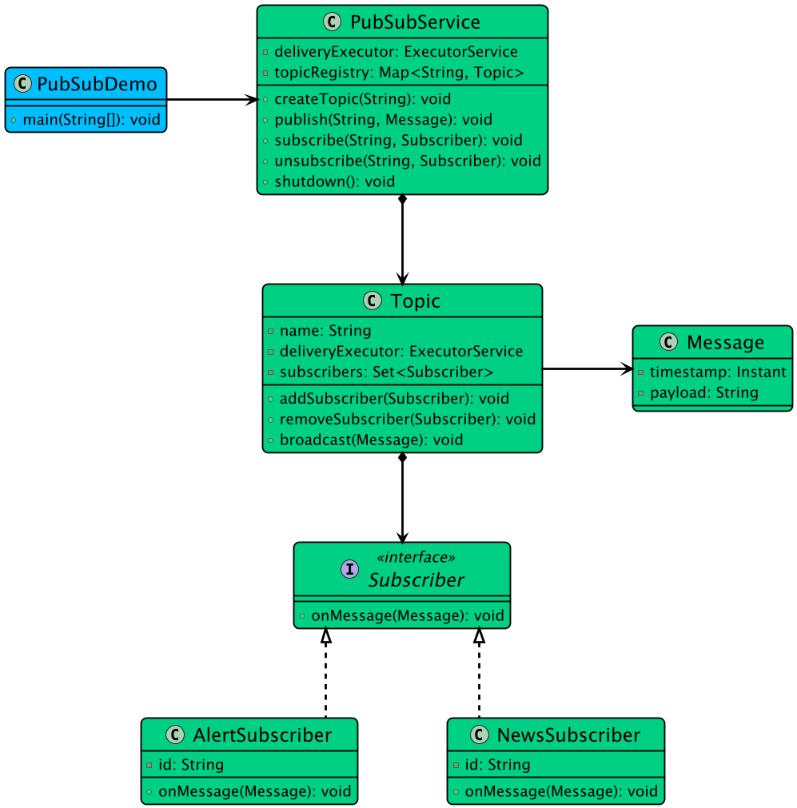

# Low-level design problem: pub sub system

> Copied from <https://github.com/ashishps1/awesome-low-level-design/blob/main/problems/pub-sub-system.md> (GPL-3.0, by Ashish Pratap Singh). Questions and answers are the source's own; nothing was answered or rewritten here.


# Designing a Pub-Sub System in Java

## Requirements
1. The Pub-Sub system should allow publishers to publish messages to specific topics.
2. Subscribers should be able to subscribe to topics of interest and receive messages published to those topics.
3. The system should support multiple publishers and subscribers.
4. Messages should be delivered to all subscribers of a topic in real-time.
5. The system should handle concurrent access and ensure thread safety.
6. The Pub-Sub system should be scalable and efficient in terms of message delivery.

## UML Class Diagram



## Implementations
#### [Java Implementation](https://github.com/ashishps1/awesome-low-level-design/blob/main/solutions/java/src/pubsubsystem)
#### [Python Implementation](https://github.com/ashishps1/awesome-low-level-design/blob/main/solutions/python/pubsubsystem)
#### [C++ Implementation](https://github.com/ashishps1/awesome-low-level-design/blob/main/solutions/cpp/pubsubsystem)
#### [C# Implementation](https://github.com/ashishps1/awesome-low-level-design/blob/main/solutions/csharp/pubsubsystem)
#### [Go Implementation](https://github.com/ashishps1/awesome-low-level-design/blob/main/solutions/golang/pubsubsystem)

## Classes, Interfaces and Enumerations
1. The **Message** class represents a message that can be published and received by subscribers. It contains the message content.
2. The **Topic** class represents a topic to which messages can be published. It maintains a set of subscribers and provides methods to add and remove subscribers, as well as publish messages to all subscribers.
3. The **Subscriber** interface defines the contract for subscribers. It declares the onMessage method that is invoked when a subscriber receives a message.
4. The **PrintSubscriber** class is a concrete implementation of the Subscriber interface. It receives messages and prints them to the console.
5. The **Publisher** class represents a publisher that publishes messages to a specific topic.
6. The **PubSubSystem** class is the main class that manages topics, subscribers, and message publishing. It uses a ConcurrentHashMap to store topics and an ExecutorService to handle concurrent message publishing.
7. The **PubSubDemo** class demonstrates the usage of the Pub-Sub system by creating topics, subscribers, and publishers, and publishing messages.


---

## Official solutions from the repository

<details><summary><b>java</b> (8 files)</summary>


**PubSubDemo.java**

```java
package pubsubsystem;

import pubsubsystem.entities.Message;
import pubsubsystem.subscriber.AlertSubscriber;
import pubsubsystem.subscriber.NewsSubscriber;
import pubsubsystem.subscriber.Subscriber;

public class PubSubDemo {
    public static void main(String[] args) throws InterruptedException {
        PubSubService pubSubService = PubSubService.getInstance();

        // --- Create Subscribers ---
        Subscriber sportsFan1 = new NewsSubscriber("SportsFan1");
        Subscriber sportsFan2 = new NewsSubscriber("SportsFan2");
        Subscriber techie1 = new NewsSubscriber("Techie1");
        Subscriber allNewsReader = new NewsSubscriber("AllNewsReader");
        Subscriber systemAdmin = new AlertSubscriber("SystemAdmin");

        // --- Create Topics and Subscriptions ---
        final String SPORTS_TOPIC = "SPORTS";
        final String TECH_TOPIC = "TECH";
        final String WEATHER_TOPIC = "WEATHER";

        pubSubService.createTopic(SPORTS_TOPIC);
        pubSubService.createTopic(TECH_TOPIC);
        pubSubService.createTopic(WEATHER_TOPIC);

        pubSubService.subscribe(SPORTS_TOPIC, sportsFan1);
        pubSubService.subscribe(SPORTS_TOPIC, sportsFan2);
        pubSubService.subscribe(SPORTS_TOPIC, allNewsReader);
        pubSubService.subscribe(SPORTS_TOPIC, systemAdmin);

        pubSubService.subscribe(TECH_TOPIC, techie1);
        pubSubService.subscribe(TECH_TOPIC, allNewsReader);

        System.out.println("\n--- Publishing Messages ---");

        // --- Publish to SPORTS topic ---
        pubSubService.publish(SPORTS_TOPIC, new Message("Team A wins the championship!"));
        // Expected: SportsFan1, SportsFan2, AllNewsReader, SystemAdmin receive this.

        // --- Publish to TECH topic ---
        pubSubService.publish(TECH_TOPIC, new Message("New AI model released."));
        // Expected: Techie1, AllNewsReader receive this.

        // --- Publish to WEATHER topic (no subscribers) ---
        pubSubService.publish(WEATHER_TOPIC, new Message("Sunny with a high of 75°F."));
        // Expected: Message is dropped.

        // Allow some time for async messages to be processed
        Thread.sleep(500);

        System.out.println("\n--- Unsubscribing a user and re-publishing ---");

        // SportsFan2 gets tired of sports news
        pubSubService.unsubscribe(SPORTS_TOPIC, sportsFan2);

        // Publish another message to SPORTS
        pubSubService.publish(SPORTS_TOPIC, new Message("Major player traded to Team B."));
        // Expected: SportsFan1, AllNewsReader, SystemAdmin receive this. SportsFan2 does NOT.

        // Give messages time to be delivered
        Thread.sleep(500);

        // --- Shutdown the service ---
        pubSubService.shutdown();
    }
}
```


**PubSubService.java**

```java
package pubsubsystem;

import pubsubsystem.entities.Message;
import pubsubsystem.entities.Topic;
import pubsubsystem.subscriber.Subscriber;

import java.util.Map;
import java.util.concurrent.ConcurrentHashMap;
import java.util.concurrent.ExecutorService;
import java.util.concurrent.Executors;
import java.util.concurrent.TimeUnit;

public class PubSubService {
    private static final PubSubService INSTANCE = new PubSubService();
    private final ExecutorService deliveryExecutor;
    private final Map<String, Topic> topicRegistry;

    private PubSubService() {
        this.topicRegistry = new ConcurrentHashMap<>();
        // A cached thread pool is suitable for handling many short-lived, bursty tasks (message deliveries).
        deliveryExecutor = Executors.newCachedThreadPool();
    }

    public static PubSubService getInstance() {
        return INSTANCE;
    }

    public void createTopic(String topicName) {
        topicRegistry.putIfAbsent(topicName, new Topic(topicName, deliveryExecutor));
        System.out.println("Topic " + topicName + " created");
    }

    public void subscribe(String topicName, Subscriber subscriber) {
        Topic topic = topicRegistry.get(topicName);
        if (topic == null)
            throw new IllegalArgumentException("Topic not found: " + topicName);
        topic.addSubscriber(subscriber);
        System.out.println("Subscriber '" + subscriber.getId() + "' subscribed to topic: " + topicName);
    }

    public void unsubscribe(String topicName, Subscriber subscriber) {
        Topic topic = topicRegistry.get(topicName);
        if (topic != null)
            topic.removeSubscriber(subscriber);
        System.out.println("Subscriber '" + subscriber.getId() + "' unsubscribed from topic: " + topicName);
    }

    public void publish(String topicName, Message message) {
        System.out.println("Publishing message to topic: " + topicName);
        Topic topic = topicRegistry.get(topicName);
        if (topic == null) throw new IllegalArgumentException("Topic not found: " + topicName);
        topic.broadcast(message);
    }

    public void shutdown() {
        System.out.println("PubSubService shutting down...");
        deliveryExecutor.shutdown();
        try {
            // Wait a reasonable time for existing tasks to complete
            if (!deliveryExecutor.awaitTermination(60, TimeUnit.SECONDS)) {
                deliveryExecutor.shutdownNow();
            }
        } catch (InterruptedException ie) {
            deliveryExecutor.shutdownNow();
            Thread.currentThread().interrupt();
        }
        System.out.println("PubSubService shutdown complete.");
    }
}
```


**README.md**

```md
# Pub/Sub System (LLD)

## Problem Statement

Design and implement a Publish-Subscribe (Pub/Sub) system that allows publishers to send messages to topics, and subscribers to receive messages from topics they are interested in. The system should support multiple topics, multiple subscribers per topic, and asynchronous message delivery.

---

## Requirements

- **Topics:** The system supports multiple topics.
- **Publishers:** Publishers can publish messages to any topic.
- **Subscribers:** Subscribers can subscribe to one or more topics and receive messages published to those topics.
- **Multiple Subscribers:** Each topic can have multiple subscribers.
- **Asynchronous Delivery:** Messages are delivered to subscribers asynchronously.
- **Unsubscribe:** Subscribers can unsubscribe from topics.
- **Extensibility:** Easy to add new subscriber types or message processing logic.

---

## Core Entities

- **Broker:** Manages topics, subscriptions, and message delivery.
- **Topic:** Represents a topic to which messages can be published and subscribers can subscribe.
- **Publisher:** Publishes messages to topics via the pubSubService.
- **Subscriber (interface):** Interface for all subscribers, defines the `consume(Message)` method.
- **PrintSubscriber:** A subscriber that prints received messages.
- **LoggingSubscriber:** A subscriber that logs received messages.
- **Message:** Represents a message with a payload.
- **Dispatcher:** Handles asynchronous delivery of messages to subscribers.

---

## Class Design

## UML Class Diagram


### 1. Broker
- **Fields:** Map<String, Topic> topics
- **Methods:** createTopic(String), subscribe(String, Subscriber), unsubscribe(String, Subscriber), publish(String, Message)

### 2. Topic
- **Fields:** String name, List<Subscriber> subscribers
- **Methods:** addSubscriber(Subscriber), removeSubscriber(Subscriber), publish(Message)

### 3. Publisher
- **Fields:** String name, Broker pubSubService
- **Methods:** publish(String topic, String payload)

### 4. Subscriber (interface)
- **Methods:** consume(Message)

### 5. PrintSubscriber
- **Implements:** Subscriber
- **Behavior:** Prints received messages to the console

### 6. LoggingSubscriber
- **Implements:** Subscriber
- **Behavior:** Logs received messages (prints with a log prefix)

### 7. Message
- **Fields:** String payload
- **Methods:** getPayload()

### 8. Dispatcher
- **Methods:** dispatch(Subscriber, Message), shutdown()

---

## Design Patterns Used

- **Observer Pattern:** The Pub/Sub system is a concrete implementation of the Observer pattern. Topics (subjects) maintain a list of subscribers (observers) and notify them asynchronously when a new message is published.
## Example Usage

```java
Broker pubSubService = new Broker();
pubSubService.createTopic("topic1");
pubSubService.createTopic("topic2");

Publisher publisher1 = new Publisher("publisher1", pubSubService);
Subscriber subscriber1 = new PrintSubscriber("PrintSubscriber1");
Subscriber subscriber2 = new LoggingSubscriber("LoggingSubscriber2");

pubSubService.subscribe("topic1", subscriber1);
pubSubService.subscribe("topic2", subscriber2);

publisher1.publish("topic1", "Hello Topic1!");
publisher1.publish("topic2", "Hello Topic2!");
```

---

## Demo

See `PubSubSystemDemo.java` for a sample usage and simulation of the pub/sub system.

---

## Extending the Design

- **Add new subscriber types:** Implement the `Subscriber` interface for custom processing.
- **Add new message types:** Extend the `Message` class for richer payloads.
- **Add filtering or transformation:** Enhance the pubSubService or topic to support message filtering or transformation.

---
```


**entities/Message.java**

```java
package pubsubsystem.entities;

import java.time.Instant;

public class Message {
    private final String payload;
    private final Instant timestamp;

    public Message(String payload) {
        this.payload = payload;
        this.timestamp = Instant.now();
    }

    public String getPayload() {
        return payload;
    }

    @Override
    public String toString() {
        return "Message{" + "payload='" + payload + '\'' + '}';
    }
}
```


**entities/Topic.java**

```java
package pubsubsystem.entities;

import pubsubsystem.subscriber.Subscriber;

import java.util.Set;
import java.util.concurrent.CopyOnWriteArraySet;
import java.util.concurrent.ExecutorService;

public class Topic {
    private final String name;
    private final Set<Subscriber> subscribers;
    private final ExecutorService deliveryExecutor;

    public Topic(String name, ExecutorService deliveryExecutor) {
        this.name = name;
        this.deliveryExecutor = deliveryExecutor;
        this.subscribers = new CopyOnWriteArraySet<>();
    }

    public String getName() {
        return name;
    }

    public void addSubscriber(Subscriber subscriber) {
        subscribers.add(subscriber);
    }

    public void removeSubscriber(Subscriber subscriber) {
        subscribers.remove(subscriber);
    }

    public void broadcast(Message message) {
        for (Subscriber subscriber : subscribers) {
            deliveryExecutor.submit(() -> {
                try {
                    subscriber.onMessage(message);
                } catch (Exception e) {
                    System.err.println("Error delivering message to subscriber " + subscriber.getId() + ": " + e.getMessage());
                }
            });
        }
    }
}
```


**subscriber/AlertSubscriber.java**

```java
package pubsubsystem.subscriber;

import pubsubsystem.entities.Message;

public class AlertSubscriber implements Subscriber {
    private final String id;

    public AlertSubscriber(String id) {
        this.id = id;
    }

    @Override
    public String getId() {
        return id;
    }

    @Override
    public void onMessage(Message message) {
        System.out.printf("!!! [ALERT - %s] : '%s' !!!%n", id, message.getPayload());
    }
}
```


**subscriber/NewsSubscriber.java**

```java
package pubsubsystem.subscriber;

import pubsubsystem.entities.Message;

public class NewsSubscriber implements Subscriber {
    private final String id;

    public NewsSubscriber(String id) {
        this.id = id;
    }

    @Override
    public String getId() {
        return id;
    }

    @Override
    public void onMessage(Message message) {
        System.out.printf("[Subscriber %s] received message '%s'%n", id, message.getPayload());
    }
}
```


**subscriber/Subscriber.java**

```java
package pubsubsystem.subscriber;

import pubsubsystem.entities.Message;

public interface Subscriber {
    String getId();
    void onMessage(Message message);
}
```

</details>

<details><summary><b>python</b> (6 files)</summary>


**README.md**

```md
# Designing a Pub-Sub System in Java

## Requirements
1. The Pub-Sub system should allow publishers to publish messages to specific topics.
2. Subscribers should be able to subscribe to topics of interest and receive messages published to those topics.
3. The system should support multiple publishers and subscribers.
4. Messages should be delivered to all subscribers of a topic in real-time.
5. The system should handle concurrent access and ensure thread safety.
6. The Pub-Sub system should be scalable and efficient in terms of message delivery.

## Classes, Interfaces and Enumerations
1. The **Message** class represents a message that can be published and received by subscribers. It contains the message content.
2. The **Topic** class represents a topic to which messages can be published. It maintains a set of subscribers and provides methods to add and remove subscribers, as well as publish messages to all subscribers.
3. The **Subscriber** interface defines the contract for subscribers. It declares the onMessage method that is invoked when a subscriber receives a message.
4. The **PrintSubscriber** class is a concrete implementation of the Subscriber interface. It receives messages and prints them to the console.
5. The **Publisher** class represents a publisher that publishes messages to a specific topic.
6. The **PubSubSystem** class is the main class that manages topics, subscribers, and message publishing. It uses a ConcurrentHashMap to store topics and an ExecutorService to handle concurrent message publishing.
7. The **PubSubDemo** class demonstrates the usage of the Pub-Sub system by creating topics, subscribers, and publishers, and publishing messages.
```


**message.py**

```py
from datetime import datetime

class Message:
    def __init__(self, payload: str):
        self.payload = payload
        self.timestamp = datetime.now()

    def get_payload(self) -> str:
        return self.payload

    def __str__(self) -> str:
        return f"Message{{payload='{self.payload}'}}"
```


**pub_sub_demo.py**

```py
from pub_sub_service import PubSubService
from subscriber import NewsSubscriber, AlertSubscriber
from message import Message
import time

class PubSubDemo:
    @staticmethod  
    def main():
        pub_sub_service = PubSubService.get_instance()

        # --- Create Subscribers ---
        sports_fan1 = NewsSubscriber("SportsFan1")
        sports_fan2 = NewsSubscriber("SportsFan2")
        techie1 = NewsSubscriber("Techie1")
        all_news_reader = NewsSubscriber("AllNewsReader")
        system_admin = AlertSubscriber("SystemAdmin")

        # --- Create Topics and Subscriptions ---
        SPORTS_TOPIC = "SPORTS"
        TECH_TOPIC = "TECH"
        WEATHER_TOPIC = "WEATHER"

        pub_sub_service.create_topic(SPORTS_TOPIC)
        pub_sub_service.create_topic(TECH_TOPIC)
        pub_sub_service.create_topic(WEATHER_TOPIC)

        pub_sub_service.subscribe(SPORTS_TOPIC, sports_fan1)
        pub_sub_service.subscribe(SPORTS_TOPIC, sports_fan2)
        pub_sub_service.subscribe(SPORTS_TOPIC, all_news_reader)
        pub_sub_service.subscribe(SPORTS_TOPIC, system_admin)

        pub_sub_service.subscribe(TECH_TOPIC, techie1)
        pub_sub_service.subscribe(TECH_TOPIC, all_news_reader)

        print("\n--- Publishing Messages ---")

        # --- Publish to SPORTS topic ---
        pub_sub_service.publish(SPORTS_TOPIC, Message("Team A wins the championship!"))
        # Expected: SportsFan1, SportsFan2, AllNewsReader, SystemAdmin receive this.

        # --- Publish to TECH topic ---
        pub_sub_service.publish(TECH_TOPIC, Message("New AI model released."))
        # Expected: Techie1, AllNewsReader receive this.

        # --- Publish to WEATHER topic (no subscribers) ---
        pub_sub_service.publish(WEATHER_TOPIC, Message("Sunny with a high of 75°F."))
        # Expected: Message is dropped.

        # Allow some time for async messages to be processed
        time.sleep(0.5)

        print("\n--- Unsubscribing a user and re-publishing ---")

        # SportsFan2 gets tired of sports news
        pub_sub_service.unsubscribe(SPORTS_TOPIC, sports_fan2)

        # Publish another message to SPORTS
        pub_sub_service.publish(SPORTS_TOPIC, Message("Major player traded to Team B."))
        # Expected: SportsFan1, AllNewsReader, SystemAdmin receive this. SportsFan2 does NOT.

        # Give messages time to be delivered
        time.sleep(0.5)

        # --- Shutdown the service ---
        pub_sub_service.shutdown()

if __name__ == "__main__":
    PubSubDemo.main()
```


**pub_sub_service.py**

```py
import threading
from typing import Dict
from topic import Topic
from subscriber import Subscriber
from message import Message
from concurrent.futures import ThreadPoolExecutor

class PubSubService:
    _instance = None
    _lock = threading.Lock()

    def __new__(cls):
        if cls._instance is None:
            with cls._lock:
                if cls._instance is None:
                    cls._instance = super().__new__(cls)
                    cls._instance._initialized = False
        return cls._instance

    def __init__(self):
        if self._initialized:
            return
        
        self.topic_registry: Dict[str, Topic] = {}
        # A cached thread pool is suitable for handling many short-lived, bursty tasks (message deliveries).
        self.delivery_executor = ThreadPoolExecutor()
        self._initialized = True

    @classmethod
    def get_instance(cls):
        return cls()

    def create_topic(self, topic_name: str):
        if topic_name not in self.topic_registry:
            self.topic_registry[topic_name] = Topic(topic_name, self.delivery_executor)
        print(f"Topic {topic_name} created")

    def subscribe(self, topic_name: str, subscriber: Subscriber):
        topic = self.topic_registry.get(topic_name)
        if topic is None:
            raise ValueError(f"Topic not found: {topic_name}")
        topic.add_subscriber(subscriber)
        print(f"Subscriber '{subscriber.get_id()}' subscribed to topic: {topic_name}")

    def unsubscribe(self, topic_name: str, subscriber: Subscriber):
        topic = self.topic_registry.get(topic_name)
        if topic is not None:
            topic.remove_subscriber(subscriber)
        print(f"Subscriber '{subscriber.get_id()}' unsubscribed from topic: {topic_name}")

    def publish(self, topic_name: str, message: Message):
        print(f"Publishing message to topic: {topic_name}")
        topic = self.topic_registry.get(topic_name)
        if topic is None:
            raise ValueError(f"Topic not found: {topic_name}")
        topic.broadcast(message)

    def shutdown(self):
        print("PubSubService shutting down...")
        self.delivery_executor.shutdown(wait=True)
        print("PubSubService shutdown complete.")
```


**subscriber.py**

```py
from abc import ABC, abstractmethod
from message import Message

class Subscriber(ABC):
    @abstractmethod
    def get_id(self) -> str:
        pass

    @abstractmethod
    def on_message(self, message: Message):
        pass

class AlertSubscriber(Subscriber):
    def __init__(self, subscriber_id: str):
        self.id = subscriber_id

    def get_id(self) -> str:
        return self.id

    def on_message(self, message: Message):
        print(f"!!! [ALERT - {self.id}] : '{message.get_payload()}' !!!")

class NewsSubscriber(Subscriber):
    def __init__(self, subscriber_id: str):
        self.id = subscriber_id

    def get_id(self) -> str:
        return self.id

    def on_message(self, message: Message):
        print(f"[Subscriber {self.id}] received message '{message.get_payload()}'")
```


**topic.py**

```py
from subscriber import Subscriber
from message import Message
from typing import Set
from concurrent.futures import ThreadPoolExecutor

class Topic:
    def __init__(self, name: str, delivery_executor: ThreadPoolExecutor):
        self.name = name
        self.delivery_executor = delivery_executor
        self.subscribers: Set[Subscriber] = set()

    def get_name(self) -> str:
        return self.name

    def add_subscriber(self, subscriber: Subscriber):
        self.subscribers.add(subscriber)

    def remove_subscriber(self, subscriber: Subscriber):
        self.subscribers.discard(subscriber)

    def broadcast(self, message: Message):
        for subscriber in self.subscribers:
            self.delivery_executor.submit(self._deliver_message, subscriber, message)

    def _deliver_message(self, subscriber: Subscriber, message: Message):
        try:
            subscriber.on_message(message)
        except Exception as e:
            print(f"Error delivering message to subscriber {subscriber.get_id()}: {str(e)}")
```

</details>

<details><summary><b>cpp</b> (10 files)</summary>


**Message.cpp**

```cpp
#include "Message.hpp"
#include <iostream>

Message::Message(std::string topic, std::string content)
    : topic(topic), content(content) {
    timestamp = std::time(nullptr);
}

std::string Message::getTopic() const { return topic; }
std::string Message::getContent() const { return content; }
std::time_t Message::getTimestamp() const { return timestamp; }

void Message::displayInfo() const {
    std::cout << "Topic: " << topic << std::endl;
    std::cout << "Content: " << content << std::endl;
    std::cout << "Time: " << std::ctime(&timestamp);
}
```


**Message.hpp**

```hpp
#ifndef MESSAGE_HPP
#define MESSAGE_HPP

#include <string>
#include <ctime>

class Message {
private:
    std::string topic;
    std::string content;
    std::time_t timestamp;

public:
    Message(std::string topic, std::string content);
    
    std::string getTopic() const;
    std::string getContent() const;
    std::time_t getTimestamp() const;
    void displayInfo() const;
};

#endif
```


**PubSubDemo.cpp**

```cpp
#include "PubSubSystem.hpp"
#include <iostream>
#include <thread>
#include <chrono>

int main() {
    PubSubSystem system;
    
    // Create topics
    Topic* tech = system.createTopic("Technology", "Tech news and updates");
    Topic* sports = system.createTopic("Sports", "Sports news and scores");
    Topic* weather = system.createTopic("Weather", "Weather updates");
    
    std::cout << "Initial topics:" << std::endl;
    system.displayTopics();
    
    // Add subscribers
    Subscriber* sub1 = system.addSubscriber("John");
    Subscriber* sub2 = system.addSubscriber("Alice");
    Subscriber* sub3 = system.addSubscriber("Bob");
    
    // Subscribe to topics
    system.subscribe(sub1->getId(), "Technology");
    system.subscribe(sub1->getId(), "Weather");
    system.subscribe(sub2->getId(), "Sports");
    system.subscribe(sub3->getId(), "Technology");
    system.subscribe(sub3->getId(), "Sports");
    
    // Publish messages
    std::cout << "\nPublishing messages..." << std::endl;
    
    system.publish("Technology", "New AI breakthrough!");
    system.publish("Sports", "Team A wins championship!");
    system.publish("Weather", "Sunny weather expected");
    
    // Small delay to simulate time passing
    std::this_thread::sleep_for(std::chrono::seconds(1));
    
    // Display messages for each subscriber
    std::cout << "\nChecking messages for subscribers:" << std::endl;
    system.displaySubscriberMessages(sub1->getId());
    system.displaySubscriberMessages(sub2->getId());
    system.displaySubscriberMessages(sub3->getId());
    
    // Unsubscribe and test
    std::cout << "\nUnsubscribing John from Weather..." << std::endl;
    system.unsubscribe(sub1->getId(), "Weather");
    
    system.publish("Weather", "Storm warning!");
    
    std::cout << "\nJohn's updated messages:" << std::endl;
    system.displaySubscriberMessages(sub1->getId());
    
    return 0;
}
```


**PubSubSystem.cpp**

```cpp
#include "PubSubSystem.hpp"
#include <iostream>
#include <algorithm>

PubSubSystem::PubSubSystem() : subscriberIdCounter(1) {}

PubSubSystem::~PubSubSystem() {
    for (auto topic : topics) delete topic;
    for (auto subscriber : subscribers) delete subscriber;
}

Topic* PubSubSystem::createTopic(const std::string& name, const std::string& description) {
    if (findTopic(name)) return nullptr;
    
    Topic* topic = new Topic(name, description);
    topics.push_back(topic);
    return topic;
}

void PubSubSystem::removeTopic(const std::string& topicName) {
    auto it = std::find_if(topics.begin(), topics.end(),
        [topicName](Topic* topic) { return topic->getName() == topicName; });
    
    if (it != topics.end()) {
        delete *it;
        topics.erase(it);
    }
}

Subscriber* PubSubSystem::addSubscriber(const std::string& name) {
    std::string id = generateSubscriberId();
    Subscriber* subscriber = new Subscriber(id, name);
    subscribers.push_back(subscriber);
    return subscriber;
}

void PubSubSystem::removeSubscriber(const std::string& subscriberId) {
    // Remove from all topics first
    for (auto topic : topics) {
        topic->removeSubscriber(subscriberId);
    }
    
    // Remove from subscribers list
    auto it = std::find_if(subscribers.begin(), subscribers.end(),
        [subscriberId](Subscriber* sub) { return sub->getId() == subscriberId; });
    
    if (it != subscribers.end()) {
        delete *it;
        subscribers.erase(it);
    }
}

bool PubSubSystem::subscribe(const std::string& subscriberId, const std::string& topicName) {
    Topic* topic = findTopic(topicName);
    Subscriber* subscriber = findSubscriber(subscriberId);
    
    if (!topic || !subscriber) return false;
    
    topic->addSubscriber(subscriber);
    return true;
}

bool PubSubSystem::unsubscribe(const std::string& subscriberId, const std::string& topicName) {
    Topic* topic = findTopic(topicName);
    if (!topic) return false;
    
    topic->removeSubscriber(subscriberId);
    return true;
}

bool PubSubSystem::publish(const std::string& topicName, const std::string& content) {
    Topic* topic = findTopic(topicName);
    if (!topic || !topic->isActive()) return false;
    
    Message message(topicName, content);
    topic->publishMessage(message);
    return true;
}

void PubSubSystem::displayTopics() const {
    std::cout << "\nAvailable Topics:" << std::endl;
    for (const auto& topic : topics) {
        topic->displayInfo();
        std::cout << "------------------------" << std::endl;
    }
}

void PubSubSystem::displaySubscribers() const {
    std::cout << "\nRegistered Subscribers:" << std::endl;
    for (const auto& subscriber : subscribers) {
        subscriber->displayInfo();
        std::cout << "------------------------" << std::endl;
    }
}

void PubSubSystem::displaySubscriberMessages(const std::string& subscriberId) const {
    if (Subscriber* subscriber = findSubscriber(subscriberId)) {
        subscriber->displayMessages();
    }
}

Topic* PubSubSystem::findTopic(const std::string& topicName) const {
    auto it = std::find_if(topics.begin(), topics.end(),
        [topicName](Topic* topic) { return topic->getName() == topicName; });
    return it != topics.end() ? *it : nullptr;
}

Subscriber* PubSubSystem::findSubscriber(const std::string& subscriberId) const {
    auto it = std::find_if(subscribers.begin(), subscribers.end(),
        [subscriberId](Subscriber* sub) { return sub->getId() == subscriberId; });
    return it != subscribers.end() ? *it : nullptr;
}

std::string PubSubSystem::generateSubscriberId() {
    return "SUB" + std::to_string(subscriberIdCounter++);
}
```


**PubSubSystem.hpp**

```hpp
#ifndef PUB_SUB_SYSTEM_HPP
#define PUB_SUB_SYSTEM_HPP

#include <vector>
#include <string>
#include "Topic.hpp"
#include "Subscriber.hpp"

class PubSubSystem {
private:
    std::vector<Topic*> topics;
    std::vector<Subscriber*> subscribers;
    int subscriberIdCounter;

public:
    PubSubSystem();
    ~PubSubSystem();
    
    Topic* createTopic(const std::string& name, const std::string& description);
    void removeTopic(const std::string& topicName);
    
    Subscriber* addSubscriber(const std::string& name);
    void removeSubscriber(const std::string& subscriberId);
    
    bool subscribe(const std::string& subscriberId, const std::string& topicName);
    bool unsubscribe(const std::string& subscriberId, const std::string& topicName);
    bool publish(const std::string& topicName, const std::string& content);
    
    void displayTopics() const;
    void displaySubscribers() const;
    void displaySubscriberMessages(const std::string& subscriberId) const;

private:
    Topic* findTopic(const std::string& topicName) const;
    Subscriber* findSubscriber(const std::string& subscriberId) const;
    std::string generateSubscriberId();
};

#endif
```


**README.md**

```md
# Designing a Pub-Sub System in Java

## Requirements
1. The Pub-Sub system should allow publishers to publish messages to specific topics.
2. Subscribers should be able to subscribe to topics of interest and receive messages published to those topics.
3. The system should support multiple publishers and subscribers.
4. Messages should be delivered to all subscribers of a topic in real-time.
5. The system should handle concurrent access and ensure thread safety.
6. The Pub-Sub system should be scalable and efficient in terms of message delivery.

## Classes, Interfaces and Enumerations
1. The **Message** class represents a message that can be published and received by subscribers. It contains the message content.
2. The **Topic** class represents a topic to which messages can be published. It maintains a set of subscribers and provides methods to add and remove subscribers, as well as publish messages to all subscribers.
3. The **Subscriber** interface defines the contract for subscribers. It declares the onMessage method that is invoked when a subscriber receives a message.
4. The **PrintSubscriber** class is a concrete implementation of the Subscriber interface. It receives messages and prints them to the console.
5. The **Publisher** class represents a publisher that publishes messages to a specific topic.
6. The **PubSubSystem** class is the main class that manages topics, subscribers, and message publishing. It uses a ConcurrentHashMap to store topics and an ExecutorService to handle concurrent message publishing.
7. The **PubSubDemo** class demonstrates the usage of the Pub-Sub system by creating topics, subscribers, and publishers, and publishing messages.
```


**Subscriber.cpp**

```cpp
#include "Subscriber.hpp"
#include <iostream>

Subscriber::Subscriber(std::string id, std::string name)
    : id(id), name(name), active(true) {}

std::string Subscriber::getId() const { return id; }
std::string Subscriber::getName() const { return name; }
bool Subscriber::isActive() const { return active; }
const std::vector<Message>& Subscriber::getMessageQueue() const { return messageQueue; }

void Subscriber::receiveMessage(const Message& message) {
    if (active) {
        messageQueue.push_back(message);
    }
}

void Subscriber::displayMessages() const {
    std::cout << "\nMessages for " << name << ":" << std::endl;
    if (messageQueue.empty()) {
        std::cout << "No messages" << std::endl;
        return;
    }
    
    for (const auto& message : messageQueue) {
        message.displayInfo();
        std::cout << "------------------------" << std::endl;
    }
}

void Subscriber::clearMessages() {
    messageQueue.clear();
}

void Subscriber::setActive(bool status) {
    active = status;
}

void Subscriber::displayInfo() const {
    std::cout << "Subscriber: " << name << " (ID: " << id << ")" << std::endl;
    std::cout << "Status: " << (active ? "Active" : "Inactive") << std::endl;
    std::cout << "Pending Messages: " << messageQueue.size() << std::endl;
}
```


**Subscriber.hpp**

```hpp
#ifndef SUBSCRIBER_HPP
#define SUBSCRIBER_HPP

#include <string>
#include <vector>
#include "Message.hpp"

class Subscriber {
private:
    std::string id;
    std::string name;
    std::vector<Message> messageQueue;
    bool active;

public:
    Subscriber(std::string id, std::string name);
    
    std::string getId() const;
    std::string getName() const;
    bool isActive() const;
    const std::vector<Message>& getMessageQueue() const;
    
    void receiveMessage(const Message& message);
    void displayMessages() const;
    void clearMessages();
    void setActive(bool status);
    void displayInfo() const;
};

#endif
```


**Topic.cpp**

```cpp
#include "Topic.hpp"
#include <iostream>
#include <algorithm>

Topic::Topic(std::string name, std::string description)
    : name(name), description(description), active(true) {}

std::string Topic::getName() const { return name; }
std::string Topic::getDescription() const { return description; }
bool Topic::isActive() const { return active; }
const std::vector<Subscriber*>& Topic::getSubscribers() const { return subscribers; }

void Topic::addSubscriber(Subscriber* subscriber) {
    if (!subscriber) return;
    
    auto it = std::find(subscribers.begin(), subscribers.end(), subscriber);
    if (it == subscribers.end()) {
        subscribers.push_back(subscriber);
    }
}

void Topic::removeSubscriber(const std::string& subscriberId) {
    auto it = std::find_if(subscribers.begin(), subscribers.end(),
        [subscriberId](Subscriber* sub) { return sub->getId() == subscriberId; });
    
    if (it != subscribers.end()) {
        subscribers.erase(it);
    }
}

void Topic::publishMessage(const Message& message) {
    if (!active) return;
    
    for (auto subscriber : subscribers) {
        subscriber->receiveMessage(message);
    }
}

void Topic::setActive(bool status) {
    active = status;
}

void Topic::displayInfo() const {
    std::cout << "Topic: " << name << std::endl;
    std::cout << "Description: " << description << std::endl;
    std::cout << "Status: " << (active ? "Active" : "Inactive") << std::endl;
    std::cout << "Subscribers: " << subscribers.size() << std::endl;
}
```


**Topic.hpp**

```hpp
#ifndef TOPIC_HPP
#define TOPIC_HPP

#include <string>
#include <vector>
#include "Subscriber.hpp"

class Topic {
private:
    std::string name;
    std::string description;
    std::vector<Subscriber*> subscribers;
    bool active;

public:
    Topic(std::string name, std::string description);
    
    std::string getName() const;
    std::string getDescription() const;
    bool isActive() const;
    const std::vector<Subscriber*>& getSubscribers() const;
    
    void addSubscriber(Subscriber* subscriber);
    void removeSubscriber(const std::string& subscriberId);
    void publishMessage(const Message& message);
    void setActive(bool status);
    void displayInfo() const;
};

#endif
```

</details>

<details><summary><b>golang</b> (7 files)</summary>


**README.md**

```md
# Designing a Pub-Sub System in Java

## Requirements
1. The Pub-Sub system should allow publishers to publish messages to specific topics.
2. Subscribers should be able to subscribe to topics of interest and receive messages published to those topics.
3. The system should support multiple publishers and subscribers.
4. Messages should be delivered to all subscribers of a topic in real-time.
5. The system should handle concurrent access and ensure thread safety.
6. The Pub-Sub system should be scalable and efficient in terms of message delivery.

## Classes, Interfaces and Enumerations
1. The **Message** class represents a message that can be published and received by subscribers. It contains the message content.
2. The **Topic** class represents a topic to which messages can be published. It maintains a set of subscribers and provides methods to add and remove subscribers, as well as publish messages to all subscribers.
3. The **Subscriber** interface defines the contract for subscribers. It declares the onMessage method that is invoked when a subscriber receives a message.
4. The **PrintSubscriber** class is a concrete implementation of the Subscriber interface. It receives messages and prints them to the console.
5. The **Publisher** class represents a publisher that publishes messages to a specific topic.
6. The **PubSubSystem** class is the main class that manages topics, subscribers, and message publishing. It uses a ConcurrentHashMap to store topics and an ExecutorService to handle concurrent message publishing.
7. The **PubSubDemo** class demonstrates the usage of the Pub-Sub system by creating topics, subscribers, and publishers, and publishing messages.
```


**message.go**

```go
package pubsubsystem

type Message struct {
	Content string
}

func NewMessage(content string) *Message {
	return &Message{Content: content}
}
```


**print_subscriber.go**

```go
package pubsubsystem

import "fmt"

type PrintSubscriber struct {
	Name string
}

func NewPrintSubscriber(name string) *PrintSubscriber {
	return &PrintSubscriber{Name: name}
}

func (ps *PrintSubscriber) OnMessage(message *Message) {
	fmt.Printf("Subscriber %s received message: %s\n", ps.Name, message.Content)
}
```


**publisher.go**

```go
package pubsubsystem

import "fmt"

type Publisher struct {
	Topics map[*Topic]struct{}
}

func NewPublisher() *Publisher {
	return &Publisher{Topics: make(map[*Topic]struct{})}
}

func (p *Publisher) RegisterTopic(topic *Topic) {
	p.Topics[topic] = struct{}{}
}

func (p *Publisher) Publish(topic *Topic, message *Message) {
	if _, exists := p.Topics[topic]; !exists {
		fmt.Printf("This publisher can't publish to topic: %s\n", topic.Name)
		return
	}
	topic.Publish(message)
}
```


**pubsub_system_demo.go**

```go
package pubsubsystem

func Run() {
	// Create topics
	topic1 := NewTopic("Topic1")
	topic2 := NewTopic("Topic2")

	// Create publishers
	publisher1 := NewPublisher()
	publisher2 := NewPublisher()

	// Create subscribers
	subscriber1 := NewPrintSubscriber("Subscriber1")
	subscriber2 := NewPrintSubscriber("Subscriber2")
	subscriber3 := NewPrintSubscriber("Subscriber3")

	publisher1.RegisterTopic(topic1)
	publisher2.RegisterTopic(topic2)

	// Subscribe to topics
	topic1.AddSubscriber(subscriber1)
	topic1.AddSubscriber(subscriber2)
	topic2.AddSubscriber(subscriber2)
	topic2.AddSubscriber(subscriber3)

	// Publish messages
	publisher1.Publish(topic1, NewMessage("Message1 for Topic1"))
	publisher1.Publish(topic1, NewMessage("Message2 for Topic1"))
	publisher2.Publish(topic2, NewMessage("Message1 for Topic2"))

	// Unsubscribe from a topic
	topic1.RemoveSubscriber(subscriber2)

	// Publish more messages
	publisher1.Publish(topic1, NewMessage("Message3 for Topic1"))
	publisher2.Publish(topic2, NewMessage("Message2 for Topic2"))
}
```


**subscriber.go**

```go
package pubsubsystem

type Subscriber interface {
	OnMessage(message *Message)
}
```


**topic.go**

```go
package pubsubsystem

import (
	"sync"
)

type Topic struct {
	Name        string
	Subscribers map[Subscriber]struct{}
	mu          sync.RWMutex
}

func NewTopic(name string) *Topic {
	return &Topic{
		Name:        name,
		Subscribers: make(map[Subscriber]struct{}),
	}
}

func (t *Topic) AddSubscriber(subscriber Subscriber) {
	t.mu.Lock()
	defer t.mu.Unlock()
	t.Subscribers[subscriber] = struct{}{}
}

func (t *Topic) RemoveSubscriber(subscriber Subscriber) {
	t.mu.Lock()
	defer t.mu.Unlock()
	delete(t.Subscribers, subscriber)
}

func (t *Topic) Publish(message *Message) {
	t.mu.RLock()
	defer t.mu.RUnlock()
	for subscriber := range t.Subscribers {
		subscriber.OnMessage(message)
	}
}
```

</details>

<details><summary><b>csharp</b> (9 files)</summary>


**Models/Message.cs**

```cs
class Message
{
    private readonly string payload;
    private readonly DateTime timestamp;

    public Message(string payload)
    {
        this.payload = payload;
        this.timestamp = DateTime.Now;
    }

    public string GetPayload()
    {
        return payload;
    }

    public override string ToString()
    {
        return $"Message{{payload='{payload}'}}";
    }
}
```


**Models/Topic.cs**

```cs
class Topic
{
    private readonly string name;
    private readonly HashSet<ISubscriber> subscribers;
    private readonly object subscribersLock = new object();

    public Topic(string name)
    {
        this.name = name;
        this.subscribers = new HashSet<ISubscriber>();
    }

    public string GetName()
    {
        return name;
    }

    public void AddSubscriber(ISubscriber subscriber)
    {
        lock (subscribersLock)
        {
            subscribers.Add(subscriber);
        }
    }

    public void RemoveSubscriber(ISubscriber subscriber)
    {
        lock (subscribersLock)
        {
            subscribers.Remove(subscriber);
        }
    }

    public void Broadcast(Message message)
    {
        List<ISubscriber> currentSubscribers;
        lock (subscribersLock)
        {
            currentSubscribers = new List<ISubscriber>(subscribers);
        }

        List<Task> deliveryTasks = new List<Task>();

        foreach (ISubscriber subscriber in currentSubscribers)
        {
            deliveryTasks.Add(Task.Run(() =>
            {
                try
                {
                    subscriber.OnMessage(message);
                }
                catch (Exception e)
                {
                    Console.Error.WriteLine($"Error delivering message to subscriber {subscriber.GetId()}: {e.Message}");
                }
            }));
        }

        Task.WaitAll(deliveryTasks.ToArray());
    }
}
```


**PubSubDemo.cs**

```cs
using System;
using System.Collections.Generic;
using System.Threading;
using System.Threading.Tasks;

public class PubSubDemo
{
    public static void Main(string[] args)
    {
        PubSubService pubSubService = PubSubService.GetInstance();

        // --- Create Subscribers ---
        ISubscriber sportsFan1 = new NewsSubscriber("SportsFan1");
        ISubscriber sportsFan2 = new NewsSubscriber("SportsFan2");
        ISubscriber techie1 = new NewsSubscriber("Techie1");
        ISubscriber allNewsReader = new NewsSubscriber("AllNewsReader");
        ISubscriber systemAdmin = new AlertSubscriber("SystemAdmin");

        // --- Create Topics and Subscriptions ---
        const string SPORTS_TOPIC = "SPORTS";
        const string TECH_TOPIC = "TECH";
        const string WEATHER_TOPIC = "WEATHER";

        pubSubService.CreateTopic(SPORTS_TOPIC);
        pubSubService.CreateTopic(TECH_TOPIC);
        pubSubService.CreateTopic(WEATHER_TOPIC);

        pubSubService.Subscribe(SPORTS_TOPIC, sportsFan1);
        pubSubService.Subscribe(SPORTS_TOPIC, sportsFan2);
        pubSubService.Subscribe(SPORTS_TOPIC, allNewsReader);
        pubSubService.Subscribe(SPORTS_TOPIC, systemAdmin);

        pubSubService.Subscribe(TECH_TOPIC, techie1);
        pubSubService.Subscribe(TECH_TOPIC, allNewsReader);

        Console.WriteLine("\n--- Publishing Messages ---");

        // --- Publish to SPORTS topic ---
        pubSubService.Publish(SPORTS_TOPIC, new Message("Team A wins the championship!"));
        // Expected: SportsFan1, SportsFan2, AllNewsReader, SystemAdmin receive this.

        // --- Publish to TECH topic ---
        pubSubService.Publish(TECH_TOPIC, new Message("New AI model released."));
        // Expected: Techie1, AllNewsReader receive this.

        // --- Publish to WEATHER topic (no subscribers) ---
        pubSubService.Publish(WEATHER_TOPIC, new Message("Sunny with a high of 75°F."));
        // Expected: Message is dropped.

        // Allow some time for async messages to be processed
        Thread.Sleep(500);

        Console.WriteLine("\n--- Unsubscribing a user and re-publishing ---");

        // SportsFan2 gets tired of sports news
        pubSubService.Unsubscribe(SPORTS_TOPIC, sportsFan2);

        // Publish another message to SPORTS
        pubSubService.Publish(SPORTS_TOPIC, new Message("Major player traded to Team B."));
        // Expected: SportsFan1, AllNewsReader, SystemAdmin receive this. SportsFan2 does NOT.

        // Give messages time to be delivered
        Thread.Sleep(500);

        // --- Shutdown the service ---
        pubSubService.Shutdown();
    }
}
```


**PubSubService.cs**

```cs
using System.Collections.Concurrent;

class PubSubService
{
    private static PubSubService instance;
    private static readonly object instanceLock = new object();

    private readonly ConcurrentDictionary<string, Topic> topicRegistry;

    private PubSubService()
    {
        topicRegistry = new ConcurrentDictionary<string, Topic>();
    }

    public static PubSubService GetInstance()
    {
        if (instance == null)
        {
            lock (instanceLock)
            {
                if (instance == null)
                {
                    instance = new PubSubService();
                }
            }
        }
        return instance;
    }

    public void CreateTopic(string topicName)
    {
        topicRegistry.TryAdd(topicName, new Topic(topicName));
        Console.WriteLine($"Topic {topicName} created");
    }

    public void Subscribe(string topicName, ISubscriber subscriber)
    {
        if (!topicRegistry.TryGetValue(topicName, out Topic topic))
        {
            throw new ArgumentException($"Topic not found: {topicName}");
        }
        topic.AddSubscriber(subscriber);
        Console.WriteLine($"Subscriber '{subscriber.GetId()}' subscribed to topic: {topicName}");
    }

    public void Unsubscribe(string topicName, ISubscriber subscriber)
    {
        if (topicRegistry.TryGetValue(topicName, out Topic topic))
        {
            topic.RemoveSubscriber(subscriber);
        }
        Console.WriteLine($"Subscriber '{subscriber.GetId()}' unsubscribed from topic: {topicName}");
    }

    public void Publish(string topicName, Message message)
    {
        Console.WriteLine($"Publishing message to topic: {topicName}");
        if (!topicRegistry.TryGetValue(topicName, out Topic topic))
        {
            throw new ArgumentException($"Topic not found: {topicName}");
        }
        topic.Broadcast(message);
    }

    public void Shutdown()
    {
        Console.WriteLine("PubSubService shutting down...");
        Console.WriteLine("PubSubService shutdown complete.");
    }
}
```


**README.md**

```md
# Designing a Pub-Sub System in Java

## Requirements
1. The Pub-Sub system should allow publishers to publish messages to specific topics.
2. Subscribers should be able to subscribe to topics of interest and receive messages published to those topics.
3. The system should support multiple publishers and subscribers.
4. Messages should be delivered to all subscribers of a topic in real-time.
5. The system should handle concurrent access and ensure thread safety.
6. The Pub-Sub system should be scalable and efficient in terms of message delivery.

## Classes, Interfaces and Enumerations
1. The **Message** class represents a message that can be published and received by subscribers. It contains the message content.
2. The **Topic** class represents a topic to which messages can be published. It maintains a set of subscribers and provides methods to add and remove subscribers, as well as publish messages to all subscribers.
3. The **Subscriber** interface defines the contract for subscribers. It declares the onMessage method that is invoked when a subscriber receives a message.
4. The **PrintSubscriber** class is a concrete implementation of the Subscriber interface. It receives messages and prints them to the console.
5. The **Publisher** class represents a publisher that publishes messages to a specific topic.
6. The **PubSubSystem** class is the main class that manages topics, subscribers, and message publishing. It uses a ConcurrentHashMap to store topics and an ExecutorService to handle concurrent message publishing.
7. The **PubSubDemo** class demonstrates the usage of the Pub-Sub system by creating topics, subscribers, and publishers, and publishing messages.
```


**Subscribers/AlertSubscriber.cs**

```cs
class AlertSubscriber : ISubscriber
{
    private readonly string id;

    public AlertSubscriber(string id)
    {
        this.id = id;
    }

    public string GetId()
    {
        return id;
    }

    public void OnMessage(Message message)
    {
        Console.WriteLine($"!!! [ALERT - {id}] : '{message.GetPayload()}' !!!");
    }
}
```


**Subscribers/ISubscriber.cs**

```cs
interface ISubscriber
{
    string GetId();
    void OnMessage(Message message);
}
```


**Subscribers/NewsSubscriber.cs**

```cs
class NewsSubscriber : ISubscriber
{
    private readonly string id;

    public NewsSubscriber(string id)
    {
        this.id = id;
    }

    public string GetId()
    {
        return id;
    }

    public void OnMessage(Message message)
    {
        Console.WriteLine($"[Subscriber {id}] received message '{message.GetPayload()}'");
    }
}
```


**pubsubsystem.csproj**

```csproj
<Project Sdk="Microsoft.NET.Sdk">

  <PropertyGroup>
    <OutputType>Exe</OutputType>
    <TargetFramework>net8.0</TargetFramework>
    <ImplicitUsings>enable</ImplicitUsings>
    <Nullable>enable</Nullable>
  </PropertyGroup>

</Project>
```

</details>
