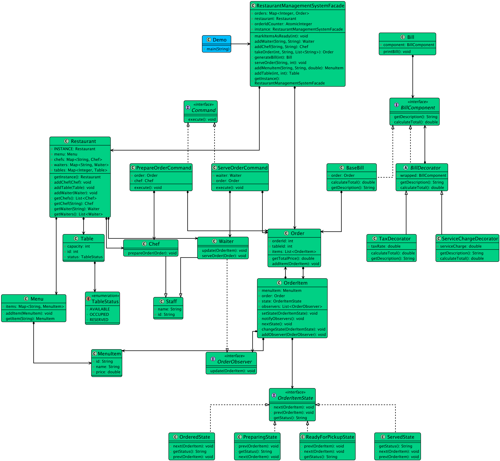

# Low-level design problem: restaurant management system

> Copied from <https://github.com/ashishps1/awesome-low-level-design/blob/main/problems/restaurant-management-system.md> (GPL-3.0, by Ashish Pratap Singh). Questions and answers are the source's own; nothing was answered or rewritten here.


# Designing Restaurant Management System

## Requirements
1. The restaurant management system should allow customers to place orders, view the menu, and make reservations.
2. The system should manage the restaurant's inventory, including ingredients and menu items.
3. The system should handle order processing, including order preparation, billing, and payment.
4. The system should support multiple payment methods, such as cash, credit card, and mobile payments.
5. The system should manage staff information, including roles, schedules, and performance tracking.
6. The system should generate reports and analytics for management, such as sales reports and inventory analysis.
7. The system should handle concurrent access and ensure data consistency.

## UML Class Diagram



## Implementations
#### [Java Implementation](https://github.com/ashishps1/awesome-low-level-design/blob/main/solutions/java/src/restaurantmanagementsystem) 
#### [Python Implementation](https://github.com/ashishps1/awesome-low-level-design/blob/main/solutions/python/restaurantmanagementsystem)
#### [C++ Implementation](https://github.com/ashishps1/awesome-low-level-design/blob/main/solutions/cpp/restaurantmanagementsystem)
#### [C# Implementation](https://github.com/ashishps1/awesome-low-level-design/blob/main/solutions/csharp/restaurantmanagementsystem)
#### [Go Implementation](https://github.com/ashishps1/awesome-low-level-design/blob/main/solutions/golang/restaurantmanagementsystem)

## Classes, Interfaces and Enumerations
1. The **MenuItem** class represents a menu item in the restaurant, with properties such as ID, name, description, price, and availability.
2. The **Order** class represents an order placed by a customer, with properties such as ID, list of menu items, total amount, order status, and timestamp.
3. The **OrderStatus** enum represents the different statuses an order can have, such as pending, preparing, ready, completed, or cancelled.
4. The **Reservation** class represents a reservation made by a customer, with properties such as ID, customer name, contact number, party size, and reservation time.
5. The **Payment** class represents a payment made for an order, with properties such as ID, amount, payment method, and payment status.
6. The **PaymentMethod** enum represents the different payment methods supported by the restaurant, such as cash, credit card, or mobile payment.
7. The **PaymentStatus** enum represents the status of a payment, which can be pending, completed, or failed.
8. The Staff class represents a staff member of the restaurant, with properties such as ID, name, role, and contact number.
9. The **Restaurant** class is the main class that manages the restaurant operations. It follows the Singleton pattern to ensure only one instance of the restaurant exists.
10. The Restaurant class provides methods for managing menu items, placing orders, updating order status, making reservations, processing payments, and managing staff.
11. Multi-threading is implemented using concurrent data structures (ConcurrentHashMap and CopyOnWriteArrayList) to handle concurrent access to shared data, such as orders and reservations.
12. The notifyKitchen and notifyStaff methods are placeholders for notifying relevant staff about order updates and status changes.
13. The **RestaurantManagementDemo** class demonstrates the usage of the restaurant management system by adding menu items, placing an order, making a reservation, processing a payment, updating order status, adding staff, and retrieving the menu.

---

## Official solutions from the repository

<details><summary><b>java</b> (29 files)</summary>


**README.md**

```md
# Restaurant Management System (LLD)

## Problem Statement

Design and implement a Restaurant Management System that allows customers to make reservations, place orders, manage tables, generate bills, and process payments. The system should also support staff management and menu management.

---

## Requirements

- **Table Management:** The system manages tables, their availability, and assignments.
- **Reservation Management:** Customers can reserve tables in advance.
- **Menu Management:** The system manages a menu of items, including prices and descriptions.
- **Order Placement:** Customers can place orders for menu items.
- **Order Tracking:** The system tracks the status of each order (e.g., PLACED, PREPARING, SERVED, COMPLETED).
- **Billing:** The system generates bills for completed orders.
- **Payment Processing:** The system processes payments for bills.
- **Staff Management:** The system manages staff assignments (e.g., waiters, chefs).
- **Extensibility:** Easy to add new features such as customer feedback, loyalty programs, or online ordering.

---

## Core Entities

- **RestaurantManagementSystem:** Main class that manages tables, reservations, orders, menu, staff, and payments.
- **Table:** Represents a table in the restaurant, with table number, capacity, and availability.
- **Reservation:** Represents a reservation for a table by a customer.
- **MenuItem:** Represents an item on the menu, with name, description, and price.
- **Order:** Represents a customer's order, including items, status, and associated table.
- **OrderItem:** Represents an item in an order.
- **OrderStatus:** Enum for order status (PLACED, PREPARING, SERVED, COMPLETED).
- **Bill:** Represents the bill for an order, including total amount and payment status.
- **Payment (in payment/):** Represents a payment transaction for a bill.
- **Staff:** Represents a staff member (e.g., waiter, chef).

---

## Class Design

## UML Class Diagram


### 1. RestaurantManagementSystem
- **Fields:** List<Table> tables, List<Reservation> reservations, List<MenuItem> menu, List<Order> orders, List<Bill> bills, List<Staff> staff, PaymentProcessor paymentProcessor
- **Methods:** addTable(Table), addMenuItem(MenuItem), makeReservation(Reservation), placeOrder(Order), updateOrderStatus(Order, OrderStatus), generateBill(Order), processPayment(Bill, Payment), addStaff(Staff), etc.

### 2. Table
- **Fields:** int tableNumber, int capacity, boolean isAvailable

### 3. Reservation
- **Fields:** int id, Table table, String customerName, Date reservationTime

### 4. MenuItem
- **Fields:** int id, String name, String description, double price

### 5. Order
- **Fields:** int id, Table table, List<OrderItem> items, OrderStatus status

### 6. OrderItem
- **Fields:** MenuItem menuItem, int quantity

### 7. OrderStatus (enum)
- Values: PLACED, PREPARING, SERVED, COMPLETED

### 8. Bill
- **Fields:** int id, Order order, double totalAmount, boolean isPaid

### 9. Payment (in payment/)
- **Fields:** int id, double amount, String method, PaymentStatus status

### 10. Staff
- **Fields:** int id, String name, String role

### 11. PaymentProcessor (in payment/)
- **Methods:** process(Payment), validate(Payment)

---

## Example Usage

```java
RestaurantManagementSystem system = new RestaurantManagementSystem();
Table table = new Table(1, 4, true);
system.addTable(table);

MenuItem pizza = new MenuItem(1, "Pizza", "Cheese Pizza", 12.0);
system.addMenuItem(pizza);

Reservation reservation = new Reservation(1, table, "Alice", new Date());
system.makeReservation(reservation);

Order order = new Order(1, table, List.of(new OrderItem(pizza, 2)), OrderStatus.PLACED);
system.placeOrder(order);

Bill bill = system.generateBill(order);
Payment payment = new Payment(1, bill.getTotalAmount(), "CREDIT_CARD");
system.processPayment(bill, payment);
```

---

## Demo

See `RestaurantManagementSystemDemo.java` for a sample usage and simulation of the restaurant management system.

---

## Extending the Design

- **Add customer feedback:** Allow customers to rate their experience.
- **Add loyalty programs:** Track and reward repeat customers.
- **Add online ordering:** Support for online reservations and orders.

---
```


**RestaurantManagementSystem.java**

```java
package restaurantmanagementsystem;

import restaurantmanagementsystem.payment.Payment;

import java.sql.Timestamp;
import java.util.ArrayList;
import java.util.List;
import java.util.Map;
import java.util.concurrent.ConcurrentHashMap;
import java.util.concurrent.CopyOnWriteArrayList;

public class RestaurantManagementSystem {
    private static RestaurantManagementSystem instance;
    private final Map<String, MenuItem> menu;
    private final Map<String, Order> orders;
    private final List<Reservation> reservations;
    private final Map<Integer, Payment> payments;
    private final List<Staff> staff;
    private final Map<Integer, Table> tables;

    private RestaurantManagementSystem() {
        menu = new ConcurrentHashMap<>();
        orders = new ConcurrentHashMap<>();
        reservations = new CopyOnWriteArrayList<>();
        payments = new ConcurrentHashMap<>();
        staff = new CopyOnWriteArrayList<>();
        tables = new ConcurrentHashMap<>();
    }

    public static synchronized RestaurantManagementSystem getInstance() {
        if (instance == null) {
            instance = new RestaurantManagementSystem();
        }
        return instance;
    }

    public MenuItem addMenuItem(String name, double price) {
        MenuItem menuItem = new MenuItem(name, price);
        menu.put(name, new MenuItem(name, price));
        return menuItem;
    }

    public void removeMenuItem(String itemName) {
        menu.remove(itemName);
    }

    public List<MenuItem> getMenu() {
        return new ArrayList<>(menu.values());
    }

    public void addTable(int tableId, int capacity) {
        tables.put(tableId, new Table(tableId, capacity));
    }

    public Table reserveTable(int tableId) {
        Table table = tables.get(tableId);
        if (table == null) {
            throw new IllegalArgumentException("Invalid table ID");
        }
        table.reserve();
        return table;
    }

    public Order placeOrder(int tableId, List<OrderItem> items) {
        Table table = tables.get(tableId);
        if (table == null || !table.isAvailable()) {
            throw new IllegalStateException("Table not reserved or invalid");
        }
        Order order = new Order(table, items);
        orders.put(order.getId(), order);
        notifyKitchen(order);
        return order;
    }

    public void markOrderPreparing(String orderId) {
        Order order = orders.get(orderId);
        order.markPreparing();
        notifyKitchen(order);
    }

    public void markOrderReady(String orderId) {
        Order order = orders.get(orderId);
        order.markReady();
        notifyStaff(order);
    }

    public void markOrderServed(String orderId) {
        Order order = orders.get(orderId);
        order.markServed();
    }

    public Bill getBill(String orderId) {
        Order order = orders.get(orderId);
        if (order.getStatus() == OrderStatus.PAID)
            throw new IllegalStateException("Order already paid");
        order.markPaid();
        return new Bill(order.getId(), order.calculateTotal());
    }

    public void makePayment(Bill bill, Payment payment) {
        Order order = orders.get(bill.getOrderId());
        if (payment.processPayment(bill.getTotalAmount())) {
            bill.markPaymentCompleted();
            order.markPaid();
        } else {
            bill.markPaymentFailed();
            throw new RuntimeException("Payment failed for the orderId: " + order.getId());
        }
    }

    public Reservation makeReservation(String customerName, String contactNumber, int partySize, Timestamp reservationTime) {
        Reservation reservation = new Reservation(customerName, contactNumber, partySize, reservationTime);
        reservations.add(reservation);
        return reservation;
    }

    public void cancelReservation(Reservation reservation) {
        reservations.remove(reservation);
    }

    public void addStaff(Staff staff) {
        this.staff.add(staff);
    }

    public void removeStaff(Staff staff) {
        this.staff.remove(staff);
    }

    private void notifyKitchen(Order order) {
        // Notify kitchen staff to prepare the order
        // ...
    }

    private void notifyStaff(Order order) {
        // Notify relevant staff about the order status update
        // ...
    }
}
```


**RestaurantManagementSystemDemo.java**

```java
package restaurantmanagementsystem;

import restaurantmanagementsystem.payment.CreditCardPayment;

import java.sql.Timestamp;
import java.util.List;

public class RestaurantManagementSystemDemo {
    public static void run() {
        RestaurantManagementSystem restaurantManagementSystem = RestaurantManagementSystem.getInstance();

        // Add menu items
        MenuItem menuItem1 = restaurantManagementSystem.addMenuItem("Burger", 9.99);
        MenuItem menuItem2 = restaurantManagementSystem.addMenuItem("Pizza", 12.99);
        MenuItem menuItem3 = restaurantManagementSystem.addMenuItem("Salad", 7.99);

        // Add tables
        restaurantManagementSystem.addTable(1, 4);
        restaurantManagementSystem.addTable(2, 2);

        // Place an order
        Order order = restaurantManagementSystem.placeOrder(1, List.of(
                new OrderItem(menuItem1, 1),
                new OrderItem(menuItem3, 2)
        ));

        // Update order status
        restaurantManagementSystem.markOrderPreparing(order.getId());
        restaurantManagementSystem.markOrderReady(order.getId());
        restaurantManagementSystem.markOrderServed(order.getId());

        // Process payment
        Bill bill = restaurantManagementSystem.getBill(order.getId());
        restaurantManagementSystem.makePayment(bill, new CreditCardPayment());

        // Make a reservation
        Reservation reservation = restaurantManagementSystem.makeReservation("John Doe", "1234567890", 4, new Timestamp(System.currentTimeMillis()));

        // Add staff
        restaurantManagementSystem.addStaff(new Staff(1, "Alice", "Manager", "9876543210"));
        restaurantManagementSystem.addStaff(new Staff(2, "Bob", "Chef", "5432109876"));

        // Get menu
        List<MenuItem> menu = restaurantManagementSystem.getMenu();
        System.out.println("Menu:");
        for (MenuItem item : menu) {
            System.out.println(item.getName() + " - $" + item.getPrice());
        }
    }
}
```


**RestaurantManagementSystemFacade.java**

```java
package restaurantmanagementsystem;

import restaurantmanagementsystem.command.Command;
import restaurantmanagementsystem.command.PrepareOrderCommand;
import restaurantmanagementsystem.command.ServeOrderCommand;
import restaurantmanagementsystem.decorator.*;
import restaurantmanagementsystem.model.*;

import java.util.HashMap;
import java.util.List;
import java.util.Map;
import java.util.concurrent.atomic.AtomicInteger;

public class RestaurantManagementSystemFacade {
    private static RestaurantManagementSystemFacade instance;
    private final Restaurant restaurant = Restaurant.getInstance();
    private final AtomicInteger orderIdCounter;
    private final Map<Integer, Order> orders;

    private RestaurantManagementSystemFacade() {
        this.orderIdCounter = new AtomicInteger(1);
        this.orders = new HashMap<>();
    }

    public static synchronized RestaurantManagementSystemFacade getInstance() {
        if (instance == null) {
            instance = new RestaurantManagementSystemFacade();
        }
        return instance;
    }

    public Table addTable(int id, int capacity) {
        Table table = new Table(id, capacity);
        restaurant.addTable(table);
        return table;
    }

    public Waiter addWaiter(String id, String name) {
        Waiter waiter = new Waiter(id, name);
        restaurant.addWaiter(waiter);
        return waiter;
    }

    public Chef addChef(String id, String name) {
        Chef chef = new Chef(id, name);
        restaurant.addChef(chef);
        return chef;
    }

    public MenuItem addMenuItem(String id, String name, double price) {
        MenuItem item = new MenuItem(id, name, price);
        restaurant.getMenu().addItem(item);
        return item;
    }

    public Order takeOrder(int tableId, String waiterId, List<String> menuItemIds) {
        Waiter waiter = restaurant.getWaiter(waiterId);
        if (waiter == null) {
            throw new IllegalArgumentException("Invalid waiter ID.");
        }
        // For simplicity, we get the first available chef.
        Chef chef = restaurant.getChefs().stream().findFirst()
                .orElseThrow(() -> new IllegalStateException("No chefs available."));

        Order order = new Order(orderIdCounter.getAndIncrement(), tableId);
        for (String itemId : menuItemIds) {
            MenuItem menuItem = restaurant.getMenu().getItem(itemId);
            OrderItem orderItem = new OrderItem(menuItem, order);
            // Waiter subscribes to each item to get notified when it's ready.
            orderItem.addObserver(waiter);
            order.addItem(orderItem);
        }

        // The Command pattern decouples the waiter (invoker) from the chef (receiver).
        Command prepareOrderCommand = new PrepareOrderCommand(order, chef);
        prepareOrderCommand.execute();

        orders.put(order.getOrderId(), order);

        return order;
    }

    public void markItemsAsReady(int orderId) {
        Order order = orders.get(orderId);
        System.out.println("\nChef has finished preparing order " + order.getOrderId());

        order.getOrderItems().forEach(item -> { // Preparing -> ReadyForPickup -> Notifies Observer (Waiter)
            item.nextState();
            item.nextState();
        });
    }

    public void serveOrder(String waiterId, int orderId) {
        Order order = orders.get(orderId);
        Waiter waiter = restaurant.getWaiter(waiterId);

        Command serveOrderCommand = new ServeOrderCommand(order, waiter);
        serveOrderCommand.execute();
    }

    public Bill generateBill(int orderId) {
        Order order = orders.get(orderId);
        // The Decorator pattern adds charges dynamically.
        BillComponent billComponent = new BaseBill(order);
        billComponent = new TaxDecorator(billComponent, 0.08); // 8% tax
        billComponent = new ServiceChargeDecorator(billComponent, 5.00); // $5 flat service charge

        return new Bill(billComponent);
    }
}
```


**command/Command.java**

```java
package restaurantmanagementsystem.command;

public interface Command {
    void execute();
}
```


**command/PrepareOrderCommand.java**

```java
package restaurantmanagementsystem.command;

import restaurantmanagementsystem.model.Chef;
import restaurantmanagementsystem.model.Order;

public class PrepareOrderCommand implements Command {
    private final Order order;
    private final Chef chef;

    public PrepareOrderCommand(Order order, Chef chef) {
        this.order = order;
        this.chef = chef;
    }

    @Override
    public void execute() {
        chef.prepareOrder(order);
    }
}
```


**command/ServeOrderCommand.java**

```java
package restaurantmanagementsystem.command;

import restaurantmanagementsystem.model.Order;
import restaurantmanagementsystem.model.Waiter;

public class ServeOrderCommand implements Command{
    private final Order order;
    private final Waiter waiter;

    public ServeOrderCommand(Order order, Waiter waiter) {
        this.order = order;
        this.waiter = waiter;
    }

    @Override
    public void execute() {
        waiter.serveOrder(order);
    }
}
```


**decorator/BaseBill.java**

```java
package restaurantmanagementsystem.decorator;

import restaurantmanagementsystem.model.Order;

public class BaseBill implements BillComponent {
    private final Order order;
    public BaseBill(Order order) { this.order = order; }

    @Override
    public double calculateTotal() { return order.getTotalPrice(); }

    @Override
    public String getDescription() { return "Order Items"; }
}
```


**decorator/Bill.java**

```java
package restaurantmanagementsystem.decorator;

public class Bill {
    private final BillComponent component;

    public Bill(BillComponent component) {
        this.component = component;
    }

    public void printBill() {
        System.out.println("\n--- BILL ---");
        System.out.printf("Description: %s\n", component.getDescription());
        System.out.printf("Total: $%.2f\n", component.calculateTotal());
        System.out.println("------------");
    }
}
```


**decorator/BillComponent.java**

```java
package restaurantmanagementsystem.decorator;

public interface BillComponent {
    double calculateTotal();
    String getDescription();
}
```


**decorator/BillDecorator.java**

```java
package restaurantmanagementsystem.decorator;

public abstract class BillDecorator implements BillComponent {
    protected BillComponent wrapped;

    public BillDecorator(BillComponent component) {
        this.wrapped = component;
    }

    @Override
    public double calculateTotal() {
        return wrapped.calculateTotal();
    }

    @Override
    public String getDescription() {
        return wrapped.getDescription();
    }
}
```


**decorator/ServiceChargeDecorator.java**

```java
package restaurantmanagementsystem.decorator;

public class ServiceChargeDecorator extends BillDecorator {
    private final double serviceCharge;

    public ServiceChargeDecorator(BillComponent component, double charge) {
        super(component);
        this.serviceCharge = charge;
    }

    @Override
    public double calculateTotal() {
        return super.calculateTotal() + serviceCharge;
    }

    @Override
    public String getDescription() {
        return super.getDescription() + ", Service Charge";
    }
}
```


**decorator/TaxDecorator.java**

```java
package restaurantmanagementsystem.decorator;

public class TaxDecorator extends BillDecorator {
    private final double taxRate;

    public TaxDecorator(BillComponent component, double taxRate) {
        super(component);
        this.taxRate = taxRate;
    }

    @Override
    public double calculateTotal() {
        return super.calculateTotal() * (1 + taxRate);
    }

    @Override
    public String getDescription() {
        return super.getDescription() + ", Tax @" + (taxRate * 100) + "%";
    }
}
```


**enums/TableStatus.java**

```java
package restaurantmanagementsystem.enums;

public enum TableStatus {
    AVAILABLE,
    OCCUPIED,
    RESERVED
}
```


**model/Chef.java**

```java
package restaurantmanagementsystem.model;

import restaurantmanagementsystem.state.PreparingState;

public class Chef extends Staff {
    public Chef(String id, String name) {
        super(id, name);
    }

    public void prepareOrder(Order order) {
        System.out.println("Chef " + name + " received order " + order.getOrderId() + " and is starting preparation.");
        order.getOrderItems().forEach(item -> {
            // Chef's action triggers the first state change for each item.
            item.changeState(new PreparingState());
        });
    }
}
```


**model/Menu.java**

```java
package restaurantmanagementsystem.model;

import java.util.HashMap;
import java.util.Map;

public class Menu {
    private final Map<String, MenuItem> items = new HashMap<>();

    public void addItem(MenuItem item) {
        items.put(item.getId(), item);
    }

    public MenuItem getItem(String id) {
        MenuItem item = items.get(id);
        if (item == null) {
            throw new IllegalArgumentException("Menu item with ID " + id + " not found.");
        }
        return item;
    }
}
```


**model/MenuItem.java**

```java
package restaurantmanagementsystem.model;

public class MenuItem {
    private final String id;
    private final String name;
    private final double price;

    public MenuItem(String id, String name, double price) {
        this.id = id;
        this.name = name;
        this.price = price;
    }

    public String getId() { return id; }
    public String getName() { return name; }
    public double getPrice() { return price; }
}
```


**model/Order.java**

```java
package restaurantmanagementsystem.model;

import java.util.ArrayList;
import java.util.List;

public class Order {
    private final int orderId;
    private final int tableId;
    private final List<OrderItem> items = new ArrayList<>();

    public Order(int orderId, int tableId) {
        this.orderId = orderId;
        this.tableId = tableId;
    }

    public void addItem(OrderItem item) {
        items.add(item);
    }

    public double getTotalPrice() {
        return items.stream()
                .mapToDouble(item -> item.getMenuItem().getPrice())
                .sum();
    }

    public int getOrderId() { return orderId; }
    public int getTableId() { return tableId; }
    public List<OrderItem> getOrderItems() { return items; }
}
```


**model/OrderItem.java**

```java
package restaurantmanagementsystem.model;

import restaurantmanagementsystem.observer.OrderObserver;
import restaurantmanagementsystem.state.OrderItemState;
import restaurantmanagementsystem.state.OrderedState;

import java.util.ArrayList;
import java.util.List;

public class OrderItem {
    private final MenuItem menuItem;
    private final Order order;
    private OrderItemState state;
    private final List<OrderObserver> observers = new ArrayList<>();

    public OrderItem(MenuItem menuItem, Order order) {
        this.menuItem = menuItem;
        this.order = order;
        this.state = new OrderedState();
    }

    public void changeState(OrderItemState newState) {
        this.state = newState;
        System.out.println("Item '" + menuItem.getName() + "' state changed to: " + newState.getStatus());
    }

    public void nextState() {
        state.next(this);
    }

    public void setState(OrderItemState state) {
        this.state = state;
    }

    public void addObserver(OrderObserver observer) {
        observers.add(observer);
    }

    public void notifyObservers() {
        new ArrayList<>(observers).forEach(observer -> observer.update(this));
    }

    public MenuItem getMenuItem() { return menuItem; }
    public Order getOrder() { return order; }
}
```


**model/Restaurant.java**

```java
package restaurantmanagementsystem.model;

import java.util.HashMap;
import java.util.List;
import java.util.Map;

public class Restaurant {
    private static final Restaurant INSTANCE = new Restaurant();
    private final Map<String, Waiter> waiters = new HashMap<>();
    private final Map<String, Chef> chefs = new HashMap<>();
    private final Map<Integer, Table> tables = new HashMap<>();
    private final Menu menu = new Menu();

    private Restaurant() {}

    public static Restaurant getInstance() {
        return INSTANCE;
    }

    public void addWaiter(Waiter waiter) { waiters.put(waiter.getId(), waiter); }
    public Waiter getWaiter(String id) { return waiters.get(id); }

    public void addChef(Chef chef) { chefs.put(chef.getId(), chef); }
    public Chef getChef(String id) { return chefs.get(id); }

    public List<Chef> getChefs() {
        return chefs.values().stream().toList();
    }

    public List<Waiter> getWaiters() {
        return waiters.values().stream().toList();
    }

    public void addTable(Table table) { tables.put(table.getId(), table); }

    public Menu getMenu() { return menu; }
}
```


**model/Staff.java**

```java
package restaurantmanagementsystem.model;

public abstract class Staff {
    protected String id;
    protected String name;

    public Staff(String id, String name) {
        this.id = id;
        this.name = name;
    }

    public String getId() { return id; }
    public String getName() { return name; }
}
```


**model/Table.java**

```java
package restaurantmanagementsystem.model;

import restaurantmanagementsystem.enums.TableStatus;

public class Table {
    private final int id;
    private final int capacity;
    private TableStatus status;

    public Table(int id, int capacity) {
        this.id = id;
        this.capacity = capacity;
        this.status = TableStatus.AVAILABLE;
    }

    public int getId() { return id; }
    public int getCapacity() { return capacity; }
    public TableStatus getStatus() { return status; }
    public void setStatus(TableStatus status) { this.status = status; }
}
```


**model/Waiter.java**

```java
package restaurantmanagementsystem.model;

import restaurantmanagementsystem.observer.OrderObserver;
import restaurantmanagementsystem.state.ServedState;

public class Waiter extends Staff implements OrderObserver {
    public Waiter(String id, String name) {
        super(id, name);
    }

    public void serveOrder(Order order) {
        System.out.println("Waiter " + name + " is serving order " + order.getOrderId());
        order.getOrderItems().forEach(item -> {
            item.changeState(new ServedState());
        });
    }

    @Override
    public void update(OrderItem item) {
        System.out.println(">>> WAITER " + name + " NOTIFIED: Item '" +
                item.getMenuItem().getName() + "' for table " +
                item.getOrder().getTableId() + " is READY FOR PICKUP.");
    }
}
```


**observer/OrderObserver.java**

```java
package restaurantmanagementsystem.observer;

import restaurantmanagementsystem.model.OrderItem;

public interface OrderObserver {
    void update(OrderItem item);
}
```


**state/OrderItemState.java**

```java
package restaurantmanagementsystem.state;

import restaurantmanagementsystem.model.OrderItem;

public interface OrderItemState {
    void next(OrderItem item);
    void prev(OrderItem item);
    String getStatus();
}
```


**state/OrderedState.java**

```java
package restaurantmanagementsystem.state;

import restaurantmanagementsystem.model.OrderItem;

public class OrderedState implements OrderItemState {
    @Override
    public void next(OrderItem item) {
        item.setState(new PreparingState());
    }

    @Override
    public void prev(OrderItem item) {
        System.out.println("This is the initial state.");
    }

    @Override
    public String getStatus() { return "ORDERED"; }
}
```


**state/PreparingState.java**

```java
package restaurantmanagementsystem.state;

import restaurantmanagementsystem.model.OrderItem;

public class PreparingState implements OrderItemState {
    @Override
    public void next(OrderItem item) {
        item.setState(new ReadyForPickupState());
    }

    @Override
    public void prev(OrderItem item) {
        item.setState(new OrderedState());
    }

    @Override
    public String getStatus() { return "PREPARING"; }
}
```


**state/ReadyForPickupState.java**

```java
package restaurantmanagementsystem.state;

import restaurantmanagementsystem.model.OrderItem;

public class ReadyForPickupState implements OrderItemState {
    @Override
    public void next(OrderItem item) {
        // This is the key state. When it transitions, it notifies observers.
        item.notifyObservers();
    }

    @Override
    public void prev(OrderItem item) {
        item.setState(new PreparingState());
    }

    @Override
    public String getStatus() { return "READY_FOR_PICKUP"; }
}
```


**state/ServedState.java**

```java
package restaurantmanagementsystem.state;

import restaurantmanagementsystem.model.OrderItem;

public class ServedState implements OrderItemState {
    @Override
    public void next(OrderItem item) {
        System.out.println("This is the final state.");
    }

    @Override
    public void prev(OrderItem item) {
        System.out.println("Cannot revert a served item.");
    }

    @Override
    public String getStatus() { return "SERVED"; }
}
```

</details>

<details><summary><b>python</b> (16 files)</summary>


**README.md**

```md
# Designing Restaurant Management System

## Requirements
1. The restaurant management system should allow customers to place orders, view the menu, and make reservations.
2. The system should manage the restaurant's inventory, including ingredients and menu items.
3. The system should handle order processing, including order preparation, billing, and payment.
4. The system should support multiple payment methods, such as cash, credit card, and mobile payments.
5. The system should manage staff information, including roles, schedules, and performance tracking.
6. The system should generate reports and analytics for management, such as sales reports and inventory analysis.
7. The system should handle concurrent access and ensure data consistency.

## Classes, Interfaces and Enumerations
1. The **MenuItem** class represents a menu item in the restaurant, with properties such as ID, name, description, price, and availability.
2. The **Order** class represents an order placed by a customer, with properties such as ID, list of menu items, total amount, order status, and timestamp.
3. The **OrderStatus** enum represents the different statuses an order can have, such as pending, preparing, ready, completed, or cancelled.
4. The **Reservation** class represents a reservation made by a customer, with properties such as ID, customer name, contact number, party size, and reservation time.
5. The **Payment** class represents a payment made for an order, with properties such as ID, amount, payment method, and payment status.
6. The **PaymentMethod** enum represents the different payment methods supported by the restaurant, such as cash, credit card, or mobile payment.
7. The **PaymentStatus** enum represents the status of a payment, which can be pending, completed, or failed.
8. The Staff class represents a staff member of the restaurant, with properties such as ID, name, role, and contact number.
9. The **Restaurant** class is the main class that manages the restaurant operations. It follows the Singleton pattern to ensure only one instance of the restaurant exists.
10. The Restaurant class provides methods for managing menu items, placing orders, updating order status, making reservations, processing payments, and managing staff.
11. Multi-threading is implemented using concurrent data structures (ConcurrentHashMap and CopyOnWriteArrayList) to handle concurrent access to shared data, such as orders and reservations.
12. The notifyKitchen and notifyStaff methods are placeholders for notifying relevant staff about order updates and status changes.
13. The **RestaurantManagementDemo** class demonstrates the usage of the restaurant management system by adding menu items, placing an order, making a reservation, processing a payment, updating order status, adding staff, and retrieving the menu.
```


**bill.py**

```py
from abc import ABC, abstractmethod
from typing import TYPE_CHECKING
from order import Order

# Decorator Pattern for Bills
class BillComponent(ABC):
    @abstractmethod
    def calculate_total(self) -> float:
        pass
    
    @abstractmethod
    def get_description(self) -> str:
        pass

class Bill:
    def __init__(self, component: BillComponent):
        self._component = component
    
    def print_bill(self):
        print("\n--- BILL ---")
        print(f"Description: {self._component.get_description()}")
        print(f"Total: ${self._component.calculate_total():.2f}")
        print("------------")

class BaseBill(BillComponent):
    def __init__(self, order: Order):
        self._order = order
    
    def calculate_total(self) -> float:
        return self._order.get_total_price()
    
    def get_description(self) -> str:
        return "Order Items"
```


**command.py**

```py
from abc import ABC, abstractmethod
from typing import TYPE_CHECKING
from staff import Chef, Waiter
from order import Order

class Command(ABC):
    @abstractmethod
    def execute(self):
        pass

class PrepareOrderCommand(Command):
    def __init__(self, order: Order, chef: Chef):
        self._order = order
        self._chef = chef
    
    def execute(self):
        self._chef.prepare_order(self._order)

class ServeOrderCommand(Command):
    def __init__(self, order: Order, waiter: Waiter):
        self._order = order
        self._waiter = waiter
    
    def execute(self):
        self._waiter.serve_order(self._order)
```


**decorators.py**

```py
from bill import BillComponent
from typing import TYPE_CHECKING

if TYPE_CHECKING:
    from bill import BillComponent

class BillDecorator(BillComponent):
    def __init__(self, component: BillComponent):
        self._wrapped = component
    
    def calculate_total(self) -> float:
        return self._wrapped.calculate_total()
    
    def get_description(self) -> str:
        return self._wrapped.get_description()


class TaxDecorator(BillDecorator):
    def __init__(self, component: BillComponent, tax_rate: float):
        super().__init__(component)
        self._tax_rate = tax_rate
    
    def calculate_total(self) -> float:
        return super().calculate_total() * (1 + self._tax_rate)
    
    def get_description(self) -> str:
        return super().get_description() + f", Tax @{self._tax_rate * 100}%"


class ServiceChargeDecorator(BillDecorator):
    def __init__(self, component: BillComponent, charge: float):
        super().__init__(component)
        self._service_charge = charge
    
    def calculate_total(self) -> float:
        return super().calculate_total() + self._service_charge
    
    def get_description(self) -> str:
        return super().get_description() + ", Service Charge"
```


**menu.py**

```py
from typing import Dict
from menu_item import MenuItem

class Menu:
    def __init__(self):
        self._items: Dict[str, MenuItem] = {}
    
    def add_item(self, item: MenuItem):
        self._items[item.get_id()] = item
    
    def get_item(self, item_id: str) -> MenuItem:
        item = self._items.get(item_id)
        if item is None:
            raise ValueError(f"Menu item with ID {item_id} not found.")
        return item
    
    def get_all_items(self) -> Dict[str, MenuItem]:
        return self._items.copy()
```


**menu_item.py**

```py
class MenuItem:
    def __init__(self, item_id: str, name: str, price: float):
        self._id = item_id
        self._name = name
        self._price = price
    
    def get_id(self) -> str:
        return self._id
    
    def get_name(self) -> str:
        return self._name
    
    def get_price(self) -> float:
        return self._price
    
    def __str__(self) -> str:
        return f"MenuItem(id={self._id}, name={self._name}, price=${self._price:.2f})"
```


**order.py**

```py
from order_item import OrderItem
from typing import List

class Order:
    def __init__(self, order_id: int, table_id: int):
        self._order_id = order_id
        self._table_id = table_id
        self._items: List[OrderItem] = []
    
    def add_item(self, item: OrderItem):
        self._items.append(item)
    
    def get_total_price(self) -> float:
        return sum(item.menu_item.get_price() for item in self._items)
    
    @property
    def order_id(self) -> int:
        return self._order_id
    
    @property
    def table_id(self) -> int:
        return self._table_id
    
    @property
    def order_items(self) -> List[OrderItem]:
        return self._items
```


**order_item.py**

```py
from menu_item import MenuItem
from typing import List
from order_observer import OrderObserver
from order_item_states import OrderItemState, OrderedState
from typing import TYPE_CHECKING

if TYPE_CHECKING:
    from order import Order

class OrderItem:
    def __init__(self, menu_item: MenuItem, order: 'Order'):
        self._menu_item = menu_item
        self._order = order
        self._state = OrderedState()
        self._observers: List[OrderObserver] = []
    
    def change_state(self, new_state: OrderItemState):
        self._state = new_state
        print(f"Item '{self._menu_item.get_name()}' state changed to: {new_state.get_status()}")
    
    def next_state(self):
        self._state.next(self)
    
    def set_state(self, state: OrderItemState):
        self._state = state
    
    def add_observer(self, observer: OrderObserver):
        self._observers.append(observer)
    
    def notify_observers(self):
        for observer in self._observers[:]:  # Create a copy to avoid modification during iteration
            observer.update(self)
    
    @property
    def menu_item(self) -> MenuItem:
        return self._menu_item
    
    @property
    def order(self) -> 'Order':
        return self._order
```


**order_item_states.py**

```py
from abc import ABC, abstractmethod
from typing import TYPE_CHECKING

if TYPE_CHECKING:
    from order_item import OrderItem

class OrderItemState(ABC):
    @abstractmethod
    def next(self, item: 'OrderItem'):
        pass
    
    @abstractmethod
    def prev(self, item: 'OrderItem'):
        pass
    
    @abstractmethod
    def get_status(self) -> str:
        pass

class OrderedState(OrderItemState):
    def next(self, item: 'OrderItem'):
        item.set_state(PreparingState())
    
    def prev(self, item: 'OrderItem'):
        print("This is the initial state.")
    
    def get_status(self) -> str:
        return "ORDERED"

class PreparingState(OrderItemState):
    def next(self, item: 'OrderItem'):
        item.set_state(ReadyForPickupState())
    
    def prev(self, item: 'OrderItem'):
        item.set_state(OrderedState())
    
    def get_status(self) -> str:
        return "PREPARING"

class ReadyForPickupState(OrderItemState):
    def next(self, item: 'OrderItem'):
        # This is the key state. When it transitions, it notifies observers.
        item.notify_observers()
    
    def prev(self, item: 'OrderItem'):
        item.set_state(PreparingState())
    
    def get_status(self) -> str:
        return "READY_FOR_PICKUP"

class ServedState(OrderItemState):
    def next(self, item: 'OrderItem'):
        print("This is the final state.")
    
    def prev(self, item: 'OrderItem'):
        print("Cannot revert a served item.")
    
    def get_status(self) -> str:
        return "SERVED"
```


**order_observer.py**

```py
from abc import ABC, abstractmethod
from typing import TYPE_CHECKING

if TYPE_CHECKING:
    from order_item import OrderItem

class OrderObserver(ABC):
    @abstractmethod
    def update(self, item: 'OrderItem'):
        pass
```


**restaurant.py**

```py
from staff import Chef, Waiter
from table import Table
from menu_item import MenuItem
from typing import Dict, List, Optional
import threading
from menu import Menu

class Restaurant:
    _instance = None
    _lock = threading.Lock()
    
    def __new__(cls):
        if cls._instance is None:
            with cls._lock:
                if cls._instance is None:
                    cls._instance = super().__new__(cls)
                    cls._instance._initialized = False
        return cls._instance
    
    def __init__(self):
        if not self._initialized:
            self._waiters: Dict[str, Waiter] = {}
            self._chefs: Dict[str, Chef] = {}
            self._tables: Dict[int, Table] = {}
            self._menu = Menu()
            self._initialized = True
    
    @classmethod
    def get_instance(cls):
        return cls()
    
    def add_waiter(self, waiter: Waiter):
        self._waiters[waiter.id] = waiter
    
    def get_waiter(self, waiter_id: str) -> Optional[Waiter]:
        return self._waiters.get(waiter_id)
    
    def add_chef(self, chef: Chef):
        self._chefs[chef.id] = chef
    
    def get_chef(self, chef_id: str) -> Optional[Chef]:
        return self._chefs.get(chef_id)
    
    def get_chefs(self) -> List[Chef]:
        return list(self._chefs.values())
    
    def get_waiters(self) -> List[Waiter]:
        return list(self._waiters.values())
    
    def add_table(self, table: Table):
        self._tables[table.id] = table
    
    @property
    def menu(self) -> Menu:
        return self._menu
```


**restaurant_management_system_demo.py**

```py
from restaurant_management_system_facade import RestaurantManagementSystemFacade

class RestaurantManagementSystemDemo:
    @staticmethod
    def main():
        # --- 1. System Setup using the Restaurant Singleton ---
        print("=== Initializing Restaurant System ===")
        rms_facade = RestaurantManagementSystemFacade.get_instance()
        
        # --- 2. Add table and staff ---
        table1 = rms_facade.add_table(1, 4)
        chef1 = rms_facade.add_chef("CHEF01", "Gordon")
        waiter1 = rms_facade.add_waiter("W01", "Alice")
        
        # --- 3. Add menu items ---
        pizza = rms_facade.add_menu_item("PIZZA01", "Margherita Pizza", 12.50)
        pasta = rms_facade.add_menu_item("PASTA01", "Carbonara Pasta", 15.00)
        coke = rms_facade.add_menu_item("DRINK01", "Coke", 2.50)
        print("Initialization Complete.\n")
        
        # --- 4. Scenario: A waiter takes an order for a table ---
        # The Command Pattern is used inside the rms_facade.take_order() method.
        print("=== SCENARIO 1: Taking an order ===")
        order1 = rms_facade.take_order(table1.id, waiter1.id, [pizza.get_id(), coke.get_id()])
        print(f"Order taken successfully. Order ID: {order1.order_id}")
        
        # --- 5. Scenario: Chef prepares food and notifies waiter ---
        print("\n=== SCENARIO 2: Chef prepares, Waiter gets notified ===")
        rms_facade.mark_items_as_ready(order1.order_id)
        rms_facade.serve_order(waiter1.id, order1.order_id)
        
        # --- 6. Scenario: Generate a bill with taxes and service charges ---
        # The Decorator Pattern is used inside rms_facade.generate_bill().
        print("\n=== SCENARIO 3: Generating the bill ===")
        final_bill = rms_facade.generate_bill(order1.order_id)
        final_bill.print_bill()

if __name__ == "__main__":
    RestaurantManagementSystemDemo.main()
```


**restaurant_management_system_facade.py**

```py
import threading
from typing import Dict, List
from restaurant import Restaurant
from table import Table
from staff import Chef, Waiter
from menu_item import MenuItem
from order import Order
from order_item import OrderItem
from command import PrepareOrderCommand, ServeOrderCommand
from decorators import TaxDecorator, ServiceChargeDecorator
from bill import Bill, BaseBill

class RestaurantManagementSystemFacade:
    _instance = None
    _lock = threading.Lock()
    
    def __new__(cls):
        if cls._instance is None:
            with cls._lock:
                if cls._instance is None:
                    cls._instance = super().__new__(cls)
                    cls._instance._initialized = False
        return cls._instance
    
    def __init__(self):
        if not self._initialized:
            self._restaurant = Restaurant.get_instance()
            self._order_id_counter = 1
            self._orders: Dict[int, Order] = {}
            self._initialized = True
    
    @classmethod
    def get_instance(cls):
        return cls()
    
    def add_table(self, table_id: int, capacity: int) -> Table:
        table = Table(table_id, capacity)
        self._restaurant.add_table(table)
        return table
    
    def add_waiter(self, waiter_id: str, name: str) -> Waiter:
        waiter = Waiter(waiter_id, name)
        self._restaurant.add_waiter(waiter)
        return waiter
    
    def add_chef(self, chef_id: str, name: str) -> Chef:
        chef = Chef(chef_id, name)
        self._restaurant.add_chef(chef)
        return chef
    
    def add_menu_item(self, item_id: str, name: str, price: float) -> MenuItem:
        item = MenuItem(item_id, name, price)
        self._restaurant.menu.add_item(item)
        return item
    
    def take_order(self, table_id: int, waiter_id: str, menu_item_ids: List[str]) -> Order:
        waiter = self._restaurant.get_waiter(waiter_id)
        if waiter is None:
            raise ValueError("Invalid waiter ID.")
        
        # For simplicity, we get the first available chef
        chefs = self._restaurant.get_chefs()
        if not chefs:
            raise RuntimeError("No chefs available.")
        chef = chefs[0]
        
        order = Order(self._order_id_counter, table_id)
        self._order_id_counter += 1
        
        for item_id in menu_item_ids:
            menu_item = self._restaurant.menu.get_item(item_id)
            order_item = OrderItem(menu_item, order)
            # Waiter subscribes to each item to get notified when it's ready
            order_item.add_observer(waiter)
            order.add_item(order_item)
        
        # The Command pattern decouples the waiter (invoker) from the chef (receiver)
        prepare_order_command = PrepareOrderCommand(order, chef)
        prepare_order_command.execute()
        
        self._orders[order.order_id] = order
        return order
    
    def mark_items_as_ready(self, order_id: int):
        order = self._orders[order_id]
        print(f"\nChef has finished preparing order {order.order_id}")
        
        for item in order.order_items:
            # Preparing -> ReadyForPickup -> Notifies Observer (Waiter)
            item.next_state()
            item.next_state()
    
    def serve_order(self, waiter_id: str, order_id: int):
        order = self._orders[order_id]
        waiter = self._restaurant.get_waiter(waiter_id)
        
        serve_order_command = ServeOrderCommand(order, waiter)
        serve_order_command.execute()
    
    def generate_bill(self, order_id: int) -> Bill:
        order = self._orders[order_id]
        # The Decorator pattern adds charges dynamically
        bill_component = BaseBill(order)
        bill_component = TaxDecorator(bill_component, 0.08)  # 8% tax
        bill_component = ServiceChargeDecorator(bill_component, 5.00)  # $5 flat service charge
        
        return Bill(bill_component)
```


**staff.py**

```py
from abc import ABC
from typing import TYPE_CHECKING
from order import Order
from order_item import OrderItem
from order_item_states import PreparingState, ServedState
from order_observer import OrderObserver

# if TYPE_CHECKING:

class Staff(ABC):
    def __init__(self, staff_id: str, name: str):
        self._id = staff_id
        self._name = name
    
    @property
    def id(self) -> str:
        return self._id
    
    @property
    def name(self) -> str:
        return self._name

class Chef(Staff):
    def __init__(self, staff_id: str, name: str):
        super().__init__(staff_id, name)
    
    def prepare_order(self, order: 'Order'):
        print(f"Chef {self._name} received order {order.order_id} and is starting preparation.")
        for item in order.order_items:
            # Chef's action triggers the first state change for each item
            item.change_state(PreparingState())

class Waiter(Staff, OrderObserver):
    def __init__(self, staff_id: str, name: str):
        super().__init__(staff_id, name)
    
    def serve_order(self, order: 'Order'):
        print(f"Waiter {self._name} is serving order {order.order_id}")
        for item in order.order_items:
            item.change_state(ServedState())
    
    def update(self, item: 'OrderItem'):
        print(f">>> WAITER {self._name} NOTIFIED: Item '{item.menu_item.get_name()}' "
              f"for table {item.order.table_id} is READY FOR PICKUP.")
```


**table.py**

```py
from table_status import TableStatus

class Table:
    def __init__(self, table_id: int, capacity: int):
        self._id = table_id
        self._capacity = capacity
        self._status = TableStatus.AVAILABLE
    
    @property
    def id(self) -> int:
        return self._id
    
    @property
    def capacity(self) -> int:
        return self._capacity
    
    @property
    def status(self) -> TableStatus:
        return self._status
    
    @status.setter
    def status(self, status: TableStatus):
        self._status = status
```


**table_status.py**

```py
from enum import Enum

class TableStatus(Enum):
    AVAILABLE = "AVAILABLE"
    OCCUPIED = "OCCUPIED"
    RESERVED = "RESERVED"
```

</details>

<details><summary><b>cpp</b> (12 files)</summary>


**MenuItem.cpp**

```cpp
#include "MenuItem.hpp"
#include <iostream>
#include <iomanip>

MenuItem::MenuItem(std::string itemId, std::string name, std::string description,
                  double price, Category category)
    : itemId(itemId), name(name), description(description),
      price(price), category(category), available(true) {}

std::string MenuItem::getItemId() const { return itemId; }
std::string MenuItem::getName() const { return name; }
std::string MenuItem::getDescription() const { return description; }
double MenuItem::getPrice() const { return price; }
Category MenuItem::getCategory() const { return category; }
bool MenuItem::isAvailable() const { return available; }

void MenuItem::setPrice(double price) {
    if (price > 0) {
        this->price = price;
    }
}

void MenuItem::setAvailable(bool status) {
    available = status;
}

void MenuItem::displayInfo() const {
    std::cout << name << " (ID: " << itemId << ")" << std::endl;
    std::cout << "Description: " << description << std::endl;
    std::cout << "Price: $" << std::fixed << std::setprecision(2) << price << std::endl;
    std::cout << "Category: ";
    switch (category) {
        case Category::APPETIZER: std::cout << "Appetizer"; break;
        case Category::MAIN_COURSE: std::cout << "Main Course"; break;
        case Category::DESSERT: std::cout << "Dessert"; break;
        case Category::BEVERAGE: std::cout << "Beverage"; break;
    }
    std::cout << std::endl;
    std::cout << "Status: " << (available ? "Available" : "Not Available") << std::endl;
}
```


**MenuItem.hpp**

```hpp
#ifndef MENU_ITEM_HPP
#define MENU_ITEM_HPP

#include <string>

enum class Category {
    APPETIZER,
    MAIN_COURSE,
    DESSERT,
    BEVERAGE
};

class MenuItem {
private:
    std::string itemId;
    std::string name;
    std::string description;
    double price;
    Category category;
    bool available;

public:
    MenuItem(std::string itemId, std::string name, std::string description,
            double price, Category category);
    
    std::string getItemId() const;
    std::string getName() const;
    std::string getDescription() const;
    double getPrice() const;
    Category getCategory() const;
    bool isAvailable() const;
    
    void setPrice(double price);
    void setAvailable(bool status);
    void displayInfo() const;
};

#endif
```


**Order.cpp**

```cpp
#include "Order.hpp"
#include <iostream>
#include <iomanip>
#include <algorithm>

Order::Order(std::string orderId, Table* table)
    : orderId(orderId), table(table), totalAmount(0.0), status(OrderStatus::PENDING) {
    orderTime = std::time(nullptr);
}

Order::~Order() {
    for (auto item : items) {
        delete item;
    }
}

std::string Order::getOrderId() const { return orderId; }
Table* Order::getTable() const { return table; }
const std::vector<OrderItem*>& Order::getItems() const { return items; }
double Order::getTotalAmount() const { return totalAmount; }
std::time_t Order::getOrderTime() const { return orderTime; }
OrderStatus Order::getStatus() const { return status; }

void Order::addItem(MenuItem* menuItem, int quantity) {
    if (!menuItem || !menuItem->isAvailable()) return;
    
    // Check if item already exists
    auto it = std::find_if(items.begin(), items.end(),
        [menuItem](OrderItem* item) { return item->getMenuItem() == menuItem; });
    
    if (it != items.end()) {
        (*it)->updateQuantity((*it)->getQuantity() + quantity);
    } else {
        items.push_back(new OrderItem(menuItem, quantity));
    }
    
    calculateTotal();
}

void Order::removeItem(const std::string& itemId) {
    auto it = std::find_if(items.begin(), items.end(),
        [itemId](OrderItem* item) { return item->getMenuItem()->getItemId() == itemId; });
    
    if (it != items.end()) {
        delete *it;
        items.erase(it);
        calculateTotal();
    }
}

void Order::updateItemQuantity(const std::string& itemId, int quantity) {
    auto it = std::find_if(items.begin(), items.end(),
        [itemId](OrderItem* item) { return item->getMenuItem()->getItemId() == itemId; });
    
    if (it != items.end()) {
        if (quantity <= 0) {
            removeItem(itemId);
        } else {
            (*it)->updateQuantity(quantity);
            calculateTotal();
        }
    }
}

void Order::setStatus(OrderStatus status) {
    this->status = status;
}

void Order::calculateTotal() {
    totalAmount = 0.0;
    for (const auto& item : items) {
        totalAmount += item->getSubtotal();
    }
}

void Order::displayInfo() const {
    std::cout << "\nOrder Details:" << std::endl;
    std::cout << "Order ID: " << orderId << std::endl;
    std::cout << "Table: " << table->getTableNumber() << std::endl;
    std::cout << "Time: " << std::ctime(&orderTime);
    std::cout << "Status: ";
    switch (status) {
        case OrderStatus::PENDING: std::cout << "Pending"; break;
        case OrderStatus::PREPARING: std::cout << "Preparing"; break;
        case OrderStatus::READY: std::cout << "Ready"; break;
        case OrderStatus::SERVED: std::cout << "Served"; break;
        case OrderStatus::PAID: std::cout << "Paid"; break;
    }
    std::cout << std::endl;
    
    std::cout << "\nItems:" << std::endl;
    for (const auto& item : items) {
        item->displayInfo();
    }
    std::cout << "------------------------" << std::endl;
    std::cout << "Total Amount: $" << std::fixed << std::setprecision(2) << totalAmount << std::endl;
}
```


**Order.hpp**

```hpp
#ifndef ORDER_HPP
#define ORDER_HPP

#include <string>
#include <vector>
#include <ctime>
#include "Table.hpp"
#include "OrderItem.hpp"

enum class OrderStatus {
    PENDING,
    PREPARING,
    READY,
    SERVED,
    PAID
};

class Order {
private:
    std::string orderId;
    Table* table;
    std::vector<OrderItem*> items;
    double totalAmount;
    std::time_t orderTime;
    OrderStatus status;

public:
    Order(std::string orderId, Table* table);
    ~Order();
    
    std::string getOrderId() const;
    Table* getTable() const;
    const std::vector<OrderItem*>& getItems() const;
    double getTotalAmount() const;
    std::time_t getOrderTime() const;
    OrderStatus getStatus() const;
    
    void addItem(MenuItem* menuItem, int quantity);
    void removeItem(const std::string& itemId);
    void updateItemQuantity(const std::string& itemId, int quantity);
    void setStatus(OrderStatus status);
    void calculateTotal();
    void displayInfo() const;
};

#endif
```


**OrderItem.cpp**

```cpp
#include "OrderItem.hpp"
#include <iostream>
#include <iomanip>

OrderItem::OrderItem(MenuItem* menuItem, int quantity)
    : menuItem(menuItem), quantity(quantity) {
    subtotal = menuItem->getPrice() * quantity;
}

MenuItem* OrderItem::getMenuItem() const { return menuItem; }
int OrderItem::getQuantity() const { return quantity; }
double OrderItem::getSubtotal() const { return subtotal; }

void OrderItem::updateQuantity(int quantity) {
    if (quantity > 0) {
        this->quantity = quantity;
        subtotal = menuItem->getPrice() * quantity;
    }
}

void OrderItem::displayInfo() const {
    std::cout << menuItem->getName() << " x " << quantity 
              << " = $" << std::fixed << std::setprecision(2) << subtotal << std::endl;
}
```


**OrderItem.hpp**

```hpp
#ifndef ORDER_ITEM_HPP
#define ORDER_ITEM_HPP

#include "MenuItem.hpp"

class OrderItem {
private:
    MenuItem* menuItem;
    int quantity;
    double subtotal;

public:
    OrderItem(MenuItem* menuItem, int quantity);
    
    MenuItem* getMenuItem() const;
    int getQuantity() const;
    double getSubtotal() const;
    
    void updateQuantity(int quantity);
    void displayInfo() const;
};

#endif
```


**README.md**

```md
# Designing Restaurant Management System

## Requirements
1. The restaurant management system should allow customers to place orders, view the menu, and make reservations.
2. The system should manage the restaurant's inventory, including ingredients and menu items.
3. The system should handle order processing, including order preparation, billing, and payment.
4. The system should support multiple payment methods, such as cash, credit card, and mobile payments.
5. The system should manage staff information, including roles, schedules, and performance tracking.
6. The system should generate reports and analytics for management, such as sales reports and inventory analysis.
7. The system should handle concurrent access and ensure data consistency.

## Classes, Interfaces and Enumerations
1. The **MenuItem** class represents a menu item in the restaurant, with properties such as ID, name, description, price, and availability.
2. The **Order** class represents an order placed by a customer, with properties such as ID, list of menu items, total amount, order status, and timestamp.
3. The **OrderStatus** enum represents the different statuses an order can have, such as pending, preparing, ready, completed, or cancelled.
4. The **Reservation** class represents a reservation made by a customer, with properties such as ID, customer name, contact number, party size, and reservation time.
5. The **Payment** class represents a payment made for an order, with properties such as ID, amount, payment method, and payment status.
6. The **PaymentMethod** enum represents the different payment methods supported by the restaurant, such as cash, credit card, or mobile payment.
7. The **PaymentStatus** enum represents the status of a payment, which can be pending, completed, or failed.
8. The Staff class represents a staff member of the restaurant, with properties such as ID, name, role, and contact number.
9. The **Restaurant** class is the main class that manages the restaurant operations. It follows the Singleton pattern to ensure only one instance of the restaurant exists.
10. The Restaurant class provides methods for managing menu items, placing orders, updating order status, making reservations, processing payments, and managing staff.
11. Multi-threading is implemented using concurrent data structures (ConcurrentHashMap and CopyOnWriteArrayList) to handle concurrent access to shared data, such as orders and reservations.
12. The notifyKitchen and notifyStaff methods are placeholders for notifying relevant staff about order updates and status changes.
13. The **RestaurantManagementDemo** class demonstrates the usage of the restaurant management system by adding menu items, placing an order, making a reservation, processing a payment, updating order status, adding staff, and retrieving the menu.
```


**RestaurantDemo.cpp**

```cpp
#include "RestaurantSystem.hpp"
#include <iostream>
#include <thread>
#include <chrono>

int main() {
    RestaurantSystem restaurant;
    
    // Add menu items
    MenuItem* burger = restaurant.addMenuItem("Burger", "Classic beef burger", 12.99, Category::MAIN_COURSE);
    MenuItem* fries = restaurant.addMenuItem("Fries", "Crispy french fries", 4.99, Category::APPETIZER);
    MenuItem* salad = restaurant.addMenuItem("Salad", "Fresh garden salad", 8.99, Category::APPETIZER);
    MenuItem* soda = restaurant.addMenuItem("Soda", "Carbonated drink", 2.99, Category::BEVERAGE);
    MenuItem* cake = restaurant.addMenuItem("Cake", "Chocolate cake", 6.99, Category::DESSERT);
    
    // Add tables
    restaurant.addTable(2);  // Table 1: 2 seats
    restaurant.addTable(4);  // Table 2: 4 seats
    restaurant.addTable(6);  // Table 3: 6 seats
    
    std::cout << "Initial restaurant status:" << std::endl;
    restaurant.displayMenu();
    restaurant.displayTables();
    
    // Create an order
    Order* order1 = restaurant.createOrder(1);  // Order for table 1
    if (order1) {
        std::cout << "\nCreated new order: " << order1->getOrderId() << std::endl;
        
        // Add items to order
        restaurant.addToOrder(order1->getOrderId(), burger->getItemId(), 2);
        restaurant.addToOrder(order1->getOrderId(), fries->getItemId(), 1);
        restaurant.addToOrder(order1->getOrderId(), soda->getItemId(), 2);
        
        // Display order
        restaurant.displayOrder(order1->getOrderId());
        
        // Update order status
        std::cout << "\nUpdating order status..." << std::endl;
        restaurant.updateOrderStatus(order1->getOrderId(), OrderStatus::PREPARING);
        std::this_thread::sleep_for(std::chrono::seconds(1));
        
        restaurant.updateOrderStatus(order1->getOrderId(), OrderStatus::READY);
        std::this_thread::sleep_for(std::chrono::seconds(1));
        
        restaurant.updateOrderStatus(order1->getOrderId(), OrderStatus::SERVED);
        
        // Update order items
        std::cout << "\nAdding dessert to order..." << std::endl;
        restaurant.addToOrder(order1->getOrderId(), cake->getItemId(), 2);
        
        // Display final order
        restaurant.displayOrder(order1->getOrderId());
        
        // Complete order
        std::cout << "\nCompleting order..." << std::endl;
        restaurant.updateOrderStatus(order1->getOrderId(), OrderStatus::PAID);
    }
    
    // Display final restaurant status
    std::cout << "\nFinal restaurant status:" << std::endl;
    restaurant.displayTables();
    restaurant.displayOrders();
    
    return 0;
}
```


**RestaurantSystem.cpp**

```cpp
#include "RestaurantSystem.hpp"
#include <iostream>
#include <algorithm>

RestaurantSystem::RestaurantSystem() : orderIdCounter(1) {}

RestaurantSystem::~RestaurantSystem() {
    for (auto item : menu) delete item;
    for (auto table : tables) delete table;
    for (auto order : orders) delete order;
}

MenuItem* RestaurantSystem::addMenuItem(const std::string& name, const std::string& description,
                                      double price, Category category) {
    std::string itemId = "ITEM" + std::to_string(menu.size() + 1);
    MenuItem* item = new MenuItem(itemId, name, description, price, category);
    menu.push_back(item);
    return item;
}

void RestaurantSystem::removeMenuItem(const std::string& itemId) {
    auto it = std::find_if(menu.begin(), menu.end(),
        [itemId](MenuItem* item) { return item->getItemId() == itemId; });
    
    if (it != menu.end()) {
        delete *it;
        menu.erase(it);
    }
}

void RestaurantSystem::updateItemAvailability(const std::string& itemId, bool available) {
    if (MenuItem* item = findMenuItem(itemId)) {
        item->setAvailable(available);
    }
}

Table* RestaurantSystem::addTable(int capacity) {
    int tableNumber = tables.size() + 1;
    Table* table = new Table(tableNumber, capacity);
    tables.push_back(table);
    return table;
}

void RestaurantSystem::updateTableStatus(int tableNumber, TableStatus status) {
    if (Table* table = findTable(tableNumber)) {
        table->setStatus(status);
    }
}

Order* RestaurantSystem::createOrder(int tableNumber) {
    Table* table = findTable(tableNumber);
    if (!table || table->getStatus() != TableStatus::AVAILABLE) return nullptr;
    
    std::string orderId = generateOrderId();
    Order* order = new Order(orderId, table);
    orders.push_back(order);
    table->setStatus(TableStatus::OCCUPIED);
    return order;
}

bool RestaurantSystem::addToOrder(const std::string& orderId, const std::string& itemId, int quantity) {
    Order* order = findOrder(orderId);
    MenuItem* item = findMenuItem(itemId);
    
    if (!order || !item) return false;
    
    order->addItem(item, quantity);
    return true;
}

bool RestaurantSystem::updateOrderItem(const std::string& orderId, const std::string& itemId, int quantity) {
    Order* order = findOrder(orderId);
    if (!order) return false;
    
    order->updateItemQuantity(itemId, quantity);
    return true;
}

bool RestaurantSystem::updateOrderStatus(const std::string& orderId, OrderStatus status) {
    Order* order = findOrder(orderId);
    if (!order) return false;
    
    order->setStatus(status);
    if (status == OrderStatus::PAID) {
        order->getTable()->setStatus(TableStatus::AVAILABLE);
    }
    return true;
}

void RestaurantSystem::displayMenu() const {
    std::cout << "\n=== Restaurant Menu ===" << std::endl;
    for (const auto& item : menu) {
        item->displayInfo();
        std::cout << "------------------------" << std::endl;
    }
}

void RestaurantSystem::displayTables() const {
    std::cout << "\n=== Tables Status ===" << std::endl;
    for (const auto& table : tables) {
        table->displayInfo();
        std::cout << "------------------------" << std::endl;
    }
}

void RestaurantSystem::displayOrders() const {
    std::cout << "\n=== Current Orders ===" << std::endl;
    for (const auto& order : orders) {
        order->displayInfo();
    }
}

void RestaurantSystem::displayOrder(const std::string& orderId) const {
    if (Order* order = findOrder(orderId)) {
        order->displayInfo();
    }
}

MenuItem* RestaurantSystem::findMenuItem(const std::string& itemId) const {
    auto it = std::find_if(menu.begin(), menu.end(),
        [itemId](MenuItem* item) { return item->getItemId() == itemId; });
    return it != menu.end() ? *it : nullptr;
}

Table* RestaurantSystem::findTable(int tableNumber) const {
    auto it = std::find_if(tables.begin(), tables.end(),
        [tableNumber](Table* table) { return table->getTableNumber() == tableNumber; });
    return it != tables.end() ? *it : nullptr;
}

Order* RestaurantSystem::findOrder(const std::string& orderId) const {
    auto it = std::find_if(orders.begin(), orders.end(),
        [orderId](Order* order) { return order->getOrderId() == orderId; });
    return it != orders.end() ? *it : nullptr;
}

std::string RestaurantSystem::generateOrderId() {
    return "ORD" + std::to_string(orderIdCounter++);
}
```


**RestaurantSystem.hpp**

```hpp
#ifndef RESTAURANT_SYSTEM_HPP
#define RESTAURANT_SYSTEM_HPP

#include <vector>
#include <string>
#include "MenuItem.hpp"
#include "Table.hpp"
#include "Order.hpp"

class RestaurantSystem {
private:
    std::vector<MenuItem*> menu;
    std::vector<Table*> tables;
    std::vector<Order*> orders;
    int orderIdCounter;

public:
    RestaurantSystem();
    ~RestaurantSystem();
    
    // Menu management
    MenuItem* addMenuItem(const std::string& name, const std::string& description,
                        double price, Category category);
    void removeMenuItem(const std::string& itemId);
    void updateItemAvailability(const std::string& itemId, bool available);
    
    // Table management
    Table* addTable(int capacity);
    void updateTableStatus(int tableNumber, TableStatus status);
    
    // Order management
    Order* createOrder(int tableNumber);
    bool addToOrder(const std::string& orderId, const std::string& itemId, int quantity);
    bool updateOrderItem(const std::string& orderId, const std::string& itemId, int quantity);
    bool updateOrderStatus(const std::string& orderId, OrderStatus status);
    
    // Display functions
    void displayMenu() const;
    void displayTables() const;
    void displayOrders() const;
    void displayOrder(const std::string& orderId) const;

private:
    MenuItem* findMenuItem(const std::string& itemId) const;
    Table* findTable(int tableNumber) const;
    Order* findOrder(const std::string& orderId) const;
    std::string generateOrderId();
};

#endif
```


**Table.cpp**

```cpp
#include "Table.hpp"
#include <iostream>

Table::Table(int tableNumber, int capacity)
    : tableNumber(tableNumber), capacity(capacity), status(TableStatus::AVAILABLE) {}

int Table::getTableNumber() const { return tableNumber; }
int Table::getCapacity() const { return capacity; }
TableStatus Table::getStatus() const { return status; }

void Table::setStatus(TableStatus status) {
    this->status = status;
}

void Table::displayInfo() const {
    std::cout << "Table " << tableNumber << std::endl;
    std::cout << "Capacity: " << capacity << " persons" << std::endl;
    std::cout << "Status: ";
    switch (status) {
        case TableStatus::AVAILABLE: std::cout << "Available"; break;
        case TableStatus::OCCUPIED: std::cout << "Occupied"; break;
        case TableStatus::RESERVED: std::cout << "Reserved"; break;
    }
    std::cout << std::endl;
}
```


**Table.hpp**

```hpp
#ifndef TABLE_HPP
#define TABLE_HPP

enum class TableStatus {
    AVAILABLE,
    OCCUPIED,
    RESERVED
};

class Table {
private:
    int tableNumber;
    int capacity;
    TableStatus status;

public:
    Table(int tableNumber, int capacity);
    
    int getTableNumber() const;
    int getCapacity() const;
    TableStatus getStatus() const;
    
    void setStatus(TableStatus status);
    void displayInfo() const;
};

#endif
```

</details>

<details><summary><b>golang</b> (11 files)</summary>


**README.md**

```md
# Designing Restaurant Management System

## Requirements
1. The restaurant management system should allow customers to place orders, view the menu, and make reservations.
2. The system should manage the restaurant's inventory, including ingredients and menu items.
3. The system should handle order processing, including order preparation, billing, and payment.
4. The system should support multiple payment methods, such as cash, credit card, and mobile payments.
5. The system should manage staff information, including roles, schedules, and performance tracking.
6. The system should generate reports and analytics for management, such as sales reports and inventory analysis.
7. The system should handle concurrent access and ensure data consistency.

## Classes, Interfaces and Enumerations
1. The **MenuItem** class represents a menu item in the restaurant, with properties such as ID, name, description, price, and availability.
2. The **Order** class represents an order placed by a customer, with properties such as ID, list of menu items, total amount, order status, and timestamp.
3. The **OrderStatus** enum represents the different statuses an order can have, such as pending, preparing, ready, completed, or cancelled.
4. The **Reservation** class represents a reservation made by a customer, with properties such as ID, customer name, contact number, party size, and reservation time.
5. The **Payment** class represents a payment made for an order, with properties such as ID, amount, payment method, and payment status.
6. The **PaymentMethod** enum represents the different payment methods supported by the restaurant, such as cash, credit card, or mobile payment.
7. The **PaymentStatus** enum represents the status of a payment, which can be pending, completed, or failed.
8. The Staff class represents a staff member of the restaurant, with properties such as ID, name, role, and contact number.
9. The **Restaurant** class is the main class that manages the restaurant operations. It follows the Singleton pattern to ensure only one instance of the restaurant exists.
10. The Restaurant class provides methods for managing menu items, placing orders, updating order status, making reservations, processing payments, and managing staff.
11. Multi-threading is implemented using concurrent data structures (ConcurrentHashMap and CopyOnWriteArrayList) to handle concurrent access to shared data, such as orders and reservations.
12. The notifyKitchen and notifyStaff methods are placeholders for notifying relevant staff about order updates and status changes.
13. The **RestaurantManagementDemo** class demonstrates the usage of the restaurant management system by adding menu items, placing an order, making a reservation, processing a payment, updating order status, adding staff, and retrieving the menu.
```


**menu_item.go**

```go
package restaurantmanagementsystem

type MenuItem struct {
	ID          int
	Name        string
	Description string
	Price       float64
	Available   bool
}

func NewMenuItem(id int, name, description string, price float64, available bool) *MenuItem {
	return &MenuItem{
		ID:          id,
		Name:        name,
		Description: description,
		Price:       price,
		Available:   available,
	}
}
```


**order.go**

```go
package restaurantmanagementsystem

import (
	"time"
)

type Order struct {
	ID          int
	Items       []MenuItem
	TotalAmount float64
	Status      OrderStatus
	Timestamp   time.Time
}

func NewOrder(id int, items []MenuItem, totalAmount float64, status OrderStatus) *Order {
	return &Order{
		ID:          id,
		Items:       items,
		TotalAmount: totalAmount,
		Status:      status,
		Timestamp:   time.Now(),
	}
}

func (o *Order) SetStatus(status OrderStatus) {
	o.Status = status
}
```


**order_status.go**

```go
package restaurantmanagementsystem

type OrderStatus int

const (
	OrderPending OrderStatus = iota
	OrderPreparing
	OrderReady
	OrderCompleted
	OrderCancelled
)
```


**payment.go**

```go
package restaurantmanagementsystem

type Payment struct {
	ID     int
	Amount float64
	Method PaymentMethod
	Status PaymentStatus
}

func NewPayment(id int, amount float64, method PaymentMethod, status PaymentStatus) *Payment {
	return &Payment{
		ID:     id,
		Amount: amount,
		Method: method,
		Status: status,
	}
}
```


**payment_method.go**

```go
package restaurantmanagementsystem

type PaymentMethod int

const (
	Cash PaymentMethod = iota
	CreditCard
	MobilePayment
)
```


**payment_status.go**

```go
package restaurantmanagementsystem

type PaymentStatus int

const (
	PaymentPending PaymentStatus = iota
	PaymentCompleted
	PaymentFailed
)
```


**reservation.go**

```go
package restaurantmanagementsystem

import (
	"time"
)

type Reservation struct {
	ID              int
	CustomerName    string
	ContactNumber   string
	PartySize       int
	ReservationTime time.Time
}

func NewReservation(id int, customerName, contactNumber string, partySize int, reservationTime time.Time) *Reservation {
	return &Reservation{
		ID:              id,
		CustomerName:    customerName,
		ContactNumber:   contactNumber,
		PartySize:       partySize,
		ReservationTime: reservationTime,
	}
}
```


**restaurant.go**

```go
package restaurantmanagementsystem

import "sync"

type Restaurant struct {
	menu         []MenuItem
	orders       map[int]*Order
	reservations []Reservation
	payments     map[int]*Payment
	staff        []Staff
	mu           sync.Mutex
}

var restaurantInstance *Restaurant
var once sync.Once

func GetRestaurantInstance() *Restaurant {
	once.Do(func() {
		restaurantInstance = &Restaurant{
			menu:         []MenuItem{},
			orders:       make(map[int]*Order),
			reservations: []Reservation{},
			payments:     make(map[int]*Payment),
			staff:        []Staff{},
		}
	})
	return restaurantInstance
}

func (r *Restaurant) AddMenuItem(item *MenuItem) {
	r.mu.Lock()
	defer r.mu.Unlock()
	r.menu = append(r.menu, *item)
}

func (r *Restaurant) RemoveMenuItem(item *MenuItem) {
	r.mu.Lock()
	defer r.mu.Unlock()
	for i, menuItem := range r.menu {
		if menuItem.ID == item.ID {
			r.menu = append(r.menu[:i], r.menu[i+1:]...)
			break
		}
	}
}

func (r *Restaurant) GetMenu() []MenuItem {
	r.mu.Lock()
	defer r.mu.Unlock()
	return r.menu
}

func (r *Restaurant) PlaceOrder(order *Order) {
	r.mu.Lock()
	defer r.mu.Unlock()
	r.orders[order.ID] = order
	r.notifyKitchen(order)
}

func (r *Restaurant) UpdateOrderStatus(orderID int, status OrderStatus) {
	r.mu.Lock()
	defer r.mu.Unlock()
	if order, exists := r.orders[orderID]; exists {
		order.SetStatus(status)
		r.notifyStaff(order)
	}
}

func (r *Restaurant) MakeReservation(reservation *Reservation) {
	r.mu.Lock()
	defer r.mu.Unlock()
	r.reservations = append(r.reservations, *reservation)
}

func (r *Restaurant) ProcessPayment(payment *Payment) {
	r.mu.Lock()
	defer r.mu.Unlock()
	r.payments[payment.ID] = payment
}

func (r *Restaurant) AddStaff(staff *Staff) {
	r.mu.Lock()
	defer r.mu.Unlock()
	r.staff = append(r.staff, *staff)
}

func (r *Restaurant) notifyKitchen(order *Order) {
	// Notify kitchen staff to prepare the order
}

func (r *Restaurant) notifyStaff(order *Order) {
	// Notify relevant staff about the order status update
}
```


**restaurant_management_demo.go**

```go
package restaurantmanagementsystem

import (
	"fmt"
	"time"
)

func Run() {
	restaurant := GetRestaurantInstance()

	// Add menu items
	restaurant.AddMenuItem(NewMenuItem(1, "Burger", "Delicious burger", 9.99, true))
	restaurant.AddMenuItem(NewMenuItem(2, "Pizza", "Cheesy pizza", 12.99, true))
	restaurant.AddMenuItem(NewMenuItem(3, "Salad", "Fresh salad", 7.99, true))

	// Place an order
	order := NewOrder(1, []MenuItem{
		*NewMenuItem(1, "Burger", "Delicious burger", 9.99, true),
		*NewMenuItem(3, "Salad", "Fresh salad", 7.99, true),
	}, 17.98, OrderPending)
	restaurant.PlaceOrder(order)

	// Make a reservation
	reservation := NewReservation(1, "John Doe", "1234567890", 4, time.Now())
	restaurant.MakeReservation(reservation)

	// Process a payment
	payment := NewPayment(1, 17.98, CreditCard, PaymentPending)
	restaurant.ProcessPayment(payment)

	// Update order status
	restaurant.UpdateOrderStatus(1, OrderPreparing)
	restaurant.UpdateOrderStatus(1, OrderReady)
	restaurant.UpdateOrderStatus(1, OrderCompleted)

	// Add staff
	restaurant.AddStaff(NewStaff(1, "Alice", "Manager", "9876543210"))
	restaurant.AddStaff(NewStaff(2, "Bob", "Chef", "5432109876"))

	// Get menu
	fmt.Println("Menu:")
	for _, item := range restaurant.GetMenu() {
		fmt.Printf("%s - $%.2f\n", item.Name, item.Price)
	}
}
```


**staff.go**

```go
package restaurantmanagementsystem

type Staff struct {
	ID            int
	Name          string
	Role          string
	ContactNumber string
}

func NewStaff(id int, name, role, contactNumber string) *Staff {
	return &Staff{
		ID:            id,
		Name:          name,
		Role:          role,
		ContactNumber: contactNumber,
	}
}
```

</details>

<details><summary><b>csharp</b> (28 files)</summary>


**Commands/ICommand.cs**

```cs
interface ICommand
{
    void Execute();
}
```


**Commands/PrepareOrderCommand.cs**

```cs
class PrepareOrderCommand : ICommand
{
    private readonly Order order;
    private readonly Chef chef;

    public PrepareOrderCommand(Order order, Chef chef)
    {
        this.order = order;
        this.chef = chef;
    }

    public void Execute()
    {
        chef.PrepareOrder(order);
    }
}
```


**Commands/ServeOrderCommand.cs**

```cs
class ServeOrderCommand : ICommand
{
    private readonly Order order;
    private readonly Waiter waiter;

    public ServeOrderCommand(Order order, Waiter waiter)
    {
        this.order = order;
        this.waiter = waiter;
    }

    public void Execute()
    {
        waiter.ServeOrder(order);
    }
}
```


**Decorators/BillDecorator.cs**

```cs
abstract class BillDecorator : IBillComponent
{
    protected IBillComponent wrapped;

    public BillDecorator(IBillComponent component)
    {
        this.wrapped = component;
    }

    public virtual double CalculateTotal()
    {
        return wrapped.CalculateTotal();
    }

    public virtual string GetDescription()
    {
        return wrapped.GetDescription();
    }
}
```


**Decorators/ServiceChargeDecorator.cs**

```cs
class ServiceChargeDecorator : BillDecorator
{
    private readonly double serviceCharge;

    public ServiceChargeDecorator(IBillComponent component, double charge) : base(component)
    {
        this.serviceCharge = charge;
    }

    public override double CalculateTotal()
    {
        return base.CalculateTotal() + serviceCharge;
    }

    public override string GetDescription()
    {
        return base.GetDescription() + ", Service Charge";
    }
}
```


**Decorators/TaxDecorator.cs**

```cs
class TaxDecorator : BillDecorator
{
    private readonly double taxRate;

    public TaxDecorator(IBillComponent component, double taxRate) : base(component)
    {
        this.taxRate = taxRate;
    }

    public override double CalculateTotal()
    {
        return base.CalculateTotal() * (1 + taxRate);
    }

    public override string GetDescription()
    {
        return base.GetDescription() + $", Tax @{taxRate * 100}%";
    }
}
```


**Enum/TableStatus.cs**

```cs
enum TableStatus
{
    AVAILABLE,
    OCCUPIED,
    RESERVED
}
```


**Models/BaseBill.cs**

```cs
class BaseBill : IBillComponent
{
    private readonly Order order;

    public BaseBill(Order order)
    {
        this.order = order;
    }

    public double CalculateTotal() => order.GetTotalPrice();
    public string GetDescription() => "Order Items";
}
```


**Models/Bill.cs**

```cs
class Bill
{
    private readonly IBillComponent component;

    public Bill(IBillComponent component)
    {
        this.component = component;
    }

    public void PrintBill()
    {
        Console.WriteLine("\n--- BILL ---");
        Console.WriteLine($"Description: {component.GetDescription()}");
        Console.WriteLine($"Total: ${component.CalculateTotal():F2}");
        Console.WriteLine("------------");
    }
}
```


**Models/Chef.cs**

```cs
class Chef : Staff
{
    public Chef(string id, string name) : base(id, name) { }

    public void PrepareOrder(Order order)
    {
        Console.WriteLine($"Chef {name} received order {order.GetOrderId()} and is starting preparation.");
        foreach (var item in order.GetOrderItems())
        {
            item.ChangeState(new PreparingState());
        }
    }
}
```


**Models/IBillComponent.cs**

```cs
interface IBillComponent
{
    double CalculateTotal();
    string GetDescription();
}
```


**Models/Menu.cs**

```cs
class Menu
{
    private readonly Dictionary<string, MenuItem> items = new Dictionary<string, MenuItem>();

    public void AddItem(MenuItem item)
    {
        items[item.GetId()] = item;
    }

    public MenuItem GetItem(string id)
    {
        if (!items.TryGetValue(id, out MenuItem item))
        {
            throw new ArgumentException($"Menu item with ID {id} not found.");
        }
        return item;
    }
}
```


**Models/MenuItem.cs**

```cs
class MenuItem
{
    private readonly string id;
    private readonly string name;
    private readonly double price;

    public MenuItem(string id, string name, double price)
    {
        this.id = id;
        this.name = name;
        this.price = price;
    }

    public string GetId() => id;
    public string GetName() => name;
    public double GetPrice() => price;
}
```


**Models/Order.cs**

```cs
class Order
{
    private readonly int orderId;
    private readonly int tableId;
    private readonly List<OrderItem> items = new List<OrderItem>();

    public Order(int orderId, int tableId)
    {
        this.orderId = orderId;
        this.tableId = tableId;
    }

    public void AddItem(OrderItem item)
    {
        items.Add(item);
    }

    public double GetTotalPrice()
    {
        return items.Sum(item => item.GetMenuItem().GetPrice());
    }

    public int GetOrderId() => orderId;
    public int GetTableId() => tableId;
    public List<OrderItem> GetOrderItems() => items;
}
```


**Models/OrderItem.cs**

```cs
class OrderItem
{
    private readonly MenuItem menuItem;
    private readonly Order order;
    private IOrderItemState state;
    private readonly List<IOrderObserver> observers = new List<IOrderObserver>();

    public OrderItem(MenuItem menuItem, Order order)
    {
        this.menuItem = menuItem;
        this.order = order;
        this.state = new OrderedState();
    }

    public void ChangeState(IOrderItemState newState)
    {
        this.state = newState;
        Console.WriteLine($"Item '{menuItem.GetName()}' state changed to: {newState.GetStatus()}");
    }

    public void NextState()
    {
        state.Next(this);
    }

    public void SetState(IOrderItemState state)
    {
        this.state = state;
    }

    public void AddObserver(IOrderObserver observer)
    {
        observers.Add(observer);
    }

    public void NotifyObservers()
    {
        foreach (var observer in observers.ToList())
        {
            observer.Update(this);
        }
    }

    public MenuItem GetMenuItem() => menuItem;
    public Order GetOrder() => order;
}
```


**Models/Restaurant.cs**

```cs
class Restaurant
{
    private static Restaurant instance;
    private static readonly object lockObject = new object();
    private readonly Dictionary<string, Waiter> waiters = new Dictionary<string, Waiter>();
    private readonly Dictionary<string, Chef> chefs = new Dictionary<string, Chef>();
    private readonly Dictionary<int, Table> tables = new Dictionary<int, Table>();
    private readonly Menu menu = new Menu();

    private Restaurant() { }

    public static Restaurant GetInstance()
    {
        if (instance == null)
        {
            lock (lockObject)
            {
                if (instance == null)
                {
                    instance = new Restaurant();
                }
            }
        }
        return instance;
    }

    public void AddWaiter(Waiter waiter) => waiters[waiter.GetId()] = waiter;
    public Waiter GetWaiter(string id) => waiters.TryGetValue(id, out Waiter waiter) ? waiter : null;

    public void AddChef(Chef chef) => chefs[chef.GetId()] = chef;
    public Chef GetChef(string id) => chefs.TryGetValue(id, out Chef chef) ? chef : null;

    public List<Chef> GetChefs() => chefs.Values.ToList();
    public List<Waiter> GetWaiters() => waiters.Values.ToList();

    public void AddTable(Table table) => tables[table.GetId()] = table;
    public Menu GetMenu() => menu;
}
```


**Models/Staff.cs**

```cs
abstract class Staff
{
    protected string id;
    protected string name;

    public Staff(string id, string name)
    {
        this.id = id;
        this.name = name;
    }

    public string GetId() => id;
    public string GetName() => name;
}
```


**Models/Table.cs**

```cs
class Table
{
    private readonly int id;
    private readonly int capacity;
    private TableStatus status;

    public Table(int id, int capacity)
    {
        this.id = id;
        this.capacity = capacity;
        this.status = TableStatus.AVAILABLE;
    }

    public int GetId() => id;
    public int GetCapacity() => capacity;
    public TableStatus GetStatus() => status;
    public void SetStatus(TableStatus status) => this.status = status;
}
```


**Models/Waiter.cs**

```cs
class Waiter : Staff, IOrderObserver
{
    public Waiter(string id, string name) : base(id, name) { }

    public void ServeOrder(Order order)
    {
        Console.WriteLine($"Waiter {name} is serving order {order.GetOrderId()}");
        foreach (var item in order.GetOrderItems())
        {
            item.ChangeState(new ServedState());
        }
    }

    public void Update(OrderItem item)
    {
        Console.WriteLine($">>> WAITER {name} NOTIFIED: Item '{item.GetMenuItem().GetName()}' " +
                         $"for table {item.GetOrder().GetTableId()} is READY FOR PICKUP.");
    }
}
```


**Observer/IOrderObserver.cs**

```cs
interface IOrderObserver
{
    void Update(OrderItem item);
}
```


**README.md**

```md
# Designing Restaurant Management System

## Requirements
1. The restaurant management system should allow customers to place orders, view the menu, and make reservations.
2. The system should manage the restaurant's inventory, including ingredients and menu items.
3. The system should handle order processing, including order preparation, billing, and payment.
4. The system should support multiple payment methods, such as cash, credit card, and mobile payments.
5. The system should manage staff information, including roles, schedules, and performance tracking.
6. The system should generate reports and analytics for management, such as sales reports and inventory analysis.
7. The system should handle concurrent access and ensure data consistency.

## Classes, Interfaces and Enumerations
1. The **MenuItem** class represents a menu item in the restaurant, with properties such as ID, name, description, price, and availability.
2. The **Order** class represents an order placed by a customer, with properties such as ID, list of menu items, total amount, order status, and timestamp.
3. The **OrderStatus** enum represents the different statuses an order can have, such as pending, preparing, ready, completed, or cancelled.
4. The **Reservation** class represents a reservation made by a customer, with properties such as ID, customer name, contact number, party size, and reservation time.
5. The **Payment** class represents a payment made for an order, with properties such as ID, amount, payment method, and payment status.
6. The **PaymentMethod** enum represents the different payment methods supported by the restaurant, such as cash, credit card, or mobile payment.
7. The **PaymentStatus** enum represents the status of a payment, which can be pending, completed, or failed.
8. The Staff class represents a staff member of the restaurant, with properties such as ID, name, role, and contact number.
9. The **Restaurant** class is the main class that manages the restaurant operations. It follows the Singleton pattern to ensure only one instance of the restaurant exists.
10. The Restaurant class provides methods for managing menu items, placing orders, updating order status, making reservations, processing payments, and managing staff.
11. Multi-threading is implemented using concurrent data structures (ConcurrentHashMap and CopyOnWriteArrayList) to handle concurrent access to shared data, such as orders and reservations.
12. The notifyKitchen and notifyStaff methods are placeholders for notifying relevant staff about order updates and status changes.
13. The **RestaurantManagementDemo** class demonstrates the usage of the restaurant management system by adding menu items, placing an order, making a reservation, processing a payment, updating order status, adding staff, and retrieving the menu.
```


**RestaurantManagementSystemDemo.cs**

```cs
using System;
using System.Collections.Generic;
using System.Linq;
using System.Threading;

public class RestaurantManagementSystemDemo
{
    public static void Main(string[] args)
    {
        Console.WriteLine("=== Initializing Restaurant System ===");
        RestaurantManagementSystemFacade rmsFacade = RestaurantManagementSystemFacade.GetInstance();

        Table table1 = rmsFacade.AddTable(1, 4);
        Chef chef1 = rmsFacade.AddChef("CHEF01", "Gordon");
        Waiter waiter1 = rmsFacade.AddWaiter("W01", "Alice");

        MenuItem pizza = rmsFacade.AddMenuItem("PIZZA01", "Margherita Pizza", 12.50);
        MenuItem pasta = rmsFacade.AddMenuItem("PASTA01", "Carbonara Pasta", 15.00);
        MenuItem coke = rmsFacade.AddMenuItem("DRINK01", "Coke", 2.50);
        Console.WriteLine("Initialization Complete.\n");

        Console.WriteLine("=== SCENARIO 1: Taking an order ===");
        Order order1 = rmsFacade.TakeOrder(table1.GetId(), waiter1.GetId(), 
            new List<string> { pizza.GetId(), coke.GetId() });
        Console.WriteLine($"Order taken successfully. Order ID: {order1.GetOrderId()}");

        Console.WriteLine("\n=== SCENARIO 2: Chef prepares, Waiter gets notified ===");
        rmsFacade.MarkItemsAsReady(order1.GetOrderId());
        rmsFacade.ServeOrder(waiter1.GetId(), order1.GetOrderId());

        Console.WriteLine("\n=== SCENARIO 3: Generating the bill ===");
        Bill finalBill = rmsFacade.GenerateBill(order1.GetOrderId());
        finalBill.PrintBill();
    }
}
```


**RestaurantManagementSystemFacade.cs**

```cs
class RestaurantManagementSystemFacade
{
    private static RestaurantManagementSystemFacade instance;
    private static readonly object lockObject = new object();
    private readonly Restaurant restaurant = Restaurant.GetInstance();
    private int orderIdCounter = 1;
    private readonly Dictionary<int, Order> orders = new Dictionary<int, Order>();

    private RestaurantManagementSystemFacade() { }

    public static RestaurantManagementSystemFacade GetInstance()
    {
        if (instance == null)
        {
            lock (lockObject)
            {
                if (instance == null)
                {
                    instance = new RestaurantManagementSystemFacade();
                }
            }
        }
        return instance;
    }

    public Table AddTable(int id, int capacity)
    {
        Table table = new Table(id, capacity);
        restaurant.AddTable(table);
        return table;
    }

    public Waiter AddWaiter(string id, string name)
    {
        Waiter waiter = new Waiter(id, name);
        restaurant.AddWaiter(waiter);
        return waiter;
    }

    public Chef AddChef(string id, string name)
    {
        Chef chef = new Chef(id, name);
        restaurant.AddChef(chef);
        return chef;
    }

    public MenuItem AddMenuItem(string id, string name, double price)
    {
        MenuItem item = new MenuItem(id, name, price);
        restaurant.GetMenu().AddItem(item);
        return item;
    }

    public Order TakeOrder(int tableId, string waiterId, List<string> menuItemIds)
    {
        Waiter waiter = restaurant.GetWaiter(waiterId);
        if (waiter == null)
        {
            throw new ArgumentException("Invalid waiter ID.");
        }

        var chefs = restaurant.GetChefs();
        if (!chefs.Any())
        {
            throw new InvalidOperationException("No chefs available.");
        }
        Chef chef = chefs.First();

        Order order = new Order(Interlocked.Increment(ref orderIdCounter) - 1, tableId);
        foreach (string itemId in menuItemIds)
        {
            MenuItem menuItem = restaurant.GetMenu().GetItem(itemId);
            OrderItem orderItem = new OrderItem(menuItem, order);
            orderItem.AddObserver(waiter);
            order.AddItem(orderItem);
        }

        ICommand prepareOrderCommand = new PrepareOrderCommand(order, chef);
        prepareOrderCommand.Execute();

        orders[order.GetOrderId()] = order;
        return order;
    }

    public void MarkItemsAsReady(int orderId)
    {
        Order order = orders[orderId];
        Console.WriteLine($"\nChef has finished preparing order {order.GetOrderId()}");

        foreach (var item in order.GetOrderItems())
        {
            item.NextState();
            item.NextState();
        }
    }

    public void ServeOrder(string waiterId, int orderId)
    {
        Order order = orders[orderId];
        Waiter waiter = restaurant.GetWaiter(waiterId);

        ICommand serveOrderCommand = new ServeOrderCommand(order, waiter);
        serveOrderCommand.Execute();
    }

    public Bill GenerateBill(int orderId)
    {
        Order order = orders[orderId];
        IBillComponent billComponent = new BaseBill(order);
        billComponent = new TaxDecorator(billComponent, 0.08);
        billComponent = new ServiceChargeDecorator(billComponent, 5.00);

        return new Bill(billComponent);
    }
}
```


**States/IOrderItemState.cs**

```cs
interface IOrderItemState
{
    void Next(OrderItem item);
    void Prev(OrderItem item);
    string GetStatus();
}
```


**States/OrderedState.cs**

```cs
class OrderedState : IOrderItemState
{
    public void Next(OrderItem item)
    {
        item.SetState(new PreparingState());
    }

    public void Prev(OrderItem item)
    {
        Console.WriteLine("This is the initial state.");
    }

    public string GetStatus() => "ORDERED";
}
```


**States/PreparingState.cs**

```cs
class PreparingState : IOrderItemState
{
    public void Next(OrderItem item)
    {
        item.SetState(new ReadyForPickupState());
    }

    public void Prev(OrderItem item)
    {
        item.SetState(new OrderedState());
    }

    public string GetStatus() => "PREPARING";
}
```


**States/ReadyForPickupState.cs**

```cs
class ReadyForPickupState : IOrderItemState
{
    public void Next(OrderItem item)
    {
        item.NotifyObservers();
    }

    public void Prev(OrderItem item)
    {
        item.SetState(new PreparingState());
    }

    public string GetStatus() => "READY_FOR_PICKUP";
}
```


**States/ServedState.cs**

```cs
class ServedState : IOrderItemState
{
    public void Next(OrderItem item)
    {
        Console.WriteLine("This is the final state.");
    }

    public void Prev(OrderItem item)
    {
        Console.WriteLine("Cannot revert a served item.");
    }

    public string GetStatus() => "SERVED";
}
```

</details>
