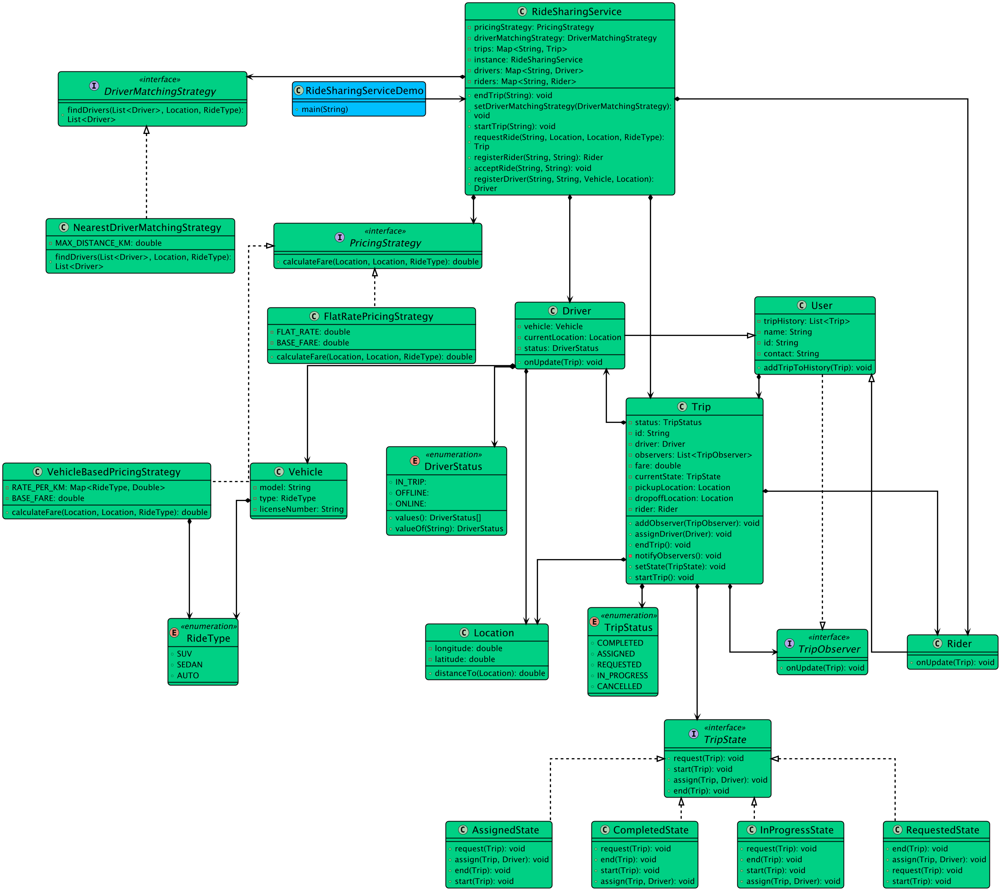

# Low-level design problem: ride sharing service

> Copied from <https://github.com/ashishps1/awesome-low-level-design/blob/main/problems/ride-sharing-service.md> (GPL-3.0, by Ashish Pratap Singh). Questions and answers are the source's own; nothing was answered or rewritten here.


# Designing a Ride-Sharing Service Like Uber

## Requirements
1. The ride sharing service should allow passengers to request rides and drivers to accept and fulfill those ride requests.
2. Passengers should be able to specify their pickup location, destination, and desired ride type (e.g., regular, premium).
3. Drivers should be able to see available ride requests and choose to accept or decline them.
4. The system should match ride requests with available drivers based on proximity and other factors.
5. The system should calculate the fare for each ride based on distance, time, and ride type.
6. The system should handle payments and process transactions between passengers and drivers.
7. The system should provide real-time tracking of ongoing rides and notify passengers and drivers about ride status updates.
8. The system should handle concurrent requests and ensure data consistency.

## UML Class Diagram



## Implementations
#### [Java Implementation](https://github.com/ashishps1/awesome-low-level-design/blob/main/solutions/java/src/ridesharingservice) 
#### [Python Implementation](https://github.com/ashishps1/awesome-low-level-design/blob/main/solutions/python/ridesharingservice)
#### [C++ Implementation](https://github.com/ashishps1/awesome-low-level-design/blob/main/solutions/cpp/ridesharingservice)
#### [C# Implementation](https://github.com/ashishps1/awesome-low-level-design/blob/main/solutions/csharp/ridesharingservice)
#### [Go Implementation](https://github.com/ashishps1/awesome-low-level-design/blob/main/solutions/golang/ridesharingservice)

## Classes, Interfaces and Enumerations
1. The **Passenger** class represents a passenger in the ride sharing service, with properties such as ID, name, contact information, and location.
2. The **Driver** class represents a driver in the ride sharing service, with properties such as ID, name, contact information, license plate, location, and status (available or busy).
3. The **Ride** class represents a ride requested by a passenger and accepted by a driver, with properties such as ID, passenger, driver, source location, destination location, status, and fare.
4. The **Location** class represents a geographical location with latitude and longitude coordinates.
5. The **Payment** class represents a payment made for a ride, with properties such as ID, ride, amount, and payment status.
6. The **RideService** class is the main class that manages the ride sharing service. It follows the Singleton pattern to ensure only one instance of the service exists.
7. The RideService class provides methods for adding passengers and drivers, requesting rides, accepting rides, starting rides, completing rides, and canceling rides.
8. Multi-threading is implemented using concurrent data structures (ConcurrentHashMap and ConcurrentLinkedQueue) to handle concurrent access to shared data, such as ride requests and driver availability.
9. The notifyDrivers, notifyPassenger, and notifyDriver methods are placeholders for notifying relevant parties about ride status updates.
10. The calculateFare and processPayment methods are placeholders for calculating ride fares and processing payments, respectively.
11. The **RideSharingDemo** class demonstrates the usage of the ride sharing service by creating passengers and drivers, requesting rides, accepting rides, starting rides, completing rides, and canceling rides.

---

## Official solutions from the repository

<details><summary><b>java</b> (23 files)</summary>


**README.md**

```md
# Ride Sharing Service (LLD)

## Problem Statement

Design and implement a Ride Sharing Service that allows riders to request rides, drivers to accept trips, and the system to manage trip assignments, payments, and trip status.

---

## Requirements

- **User Management:** The system manages both riders and drivers.
- **Location Management:** The system tracks the current location of drivers and riders.
- **Trip Request:** Riders can request rides by specifying pickup and drop-off locations.
- **Driver Assignment:** The system assigns available drivers to ride requests based on proximity and availability.
- **Trip Management:** The system tracks the status of each trip (e.g., REQUESTED, ONGOING, COMPLETED, CANCELLED).
- **Payment Processing:** The system processes payments for completed trips.
- **Driver Status:** The system tracks driver availability (e.g., AVAILABLE, ON_TRIP, OFFLINE).
- **Extensibility:** Easy to add new features such as ratings, ride pooling, or surge pricing.

---

## Core Entities

- **RideSharingService:** Main class that manages riders, drivers, trips, and payments.
- **Rider:** Represents a rider who can request trips.
- **Driver:** Represents a driver with current status and location.
- **Trip:** Represents a ride, including rider, driver, locations, status, and payment.
- **Location:** Represents a geographic location (latitude, longitude).
- **TripStatus (enum):** REQUESTED, ONGOING, COMPLETED, CANCELLED.
- **DriverStatus (enum):** AVAILABLE, ON_TRIP, OFFLINE.
- **Payment (in payment/):** Represents a payment transaction for a trip.
- **User:** Base class for Rider and Driver (if applicable).

---

## Class Design

## UML Class Diagram


### 1. RideSharingService
- **Fields:** List<Rider> riders, List<Driver> drivers, List<Trip> trips, PaymentProcessor paymentProcessor
- **Methods:** registerRider(Rider), registerDriver(Driver), requestTrip(Rider, Location, Location), assignDriver(Trip), startTrip(Trip), completeTrip(Trip), processPayment(Trip, Payment), updateDriverStatus(Driver, DriverStatus), etc.

### 2. Rider
- **Fields:** int id, String name, Location currentLocation

### 3. Driver
- **Fields:** int id, String name, Location currentLocation, DriverStatus status

### 4. Trip
- **Fields:** int id, Rider rider, Driver driver, Location pickup, Location dropoff, TripStatus status, Payment payment

### 5. Location
- **Fields:** double latitude, double longitude

### 6. TripStatus (enum)
- Values: REQUESTED, ONGOING, COMPLETED, CANCELLED

### 7. DriverStatus (enum)
- Values: AVAILABLE, ON_TRIP, OFFLINE

### 8. Payment (in payment/)
- **Fields:** int id, double amount, String method, PaymentStatus status

### 9. PaymentProcessor (in payment/)
- **Methods:** process(Payment), validate(Payment)

### 10. User
- **Fields:** int id, String name

---

## Example Usage

```java
RideSharingService service = new RideSharingService();
Rider alice = new Rider(1, "Alice", new Location(12.9716, 77.5946));
Driver bob = new Driver(2, "Bob", new Location(12.9718, 77.5940), DriverStatus.AVAILABLE);

service.registerRider(alice);
service.registerDriver(bob);

Trip trip = service.requestTrip(alice, alice.getCurrentLocation(), new Location(12.9352, 77.6245));
service.assignDriver(trip);
service.startTrip(trip);
// ... after trip completion
Payment payment = new Payment(1, 250.0, "CREDIT_CARD");
service.completeTrip(trip);
service.processPayment(trip, payment);
```

---

## Demo

See `RideSharingServiceDemo.java` for a sample usage and simulation of the ride sharing service.

---

## Extending the Framework

- **Add ratings and reviews:** Allow riders and drivers to rate each other.
- **Add ride pooling:** Support multiple riders sharing a trip.
- **Add surge pricing:** Adjust pricing based on demand and supply.

---
```


**RideSharingService.java**

```java
package ridesharingservice;

import java.util.List;
import java.util.Map;
import java.util.NoSuchElementException;
import java.util.concurrent.ConcurrentHashMap;

import ridesharingservice.entities.Driver;
import ridesharingservice.entities.Location;
import ridesharingservice.entities.Trip;
import ridesharingservice.entities.Vehicle;
import ridesharingservice.enums.DriverStatus;
import ridesharingservice.enums.RideType;
import ridesharingservice.observer.Rider;
import ridesharingservice.strategy.matching.DriverMatchingStrategy;
import ridesharingservice.strategy.pricing.PricingStrategy;

public class RideSharingService {
    private static volatile RideSharingService instance;
    private final Map<String, Rider> riders = new ConcurrentHashMap<>();
    private final Map<String, Driver> drivers = new ConcurrentHashMap<>();
    private final Map<String, Trip> trips = new ConcurrentHashMap<>();
    private PricingStrategy pricingStrategy;
    private DriverMatchingStrategy driverMatchingStrategy;

    private RideSharingService() {}

    public static synchronized RideSharingService getInstance() {
        if (instance == null) {
            instance = new RideSharingService();
        }
        return instance;
    }

    // Allow changing strategies at runtime for extensibility
    public void setPricingStrategy(PricingStrategy pricingStrategy) {
        this.pricingStrategy = pricingStrategy;
    }

    public void setDriverMatchingStrategy(DriverMatchingStrategy driverMatchingStrategy) {
        this.driverMatchingStrategy = driverMatchingStrategy;
    }

    public Rider registerRider(String name, String contact) {
        Rider rider = new Rider(name, contact);
        riders.put(rider.getId(), rider);
        return rider;
    }

    public Driver registerDriver(String name, String contact, Vehicle vehicle, Location initialLocation) {
        Driver driver = new Driver(name, contact, vehicle, initialLocation);
        drivers.put(driver.getId(), driver);
        return driver;
    }

    public Trip requestRide(String riderId, Location pickup, Location dropoff, RideType rideType) {
        Rider rider = riders.get(riderId);
        if (rider == null)
            throw new NoSuchElementException("Rider not found");

        System.out.println("\n--- New Ride Request from " + rider.getName() + " ---");

        // 1. Find available drivers
        List<Driver> availableDrivers = driverMatchingStrategy.findDrivers(List.copyOf(drivers.values()), pickup, rideType);

        if (availableDrivers.isEmpty()) {
            System.out.println("No drivers available for your request. Please try again later.");
            return null;
        }

        System.out.println("Found " + availableDrivers.size() + " available driver(s).");

        // 2. Calculate fare
        double fare = pricingStrategy.calculateFare(pickup, dropoff, rideType);
        System.out.printf("Estimated fare: $%.2f%n", fare);

        // 3. Create a trip using the Builder
        Trip trip = new Trip.TripBuilder()
                .withRider(rider)
                .withPickupLocation(pickup)
                .withDropoffLocation(dropoff)
                .withFare(fare)
                .build();

        trips.put(trip.getId(), trip);

        // 4. Notify nearby drivers (in a real system, this would be a push notification)
        System.out.println("Notifying nearby drivers of the new ride request...");
        for (Driver driver : availableDrivers) {
            System.out.println(" > Notifying " + driver.getName() + " at " + driver.getCurrentLocation());
            driver.onUpdate(trip);
        }

        return trip;
    }

    public void acceptRide(String driverId, String tripId) {
        Driver driver = drivers.get(driverId);
        Trip trip = trips.get(tripId);
        if (driver == null || trip == null)
            throw new NoSuchElementException("Driver or Trip not found");

        System.out.println("\n--- Driver " + driver.getName() + " accepted the ride ---");

        driver.setStatus(DriverStatus.IN_TRIP);
        trip.assignDriver(driver);
    }

    public void startTrip(String tripId) {
        Trip trip = trips.get(tripId);
        if (trip == null)
            throw new NoSuchElementException("Trip not found");
        System.out.println("\n--- Trip " + trip.getId() + " is starting ---");
        trip.startTrip();
    }

    public void endTrip(String tripId) {
        Trip trip = trips.get(tripId);
        if (trip == null)
            throw new NoSuchElementException("Trip not found");
        System.out.println("\n--- Trip " + trip.getId() + " is ending ---");
        trip.endTrip();

        // Update statuses and history
        Driver driver = trip.getDriver();
        driver.setStatus(DriverStatus.ONLINE); // Driver is available again
        driver.setCurrentLocation(trip.getDropoffLocation()); // Update driver location

        Rider rider = trip.getRider();
        driver.addTripToHistory(trip);
        rider.addTripToHistory(trip);

        System.out.println("Driver " + driver.getName() + " is now back online at " + driver.getCurrentLocation());
    }
}
```


**RideSharingServiceDemo.java**

```java
package ridesharingservice;

import ridesharingservice.entities.Driver;
import ridesharingservice.entities.Location;
import ridesharingservice.entities.Trip;
import ridesharingservice.entities.Vehicle;
import ridesharingservice.enums.DriverStatus;
import ridesharingservice.enums.RideType;
import ridesharingservice.observer.Rider;
import ridesharingservice.strategy.matching.NearestDriverMatchingStrategy;
import ridesharingservice.strategy.pricing.VehicleBasedPricingStrategy;

public class RideSharingServiceDemo {
    public static void main(String[] args) {
        // 1. Setup the system using singleton instance
        RideSharingService service = RideSharingService.getInstance();
        service.setDriverMatchingStrategy(new NearestDriverMatchingStrategy());
        service.setPricingStrategy(new VehicleBasedPricingStrategy());

        // 2. Register riders and drivers
        Rider alice = service.registerRider("Alice", "123-456-7890");

        Driver bob = service.registerDriver("Bob",
                "243-987-2860",
                new Vehicle("KA01-1234", "Toyota Prius", RideType.SEDAN),
                new Location(1.0, 1.0));

        Driver charlie = service.registerDriver("Charlie",
                "313-486-2691",
                new Vehicle("KA02-5678", "Honda CRV", RideType.SUV),
                new Location(2.0, 2.0));

        Driver david = service.registerDriver("David",
                "613-586-3241",
                new Vehicle("KA03-9012", "Honda CRV", RideType.SEDAN),
                new Location(1.2, 1.2));

        // 3. Drivers go online
        bob.setStatus(DriverStatus.ONLINE);
        charlie.setStatus(DriverStatus.ONLINE);
        david.setStatus(DriverStatus.ONLINE);

        // David is online but will be too far for the first request
        david.setCurrentLocation(new Location(10.0, 10.0));

        // 4. Alice requests a ride
        Location pickupLocation = new Location(0.0, 0.0);
        Location dropoffLocation = new Location(5.0, 5.0);

        // Rider wants a SEDAN
        Trip trip1 = service.requestRide(alice.getId(), pickupLocation, dropoffLocation, RideType.SEDAN);

        if (trip1 != null) {
            // 5. One of the nearby drivers accepts the ride
            // In this case, Bob (1.0, 1.0) is closer than David (10.0, 10.0 is too far).
            // Charlie is ignored because he drives an SUV.
            service.acceptRide(bob.getId(), trip1.getId());

            // 6. The trip progresses
            service.startTrip(trip1.getId());
            service.endTrip(trip1.getId());
        }

        System.out.println("\n--- Checking Trip History ---");
        System.out.println("Alice's trip history: " + alice.getTripHistory());
        System.out.println("Bob's trip history: " + bob.getTripHistory());

        // --- Second ride request ---
        System.out.println("\n=============================================");
        Rider harry = service.registerRider("Harry", "167-342-7834");

        // Harry requests an SUV
        Trip trip2 = service.requestRide(harry.getId(),
                new Location(2.5, 2.5),
                new Location(8.0, 8.0),
                RideType.SUV);

        if(trip2 != null) {
            // Only Charlie is available for an SUV ride
            service.acceptRide(charlie.getId(), trip2.getId());
            service.startTrip(trip2.getId());
            service.endTrip(trip2.getId());
        }
    }
}
```


**entities/Driver.java**

```java
package ridesharingservice.entities;

import ridesharingservice.enums.DriverStatus;
import ridesharingservice.enums.TripStatus;

public class Driver extends User {
    private Vehicle vehicle;
    private Location currentLocation;
    private DriverStatus status;

    public Driver(String name, String contact, Vehicle vehicle, Location initialLocation) {
        super(name, contact);
        this.vehicle = vehicle;
        this.currentLocation = initialLocation;
        this.status = DriverStatus.OFFLINE; // Default status
    }

    public Vehicle getVehicle() {
        return vehicle;
    }

    public DriverStatus getStatus() {
        return status;
    }

    public void setStatus(DriverStatus status) {
        this.status = status;
        System.out.println("Driver " + getName() + " is now " + status);
    }

    public Location getCurrentLocation() {
        return currentLocation;
    }

    public void setCurrentLocation(Location currentLocation) {
        this.currentLocation = currentLocation;
    }

    @Override public void onUpdate(Trip trip) {
        System.out.printf("--- Notification for Driver %s ---\n", getName());
        System.out.printf("  Trip %s status: %s.\n", trip.getId(), trip.getStatus());
        if (trip.getStatus() == TripStatus.REQUESTED) {
            System.out.println("  A new ride is available for you to accept.");
        }
        System.out.println("--------------------------------\n");
    }
}
```


**entities/Location.java**

```java
package ridesharingservice.entities;

public class Location {
    private final double latitude;
    private final double longitude;

    public Location(double latitude, double longitude) {
        this.latitude = latitude;
        this.longitude = longitude;
    }

    public double distanceTo(Location other) {
        double dx = this.latitude - other.latitude;
        double dy = this.longitude - other.longitude;
        return Math.sqrt(dx * dx + dy * dy); // Euclidean for simplicity
    }

    @Override
    public String toString() {
        return "Location(" + latitude + ", " + longitude + ")";
    }
}
```


**entities/Trip.java**

```java
package ridesharingservice.entities;

import java.util.UUID;

import ridesharingservice.enums.TripStatus;
import ridesharingservice.observer.Rider;
import ridesharingservice.observer.TripObserver;
import ridesharingservice.state.RequestedState;
import ridesharingservice.state.TripState;

import java.util.ArrayList;
import java.util.List;

public class Trip {
    private final String id;
    private final Rider rider;
    private Driver driver;
    private final Location pickupLocation;
    private final Location dropoffLocation;
    private final double fare;
    private TripStatus status;

    private TripState currentState;
    private final List<TripObserver> observers = new ArrayList<>();

    private Trip(TripBuilder builder) {
        this.id = builder.id;
        this.rider = builder.rider;
        this.pickupLocation = builder.pickupLocation;
        this.dropoffLocation = builder.dropoffLocation;
        this.fare = builder.fare;
        this.status = TripStatus.REQUESTED;
        this.currentState = new RequestedState(); // Initial state
    }

    public void addObserver(TripObserver observer) {
        observers.add(observer);
    }

    private void notifyObservers() {
        observers.forEach(o -> o.onUpdate(this));
    }

    public void assignDriver(Driver driver) {
        currentState.assign(this, driver);
        addObserver(driver);
        notifyObservers();
    }

    public void startTrip() {
        currentState.start(this);
        notifyObservers();
    }

    public void endTrip() {
        currentState.end(this);
        notifyObservers();
    }

    // Getters
    public String getId() { return id; }
    public Rider getRider() { return rider; }
    public Driver getDriver() { return driver; }
    public Location getPickupLocation() { return pickupLocation; }
    public Location getDropoffLocation() { return dropoffLocation; }
    public double getFare() { return fare; }
    public TripStatus getStatus() { return status; }

    // Setters are protected, only to be called by State objects
    public void setState(TripState state) {
        this.currentState = state;
    }

    public void setStatus(TripStatus status) {
        this.status = status;
    }

    public void setDriver(Driver driver) {
        this.driver = driver;
    }

    // --- Builder Pattern ---
    public static class TripBuilder {
        private final String id;
        private Rider rider;
        private Location pickupLocation;
        private Location dropoffLocation;
        private double fare;

        public TripBuilder() {
            this.id = UUID.randomUUID().toString();
        }

        public TripBuilder withRider(Rider rider) {
            this.rider = rider;
            return this;
        }

        public TripBuilder withPickupLocation(Location pickupLocation) {
            this.pickupLocation = pickupLocation;
            return this;
        }

        public TripBuilder withDropoffLocation(Location dropoffLocation) {
            this.dropoffLocation = dropoffLocation;
            return this;
        }

        public TripBuilder withFare(double fare) {
            this.fare = fare;
            return this;
        }

        public Trip build() {
            // Basic validation
            if (rider == null || pickupLocation == null || dropoffLocation == null) {
                throw new IllegalStateException("Rider, pickup, and dropoff locations are required to build a trip.");
            }
            return new Trip(this);
        }
    }

    @Override
    public String toString() {
        return "Trip [id=" + id + ", status=" + status + ", fare=$" + String.format("%.2f", fare) + "]";
    }
}
```


**entities/User.java**

```java
package ridesharingservice.entities;

import java.util.ArrayList;
import java.util.List;
import java.util.UUID;

import ridesharingservice.observer.TripObserver;

public abstract class User implements TripObserver {
    private final String id;
    private final String name;
    private final String contact;
    private final List<Trip> tripHistory;

    public User(String name, String contact) {
        this.id = UUID.randomUUID().toString();
        this.name = name;
        this.contact = contact;
        this.tripHistory = new ArrayList<>();
    }

    public void addTripToHistory(Trip trip) {
        tripHistory.add(trip);
    }

    public List<Trip> getTripHistory() {
        return tripHistory;
    }

    public String getId() {
        return id;
    }

    public String getName() {
        return name;
    }

    public String getContact() {
        return contact;
    }
}
```


**entities/Vehicle.java**

```java
package ridesharingservice.entities;

import ridesharingservice.enums.RideType;

public class Vehicle {
    private final String licenseNumber;
    private final String model;
    private final RideType type;

    public Vehicle(String licenseNumber, String model, RideType type) {
        this.licenseNumber = licenseNumber;
        this.model = model;
        this.type = type;
    }

    public String getLicenseNumber() { return licenseNumber; }

    public String getModel() { return model; }

    public RideType getType() { return type; }
}
```


**enums/DriverStatus.java**

```java
package ridesharingservice.enums;

public enum DriverStatus {
    ONLINE,
    IN_TRIP,
    OFFLINE
}
```


**enums/RideType.java**

```java
package ridesharingservice.enums;

public enum RideType {
    SEDAN,
    SUV,
    AUTO
}
```


**enums/TripStatus.java**

```java
package ridesharingservice.enums;

public enum TripStatus {
    REQUESTED,
    ASSIGNED,
    IN_PROGRESS,
    COMPLETED,
    CANCELLED
}
```


**observer/Rider.java**

```java
package ridesharingservice.observer;

import ridesharingservice.entities.Trip;
import ridesharingservice.entities.User;

public class Rider extends User {
    public Rider(String name, String contact) {
        super(name, contact);
    }

    @Override
    public void onUpdate(Trip trip) {
        System.out.printf("--- Notification for Rider %s ---\n", getName());
        System.out.printf("  Trip %s is now %s.\n", trip.getId(), trip.getStatus());
        if (trip.getDriver() != null) {
            System.out.printf("  Driver: %s in a %s (%s)\n",
                    trip.getDriver().getName(), trip.getDriver().getVehicle().getModel(),
                    trip.getDriver().getVehicle().getLicenseNumber());
        }
        System.out.println("--------------------------------\n");
    }
}
```


**observer/TripObserver.java**

```java
package ridesharingservice.observer;

import ridesharingservice.entities.Trip;

public interface TripObserver {
    void onUpdate(Trip trip);
}
```


**state/AssignedState.java**

```java
package ridesharingservice.state;

import ridesharingservice.entities.Driver;
import ridesharingservice.entities.Trip;
import ridesharingservice.enums.TripStatus;

public class AssignedState implements TripState {
    @Override
    public void request(Trip trip) {
        System.out.println("Trip has already been requested and assigned.");
    }

    @Override
    public void assign(Trip trip, Driver driver) {
        System.out.println("Trip is already assigned. To re-assign, cancel first.");
    }

    @Override
    public void start(Trip trip) {
        trip.setStatus(TripStatus.IN_PROGRESS);
        trip.setState(new InProgressState());
    }

    @Override
    public void end(Trip trip) {
        System.out.println("Cannot end a trip that has not started.");
    }
}
```


**state/CompletedState.java**

```java
package ridesharingservice.state;

import ridesharingservice.entities.Driver;
import ridesharingservice.entities.Trip;

public class CompletedState implements TripState {
    @Override
    public void request(Trip trip) {
        System.out.println("Cannot request a trip that is already completed.");
    }

    @Override
    public void assign(Trip trip, Driver driver) {
        System.out.println("Cannot assign a driver to a completed trip.");
    }

    @Override
    public void start(Trip trip) {
        System.out.println("Cannot start a completed trip.");
    }

    @Override
    public void end(Trip trip) {
        System.out.println("Trip is already completed.");
    }
}
```


**state/InProgressState.java**

```java
package ridesharingservice.state;

import ridesharingservice.entities.Driver;
import ridesharingservice.entities.Trip;
import ridesharingservice.enums.TripStatus;

public class InProgressState implements TripState {
    @Override
    public void request(Trip trip) {
        System.out.println("Trip is already in progress.");
    }

    @Override
    public void assign(Trip trip, Driver driver) {
        System.out.println("Cannot assign a new driver while trip is in progress.");
    }

    @Override
    public void start(Trip trip) {
        System.out.println("Trip is already in progress.");
    }

    @Override
    public void end(Trip trip) {
        trip.setStatus(TripStatus.COMPLETED);
        trip.setState(new CompletedState());
    }
}
```


**state/RequestedState.java**

```java
package ridesharingservice.state;

import ridesharingservice.entities.Driver;
import ridesharingservice.entities.Trip;
import ridesharingservice.enums.TripStatus;

public class RequestedState implements TripState {
    @Override
    public void request(Trip trip) {
        System.out.println("Trip is already in requested state.");
    }

    @Override
    public void assign(Trip trip, Driver driver) {
        trip.setDriver(driver);
        trip.setStatus(TripStatus.ASSIGNED);
        trip.setState(new AssignedState());
    }

    @Override
    public void start(Trip trip) {
        System.out.println("Cannot start a trip that has not been assigned a driver.");
    }

    @Override
    public void end(Trip trip) {
        System.out.println("Cannot end a trip that has not been assigned a driver.");
    }
}
```


**state/TripState.java**

```java
package ridesharingservice.state;

import ridesharingservice.entities.Driver;
import ridesharingservice.entities.Trip;

public interface TripState {
    void request(Trip trip);
    void assign(Trip trip, Driver driver);
    void start(Trip trip);
    void end(Trip trip);
}
```


**strategy/matching/DriverMatchingStrategy.java**

```java
package ridesharingservice.strategy.matching;

import java.util.List;

import ridesharingservice.entities.Driver;
import ridesharingservice.entities.Location;
import ridesharingservice.enums.RideType;

public interface DriverMatchingStrategy {
    List<Driver> findDrivers(List<Driver> allDrivers, Location pickupLocation, RideType rideType);
}
```


**strategy/matching/NearestDriverMatchingStrategy.java**

```java
package ridesharingservice.strategy.matching;

import java.util.Comparator;
import java.util.List;
import java.util.stream.Collectors;

import ridesharingservice.entities.Driver;
import ridesharingservice.entities.Location;
import ridesharingservice.enums.DriverStatus;
import ridesharingservice.enums.RideType;

public class NearestDriverMatchingStrategy implements DriverMatchingStrategy {
    private static final double MAX_DISTANCE_KM = 5.0; // Max distance to consider a driver "nearby"

    @Override
    public List<Driver> findDrivers(List<Driver> allDrivers, Location pickupLocation, RideType rideType) {
        System.out.println("Finding nearest drivers for ride type: " + rideType);
        return allDrivers.stream()
                .filter(driver -> driver.getStatus() == DriverStatus.ONLINE)
                .filter(driver -> driver.getVehicle().getType() == rideType)
                .filter(driver -> pickupLocation.distanceTo(driver.getCurrentLocation()) <= MAX_DISTANCE_KM)
                .sorted(Comparator.comparingDouble(driver -> pickupLocation.distanceTo(driver.getCurrentLocation())))
                .collect(Collectors.toList());
    }
}
```


**strategy/pricing/FlatRatePricingStrategy.java**

```java
package ridesharingservice.strategy.pricing;

import ridesharingservice.entities.Location;
import ridesharingservice.enums.RideType;

public class FlatRatePricingStrategy implements PricingStrategy {
    private static final double BASE_FARE = 5.0;
    private static final double FLAT_RATE = 1.5;

    @Override
    public double calculateFare(Location pickup, Location dropoff, RideType rideType) {
        double distance = pickup.distanceTo(dropoff);
        return BASE_FARE + distance * FLAT_RATE;
    }
}
```


**strategy/pricing/PricingStrategy.java**

```java
package ridesharingservice.strategy.pricing;

import ridesharingservice.entities.Location;
import ridesharingservice.enums.RideType;

public interface PricingStrategy {
    double calculateFare(Location pickup, Location dropoff, RideType rideType);
}
```


**strategy/pricing/VehicleBasedPricingStrategy.java**

```java
package ridesharingservice.strategy.pricing;

import java.util.Map;

import ridesharingservice.entities.Location;
import ridesharingservice.enums.RideType;

public class VehicleBasedPricingStrategy implements PricingStrategy {
    private static final double BASE_FARE = 2.50;
    private static final Map<RideType, Double> RATE_PER_KM = Map.of(
            RideType.SEDAN, 1.50,
            RideType.SUV, 2.00,
            RideType.AUTO, 1.00
    );

    @Override
    public double calculateFare(Location pickup, Location dropoff, RideType rideType) {
        return BASE_FARE + RATE_PER_KM.get(rideType) * pickup.distanceTo(dropoff);
    }
}
```

</details>

<details><summary><b>python</b> (14 files)</summary>


**README.md**

```md
# Designing a Ride-Sharing Service Like Uber

## Requirements
1. The ride sharing service should allow passengers to request rides and drivers to accept and fulfill those ride requests.
2. Passengers should be able to specify their pickup location, destination, and desired ride type (e.g., regular, premium).
3. Drivers should be able to see available ride requests and choose to accept or decline them.
4. The system should match ride requests with available drivers based on proximity and other factors.
5. The system should calculate the fare for each ride based on distance, time, and ride type.
6. The system should handle payments and process transactions between passengers and drivers.
7. The system should provide real-time tracking of ongoing rides and notify passengers and drivers about ride status updates.
8. The system should handle concurrent requests and ensure data consistency.

## Classes, Interfaces and Enumerations
1. The **Passenger** class represents a passenger in the ride sharing service, with properties such as ID, name, contact information, and location.
2. The **Driver** class represents a driver in the ride sharing service, with properties such as ID, name, contact information, license plate, location, and status (available or busy).
3. The **Ride** class represents a ride requested by a passenger and accepted by a driver, with properties such as ID, passenger, driver, source location, destination location, status, and fare.
4. The **Location** class represents a geographical location with latitude and longitude coordinates.
5. The **Payment** class represents a payment made for a ride, with properties such as ID, ride, amount, and payment status.
6. The **RideService** class is the main class that manages the ride sharing service. It follows the Singleton pattern to ensure only one instance of the service exists.
7. The RideService class provides methods for adding passengers and drivers, requesting rides, accepting rides, starting rides, completing rides, and canceling rides.
8. Multi-threading is implemented using concurrent data structures (ConcurrentHashMap and ConcurrentLinkedQueue) to handle concurrent access to shared data, such as ride requests and driver availability.
9. The notifyDrivers, notifyPassenger, and notifyDriver methods are placeholders for notifying relevant parties about ride status updates.
10. The calculateFare and processPayment methods are placeholders for calculating ride fares and processing payments, respectively.
11. The **RideSharingDemo** class demonstrates the usage of the ride sharing service by creating passengers and drivers, requesting rides, accepting rides, starting rides, completing rides, and canceling rides.
```


**driver.py**

```py
from vehicle import Vehicle
from location import Location
from enums import DriverStatus, TripStatus
from trip import Trip
from typing import TYPE_CHECKING
from user import User

if TYPE_CHECKING:
    from trip import Trip

class Driver(User):
    def __init__(self, name: str, contact: str, vehicle: Vehicle, initial_location: Location):
        super().__init__(name, contact)
        self._vehicle = vehicle
        self._current_location = initial_location
        self._status = DriverStatus.OFFLINE  # Default status
    
    def get_vehicle(self) -> Vehicle:
        return self._vehicle
    
    def get_status(self) -> DriverStatus:
        return self._status
    
    def set_status(self, status: DriverStatus):
        self._status = status
        print(f"Driver {self.get_name()} is now {status.value}")
    
    def get_current_location(self) -> Location:
        return self._current_location
    
    def set_current_location(self, current_location: Location):
        self._current_location = current_location
    
    def on_update(self, trip: 'Trip'):
        print(f"--- Notification for Driver {self.get_name()} ---")
        print(f"  Trip {trip.get_id()} status: {trip.get_status().value}.")
        if trip.get_status() == TripStatus.REQUESTED:
            print("  A new ride is available for you to accept.")
        print("--------------------------------\n")
```


**driver_matching_strategy.py**

```py
from abc import ABC, abstractmethod
from typing import List
from driver import Driver
from location import Location
from enums import DriverStatus, RideType

class DriverMatchingStrategy(ABC):
    @abstractmethod
    def find_drivers(self, all_drivers: List[Driver], pickup_location: Location, ride_type: RideType) -> List[Driver]:
        pass

class NearestDriverMatchingStrategy(DriverMatchingStrategy):
    MAX_DISTANCE_KM = 5.0  # Max distance to consider a driver "nearby"
    
    def find_drivers(self, all_drivers: List[Driver], pickup_location: Location, ride_type: RideType) -> List[Driver]:
        print(f"Finding nearest drivers for ride type: {ride_type.value}")
        available_drivers = [
            driver for driver in all_drivers
            if (driver.get_status() == DriverStatus.ONLINE and
                driver.get_vehicle().get_type() == ride_type and
                pickup_location.distance_to(driver.get_current_location()) <= self.MAX_DISTANCE_KM)
        ]
        
        # Sort by distance
        available_drivers.sort(key=lambda d: pickup_location.distance_to(d.get_current_location()))
        return available_drivers
```


**enums.py**

```py
from enum import Enum

class RideType(Enum):
    SEDAN = "SEDAN"
    SUV = "SUV"
    AUTO = "AUTO"

class TripStatus(Enum):
    REQUESTED = "REQUESTED"
    ASSIGNED = "ASSIGNED"
    IN_PROGRESS = "IN_PROGRESS"
    COMPLETED = "COMPLETED"
    CANCELLED = "CANCELLED"

class DriverStatus(Enum):
    OFFLINE = "OFFLINE"
    ONLINE = "ONLINE"
    IN_TRIP = "IN_TRIP"
```


**location.py**

```py
import math

class Location:
    def __init__(self, latitude: float, longitude: float):
        self._latitude = latitude
        self._longitude = longitude
    
    def distance_to(self, other: 'Location') -> float:
        dx = self._latitude - other._latitude
        dy = self._longitude - other._longitude
        return math.sqrt(dx * dx + dy * dy)  # Euclidean for simplicity
    
    def __str__(self) -> str:
        return f"Location({self._latitude}, {self._longitude})"
```


**pricing_strategy.py**

```py
from abc import ABC, abstractmethod
from location import Location
from enums import RideType

class PricingStrategy(ABC):
    @abstractmethod
    def calculate_fare(self, pickup: Location, dropoff: Location, ride_type: RideType) -> float:
        pass

class FlatRatePricingStrategy(PricingStrategy):
    BASE_FARE = 5.0
    FLAT_RATE = 1.5
    
    def calculate_fare(self, pickup: Location, dropoff: Location, ride_type: RideType) -> float:
        distance = pickup.distance_to(dropoff)
        return self.BASE_FARE + distance * self.FLAT_RATE

class VehicleBasedPricingStrategy(PricingStrategy):
    BASE_FARE = 2.50
    RATE_PER_KM = {
        RideType.SEDAN: 1.50,
        RideType.SUV: 2.00,
        RideType.AUTO: 1.00
    }
    
    def calculate_fare(self, pickup: Location, dropoff: Location, ride_type: RideType) -> float:
        return self.BASE_FARE + self.RATE_PER_KM[ride_type] * pickup.distance_to(dropoff)
```


**ride_sharing_demo.py**

```py
from ride_sharing_service import RideSharingService
from driver_matching_strategy import NearestDriverMatchingStrategy
from pricing_strategy import VehicleBasedPricingStrategy
from enums import DriverStatus, RideType
from location import Location
from vehicle import Vehicle

class RideSharingServiceDemo:
    @staticmethod
    def main():
        # 1. Setup the system using singleton instance
        service = RideSharingService.get_instance()
        service.set_driver_matching_strategy(NearestDriverMatchingStrategy())
        service.set_pricing_strategy(VehicleBasedPricingStrategy())
        
        # 2. Register riders and drivers
        alice = service.register_rider("Alice", "123-456-7890")
        
        bob = service.register_driver("Bob",
                                    "243-987-2860",
                                    Vehicle("KA01-1234", "Toyota Prius", RideType.SEDAN),
                                    Location(1.0, 1.0))
        
        charlie = service.register_driver("Charlie",
                                        "313-486-2691",
                                        Vehicle("KA02-5678", "Honda CRV", RideType.SUV),
                                        Location(2.0, 2.0))
        
        david = service.register_driver("David",
                                      "613-586-3241",
                                      Vehicle("KA03-9012", "Honda CRV", RideType.SEDAN),
                                      Location(1.2, 1.2))
        
        # 3. Drivers go online
        bob.set_status(DriverStatus.ONLINE)
        charlie.set_status(DriverStatus.ONLINE)
        david.set_status(DriverStatus.ONLINE)
        
        # David is online but will be too far for the first request
        david.set_current_location(Location(10.0, 10.0))
        
        # 4. Alice requests a ride
        pickup_location = Location(0.0, 0.0)
        dropoff_location = Location(5.0, 5.0)
        
        # Rider wants a SEDAN
        trip1 = service.request_ride(alice.get_id(), pickup_location, dropoff_location, RideType.SEDAN)
        
        if trip1 is not None:
            # 5. One of the nearby drivers accepts the ride
            # In this case, Bob (1.0, 1.0) is closer than David (10.0, 10.0 is too far).
            # Charlie is ignored because he drives an SUV.
            service.accept_ride(bob.get_id(), trip1.get_id())
            
            # 6. The trip progresses
            service.start_trip(trip1.get_id())
            service.end_trip(trip1.get_id())
        
        print("\n--- Checking Trip History ---")
        print(f"Alice's trip history: {alice.get_trip_history()}")
        print(f"Bob's trip history: {bob.get_trip_history()}")
        
        # --- Second ride request ---
        print("\n=============================================")
        harry = service.register_rider("Harry", "167-342-7834")
        
        # Harry requests an SUV
        trip2 = service.request_ride(harry.get_id(),
                                    Location(2.5, 2.5),
                                    Location(8.0, 8.0),
                                    RideType.SUV)
        
        if trip2 is not None:
            # Only Charlie is available for an SUV ride
            service.accept_ride(charlie.get_id(), trip2.get_id())
            service.start_trip(trip2.get_id())
            service.end_trip(trip2.get_id())

if __name__ == "__main__":
    RideSharingServiceDemo.main()
```


**ride_sharing_service.py**

```py
import threading
from typing import Dict, Optional
from driver import Driver
from driver_matching_strategy import DriverMatchingStrategy
from enums import DriverStatus, RideType
from pricing_strategy import PricingStrategy
from rider import Rider
from trip import Trip
from location import Location
from vehicle import Vehicle

class RideSharingService:
    _instance = None
    _lock = threading.Lock()
    
    def __new__(cls):
        if cls._instance is None:
            with cls._lock:
                if cls._instance is None:
                    cls._instance = super().__new__(cls)
                    cls._instance._initialized = False
        return cls._instance
    
    def __init__(self):
        if not self._initialized:
            self._riders: Dict[str, Rider] = {}
            self._drivers: Dict[str, Driver] = {}
            self._trips: Dict[str, Trip] = {}
            self._pricing_strategy: Optional[PricingStrategy] = None
            self._driver_matching_strategy: Optional[DriverMatchingStrategy] = None
            self._initialized = True
    
    @classmethod
    def get_instance(cls):
        return cls()
    
    # Allow changing strategies at runtime for extensibility
    def set_pricing_strategy(self, pricing_strategy: PricingStrategy):
        self._pricing_strategy = pricing_strategy
    
    def set_driver_matching_strategy(self, driver_matching_strategy: DriverMatchingStrategy):
        self._driver_matching_strategy = driver_matching_strategy
    
    def register_rider(self, name: str, contact: str) -> Rider:
        rider = Rider(name, contact)
        self._riders[rider.get_id()] = rider
        return rider
    
    def register_driver(self, name: str, contact: str, vehicle: Vehicle, initial_location: Location) -> Driver:
        driver = Driver(name, contact, vehicle, initial_location)
        self._drivers[driver.get_id()] = driver
        return driver
    
    def request_ride(self, rider_id: str, pickup: Location, dropoff: Location, ride_type: RideType) -> Optional[Trip]:
        rider = self._riders.get(rider_id)
        if rider is None:
            raise KeyError("Rider not found")
        
        print(f"\n--- New Ride Request from {rider.get_name()} ---")
        
        # 1. Find available drivers
        available_drivers = self._driver_matching_strategy.find_drivers(
            list(self._drivers.values()), pickup, ride_type
        )
        
        if not available_drivers:
            print("No drivers available for your request. Please try again later.")
            return None
        
        print(f"Found {len(available_drivers)} available driver(s).")
        
        # 2. Calculate fare
        fare = self._pricing_strategy.calculate_fare(pickup, dropoff, ride_type)
        print(f"Estimated fare: ${fare:.2f}")
        
        # 3. Create a trip using the Builder
        trip = Trip.TripBuilder() \
            .with_rider(rider) \
            .with_pickup_location(pickup) \
            .with_dropoff_location(dropoff) \
            .with_fare(fare) \
            .build()
        
        self._trips[trip.get_id()] = trip
        
        # 4. Notify nearby drivers (in a real system, this would be a push notification)
        print("Notifying nearby drivers of the new ride request...")
        for driver in available_drivers:
            print(f" > Notifying {driver.get_name()} at {driver.get_current_location()}")
            driver.on_update(trip)
        
        return trip
    
    def accept_ride(self, driver_id: str, trip_id: str):
        driver = self._drivers.get(driver_id)
        trip = self._trips.get(trip_id)
        if driver is None or trip is None:
            raise KeyError("Driver or Trip not found")
        
        print(f"\n--- Driver {driver.get_name()} accepted the ride ---")
        
        driver.set_status(DriverStatus.IN_TRIP)
        trip.assign_driver(driver)
    
    def start_trip(self, trip_id: str):
        trip = self._trips.get(trip_id)
        if trip is None:
            raise KeyError("Trip not found")
        print(f"\n--- Trip {trip.get_id()} is starting ---")
        trip.start_trip()
    
    def end_trip(self, trip_id: str):
        trip = self._trips.get(trip_id)
        if trip is None:
            raise KeyError("Trip not found")
        print(f"\n--- Trip {trip.get_id()} is ending ---")
        trip.end_trip()
        
        # Update statuses and history
        driver = trip.get_driver()
        driver.set_status(DriverStatus.ONLINE)  # Driver is available again
        driver.set_current_location(trip.get_dropoff_location())  # Update driver location
        
        rider = trip.get_rider()
        driver.add_trip_to_history(trip)
        rider.add_trip_to_history(trip)
        
        print(f"Driver {driver.get_name()} is now back online at {driver.get_current_location()}")
```


**rider.py**

```py
from user import User
from typing import TYPE_CHECKING

if TYPE_CHECKING:
    from trip import Trip

class Rider(User):
    def __init__(self, name: str, contact: str):
        super().__init__(name, contact)
    
    def on_update(self, trip: 'Trip'):
        print(f"--- Notification for Rider {self.get_name()} ---")
        print(f"  Trip {trip.get_id()} is now {trip.get_status().value}.")
        if trip.get_driver() is not None:
            print(f"  Driver: {trip.get_driver().get_name()} in a {trip.get_driver().get_vehicle().get_model()} "
                  f"({trip.get_driver().get_vehicle().get_license_number()})")
        print("--------------------------------\n")
```


**trip.py**

```py
from typing import Optional, List
from enums import TripStatus
from trip_states import TripState, RequestedState
from rider import Rider
from trip_observer import TripObserver
from location import Location
import uuid
from typing import TYPE_CHECKING

if TYPE_CHECKING:
    from driver import Driver

class Trip:
    def __init__(self, builder: 'TripBuilder'):
        self._id = builder._id
        self._rider = builder._rider
        self._driver: Optional['Driver'] = None
        self._pickup_location = builder._pickup_location
        self._dropoff_location = builder._dropoff_location
        self._fare = builder._fare
        self._status = TripStatus.REQUESTED
        self._current_state = RequestedState()  # Initial state
        self._observers: List[TripObserver] = []
    
    def add_observer(self, observer: TripObserver):
        self._observers.append(observer)
    
    def _notify_observers(self):
        for observer in self._observers:
            observer.on_update(self)
    
    def assign_driver(self, driver: 'Driver'):
        self._current_state.assign(self, driver)
        self.add_observer(driver)
        self._notify_observers()
    
    def start_trip(self):
        self._current_state.start(self)
        self._notify_observers()
    
    def end_trip(self):
        self._current_state.end(self)
        self._notify_observers()
    
    # Getters
    def get_id(self) -> str:
        return self._id
    
    def get_rider(self) -> Rider:
        return self._rider
    
    def get_driver(self) -> Optional['Driver']:
        return self._driver
    
    def get_pickup_location(self) -> Location:
        return self._pickup_location
    
    def get_dropoff_location(self) -> Location:
        return self._dropoff_location
    
    def get_fare(self) -> float:
        return self._fare
    
    def get_status(self) -> TripStatus:
        return self._status
    
    # Setters are protected, only to be called by State objects
    def set_state(self, state: TripState):
        self._current_state = state
    
    def set_status(self, status: TripStatus):
        self._status = status
    
    def set_driver(self, driver: 'Driver'):
        self._driver = driver
    
    def __str__(self) -> str:
        return f"Trip [id={self._id}, status={self._status.value}, fare=${self._fare:.2f}]"
    
    # Builder Pattern
    class TripBuilder:
        def __init__(self):
            self._id = str(uuid.uuid4())
            self._rider: Optional[Rider] = None
            self._pickup_location: Optional[Location] = None
            self._dropoff_location: Optional[Location] = None
            self._fare = 0.0
        
        def with_rider(self, rider: Rider) -> 'Trip.TripBuilder':
            self._rider = rider
            return self
        
        def with_pickup_location(self, pickup_location: Location) -> 'Trip.TripBuilder':
            self._pickup_location = pickup_location
            return self
        
        def with_dropoff_location(self, dropoff_location: Location) -> 'Trip.TripBuilder':
            self._dropoff_location = dropoff_location
            return self
        
        def with_fare(self, fare: float) -> 'Trip.TripBuilder':
            self._fare = fare
            return self
        
        def build(self) -> 'Trip':
            # Basic validation
            if self._rider is None or self._pickup_location is None or self._dropoff_location is None:
                raise ValueError("Rider, pickup, and dropoff locations are required to build a trip.")
            return Trip(self)
```


**trip_observer.py**

```py
from abc import ABC, abstractmethod
from typing import TYPE_CHECKING

if TYPE_CHECKING:
    from trip import Trip

class TripObserver(ABC):
    @abstractmethod
    def on_update(self, trip: 'Trip'):
        pass
```


**trip_states.py**

```py
from abc import ABC, abstractmethod
from enums import TripStatus
from typing import TYPE_CHECKING

if TYPE_CHECKING:
    from driver import Driver
    from trip import Trip

class TripState(ABC):
    @abstractmethod
    def request(self, trip: 'Trip'):
        pass
    
    @abstractmethod
    def assign(self, trip: 'Trip', driver: 'Driver'):
        pass
    
    @abstractmethod
    def start(self, trip: 'Trip'):
        pass
    
    @abstractmethod
    def end(self, trip: 'Trip'):
        pass

class RequestedState(TripState):
    def request(self, trip: 'Trip'):
        print("Trip is already in requested state.")
    
    def assign(self, trip: 'Trip', driver: 'Driver'):
        trip.set_driver(driver)
        trip.set_status(TripStatus.ASSIGNED)
        trip.set_state(AssignedState())
    
    def start(self, trip: 'Trip'):
        print("Cannot start a trip that has not been assigned a driver.")
    
    def end(self, trip: 'Trip'):
        print("Cannot end a trip that has not been assigned a driver.")

class AssignedState(TripState):
    def request(self, trip: 'Trip'):
        print("Trip has already been requested and assigned.")
    
    def assign(self, trip: 'Trip', driver: 'Driver'):
        print("Trip is already assigned. To re-assign, cancel first.")
    
    def start(self, trip: 'Trip'):
        trip.set_status(TripStatus.IN_PROGRESS)
        trip.set_state(InProgressState())
    
    def end(self, trip: 'Trip'):
        print("Cannot end a trip that has not started.")


class InProgressState(TripState):
    def request(self, trip: 'Trip'):
        print("Trip is already in progress.")
    
    def assign(self, trip: 'Trip', driver: 'Driver'):
        print("Cannot assign a new driver while trip is in progress.")
    
    def start(self, trip: 'Trip'):
        print("Trip is already in progress.")
    
    def end(self, trip: 'Trip'):
        trip.set_status(TripStatus.COMPLETED)
        trip.set_state(CompletedState())


class CompletedState(TripState):
    def request(self, trip: 'Trip'):
        print("Cannot request a trip that is already completed.")
    
    def assign(self, trip: 'Trip', driver: 'Driver'):
        print("Cannot assign a driver to a completed trip.")
    
    def start(self, trip: 'Trip'):
        print("Cannot start a completed trip.")
    
    def end(self, trip: 'Trip'):
        print("Trip is already completed.")
```


**user.py**

```py
from typing import List
from trip_observer import TripObserver
import uuid
from typing import TYPE_CHECKING

if TYPE_CHECKING:
    from trip import Trip

class User(TripObserver):
    def __init__(self, name: str, contact: str):
        self._id = str(uuid.uuid4())
        self._name = name
        self._contact = contact
        self._trip_history: List['Trip'] = []
    
    def add_trip_to_history(self, trip: 'Trip'):
        self._trip_history.append(trip)
    
    def get_trip_history(self) -> List['Trip']:
        return self._trip_history
    
    def get_id(self) -> str:
        return self._id
    
    def get_name(self) -> str:
        return self._name
    
    def get_contact(self) -> str:
        return self._contact
```


**vehicle.py**

```py
from enums import RideType

class Vehicle:
    def __init__(self, license_number: str, model: str, vehicle_type: RideType):
        self._license_number = license_number
        self._model = model
        self._type = vehicle_type
    
    def get_license_number(self) -> str:
        return self._license_number
    
    def get_model(self) -> str:
        return self._model
    
    def get_type(self) -> RideType:
        return self._type
```

</details>

<details><summary><b>cpp</b> (10 files)</summary>


**Location.cpp**

```cpp
#include "Location.hpp"
#include <iostream>
#include <cmath>

Location::Location(double latitude, double longitude, std::string address)
    : latitude(latitude), longitude(longitude), address(address) {}

double Location::getLatitude() const { return latitude; }
double Location::getLongitude() const { return longitude; }
std::string Location::getAddress() const { return address; }

double Location::calculateDistance(const Location& other) const {
    // Simple Euclidean distance for demonstration
    double dx = latitude - other.latitude;
    double dy = longitude - other.longitude;
    return std::sqrt(dx * dx + dy * dy);
}

void Location::displayInfo() const {
    std::cout << "Location: " << address << std::endl;
    std::cout << "Coordinates: (" << latitude << ", " << longitude << ")" << std::endl;
}
```


**Location.hpp**

```hpp
#ifndef LOCATION_HPP
#define LOCATION_HPP

#include <string>

class Location {
private:
    double latitude;
    double longitude;
    std::string address;

public:
    Location(double latitude, double longitude, std::string address);
    
    double getLatitude() const;
    double getLongitude() const;
    std::string getAddress() const;
    
    double calculateDistance(const Location& other) const;
    void displayInfo() const;
};

#endif
```


**README.md**

```md
# Designing a Ride-Sharing Service Like Uber

## Requirements
1. The ride sharing service should allow passengers to request rides and drivers to accept and fulfill those ride requests.
2. Passengers should be able to specify their pickup location, destination, and desired ride type (e.g., regular, premium).
3. Drivers should be able to see available ride requests and choose to accept or decline them.
4. The system should match ride requests with available drivers based on proximity and other factors.
5. The system should calculate the fare for each ride based on distance, time, and ride type.
6. The system should handle payments and process transactions between passengers and drivers.
7. The system should provide real-time tracking of ongoing rides and notify passengers and drivers about ride status updates.
8. The system should handle concurrent requests and ensure data consistency.

## Classes, Interfaces and Enumerations
1. The **Passenger** class represents a passenger in the ride sharing service, with properties such as ID, name, contact information, and location.
2. The **Driver** class represents a driver in the ride sharing service, with properties such as ID, name, contact information, license plate, location, and status (available or busy).
3. The **Ride** class represents a ride requested by a passenger and accepted by a driver, with properties such as ID, passenger, driver, source location, destination location, status, and fare.
4. The **Location** class represents a geographical location with latitude and longitude coordinates.
5. The **Payment** class represents a payment made for a ride, with properties such as ID, ride, amount, and payment status.
6. The **RideService** class is the main class that manages the ride sharing service. It follows the Singleton pattern to ensure only one instance of the service exists.
7. The RideService class provides methods for adding passengers and drivers, requesting rides, accepting rides, starting rides, completing rides, and canceling rides.
8. Multi-threading is implemented using concurrent data structures (ConcurrentHashMap and ConcurrentLinkedQueue) to handle concurrent access to shared data, such as ride requests and driver availability.
9. The notifyDrivers, notifyPassenger, and notifyDriver methods are placeholders for notifying relevant parties about ride status updates.
10. The calculateFare and processPayment methods are placeholders for calculating ride fares and processing payments, respectively.
11. The **RideSharingDemo** class demonstrates the usage of the ride sharing service by creating passengers and drivers, requesting rides, accepting rides, starting rides, completing rides, and canceling rides.
```


**Ride.cpp**

```cpp
#include "Ride.hpp"
#include <iostream>
#include <iomanip>

Ride::Ride(std::string rideId, User* rider, Location* pickup, Location* dropoff)
    : rideId(rideId), rider(rider), driver(nullptr), pickup(pickup), dropoff(dropoff),
      distance(0.0), fare(0.0), status(RideStatus::REQUESTED) {
    requestTime = std::time(nullptr);
    completionTime = 0;
    distance = pickup->calculateDistance(*dropoff);
}

Ride::~Ride() {
    delete pickup;
    delete dropoff;
}

std::string Ride::getRideId() const { return rideId; }
User* Ride::getRider() const { return rider; }
User* Ride::getDriver() const { return driver; }
Location* Ride::getPickup() const { return pickup; }
Location* Ride::getDropoff() const { return dropoff; }
double Ride::getDistance() const { return distance; }
double Ride::getFare() const { return fare; }
std::time_t Ride::getRequestTime() const { return requestTime; }
std::time_t Ride::getCompletionTime() const { return completionTime; }
RideStatus Ride::getStatus() const { return status; }

void Ride::assignDriver(User* driver) {
    if (driver && driver->getType() == UserType::DRIVER) {
        this->driver = driver;
        status = RideStatus::ACCEPTED;
    }
}

void Ride::calculateFare() {
    // Simple fare calculation: base fare + distance-based fare
    const double BASE_FARE = 5.0;
    const double RATE_PER_KM = 2.0;
    fare = BASE_FARE + (distance * RATE_PER_KM);
}

void Ride::updateStatus(RideStatus status) {
    this->status = status;
    if (status == RideStatus::COMPLETED) {
        completionTime = std::time(nullptr);
        calculateFare();
    }
}

void Ride::displayInfo() const {
    std::cout << "\nRide Details:" << std::endl;
    std::cout << "ID: " << rideId << std::endl;
    std::cout << "Rider: " << rider->getName() << std::endl;
    if (driver) {
        std::cout << "Driver: " << driver->getName() << std::endl;
    }
    std::cout << "Status: ";
    switch (status) {
        case RideStatus::REQUESTED: std::cout << "Requested"; break;
        case RideStatus::ACCEPTED: std::cout << "Accepted"; break;
        case RideStatus::IN_PROGRESS: std::cout << "In Progress"; break;
        case RideStatus::COMPLETED: std::cout << "Completed"; break;
        case RideStatus::CANCELLED: std::cout << "Cancelled"; break;
    }
    std::cout << std::endl;
    
    std::cout << "Pickup: " << pickup->getAddress() << std::endl;
    std::cout << "Dropoff: " << dropoff->getAddress() << std::endl;
    std::cout << "Distance: " << std::fixed << std::setprecision(2) << distance << " km" << std::endl;
    
    if (status == RideStatus::COMPLETED) {
        std::cout << "Fare: $" << std::fixed << std::setprecision(2) << fare << std::endl;
        std::cout << "Request Time: " << std::ctime(&requestTime);
        std::cout << "Completion Time: " << std::ctime(&completionTime);
    }
}
```


**Ride.hpp**

```hpp
#ifndef RIDE_HPP
#define RIDE_HPP

#include <string>
#include <ctime>
#include "User.hpp"
#include "Location.hpp"

enum class RideStatus {
    REQUESTED,
    ACCEPTED,
    IN_PROGRESS,
    COMPLETED,
    CANCELLED
};

class Ride {
private:
    std::string rideId;
    User* rider;
    User* driver;
    Location* pickup;
    Location* dropoff;
    double distance;
    double fare;
    std::time_t requestTime;
    std::time_t completionTime;
    RideStatus status;

public:
    Ride(std::string rideId, User* rider, Location* pickup, Location* dropoff);
    ~Ride();
    
    std::string getRideId() const;
    User* getRider() const;
    User* getDriver() const;
    Location* getPickup() const;
    Location* getDropoff() const;
    double getDistance() const;
    double getFare() const;
    std::time_t getRequestTime() const;
    std::time_t getCompletionTime() const;
    RideStatus getStatus() const;
    
    void assignDriver(User* driver);
    void calculateFare();
    void updateStatus(RideStatus status);
    void displayInfo() const;
};

#endif
```


**RideDemo.cpp**

```cpp
#include "RideService.hpp"
#include <iostream>
#include <thread>
#include <chrono>

int main() {
    RideService service;
    
    // Register users
    User* rider1 = service.registerUser("John", "123-456-7890", UserType::RIDER,
        new Location(40.7128, -74.0060, "New York City"));
    
    User* rider2 = service.registerUser("Alice", "123-456-7891", UserType::RIDER,
        new Location(34.0522, -118.2437, "Los Angeles"));
    
    User* driver1 = service.registerUser("Bob", "123-456-7892", UserType::DRIVER,
        new Location(40.7300, -74.0100, "Near NYC"));
    
    User* driver2 = service.registerUser("Carol", "123-456-7893", UserType::DRIVER,
        new Location(34.0500, -118.2400, "Near LA"));
    
    std::cout << "Initial users:" << std::endl;
    service.displayUsers();
    
    // Request rides
    Location* pickup1 = new Location(40.7128, -74.0060, "NYC Downtown");
    Location* dropoff1 = new Location(40.7589, -73.9851, "Central Park");
    
    std::cout << "\nRequesting ride..." << std::endl;
    Ride* ride1 = service.requestRide(rider1->getUserId(), pickup1, dropoff1);
    
    if (ride1) {
        std::cout << "Ride requested successfully:" << std::endl;
        ride1->displayInfo();
        
        // Update ride status
        std::cout << "\nUpdating ride status..." << std::endl;
        service.updateRideStatus(ride1->getRideId(), RideStatus::IN_PROGRESS);
        std::this_thread::sleep_for(std::chrono::seconds(1));
        
        service.updateRideStatus(ride1->getRideId(), RideStatus::COMPLETED);
        
        // Rate users
        std::cout << "\nRating users..." << std::endl;
        service.rateUser(ride1->getDriver()->getUserId(), 5.0);  // Rate driver
        service.rateUser(ride1->getRider()->getUserId(), 4.5);   // Rate rider
    }
    
    // Display final status
    std::cout << "\nFinal user status:" << std::endl;
    service.displayUsers();
    
    std::cout << "\nRide history:" << std::endl;
    service.displayRides();
    
    return 0;
}
```


**RideService.cpp**

```cpp
#include "RideService.hpp"
#include <iostream>
#include <algorithm>

RideService::RideService() : userIdCounter(1), rideIdCounter(1) {}

RideService::~RideService() {
    for (auto user : users) delete user;
    for (auto ride : rides) delete ride;
}

User* RideService::registerUser(const std::string& name, const std::string& phone,
                              UserType type, Location* location) {
    std::string userId = generateUserId();
    User* user = new User(userId, name, phone, type, location);
    users.push_back(user);
    return user;
}

void RideService::removeUser(const std::string& userId) {
    auto it = std::find_if(users.begin(), users.end(),
        [userId](User* user) { return user->getUserId() == userId; });
    
    if (it != users.end()) {
        delete *it;
        users.erase(it);
    }
}

Ride* RideService::requestRide(const std::string& riderId, Location* pickup, Location* dropoff) {
    User* rider = findUser(riderId);
    if (!rider || rider->getType() != UserType::RIDER) return nullptr;
    
    std::string rideId = generateRideId();
    Ride* ride = new Ride(rideId, rider, pickup, dropoff);
    rides.push_back(ride);
    
    // Try to find and assign nearest driver
    User* driver = findNearestDriver(*pickup);
    if (driver) {
        ride->assignDriver(driver);
    }
    
    return ride;
}

bool RideService::assignDriver(const std::string& rideId, const std::string& driverId) {
    Ride* ride = findRide(rideId);
    User* driver = findUser(driverId);
    
    if (!ride || !driver || driver->getType() != UserType::DRIVER) return false;
    
    ride->assignDriver(driver);
    return true;
}

bool RideService::updateRideStatus(const std::string& rideId, RideStatus status) {
    Ride* ride = findRide(rideId);
    if (!ride) return false;
    
    ride->updateStatus(status);
    return true;
}

bool RideService::rateUser(const std::string& userId, double rating) {
    User* user = findUser(userId);
    if (!user) return false;
    
    user->updateRating(rating);
    return true;
}

void RideService::displayUsers() const {
    std::cout << "\n=== Registered Users ===" << std::endl;
    for (const auto& user : users) {
        user->displayInfo();
        std::cout << "------------------------" << std::endl;
    }
}

void RideService::displayRides() const {
    std::cout << "\n=== All Rides ===" << std::endl;
    for (const auto& ride : rides) {
        ride->displayInfo();
    }
}

void RideService::displayUserHistory(const std::string& userId) const {
    std::cout << "\n=== Ride History for User " << userId << " ===" << std::endl;
    for (const auto& ride : rides) {
        if ((ride->getRider()->getUserId() == userId) ||
            (ride->getDriver() && ride->getDriver()->getUserId() == userId)) {
            ride->displayInfo();
        }
    }
}

User* RideService::findUser(const std::string& userId) const {
    auto it = std::find_if(users.begin(), users.end(),
        [userId](User* user) { return user->getUserId() == userId; });
    return it != users.end() ? *it : nullptr;
}

Ride* RideService::findRide(const std::string& rideId) const {
    auto it = std::find_if(rides.begin(), rides.end(),
        [rideId](Ride* ride) { return ride->getRideId() == rideId; });
    return it != rides.end() ? *it : nullptr;
}

User* RideService::findNearestDriver(const Location& pickup) const {
    User* nearestDriver = nullptr;
    double minDistance = std::numeric_limits<double>::max();
    
    for (auto user : users) {
        if (user->getType() == UserType::DRIVER && user->isActive()) {
            double distance = pickup.calculateDistance(*user->getCurrentLocation());
            if (distance < minDistance) {
                minDistance = distance;
                nearestDriver = user;
            }
        }
    }
    
    return nearestDriver;
}

std::string RideService::generateUserId() {
    return "U" + std::to_string(userIdCounter++);
}

std::string RideService::generateRideId() {
    return "R" + std::to_string(rideIdCounter++);
}
```


**RideService.hpp**

```hpp
#ifndef RIDE_SERVICE_HPP
#define RIDE_SERVICE_HPP

#include <vector>
#include <string>
#include "User.hpp"
#include "Ride.hpp"

class RideService {
private:
    std::vector<User*> users;
    std::vector<Ride*> rides;
    int userIdCounter;
    int rideIdCounter;

public:
    RideService();
    ~RideService();
    
    User* registerUser(const std::string& name, const std::string& phone,
                      UserType type, Location* location);
    void removeUser(const std::string& userId);
    
    Ride* requestRide(const std::string& riderId, Location* pickup, Location* dropoff);
    bool assignDriver(const std::string& rideId, const std::string& driverId);
    bool updateRideStatus(const std::string& rideId, RideStatus status);
    bool rateUser(const std::string& userId, double rating);
    
    void displayUsers() const;
    void displayRides() const;
    void displayUserHistory(const std::string& userId) const;

private:
    User* findUser(const std::string& userId) const;
    Ride* findRide(const std::string& rideId) const;
    User* findNearestDriver(const Location& pickup) const;
    std::string generateUserId();
    std::string generateRideId();
};

#endif
```


**User.cpp**

```cpp
#include "User.hpp"
#include <iostream>
#include <iomanip>

User::User(std::string userId, std::string name, std::string phone, UserType type,
           Location* location)
    : userId(userId), name(name), phone(phone), type(type),
      currentLocation(location), active(true), rating(5.0), totalRatings(0) {}

User::~User() {
    delete currentLocation;
}

std::string User::getUserId() const { return userId; }
std::string User::getName() const { return name; }
std::string User::getPhone() const { return phone; }
UserType User::getType() const { return type; }
Location* User::getCurrentLocation() const { return currentLocation; }
bool User::isActive() const { return active; }
double User::getRating() const { return rating; }

void User::updateLocation(Location* location) {
    delete currentLocation;
    currentLocation = location;
}

void User::setActive(bool status) {
    active = status;
}

void User::updateRating(double newRating) {
    if (newRating >= 1.0 && newRating <= 5.0) {
        rating = ((rating * totalRatings) + newRating) / (totalRatings + 1);
        totalRatings++;
    }
}

void User::displayInfo() const {
    std::cout << "User: " << name << " (ID: " << userId << ")" << std::endl;
    std::cout << "Type: " << (type == UserType::RIDER ? "Rider" : "Driver") << std::endl;
    std::cout << "Phone: " << phone << std::endl;
    std::cout << "Rating: " << std::fixed << std::setprecision(1) << rating << std::endl;
    std::cout << "Status: " << (active ? "Active" : "Inactive") << std::endl;
    if (currentLocation) {
        currentLocation->displayInfo();
    }
}
```


**User.hpp**

```hpp
#ifndef USER_HPP
#define USER_HPP

#include <string>
#include "Location.hpp"

enum class UserType {
    RIDER,
    DRIVER
};

class User {
private:
    std::string userId;
    std::string name;
    std::string phone;
    UserType type;
    Location* currentLocation;
    bool active;
    double rating;
    int totalRatings;

public:
    User(std::string userId, std::string name, std::string phone, UserType type,
         Location* location);
    ~User();
    
    std::string getUserId() const;
    std::string getName() const;
    std::string getPhone() const;
    UserType getType() const;
    Location* getCurrentLocation() const;
    bool isActive() const;
    double getRating() const;
    
    void updateLocation(Location* location);
    void setActive(bool status);
    void updateRating(double newRating);
    void displayInfo() const;
};

#endif
```

</details>

<details><summary><b>golang</b> (9 files)</summary>


**README.md**

```md
# Designing a Ride-Sharing Service Like Uber

## Requirements
1. The ride sharing service should allow passengers to request rides and drivers to accept and fulfill those ride requests.
2. Passengers should be able to specify their pickup location, destination, and desired ride type (e.g., regular, premium).
3. Drivers should be able to see available ride requests and choose to accept or decline them.
4. The system should match ride requests with available drivers based on proximity and other factors.
5. The system should calculate the fare for each ride based on distance, time, and ride type.
6. The system should handle payments and process transactions between passengers and drivers.
7. The system should provide real-time tracking of ongoing rides and notify passengers and drivers about ride status updates.
8. The system should handle concurrent requests and ensure data consistency.

## Classes, Interfaces and Enumerations
1. The **Passenger** class represents a passenger in the ride sharing service, with properties such as ID, name, contact information, and location.
2. The **Driver** class represents a driver in the ride sharing service, with properties such as ID, name, contact information, license plate, location, and status (available or busy).
3. The **Ride** class represents a ride requested by a passenger and accepted by a driver, with properties such as ID, passenger, driver, source location, destination location, status, and fare.
4. The **Location** class represents a geographical location with latitude and longitude coordinates.
5. The **Payment** class represents a payment made for a ride, with properties such as ID, ride, amount, and payment status.
6. The **RideService** class is the main class that manages the ride sharing service. It follows the Singleton pattern to ensure only one instance of the service exists.
7. The RideService class provides methods for adding passengers and drivers, requesting rides, accepting rides, starting rides, completing rides, and canceling rides.
8. Multi-threading is implemented using concurrent data structures (ConcurrentHashMap and ConcurrentLinkedQueue) to handle concurrent access to shared data, such as ride requests and driver availability.
9. The notifyDrivers, notifyPassenger, and notifyDriver methods are placeholders for notifying relevant parties about ride status updates.
10. The calculateFare and processPayment methods are placeholders for calculating ride fares and processing payments, respectively.
11. The **RideSharingDemo** class demonstrates the usage of the ride sharing service by creating passengers and drivers, requesting rides, accepting rides, starting rides, completing rides, and canceling rides.
```


**driver.go**

```go
package ridesharingservice

type Driver struct {
	ID           int
	Name         string
	Contact      string
	LicensePlate string
	Location     *Location
	Status       DriverStatus
}
```


**driver_status.go**

```go
package ridesharingservice

type DriverStatus int

const (
	Available DriverStatus = iota
	Busy
)
```


**location.go**

```go
package ridesharingservice

type Location struct {
	Latitude  float64
	Longitude float64
}
```


**passenger.go**

```go
package ridesharingservice

type Passenger struct {
	ID       int
	Name     string
	Contact  string
	Location *Location
}
```


**ride.go**

```go
package ridesharingservice

type Ride struct {
	ID          int
	Passenger   *Passenger
	Driver      *Driver
	Source      *Location
	Destination *Location
	Status      RideStatus
	Fare        float64
}
```


**ride_service.go**

```go
package ridesharingservice

import (
	"fmt"
	"math/rand"
	"sync"
	"time"
)

type RideService struct {
	passengers     map[int]*Passenger
	drivers        map[int]*Driver
	rides          map[int]*Ride
	requestedRides chan *Ride
	mu             sync.Mutex
}

var instance *RideService
var once sync.Once

func GetRideService() *RideService {
	once.Do(func() {
		instance = &RideService{
			passengers:     make(map[int]*Passenger),
			drivers:        make(map[int]*Driver),
			rides:          make(map[int]*Ride),
			requestedRides: make(chan *Ride, 10),
		}
	})
	return instance
}

func (rs *RideService) AddPassenger(passenger *Passenger) {
	rs.mu.Lock()
	defer rs.mu.Unlock()
	rs.passengers[passenger.ID] = passenger
}

func (rs *RideService) AddDriver(driver *Driver) {
	rs.mu.Lock()
	defer rs.mu.Unlock()
	rs.drivers[driver.ID] = driver
}

func (rs *RideService) RequestRide(passenger *Passenger, source, destination *Location) {
	ride := &Ride{
		ID:          rs.generateRideID(),
		Passenger:   passenger,
		Source:      source,
		Destination: destination,
		Status:      Requested,
	}
	rs.requestedRides <- ride
	rs.notifyDrivers(ride)
}

func (rs *RideService) AcceptRide(driver *Driver, ride *Ride) {
	rs.mu.Lock()
	defer rs.mu.Unlock()
	if ride.Status == Requested {
		ride.Driver = driver
		ride.Status = Accepted
		driver.Status = Busy
		rs.notifyPassenger(ride)
	}
}

func (rs *RideService) StartRide(ride *Ride) {
	rs.mu.Lock()
	defer rs.mu.Unlock()
	if ride.Status == Accepted {
		ride.Status = InProgress
		rs.notifyPassenger(ride)
	}
}

func (rs *RideService) CompleteRide(ride *Ride) {
	rs.mu.Lock()
	defer rs.mu.Unlock()
	if ride.Status == InProgress {
		ride.Status = Completed
		ride.Driver.Status = Available
		ride.Fare = rs.calculateFare(ride)
		rs.notifyPassenger(ride)
		rs.notifyDriver(ride)
	}
}

func (rs *RideService) CancelRide(ride *Ride) {
	rs.mu.Lock()
	defer rs.mu.Unlock()
	if ride.Status == Requested || ride.Status == Accepted {
		ride.Status = Cancelled
		if ride.Driver != nil {
			ride.Driver.Status = Available
		}
		rs.notifyPassenger(ride)
		rs.notifyDriver(ride)
	}
}

func (rs *RideService) notifyDrivers(ride *Ride) {
	for _, driver := range rs.drivers {
		if driver.Status == Available && rs.calculateDistance(driver.Location, ride.Source) <= 5.0 {
			fmt.Printf("Notifying driver %s about ride request: %d\n", driver.Name, ride.ID)
		}
	}
}

func (rs *RideService) notifyPassenger(ride *Ride) {
	message := ""
	switch ride.Status {
	case Accepted:
		message = fmt.Sprintf("Your ride has been accepted by driver: %s", ride.Driver.Name)
	case InProgress:
		message = "Your ride is in progress"
	case Completed:
		message = fmt.Sprintf("Your ride has been completed. Fare: $%.2f", ride.Fare)
	case Cancelled:
		message = "Your ride has been cancelled"
	}
	fmt.Printf("Notifying passenger %s: %s\n", ride.Passenger.Name, message)
}

func (rs *RideService) notifyDriver(ride *Ride) {
	if ride.Driver != nil {
		message := ""
		switch ride.Status {
		case Completed:
			message = fmt.Sprintf("Ride completed. Fare: $%.2f", ride.Fare)
		case Cancelled:
			message = "Ride cancelled by passenger"
		}
		fmt.Printf("Notifying driver %s: %s\n", ride.Driver.Name, message)
	}
}

func (rs *RideService) calculateFare(ride *Ride) float64 {
	baseFare := 2.0
	perKmFare := 1.5
	perMinuteFare := 0.25

	distance := rs.calculateDistance(ride.Source, ride.Destination)
	duration := rs.calculateDuration(ride.Source, ride.Destination)

	return baseFare + (distance * perKmFare) + (duration * perMinuteFare)
}

func (rs *RideService) calculateDistance(source, destination *Location) float64 {
	return rand.Float64()*20 + 1
}

func (rs *RideService) calculateDuration(source, destination *Location) float64 {
	distance := rs.calculateDistance(source, destination)
	return (distance / 30) * 60
}

func (rs *RideService) generateRideID() int {
	return int(time.Now().Unix())
}
```


**ride_sharing_service_demo.go**

```go
package ridesharingservice

import "fmt"

func Run() {
	rideService := GetRideService()

	// Create passengers
	passenger1 := &Passenger{ID: 1, Name: "John Doe", Contact: "1234567890", Location: &Location{Latitude: 37.7749, Longitude: -122.4194}}
	passenger2 := &Passenger{ID: 2, Name: "Jane Smith", Contact: "9876543210", Location: &Location{Latitude: 37.7860, Longitude: -122.4070}}
	rideService.AddPassenger(passenger1)
	rideService.AddPassenger(passenger2)

	// Create drivers
	driver1 := &Driver{ID: 1, Name: "Alice Johnson", Contact: "4567890123", LicensePlate: "ABC123", Location: &Location{Latitude: 37.7749, Longitude: -122.4194}, Status: Available}
	driver2 := &Driver{ID: 2, Name: "Bob Williams", Contact: "7890123456", LicensePlate: "XYZ789", Location: &Location{Latitude: 37.7860, Longitude: -122.4070}, Status: Available}
	rideService.AddDriver(driver1)
	rideService.AddDriver(driver2)

	// Passenger 1 requests a ride
	rideService.RequestRide(passenger1, passenger1.Location, &Location{Latitude: 37.7887, Longitude: -122.4098})

	// Driver 1 accepts the ride
	ride := <-rideService.requestedRides
	rideService.AcceptRide(driver1, ride)

	// Start and complete the ride
	rideService.StartRide(ride)
	rideService.CompleteRide(ride)

	// Passenger 2 requests a ride and cancels it
	rideService.RequestRide(passenger2, passenger2.Location, &Location{Latitude: 37.7749, Longitude: -122.4194})
	ride2 := <-rideService.requestedRides
	rideService.AcceptRide(driver2, ride2)
	rideService.CancelRide(ride2)

	fmt.Println("Demo completed")
}
```


**ride_status.go**

```go
package ridesharingservice

type RideStatus int

const (
	Requested RideStatus = iota
	Accepted
	InProgress
	Completed
	Cancelled
)
```

</details>

<details><summary><b>csharp</b> (24 files)</summary>


**Enums/DriverStatus.cs**

```cs
enum DriverStatus
{
    ONLINE,
    IN_TRIP,
    OFFLINE
}
```


**Enums/RideType.cs**

```cs
enum RideType
{
    SEDAN,
    SUV,
    AUTO
}
```


**Enums/TripStatus.cs**

```cs
enum TripStatus
{
    REQUESTED,
    ASSIGNED,
    IN_PROGRESS,
    COMPLETED,
    CANCELLED
}
```


**Models/Driver.cs**

```cs
class Driver : User
{
    private Vehicle vehicle;
    private Location currentLocation;
    private DriverStatus status;

    public Driver(string name, string contact, Vehicle v, Location loc)
        : base(name, contact)
    {
        vehicle = v;
        currentLocation = loc;
        status = DriverStatus.OFFLINE;
    }

    public Vehicle Vehicle => vehicle;
    public DriverStatus Status => status;

    public void SetStatus(DriverStatus s)
    {
        status = s;
        Console.WriteLine($"Driver {Name} is now {s}");
    }

    public Location CurrentLocation => currentLocation;
    
    public void SetCurrentLocation(Location loc)
    {
        currentLocation = loc;
    }

    public override void OnUpdate(Trip trip)
    {
        Console.WriteLine($"--- Notification for Driver {Name} ---");
        Console.WriteLine($"  Trip {trip.Id} status: {trip.Status}.");
        if (trip.Status == TripStatus.REQUESTED)
        {
            Console.WriteLine("  A new ride is available for you to accept.");
        }
        Console.WriteLine("--------------------------------\n");
    }
}
```


**Models/Location.cs**

```cs
class Location
{
    private readonly double latitude;
    private readonly double longitude;

    public Location(double lat, double lng)
    {
        latitude = lat;
        longitude = lng;
    }

    public double DistanceTo(Location other)
    {
        double dx = latitude - other.latitude;
        double dy = longitude - other.longitude;
        return Math.Sqrt(dx * dx + dy * dy);
    }

    public double Latitude => latitude;
    public double Longitude => longitude;

    public override string ToString()
    {
        return $"Location({latitude}, {longitude})";
    }
}
```


**Models/Rider.cs**

```cs
class Rider : User
{
    public Rider(string name, string contact) : base(name, contact) { }

    public override void OnUpdate(Trip trip)
    {
        Console.WriteLine($"--- Notification for Rider {Name} ---");
        Console.WriteLine($"  Trip {trip.Id} is now {trip.Status}.");
        if (trip.Driver != null)
        {
            Console.WriteLine($"  Driver: {trip.Driver.Name} in a {trip.Driver.Vehicle.Model} ({trip.Driver.Vehicle.LicenseNumber})");
        }
        Console.WriteLine("--------------------------------\n");
    }
}
```


**Models/Trip.cs**

```cs
class Trip
{
    private readonly string id;
    private readonly Rider rider;
    private Driver driver;
    private readonly Location pickupLocation;
    private readonly Location dropoffLocation;
    private readonly double fare;
    private TripStatus status;
    private ITripState currentState;
    private readonly List<ITripObserver> observers = new List<ITripObserver>();

    public static int idCounter = 0;

    public Trip(TripBuilder builder)
    {
        id = builder.Id;
        rider = builder.Rider;
        driver = null;
        pickupLocation = builder.PickupLocation;
        dropoffLocation = builder.DropoffLocation;
        fare = builder.Fare;
        status = TripStatus.REQUESTED;
        currentState = new RequestedState();
    }

    public void AddObserver(ITripObserver observer)
    {
        observers.Add(observer);
    }

    private void NotifyObservers()
    {
        foreach (var obs in observers)
        {
            obs.OnUpdate(this);
        }
    }

    public void AssignDriver(Driver d)
    {
        currentState.Assign(this, d);
        AddObserver(d);
        NotifyObservers();
    }

    public void StartTrip()
    {
        currentState.Start(this);
        NotifyObservers();
    }

    public void EndTrip()
    {
        currentState.End(this);
        NotifyObservers();
    }

    // Getters
    public string Id => id;
    public Rider Rider => rider;
    public Driver Driver => driver;
    public Location PickupLocation => pickupLocation;
    public Location DropoffLocation => dropoffLocation;
    public double Fare => fare;
    public TripStatus Status => status;

    // Setters (internal, only to be called by State objects)
    public void SetState(ITripState state)
    {
        currentState = state;
    }

    public void SetStatus(TripStatus s)
    {
        status = s;
    }

    public void SetDriver(Driver d)
    {
        driver = d;
    }

    public override string ToString()
    {
        return $"Trip [id={id}, status={status}, fare=${fare:F2}]";
    }
}

class TripBuilder
{
    private readonly string id;
    private Rider rider;
    private Location pickupLocation;
    private Location dropoffLocation;
    private double fare;

    public TripBuilder()
    {
        id = $"trip_{++Trip.idCounter}";
    }

    public TripBuilder WithRider(Rider r)
    {
        rider = r;
        return this;
    }

    public TripBuilder WithPickupLocation(Location loc)
    {
        pickupLocation = loc;
        return this;
    }

    public TripBuilder WithDropoffLocation(Location loc)
    {
        dropoffLocation = loc;
        return this;
    }

    public TripBuilder WithFare(double f)
    {
        fare = f;
        return this;
    }

    public Trip Build()
    {
        if (rider == null || pickupLocation == null || dropoffLocation == null)
        {
            throw new InvalidOperationException("Rider, pickup, and dropoff locations are required to build a trip.");
        }
        return new Trip(this);
    }

    internal string Id => id;
    internal Rider Rider => rider;
    internal Location PickupLocation => pickupLocation;
    internal Location DropoffLocation => dropoffLocation;
    internal double Fare => fare;
}
```


**Models/User.cs**

```cs
abstract class User : ITripObserver
{
    private readonly string id;
    private readonly string name;
    private readonly string contact;
    private readonly List<Trip> tripHistory;

    private static int idCounter = 0;

    public User(string n, string c)
    {
        id = $"user_{++idCounter}";
        name = n;
        contact = c;
        tripHistory = new List<Trip>();
    }

    public void AddTripToHistory(Trip trip)
    {
        tripHistory.Add(trip);
    }

    public List<Trip> TripHistory => tripHistory;
    public string Id => id;
    public string Name => name;
    public string Contact => contact;

    public abstract void OnUpdate(Trip trip);
}
```


**Models/Vehicle.cs**

```cs
class Vehicle
{
    private readonly string licenseNumber;
    private readonly string model;
    private readonly RideType type;

    public Vehicle(string license, string m, RideType t)
    {
        licenseNumber = license;
        model = m;
        type = t;
    }

    public string LicenseNumber => licenseNumber;
    public string Model => model;
    public RideType Type => type;
}
```


**Observer/ITripObserver.cs**

```cs
interface ITripObserver
{
    void OnUpdate(Trip trip);
}
```


**README.md**

```md
# Designing a Ride-Sharing Service Like Uber

## Requirements
1. The ride sharing service should allow passengers to request rides and drivers to accept and fulfill those ride requests.
2. Passengers should be able to specify their pickup location, destination, and desired ride type (e.g., regular, premium).
3. Drivers should be able to see available ride requests and choose to accept or decline them.
4. The system should match ride requests with available drivers based on proximity and other factors.
5. The system should calculate the fare for each ride based on distance, time, and ride type.
6. The system should handle payments and process transactions between passengers and drivers.
7. The system should provide real-time tracking of ongoing rides and notify passengers and drivers about ride status updates.
8. The system should handle concurrent requests and ensure data consistency.

## Classes, Interfaces and Enumerations
1. The **Passenger** class represents a passenger in the ride sharing service, with properties such as ID, name, contact information, and location.
2. The **Driver** class represents a driver in the ride sharing service, with properties such as ID, name, contact information, license plate, location, and status (available or busy).
3. The **Ride** class represents a ride requested by a passenger and accepted by a driver, with properties such as ID, passenger, driver, source location, destination location, status, and fare.
4. The **Location** class represents a geographical location with latitude and longitude coordinates.
5. The **Payment** class represents a payment made for a ride, with properties such as ID, ride, amount, and payment status.
6. The **RideService** class is the main class that manages the ride sharing service. It follows the Singleton pattern to ensure only one instance of the service exists.
7. The RideService class provides methods for adding passengers and drivers, requesting rides, accepting rides, starting rides, completing rides, and canceling rides.
8. Multi-threading is implemented using concurrent data structures (ConcurrentHashMap and ConcurrentLinkedQueue) to handle concurrent access to shared data, such as ride requests and driver availability.
9. The notifyDrivers, notifyPassenger, and notifyDriver methods are placeholders for notifying relevant parties about ride status updates.
10. The calculateFare and processPayment methods are placeholders for calculating ride fares and processing payments, respectively.
11. The **RideSharingDemo** class demonstrates the usage of the ride sharing service by creating passengers and drivers, requesting rides, accepting rides, starting rides, completing rides, and canceling rides.
```


**RideSharingService.cs**

```cs
class RideSharingService
{
    private static volatile RideSharingService instance;
    private static readonly object lockObject = new object();
    
    private readonly Dictionary<string, Rider> riders = new Dictionary<string, Rider>();
    private readonly Dictionary<string, Driver> drivers = new Dictionary<string, Driver>();
    private readonly Dictionary<string, Trip> trips = new Dictionary<string, Trip>();
    private IPricingStrategy pricingStrategy;
    private IDriverMatchingStrategy driverMatchingStrategy;

    private RideSharingService() { }

    public static RideSharingService Instance
    {
        get
        {
            if (instance == null)
            {
                lock (lockObject)
                {
                    if (instance == null)
                    {
                        instance = new RideSharingService();
                    }
                }
            }
            return instance;
        }
    }

    public void SetPricingStrategy(IPricingStrategy strategy)
    {
        pricingStrategy = strategy;
    }

    public void SetDriverMatchingStrategy(IDriverMatchingStrategy strategy)
    {
        driverMatchingStrategy = strategy;
    }

    public Rider RegisterRider(string name, string contact)
    {
        var rider = new Rider(name, contact);
        riders[rider.Id] = rider;
        return rider;
    }

    public Driver RegisterDriver(string name, string contact, Vehicle vehicle, Location initialLocation)
    {
        var driver = new Driver(name, contact, vehicle, initialLocation);
        drivers[driver.Id] = driver;
        return driver;
    }

    public Trip RequestRide(string riderId, Location pickup, Location dropoff, RideType rideType)
    {
        if (!riders.TryGetValue(riderId, out Rider rider))
        {
            throw new ArgumentException("Rider not found");
        }

        Console.WriteLine($"\n--- New Ride Request from {rider.Name} ---");

        // 1. Find available drivers
        var availableDrivers = driverMatchingStrategy.FindDrivers(drivers.Values.ToList(), pickup, rideType);

        if (!availableDrivers.Any())
        {
            Console.WriteLine("No drivers available for your request. Please try again later.");
            return null;
        }

        Console.WriteLine($"Found {availableDrivers.Count} available driver(s).");

        // 2. Calculate fare
        double fare = pricingStrategy.CalculateFare(pickup, dropoff, rideType);
        Console.WriteLine($"Estimated fare: ${fare:F2}");

        // 3. Create a trip using the Builder
        var trip = new TripBuilder()
            .WithRider(rider)
            .WithPickupLocation(pickup)
            .WithDropoffLocation(dropoff)
            .WithFare(fare)
            .Build();

        trips[trip.Id] = trip;

        // 4. Notify nearby drivers
        Console.WriteLine("Notifying nearby drivers of the new ride request...");
        foreach (var driver in availableDrivers)
        {
            Console.WriteLine($" > Notifying {driver.Name} at {driver.CurrentLocation}");
            driver.OnUpdate(trip);
        }

        return trip;
    }

    public void AcceptRide(string driverId, string tripId)
    {
        if (!drivers.TryGetValue(driverId, out Driver driver) || !trips.TryGetValue(tripId, out Trip trip))
        {
            throw new ArgumentException("Driver or Trip not found");
        }

        Console.WriteLine($"\n--- Driver {driver.Name} accepted the ride ---");

        driver.SetStatus(DriverStatus.IN_TRIP);
        trip.AssignDriver(driver);
    }

    public void StartTrip(string tripId)
    {
        if (!trips.TryGetValue(tripId, out Trip trip))
        {
            throw new ArgumentException("Trip not found");
        }
        Console.WriteLine($"\n--- Trip {trip.Id} is starting ---");
        trip.StartTrip();
    }

    public void EndTrip(string tripId)
    {
        if (!trips.TryGetValue(tripId, out Trip trip))
        {
            throw new ArgumentException("Trip not found");
        }
        Console.WriteLine($"\n--- Trip {trip.Id} is ending ---");
        trip.EndTrip();

        // Update statuses and history
        var driver = trip.Driver;
        driver.SetStatus(DriverStatus.ONLINE);
        driver.SetCurrentLocation(trip.DropoffLocation);

        var rider = trip.Rider;
        driver.AddTripToHistory(trip);
        rider.AddTripToHistory(trip);

        Console.WriteLine($"Driver {driver.Name} is now back online at {driver.CurrentLocation}");
    }
}
```


**RideSharingServiceDemo.cs**

```cs
using System;
using System.Collections.Generic;
using System.Linq;

public class RideSharingServiceDemo
{
    public static void Main()
    {
        // 1. Setup the system using singleton instance
        var service = RideSharingService.Instance;
        service.SetDriverMatchingStrategy(new NearestDriverMatchingStrategy());
        service.SetPricingStrategy(new VehicleBasedPricingStrategy());

        // 2. Register riders and drivers
        var alice = service.RegisterRider("Alice", "123-456-7890");

        var bobVehicle = new Vehicle("KA01-1234", "Toyota Prius", RideType.SEDAN);
        var bob = service.RegisterDriver("Bob", "243-987-2860", bobVehicle, new Location(1.0, 1.0));

        var charlieVehicle = new Vehicle("KA02-5678", "Honda CRV", RideType.SUV);
        var charlie = service.RegisterDriver("Charlie", "313-486-2691", charlieVehicle, new Location(2.0, 2.0));

        var davidVehicle = new Vehicle("KA03-9012", "Honda CRV", RideType.SEDAN);
        var david = service.RegisterDriver("David", "613-586-3241", davidVehicle, new Location(1.2, 1.2));

        // 3. Drivers go online
        bob.SetStatus(DriverStatus.ONLINE);
        charlie.SetStatus(DriverStatus.ONLINE);
        david.SetStatus(DriverStatus.ONLINE);

        // David is online but will be too far for the first request
        david.SetCurrentLocation(new Location(10.0, 10.0));

        // 4. Alice requests a ride
        var pickupLocation = new Location(0.0, 0.0);
        var dropoffLocation = new Location(5.0, 5.0);

        // Rider wants a SEDAN
        var trip1 = service.RequestRide(alice.Id, pickupLocation, dropoffLocation, RideType.SEDAN);

        if (trip1 != null)
        {
            // 5. One of the nearby drivers accepts the ride
            service.AcceptRide(bob.Id, trip1.Id);

            // 6. The trip progresses
            service.StartTrip(trip1.Id);
            service.EndTrip(trip1.Id);
        }

        Console.WriteLine("\n--- Checking Trip History ---");
        Console.WriteLine($"Alice's trip history: {alice.TripHistory.Count} trips");
        Console.WriteLine($"Bob's trip history: {bob.TripHistory.Count} trips");

        // --- Second ride request ---
        Console.WriteLine("\n=============================================");
        var harry = service.RegisterRider("Harry", "167-342-7834");

        // Harry requests an SUV
        var trip2 = service.RequestRide(harry.Id,
            new Location(2.5, 2.5),
            new Location(8.0, 8.0),
            RideType.SUV);

        if (trip2 != null)
        {
            // Only Charlie is available for an SUV ride
            service.AcceptRide(charlie.Id, trip2.Id);
            service.StartTrip(trip2.Id);
            service.EndTrip(trip2.Id);
        }
    }
}
```


**States/AssignedState.cs**

```cs
class AssignedState : ITripState
{
    public void Request(Trip trip)
    {
        Console.WriteLine("Trip has already been requested and assigned.");
    }

    public void Assign(Trip trip, Driver driver)
    {
        Console.WriteLine("Trip is already assigned. To re-assign, cancel first.");
    }

    public void Start(Trip trip)
    {
        trip.SetStatus(TripStatus.IN_PROGRESS);
        trip.SetState(new InProgressState());
    }

    public void End(Trip trip)
    {
        Console.WriteLine("Cannot end a trip that has not started.");
    }
}
```


**States/CompletedState.cs**

```cs
class CompletedState : ITripState
{
    public void Request(Trip trip)
    {
        Console.WriteLine("Cannot request a trip that is already completed.");
    }

    public void Assign(Trip trip, Driver driver)
    {
        Console.WriteLine("Cannot assign a driver to a completed trip.");
    }

    public void Start(Trip trip)
    {
        Console.WriteLine("Cannot start a completed trip.");
    }

    public void End(Trip trip)
    {
        Console.WriteLine("Trip is already completed.");
    }
}
```


**States/ITripState.cs**

```cs
interface ITripState
{
    void Request(Trip trip);
    void Assign(Trip trip, Driver driver);
    void Start(Trip trip);
    void End(Trip trip);
}
```


**States/InProgressState.cs**

```cs
class InProgressState : ITripState
{
    public void Request(Trip trip)
    {
        Console.WriteLine("Trip is already in progress.");
    }

    public void Assign(Trip trip, Driver driver)
    {
        Console.WriteLine("Cannot assign a new driver while trip is in progress.");
    }

    public void Start(Trip trip)
    {
        Console.WriteLine("Trip is already in progress.");
    }

    public void End(Trip trip)
    {
        trip.SetStatus(TripStatus.COMPLETED);
        trip.SetState(new CompletedState());
    }
}
```


**States/RequestedState.cs**

```cs
class RequestedState : ITripState
{
    public void Request(Trip trip)
    {
        Console.WriteLine("Trip is already in requested state.");
    }

    public void Assign(Trip trip, Driver driver)
    {
        trip.SetDriver(driver);
        trip.SetStatus(TripStatus.ASSIGNED);
        trip.SetState(new AssignedState());
    }

    public void Start(Trip trip)
    {
        Console.WriteLine("Cannot start a trip that has not been assigned a driver.");
    }

    public void End(Trip trip)
    {
        Console.WriteLine("Cannot end a trip that has not been assigned a driver.");
    }
}
```


**Strategies/Matching/IDriverMatchingStrategy.cs**

```cs
interface IDriverMatchingStrategy
{
    List<Driver> FindDrivers(List<Driver> allDrivers, Location pickupLocation, RideType rideType);
}
```


**Strategies/Matching/NearestDriverMatchingStrategy.cs**

```cs
class NearestDriverMatchingStrategy : IDriverMatchingStrategy
{
    private const double MAX_DISTANCE_KM = 5.0;

    public List<Driver> FindDrivers(List<Driver> allDrivers, Location pickupLocation, RideType rideType)
    {
        Console.WriteLine($"Finding nearest drivers for ride type: {rideType}");

        return allDrivers
            .Where(driver => driver.Status == DriverStatus.ONLINE)
            .Where(driver => driver.Vehicle.Type == rideType)
            .Where(driver => pickupLocation.DistanceTo(driver.CurrentLocation) <= MAX_DISTANCE_KM)
            .OrderBy(driver => pickupLocation.DistanceTo(driver.CurrentLocation))
            .ToList();
    }
}
```


**Strategies/Pricing/FlatRatePricingStrategy.cs**

```cs
class FlatRatePricingStrategy : IPricingStrategy
{
    private const double BASE_FARE = 5.0;
    private const double FLAT_RATE = 1.5;

    public double CalculateFare(Location pickup, Location dropoff, RideType rideType)
    {
        double distance = pickup.DistanceTo(dropoff);
        return BASE_FARE + distance * FLAT_RATE;
    }
}
```


**Strategies/Pricing/IPricingStrategy.cs**

```cs
interface IPricingStrategy
{
    double CalculateFare(Location pickup, Location dropoff, RideType rideType);
}
```


**Strategies/Pricing/VehicleBasedPricingStrategy.cs**

```cs
class VehicleBasedPricingStrategy : IPricingStrategy
{
    private const double BASE_FARE = 2.50;
    private readonly Dictionary<RideType, double> ratePerKm = new Dictionary<RideType, double>
    {
        { RideType.SEDAN, 1.50 },
        { RideType.SUV, 2.00 },
        { RideType.AUTO, 1.00 }
    };

    public double CalculateFare(Location pickup, Location dropoff, RideType rideType)
    {
        return BASE_FARE + ratePerKm[rideType] * pickup.DistanceTo(dropoff);
    }
}
```


**ridesharingservice.csproj**

```csproj
<Project Sdk="Microsoft.NET.Sdk">

  <PropertyGroup>
    <OutputType>Exe</OutputType>
    <TargetFramework>net8.0</TargetFramework>
    <ImplicitUsings>enable</ImplicitUsings>
    <Nullable>enable</Nullable>
  </PropertyGroup>

</Project>
```

</details>
