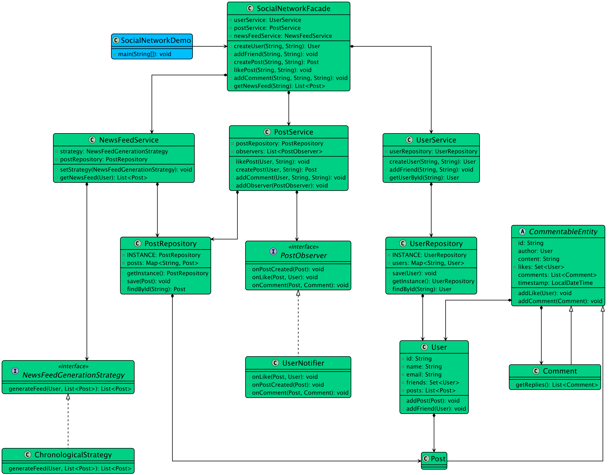

# Low-level design problem: social networking service

> Copied from <https://github.com/ashishps1/awesome-low-level-design/blob/main/problems/social-networking-service.md> (GPL-3.0, by Ashish Pratap Singh). Questions and answers are the source's own; nothing was answered or rewritten here.


# Designing a Social Network Like Facebook

## Requirements
#### User Registration and Authentication:
- Users should be able to create an account with their personal information, such as name, email, and password.
- Users should be able to log in and log out of their accounts securely.
#### User Profiles:
- Each user should have a profile with their information, such as profile picture, bio, and interests.
- Users should be able to update their profile information.
#### Friend Connections:
- Users should be able to send friend requests to other users.
- Users should be able to accept or decline friend requests.
- Users should be able to view their list of friends.
#### Posts and Newsfeed:
- Users should be able to create posts with text, images, or videos.
- Users should be able to view a newsfeed consisting of posts from their friends and their own posts.
- The newsfeed should be sorted in reverse chronological order.
#### Likes and Comments:
- Users should be able to like and comment on posts.
- Users should be able to view the list of likes and comments on a post.
#### Privacy and Security:
- Users should be able to control the visibility of their posts and profile information.
- The system should enforce secure access control to ensure data privacy.
#### Notifications:
- Users should receive notifications for events such as friend requests, likes, comments, and mentions.
- Notifications should be delivered in real-time.
#### Scalability and Performance:
- The system should be designed to handle a large number of concurrent users and high traffic load.
- The system should be scalable and efficient in terms of resource utilization.

## UML Class Diagram



## Implementations
#### [Java Implementation](https://github.com/ashishps1/awesome-low-level-design/blob/main/solutions/java/src/socialnetworkingservice) 
#### [Python Implementation](https://github.com/ashishps1/awesome-low-level-design/blob/main/solutions/python/socialnetworkingservice)
#### [C++ Implementation](https://github.com/ashishps1/awesome-low-level-design/blob/main/solutions/cpp/socialnetworkingservice)
#### [C# Implementation](https://github.com/ashishps1/awesome-low-level-design/blob/main/solutions/csharp/socialnetworkingservice)
#### [Go Implementation](https://github.com/ashishps1/awesome-low-level-design/blob/main/solutions/golang/socialnetworkingservice)

## Classes, Interfaces and Enumerations
1. The **User** class represents a user in the social networking system, containing properties such as ID, name, email, password, profile picture, bio, list of friends, and list of posts.
2. The **Post** class represents a post created by a user, containing properties such as ID, user ID, content, image URLs, video URLs, timestamp, likes, and comments.
3. The **Comment** class represents a comment made by a user on a post, containing properties such as ID, user ID, post ID, content, and timestamp.
4. The **Notification** class represents a notification generated for a user, containing properties such as ID, user ID, notification type, content, and timestamp.
5. The **NotificationType** enum defines the different types of notifications, such as friend request, friend request accepted, like, comment, and mention.
6. The **SocialNetworkingService** class is the main class that manages the social networking system. It follows the Singleton pattern to ensure only one instance of the service exists.
7. The SocialNetworkingService class provides methods for user registration, login, profile updates, friend requests, post creation, newsfeed generation, likes, comments, and notifications.
8. Multi-threading is achieved using concurrent data structures such as ConcurrentHashMap and CopyOnWriteArrayList to handle concurrent access to shared resources.
9. The **SocialNetworkingDemo** class demonstrates the usage of the social networking system by registering users, logging in, sending friend requests, creating posts, liking posts, commenting on posts, and retrieving newsfeed and notifications.

---

## Official solutions from the repository

<details><summary><b>java</b> (16 files)</summary>


**README.md**

```md
Facade Pattern: The SocialNetworkFacade is the main entry point for the client. It provides a simple, unified interface (createPost, addFriend, getNewsFeed) to the complex subsystem of services and repositories.

Observer Pattern: The PostService acts as a Subject. When a user creates a post, it notifies all registered Observers (like a NewsFeedNotifier). This decouples the action of posting from the consequence of updating news feeds.

Strategy Pattern: The NewsFeedService uses a NewsFeedGenerationStrategy to generate a user's news feed. The default is a ChronologicalStrategy, but this can be easily swapped for a more complex algorithm.

Composite Pattern: To model comments and replies, the Commentable interface is used. Both Post and Comment implement this interface, allowing them to be treated uniformly. A comment can be added to a post or to another comment, forming a tree structure.

Singleton Pattern: The Repository classes are implemented as Singletons to provide a global, in-memory data store for this simulation.

Repository Pattern: This pattern is used to abstract the data access layer. Services interact with UserRepository and PostRepository interfaces, completely decoupling them from the underlying data storage mechanism (which is a ConcurrentHashMap in this case).
```


**SocialNetworkDemo.java**

```java
package socialnetworkingservice;

import socialnetworkingservice.model.Post;
import socialnetworkingservice.model.User;

import java.util.List;

public class SocialNetworkDemo {
    public static void main(String[] args) {
        SocialNetworkFacade socialNetwork = new SocialNetworkFacade();

        System.out.println("----------- 1. Creating Users -----------");
        User alice = socialNetwork.createUser("Alice", "alice@example.com");
        User bob = socialNetwork.createUser("Bob", "bob@example.com");
        User charlie = socialNetwork.createUser("Charlie", "charlie@example.com");
        System.out.println("Created users: " + alice.getName() + ", " + bob.getName() + ", " + charlie.getName());

        System.out.println("\n----------- 2. Building Friendships -----------");
        socialNetwork.addFriend(alice.getId(), bob.getId());
        socialNetwork.addFriend(bob.getId(), charlie.getId());
        System.out.println(alice.getName() + " and " + bob.getName() + " are now friends.");
        System.out.println(bob.getName() + " and " + charlie.getName() + " are now friends.");

        System.out.println("\n----------- 3. Users Create Posts -----------");
        Post alicePost = socialNetwork.createPost(alice.getId(), "Hello from Alice!");
        Post bobPost = socialNetwork.createPost(bob.getId(), "It's a beautiful day!");
        Post charliePost = socialNetwork.createPost(charlie.getId(), "Thinking about design patterns.");

        System.out.println("\n----------- 4. Users Interact with Posts -----------");
        socialNetwork.addComment(bob.getId(), alicePost.getId(), "Hey Alice, nice to see you here!");
        socialNetwork.likePost(charlie.getId(), alicePost.getId());

        System.out.println("\n----------- 5. Viewing News Feeds (Strategy Pattern) -----------");

        System.out.println("\n--- Alice's News Feed (should see Bob's post) ---");
        List<Post> alicesFeed = socialNetwork.getNewsFeed(alice.getId());
        printFeed(alicesFeed);

        System.out.println("\n--- Bob's News Feed (should see Alice's, and Charlie's post) ---");
        List<Post> bobsFeed = socialNetwork.getNewsFeed(bob.getId());
        printFeed(bobsFeed);

        System.out.println("\n--- Charlie's News Feed (should see Bob's post) ---");
        List<Post> charliesFeed = socialNetwork.getNewsFeed(charlie.getId());
        printFeed(charliesFeed);
    }

    private static void printFeed(List<Post> feed) {
        if (feed.isEmpty()) {
            System.out.println("  No posts in the feed.");
            return;
        }
        feed.forEach(post -> {
            System.out.println("  Post by " + post.getAuthor().getName() + " at " + post.getTimestamp());
            System.out.println("    \"" + post.getContent() + "\"");
            System.out.println("    Likes: " + post.getLikes().size() + ", Comments: " + post.getComments().size());
        });
    }
}
```


**SocialNetworkFacade.java**

```java
package socialnetworkingservice;

import socialnetworkingservice.model.Post;
import socialnetworkingservice.model.User;
import socialnetworkingservice.observer.UserNotifier;
import socialnetworkingservice.service.NewsFeedService;
import socialnetworkingservice.service.PostService;
import socialnetworkingservice.service.UserService;

import java.util.List;

public class SocialNetworkFacade {
    private final UserService userService;
    private final PostService postService;
    private final NewsFeedService newsFeedService;

    public SocialNetworkFacade() {
        this.userService = new UserService();
        this.postService = new PostService();
        this.newsFeedService = new NewsFeedService();
        // Wire up the observer
        postService.addObserver(new UserNotifier());
    }

    public User createUser(String name, String email) {
        return userService.createUser(name, email);
    }

    public void addFriend(String userId1, String userId2) {
        userService.addFriend(userId1, userId2);
    }

    public Post createPost(String authorId, String content) {
        User author = userService.getUserById(authorId);
        return postService.createPost(author, content);
    }

    public void addComment(String userId, String postId, String content) {
        User user = userService.getUserById(userId);
        postService.addComment(user, postId, content);
    }

    public void likePost(String userId, String postId) {
        User user = userService.getUserById(userId);
        postService.likePost(user, postId);
    }

    public List<Post> getNewsFeed(String userId) {
        User user = userService.getUserById(userId);
        return newsFeedService.getNewsFeed(user);
    }
}
```


**model/Comment.java**

```java
package socialnetworkingservice.model;

import java.util.List;

public class Comment extends CommentableEntity {
    public Comment(User author, String content) {
        super(author, content);
    }

    public List<Comment> getReplies() {
        return getComments();
    }
}
```


**model/CommentableEntity.java**

```java
package socialnetworkingservice.model;

import java.time.LocalDateTime;
import java.util.*;

public abstract class CommentableEntity {
    protected final String id;
    protected final User author;
    protected final String content;
    protected final LocalDateTime timestamp;
    private final Set<User> likes = new HashSet<>();
    protected final List<Comment> comments = new ArrayList<>();

    public CommentableEntity(User author, String content) {
        this.id = UUID.randomUUID().toString();
        this.author = author;
        this.content = content;
        this.timestamp = LocalDateTime.now();
    }

    public void addLike(User user) {
        likes.add(user);
    }

    public void addComment(Comment comment) {
        comments.add(comment);
    }

    public String getId() { return id; }
    public User getAuthor() { return author; }
    public String getContent() { return content; }
    public LocalDateTime getTimestamp() { return timestamp; }
    public List<Comment> getComments() { return comments; }
    public Set<User> getLikes() {
        return likes;
    }
}
```


**model/Post.java**

```java
package socialnetworkingservice.model;

public class Post extends CommentableEntity {
    public Post(User author, String content) {
        super(author, content);
    }
}
```


**model/User.java**

```java
package socialnetworkingservice.model;

import java.util.*;

public class User {
    private final String id;
    private final String name;
    private final String email;
    private final Set<User> friends = new HashSet<>();
    private final List<Post> posts = new ArrayList<>();

    public User(String name, String email) {
        this.id = UUID.randomUUID().toString();
        this.name = name;
        this.email = email;
    }

    public void addFriend(User friend) {
        friends.add(friend);
    }

    public  void addPost(Post post) {
        posts.add(post);
    }

    public String getId() { return id; }
    public String getName() { return name; }
    public Set<User> getFriends() { return friends; }
    public List<Post> getPosts() { return posts; }
}
```


**observer/PostObserver.java**

```java
package socialnetworkingservice.observer;

import socialnetworkingservice.model.Comment;
import socialnetworkingservice.model.Post;
import socialnetworkingservice.model.User;

public interface PostObserver {
    void onPostCreated(Post post);
    void onLike(Post post, User user);
    void onComment(Post post, Comment comment);
}
```


**observer/UserNotifier.java**

```java
package socialnetworkingservice.observer;

import socialnetworkingservice.model.Comment;
import socialnetworkingservice.model.Post;
import socialnetworkingservice.model.User;

public class UserNotifier implements PostObserver {
    @Override
    public void onPostCreated(Post post) {
        User author = post.getAuthor();
        for (User friend: author.getFriends()) {
            System.out.println("Notification for " + friend.getName() + ": " + author.getName() + " created a new post: " + post.getContent());
        }
    }

    @Override
    public void onLike(Post post, User user) {
        User author = post.getAuthor();
        System.out.println("Notification for " + author.getName() + ": " + user.getName() + " liked your post");
    }

    @Override
    public void onComment(Post post, Comment comment) {
        User author = post.getAuthor();
        System.out.println("Notification for " + author.getName() + ": " + comment.getAuthor().getName() + " commented on your post");
    }
}
```


**repository/PostRepository.java**

```java
package socialnetworkingservice.repository;

import socialnetworkingservice.model.Post;

import java.util.Map;
import java.util.concurrent.ConcurrentHashMap;

public class PostRepository {
    private static final PostRepository INSTANCE = new PostRepository();
    private final Map<String, Post> posts = new ConcurrentHashMap<>();

    private PostRepository() {}

    public static PostRepository getInstance() { return INSTANCE; }

    public void save(Post post) {
        posts.put(post.getId(), post);
    }

    public Post findById(String id) {
        return posts.get(id);
    }
}
```


**repository/UserRepository.java**

```java
package socialnetworkingservice.repository;

import socialnetworkingservice.model.User;

import java.util.Map;
import java.util.concurrent.ConcurrentHashMap;

public class UserRepository {
    private static final UserRepository INSTANCE = new UserRepository();
    private final Map<String, User> users = new ConcurrentHashMap<>();

    private UserRepository() {}

    public static UserRepository getInstance() {
        return INSTANCE;
    }

    public void save(User user) {
        users.put(user.getId(), user);
    }

    public User findById(String id) {
        return users.get(id);
    }
}
```


**service/NewsFeedService.java**

```java
package socialnetworkingservice.service;

import socialnetworkingservice.model.Post;
import socialnetworkingservice.model.User;
import socialnetworkingservice.strategy.ChronologicalStrategy;
import socialnetworkingservice.strategy.NewsFeedGenerationStrategy;

import java.util.List;

public class NewsFeedService {
    private NewsFeedGenerationStrategy strategy;

    public NewsFeedService() {
        this.strategy = new ChronologicalStrategy(); // Default strategy
    }

    public void setStrategy(NewsFeedGenerationStrategy strategy) {
        this.strategy = strategy;
    }

    public List<Post> getNewsFeed(User user) {
        return strategy.generateFeed(user);
    }
}
```


**service/PostService.java**

```java
package socialnetworkingservice.service;

import socialnetworkingservice.model.Comment;
import socialnetworkingservice.model.Post;
import socialnetworkingservice.model.User;
import socialnetworkingservice.observer.PostObserver;
import socialnetworkingservice.repository.PostRepository;

import java.util.ArrayList;
import java.util.List;

public class PostService {
    private final PostRepository postRepository = PostRepository.getInstance();
    private final List<PostObserver> observers = new ArrayList<>();

    public void addObserver(PostObserver observer) { observers.add(observer); }

    public Post createPost(User author, String content) {
        Post post = new Post(author, content);
        postRepository.save(post);
        author.addPost(post);
        observers.forEach(observer -> observer.onPostCreated(post)); // Notify observers
        return post;
    }

    public void likePost(User user, String postId) {
        Post post = postRepository.findById(postId);
        post.addLike(user);
        observers.forEach(observer -> observer.onLike(post, user));
    }

    public void addComment(User author, String commentableId, String content) {
        Comment comment = new Comment(author, content);
        Post post = postRepository.findById(commentableId);
        post.addComment(comment);
        observers.forEach(observer -> observer.onComment(post, comment));
    }
}
```


**service/UserService.java**

```java
package socialnetworkingservice.service;

import socialnetworkingservice.model.User;
import socialnetworkingservice.repository.UserRepository;

public class UserService {
    private final UserRepository userRepository = UserRepository.getInstance();

    public User createUser(String name, String email) {
        User user = new User(name, email);
        userRepository.save(user);
        return user;
    }

    public void addFriend(String userId1, String userId2) {
        User user1 = userRepository.findById(userId1);
        User user2 = userRepository.findById(userId2);

        user1.addFriend(user2);
        user2.addFriend(user1);
    }

    public User getUserById(String userId) {
        return userRepository.findById(userId);
    }
}
```


**strategy/ChronologicalStrategy.java**

```java
package socialnetworkingservice.strategy;

import socialnetworkingservice.model.Post;
import socialnetworkingservice.model.User;

import java.util.ArrayList;
import java.util.List;
import java.util.Set;

public class ChronologicalStrategy implements NewsFeedGenerationStrategy {
    @Override
    public List<Post> generateFeed(User user) {
        Set<User> friends = user.getFriends();
        List<Post> feed = new ArrayList<>();

        for (User friend: friends) {
            feed.addAll(friend.getPosts());
        }

        // Sort posts by timestamp in reverse (most recent first)
        feed.sort((p1, p2) -> p2.getTimestamp().compareTo(p1.getTimestamp()));

        return feed;
    }
}
```


**strategy/NewsFeedGenerationStrategy.java**

```java
package socialnetworkingservice.strategy;

import socialnetworkingservice.model.Post;
import socialnetworkingservice.model.User;

import java.util.List;

public interface NewsFeedGenerationStrategy {
    List<Post> generateFeed(User user);
}
```

</details>

<details><summary><b>python</b> (11 files)</summary>


**README.md**

```md
# Designing a Social Network Like Facebook

## Requirements
#### User Registration and Authentication:
- Users should be able to create an account with their personal information, such as name, email, and password.
- Users should be able to log in and log out of their accounts securely.
#### User Profiles:
- Each user should have a profile with their information, such as profile picture, bio, and interests.
- Users should be able to update their profile information.
#### Friend Connections:
- Users should be able to send friend requests to other users.
- Users should be able to accept or decline friend requests.
- Users should be able to view their list of friends.
#### Posts and Newsfeed:
- Users should be able to create posts with text, images, or videos.
- Users should be able to view a newsfeed consisting of posts from their friends and their own posts.
- The newsfeed should be sorted in reverse chronological order.
#### Likes and Comments:
- Users should be able to like and comment on posts.
- Users should be able to view the list of likes and comments on a post.
#### Privacy and Security:
- Users should be able to control the visibility of their posts and profile information.
- The system should enforce secure access control to ensure data privacy.
#### Notifications:
- Users should receive notifications for events such as friend requests, likes, comments, and mentions.
- Notifications should be delivered in real-time.
#### Scalability and Performance:
- The system should be designed to handle a large number of concurrent users and high traffic load.
- The system should be scalable and efficient in terms of resource utilization.

## Classes, Interfaces and Enumerations
1. The **User** class represents a user in the social networking system, containing properties such as ID, name, email, password, profile picture, bio, list of friends, and list of posts.
2. The **Post** class represents a post created by a user, containing properties such as ID, user ID, content, image URLs, video URLs, timestamp, likes, and comments.
3. The **Comment** class represents a comment made by a user on a post, containing properties such as ID, user ID, post ID, content, and timestamp.
4. The **Notification** class represents a notification generated for a user, containing properties such as ID, user ID, notification type, content, and timestamp.
5. The **NotificationType** enum defines the different types of notifications, such as friend request, friend request accepted, like, comment, and mention.
6. The **SocialNetworkingService** class is the main class that manages the social networking system. It follows the Singleton pattern to ensure only one instance of the service exists.
7. The SocialNetworkingService class provides methods for user registration, login, profile updates, friend requests, post creation, newsfeed generation, likes, comments, and notifications.
8. Multi-threading is achieved using concurrent data structures such as ConcurrentHashMap and CopyOnWriteArrayList to handle concurrent access to shared resources.
9. The **SocialNetworkingDemo** class demonstrates the usage of the social networking system by registering users, logging in, sending friend requests, creating posts, liking posts, commenting on posts, and retrieving newsfeed and notifications.
```


**commentable_entity.py**

```py
from datetime import datetime
from typing import List, Set
import uuid
from typing import TYPE_CHECKING

if TYPE_CHECKING:
    from user import User

class CommentableEntity:
    def __init__(self, author: 'User', content: str):
        self.id = str(uuid.uuid4())
        self.author = author
        self.content = content
        self.timestamp = datetime.now()
        self.likes: Set['User'] = set()
        self.comments: List['Comment'] = []

    def add_like(self, user: 'User'):
        self.likes.add(user)

    def add_comment(self, comment: 'Comment'):
        self.comments.append(comment)

    def get_id(self) -> str:
        return self.id

    def get_author(self) -> 'User':
        return self.author

    def get_content(self) -> str:
        return self.content

    def get_timestamp(self) -> datetime:
        return self.timestamp

    def get_comments(self) -> List['Comment']:
        return self.comments

    def get_likes(self) -> Set['User']:
        return self.likes

class Post(CommentableEntity):
    def __init__(self, author: 'User', content: str):
        super().__init__(author, content)

class Comment(CommentableEntity):
    def __init__(self, author: 'User', content: str):
        super().__init__(author, content)

    def get_replies(self) -> List['Comment']:
        return self.get_comments()
```


**newsfeed_service.py**

```py
from strategy import NewsFeedGenerationStrategy, ChronologicalStrategy
from user import User
from typing import List
from commentable_entity import Post

class NewsFeedService:
    def __init__(self):
        self.strategy = ChronologicalStrategy()  # Default strategy

    def set_strategy(self, strategy: NewsFeedGenerationStrategy):
        self.strategy = strategy

    def get_news_feed(self, user: User) -> List[Post]:
        return self.strategy.generate_feed(user)
```


**post_observer.py**

```py
from abc import ABC, abstractmethod
from user import User
from commentable_entity import Post, Comment

class PostObserver(ABC):
    @abstractmethod
    def on_post_created(self, post: Post):
        pass

    @abstractmethod
    def on_like(self, post: Post, user: User):
        pass

    @abstractmethod
    def on_comment(self, post: Post, comment: Comment):
        pass

class UserNotifier(PostObserver):
    def on_post_created(self, post: Post):
        author = post.get_author()
        for friend in author.get_friends():
            print(f"Notification for {friend.get_name()}: {author.get_name()} created a new post: {post.get_content()}")

    def on_like(self, post: Post, user: User):
        author = post.get_author()
        print(f"Notification for {author.get_name()}: {user.get_name()} liked your post")

    def on_comment(self, post: Post, comment: Comment):
        author = post.get_author()
        print(f"Notification for {author.get_name()}: {comment.get_author().get_name()} commented on your post")
```


**post_service.py**

```py
from post_observer import PostObserver
from repository import PostRepository
from user import User
from typing import List
from commentable_entity import Post, Comment

class PostService:
    def __init__(self):
        self.post_repository = PostRepository.get_instance()
        self.observers: List[PostObserver] = []

    def add_observer(self, observer: PostObserver):
        self.observers.append(observer)

    def create_post(self, author: User, content: str) -> Post:
        post = Post(author, content)
        self.post_repository.save(post)
        author.add_post(post)
        for observer in self.observers:
            observer.on_post_created(post)
        return post

    def like_post(self, user: User, post_id: str):
        post = self.post_repository.find_by_id(post_id)
        post.add_like(user)
        for observer in self.observers:
            observer.on_like(post, user)

    def add_comment(self, author: User, commentable_id: str, content: str):
        comment = Comment(author, content)
        post = self.post_repository.find_by_id(commentable_id)
        post.add_comment(comment)
        for observer in self.observers:
            observer.on_comment(post, comment)
```


**repository.py**

```py
from user import User
from typing import Optional
from threading import Lock
from commentable_entity import Post

class UserRepository:
    _instance = None
    _lock = Lock()

    def __new__(cls):
        if cls._instance is None:
            with cls._lock:
                if cls._instance is None:
                    cls._instance = super().__new__(cls)
                    cls._instance.users = {}
        return cls._instance

    @classmethod
    def get_instance(cls):
        return cls()

    def save(self, user: User):
        self.users[user.get_id()] = user

    def find_by_id(self, user_id: str) -> Optional[User]:
        return self.users.get(user_id)

class PostRepository:
    _instance = None
    _lock = Lock()

    def __new__(cls):
        if cls._instance is None:
            with cls._lock:
                if cls._instance is None:
                    cls._instance = super().__new__(cls)
                    cls._instance.posts = {}
        return cls._instance

    @classmethod
    def get_instance(cls):
        return cls()

    def save(self, post: Post):
        self.posts[post.get_id()] = post

    def find_by_id(self, post_id: str) -> Optional[Post]:
        return self.posts.get(post_id)
```


**social_network_facade.py**

```py
from user_service import UserService
from post_service import PostService
from newsfeed_service import NewsFeedService
from post_observer import UserNotifier
from user import User
from typing import List
from commentable_entity import Post

class SocialNetworkFacade:
    def __init__(self):
        self.user_service = UserService()
        self.post_service = PostService()
        self.news_feed_service = NewsFeedService()
        # Wire up the observer
        self.post_service.add_observer(UserNotifier())

    def create_user(self, name: str, email: str) -> User:
        return self.user_service.create_user(name, email)

    def add_friend(self, user_id1: str, user_id2: str):
        self.user_service.add_friend(user_id1, user_id2)

    def create_post(self, author_id: str, content: str) -> Post:
        author = self.user_service.get_user_by_id(author_id)
        return self.post_service.create_post(author, content)

    def add_comment(self, user_id: str, post_id: str, content: str):
        user = self.user_service.get_user_by_id(user_id)
        self.post_service.add_comment(user, post_id, content)

    def like_post(self, user_id: str, post_id: str):
        user = self.user_service.get_user_by_id(user_id)
        self.post_service.like_post(user, post_id)

    def get_news_feed(self, user_id: str) -> List[Post]:
        user = self.user_service.get_user_by_id(user_id)
        return self.news_feed_service.get_news_feed(user)
```


**social_networking_service_demo.py**

```py
from datetime import datetime
from user import User
from typing import List
from commentable_entity import Post, Comment
from social_network_facade import SocialNetworkFacade

def print_feed(feed: List[Post]):
    if not feed:
        print("  No posts in the feed.")
        return
    
    for post in feed:
        print(f"  Post by {post.get_author().get_name()} at {post.get_timestamp()}")
        print(f"    \"{post.get_content()}\"")
        print(f"    Likes: {len(post.get_likes())}, Comments: {len(post.get_comments())}")

class SocialNetworkingServiceDemo:
    def run():
        social_network = SocialNetworkFacade()

        print("----------- 1. Creating Users -----------")
        alice = social_network.create_user("Alice", "alice@example.com")
        bob = social_network.create_user("Bob", "bob@example.com")
        charlie = social_network.create_user("Charlie", "charlie@example.com")
        print(f"Created users: {alice.get_name()}, {bob.get_name()}, {charlie.get_name()}")

        print("\n----------- 2. Building Friendships -----------")
        social_network.add_friend(alice.get_id(), bob.get_id())
        social_network.add_friend(bob.get_id(), charlie.get_id())
        print(f"{alice.get_name()} and {bob.get_name()} are now friends.")
        print(f"{bob.get_name()} and {charlie.get_name()} are now friends.")

        print("\n----------- 3. Users Create Posts -----------")
        alice_post = social_network.create_post(alice.get_id(), "Hello from Alice!")
        bob_post = social_network.create_post(bob.get_id(), "It's a beautiful day!")
        charlie_post = social_network.create_post(charlie.get_id(), "Thinking about design patterns.")

        print("\n----------- 4. Users Interact with Posts -----------")
        social_network.add_comment(bob.get_id(), alice_post.get_id(), "Hey Alice, nice to see you here!")
        social_network.like_post(charlie.get_id(), alice_post.get_id())

        print("\n----------- 5. Viewing News Feeds (Strategy Pattern) -----------")

        print("\n--- Alice's News Feed (should see Bob's post) ---")
        alices_feed = social_network.get_news_feed(alice.get_id())
        print_feed(alices_feed)

        print("\n--- Bob's News Feed (should see Alice's, and Charlie's post) ---")
        bobs_feed = social_network.get_news_feed(bob.get_id())
        print_feed(bobs_feed)

        print("\n--- Charlie's News Feed (should see Bob's post) ---")
        charlies_feed = social_network.get_news_feed(charlie.get_id())
        print_feed(charlies_feed)

if __name__ == "__main__":
    SocialNetworkingServiceDemo.run()
```


**strategy.py**

```py
from abc import ABC, abstractmethod
from user import User
from typing import List
from commentable_entity import Post

class NewsFeedGenerationStrategy(ABC):
    @abstractmethod
    def generate_feed(self, user: User) -> List[Post]:
        pass

class ChronologicalStrategy(NewsFeedGenerationStrategy):
    def generate_feed(self, user: User) -> List[Post]:
        friends = user.get_friends()
        feed = []

        for friend in friends:
            feed.extend(friend.get_posts())

        # Sort posts by timestamp in reverse (most recent first)
        feed.sort(key=lambda p: p.get_timestamp(), reverse=True)

        return feed
```


**user.py**

```py
from typing import List, Set
import uuid
from commentable_entity import Post

class User:
    def __init__(self, name: str, email: str):
        self.id = str(uuid.uuid4())
        self.name = name
        self.email = email
        self.friends: Set['User'] = set()
        self.posts: List[Post] = []

    def add_friend(self, friend: 'User'):
        self.friends.add(friend)

    def add_post(self, post: Post):
        self.posts.append(post)

    def get_id(self) -> str:
        return self.id

    def get_name(self) -> str:
        return self.name

    def get_friends(self) -> Set['User']:
        return self.friends

    def get_posts(self) -> List[Post]:
        return self.posts
```


**user_service.py**

```py
from user import User
from repository import UserRepository
from typing import Optional

class UserService:
    def __init__(self):
        self.user_repository = UserRepository.get_instance()

    def create_user(self, name: str, email: str) -> User:
        user = User(name, email)
        self.user_repository.save(user)
        return user

    def add_friend(self, user_id1: str, user_id2: str):
        user1 = self.user_repository.find_by_id(user_id1)
        user2 = self.user_repository.find_by_id(user_id2)

        user1.add_friend(user2)
        user2.add_friend(user1)

    def get_user_by_id(self, user_id: str) -> Optional[User]:
        return self.user_repository.find_by_id(user_id)
```

</details>

<details><summary><b>cpp</b> (8 files)</summary>


**Post.cpp**

```cpp
#include "Post.hpp"
#include <iostream>
#include <algorithm>

Post::Post(std::string postId, std::string userId, std::string content)
    : postId(postId), userId(userId), content(content) {
    timestamp = std::time(nullptr);
}

std::string Post::getPostId() const { return postId; }
std::string Post::getUserId() const { return userId; }
std::string Post::getContent() const { return content; }
std::time_t Post::getTimestamp() const { return timestamp; }
const std::vector<std::string>& Post::getLikes() const { return likes; }
const std::vector<std::string>& Post::getComments() const { return comments; }

void Post::addLike(const std::string& userId) {
    if (std::find(likes.begin(), likes.end(), userId) == likes.end()) {
        likes.push_back(userId);
    }
}

void Post::removeLike(const std::string& userId) {
    auto it = std::find(likes.begin(), likes.end(), userId);
    if (it != likes.end()) {
        likes.erase(it);
    }
}

void Post::addComment(const std::string& comment) {
    comments.push_back(comment);
}

void Post::displayInfo() const {
    std::cout << "\nPost ID: " << postId << std::endl;
    std::cout << "Content: " << content << std::endl;
    std::cout << "Time: " << std::ctime(&timestamp);
    std::cout << "Likes: " << likes.size() << std::endl;
    
    if (!comments.empty()) {
        std::cout << "Comments:" << std::endl;
        for (const auto& comment : comments) {
            std::cout << "- " << comment << std::endl;
        }
    }
}
```


**Post.hpp**

```hpp
#ifndef POST_HPP
#define POST_HPP

#include <string>
#include <vector>
#include <ctime>

class Post {
private:
    std::string postId;
    std::string userId;
    std::string content;
    std::time_t timestamp;
    std::vector<std::string> likes;  // Vector of userIds who liked
    std::vector<std::string> comments;

public:
    Post(std::string postId, std::string userId, std::string content);
    
    std::string getPostId() const;
    std::string getUserId() const;
    std::string getContent() const;
    std::time_t getTimestamp() const;
    const std::vector<std::string>& getLikes() const;
    const std::vector<std::string>& getComments() const;
    
    void addLike(const std::string& userId);
    void removeLike(const std::string& userId);
    void addComment(const std::string& comment);
    void displayInfo() const;
};

#endif
```


**README.md**

```md
# Designing a Social Network Like Facebook

## Requirements
#### User Registration and Authentication:
- Users should be able to create an account with their personal information, such as name, email, and password.
- Users should be able to log in and log out of their accounts securely.
#### User Profiles:
- Each user should have a profile with their information, such as profile picture, bio, and interests.
- Users should be able to update their profile information.
#### Friend Connections:
- Users should be able to send friend requests to other users.
- Users should be able to accept or decline friend requests.
- Users should be able to view their list of friends.
#### Posts and Newsfeed:
- Users should be able to create posts with text, images, or videos.
- Users should be able to view a newsfeed consisting of posts from their friends and their own posts.
- The newsfeed should be sorted in reverse chronological order.
#### Likes and Comments:
- Users should be able to like and comment on posts.
- Users should be able to view the list of likes and comments on a post.
#### Privacy and Security:
- Users should be able to control the visibility of their posts and profile information.
- The system should enforce secure access control to ensure data privacy.
#### Notifications:
- Users should receive notifications for events such as friend requests, likes, comments, and mentions.
- Notifications should be delivered in real-time.
#### Scalability and Performance:
- The system should be designed to handle a large number of concurrent users and high traffic load.
- The system should be scalable and efficient in terms of resource utilization.

## Classes, Interfaces and Enumerations
1. The **User** class represents a user in the social networking system, containing properties such as ID, name, email, password, profile picture, bio, list of friends, and list of posts.
2. The **Post** class represents a post created by a user, containing properties such as ID, user ID, content, image URLs, video URLs, timestamp, likes, and comments.
3. The **Comment** class represents a comment made by a user on a post, containing properties such as ID, user ID, post ID, content, and timestamp.
4. The **Notification** class represents a notification generated for a user, containing properties such as ID, user ID, notification type, content, and timestamp.
5. The **NotificationType** enum defines the different types of notifications, such as friend request, friend request accepted, like, comment, and mention.
6. The **SocialNetworkingService** class is the main class that manages the social networking system. It follows the Singleton pattern to ensure only one instance of the service exists.
7. The SocialNetworkingService class provides methods for user registration, login, profile updates, friend requests, post creation, newsfeed generation, likes, comments, and notifications.
8. Multi-threading is achieved using concurrent data structures such as ConcurrentHashMap and CopyOnWriteArrayList to handle concurrent access to shared resources.
9. The **SocialNetworkingDemo** class demonstrates the usage of the social networking system by registering users, logging in, sending friend requests, creating posts, liking posts, commenting on posts, and retrieving newsfeed and notifications.
```


**SocialNetwork.cpp**

```cpp
#include "SocialNetwork.hpp"
#include <iostream>
#include <algorithm>

SocialNetwork::SocialNetwork() : userIdCounter(1), postIdCounter(1) {}

SocialNetwork::~SocialNetwork() {
    for (auto user : users) delete user;
    for (auto post : posts) delete post;
}

User* SocialNetwork::registerUser(const std::string& username, const std::string& email) {
    std::string userId = generateUserId();
    User* user = new User(userId, username, email);
    users.push_back(user);
    return user;
}

void SocialNetwork::removeUser(const std::string& userId) {
    auto it = std::find_if(users.begin(), users.end(),
        [userId](User* user) { return user->getUserId() == userId; });
    
    if (it != users.end()) {
        // Remove user from friends lists
        for (auto user : users) {
            user->removeFriend(userId);
        }
        
        // Remove user's posts
        posts.erase(
            std::remove_if(posts.begin(), posts.end(),
                [userId](Post* post) { return post->getUserId() == userId; }),
            posts.end()
        );
        
        delete *it;
        users.erase(it);
    }
}

bool SocialNetwork::addFriend(const std::string& userId1, const std::string& userId2) {
    User* user1 = findUser(userId1);
    User* user2 = findUser(userId2);
    
    if (!user1 || !user2 || userId1 == userId2) return false;
    
    user1->addFriend(userId2);
    user2->addFriend(userId1);
    return true;
}

bool SocialNetwork::removeFriend(const std::string& userId1, const std::string& userId2) {
    User* user1 = findUser(userId1);
    User* user2 = findUser(userId2);
    
    if (!user1 || !user2) return false;
    
    user1->removeFriend(userId2);
    user2->removeFriend(userId1);
    return true;
}

Post* SocialNetwork::createPost(const std::string& userId, const std::string& content) {
    if (!findUser(userId)) return nullptr;
    
    std::string postId = generatePostId();
    Post* post = new Post(postId, userId, content);
    posts.push_back(post);
    return post;
}

bool SocialNetwork::likePost(const std::string& userId, const std::string& postId) {
    User* user = findUser(userId);
    Post* post = findPost(postId);
    
    if (!user || !post) return false;
    
    post->addLike(userId);
    return true;
}

bool SocialNetwork::unlikePost(const std::string& userId, const std::string& postId) {
    User* user = findUser(userId);
    Post* post = findPost(postId);
    
    if (!user || !post) return false;
    
    post->removeLike(userId);
    return true;
}

bool SocialNetwork::addComment(const std::string& postId, const std::string& comment) {
    Post* post = findPost(postId);
    if (!post) return false;
    
    post->addComment(comment);
    return true;
}

void SocialNetwork::displayUserProfile(const std::string& userId) const {
    User* user = findUser(userId);
    if (user) {
        std::cout << "\nUser Profile:" << std::endl;
        user->displayInfo();
    }
}

void SocialNetwork::displayUserFriends(const std::string& userId) const {
    User* user = findUser(userId);
    if (!user) return;
    
    std::cout << "\nFriends of " << user->getUsername() << ":" << std::endl;
    for (const auto& friendId : user->getFriends()) {
        if (User* friend_ = findUser(friendId)) {
            std::cout << "- " << friend_->getUsername() << std::endl;
        }
    }
}

void SocialNetwork::displayUserPosts(const std::string& userId) const {
    User* user = findUser(userId);
    if (!user) return;
    
    std::cout << "\nPosts by " << user->getUsername() << ":" << std::endl;
    for (const auto& post : posts) {
        if (post->getUserId() == userId) {
            post->displayInfo();
        }
    }
}

void SocialNetwork::displayAllUsers() const {
    std::cout << "\nAll Users:" << std::endl;
    for (const auto& user : users) {
        user->displayInfo();
        std::cout << "------------------------" << std::endl;
    }
}

void SocialNetwork::displayAllPosts() const {
    std::cout << "\nAll Posts:" << std::endl;
    for (const auto& post : posts) {
        post->displayInfo();
        std::cout << "------------------------" << std::endl;
    }
}

User* SocialNetwork::findUser(const std::string& userId) const {
    auto it = std::find_if(users.begin(), users.end(),
        [userId](User* user) { return user->getUserId() == userId; });
    return it != users.end() ? *it : nullptr;
}

Post* SocialNetwork::findPost(const std::string& postId) const {
    auto it = std::find_if(posts.begin(), posts.end(),
        [postId](Post* post) { return post->getPostId() == postId; });
    return it != posts.end() ? *it : nullptr;
}

std::string SocialNetwork::generateUserId() {
    return "U" + std::to_string(userIdCounter++);
}

std::string SocialNetwork::generatePostId() {
    return "P" + std::to_string(postIdCounter++);
}
```


**SocialNetwork.hpp**

```hpp
#ifndef SOCIAL_NETWORK_HPP
#define SOCIAL_NETWORK_HPP

#include <vector>
#include <string>
#include "User.hpp"
#include "Post.hpp"

class SocialNetwork {
private:
    std::vector<User*> users;
    std::vector<Post*> posts;
    int userIdCounter;
    int postIdCounter;

public:
    SocialNetwork();
    ~SocialNetwork();
    
    // User management
    User* registerUser(const std::string& username, const std::string& email);
    void removeUser(const std::string& userId);
    bool addFriend(const std::string& userId1, const std::string& userId2);
    bool removeFriend(const std::string& userId1, const std::string& userId2);
    
    // Post management
    Post* createPost(const std::string& userId, const std::string& content);
    bool likePost(const std::string& userId, const std::string& postId);
    bool unlikePost(const std::string& userId, const std::string& postId);
    bool addComment(const std::string& postId, const std::string& comment);
    
    // Display functions
    void displayUserProfile(const std::string& userId) const;
    void displayUserFriends(const std::string& userId) const;
    void displayUserPosts(const std::string& userId) const;
    void displayAllUsers() const;
    void displayAllPosts() const;

private:
    User* findUser(const std::string& userId) const;
    Post* findPost(const std::string& postId) const;
    std::string generateUserId();
    std::string generatePostId();
};

#endif
```


**SocialNetworkDemo.cpp**

```cpp
#include "SocialNetwork.hpp"
#include <iostream>
#include <thread>
#include <chrono>

int main() {
    SocialNetwork network;
    
    // Register users
    User* user1 = network.registerUser("john_doe", "john@email.com");
    User* user2 = network.registerUser("jane_smith", "jane@email.com");
    User* user3 = network.registerUser("bob_wilson", "bob@email.com");
    
    std::cout << "Initial users:" << std::endl;
    network.displayAllUsers();
    
    // Add friends
    network.addFriend(user1->getUserId(), user2->getUserId());
    network.addFriend(user2->getUserId(), user3->getUserId());
    
    // Create posts
    Post* post1 = network.createPost(user1->getUserId(), "Hello, world!");
    Post* post2 = network.createPost(user2->getUserId(), "Having a great day!");
    
    // Like and comment on posts
    network.likePost(user2->getUserId(), post1->getPostId());
    network.likePost(user3->getUserId(), post1->getPostId());
    network.addComment(post1->getPostId(), "Great post!");
    
    network.likePost(user1->getUserId(), post2->getPostId());
    network.addComment(post2->getPostId(), "Glad to hear that!");
    
    // Display user profiles and posts
    std::cout << "\nUser Profiles and Posts:" << std::endl;
    network.displayUserProfile(user1->getUserId());
    network.displayUserFriends(user1->getUserId());
    network.displayUserPosts(user1->getUserId());
    
    network.displayUserProfile(user2->getUserId());
    network.displayUserFriends(user2->getUserId());
    network.displayUserPosts(user2->getUserId());
    
    // Remove a friend and display updated info
    network.removeFriend(user1->getUserId(), user2->getUserId());
    std::cout << "\nAfter removing friendship:" << std::endl;
    network.displayUserFriends(user1->getUserId());
    
    return 0;
}
```


**User.cpp**

```cpp
#include "User.hpp"
#include <iostream>

User::User(std::string userId, std::string username, std::string email)
    : userId(userId), username(username), email(email), active(true) {}

std::string User::getUserId() const { return userId; }
std::string User::getUsername() const { return username; }
std::string User::getEmail() const { return email; }
const std::set<std::string>& User::getFriends() const { return friends; }
bool User::isActive() const { return active; }

void User::addFriend(const std::string& friendId) {
    friends.insert(friendId);
}

void User::removeFriend(const std::string& friendId) {
    friends.erase(friendId);
}

void User::setActive(bool status) {
    active = status;
}

void User::displayInfo() const {
    std::cout << "User: " << username << " (ID: " << userId << ")" << std::endl;
    std::cout << "Email: " << email << std::endl;
    std::cout << "Status: " << (active ? "Active" : "Inactive") << std::endl;
    std::cout << "Friends: " << friends.size() << std::endl;
}
```


**User.hpp**

```hpp
#ifndef USER_HPP
#define USER_HPP

#include <string>
#include <vector>
#include <set>

class User {
private:
    std::string userId;
    std::string username;
    std::string email;
    std::set<std::string> friends;  // Set of friend userIds
    bool active;

public:
    User(std::string userId, std::string username, std::string email);
    
    std::string getUserId() const;
    std::string getUsername() const;
    std::string getEmail() const;
    const std::set<std::string>& getFriends() const;
    bool isActive() const;
    
    void addFriend(const std::string& friendId);
    void removeFriend(const std::string& friendId);
    void setActive(bool status);
    void displayInfo() const;
};

#endif
```

</details>

<details><summary><b>golang</b> (8 files)</summary>


**README.md**

```md
# Designing a Social Network Like Facebook

## Requirements
#### User Registration and Authentication:
- Users should be able to create an account with their personal information, such as name, email, and password.
- Users should be able to log in and log out of their accounts securely.
#### User Profiles:
- Each user should have a profile with their information, such as profile picture, bio, and interests.
- Users should be able to update their profile information.
#### Friend Connections:
- Users should be able to send friend requests to other users.
- Users should be able to accept or decline friend requests.
- Users should be able to view their list of friends.
#### Posts and Newsfeed:
- Users should be able to create posts with text, images, or videos.
- Users should be able to view a newsfeed consisting of posts from their friends and their own posts.
- The newsfeed should be sorted in reverse chronological order.
#### Likes and Comments:
- Users should be able to like and comment on posts.
- Users should be able to view the list of likes and comments on a post.
#### Privacy and Security:
- Users should be able to control the visibility of their posts and profile information.
- The system should enforce secure access control to ensure data privacy.
#### Notifications:
- Users should receive notifications for events such as friend requests, likes, comments, and mentions.
- Notifications should be delivered in real-time.
#### Scalability and Performance:
- The system should be designed to handle a large number of concurrent users and high traffic load.
- The system should be scalable and efficient in terms of resource utilization.

## Classes, Interfaces and Enumerations
1. The **User** class represents a user in the social networking system, containing properties such as ID, name, email, password, profile picture, bio, list of friends, and list of posts.
2. The **Post** class represents a post created by a user, containing properties such as ID, user ID, content, image URLs, video URLs, timestamp, likes, and comments.
3. The **Comment** class represents a comment made by a user on a post, containing properties such as ID, user ID, post ID, content, and timestamp.
4. The **Notification** class represents a notification generated for a user, containing properties such as ID, user ID, notification type, content, and timestamp.
5. The **NotificationType** enum defines the different types of notifications, such as friend request, friend request accepted, like, comment, and mention.
6. The **SocialNetworkingService** class is the main class that manages the social networking system. It follows the Singleton pattern to ensure only one instance of the service exists.
7. The SocialNetworkingService class provides methods for user registration, login, profile updates, friend requests, post creation, newsfeed generation, likes, comments, and notifications.
8. Multi-threading is achieved using concurrent data structures such as ConcurrentHashMap and CopyOnWriteArrayList to handle concurrent access to shared resources.
9. The **SocialNetworkingDemo** class demonstrates the usage of the social networking system by registering users, logging in, sending friend requests, creating posts, liking posts, commenting on posts, and retrieving newsfeed and notifications.
```


**comment.go**

```go
package socialnetworkingservice

import "time"

type Comment struct {
	ID        string
	UserID    string
	PostID    string
	Content   string
	Timestamp time.Time
}

func NewComment(id, userID, postID, content string) *Comment {
	return &Comment{
		ID:        id,
		UserID:    userID,
		PostID:    postID,
		Content:   content,
		Timestamp: time.Now(),
	}
}
```


**notification.go**

```go
package socialnetworkingservice

import "time"

type Notification struct {
	ID        string
	UserID    string
	Type      NotificationType
	Content   string
	Timestamp time.Time
}

func NewNotification(id, userID string, notifType NotificationType, content string) *Notification {
	return &Notification{
		ID:        id,
		UserID:    userID,
		Type:      notifType,
		Content:   content,
		Timestamp: time.Now(),
	}
}
```


**post.go**

```go
package socialnetworkingservice

import (
	"sync"
	"time"
)

type Post struct {
	ID        string
	UserID    string
	Content   string
	ImageURLs []string
	VideoURLs []string
	Timestamp time.Time
	likes     map[string]bool
	comments  []*Comment
	mu        sync.RWMutex
}

func NewPost(id, userID, content string, imageURLs, videoURLs []string) *Post {
	return &Post{
		ID:        id,
		UserID:    userID,
		Content:   content,
		ImageURLs: imageURLs,
		VideoURLs: videoURLs,
		Timestamp: time.Now(),
		likes:     make(map[string]bool),
		comments:  make([]*Comment, 0),
	}
}

func (p *Post) AddLike(userID string) bool {
	p.mu.Lock()
	defer p.mu.Unlock()
	if !p.likes[userID] {
		p.likes[userID] = true
		return true
	}
	return false
}

func (p *Post) AddComment(comment *Comment) {
	p.mu.Lock()
	defer p.mu.Unlock()
	p.comments = append(p.comments, comment)
}

func (p *Post) GetLikes() []string {
	p.mu.RLock()
	defer p.mu.RUnlock()
	likes := make([]string, 0, len(p.likes))
	for userID := range p.likes {
		likes = append(likes, userID)
	}
	return likes
}

func (p *Post) GetComments() []*Comment {
	p.mu.RLock()
	defer p.mu.RUnlock()
	comments := make([]*Comment, len(p.comments))
	copy(comments, p.comments)
	return comments
}
```


**social_networking_service.go**

```go
package socialnetworkingservice

import (
	"fmt"
	"sort"
	"sync"
	"time"
)

type SocialNetwork struct {
	users         map[string]*User
	posts         map[string]*Post
	notifications map[string][]*Notification
	mu            sync.RWMutex
}

var (
	instance *SocialNetwork
	once     sync.Once
)

func GetSocialNetwork() *SocialNetwork {
	once.Do(func() {
		instance = &SocialNetwork{
			users:         make(map[string]*User),
			posts:         make(map[string]*Post),
			notifications: make(map[string][]*Notification),
		}
	})
	return instance
}

func (sn *SocialNetwork) RegisterUser(user *User) error {
	sn.mu.Lock()
	defer sn.mu.Unlock()

	if _, exists := sn.users[user.ID]; exists {
		return fmt.Errorf("user with ID %s already exists", user.ID)
	}
	sn.users[user.ID] = user
	return nil
}

func (sn *SocialNetwork) LoginUser(email, password string) (*User, error) {
	sn.mu.RLock()
	defer sn.mu.RUnlock()

	for _, user := range sn.users {
		if user.Email == email && user.Password == password {
			return user, nil
		}
	}
	return nil, fmt.Errorf("invalid email or password")
}

func (sn *SocialNetwork) UpdateUserProfile(user *User) {
	sn.mu.Lock()
	defer sn.mu.Unlock()
	sn.users[user.ID] = user
}

func (sn *SocialNetwork) SendFriendRequest(senderID, receiverID string) error {
	sn.mu.Lock()
	defer sn.mu.Unlock()

	receiver, exists := sn.users[receiverID]
	if !exists {
		return fmt.Errorf("receiver not found")
	} else {
		fmt.Printf(receiver.ID)
	}

	notification := NewNotification(
		fmt.Sprintf("notif-%d", time.Now().UnixNano()),
		receiverID,
		NotificationTypeFriendRequest,
		fmt.Sprintf("Friend request from %s", senderID),
	)

	sn.addNotification(receiverID, notification)
	return nil
}

func (sn *SocialNetwork) AcceptFriendRequest(userID, friendID string) error {
	sn.mu.Lock()
	defer sn.mu.Unlock()

	user, exists1 := sn.users[userID]
	friend, exists2 := sn.users[friendID]

	if !exists1 || !exists2 {
		return fmt.Errorf("user or friend not found")
	}

	user.AddFriend(friendID)
	friend.AddFriend(userID)

	notification := NewNotification(
		fmt.Sprintf("notif-%d", time.Now().UnixNano()),
		friendID,
		NotificationTypeFriendRequestAccepted,
		fmt.Sprintf("Friend request accepted by %s", userID),
	)

	sn.addNotification(friendID, notification)
	return nil
}

func (sn *SocialNetwork) CreatePost(post *Post) error {
	sn.mu.Lock()
	defer sn.mu.Unlock()

	user, exists := sn.users[post.UserID]
	if !exists {
		return fmt.Errorf("user not found")
	}

	sn.posts[post.ID] = post
	user.AddPost(post)
	return nil
}

func (sn *SocialNetwork) GetNewsfeed(userID string) ([]*Post, error) {
	sn.mu.RLock()
	defer sn.mu.RUnlock()

	user, exists := sn.users[userID]
	if !exists {
		return nil, fmt.Errorf("user not found")
	}

	var newsfeed []*Post

	// Add user's own posts
	newsfeed = append(newsfeed, user.GetPosts()...)

	// Add friends' posts
	for friendID := range user.friends {
		if friend, ok := sn.users[friendID]; ok {
			newsfeed = append(newsfeed, friend.GetPosts()...)
		}
	}

	// Sort by timestamp (newest first)
	sort.Slice(newsfeed, func(i, j int) bool {
		return newsfeed[i].Timestamp.After(newsfeed[j].Timestamp)
	})

	return newsfeed, nil
}

func (sn *SocialNetwork) LikePost(userID, postID string) error {
	sn.mu.Lock()
	defer sn.mu.Unlock()

	post, exists := sn.posts[postID]
	if !exists {
		return fmt.Errorf("post not found")
	}

	if added := post.AddLike(userID); added {
		notification := NewNotification(
			fmt.Sprintf("notif-%d", time.Now().UnixNano()),
			post.UserID,
			NotificationTypeLike,
			fmt.Sprintf("Your post was liked by %s", userID),
		)
		sn.addNotification(post.UserID, notification)
	}
	return nil
}

func (sn *SocialNetwork) CommentOnPost(comment *Comment) error {
	sn.mu.Lock()
	defer sn.mu.Unlock()

	post, exists := sn.posts[comment.PostID]
	if !exists {
		return fmt.Errorf("post not found")
	}

	post.AddComment(comment)

	notification := NewNotification(
		fmt.Sprintf("notif-%d", time.Now().UnixNano()),
		post.UserID,
		NotificationTypeComment,
		fmt.Sprintf("Your post received a comment from %s", comment.UserID),
	)
	sn.addNotification(post.UserID, notification)
	return nil
}

func (sn *SocialNetwork) GetNotifications(userID string) ([]*Notification, error) {
	sn.mu.RLock()
	defer sn.mu.RUnlock()

	if _, exists := sn.users[userID]; !exists {
		return nil, fmt.Errorf("user not found")
	}

	return sn.notifications[userID], nil
}

func (sn *SocialNetwork) addNotification(userID string, notification *Notification) {
	sn.notifications[userID] = append(sn.notifications[userID], notification)
}
```


**social_networking_service_demo.go**

```go
package socialnetworkingservice

import (
	"fmt"
	"log"
)

func Run() {
	socialNetwork := GetSocialNetwork()

	// Create users
	user1 := NewUser("1", "John Doe", "john@example.com", "password", "profile1.jpg", "I love coding!")
	user2 := NewUser("2", "Jane Smith", "jane@example.com", "password", "profile2.jpg", "Exploring the world!")

	// Register users
	if err := socialNetwork.RegisterUser(user1); err != nil {
		log.Printf("Failed to register user1: %v", err)
		return
	}
	if err := socialNetwork.RegisterUser(user2); err != nil {
		log.Printf("Failed to register user2: %v", err)
		return
	}

	// Login
	loggedInUser, err := socialNetwork.LoginUser("john@example.com", "password")
	if err != nil {
		log.Printf("Login failed: %v", err)
		return
	}
	fmt.Printf("User logged in: %s\n", loggedInUser.Name)

	// Send friend request
	if err := socialNetwork.SendFriendRequest(user1.ID, user2.ID); err != nil {
		log.Printf("Failed to send friend request: %v", err)
		return
	}

	// Accept friend request
	if err := socialNetwork.AcceptFriendRequest(user2.ID, user1.ID); err != nil {
		log.Printf("Failed to accept friend request: %v", err)
		return
	}

	// Create posts
	post1 := NewPost("post1", user1.ID, "My first post!", []string{}, []string{})
	post2 := NewPost("post2", user2.ID, "Having a great day!", []string{}, []string{})

	if err := socialNetwork.CreatePost(post1); err != nil {
		log.Printf("Failed to create post1: %v", err)
		return
	}
	if err := socialNetwork.CreatePost(post2); err != nil {
		log.Printf("Failed to create post2: %v", err)
		return
	}

	// Like and comment
	if err := socialNetwork.LikePost(user2.ID, post1.ID); err != nil {
		log.Printf("Failed to like post: %v", err)
		return
	}

	comment := NewComment("comment1", user2.ID, post1.ID, "Great post!")
	if err := socialNetwork.CommentOnPost(comment); err != nil {
		log.Printf("Failed to comment on post: %v", err)
		return
	}

	// Get newsfeed
	newsfeed, err := socialNetwork.GetNewsfeed(user1.ID)
	if err != nil {
		log.Printf("Failed to get newsfeed: %v", err)
		return
	}

	fmt.Println("\nNewsfeed:")
	for _, post := range newsfeed {
		fmt.Printf("Post: %s\n", post.Content)
		fmt.Printf("Likes: %d\n", len(post.GetLikes()))
		fmt.Printf("Comments: %d\n\n", len(post.GetComments()))
	}

	// Get notifications
	notifications, err := socialNetwork.GetNotifications(user1.ID)
	if err != nil {
		log.Printf("Failed to get notifications: %v", err)
		return
	}

	fmt.Println("Notifications:")
	for _, notification := range notifications {
		fmt.Printf("Type: %s\n", notification.Type)
		fmt.Printf("Content: %s\n\n", notification.Content)
	}
}
```


**types.go**

```go
package socialnetworkingservice

type NotificationType int

const (
    NotificationTypeFriendRequest NotificationType = iota
    NotificationTypeFriendRequestAccepted
    NotificationTypeLike
    NotificationTypeComment
    NotificationTypeMention
)

func (nt NotificationType) String() string {
    return [...]string{
        "FRIEND_REQUEST",
        "FRIEND_REQUEST_ACCEPTED",
        "LIKE",
        "COMMENT",
        "MENTION",
    }[nt]
}
```


**user.go**

```go
package socialnetworkingservice

import "sync"

type User struct {
	ID             string
	Name           string
	Email          string
	Password       string
	ProfilePicture string
	Bio            string
	friends        map[string]bool
	posts          []*Post
	mu             sync.RWMutex
}

func NewUser(id, name, email, password, profilePicture, bio string) *User {
	return &User{
		ID:             id,
		Name:           name,
		Email:          email,
		Password:       password,
		ProfilePicture: profilePicture,
		Bio:            bio,
		friends:        make(map[string]bool),
		posts:          make([]*Post, 0),
	}
}

func (u *User) AddFriend(friendID string) {
	u.mu.Lock()
	defer u.mu.Unlock()
	u.friends[friendID] = true
}

func (u *User) AddPost(post *Post) {
	u.mu.Lock()
	defer u.mu.Unlock()
	u.posts = append(u.posts, post)
}

func (u *User) GetFriends() []string {
	u.mu.RLock()
	defer u.mu.RUnlock()
	friends := make([]string, 0, len(u.friends))
	for friendID := range u.friends {
		friends = append(friends, friendID)
	}
	return friends
}

func (u *User) GetPosts() []*Post {
	u.mu.RLock()
	defer u.mu.RUnlock()
	posts := make([]*Post, len(u.posts))
	copy(posts, u.posts)
	return posts
}
```

</details>

<details><summary><b>csharp</b> (17 files)</summary>


**Models/Comment.cs**

```cs
class Comment : CommentableEntity
{
    public Comment(User author, string content) : base(author, content) { }

    public List<Comment> GetReplies()
    {
        return GetComments();
    }
}
```


**Models/CommentableEntity.cs**

```cs
abstract class CommentableEntity
{
    protected readonly string id;
    protected readonly User author;
    protected readonly string content;
    protected readonly DateTime timestamp;
    private readonly HashSet<User> likes = new HashSet<User>();
    protected readonly List<Comment> comments = new List<Comment>();

    public CommentableEntity(User author, string content)
    {
        this.id = Guid.NewGuid().ToString();
        this.author = author;
        this.content = content;
        this.timestamp = DateTime.Now;
    }

    public void AddLike(User user)
    {
        likes.Add(user);
    }

    public void AddComment(Comment comment)
    {
        comments.Add(comment);
    }

    public string GetId() { return id; }
    public User GetAuthor() { return author; }
    public string GetContent() { return content; }
    public DateTime GetTimestamp() { return timestamp; }
    public List<Comment> GetComments() { return comments; }
    public HashSet<User> GetLikes() { return likes; }
}
```


**Models/Post.cs**

```cs
class Post : CommentableEntity
{
    public Post(User author, string content) : base(author, content) { }
}
```


**Models/User.cs**

```cs
class User
{
    private readonly string id;
    private readonly string name;
    private readonly string email;
    private readonly HashSet<User> friends = new HashSet<User>();
    private readonly List<Post> posts = new List<Post>();

    public User(string name, string email)
    {
        this.id = Guid.NewGuid().ToString();
        this.name = name;
        this.email = email;
    }

    public void AddFriend(User friend)
    {
        friends.Add(friend);
    }

    public void AddPost(Post post)
    {
        posts.Add(post);
    }

    public string GetId() { return id; }
    public string GetName() { return name; }
    public HashSet<User> GetFriends() { return friends; }
    public List<Post> GetPosts() { return posts; }
}
```


**Observer/IPostObserver.cs**

```cs
interface IPostObserver
{
    void OnPostCreated(Post post);
    void OnLike(Post post, User user);
    void OnComment(Post post, Comment comment);
}
```


**Observer/UserNotifier.cs**

```cs
class UserNotifier : IPostObserver
{
    public void OnPostCreated(Post post)
    {
        User author = post.GetAuthor();
        foreach (User friend in author.GetFriends())
        {
            Console.WriteLine($"Notification for {friend.GetName()}: {author.GetName()} created a new post: {post.GetContent()}");
        }
    }

    public void OnLike(Post post, User user)
    {
        User author = post.GetAuthor();
        Console.WriteLine($"Notification for {author.GetName()}: {user.GetName()} liked your post");
    }

    public void OnComment(Post post, Comment comment)
    {
        User author = post.GetAuthor();
        Console.WriteLine($"Notification for {author.GetName()}: {comment.GetAuthor().GetName()} commented on your post");
    }
}
```


**README.md**

```md
# Designing a Social Network Like Facebook

## Requirements
#### User Registration and Authentication:
- Users should be able to create an account with their personal information, such as name, email, and password.
- Users should be able to log in and log out of their accounts securely.
#### User Profiles:
- Each user should have a profile with their information, such as profile picture, bio, and interests.
- Users should be able to update their profile information.
#### Friend Connections:
- Users should be able to send friend requests to other users.
- Users should be able to accept or decline friend requests.
- Users should be able to view their list of friends.
#### Posts and Newsfeed:
- Users should be able to create posts with text, images, or videos.
- Users should be able to view a newsfeed consisting of posts from their friends and their own posts.
- The newsfeed should be sorted in reverse chronological order.
#### Likes and Comments:
- Users should be able to like and comment on posts.
- Users should be able to view the list of likes and comments on a post.
#### Privacy and Security:
- Users should be able to control the visibility of their posts and profile information.
- The system should enforce secure access control to ensure data privacy.
#### Notifications:
- Users should receive notifications for events such as friend requests, likes, comments, and mentions.
- Notifications should be delivered in real-time.
#### Scalability and Performance:
- The system should be designed to handle a large number of concurrent users and high traffic load.
- The system should be scalable and efficient in terms of resource utilization.

## Classes, Interfaces and Enumerations
1. The **User** class represents a user in the social networking system, containing properties such as ID, name, email, password, profile picture, bio, list of friends, and list of posts.
2. The **Post** class represents a post created by a user, containing properties such as ID, user ID, content, image URLs, video URLs, timestamp, likes, and comments.
3. The **Comment** class represents a comment made by a user on a post, containing properties such as ID, user ID, post ID, content, and timestamp.
4. The **Notification** class represents a notification generated for a user, containing properties such as ID, user ID, notification type, content, and timestamp.
5. The **NotificationType** enum defines the different types of notifications, such as friend request, friend request accepted, like, comment, and mention.
6. The **SocialNetworkingService** class is the main class that manages the social networking system. It follows the Singleton pattern to ensure only one instance of the service exists.
7. The SocialNetworkingService class provides methods for user registration, login, profile updates, friend requests, post creation, newsfeed generation, likes, comments, and notifications.
8. Multi-threading is achieved using concurrent data structures such as ConcurrentHashMap and CopyOnWriteArrayList to handle concurrent access to shared resources.
9. The **SocialNetworkingDemo** class demonstrates the usage of the social networking system by registering users, logging in, sending friend requests, creating posts, liking posts, commenting on posts, and retrieving newsfeed and notifications.
```


**Repositories/PostRepository.cs**

```cs
class PostRepository
{
    private static readonly PostRepository INSTANCE = new PostRepository();
    private readonly Dictionary<string, Post> posts = new Dictionary<string, Post>();

    private PostRepository() { }

    public static PostRepository GetInstance()
    {
        return INSTANCE;
    }

    public void Save(Post post)
    {
        posts[post.GetId()] = post;
    }

    public Post FindById(string id)
    {
        posts.TryGetValue(id, out Post post);
        return post;
    }
}
```


**Repositories/UserRepository.cs**

```cs
class UserRepository
{
    private static readonly UserRepository INSTANCE = new UserRepository();
    private readonly Dictionary<string, User> users = new Dictionary<string, User>();

    private UserRepository() { }

    public static UserRepository GetInstance()
    {
        return INSTANCE;
    }

    public void Save(User user)
    {
        users[user.GetId()] = user;
    }

    public User FindById(string id)
    {
        users.TryGetValue(id, out User user);
        return user;
    }
}
```


**Services/NewsFeedService.cs**

```cs
class NewsFeedService
{
    private INewsFeedGenerationStrategy strategy;

    public NewsFeedService()
    {
        this.strategy = new ChronologicalStrategy(); // Default strategy
    }

    public void SetStrategy(INewsFeedGenerationStrategy strategy)
    {
        this.strategy = strategy;
    }

    public List<Post> GetNewsFeed(User user)
    {
        return strategy.GenerateFeed(user);
    }
}
```


**Services/PostService.cs**

```cs
class PostService
{
    private readonly PostRepository postRepository = PostRepository.GetInstance();
    private readonly List<IPostObserver> observers = new List<IPostObserver>();

    public void AddObserver(IPostObserver observer)
    {
        observers.Add(observer);
    }

    public Post CreatePost(User author, string content)
    {
        Post post = new Post(author, content);
        postRepository.Save(post);
        author.AddPost(post);
        foreach (var observer in observers)
        {
            observer.OnPostCreated(post);
        }
        return post;
    }

    public void LikePost(User user, string postId)
    {
        Post post = postRepository.FindById(postId);
        post.AddLike(user);
        foreach (var observer in observers)
        {
            observer.OnLike(post, user);
        }
    }

    public void AddComment(User author, string commentableId, string content)
    {
        Comment comment = new Comment(author, content);
        Post post = postRepository.FindById(commentableId);
        post.AddComment(comment);
        foreach (var observer in observers)
        {
            observer.OnComment(post, comment);
        }
    }
}
```


**Services/UserService.cs**

```cs
class UserService
{
    private readonly UserRepository userRepository = UserRepository.GetInstance();

    public User CreateUser(string name, string email)
    {
        User user = new User(name, email);
        userRepository.Save(user);
        return user;
    }

    public void AddFriend(string userId1, string userId2)
    {
        User user1 = userRepository.FindById(userId1);
        User user2 = userRepository.FindById(userId2);

        user1.AddFriend(user2);
        user2.AddFriend(user1);
    }

    public User GetUserById(string userId)
    {
        return userRepository.FindById(userId);
    }
}
```


**SocialNetworkFacade.cs**

```cs
class SocialNetworkFacade
{
    private readonly UserService userService;
    private readonly PostService postService;
    private readonly NewsFeedService newsFeedService;

    public SocialNetworkFacade()
    {
        this.userService = new UserService();
        this.postService = new PostService();
        this.newsFeedService = new NewsFeedService();
        // Wire up the observer
        postService.AddObserver(new UserNotifier());
    }

    public User CreateUser(string name, string email)
    {
        return userService.CreateUser(name, email);
    }

    public void AddFriend(string userId1, string userId2)
    {
        userService.AddFriend(userId1, userId2);
    }

    public Post CreatePost(string authorId, string content)
    {
        User author = userService.GetUserById(authorId);
        return postService.CreatePost(author, content);
    }

    public void AddComment(string userId, string postId, string content)
    {
        User user = userService.GetUserById(userId);
        postService.AddComment(user, postId, content);
    }

    public void LikePost(string userId, string postId)
    {
        User user = userService.GetUserById(userId);
        postService.LikePost(user, postId);
    }

    public List<Post> GetNewsFeed(string userId)
    {
        User user = userService.GetUserById(userId);
        return newsFeedService.GetNewsFeed(user);
    }
}
```


**SocialNetworkingDemo.cs**

```cs
using System;
using System.Collections.Generic;
using System.Linq;

public class SocialNetworkDemo
{
    private static void PrintFeed(List<Post> feed)
    {
        if (feed.Count == 0)
        {
            Console.WriteLine("  No posts in the feed.");
            return;
        }

        foreach (Post post in feed)
        {
            Console.WriteLine($"  Post by {post.GetAuthor().GetName()} at {post.GetTimestamp()}");
            Console.WriteLine($"    \"{post.GetContent()}\"");
            Console.WriteLine($"    Likes: {post.GetLikes().Count}, Comments: {post.GetComments().Count}");
        }
    }

    public static void Main(string[] args)
    {
        SocialNetworkFacade socialNetwork = new SocialNetworkFacade();

        Console.WriteLine("----------- 1. Creating Users -----------");
        User alice = socialNetwork.CreateUser("Alice", "alice@example.com");
        User bob = socialNetwork.CreateUser("Bob", "bob@example.com");
        User charlie = socialNetwork.CreateUser("Charlie", "charlie@example.com");
        Console.WriteLine($"Created users: {alice.GetName()}, {bob.GetName()}, {charlie.GetName()}");

        Console.WriteLine("\n----------- 2. Building Friendships -----------");
        socialNetwork.AddFriend(alice.GetId(), bob.GetId());
        socialNetwork.AddFriend(bob.GetId(), charlie.GetId());
        Console.WriteLine($"{alice.GetName()} and {bob.GetName()} are now friends.");
        Console.WriteLine($"{bob.GetName()} and {charlie.GetName()} are now friends.");

        Console.WriteLine("\n----------- 3. Users Create Posts -----------");
        Post alicePost = socialNetwork.CreatePost(alice.GetId(), "Hello from Alice!");
        Post bobPost = socialNetwork.CreatePost(bob.GetId(), "It's a beautiful day!");
        Post charliePost = socialNetwork.CreatePost(charlie.GetId(), "Thinking about design patterns.");

        Console.WriteLine("\n----------- 4. Users Interact with Posts -----------");
        socialNetwork.AddComment(bob.GetId(), alicePost.GetId(), "Hey Alice, nice to see you here!");
        socialNetwork.LikePost(charlie.GetId(), alicePost.GetId());

        Console.WriteLine("\n----------- 5. Viewing News Feeds (Strategy Pattern) -----------");

        Console.WriteLine("\n--- Alice's News Feed (should see Bob's post) ---");
        List<Post> alicesFeed = socialNetwork.GetNewsFeed(alice.GetId());
        PrintFeed(alicesFeed);

        Console.WriteLine("\n--- Bob's News Feed (should see Alice's, and Charlie's post) ---");
        List<Post> bobsFeed = socialNetwork.GetNewsFeed(bob.GetId());
        PrintFeed(bobsFeed);

        Console.WriteLine("\n--- Charlie's News Feed (should see Bob's post) ---");
        List<Post> charliesFeed = socialNetwork.GetNewsFeed(charlie.GetId());
        PrintFeed(charliesFeed);
    }
}
```


**Strategy/ChronologicalStrategy.cs**

```cs
class ChronologicalStrategy : INewsFeedGenerationStrategy
{
    public List<Post> GenerateFeed(User user)
    {
        HashSet<User> friends = user.GetFriends();
        List<Post> feed = new List<Post>();

        foreach (User friend in friends)
        {
            feed.AddRange(friend.GetPosts());
        }

        // Sort posts by timestamp in reverse (most recent first)
        feed.Sort((p1, p2) => p2.GetTimestamp().CompareTo(p1.GetTimestamp()));

        return feed;
    }
}
```


**Strategy/INewsFeedGenerationStrategy.cs**

```cs
interface INewsFeedGenerationStrategy
{
    List<Post> GenerateFeed(User user);
}
```


**socialnetworkingservice.csproj**

```csproj
<Project Sdk="Microsoft.NET.Sdk">

  <PropertyGroup>
    <OutputType>Exe</OutputType>
    <TargetFramework>net8.0</TargetFramework>
    <ImplicitUsings>enable</ImplicitUsings>
    <Nullable>enable</Nullable>
  </PropertyGroup>

</Project>
```

</details>
