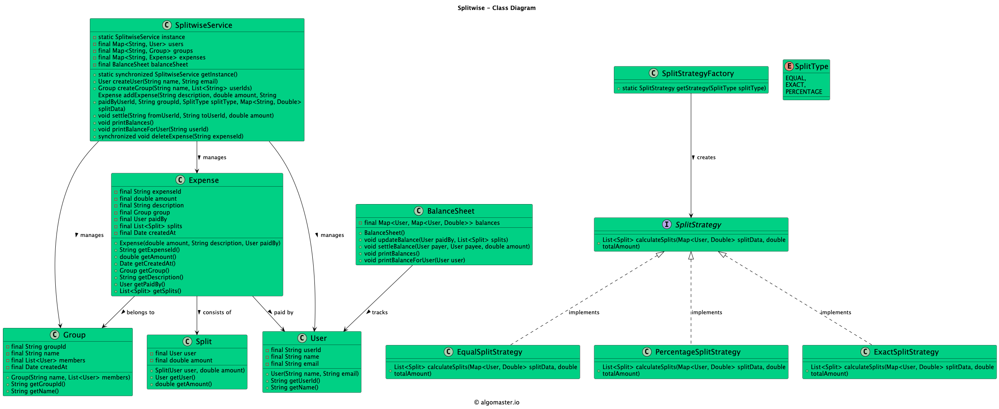

# Low-level design problem: splitwise

> Copied from <https://github.com/ashishps1/awesome-low-level-design/blob/main/problems/splitwise.md> (GPL-3.0, by Ashish Pratap Singh). Questions and answers are the source's own; nothing was answered or rewritten here.


# Designing Splitwise

## Requirements
1. The system should allow users to create accounts and manage their profile information.
2. Users should be able to create groups and add other users to the groups.
3. Users should be able to add expenses within a group, specifying the amount, description, and participants.
4. The system should automatically split the expenses among the participants based on their share.
5. Users should be able to view their individual balances with other users and settle up the balances.
6. The system should support different split methods, such as equal split, percentage split, and exact amounts.
7. Users should be able to view their transaction history and group expenses.
8. The system should handle concurrent transactions and ensure data consistency.

## UML Class Diagram



## Implementations
#### [Java Implementation](https://github.com/ashishps1/awesome-low-level-design/blob/main/solutions/java/src/splitwise)
#### [Python Implementation](https://github.com/ashishps1/awesome-low-level-design/blob/main/solutions/python/splitwise)
#### [C++ Implementation](https://github.com/ashishps1/awesome-low-level-design/blob/main/solutions/cpp/splitwise)
#### [C# Implementation](https://github.com/ashishps1/awesome-low-level-design/blob/main/solutions/csharp/splitwise)
#### [Go Implementation](https://github.com/ashishps1/awesome-low-level-design/blob/main/solutions/golang/splitwise)

## Classes, Interfaces and Enumerations
1. The **User** class represents a user in the Splitwise system, with properties such as ID, name, email, and a map to store balances with other users.
2. The **Group** class represents a group in Splitwise, containing a list of member users and a list of expenses.
3. The **Expense** class represents an expense within a group, with properties such as ID, amount, description, the user who paid, and a list of splits.
4. The **Split** class is an abstract class representing the split of an expense. It is extended by EqualSplit, PercentSplit, and ExactSplit classes to handle different split methods.
5. The **Transaction** class represents a transaction between two users, with properties such as ID, sender, receiver, and amount.
6. The **SplitwiseService** class is the main class that manages the Splitwise system. It follows the Singleton pattern to ensure only one instance of the service exists.
7. The SplitwiseService class provides methods for adding users, groups, and expenses, splitting expenses, updating balances, settling balances, and creating transactions.
8. Multi-threading is achieved using concurrent data structures such as ConcurrentHashMap and CopyOnWriteArrayList to handle concurrent access to shared resources.
9. The **SplitwiseDemo** class demonstrates the usage of the Splitwise system by creating users, a group, adding an expense, settling balances, and printing user balances.

---

## Official solutions from the repository

<details><summary><b>java</b> (13 files)</summary>


**README.md**

```md
# Splitwise System (LLD)

## Problem Statement

Design and implement a Splitwise System that allows users to split expenses among groups and individuals. The system should handle expense tracking, balance calculations, and settlement of debts between users.

---

## Requirements

1. **User Management:**
   - Create and manage user profiles
   - Track user balances
   - Handle user relationships

2. **Group Management:**
   - Create and manage groups
   - Add/remove members
   - Track group expenses

3. **Expense Management:**
   - Add expenses to groups or individuals
   - Support different split types (EQUAL, EXACT, PERCENTAGE)
   - Track expense history

4. **Balance Management:**
   - Calculate balances between users
   - Track who owes whom
   - Handle settlements

5. **Transaction Management:**
   - Record transactions
   - Track payment status
   - Generate balance reports

---

## Core Entities

### 1. SplitwiseService
- **Fields:** List<User> users, List<Group> groups, List<Expense> expenses
- **Methods:** 
  - addUser()
  - createGroup()
  - addExpense()
  - getBalance()
  - settleExpense()

### 2. User
- **Fields:** String id, String name, String email, Map<User, Double> balances
- **Methods:** 
  - updateProfile()
  - getBalance()
  - addBalance()
  - subtractBalance()

### 3. Group
- **Fields:** String id, String name, List<User> members, List<Expense> expenses
- **Methods:** 
  - addMember()
  - removeMember()
  - addExpense()
  - getBalances()

### 4. Expense
- **Fields:** String id, String description, double amount, User paidBy, List<User> paidFor, SplitType splitType
- **Methods:** 
  - calculateSplits()
  - getAmount()
  - getPaidBy()

### 5. Transaction
- **Fields:** String id, User from, User to, double amount
- **Methods:** 
  - execute()
  - getStatus()

### 6. SplitType (Enum)
- **Values:** EQUAL, EXACT, PERCENTAGE

## UML Class Diagram


---

## Example Usage

```java
SplitwiseService service = new SplitwiseService();

// Create users
User user1 = service.addUser("John", "john@example.com");
User user2 = service.addUser("Jane", "jane@example.com");

// Create a group
Group group = service.createGroup("Trip to Paris");
group.addMember(user1);
group.addMember(user2);

// Add an expense
Expense expense = service.addExpense(
    "Dinner", 
    100.0, 
    user1, 
    Arrays.asList(user1, user2), 
    SplitType.EQUAL
);

// Get balances
double balance = service.getBalance(user1, user2);

// Settle expense
service.settleExpense(user2, user1, 50.0);
```

---

## Demo

See `SplitwiseDemo.java` for a sample usage and simulation of the Splitwise system.

---

## Extending the Framework

- **Add expense categories:** Categorize expenses (food, travel, etc.)
- **Add recurring expenses:** Support for regular payments
- **Add expense comments:** Allow users to add notes to expenses
- **Add expense attachments:** Support for receipts and documents
- **Add payment integration:** Integrate with payment gateways
- **Add notification system:** Send reminders for pending payments

---

## Design Patterns Used

- **Singleton Pattern:** For the Splitwise service instance
- **Factory Pattern:** For creating different types of splits
- **Strategy Pattern:** For different expense splitting strategies
- **Observer Pattern:** For balance updates and notifications

---

## Exception Handling

- **InvalidAmountException:** Thrown when expense amount is invalid
- **InvalidSplitException:** Thrown when split details are invalid
- **UserNotFoundException:** Thrown when user is not found
- **GroupNotFoundException:** Thrown when group is not found
- **InsufficientBalanceException:** Thrown when user has insufficient balance

---
```


**SplitwiseDemo.java**

```java
package splitwise;


import splitwise.entities.Expense;
import splitwise.entities.Group;
import splitwise.entities.Transaction;
import splitwise.entities.User;
import splitwise.strategy.EqualSplitStrategy;
import splitwise.strategy.ExactSplitStrategy;
import splitwise.strategy.PercentageSplitStrategy;

import java.util.Arrays;
import java.util.List;

public class SplitwiseDemo {
    public static void main(String[] args) {
        // 1. Setup the service
        SplitwiseService service = SplitwiseService.getInstance();

        // 2. Create users and groups
        User alice = service.addUser("Alice", "alice@a.com");
        User bob = service.addUser( "Bob", "bob@b.com");
        User charlie = service.addUser("Charlie", "charlie@c.com");
        User david = service.addUser("David", "david@d.com");

        Group friendsGroup = service.addGroup("Friends Trip", List.of(alice, bob, charlie, david));

        System.out.println("--- System Setup Complete ---\n");

        // 3. Use Case 1: Equal Split
        System.out.println("--- Use Case 1: Equal Split ---");
        service.createExpense(new Expense.ExpenseBuilder()
                .setDescription("Dinner")
                .setAmount(1000)
                .setPaidBy(alice)
                .setParticipants(Arrays.asList(alice, bob, charlie, david))
                .setSplitStrategy(new EqualSplitStrategy())
        );

        service.showBalanceSheet(alice.getId());
        service.showBalanceSheet(bob.getId());
        System.out.println();

        // 4. Use Case 2: Exact Split
        System.out.println("--- Use Case 2: Exact Split ---");
        service.createExpense(new Expense.ExpenseBuilder()
                .setDescription("Movie Tickets")
                .setAmount(370)
                .setPaidBy(alice)
                .setParticipants(Arrays.asList(bob, charlie))
                .setSplitStrategy(new ExactSplitStrategy())
                .setSplitValues(Arrays.asList(120.0, 250.0))
        );

        service.showBalanceSheet(alice.getId());
        service.showBalanceSheet(bob.getId());
        System.out.println();

        // 5. Use Case 3: Percentage Split
        System.out.println("--- Use Case 3: Percentage Split ---");
        service.createExpense(new Expense.ExpenseBuilder()
                .setDescription("Groceries")
                .setAmount(500)
                .setPaidBy(david)
                .setParticipants(Arrays.asList(alice, bob, charlie))
                .setSplitStrategy(new PercentageSplitStrategy())
                .setSplitValues(Arrays.asList(40.0, 30.0, 30.0)) // 40%, 30%, 30%
        );

        System.out.println("--- Balances After All Expenses ---");
        service.showBalanceSheet(alice.getId());
        service.showBalanceSheet(bob.getId());

        service.showBalanceSheet(charlie.getId());
        service.showBalanceSheet(david.getId());

        System.out.println();

        // 6. Use Case 4: Simplify Group Debts
        System.out.println("--- Use Case 4: Simplify Group Debts for 'Friends Trip' ---");
        List<Transaction> simplifiedDebts = service.simplifyGroupDebts(friendsGroup.getId());
        if (simplifiedDebts.isEmpty()) {
            System.out.println("All debts are settled within the group!");
        } else {
            simplifiedDebts.forEach(System.out::println);
        }
        System.out.println();

        service.showBalanceSheet(bob.getId());

        // 7. Use Case 5: Partial Settlement
        System.out.println("--- Use Case 5: Partial Settlement ---");
        // From the simplified debts, we see Bob should pay Alice. Let's say Bob pays 100.
        service.settleUp(bob.getId(), alice.getId(), 100);

        System.out.println("--- Balances After Partial Settlement ---");
        service.showBalanceSheet(alice.getId());
        service.showBalanceSheet(bob.getId());
    }
}
```


**SplitwiseService.java**

```java
package splitwise;

import splitwise.entities.*;

import java.util.*;
import java.util.stream.Collectors;

public class SplitwiseService {
    private static SplitwiseService instance;
    private final Map<String, User> users = new HashMap<>();
    private final Map<String, Group> groups = new HashMap<>();

    private SplitwiseService() {}

    public static synchronized SplitwiseService getInstance() {
        if (instance == null) {
            instance = new SplitwiseService();
        }
        return instance;
    }

    // --- Setup Methods ---
    public User addUser(String name, String email) {
        User user = new User(name, email);
        users.put(user.getId(), user);
        return user;
    }

    public Group addGroup(String name, List<User> members) {
        Group group = new Group(name, members);
        groups.put(group.getId(), group);
        return group;
    }

    public User getUser(String id) { return users.get(id); }
    public Group getGroup(String id) { return groups.get(id); }

    // --- Core Functional Methods (Facade) ---
    public synchronized void createExpense(Expense.ExpenseBuilder builder) {
        Expense expense = builder.build();
        User paidBy = expense.getPaidBy();

        for (Split split : expense.getSplits()) {
            User participant = split.getUser();
            double amount = split.getAmount();

            if (!paidBy.equals(participant)) {
                paidBy.getBalanceSheet().adjustBalance(participant, amount);
                participant.getBalanceSheet().adjustBalance(paidBy, -amount);
            }
        }
        System.out.println("Expense '" + expense.getDescription() + "' of amount " + expense.getAmount() + " created.");
    }

    public synchronized void settleUp(String payerId, String payeeId, double amount) {
        User payer = users.get(payerId);
        User payee = users.get(payeeId);
        System.out.println(payer.getName() + " is settling up " + amount + " with " + payee.getName());
        // Settlement is like a reverse expense. payer owes less to payee.

        payee.getBalanceSheet().adjustBalance(payer, -amount);
        payer.getBalanceSheet().adjustBalance(payee, amount);
    }

    public void showBalanceSheet(String userId) {
        User user = users.get(userId);
        user.getBalanceSheet().showBalances();
    }

    public List<Transaction> simplifyGroupDebts(String groupId) {
        Group group = groups.get(groupId);
        if (group == null) throw new IllegalArgumentException("Group not found");

        // Calculate net balance for each member within the group context
        Map<User, Double> netBalances = new HashMap<>();
        for (User member : group.getMembers()) {
            double balance = 0;
            for(Map.Entry<User, Double> entry : member.getBalanceSheet().getBalances().entrySet()) {
                // Consider only balances with other group members
                if (group.getMembers().contains(entry.getKey())) {
                    balance += entry.getValue();
                }
            }
            netBalances.put(member, balance);
        }

        // Separate into creditors and debtors
        List<Map.Entry<User, Double>> creditors = netBalances.entrySet().stream()
                .filter(e -> e.getValue() > 0).collect(Collectors.toList());
        List<Map.Entry<User, Double>> debtors = netBalances.entrySet().stream()
                .filter(e -> e.getValue() < 0).collect(Collectors.toList());

        creditors.sort(Map.Entry.comparingByValue(Comparator.reverseOrder()));
        debtors.sort(Map.Entry.comparingByValue());

        List<Transaction> transactions = new ArrayList<>();
        int i = 0, j = 0;
        while (i < creditors.size() && j < debtors.size()) {
            Map.Entry<User, Double> creditor = creditors.get(i);
            Map.Entry<User, Double> debtor = debtors.get(j);

            double amountToSettle = Math.min(creditor.getValue(), -debtor.getValue());
            transactions.add(new Transaction(debtor.getKey(), creditor.getKey(), amountToSettle));

            creditor.setValue(creditor.getValue() - amountToSettle);
            debtor.setValue(debtor.getValue() + amountToSettle);

            if (Math.abs(creditor.getValue()) < 0.01) i++;
            if (Math.abs(debtor.getValue()) < 0.01) j++;
        }
        return transactions;
    }
}
```


**entities/BalanceSheet.java**

```java
package splitwise.entities;

import java.util.Map;
import java.util.concurrent.ConcurrentHashMap;

public class BalanceSheet {
    private final User owner;
    // A map where:
    // Key: The user to whom the balance is related.
    // Value: The net amount.
    // - Positive value: The key-user owes the owner of this balance sheet money.
    // - Negative value: The owner owes the key-user money.
    private final Map<User, Double> balances = new ConcurrentHashMap<>();

    public BalanceSheet(User owner) {
        this.owner = owner;
    }

    public Map<User, Double> getBalances() {
        return balances;
    }

    public synchronized void adjustBalance(User otherUser, double amount) {
        if (owner.equals(otherUser)) {
            return; // Cannot owe yourself
        }
        balances.merge(otherUser, amount, Double::sum);
    }

    public void showBalances() {
        System.out.println("--- Balance Sheet for " + owner.getName() + " ---");
        if (balances.isEmpty()) {
            System.out.println("All settled up!");
            return;
        }

        double totalOwedToMe = 0;
        double totalIOwe = 0;

        for (Map.Entry<User, Double> entry : balances.entrySet()) {
            User otherUser = entry.getKey();
            double amount = entry.getValue();

            if (amount > 0.01) {
                System.out.println(otherUser.getName() + " owes " + owner.getName() + " $" + String.format("%.2f", amount));
                totalOwedToMe += amount;
            } else if (amount < -0.01) {
                System.out.println(owner.getName() + " owes " + otherUser.getName() + " $" + String.format("%.2f", -amount));
                totalIOwe += (-amount);
            }
        }
        System.out.println("Total Owed to " + owner.getName() + ": $" + String.format("%.2f", totalOwedToMe));
        System.out.println("Total " + owner.getName() + " Owes: $" + String.format("%.2f", totalIOwe));
        System.out.println("---------------------------------");
    }
}
```


**entities/Expense.java**

```java
package splitwise.entities;

import splitwise.strategy.SplitStrategy;

import java.time.LocalDateTime;
import java.util.List;

public class Expense {
    private final String id;
    private final String description;
    private final double amount;
    private final User paidBy;
    private final List<Split> splits;
    private final LocalDateTime timestamp;

    private Expense(ExpenseBuilder builder) {
        this.id = builder.id;
        this.description = builder.description;
        this.amount = builder.amount;
        this.paidBy = builder.paidBy;
        this.timestamp = LocalDateTime.now();

        // Use the strategy to calculate splits
        this.splits = builder.splitStrategy.calculateSplits(builder.amount, builder.paidBy, builder.participants, builder.splitValues);
    }

    // Getters...
    public String getId() { return id; }
    public String getDescription() { return description; }
    public double getAmount() { return amount; }
    public User getPaidBy() { return paidBy; }
    public List<Split> getSplits() { return splits; }

    // --- Builder Pattern ---
    public static class ExpenseBuilder {
        private String id;
        private String description;
        private double amount;
        private User paidBy;
        private List<User> participants;
        private SplitStrategy splitStrategy;
        private List<Double> splitValues; // For EXACT and PERCENTAGE splits

        public ExpenseBuilder setId(String id) { this.id = id; return this; }
        public ExpenseBuilder setDescription(String description) { this.description = description; return this; }
        public ExpenseBuilder setAmount(double amount) { this.amount = amount; return this; }
        public ExpenseBuilder setPaidBy(User paidBy) { this.paidBy = paidBy; return this; }
        public ExpenseBuilder setParticipants(List<User> participants) { this.participants = participants; return this; }
        public ExpenseBuilder setSplitStrategy(SplitStrategy splitStrategy) { this.splitStrategy = splitStrategy; return this; }
        public ExpenseBuilder setSplitValues(List<Double> splitValues) { this.splitValues = splitValues; return this; }

        public Expense build() {
            // Validations
            if (splitStrategy == null) {
                throw new IllegalStateException("Split strategy is required.");
            }
            return new Expense(this);
        }
    }
}
```


**entities/Group.java**

```java
package splitwise.entities;

import java.util.ArrayList;
import java.util.List;
import java.util.UUID;

public class Group {
    private final String id;
    private final String name;
    private final List<User> members;

    public Group(String name, List<User> members) {
        this.id = UUID.randomUUID().toString();
        this.name = name;
        this.members = members;
    }

    public String getId() {
        return id;
    }

    public String getName() {
        return name;
    }

    public List<User> getMembers() {
        return new ArrayList<>(members);
    }
}
```


**entities/Split.java**

```java
package splitwise.entities;

public class Split {
    private final User user;
    private final double amount;

    public Split(User user, double amount) {
        this.user = user;
        this.amount = amount;
    }

    public User getUser() { return user; }
    public double getAmount() { return amount; }
}
```


**entities/Transaction.java**

```java
package splitwise.entities;

public class Transaction {
    private final User from;
    private final User to;
    private final double amount;

    public Transaction(User from, User to, double amount) {
        this.from = from;
        this.to = to;
        this.amount = amount;
    }

    @Override
    public String toString() {
        return from.getName() + " should pay " + to.getName() + " $" + String.format("%.2f", amount);
    }
}
```


**entities/User.java**

```java
package splitwise.entities;

import java.util.UUID;

public class User {
    private final String id;
    private final String name;
    private final String email;
    private final BalanceSheet balanceSheet;

    public User(String name, String email) {
        this.id = UUID.randomUUID().toString();;
        this.name = name;
        this.email = email;
        this.balanceSheet = new BalanceSheet(this);
    }

    public String getId() {
        return id;
    }

    public String getName() {
        return name;
    }

    public BalanceSheet getBalanceSheet() {
        return balanceSheet;
    }
}
```


**strategy/EqualSplitStrategy.java**

```java
package splitwise.strategy;

import splitwise.entities.Split;
import splitwise.entities.User;

import java.util.ArrayList;
import java.util.List;

public class EqualSplitStrategy implements SplitStrategy {
    @Override
    public List<Split> calculateSplits(double totalAmount, User paidBy, List<User> participants, List<Double> splitValues) {
        List<Split> splits = new ArrayList<>();
        double amountPerPerson = totalAmount / participants.size();
        for (User participant : participants) {
            splits.add(new Split(participant, amountPerPerson));
        }
        return splits;
    }
}
```


**strategy/ExactSplitStrategy.java**

```java
package splitwise.strategy;

import splitwise.entities.Split;
import splitwise.entities.User;

import java.util.ArrayList;
import java.util.List;

public class ExactSplitStrategy implements SplitStrategy {
    @Override
    public List<Split> calculateSplits(double totalAmount, User paidBy, List<User> participants, List<Double> splitValues) {
        if (participants.size() != splitValues.size()) {
            throw new IllegalArgumentException("Number of participants and split values must match.");
        }
        if (Math.abs(splitValues.stream().mapToDouble(Double::doubleValue).sum() - totalAmount) > 0.01) {
            throw new IllegalArgumentException("Sum of exact amounts must equal the total expense amount.");
        }

        List<Split> splits = new ArrayList<>();
        for (int i = 0; i < participants.size(); i++) {
            splits.add(new Split(participants.get(i), splitValues.get(i)));
        }
        return splits;
    }
}
```


**strategy/PercentageSplitStrategy.java**

```java
package splitwise.strategy;

import splitwise.entities.Split;
import splitwise.entities.User;

import java.util.ArrayList;
import java.util.List;

public class PercentageSplitStrategy implements SplitStrategy {
    @Override
    public List<Split> calculateSplits(double totalAmount, User paidBy, List<User> participants, List<Double> splitValues) {
        if (participants.size() != splitValues.size()) {
            throw new IllegalArgumentException("Number of participants and split values must match.");
        }
        if (Math.abs(splitValues.stream().mapToDouble(Double::doubleValue).sum() - 100.0) > 0.01) {
            throw new IllegalArgumentException("Sum of percentages must be 100.");
        }

        List<Split> splits = new ArrayList<>();
        for (int i = 0; i < participants.size(); i++) {
            double amount = (totalAmount * splitValues.get(i)) / 100.0;
            splits.add(new Split(participants.get(i), amount));
        }
        return splits;
    }
}
```


**strategy/SplitStrategy.java**

```java
package splitwise.strategy;

import splitwise.entities.Split;
import splitwise.entities.User;

import java.util.List;

public interface SplitStrategy {
    List<Split> calculateSplits(double totalAmount, User paidBy, List<User> participants, List<Double> splitValues);
}
```

</details>

<details><summary><b>python</b> (10 files)</summary>


**README.md**

```md
# Designing Splitwise

## Requirements
1. The system should allow users to create accounts and manage their profile information.
2. Users should be able to create groups and add other users to the groups.
3. Users should be able to add expenses within a group, specifying the amount, description, and participants.
4. The system should automatically split the expenses among the participants based on their share.
5. Users should be able to view their individual balances with other users and settle up the balances.
6. The system should support different split methods, such as equal split, percentage split, and exact amounts.
7. Users should be able to view their transaction history and group expenses.
8. The system should handle concurrent transactions and ensure data consistency.

## Classes, Interfaces and Enumerations
1. The **User** class represents a user in the Splitwise system, with properties such as ID, name, email, and a map to store balances with other users.
2. The **Group** class represents a group in Splitwise, containing a list of member users and a list of expenses.
3. The **Expense** class represents an expense within a group, with properties such as ID, amount, description, the user who paid, and a list of splits.
4. The **Split** class is an abstract class representing the split of an expense. It is extended by EqualSplit, PercentSplit, and ExactSplit classes to handle different split methods.
5. The **Transaction** class represents a transaction between two users, with properties such as ID, sender, receiver, and amount.
6. The **SplitwiseService** class is the main class that manages the Splitwise system. It follows the Singleton pattern to ensure only one instance of the service exists.
7. The SplitwiseService class provides methods for adding users, groups, and expenses, splitting expenses, updating balances, settling balances, and creating transactions.
8. Multi-threading is achieved using concurrent data structures such as ConcurrentHashMap and CopyOnWriteArrayList to handle concurrent access to shared resources.
9. The **SplitwiseDemo** class demonstrates the usage of the Splitwise system by creating users, a group, adding an expense, settling balances, and printing user balances.
```


**balance_sheet.py**

```py
import threading
from typing import Dict, TYPE_CHECKING

if TYPE_CHECKING:
    from user import User

class BalanceSheet:
    def __init__(self, owner: 'User'):
        self._owner = owner
        self._balances: Dict['User', float] = {}
        self._lock = threading.Lock()
    
    def get_balances(self) -> Dict['User', float]:
        return self._balances
    
    def adjust_balance(self, other_user: 'User', amount: float):
        with self._lock:
            if self._owner == other_user:
                return  # Cannot owe yourself
            
            if other_user in self._balances:
                self._balances[other_user] += amount
            else:
                self._balances[other_user] = amount
    
    def show_balances(self):
        print(f"--- Balance Sheet for {self._owner.get_name()} ---")
        if not self._balances:
            print("All settled up!")
            return
        
        total_owed_to_me = 0
        total_i_owe = 0
        
        for other_user, amount in self._balances.items():
            if amount > 0.01:
                print(f"{other_user.get_name()} owes {self._owner.get_name()} ${amount:.2f}")
                total_owed_to_me += amount
            elif amount < -0.01:
                print(f"{self._owner.get_name()} owes {other_user.get_name()} ${-amount:.2f}")
                total_i_owe += (-amount)
        
        print(f"Total Owed to {self._owner.get_name()}: ${total_owed_to_me:.2f}")
        print(f"Total {self._owner.get_name()} Owes: ${total_i_owe:.2f}")
        print("---------------------------------")
```


**expense.py**

```py
from datetime import datetime
from typing import List, Optional
from user import User
from split import Split
from split_strategy import SplitStrategy

class Expense:
    def __init__(self, builder: 'ExpenseBuilder'):
        self._id = builder._id
        self._description = builder._description
        self._amount = builder._amount
        self._paid_by = builder._paid_by
        self._timestamp = datetime.now()
        
        # Use the strategy to calculate splits
        self._splits = builder._split_strategy.calculate_splits(
            builder._amount, builder._paid_by, builder._participants, builder._split_values
        )
    
    def get_id(self) -> str:
        return self._id
    
    def get_description(self) -> str:
        return self._description
    
    def get_amount(self) -> float:
        return self._amount
    
    def get_paid_by(self) -> User:
        return self._paid_by
    
    def get_splits(self) -> List[Split]:
        return self._splits
    
    class ExpenseBuilder:
        def __init__(self):
            self._id: Optional[str] = None
            self._description: Optional[str] = None
            self._amount: Optional[float] = None
            self._paid_by: Optional[User] = None
            self._participants: Optional[List[User]] = None
            self._split_strategy: Optional[SplitStrategy] = None
            self._split_values: Optional[List[float]] = None
        
        def set_id(self, expense_id: str) -> 'Expense.ExpenseBuilder':
            self._id = expense_id
            return self
        
        def set_description(self, description: str) -> 'Expense.ExpenseBuilder':
            self._description = description
            return self
        
        def set_amount(self, amount: float) -> 'Expense.ExpenseBuilder':
            self._amount = amount
            return self
        
        def set_paid_by(self, paid_by: User) -> 'Expense.ExpenseBuilder':
            self._paid_by = paid_by
            return self
        
        def set_participants(self, participants: List[User]) -> 'Expense.ExpenseBuilder':
            self._participants = participants
            return self
        
        def set_split_strategy(self, split_strategy: SplitStrategy) -> 'Expense.ExpenseBuilder':
            self._split_strategy = split_strategy
            return self
        
        def set_split_values(self, split_values: List[float]) -> 'Expense.ExpenseBuilder':
            self._split_values = split_values
            return self
        
        def build(self) -> 'Expense':
            if self._split_strategy is None:
                raise ValueError("Split strategy is required.")
            return Expense(self)
```


**group.py**

```py
import uuid
from typing import List, TYPE_CHECKING

if TYPE_CHECKING:
    from user import User

class Group:
    def __init__(self, name: str, members: List['User']):
        self._id = str(uuid.uuid4())
        self._name = name
        self._members = members
    
    def get_id(self) -> str:
        return self._id
    
    def get_name(self) -> str:
        return self._name
    
    def get_members(self) -> List['User']:
        return self._members.copy()
```


**split.py**

```py
from typing import TYPE_CHECKING

if TYPE_CHECKING:
    from user import User

class Split:
    def __init__(self, user: 'User', amount: float):
        self._user = user
        self._amount = amount
    
    def get_user(self) -> 'User':
        return self._user
    
    def get_amount(self) -> float:
        return self._amount
```


**split_strategy.py**

```py
from abc import ABC, abstractmethod
from typing import List, Optional, TYPE_CHECKING
from split import Split
from user import User

class SplitStrategy(ABC):
    @abstractmethod
    def calculate_splits(self, total_amount: float, paid_by: 'User', participants: List['User'], split_values: Optional[List[float]]) -> List['Split']:
        pass

class EqualSplitStrategy(SplitStrategy):
    def calculate_splits(self, total_amount: float, paid_by: 'User', participants: List['User'], split_values: Optional[List[float]]) -> List['Split']:
        splits = []
        amount_per_person = total_amount / len(participants)
        for participant in participants:
            splits.append(Split(participant, amount_per_person))
        return splits

class ExactSplitStrategy(SplitStrategy):
    def calculate_splits(self, total_amount: float, paid_by: 'User', participants: List['User'], split_values: Optional[List[float]]) -> List['Split']:
        if len(participants) != len(split_values):
            raise ValueError("Number of participants and split values must match.")
        if abs(sum(split_values) - total_amount) > 0.01:
            raise ValueError("Sum of exact amounts must equal the total expense amount.")
        
        splits = []
        for i in range(len(participants)):
            splits.append(Split(participants[i], split_values[i]))
        return splits

class PercentageSplitStrategy(SplitStrategy):
    def calculate_splits(self, total_amount: float, paid_by: 'User', participants: List['User'], split_values: Optional[List[float]]) -> List['Split']:
        if len(participants) != len(split_values):
            raise ValueError("Number of participants and split values must match.")
        if abs(sum(split_values) - 100.0) > 0.01:
            raise ValueError("Sum of percentages must be 100.")
        
        splits = []
        for i in range(len(participants)):
            amount = (total_amount * split_values[i]) / 100.0
            splits.append(Split(participants[i], amount))
        return splits
```


**splitwise_demo.py**

```py
from splitwise_service import SplitwiseService
from expense import Expense
from split_strategy import EqualSplitStrategy, ExactSplitStrategy, PercentageSplitStrategy

class SplitwiseDemo:
    @staticmethod
    def main():
        # 1. Setup the service
        service = SplitwiseService.get_instance()
        
        # 2. Create users and groups
        alice = service.add_user("Alice", "alice@a.com")
        bob = service.add_user("Bob", "bob@b.com")
        charlie = service.add_user("Charlie", "charlie@c.com")
        david = service.add_user("David", "david@d.com")
        
        friends_group = service.add_group("Friends Trip", [alice, bob, charlie, david])
        
        print("--- System Setup Complete ---\n")
        
        # 3. Use Case 1: Equal Split
        print("--- Use Case 1: Equal Split ---")
        service.create_expense(Expense.ExpenseBuilder()
                              .set_description("Dinner")
                              .set_amount(1000)
                              .set_paid_by(alice)
                              .set_participants([alice, bob, charlie, david])
                              .set_split_strategy(EqualSplitStrategy()))
        
        service.show_balance_sheet(alice.get_id())
        service.show_balance_sheet(bob.get_id())
        print()
        
        # 4. Use Case 2: Exact Split
        print("--- Use Case 2: Exact Split ---")
        service.create_expense(Expense.ExpenseBuilder()
                              .set_description("Movie Tickets")
                              .set_amount(370)
                              .set_paid_by(alice)
                              .set_participants([bob, charlie])
                              .set_split_strategy(ExactSplitStrategy())
                              .set_split_values([120.0, 250.0]))
        
        service.show_balance_sheet(alice.get_id())
        service.show_balance_sheet(bob.get_id())
        print()
        
        # 5. Use Case 3: Percentage Split
        print("--- Use Case 3: Percentage Split ---")
        service.create_expense(Expense.ExpenseBuilder()
                              .set_description("Groceries")
                              .set_amount(500)
                              .set_paid_by(david)
                              .set_participants([alice, bob, charlie])
                              .set_split_strategy(PercentageSplitStrategy())
                              .set_split_values([40.0, 30.0, 30.0]))  # 40%, 30%, 30%
        
        print("--- Balances After All Expenses ---")
        service.show_balance_sheet(alice.get_id())
        service.show_balance_sheet(bob.get_id())
        service.show_balance_sheet(charlie.get_id())
        service.show_balance_sheet(david.get_id())
        print()
        
        # 6. Use Case 4: Simplify Group Debts
        print("--- Use Case 4: Simplify Group Debts for 'Friends Trip' ---")
        simplified_debts = service.simplify_group_debts(friends_group.get_id())
        if not simplified_debts:
            print("All debts are settled within the group!")
        else:
            for debt in simplified_debts:
                print(debt)
        print()
        
        service.show_balance_sheet(bob.get_id())
        
        # 7. Use Case 5: Partial Settlement
        print("--- Use Case 5: Partial Settlement ---")
        # From the simplified debts, we see Bob should pay Alice. Let's say Bob pays 100.
        service.settle_up(bob.get_id(), alice.get_id(), 100)
        
        print("--- Balances After Partial Settlement ---")
        service.show_balance_sheet(alice.get_id())
        service.show_balance_sheet(bob.get_id())

if __name__ == "__main__":
    SplitwiseDemo.main()
```


**splitwise_service.py**

```py
import threading
from typing import Dict, List, Optional
from user import User
from group import Group
from expense import Expense
from transaction import Transaction

class SplitwiseService:
    _instance = None
    _lock = threading.Lock()
    
    def __new__(cls):
        if cls._instance is None:
            with cls._lock:
                if cls._instance is None:
                    cls._instance = super().__new__(cls)
                    cls._instance._initialized = False
        return cls._instance
    
    def __init__(self):
        if not self._initialized:
            self._users: Dict[str, User] = {}
            self._groups: Dict[str, Group] = {}
            self._initialized = True
    
    @classmethod
    def get_instance(cls):
        return cls()
    
    def add_user(self, name: str, email: str) -> User:
        user = User(name, email)
        self._users[user.get_id()] = user
        return user
    
    def add_group(self, name: str, members: List[User]) -> Group:
        group = Group(name, members)
        self._groups[group.get_id()] = group
        return group
    
    def get_user(self, user_id: str) -> Optional[User]:
        return self._users.get(user_id)
    
    def get_group(self, group_id: str) -> Optional[Group]:
        return self._groups.get(group_id)
    
    def create_expense(self, builder: Expense.ExpenseBuilder):
        with self._lock:
            expense = builder.build()
            paid_by = expense.get_paid_by()
            
            for split in expense.get_splits():
                participant = split.get_user()
                amount = split.get_amount()
                
                if paid_by != participant:
                    paid_by.get_balance_sheet().adjust_balance(participant, amount)
                    participant.get_balance_sheet().adjust_balance(paid_by, -amount)
            
            print(f"Expense '{expense.get_description()}' of amount {expense.get_amount()} created.")
    
    def settle_up(self, payer_id: str, payee_id: str, amount: float):
        with self._lock:
            payer = self._users[payer_id]
            payee = self._users[payee_id]
            print(f"{payer.get_name()} is settling up {amount} with {payee.get_name()}")
            
            # Settlement is like a reverse expense. payer owes less to payee.
            payee.get_balance_sheet().adjust_balance(payer, -amount)
            payer.get_balance_sheet().adjust_balance(payee, amount)
    
    def show_balance_sheet(self, user_id: str):
        user = self._users[user_id]
        user.get_balance_sheet().show_balances()
    
    def simplify_group_debts(self, group_id: str) -> List[Transaction]:
        group = self._groups.get(group_id)
        if group is None:
            raise ValueError("Group not found")
        
        # Calculate net balance for each member within the group context
        net_balances = {}
        for member in group.get_members():
            balance = 0
            for other_user, amount in member.get_balance_sheet().get_balances().items():
                # Consider only balances with other group members
                if other_user in group.get_members():
                    balance += amount
            net_balances[member] = balance
        
        # Separate into creditors and debtors
        creditors = [(user, balance) for user, balance in net_balances.items() if balance > 0]
        debtors = [(user, balance) for user, balance in net_balances.items() if balance < 0]
        
        creditors.sort(key=lambda x: x[1], reverse=True)
        debtors.sort(key=lambda x: x[1])
        
        transactions = []
        i = j = 0
        
        while i < len(creditors) and j < len(debtors):
            creditor_user, creditor_amount = creditors[i]
            debtor_user, debtor_amount = debtors[j]
            
            amount_to_settle = min(creditor_amount, -debtor_amount)
            transactions.append(Transaction(debtor_user, creditor_user, amount_to_settle))
            
            creditors[i] = (creditor_user, creditor_amount - amount_to_settle)
            debtors[j] = (debtor_user, debtor_amount + amount_to_settle)
            
            if abs(creditors[i][1]) < 0.01:
                i += 1
            if abs(debtors[j][1]) < 0.01:
                j += 1
        
        return transactions
```


**transaction.py**

```py
from typing import TYPE_CHECKING
if TYPE_CHECKING:
    from user import User

class Transaction:
    def __init__(self, from_user: 'User', to_user: 'User', amount: float):
        self._from = from_user
        self._to = to_user
        self._amount = amount
    
    def __str__(self) -> str:
        return f"{self._from.get_name()} should pay {self._to.get_name()} ${self._amount:.2f}"
```


**user.py**

```py
import uuid
from balance_sheet import BalanceSheet
    
class User:
    def __init__(self, name: str, email: str):
        self._id = str(uuid.uuid4())
        self._name = name
        self._email = email
        self._balance_sheet = BalanceSheet(self)
    
    def get_id(self) -> str:
        return self._id
    
    def get_name(self) -> str:
        return self._name
    
    def get_balance_sheet(self) -> 'BalanceSheet':
        return self._balance_sheet
```

</details>

<details><summary><b>cpp</b> (8 files)</summary>


**Expense.cpp**

```cpp
#include "Expense.hpp"
#include <iostream>
#include <iomanip>

Expense::Expense(std::string expenseId, std::string description, double totalAmount,
                std::string paidBy, const std::vector<std::string>& participants,
                ExpenseType type)
    : expenseId(expenseId), description(description), totalAmount(totalAmount),
      paidBy(paidBy), participants(participants), type(type) {
    timestamp = std::time(nullptr);
    if (type == ExpenseType::EQUAL) {
        calculateEqualShares();
    }
}

std::string Expense::getExpenseId() const { return expenseId; }
std::string Expense::getDescription() const { return description; }
double Expense::getTotalAmount() const { return totalAmount; }
std::string Expense::getPaidBy() const { return paidBy; }
const std::vector<std::string>& Expense::getParticipants() const { return participants; }
const std::map<std::string, double>& Expense::getShares() const { return shares; }
ExpenseType Expense::getType() const { return type; }
std::time_t Expense::getTimestamp() const { return timestamp; }

void Expense::setShares(const std::map<std::string, double>& shares) {
    this->shares = shares;
}

void Expense::calculateEqualShares() {
    double equalShare = totalAmount / participants.size();
    for (const auto& participant : participants) {
        shares[participant] = equalShare;
    }
}

void Expense::displayInfo() const {
    std::cout << "\nExpense Details:" << std::endl;
    std::cout << "ID: " << expenseId << std::endl;
    std::cout << "Description: " << description << std::endl;
    std::cout << "Amount: $" << std::fixed << std::setprecision(2) << totalAmount << std::endl;
    std::cout << "Paid by: " << paidBy << std::endl;
    std::cout << "Type: ";
    switch (type) {
        case ExpenseType::EQUAL: std::cout << "Equal"; break;
        case ExpenseType::EXACT: std::cout << "Exact"; break;
        case ExpenseType::PERCENT: std::cout << "Percent"; break;
    }
    std::cout << std::endl;
    
    std::cout << "Shares:" << std::endl;
    for (const auto& share : shares) {
        std::cout << share.first << ": $" << std::fixed << std::setprecision(2)
                  << share.second << std::endl;
    }
    
    std::cout << "Time: " << std::ctime(&timestamp);
}
```


**Expense.hpp**

```hpp
#ifndef EXPENSE_HPP
#define EXPENSE_HPP

#include <string>
#include <vector>
#include <map>
#include <ctime>

enum class ExpenseType {
    EQUAL,
    EXACT,
    PERCENT
};

class Expense {
private:
    std::string expenseId;
    std::string description;
    double totalAmount;
    std::string paidBy;
    std::vector<std::string> participants;
    std::map<std::string, double> shares;  // userId -> share amount
    ExpenseType type;
    std::time_t timestamp;

public:
    Expense(std::string expenseId, std::string description, double totalAmount,
           std::string paidBy, const std::vector<std::string>& participants,
           ExpenseType type);
    
    std::string getExpenseId() const;
    std::string getDescription() const;
    double getTotalAmount() const;
    std::string getPaidBy() const;
    const std::vector<std::string>& getParticipants() const;
    const std::map<std::string, double>& getShares() const;
    ExpenseType getType() const;
    std::time_t getTimestamp() const;
    
    void setShares(const std::map<std::string, double>& shares);
    void calculateEqualShares();
    void displayInfo() const;
};

#endif
```


**README.md**

```md
# Designing Splitwise

## Requirements
1. The system should allow users to create accounts and manage their profile information.
2. Users should be able to create groups and add other users to the groups.
3. Users should be able to add expenses within a group, specifying the amount, description, and participants.
4. The system should automatically split the expenses among the participants based on their share.
5. Users should be able to view their individual balances with other users and settle up the balances.
6. The system should support different split methods, such as equal split, percentage split, and exact amounts.
7. Users should be able to view their transaction history and group expenses.
8. The system should handle concurrent transactions and ensure data consistency.

## Classes, Interfaces and Enumerations
1. The **User** class represents a user in the Splitwise system, with properties such as ID, name, email, and a map to store balances with other users.
2. The **Group** class represents a group in Splitwise, containing a list of member users and a list of expenses.
3. The **Expense** class represents an expense within a group, with properties such as ID, amount, description, the user who paid, and a list of splits.
4. The **Split** class is an abstract class representing the split of an expense. It is extended by EqualSplit, PercentSplit, and ExactSplit classes to handle different split methods.
5. The **Transaction** class represents a transaction between two users, with properties such as ID, sender, receiver, and amount.
6. The **SplitwiseService** class is the main class that manages the Splitwise system. It follows the Singleton pattern to ensure only one instance of the service exists.
7. The SplitwiseService class provides methods for adding users, groups, and expenses, splitting expenses, updating balances, settling balances, and creating transactions.
8. Multi-threading is achieved using concurrent data structures such as ConcurrentHashMap and CopyOnWriteArrayList to handle concurrent access to shared resources.
9. The **SplitwiseDemo** class demonstrates the usage of the Splitwise system by creating users, a group, adding an expense, settling balances, and printing user balances.
```


**SplitwiseDemo.cpp**

```cpp
#include "SplitwiseSystem.hpp"
#include <iostream>

int main() {
    SplitwiseSystem splitwise;
    
    // Register users
    User* user1 = splitwise.registerUser("John", "john@email.com");
    User* user2 = splitwise.registerUser("Alice", "alice@email.com");
    User* user3 = splitwise.registerUser("Bob", "bob@email.com");
    
    std::cout << "Initial users:" << std::endl;
    splitwise.displayUsers();
    
    // Add expenses
    std::vector<std::string> participants = {
        user1->getUserId(), user2->getUserId(), user3->getUserId()
    };
    
    // Equal split expense
    Expense* dinner = splitwise.addExpense("Dinner", 300.0, user1->getUserId(), participants);
    
    // Custom split expense
    std::vector<std::string> movieParticipants = {
        user1->getUserId(), user2->getUserId()
    };
    Expense* movie = splitwise.addExpense("Movie", 100.0, user2->getUserId(),
                                        movieParticipants, ExpenseType::EXACT);
    
    std::map<std::string, double> movieShares = {
        {user1->getUserId(), 60.0},
        {user2->getUserId(), 40.0}
    };
    splitwise.setExpenseShares(movie->getExpenseId(), movieShares);
    
    // Display expenses
    std::cout << "\nAll expenses:" << std::endl;
    splitwise.displayExpenses();
    
    // Show balances
    std::cout << "\nBalances after expenses:" << std::endl;
    splitwise.showAllBalances();
    
    // Show individual expenses
    std::cout << "\nJohn's expenses:" << std::endl;
    splitwise.displayUserExpenses(user1->getUserId());
    
    return 0;
}
```


**SplitwiseSystem.cpp**

```cpp
#include "SplitwiseSystem.hpp"
#include <iostream>
#include <algorithm>
#include <numeric>

SplitwiseSystem::SplitwiseSystem() : userIdCounter(1), expenseIdCounter(1) {}

SplitwiseSystem::~SplitwiseSystem() {
    for (auto user : users) delete user;
    for (auto expense : expenses) delete expense;
}

User* SplitwiseSystem::registerUser(const std::string& name, const std::string& email) {
    std::string userId = generateUserId();
    User* user = new User(userId, name, email);
    users.push_back(user);
    return user;
}

void SplitwiseSystem::removeUser(const std::string& userId) {
    auto it = std::find_if(users.begin(), users.end(),
        [userId](User* user) { return user->getUserId() == userId; });
    
    if (it != users.end()) {
        delete *it;
        users.erase(it);
    }
}

Expense* SplitwiseSystem::addExpense(const std::string& description, double amount,
                                   const std::string& paidBy,
                                   const std::vector<std::string>& participants,
                                   ExpenseType type) {
    if (!findUser(paidBy)) return nullptr;
    
    std::string expenseId = generateExpenseId();
    Expense* expense = new Expense(expenseId, description, amount, paidBy, participants, type);
    expenses.push_back(expense);
    
    if (type == ExpenseType::EQUAL) {
        settleExpense(expenseId);
    }
    
    return expense;
}

bool SplitwiseSystem::setExpenseShares(const std::string& expenseId,
                                     const std::map<std::string, double>& shares) {
    Expense* expense = findExpense(expenseId);
    if (!expense) return false;
    
    // Validate total shares equals expense amount
    double totalShares = std::accumulate(shares.begin(), shares.end(), 0.0,
        [](double sum, const auto& pair) { return sum + pair.second; });
    
    if (std::abs(totalShares - expense->getTotalAmount()) > 0.01) return false;
    
    expense->setShares(shares);
    settleExpense(expenseId);
    return true;
}

void SplitwiseSystem::settleExpense(const std::string& expenseId) {
    Expense* expense = findExpense(expenseId);
    if (!expense) return;
    
    const std::string& paidBy = expense->getPaidBy();
    const auto& shares = expense->getShares();
    
    for (const auto& share : shares) {
        if (share.first != paidBy) {
            // Update balances for both users
            User* payer = findUser(paidBy);
            User* participant = findUser(share.first);
            
            if (payer && participant) {
                payer->updateBalance(share.first, share.second);
                participant->updateBalance(paidBy, -share.second);
            }
        }
    }
}

void SplitwiseSystem::showBalance(const std::string& userId) const {
    User* user = findUser(userId);
    if (!user) return;
    
    user->displayBalances();
}

void SplitwiseSystem::showAllBalances() const {
    std::cout << "\nAll Balances:" << std::endl;
    for (const auto& user : users) {
        user->displayBalances();
    }
}

void SplitwiseSystem::displayUsers() const {
    std::cout << "\nRegistered Users:" << std::endl;
    for (const auto& user : users) {
        user->displayInfo();
        std::cout << "------------------------" << std::endl;
    }
}

void SplitwiseSystem::displayExpenses() const {
    std::cout << "\nAll Expenses:" << std::endl;
    for (const auto& expense : expenses) {
        expense->displayInfo();
        std::cout << "------------------------" << std::endl;
    }
}

void SplitwiseSystem::displayUserExpenses(const std::string& userId) const {
    User* user = findUser(userId);
    if (!user) return;
    
    std::cout << "\nExpenses for " << user->getName() << ":" << std::endl;
    for (const auto& expense : expenses) {
        if (expense->getPaidBy() == userId ||
            std::find(expense->getParticipants().begin(),
                     expense->getParticipants().end(),
                     userId) != expense->getParticipants().end()) {
            expense->displayInfo();
            std::cout << "------------------------" << std::endl;
        }
    }
}

User* SplitwiseSystem::findUser(const std::string& userId) const {
    auto it = std::find_if(users.begin(), users.end(),
        [userId](User* user) { return user->getUserId() == userId; });
    return it != users.end() ? *it : nullptr;
}

Expense* SplitwiseSystem::findExpense(const std::string& expenseId) const {
    auto it = std::find_if(expenses.begin(), expenses.end(),
        [expenseId](Expense* expense) { return expense->getExpenseId() == expenseId; });
    return it != expenses.end() ? *it : nullptr;
}

std::string SplitwiseSystem::generateUserId() {
    return "U" + std::to_string(userIdCounter++);
}

std::string SplitwiseSystem::generateExpenseId() {
    return "E" + std::to_string(expenseIdCounter++);
}
```


**SplitwiseSystem.hpp**

```hpp
#ifndef SPLITWISE_SYSTEM_HPP
#define SPLITWISE_SYSTEM_HPP

#include <vector>
#include <string>
#include "User.hpp"
#include "Expense.hpp"

class SplitwiseSystem {
private:
    std::vector<User*> users;
    std::vector<Expense*> expenses;
    int userIdCounter;
    int expenseIdCounter;

public:
    SplitwiseSystem();
    ~SplitwiseSystem();
    
    // User management
    User* registerUser(const std::string& name, const std::string& email);
    void removeUser(const std::string& userId);
    
    // Expense management
    Expense* addExpense(const std::string& description, double amount,
                       const std::string& paidBy,
                       const std::vector<std::string>& participants,
                       ExpenseType type = ExpenseType::EQUAL);
    bool setExpenseShares(const std::string& expenseId,
                         const std::map<std::string, double>& shares);
    
    // Balance management
    void settleExpense(const std::string& expenseId);
    void showBalance(const std::string& userId) const;
    void showAllBalances() const;
    
    // Display functions
    void displayUsers() const;
    void displayExpenses() const;
    void displayUserExpenses(const std::string& userId) const;

private:
    User* findUser(const std::string& userId) const;
    Expense* findExpense(const std::string& expenseId) const;
    void updateBalances(Expense* expense);
    std::string generateUserId();
    std::string generateExpenseId();
};

#endif
```


**User.cpp**

```cpp
#include "User.hpp"
#include <iostream>
#include <iomanip>

User::User(std::string userId, std::string name, std::string email)
    : userId(userId), name(name), email(email), active(true) {}

std::string User::getUserId() const { return userId; }
std::string User::getName() const { return name; }
std::string User::getEmail() const { return email; }
bool User::isActive() const { return active; }
double User::getBalanceWith(const std::string& userId) const {
    auto it = balances.find(userId);
    return it != balances.end() ? it->second : 0.0;
}
const std::map<std::string, double>& User::getBalances() const { return balances; }

void User::updateBalance(const std::string& userId, double amount) {
    balances[userId] += amount;
}

void User::setActive(bool status) {
    active = status;
}

void User::displayInfo() const {
    std::cout << "User: " << name << " (ID: " << userId << ")" << std::endl;
    std::cout << "Email: " << email << std::endl;
    std::cout << "Status: " << (active ? "Active" : "Inactive") << std::endl;
}

void User::displayBalances() const {
    std::cout << "\nBalances for " << name << ":" << std::endl;
    for (const auto& balance : balances) {
        std::cout << "With " << balance.first << ": $"
                  << std::fixed << std::setprecision(2) << balance.second << std::endl;
    }
}
```


**User.hpp**

```hpp
#ifndef USER_HPP
#define USER_HPP

#include <string>
#include <map>

class User {
private:
    std::string userId;
    std::string name;
    std::string email;
    std::map<std::string, double> balances;  // userId -> amount
    bool active;

public:
    User(std::string userId, std::string name, std::string email);
    
    std::string getUserId() const;
    std::string getName() const;
    std::string getEmail() const;
    bool isActive() const;
    double getBalanceWith(const std::string& userId) const;
    const std::map<std::string, double>& getBalances() const;
    
    void updateBalance(const std::string& userId, double amount);
    void setActive(bool status);
    void displayInfo() const;
    void displayBalances() const;
};

#endif
```

</details>

<details><summary><b>golang</b> (10 files)</summary>


**README.md**

```md
# Designing Splitwise

## Requirements
1. The system should allow users to create accounts and manage their profile information.
2. Users should be able to create groups and add other users to the groups.
3. Users should be able to add expenses within a group, specifying the amount, description, and participants.
4. The system should automatically split the expenses among the participants based on their share.
5. Users should be able to view their individual balances with other users and settle up the balances.
6. The system should support different split methods, such as equal split, percentage split, and exact amounts.
7. Users should be able to view their transaction history and group expenses.
8. The system should handle concurrent transactions and ensure data consistency.

## Classes, Interfaces and Enumerations
1. The **User** class represents a user in the Splitwise system, with properties such as ID, name, email, and a map to store balances with other users.
2. The **Group** class represents a group in Splitwise, containing a list of member users and a list of expenses.
3. The **Expense** class represents an expense within a group, with properties such as ID, amount, description, the user who paid, and a list of splits.
4. The **Split** class is an abstract class representing the split of an expense. It is extended by EqualSplit, PercentSplit, and ExactSplit classes to handle different split methods.
5. The **Transaction** class represents a transaction between two users, with properties such as ID, sender, receiver, and amount.
6. The **SplitwiseService** class is the main class that manages the Splitwise system. It follows the Singleton pattern to ensure only one instance of the service exists.
7. The SplitwiseService class provides methods for adding users, groups, and expenses, splitting expenses, updating balances, settling balances, and creating transactions.
8. Multi-threading is achieved using concurrent data structures such as ConcurrentHashMap and CopyOnWriteArrayList to handle concurrent access to shared resources.
9. The **SplitwiseDemo** class demonstrates the usage of the Splitwise system by creating users, a group, adding an expense, settling balances, and printing user balances.
```


**equal_split.go**

```go
package splitwise

type EqualSplit struct {
	User   *User
	Amount float64
}

func NewEqualSplit(user *User) *EqualSplit {
	return &EqualSplit{User: user}
}

func (e *EqualSplit) GetAmount() float64 {
	return e.Amount
}

func (e *EqualSplit) SetAmount(amount float64) {
	e.Amount = amount
}

func (e *EqualSplit) GetUser() *User {
	return e.User
}
```


**expense.go**

```go
package splitwise

type Expense struct {
	ID          string
	Amount      float64
	Description string
	PaidBy      *User
	Splits      []Split
}

func NewExpense(id string, amount float64, description string, paidBy *User) *Expense {
	return &Expense{
		ID:          id,
		Amount:      amount,
		Description: description,
		PaidBy:      paidBy,
		Splits:      []Split{},
	}
}

func (e *Expense) AddSplit(split Split) {
	e.Splits = append(e.Splits, split)
}
```


**group.go**

```go
package splitwise

type Group struct {
	ID       string
	Name     string
	Members  []*User
	Expenses []*Expense
}

func NewGroup(id, name string) *Group {
	return &Group{
		ID:       id,
		Name:     name,
		Members:  []*User{},
		Expenses: []*Expense{},
	}
}

func (g *Group) AddMember(user *User) {
	g.Members = append(g.Members, user)
}

func (g *Group) AddExpense(expense *Expense) {
	g.Expenses = append(g.Expenses, expense)
}
```


**percent_split.go**

```go
package splitwise

type PercentSplit struct {
	User    *User
	Amount  float64
	Percent float64
}

func NewPercentSplit(user *User, percent float64) *PercentSplit {
	return &PercentSplit{User: user, Percent: percent}
}

func (p *PercentSplit) GetAmount() float64 {
	return p.Amount
}

func (p *PercentSplit) SetAmount(amount float64) {
	p.Amount = amount
}

func (p *PercentSplit) GetUser() *User {
	return p.User
}
```


**split.go**

```go
package splitwise

type Split interface {
	GetAmount() float64
	SetAmount(amount float64)
	GetUser() *User
}
```


**splitwise_demo.go**

```go
package splitwise

import (
	"fmt"
)

func Run() {
	service := GetSplitwiseService()

	// Create users
	user1 := NewUser("1", "Alice", "alice@example.com")
	user2 := NewUser("2", "Bob", "bob@example.com")
	user3 := NewUser("3", "Charlie", "charlie@example.com")
	service.AddUser(user1)
	service.AddUser(user2)
	service.AddUser(user3)

	// Create group and add users
	group := NewGroup("1", "Apartment")
	group.AddMember(user1)
	group.AddMember(user2)
	group.AddMember(user3)
	service.AddGroup(group)

	// Add expense
	expense := NewExpense("1", 300, "Rent", user1)
	expense.AddSplit(NewEqualSplit(user1))
	expense.AddSplit(NewEqualSplit(user2))
	expense.AddSplit(NewPercentSplit(user3, 20))
	service.AddExpense(group.ID, expense)

	// Settle balances
	service.SettleBalance(user1.ID, user2.ID)
	service.SettleBalance(user1.ID, user3.ID)

	// Print balances
	for _, user := range []*User{user1, user2, user3} {
		fmt.Printf("User: %s\n", user.Name)
		for key, balance := range user.Balances {
			fmt.Printf("  Balance with %s: %.2f\n", key, balance)
		}
	}
}
```


**splitwise_service.go**

```go
package splitwise

import (
	"fmt"
	"sync"
)

type SplitwiseService struct {
	users   map[string]*User
	groups  map[string]*Group
	counter int
	mu      sync.Mutex
}

var instance *SplitwiseService
var once sync.Once

func GetSplitwiseService() *SplitwiseService {
	once.Do(func() {
		instance = &SplitwiseService{
			users:  make(map[string]*User),
			groups: make(map[string]*Group),
		}
	})
	return instance
}

func (s *SplitwiseService) AddUser(user *User) {
	s.users[user.ID] = user
}

func (s *SplitwiseService) AddGroup(group *Group) {
	s.groups[group.ID] = group
}

func (s *SplitwiseService) AddExpense(groupID string, expense *Expense) {
	group, exists := s.groups[groupID]
	if !exists {
		return
	}
	group.AddExpense(expense)
	s.splitExpense(expense)
	s.updateBalances(expense)
}

func (s *SplitwiseService) splitExpense(expense *Expense) {
	totalAmount := expense.Amount
	totalSplits := len(expense.Splits)

	for _, split := range expense.Splits {
		switch v := split.(type) {
		case *EqualSplit:
			v.SetAmount(totalAmount / float64(totalSplits))
		case *PercentSplit:
			v.SetAmount(totalAmount * v.Percent / 100.0)
		}
	}
}

func (s *SplitwiseService) updateBalances(expense *Expense) {
	for _, split := range expense.Splits {
		paidBy := expense.PaidBy
		user := split.GetUser()
		amount := split.GetAmount()
		if paidBy != user {
			s.updateBalance(paidBy, user, amount)
			s.updateBalance(user, paidBy, -amount)
		}
	}
}

func (s *SplitwiseService) updateBalance(user1, user2 *User, amount float64) {
	key := user1.ID + ":" + user2.ID
	user1.Balances[key] += amount
}

func (s *SplitwiseService) SettleBalance(userID1, userID2 string) {
	user1, exists1 := s.users[userID1]
	user2, exists2 := s.users[userID2]
	if !exists1 || !exists2 {
		return
	}

	key := user1.ID + ":" + user2.ID
	balance := user1.Balances[key]

	if balance > 0 {
		s.createTransaction(user1, user2, balance)
		user1.Balances[key] = 0
		user2.Balances[user2.ID+":"+user1.ID] = 0
	} else if balance < 0 {
		s.createTransaction(user2, user1, -balance)
		user1.Balances[key] = 0
		user2.Balances[user2.ID+":"+user1.ID] = 0
	}
}

func (s *SplitwiseService) createTransaction(sender, receiver *User, amount float64) {
	fmt.Printf("Transaction: %s pays %s an amount of %.2f\n", sender.Name, receiver.Name, amount)
}
```


**transaction.go**

```go
package splitwise

type Transaction struct {
	ID       string
	Sender   *User
	Receiver *User
	Amount   float64
}

func NewTransaction(id string, sender, receiver *User, amount float64) *Transaction {
	return &Transaction{ID: id, Sender: sender, Receiver: receiver, Amount: amount}
}
```


**user.go**

```go
package splitwise

type User struct {
	ID       string
	Name     string
	Email    string
	Balances map[string]float64
}

func NewUser(id, name, email string) *User {
	return &User{
		ID:       id,
		Name:     name,
		Email:    email,
		Balances: make(map[string]float64),
	}
}
```

</details>

<details><summary><b>csharp</b> (13 files)</summary>


**Models/BalanceSheet.cs**

```cs
class BalanceSheet
{
    private readonly User owner;
    private readonly Dictionary<User, double> balances = new Dictionary<User, double>();
    private readonly object balanceLock = new object();

    public BalanceSheet(User owner)
    {
        this.owner = owner;
    }

    public Dictionary<User, double> GetBalances() => balances;

    public void AdjustBalance(User otherUser, double amount)
    {
        lock (balanceLock)
        {
            if (owner.Equals(otherUser))
            {
                return; // Cannot owe yourself
            }

            if (balances.ContainsKey(otherUser))
            {
                balances[otherUser] += amount;
            }
            else
            {
                balances[otherUser] = amount;
            }
        }
    }

    public void ShowBalances()
    {
        Console.WriteLine($"--- Balance Sheet for {owner.GetName()} ---");
        if (balances.Count == 0)
        {
            Console.WriteLine("All settled up!");
            return;
        }

        double totalOwedToMe = 0;
        double totalIOwe = 0;

        foreach (var entry in balances)
        {
            User otherUser = entry.Key;
            double amount = entry.Value;

            if (amount > 0.01)
            {
                Console.WriteLine($"{otherUser.GetName()} owes {owner.GetName()} ${amount:F2}");
                totalOwedToMe += amount;
            }
            else if (amount < -0.01)
            {
                Console.WriteLine($"{owner.GetName()} owes {otherUser.GetName()} ${-amount:F2}");
                totalIOwe += (-amount);
            }
        }

        Console.WriteLine($"Total Owed to {owner.GetName()}: ${totalOwedToMe:F2}");
        Console.WriteLine($"Total {owner.GetName()} Owes: ${totalIOwe:F2}");
        Console.WriteLine("---------------------------------");
    }
}
```


**Models/Expense.cs**

```cs
class Expense
{
    private readonly string id;
    private readonly string description;
    private readonly double amount;
    private readonly User paidBy;
    private readonly List<Split> splits;
    private readonly DateTime timestamp;

    public Expense(ExpenseBuilder builder)
    {
        this.id = builder.Id;
        this.description = builder.Description;
        this.amount = builder.Amount;
        this.paidBy = builder.PaidBy;
        this.timestamp = DateTime.Now;

        // Use the strategy to calculate splits
        this.splits = builder.SplitStrategy.CalculateSplits(
            builder.Amount, builder.PaidBy, builder.Participants, builder.SplitValues);
    }

    public string GetId() => id;
    public string GetDescription() => description;
    public double GetAmount() => amount;
    public User GetPaidBy() => paidBy;
    public List<Split> GetSplits() => splits;
}

class ExpenseBuilder
{
    public string Id { get; set; }
    public string Description { get; set; }
    public double Amount { get; set; }
    public User PaidBy { get; set; }
    public List<User> Participants { get; set; }
    public SplitStrategy SplitStrategy { get; set; }
    public List<double> SplitValues { get; set; }

    public ExpenseBuilder SetId(string id)
    {
        this.Id = id;
        return this;
    }

    public ExpenseBuilder SetDescription(string description)
    {
        this.Description = description;
        return this;
    }

    public ExpenseBuilder SetAmount(double amount)
    {
        this.Amount = amount;
        return this;
    }

    public ExpenseBuilder SetPaidBy(User paidBy)
    {
        this.PaidBy = paidBy;
        return this;
    }

    public ExpenseBuilder SetParticipants(List<User> participants)
    {
        this.Participants = participants;
        return this;
    }

    public ExpenseBuilder SetSplitStrategy(SplitStrategy splitStrategy)
    {
        this.SplitStrategy = splitStrategy;
        return this;
    }

    public ExpenseBuilder SetSplitValues(List<double> splitValues)
    {
        this.SplitValues = splitValues;
        return this;
    }

    public Expense Build()
    {
        if (SplitStrategy == null)
        {
            throw new InvalidOperationException("Split strategy is required.");
        }
        return new Expense(this);
    }
}
```


**Models/Group.cs**

```cs
class Group
{
    private readonly string id;
    private readonly string name;
    private readonly List<User> members;

    public Group(string name, List<User> members)
    {
        this.id = Guid.NewGuid().ToString();
        this.name = name;
        this.members = members;
    }

    public string GetId() => id;
    public string GetName() => name;
    public List<User> GetMembers() => new List<User>(members);
}
```


**Models/Split.cs**

```cs
class Split
{
    private readonly User user;
    private readonly double amount;

    public Split(User user, double amount)
    {
        this.user = user;
        this.amount = amount;
    }

    public User GetUser() => user;
    public double GetAmount() => amount;
}
```


**Models/Transaction.cs**

```cs
class Transaction
{
    private readonly User from;
    private readonly User to;
    private readonly double amount;

    public Transaction(User from, User to, double amount)
    {
        this.from = from;
        this.to = to;
        this.amount = amount;
    }

    public override string ToString()
    {
        return $"{from.GetName()} should pay {to.GetName()} ${amount:F2}";
    }
}
```


**Models/User.cs**

```cs
class User
{
    private readonly string id;
    private readonly string name;
    private readonly string email;
    private readonly BalanceSheet balanceSheet;

    public User(string name, string email)
    {
        this.id = Guid.NewGuid().ToString();
        this.name = name;
        this.email = email;
        this.balanceSheet = new BalanceSheet(this);
    }

    public string GetId() => id;
    public string GetName() => name;
    public BalanceSheet GetBalanceSheet() => balanceSheet;
}
```


**README.md**

```md
# Designing Splitwise

## Requirements
1. The system should allow users to create accounts and manage their profile information.
2. Users should be able to create groups and add other users to the groups.
3. Users should be able to add expenses within a group, specifying the amount, description, and participants.
4. The system should automatically split the expenses among the participants based on their share.
5. Users should be able to view their individual balances with other users and settle up the balances.
6. The system should support different split methods, such as equal split, percentage split, and exact amounts.
7. Users should be able to view their transaction history and group expenses.
8. The system should handle concurrent transactions and ensure data consistency.

## Classes, Interfaces and Enumerations
1. The **User** class represents a user in the Splitwise system, with properties such as ID, name, email, and a map to store balances with other users.
2. The **Group** class represents a group in Splitwise, containing a list of member users and a list of expenses.
3. The **Expense** class represents an expense within a group, with properties such as ID, amount, description, the user who paid, and a list of splits.
4. The **Split** class is an abstract class representing the split of an expense. It is extended by EqualSplit, PercentSplit, and ExactSplit classes to handle different split methods.
5. The **Transaction** class represents a transaction between two users, with properties such as ID, sender, receiver, and amount.
6. The **SplitwiseService** class is the main class that manages the Splitwise system. It follows the Singleton pattern to ensure only one instance of the service exists.
7. The SplitwiseService class provides methods for adding users, groups, and expenses, splitting expenses, updating balances, settling balances, and creating transactions.
8. Multi-threading is achieved using concurrent data structures such as ConcurrentHashMap and CopyOnWriteArrayList to handle concurrent access to shared resources.
9. The **SplitwiseDemo** class demonstrates the usage of the Splitwise system by creating users, a group, adding an expense, settling balances, and printing user balances.
```


**SplitwiseDemo.cs**

```cs
using System;
using System.Collections.Generic;
using System.Linq;
using System.Threading;

public class SplitwiseDemo
{
    public static void Main(string[] args)
    {
        // 1. Setup the service
        SplitwiseService service = SplitwiseService.GetInstance();

        // 2. Create users and groups
        User alice = service.AddUser("Alice", "alice@a.com");
        User bob = service.AddUser("Bob", "bob@b.com");
        User charlie = service.AddUser("Charlie", "charlie@c.com");
        User david = service.AddUser("David", "david@d.com");

        Group friendsGroup = service.AddGroup("Friends Trip", new List<User> { alice, bob, charlie, david });

        Console.WriteLine("--- System Setup Complete ---\n");

        // 3. Use Case 1: Equal Split
        Console.WriteLine("--- Use Case 1: Equal Split ---");
        service.CreateExpense(new ExpenseBuilder()
                              .SetDescription("Dinner")
                              .SetAmount(1000)
                              .SetPaidBy(alice)
                              .SetParticipants(new List<User> { alice, bob, charlie, david })
                              .SetSplitStrategy(new EqualSplitStrategy()));

        service.ShowBalanceSheet(alice.GetId());
        service.ShowBalanceSheet(bob.GetId());
        Console.WriteLine();

        // 4. Use Case 2: Exact Split
        Console.WriteLine("--- Use Case 2: Exact Split ---");
        service.CreateExpense(new ExpenseBuilder()
                              .SetDescription("Movie Tickets")
                              .SetAmount(370)
                              .SetPaidBy(alice)
                              .SetParticipants(new List<User> { bob, charlie })
                              .SetSplitStrategy(new ExactSplitStrategy())
                              .SetSplitValues(new List<double> { 120.0, 250.0 }));

        service.ShowBalanceSheet(alice.GetId());
        service.ShowBalanceSheet(bob.GetId());
        Console.WriteLine();

        // 5. Use Case 3: Percentage Split
        Console.WriteLine("--- Use Case 3: Percentage Split ---");
        service.CreateExpense(new ExpenseBuilder()
                              .SetDescription("Groceries")
                              .SetAmount(500)
                              .SetPaidBy(david)
                              .SetParticipants(new List<User> { alice, bob, charlie })
                              .SetSplitStrategy(new PercentageSplitStrategy())
                              .SetSplitValues(new List<double> { 40.0, 30.0, 30.0 })); // 40%, 30%, 30%

        Console.WriteLine("--- Balances After All Expenses ---");
        service.ShowBalanceSheet(alice.GetId());
        service.ShowBalanceSheet(bob.GetId());
        service.ShowBalanceSheet(charlie.GetId());
        service.ShowBalanceSheet(david.GetId());
        Console.WriteLine();

        // 6. Use Case 4: Simplify Group Debts
        Console.WriteLine("--- Use Case 4: Simplify Group Debts for 'Friends Trip' ---");
        List<Transaction> simplifiedDebts = service.SimplifyGroupDebts(friendsGroup.GetId());
        if (simplifiedDebts.Count == 0)
        {
            Console.WriteLine("All debts are settled within the group!");
        }
        else
        {
            foreach (Transaction debt in simplifiedDebts)
            {
                Console.WriteLine(debt.ToString());
            }
        }
        Console.WriteLine();

        service.ShowBalanceSheet(bob.GetId());

        // 7. Use Case 5: Partial Settlement
        Console.WriteLine("--- Use Case 5: Partial Settlement ---");
        // From the simplified debts, we see Bob should pay Alice. Let's say Bob pays 100.
        service.SettleUp(bob.GetId(), alice.GetId(), 100);

        Console.WriteLine("--- Balances After Partial Settlement ---");
        service.ShowBalanceSheet(alice.GetId());
        service.ShowBalanceSheet(bob.GetId());
    }
}
```


**SplitwiseService.cs**

```cs
class SplitwiseService
{
    private static SplitwiseService instance;
    private static readonly object lockObject = new object();
    private readonly Dictionary<string, User> users = new Dictionary<string, User>();
    private readonly Dictionary<string, Group> groups = new Dictionary<string, Group>();

    private SplitwiseService() { }

    public static SplitwiseService GetInstance()
    {
        if (instance == null)
        {
            lock (lockObject)
            {
                if (instance == null)
                {
                    instance = new SplitwiseService();
                }
            }
        }
        return instance;
    }

    public User AddUser(string name, string email)
    {
        User user = new User(name, email);
        users[user.GetId()] = user;
        return user;
    }

    public Group AddGroup(string name, List<User> members)
    {
        Group group = new Group(name, members);
        groups[group.GetId()] = group;
        return group;
    }

    public User GetUser(string id)
    {
        return users.TryGetValue(id, out User user) ? user : null;
    }

    public Group GetGroup(string id)
    {
        return groups.TryGetValue(id, out Group group) ? group : null;
    }

    public void CreateExpense(ExpenseBuilder builder)
    {
        lock (lockObject)
        {
            Expense expense = builder.Build();
            User paidBy = expense.GetPaidBy();

            foreach (Split split in expense.GetSplits())
            {
                User participant = split.GetUser();
                double amount = split.GetAmount();

                if (!paidBy.Equals(participant))
                {
                    paidBy.GetBalanceSheet().AdjustBalance(participant, amount);
                    participant.GetBalanceSheet().AdjustBalance(paidBy, -amount);
                }
            }

            Console.WriteLine($"Expense '{expense.GetDescription()}' of amount {expense.GetAmount()} created.");
        }
    }

    public void SettleUp(string payerId, string payeeId, double amount)
    {
        lock (lockObject)
        {
            User payer = users[payerId];
            User payee = users[payeeId];
            Console.WriteLine($"{payer.GetName()} is settling up {amount} with {payee.GetName()}");

            // Settlement is like a reverse expense. payer owes less to payee.
            payee.GetBalanceSheet().AdjustBalance(payer, -amount);
            payer.GetBalanceSheet().AdjustBalance(payee, amount);
        }
    }

    public void ShowBalanceSheet(string userId)
    {
        User user = users[userId];
        user.GetBalanceSheet().ShowBalances();
    }

    public List<Transaction> SimplifyGroupDebts(string groupId)
    {
        Group group = groups[groupId];
        if (group == null)
        {
            throw new ArgumentException("Group not found");
        }

        // Calculate net balance for each member within the group context
        Dictionary<User, double> netBalances = new Dictionary<User, double>();
        foreach (User member in group.GetMembers())
        {
            double balance = 0;
            foreach (var entry in member.GetBalanceSheet().GetBalances())
            {
                // Consider only balances with other group members
                if (group.GetMembers().Contains(entry.Key))
                {
                    balance += entry.Value;
                }
            }
            netBalances[member] = balance;
        }

        // Separate into creditors and debtors
        var creditors = netBalances.Where(e => e.Value > 0).OrderByDescending(e => e.Value).ToList();
        var debtors = netBalances.Where(e => e.Value < 0).OrderBy(e => e.Value).ToList();

        List<Transaction> transactions = new List<Transaction>();
        int i = 0, j = 0;

        while (i < creditors.Count && j < debtors.Count)
        {
            var creditor = creditors[i];
            var debtor = debtors[j];

            double amountToSettle = Math.Min(creditor.Value, -debtor.Value);
            transactions.Add(new Transaction(debtor.Key, creditor.Key, amountToSettle));

            // Update the values
            creditors[i] = new KeyValuePair<User, double>(creditor.Key, creditor.Value - amountToSettle);
            debtors[j] = new KeyValuePair<User, double>(debtor.Key, debtor.Value + amountToSettle);

            if (Math.Abs(creditors[i].Value) < 0.01) i++;
            if (Math.Abs(debtors[j].Value) < 0.01) j++;
        }

        return transactions;
    }
}
```


**Strategy/EqualSplitStrategy.cs**

```cs
class EqualSplitStrategy : SplitStrategy
{
    public override List<Split> CalculateSplits(double totalAmount, User paidBy, List<User> participants, List<double> splitValues)
    {
        List<Split> splits = new List<Split>();
        double amountPerPerson = totalAmount / participants.Count;
        foreach (User participant in participants)
        {
            splits.Add(new Split(participant, amountPerPerson));
        }
        return splits;
    }
}
```


**Strategy/ExactSplitStrategy.cs**

```cs
class ExactSplitStrategy : SplitStrategy
{
    public override List<Split> CalculateSplits(double totalAmount, User paidBy, List<User> participants, List<double> splitValues)
    {
        if (participants.Count != splitValues.Count)
        {
            throw new ArgumentException("Number of participants and split values must match.");
        }

        if (Math.Abs(splitValues.Sum() - totalAmount) > 0.01)
        {
            throw new ArgumentException("Sum of exact amounts must equal the total expense amount.");
        }

        List<Split> splits = new List<Split>();
        for (int i = 0; i < participants.Count; i++)
        {
            splits.Add(new Split(participants[i], splitValues[i]));
        }
        return splits;
    }
}
```


**Strategy/PercentageSplitStrategy.cs**

```cs
class PercentageSplitStrategy : SplitStrategy
{
    public override List<Split> CalculateSplits(double totalAmount, User paidBy, List<User> participants, List<double> splitValues)
    {
        if (participants.Count != splitValues.Count)
        {
            throw new ArgumentException("Number of participants and split values must match.");
        }

        if (Math.Abs(splitValues.Sum() - 100.0) > 0.01)
        {
            throw new ArgumentException("Sum of percentages must be 100.");
        }

        List<Split> splits = new List<Split>();
        for (int i = 0; i < participants.Count; i++)
        {
            double amount = (totalAmount * splitValues[i]) / 100.0;
            splits.Add(new Split(participants[i], amount));
        }
        return splits;
    }
}
```


**Strategy/SplitStrategy.cs**

```cs
abstract class SplitStrategy
{
    public abstract List<Split> CalculateSplits(double totalAmount, User paidBy, List<User> participants, List<double> splitValues);
}
```

</details>
