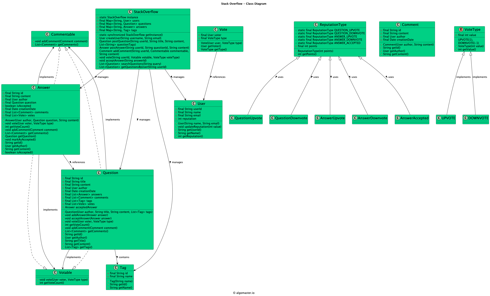

# Low-level design problem: stack overflow

> Copied from <https://github.com/ashishps1/awesome-low-level-design/blob/main/problems/stack-overflow.md> (GPL-3.0, by Ashish Pratap Singh). Questions and answers are the source's own; nothing was answered or rewritten here.


# Designing Stack Overflow

## Requirements
1. Users can post questions, answer questions, and comment on questions and answers.
2. Users can vote on questions and answers.
3. Questions should have tags associated with them.
4. Users can search for questions based on keywords, tags, or user profiles.
5. The system should assign reputation score to users based on their activity and the quality of their contributions.
6. The system should handle concurrent access and ensure data consistency.

## UML Class Diagram



## Implementations
#### [Java Implementation](https://github.com/ashishps1/awesome-low-level-design/blob/main/solutions/java/src/stackoverflow) 
#### [Python Implementation](https://github.com/ashishps1/awesome-low-level-design/blob/main/solutions/python/stackoverflow)
#### [C++ Implementation](https://github.com/ashishps1/awesome-low-level-design/blob/main/solutions/cpp/stackoverflow)
#### [C# Implementation](https://github.com/ashishps1/awesome-low-level-design/blob/main/solutions/csharp/stackoverflow)
#### [Go Implementation](https://github.com/ashishps1/awesome-low-level-design/blob/main/solutions/golang/stackoverflow)
#### [TypeScript Implementation](https://github.com/ashishps1/awesome-low-level-design/blob/main/solutions/typescript/src/StackOverflow)

## Classes, Interfaces and Enumerations
1. The **User** class represents a user of the Stack Overflow system, with properties such as id, username, email, and reputation.
2. The **Question** class represents a question posted by a user, with properties such as id, title, content, author, answers, comments, tags, votes and creation date.
3. The **Answer** class represents an answer to a question, with properties such as id, content, author, associated question, comments, votes and creation date.
4. The **Comment** class represents a comment on a question or an answer, with properties such as id, content, author, and creation date.
5. The **Tag** class represents a tag associated with a question, with properties such as id and name.
6. The **Vote** class represents vote associated with a question/answer.
7. The **StackOverflow** class is the main class that manages the Stack Overflow system. It provides methods for creating user, posting questions, answers, and comments, voting on questions and answers, searching for questions, and retrieving questions by tags and users.
8.  The **StackOverflowDemo** class demonstrates the usage of the Stack Overflow system by creating users, posting questions and answers, voting, searching for questions, and retrieving questions by tags and users.

---

## Official solutions from the repository

<details><summary><b>java</b> (19 files)</summary>


**README.md**

```md
# StackOverflow System (LLD)

## Problem Statement

Design and implement a simplified StackOverflow-like Q&A platform. The system should allow users to post questions and answers, vote on them, comment, tag questions, and track user reputation.

---

## Requirements

- **User Management:** Users can ask questions, answer, comment, and vote.
- **Questions & Answers:** Users can post questions and answers. Each question can have multiple answers, and one accepted answer.
- **Voting:** Users can upvote or downvote questions and answers. Reputation is updated accordingly.
- **Comments:** Users can comment on both questions and answers.
- **Tags:** Questions can be tagged for categorization.
- **Reputation:** Users gain or lose reputation based on votes and accepted answers.
- **Accepted Answer:** The question author can mark one answer as accepted.

---

## Core Entities

- **User:** Represents a user, tracks reputation and user details.
- **Question:** Represents a question, holds answers, comments, tags, votes, and accepted answer.
- **Answer:** Represents an answer to a question, holds comments, votes, and accepted status.
- **Comment:** Represents a comment on a question or answer.
- **Tag:** Represents a tag for categorizing questions.
- **Vote:** Represents a vote (upvote/downvote) by a user on a question or answer.
- **VoteType:** Enum for UPVOTE and DOWNVOTE.
- **Votable (interface):** For entities that can be voted on.
- **Commentable (interface):** For entities that can be commented on.

---

## Class Design

## UML Class Diagram


### 1. User
- **Fields:** id, name, reputation, etc.
- **Methods:** updateReputation(int delta), getReputation(), etc.

### 2. Question
- **Fields:** id, title, content, author, creationDate, answers, comments, tags, votes, acceptedAnswer
- **Methods:** addAnswer(Answer), acceptAnswer(Answer), vote(User, VoteType), getVoteCount(), addComment(Comment), getComments(), etc.

### 3. Answer
- **Fields:** id, content, author, question, isAccepted, creationDate, comments, votes
- **Methods:** vote(User, VoteType), getVoteCount(), addComment(Comment), getComments(), markAsAccepted(), etc.

### 4. Comment
- **Fields:** id, content, author, creationDate

### 5. Tag
- **Fields:** name

### 6. Vote
- **Fields:** voter, type (VoteType)
- **Methods:** getVoter(), getType()

### 7. VoteType
- Enum: UPVOTE, DOWNVOTE

### 8. Votable (interface)
- **Methods:** vote(User, VoteType), getVoteCount()

### 9. Commentable (interface)
- **Methods:** addComment(Comment), getComments()

---

## Design Patterns Used

- **Strategy Pattern:** For voting and commenting behaviors via interfaces.
- **Observer Pattern:** (Conceptually) for reputation updates on votes and accepted answers.

---

## Example Usage

```java
User alice = new User("Alice");
Question q = new Question(alice, "What is Java?", "Explain Java basics.", Arrays.asList("java", "basics"));
User bob = new User("Bob");
Answer a = new Answer(bob, q, "Java is a programming language.");
q.addAnswer(a);
q.vote(bob, VoteType.UPVOTE);
a.vote(alice, VoteType.UPVOTE);
q.acceptAnswer(a);
```

---

## Demo

See `StackOverflowDemo.java` for a sample usage of the StackOverflow system.

---

## Extending the Framework

- **Add new features:** Such as badges, user profiles, or advanced search.
- **Add new vote types:** Extend `VoteType` and update logic in `vote()` methods.
- **Add moderation:** Implement admin/moderator roles for content management.

---
```


**StackOverflowDemo.java**

```java
package stackoverflow;

import stackoverflow.enums.VoteType;
import stackoverflow.entities.Answer;
import stackoverflow.entities.Question;
import stackoverflow.entities.Tag;
import stackoverflow.entities.User;
import stackoverflow.strategy.SearchStrategy;
import stackoverflow.strategy.TagSearchStrategy;
import stackoverflow.strategy.UserSearchStrategy;

import java.util.List;
import java.util.Set;

public class StackOverflowDemo {
    public static void main(String[] args) {
        StackOverflowService service = new StackOverflowService();

        // 1. Create Users
        User alice = service.createUser("Alice");
        User bob = service.createUser("Bob");
        User charlie = service.createUser("Charlie");

        // 2. Alice posts a question
        System.out.println("--- Alice posts a question ---");
        Tag javaTag = new Tag("java");
        Tag designPatternsTag = new Tag("design-patterns");
        Set<Tag> tags = Set.of(javaTag, designPatternsTag);
        Question question = service.postQuestion(alice.getId(), "How to implement Observer Pattern?", "Details about Observer Pattern...", tags);
        printReputations(alice, bob, charlie);

        // 3. Bob and Charlie post answers
        System.out.println("\n--- Bob and Charlie post answers ---");
        Answer bobAnswer = service.postAnswer(bob.getId(), question.getId(), "You can use the java.util.Observer interface.");
        Answer charlieAnswer = service.postAnswer(charlie.getId(), question.getId(), "A better way is to create your own Observer interface.");
        printReputations(alice, bob, charlie);

        // 4. Voting happens
        System.out.println("\n--- Voting Occurs ---");
        service.voteOnPost(alice.getId(), question.getId(), VoteType.UPVOTE); // Alice upvotes her own question
        service.voteOnPost(bob.getId(), charlieAnswer.getId(), VoteType.UPVOTE); // Bob upvotes Charlie's answer
        service.voteOnPost(alice.getId(), bobAnswer.getId(), VoteType.DOWNVOTE); // Alice downvotes Bob's answer
        printReputations(alice, bob, charlie);

        // 5. Alice accepts Charlie's answer
        System.out.println("\n--- Alice accepts Charlie's answer ---");
        service.acceptAnswer(question.getId(), charlieAnswer.getId());
        printReputations(alice, bob, charlie);

        // 6. Search for questions
        System.out.println("\n--- (C) Combined Search: Questions by 'Alice' with tag 'java' ---");
        List<SearchStrategy> filtersC = List.of(
                new UserSearchStrategy(alice),
                new TagSearchStrategy(javaTag)
        );
        List<Question> searchResults = service.searchQuestions(filtersC);
        searchResults.forEach(q -> System.out.println("  - Found: " + q.getTitle()));
    }

    private static void printReputations(User... users) {
        System.out.println("--- Current Reputations ---");
        for(User user : users) {
            System.out.printf("%s: %d\n", user.getName(), user.getReputation());
        }
    }
}
```


**StackOverflowService.java**

```java
package stackoverflow;

import stackoverflow.enums.VoteType;
import stackoverflow.entities.*;
import stackoverflow.observer.PostObserver;
import stackoverflow.observer.ReputationManager;
import stackoverflow.strategy.SearchStrategy;

import java.util.*;
import java.util.concurrent.ConcurrentHashMap;

public class StackOverflowService {
    private final Map<String, User> users = new ConcurrentHashMap<>();
    private final Map<String, Question> questions = new ConcurrentHashMap<>();
    private final Map<String, Answer> answers = new ConcurrentHashMap<>();
    private final PostObserver reputationManager = new ReputationManager();

    public User createUser(String name) {
        User user = new User(name);
        users.put(user.getId(), user);
        return user;
    }

    public Question postQuestion(String userId, String title, String body, Set<Tag> tags) {
        User author = users.get(userId);
        Question question = new Question(title, body, author, tags);
        question.addObserver(reputationManager);
        questions.put(question.getId(), question);
        return question;
    }

    public Answer postAnswer(String userId, String questionId, String body) {
        User author = users.get(userId);
        Question question = questions.get(questionId);
        Answer answer = new Answer(body, author);
        answer.addObserver(reputationManager);
        question.addAnswer(answer);
        answers.put(answer.getId(), answer);
        return answer;
    }

    public void voteOnPost(String userId, String postId, VoteType voteType) {
        User user = users.get(userId);
        Post post = findPostById(postId);
        post.vote(user, voteType);
    }

    public void acceptAnswer(String questionId, String answerId) {
        Question question = questions.get(questionId);
        Answer answer = answers.get(answerId);
        question.acceptAnswer(answer);
    }

    public List<Question> searchQuestions(List<SearchStrategy> strategies) {
        List<Question> results = new ArrayList<>(questions.values());

        // Sequentially apply each filter strategy to the results of the previous one.
        for (SearchStrategy strategy : strategies) {
            results = strategy.filter(results);
        }

        return results;
    }

    public User getUser(String userId) {
        return users.get(userId);
    }

    private Post findPostById(String postId) {
        if (questions.containsKey(postId)) {
            return questions.get(postId);
        } else if (answers.containsKey(postId)) {
            return answers.get(postId);
        }

        throw new NoSuchElementException("Post not found");
    }
}
```


**entities/Answer.java**

```java
package stackoverflow.entities;

import java.util.UUID;

public class Answer extends Post {
    private boolean isAccepted = false;

    public Answer(String body, User author) {
        super(UUID.randomUUID().toString(), body, author);
    }

    public void setAccepted(boolean accepted) {
        isAccepted = accepted;
    }

    public boolean isAccepted() { return isAccepted; }
}
```


**entities/Comment.java**

```java
package stackoverflow.entities;

import java.util.UUID;

public class Comment extends Content {
    public Comment(String body, User author) {
        super(UUID.randomUUID().toString(), body, author);
    }
}
```


**entities/Content.java**

```java
package stackoverflow.entities;

import java.time.LocalDateTime;

public abstract class Content {
    protected final String id;
    protected final String body;
    protected final User author;
    protected final LocalDateTime creationTime;

    public Content(String id, String body, User author) {
        this.id = id;
        this.body = body;
        this.author = author;
        this.creationTime = LocalDateTime.now();
    }
    public String getId() { return id; }
    public String getBody() { return body; }
    public User getAuthor() { return author; }
}
```


**entities/Event.java**

```java
package stackoverflow.entities;

import stackoverflow.enums.EventType;

public class Event {
    private final EventType type;
    private final User actor;        // user who performed the action
    private final Post targetPost;   // post being acted on

    public Event(EventType type, User actor, Post targetPost) {
        this.type = type;
        this.actor = actor;
        this.targetPost = targetPost;
    }

    public EventType getType() { return type; }
    public User getActor() { return actor; }
    public Post getTargetPost() { return targetPost; }
}
```


**entities/Post.java**

```java
package stackoverflow.entities;

import stackoverflow.enums.EventType;
import stackoverflow.enums.VoteType;
import stackoverflow.observer.PostObserver;

import java.util.ArrayList;
import java.util.List;
import java.util.Map;
import java.util.concurrent.ConcurrentHashMap;
import java.util.concurrent.CopyOnWriteArrayList;
import java.util.concurrent.atomic.AtomicInteger;

public abstract class Post extends Content {
    private final AtomicInteger voteCount = new AtomicInteger(0);
    private final Map<String, VoteType> voters = new ConcurrentHashMap<>();
    private final List<Comment> comments = new CopyOnWriteArrayList<>();
    private final List<PostObserver> observers = new CopyOnWriteArrayList<>();

    public Post(String id, String body, User author) {
        super(id, body, author);
    }

    public void addObserver(PostObserver observer) {
        this.observers.add(observer);
    }

    protected void notifyObservers(Event event) {
        observers.forEach(o -> o.onPostEvent(event));
    }

    public synchronized void vote(User user, VoteType voteType) {
        String userId = user.getId();
        if (voters.get(userId) == voteType)
            return; // Already voted

        int scoreChange = 0;
        if (voters.containsKey(userId)) { // User is changing their vote
            scoreChange = (voteType == VoteType.UPVOTE) ? 2 : -2;
        } else { // New vote
            scoreChange = (voteType == VoteType.UPVOTE) ? 1 : -1;
        }

        voters.put(userId, voteType);
        voteCount.addAndGet(scoreChange);

        EventType eventType = EventType.UPVOTE_QUESTION;

        if (this instanceof Question) {
            eventType = (voteType == VoteType.UPVOTE ? EventType.UPVOTE_QUESTION : EventType.DOWNVOTE_QUESTION);
        } else {
            eventType = (voteType == VoteType.UPVOTE ? EventType.UPVOTE_ANSWER : EventType.DOWNVOTE_ANSWER);
        }

        notifyObservers(new Event(eventType, user, this));
    }
}
```


**entities/Question.java**

```java
package stackoverflow.entities;

import stackoverflow.enums.EventType;

import java.util.*;

public class Question extends Post {
    private final String title;
    private final Set<Tag> tags;
    private final List<Answer> answers = new ArrayList<>();
    private Answer acceptedAnswer;

    public Question(String title, String body, User author, Set<Tag> tags) {
        super(UUID.randomUUID().toString(), body, author);
        this.title = title;
        this.tags = tags;
    }

    public void addAnswer(Answer answer) { this.answers.add(answer); }

    public synchronized void acceptAnswer(Answer answer) {
        if (!this.author.getId().equals(answer.getAuthor().getId()) && this.acceptedAnswer == null) {
            this.acceptedAnswer = answer;
            answer.setAccepted(true);
            notifyObservers(new Event(EventType.ACCEPT_ANSWER, answer.getAuthor(), answer));
        }
    }

    public String getTitle() { return title; }
    public Set<Tag> getTags() { return tags; }
    public List<Answer> getAnswers() { return answers; }
}
```


**entities/Tag.java**

```java
package stackoverflow.entities;

public class Tag {
    private final String name;

    public Tag(String name) { this.name = name; }

    public String getName() { return name; }
}
```


**entities/User.java**

```java
package stackoverflow.entities;

import java.util.UUID;
import java.util.concurrent.atomic.AtomicInteger;

public class User {
    private final String id;
    private final String name;
    private final AtomicInteger reputation;

    public User(String name) {
        this.id = UUID.randomUUID().toString();
        this.name = name;
        this.reputation = new AtomicInteger(0);
    }

    public void updateReputation(int change) {
        this.reputation.addAndGet(change);
    }

    public String getId() { return id; }
    public String getName() { return name; }
    public int getReputation() { return reputation.get(); }
}
```


**enums/EventType.java**

```java
package stackoverflow.enums;

public enum EventType {
    UPVOTE_QUESTION,
    DOWNVOTE_QUESTION,
    UPVOTE_ANSWER,
    DOWNVOTE_ANSWER,
    ACCEPT_ANSWER
}
```


**enums/VoteType.java**

```java
package stackoverflow.enums;

public enum VoteType {
    UPVOTE, DOWNVOTE
}
```


**observer/PostObserver.java**

```java
package stackoverflow.observer;

import stackoverflow.entities.Event;

public interface PostObserver {
    void onPostEvent(Event event);
}
```


**observer/ReputationManager.java**

```java
package stackoverflow.observer;

import stackoverflow.entities.Event;
import stackoverflow.entities.User;

public class ReputationManager implements PostObserver {
    private static final int QUESTION_UPVOTE_REP = 5;
    private static final int ANSWER_UPVOTE_REP = 10;
    private static final int ACCEPTED_ANSWER_REP = 15;
    private static final int DOWNVOTE_REP_PENALTY = -1; // Penalty for the voter
    private static final int POST_DOWNVOTED_REP_PENALTY = -2; // Penalty for the post author

    @Override
    public void onPostEvent(Event event) {
        User postAuthor = event.getTargetPost().getAuthor();
        switch (event.getType()) {
            case UPVOTE_QUESTION:
                postAuthor.updateReputation(QUESTION_UPVOTE_REP);
                break;
            case DOWNVOTE_QUESTION:
                postAuthor.updateReputation(DOWNVOTE_REP_PENALTY);
                event.getActor().updateReputation(POST_DOWNVOTED_REP_PENALTY); // voter penalty
                break;
            case UPVOTE_ANSWER:
                postAuthor.updateReputation(ANSWER_UPVOTE_REP);
                break;
            case DOWNVOTE_ANSWER:
                postAuthor.updateReputation(DOWNVOTE_REP_PENALTY);
                event.getActor().updateReputation(POST_DOWNVOTED_REP_PENALTY);
                break;
            case ACCEPT_ANSWER:
                postAuthor.updateReputation(ACCEPTED_ANSWER_REP);
                break;
        }
    }
}
```


**strategy/KeywordSearchStrategy.java**

```java
package stackoverflow.strategy;

import stackoverflow.entities.Question;

import java.util.List;
import java.util.stream.Collectors;

public class KeywordSearchStrategy implements SearchStrategy {
    private final String keyword;

    public KeywordSearchStrategy(String keyword) {
        this.keyword = keyword.toLowerCase();
    }

    @Override
    public List<Question> filter(List<Question> questions) {
        return questions.stream()
                .filter(q -> q.getTitle().toLowerCase().contains(keyword) ||
                        q.getBody().toLowerCase().contains(keyword))
                .collect(Collectors.toList());
    }
}
```


**strategy/SearchStrategy.java**

```java
package stackoverflow.strategy;

import stackoverflow.entities.Question;

import java.util.List;

public interface SearchStrategy {
    List<Question> filter(List<Question> questions);
}
```


**strategy/TagSearchStrategy.java**

```java
package stackoverflow.strategy;

import stackoverflow.entities.Question;
import stackoverflow.entities.Tag;

import java.util.List;
import java.util.stream.Collectors;

public class TagSearchStrategy implements SearchStrategy {
    private final Tag tag;

    public TagSearchStrategy(Tag tag) {
        this.tag = tag;
    }

    @Override
    public List<Question> filter(List<Question> questions) {
        return questions.stream()
                .filter(q -> q.getTags().stream()
                        .anyMatch(t -> t.getName().equalsIgnoreCase(tag.getName())))
                .collect(Collectors.toList());
    }
}
```


**strategy/UserSearchStrategy.java**

```java
package stackoverflow.strategy;

import stackoverflow.entities.Question;
import stackoverflow.entities.User;

import java.util.List;
import java.util.stream.Collectors;

public class UserSearchStrategy implements SearchStrategy {
    private final User user;

    public UserSearchStrategy(User user) {
        this.user = user;
    }

    @Override
    public List<Question> filter(List<Question> questions) {
        return questions.stream()
                .filter(q -> q.getAuthor().getId().equals(user.getId()))
                .collect(Collectors.toList());
    }
}
```

</details>

<details><summary><b>python</b> (11 files)</summary>


**README.md**

```md
# Designing Stack Overflow

## Requirements
1. Users can post questions, answer questions, and comment on questions and answers.
2. Users can vote on questions and answers.
3. Questions should have tags associated with them.
4. Users can search for questions based on keywords, tags, or user profiles.
5. The system should assign reputation score to users based on their activity and the quality of their contributions.
6. The system should handle concurrent access and ensure data consistency.

## Classes, Interfaces and Enumerations
1. The **User** class represents a user of the Stack Overflow system, with properties such as id, username, email, and reputation.
2. The **Question** class represents a question posted by a user, with properties such as id, title, content, author, answers, comments, tags, votes and creation date.
3. The **Answer** class represents an answer to a question, with properties such as id, content, author, associated question, comments, votes and creation date.
4. The **Comment** class represents a comment on a question or an answer, with properties such as id, content, author, and creation date.
5. The **Tag** class represents a tag associated with a question, with properties such as id and name.
6. The **Vote** class represents vote associated with a question/answer.
7. The **StackOverflow** class is the main class that manages the Stack Overflow system. It provides methods for creating user, posting questions, answers, and comments, voting on questions and answers, searching for questions, and retrieving questions by tags and users.
8.  The **StackOverflowDemo** class demonstrates the usage of the Stack Overflow system by creating users, posting questions and answers, voting, searching for questions, and retrieving questions by tags and users.
```


**content.py**

```py
import threading
import uuid
from abc import ABC
from datetime import datetime
from typing import Dict, List, Optional, Set, TYPE_CHECKING

from enums import VoteType, EventType
from user import User
from tag import Tag

if TYPE_CHECKING:
    from event import Event
    from post_observer import PostObserver


class Content(ABC):
    def __init__(self, content_id: str, body: str, author: User):
        self.id = content_id
        self.body = body
        self.author = author
        self.creation_time = datetime.now()

    def get_id(self) -> str:
        return self.id

    def get_body(self) -> str:
        return self.body

    def get_author(self) -> User:
        return self.author


class Post(Content):
    def __init__(self, post_id: str, body: str, author: User):
        super().__init__(post_id, body, author)
        self.vote_count = 0
        self.voters: Dict[str, VoteType] = {}
        self.comments: List['Comment'] = []
        self.observers: List['PostObserver'] = []
        self._lock = threading.Lock()

    def add_observer(self, observer: 'PostObserver'):
        self.observers.append(observer)

    def notify_observers(self, event: 'Event'):
        for observer in self.observers:
            observer.on_post_event(event)

    def vote(self, user: User, vote_type: VoteType):
        with self._lock:
            user_id = user.get_id()
            if self.voters.get(user_id) == vote_type:
                return  # Already voted

            score_change = 0
            if user_id in self.voters:  # User is changing their vote
                score_change = 2 if vote_type == VoteType.UPVOTE else -2
            else:  # New vote
                score_change = 1 if vote_type == VoteType.UPVOTE else -1

            self.voters[user_id] = vote_type
            self.vote_count += score_change

            # Import here to avoid circular dependency
            from event import Event
            
            if isinstance(self, Question):
                event_type = EventType.UPVOTE_QUESTION if vote_type == VoteType.UPVOTE else EventType.DOWNVOTE_QUESTION
            else:
                event_type = EventType.UPVOTE_ANSWER if vote_type == VoteType.UPVOTE else EventType.DOWNVOTE_ANSWER

            self.notify_observers(Event(event_type, user, self))

    def get_vote_count(self) -> int:
        return self.vote_count

    def add_comment(self, comment: 'Comment'):
        self.comments.append(comment)

    def get_comments(self) -> List['Comment']:
        return self.comments


class Question(Post):
    def __init__(self, title: str, body: str, author: User, tags: Set[Tag]):
        super().__init__(str(uuid.uuid4()), body, author)
        self.title = title
        self.tags = tags
        self.answers: List['Answer'] = []
        self.accepted_answer: Optional['Answer'] = None

    def add_answer(self, answer: 'Answer'):
        self.answers.append(answer)

    def accept_answer(self, answer: 'Answer'):
        with self._lock:
            # Only the question author can accept an answer, and it shouldn't be their own answer
            if (self.author.get_id() != answer.get_author().get_id() and 
                self.accepted_answer is None):
                self.accepted_answer = answer
                answer.set_accepted(True)
                
                # Import here to avoid circular dependency
                from event import Event
                self.notify_observers(Event(EventType.ACCEPT_ANSWER, answer.get_author(), answer))

    def get_title(self) -> str:
        return self.title

    def get_tags(self) -> Set[Tag]:
        return self.tags

    def get_answers(self) -> List['Answer']:
        return self.answers

    def get_accepted_answer(self) -> Optional['Answer']:
        return self.accepted_answer


class Answer(Post):
    def __init__(self, body: str, author: User):
        super().__init__(str(uuid.uuid4()), body, author)
        self.is_accepted = False

    def set_accepted(self, accepted: bool):
        self.is_accepted = accepted

    def is_accepted_answer(self) -> bool:
        return self.is_accepted


class Comment(Content):
    def __init__(self, body: str, author: User):
        super().__init__(str(uuid.uuid4()), body, author)
```


**enums.py**

```py
from enum import Enum

class VoteType(Enum):
    UPVOTE = "UPVOTE"
    DOWNVOTE = "DOWNVOTE"

class EventType(Enum):
    UPVOTE_QUESTION = "UPVOTE_QUESTION"
    DOWNVOTE_QUESTION = "DOWNVOTE_QUESTION"
    UPVOTE_ANSWER = "UPVOTE_ANSWER"
    DOWNVOTE_ANSWER = "DOWNVOTE_ANSWER"
    ACCEPT_ANSWER = "ACCEPT_ANSWER"
```


**event.py**

```py
from enums import EventType
from user import User
from typing import TYPE_CHECKING

if TYPE_CHECKING:
    from post import Post

class Event:
    def __init__(self, event_type: EventType, actor: User, target_post: 'Post'):
        self.type = event_type
        self.actor = actor
        self.target_post = target_post

    def get_type(self) -> EventType:
        return self.type

    def get_actor(self) -> User:
        return self.actor

    def get_target_post(self) -> 'Post':
        return self.target_post
```


**post_observer.py**

```py
from abc import ABC, abstractmethod
from typing import TYPE_CHECKING

if TYPE_CHECKING:
    from event import Event

class PostObserver(ABC):
    @abstractmethod
    def on_post_event(self, event: 'Event'):
        pass
```


**reputation_manager.py**

```py
from post_observer import PostObserver
from event import Event
from enums import EventType

class ReputationManager(PostObserver):
    QUESTION_UPVOTE_REP = 5
    ANSWER_UPVOTE_REP = 10
    ACCEPTED_ANSWER_REP = 15
    DOWNVOTE_REP_PENALTY = -1  # Penalty for the voter
    POST_DOWNVOTED_REP_PENALTY = -2  # Penalty for the post author

    def on_post_event(self, event: Event):
        post_author = event.get_target_post().get_author()
        
        if event.get_type() == EventType.UPVOTE_QUESTION:
            post_author.update_reputation(self.QUESTION_UPVOTE_REP)
        elif event.get_type() == EventType.DOWNVOTE_QUESTION:
            post_author.update_reputation(self.DOWNVOTE_REP_PENALTY)
            event.get_actor().update_reputation(self.POST_DOWNVOTED_REP_PENALTY)  # voter penalty
        elif event.get_type() == EventType.UPVOTE_ANSWER:
            post_author.update_reputation(self.ANSWER_UPVOTE_REP)
        elif event.get_type() == EventType.DOWNVOTE_ANSWER:
            post_author.update_reputation(self.DOWNVOTE_REP_PENALTY)
            event.get_actor().update_reputation(self.POST_DOWNVOTED_REP_PENALTY)
        elif event.get_type() == EventType.ACCEPT_ANSWER:
            post_author.update_reputation(self.ACCEPTED_ANSWER_REP)
```


**search_strategy.py**

```py
from abc import ABC, abstractmethod
from typing import List
from tag import Tag
from user import User
from content import Question

class SearchStrategy(ABC):
    @abstractmethod
    def filter(self, questions: List[Question]) -> List[Question]:
        pass

class KeywordSearchStrategy(SearchStrategy):
    def __init__(self, keyword: str):
        self.keyword = keyword.lower()

    def filter(self, questions: List[Question]) -> List[Question]:
        return [q for q in questions 
                if self.keyword in q.get_title().lower() or self.keyword in q.get_body().lower()]

class TagSearchStrategy(SearchStrategy):
    def __init__(self, tag: Tag):
        self.tag = tag

    def filter(self, questions: List[Question]) -> List[Question]:
        return [q for q in questions 
                if any(t.get_name().lower() == self.tag.get_name().lower() for t in q.get_tags())]

class UserSearchStrategy(SearchStrategy):
    def __init__(self, user: User):
        self.user = user

    def filter(self, questions: List[Question]) -> List[Question]:
        return [q for q in questions if q.get_author().get_id() == self.user.get_id()]
```


**stack_overflow_demo.py**

```py
from stack_overflow_service import StackOverflowService
from enums import VoteType
from search_strategy import UserSearchStrategy, TagSearchStrategy
from tag import Tag

class StackOverflowDemo:
    @staticmethod
    def main():
        service = StackOverflowService()

        # 1. Create Users
        alice = service.create_user("Alice")
        bob = service.create_user("Bob")
        charlie = service.create_user("Charlie")

        # 2. Alice posts a question
        print("--- Alice posts a question ---")
        java_tag = Tag("java")
        design_patterns_tag = Tag("design-patterns")
        tags = {java_tag, design_patterns_tag}
        question = service.post_question(alice.get_id(), "How to implement Observer Pattern?", "Details about Observer Pattern...", tags)
        StackOverflowDemo.print_reputations(alice, bob, charlie)

        # 3. Bob and Charlie post answers
        print("\n--- Bob and Charlie post answers ---")
        bob_answer = service.post_answer(bob.get_id(), question.get_id(), "You can use the java.util.Observer interface.")
        charlie_answer = service.post_answer(charlie.get_id(), question.get_id(), "A better way is to create your own Observer interface.")
        StackOverflowDemo.print_reputations(alice, bob, charlie)

        # 4. Voting happens
        print("\n--- Voting Occurs ---")
        service.vote_on_post(alice.get_id(), question.get_id(), VoteType.UPVOTE)  # Alice upvotes her own question
        service.vote_on_post(bob.get_id(), charlie_answer.get_id(), VoteType.UPVOTE)  # Bob upvotes Charlie's answer
        service.vote_on_post(alice.get_id(), bob_answer.get_id(), VoteType.DOWNVOTE)  # Alice downvotes Bob's answer
        StackOverflowDemo.print_reputations(alice, bob, charlie)

        # 5. Alice accepts Charlie's answer
        print("\n--- Alice accepts Charlie's answer ---")
        service.accept_answer(question.get_id(), charlie_answer.get_id())
        StackOverflowDemo.print_reputations(alice, bob, charlie)

        # 6. Search for questions
        print("\n--- (C) Combined Search: Questions by 'Alice' with tag 'java' ---")
        filters_c = [
            UserSearchStrategy(alice),
            TagSearchStrategy(java_tag)
        ]
        search_results = service.search_questions(filters_c)
        for q in search_results:
            print(f"  - Found: {q.get_title()}")

    @staticmethod
    def print_reputations(*users):
        print("--- Current Reputations ---")
        for user in users:
            print(f"{user.get_name()}: {user.get_reputation()}")


if __name__ == "__main__":
    StackOverflowDemo.main()
```


**stack_overflow_service.py**

```py
from typing import Dict, Set, List
from user import User
from content import Question
from content import Answer
from tag import Tag
from enums import VoteType
from search_strategy import SearchStrategy
from reputation_manager import ReputationManager
from content import Post

class StackOverflowService:
    def __init__(self):
        self.users: Dict[str, User] = {}
        self.questions: Dict[str, Question] = {}
        self.answers: Dict[str, Answer] = {}
        self.reputation_manager = ReputationManager()

    def create_user(self, name: str) -> User:
        user = User(name)
        self.users[user.get_id()] = user
        return user

    def post_question(self, user_id: str, title: str, body: str, tags: Set[Tag]) -> Question:
        author = self.users[user_id]
        question = Question(title, body, author, tags)
        question.add_observer(self.reputation_manager)
        self.questions[question.get_id()] = question
        return question

    def post_answer(self, user_id: str, question_id: str, body: str) -> Answer:
        author = self.users[user_id]
        question = self.questions[question_id]
        answer = Answer(body, author)
        answer.add_observer(self.reputation_manager)
        question.add_answer(answer)
        self.answers[answer.get_id()] = answer
        return answer

    def vote_on_post(self, user_id: str, post_id: str, vote_type: VoteType):
        user = self.users[user_id]
        post = self.find_post_by_id(post_id)
        post.vote(user, vote_type)

    def accept_answer(self, question_id: str, answer_id: str):
        question = self.questions[question_id]
        answer = self.answers[answer_id]
        question.accept_answer(answer)

    def search_questions(self, strategies: List[SearchStrategy]) -> List[Question]:
        results = list(self.questions.values())

        for strategy in strategies:
            results = strategy.filter(results)

        return results

    def get_user(self, user_id: str) -> User:
        return self.users[user_id]

    def find_post_by_id(self, post_id: str) -> Post:
        if post_id in self.questions:
            return self.questions[post_id]
        elif post_id in self.answers:
            return self.answers[post_id]
        
        raise KeyError("Post not found")
```


**tag.py**

```py
class Tag:
    def __init__(self, name: str):
        self.name = name

    def get_name(self) -> str:
        return self.name
```


**user.py**

```py
import threading
import uuid

class User:
    def __init__(self, name: str):
        self.id = str(uuid.uuid4())
        self.name = name
        self.reputation = 0
        self._lock = threading.Lock()

    def update_reputation(self, change: int):
        with self._lock:
            self.reputation += change

    def get_id(self) -> str:
        return self.id

    def get_name(self) -> str:
        return self.name

    def get_reputation(self) -> int:
        with self._lock:
            return self.reputation
```

</details>

<details><summary><b>cpp</b> (10 files)</summary>


**Comment.cpp**

```cpp
#include "Comment.hpp"
#include <iostream>

Comment::Comment(std::string commentId, std::string userId, std::string content)
    : commentId(commentId), userId(userId), content(content) {
    timestamp = std::time(nullptr);
}

std::string Comment::getCommentId() const { return commentId; }
std::string Comment::getUserId() const { return userId; }
std::string Comment::getContent() const { return content; }
std::time_t Comment::getTimestamp() const { return timestamp; }

void Comment::displayInfo() const {
    std::cout << "- " << content << " (by User " << userId << ")" << std::endl;
}
```


**Comment.hpp**

```hpp
#ifndef COMMENT_HPP
#define COMMENT_HPP

#include <string>
#include <ctime>

class Comment {
private:
    std::string commentId;
    std::string userId;
    std::string content;
    std::time_t timestamp;

public:
    Comment(std::string commentId, std::string userId, std::string content);
    
    std::string getCommentId() const;
    std::string getUserId() const;
    std::string getContent() const;
    std::time_t getTimestamp() const;
    
    void displayInfo() const;
};

#endif
```


**Post.cpp**

```cpp
#include "Post.hpp"
#include <iostream>
#include <algorithm>

Post::Post(std::string postId, std::string userId, std::string content,
           const std::vector<std::string>& tags, PostType type)
    : postId(postId), userId(userId), content(content), tags(tags),
      score(0), accepted(false), type(type) {
    timestamp = std::time(nullptr);
}

Post::~Post() {
    for (auto comment : comments) {
        delete comment;
    }
}

std::string Post::getPostId() const { return postId; }
std::string Post::getUserId() const { return userId; }
std::string Post::getContent() const { return content; }
const std::vector<std::string>& Post::getTags() const { return tags; }
const std::vector<Comment*>& Post::getComments() const { return comments; }
int Post::getScore() const { return score; }
bool Post::isAccepted() const { return accepted; }
PostType Post::getType() const { return type; }
std::time_t Post::getTimestamp() const { return timestamp; }

void Post::addComment(Comment* comment) {
    comments.push_back(comment);
}

bool Post::addVote(const std::string& userId) {
    if (std::find(votes.begin(), votes.end(), userId) == votes.end()) {
        votes.push_back(userId);
        score++;
        return true;
    }
    return false;
}

bool Post::removeVote(const std::string& userId) {
    auto it = std::find(votes.begin(), votes.end(), userId);
    if (it != votes.end()) {
        votes.erase(it);
        score--;
        return true;
    }
    return false;
}

void Post::setAccepted(bool status) {
    accepted = status;
}

void Post::displayInfo() const {
    std::cout << "\nPost ID: " << postId << std::endl;
    std::cout << "Type: " << (type == PostType::QUESTION ? "Question" : "Answer") << std::endl;
    std::cout << "Content: " << content << std::endl;
    std::cout << "Score: " << score << std::endl;
    std::cout << "Status: " << (accepted ? "Accepted" : "Not Accepted") << std::endl;
    
    if (!tags.empty()) {
        std::cout << "Tags: ";
        for (const auto& tag : tags) {
            std::cout << tag << " ";
        }
        std::cout << std::endl;
    }
    
    if (!comments.empty()) {
        std::cout << "Comments:" << std::endl;
        for (const auto& comment : comments) {
            comment->displayInfo();
        }
    }
    
    std::cout << "Time: " << std::ctime(&timestamp);
}
```


**Post.hpp**

```hpp
#ifndef POST_HPP
#define POST_HPP

#include <string>
#include <vector>
#include <ctime>
#include "Comment.hpp"

enum class PostType {
    QUESTION,
    ANSWER
};

class Post {
private:
    std::string postId;
    std::string userId;
    std::string content;
    std::vector<std::string> tags;
    std::vector<Comment*> comments;
    std::vector<std::string> votes;  // userIds who voted
    int score;
    bool accepted;
    PostType type;
    std::time_t timestamp;

public:
    Post(std::string postId, std::string userId, std::string content,
         const std::vector<std::string>& tags, PostType type);
    ~Post();
    
    std::string getPostId() const;
    std::string getUserId() const;
    std::string getContent() const;
    const std::vector<std::string>& getTags() const;
    const std::vector<Comment*>& getComments() const;
    int getScore() const;
    bool isAccepted() const;
    PostType getType() const;
    std::time_t getTimestamp() const;
    
    void addComment(Comment* comment);
    bool addVote(const std::string& userId);
    bool removeVote(const std::string& userId);
    void setAccepted(bool status);
    void displayInfo() const;
};

#endif
```


**README.md**

```md
# Designing Stack Overflow

## Requirements
1. Users can post questions, answer questions, and comment on questions and answers.
2. Users can vote on questions and answers.
3. Questions should have tags associated with them.
4. Users can search for questions based on keywords, tags, or user profiles.
5. The system should assign reputation score to users based on their activity and the quality of their contributions.
6. The system should handle concurrent access and ensure data consistency.

## Classes, Interfaces and Enumerations
1. The **User** class represents a user of the Stack Overflow system, with properties such as id, username, email, and reputation.
2. The **Question** class represents a question posted by a user, with properties such as id, title, content, author, answers, comments, tags, votes and creation date.
3. The **Answer** class represents an answer to a question, with properties such as id, content, author, associated question, comments, votes and creation date.
4. The **Comment** class represents a comment on a question or an answer, with properties such as id, content, author, and creation date.
5. The **Tag** class represents a tag associated with a question, with properties such as id and name.
6. The **Vote** class represents vote associated with a question/answer.
7. The **StackOverflow** class is the main class that manages the Stack Overflow system. It provides methods for creating user, posting questions, answers, and comments, voting on questions and answers, searching for questions, and retrieving questions by tags and users.
8.  The **StackOverflowDemo** class demonstrates the usage of the Stack Overflow system by creating users, posting questions and answers, voting, searching for questions, and retrieving questions by tags and users.
```


**StackOverflow.cpp**

```cpp
#include "StackOverflow.hpp"
#include <iostream>
#include <algorithm>

StackOverflow::StackOverflow() : userIdCounter(1), postIdCounter(1), commentIdCounter(1) {}

StackOverflow::~StackOverflow() {
    for (auto user : users) delete user;
    for (auto post : posts) delete post;
}

User* StackOverflow::registerUser(const std::string& username, const std::string& email) {
    std::string userId = generateUserId();
    User* user = new User(userId, username, email);
    users.push_back(user);
    return user;
}

void StackOverflow::removeUser(const std::string& userId) {
    auto it = std::find_if(users.begin(), users.end(),
        [userId](User* user) { return user->getUserId() == userId; });
    
    if (it != users.end()) {
        delete *it;
        users.erase(it);
    }
}

Post* StackOverflow::addQuestion(const std::string& userId, const std::string& content,
                                const std::vector<std::string>& tags) {
    if (!findUser(userId)) return nullptr;
    
    std::string postId = generatePostId();
    Post* question = new Post(postId, userId, content, tags, PostType::QUESTION);
    posts.push_back(question);
    return question;
}

Post* StackOverflow::addAnswer(const std::string& userId, const std::string& questionId,
                              const std::string& content) {
    if (!findUser(userId)) return nullptr;
    
    Post* question = findPost(questionId);
    if (!question || question->getType() != PostType::QUESTION) return nullptr;
    
    std::string postId = generatePostId();
    Post* answer = new Post(postId, userId, content, std::vector<std::string>(), PostType::ANSWER);
    posts.push_back(answer);
    return answer;
}

Comment* StackOverflow::addComment(const std::string& userId, const std::string& postId,
                                 const std::string& content) {
    if (!findUser(userId)) return nullptr;
    
    Post* post = findPost(postId);
    if (!post) return nullptr;
    
    std::string commentId = generateCommentId();
    Comment* comment = new Comment(commentId, userId, content);
    post->addComment(comment);
    return comment;
}

bool StackOverflow::votePost(const std::string& userId, const std::string& postId) {
    User* user = findUser(userId);
    Post* post = findPost(postId);
    
    if (!user || !post || userId == post->getUserId()) return false;
    
    if (post->addVote(userId)) {
        updateUserReputation(post->getUserId(), 10);  // +10 for upvote
        return true;
    }
    return false;
}

bool StackOverflow::unvotePost(const std::string& userId, const std::string& postId) {
    Post* post = findPost(postId);
    if (!post) return false;
    
    if (post->removeVote(userId)) {
        updateUserReputation(post->getUserId(), -10);  // -10 for removed upvote
        return true;
    }
    return false;
}

bool StackOverflow::acceptAnswer(const std::string& userId, const std::string& answerId) {
    Post* answer = findPost(answerId);
    if (!answer || answer->getType() != PostType::ANSWER) return false;
    
    answer->setAccepted(true);
    updateUserReputation(answer->getUserId(), 15);  // +15 for accepted answer
    return true;
}

std::vector<Post*> StackOverflow::searchQuestions(const std::string& tag) const {
    std::vector<Post*> results;
    for (const auto& post : posts) {
        if (post->getType() == PostType::QUESTION) {
            const auto& tags = post->getTags();
            if (std::find(tags.begin(), tags.end(), tag) != tags.end()) {
                results.push_back(post);
            }
        }
    }
    return results;
}

void StackOverflow::displayUserProfile(const std::string& userId) const {
    User* user = findUser(userId);
    if (!user) return;
    
    user->displayInfo();
    
    std::cout << "\nPosts by " << user->getUsername() << ":" << std::endl;
    for (const auto& post : posts) {
        if (post->getUserId() == userId) {
            post->displayInfo();
        }
    }
}

void StackOverflow::displayQuestion(const std::string& questionId) const {
    Post* question = findPost(questionId);
    if (!question || question->getType() != PostType::QUESTION) return;
    
    question->displayInfo();
    
    std::cout << "\nAnswers:" << std::endl;
    for (const auto& post : posts) {
        if (post->getType() == PostType::ANSWER) {
            post->displayInfo();
        }
    }
}

void StackOverflow::displayAllQuestions() const {
    std::cout << "\nAll Questions:" << std::endl;
    for (const auto& post : posts) {
        if (post->getType() == PostType::QUESTION) {
            post->displayInfo();
            std::cout << "------------------------" << std::endl;
        }
    }
}

User* StackOverflow::findUser(const std::string& userId) const {
    auto it = std::find_if(users.begin(), users.end(),
        [userId](User* user) { return user->getUserId() == userId; });
    return it != users.end() ? *it : nullptr;
}

Post* StackOverflow::findPost(const std::string& postId) const {
    auto it = std::find_if(posts.begin(), posts.end(),
        [postId](Post* post) { return post->getPostId() == postId; });
    return it != posts.end() ? *it : nullptr;
}

void StackOverflow::updateUserReputation(const std::string& userId, int points) {
    if (User* user = findUser(userId)) {
        user->updateReputation(points);
    }
}

std::string StackOverflow::generateUserId() {
    return "U" + std::to_string(userIdCounter++);
}

std::string StackOverflow::generatePostId() {
    return "P" + std::to_string(postIdCounter++);
}

std::string StackOverflow::generateCommentId() {
    return "C" + std::to_string(commentIdCounter++);
}
```


**StackOverflow.hpp**

```hpp
#ifndef STACK_OVERFLOW_HPP
#define STACK_OVERFLOW_HPP

#include <vector>
#include <string>
#include "User.hpp"
#include "Post.hpp"
#include "Comment.hpp"

class StackOverflow {
private:
    std::vector<User*> users;
    std::vector<Post*> posts;
    int userIdCounter;
    int postIdCounter;
    int commentIdCounter;

public:
    StackOverflow();
    ~StackOverflow();
    
    // User management
    User* registerUser(const std::string& username, const std::string& email);
    void removeUser(const std::string& userId);
    
    // Post management
    Post* addQuestion(const std::string& userId, const std::string& content,
                     const std::vector<std::string>& tags);
    Post* addAnswer(const std::string& userId, const std::string& questionId,
                   const std::string& content);
    Comment* addComment(const std::string& userId, const std::string& postId,
                       const std::string& content);
    
    // Voting and acceptance
    bool votePost(const std::string& userId, const std::string& postId);
    bool unvotePost(const std::string& userId, const std::string& postId);
    bool acceptAnswer(const std::string& userId, const std::string& answerId);
    
    // Search and display
    std::vector<Post*> searchQuestions(const std::string& tag) const;
    void displayUserProfile(const std::string& userId) const;
    void displayQuestion(const std::string& questionId) const;
    void displayAllQuestions() const;

private:
    User* findUser(const std::string& userId) const;
    Post* findPost(const std::string& postId) const;
    void updateUserReputation(const std::string& userId, int points);
    std::string generateUserId();
    std::string generatePostId();
    std::string generateCommentId();
};

#endif
```


**StackOverflowDemo.cpp**

```cpp
#include "StackOverflow.hpp"
#include <iostream>

int main() {
    StackOverflow stackoverflow;
    
    // Register users
    User* user1 = stackoverflow.registerUser("john_doe", "john@email.com");
    User* user2 = stackoverflow.registerUser("alice_smith", "alice@email.com");
    User* user3 = stackoverflow.registerUser("bob_wilson", "bob@email.com");
    
    std::cout << "Initial users:" << std::endl;
    stackoverflow.displayUserProfile(user1->getUserId());
    
    // Add questions
    std::vector<std::string> tags = {"c++", "programming"};
    Post* question1 = stackoverflow.addQuestion(
        user1->getUserId(),
        "How do I use smart pointers in C++?",
        tags
    );
    
    // Add answers
    Post* answer1 = stackoverflow.addAnswer(
        user2->getUserId(),
        question1->getPostId(),
        "Smart pointers automatically manage memory for you..."
    );
    
    Post* answer2 = stackoverflow.addAnswer(
        user3->getUserId(),
        question1->getPostId(),
        "There are three main types of smart pointers..."
    );
    
    // Add comments
    stackoverflow.addComment(
        user1->getUserId(),
        answer1->getPostId(),
        "Thanks, that's helpful!"
    );
    
    // Vote on posts
    stackoverflow.votePost(user2->getUserId(), question1->getPostId());
    stackoverflow.votePost(user3->getUserId(), answer1->getPostId());
    stackoverflow.votePost(user1->getUserId(), answer2->getPostId());
    
    // Accept answer
    stackoverflow.acceptAnswer(user1->getUserId(), answer1->getPostId());
    
    // Display results
    std::cout << "\nQuestion with answers:" << std::endl;
    stackoverflow.displayQuestion(question1->getPostId());
    
    std::cout << "\nUser profiles after activity:" << std::endl;
    stackoverflow.displayUserProfile(user1->getUserId());
    stackoverflow.displayUserProfile(user2->getUserId());
    
    // Search questions
    std::cout << "\nSearching for C++ questions:" << std::endl;
    auto results = stackoverflow.searchQuestions("c++");
    for (const auto& question : results) {
        question->displayInfo();
    }
    
    return 0;
}
```


**User.cpp**

```cpp
#include "User.hpp"
#include <iostream>

User::User(std::string userId, std::string username, std::string email)
    : userId(userId), username(username), email(email), reputation(1), active(true) {}

std::string User::getUserId() const { return userId; }
std::string User::getUsername() const { return username; }
std::string User::getEmail() const { return email; }
int User::getReputation() const { return reputation; }
const std::vector<std::string>& User::getBadges() const { return badges; }
bool User::isActive() const { return active; }

void User::updateReputation(int points) {
    reputation += points;
}

void User::addBadge(const std::string& badge) {
    badges.push_back(badge);
}

void User::setActive(bool status) {
    active = status;
}

void User::displayInfo() const {
    std::cout << "User: " << username << " (ID: " << userId << ")" << std::endl;
    std::cout << "Email: " << email << std::endl;
    std::cout << "Reputation: " << reputation << std::endl;
    std::cout << "Status: " << (active ? "Active" : "Inactive") << std::endl;
    
    if (!badges.empty()) {
        std::cout << "Badges:" << std::endl;
        for (const auto& badge : badges) {
            std::cout << "- " << badge << std::endl;
        }
    }
}
```


**User.hpp**

```hpp
#ifndef USER_HPP
#define USER_HPP

#include <string>
#include <vector>

class User {
private:
    std::string userId;
    std::string username;
    std::string email;
    int reputation;
    std::vector<std::string> badges;
    bool active;

public:
    User(std::string userId, std::string username, std::string email);
    
    std::string getUserId() const;
    std::string getUsername() const;
    std::string getEmail() const;
    int getReputation() const;
    const std::vector<std::string>& getBadges() const;
    bool isActive() const;
    
    void updateReputation(int points);
    void addBadge(const std::string& badge);
    void setActive(bool status);
    void displayInfo() const;
};

#endif
```

</details>

<details><summary><b>golang</b> (5 files)</summary>


**README.md**

```md
# Designing Stack Overflow

## Requirements
1. Users can post questions, answer questions, and comment on questions and answers.
2. Users can vote on questions and answers.
3. Questions should have tags associated with them.
4. Users can search for questions based on keywords, tags, or user profiles.
5. The system should assign reputation score to users based on their activity and the quality of their contributions.
6. The system should handle concurrent access and ensure data consistency.

## Classes, Interfaces and Enumerations
1. The **User** class represents a user of the Stack Overflow system, with properties such as id, username, email, and reputation.
2. The **Question** class represents a question posted by a user, with properties such as id, title, content, author, answers, comments, tags, votes and creation date.
3. The **Answer** class represents an answer to a question, with properties such as id, content, author, associated question, comments, votes and creation date.
4. The **Comment** class represents a comment on a question or an answer, with properties such as id, content, author, and creation date.
5. The **Tag** class represents a tag associated with a question, with properties such as id and name.
6. The **Vote** class represents vote associated with a question/answer.
7. The **StackOverflow** class is the main class that manages the Stack Overflow system. It provides methods for creating user, posting questions, answers, and comments, voting on questions and answers, searching for questions, and retrieving questions by tags and users.
8.  The **StackOverflowDemo** class demonstrates the usage of the Stack Overflow system by creating users, posting questions and answers, voting, searching for questions, and retrieving questions by tags and users.
```


**answer.go**

```go
package stackoverflow

import (
	"fmt"
	"sync"
	"time"
)

type Answer struct {
	ID           string
	Content      string
	Author       *User
	Question     *Question
	CreationDate time.Time
	isAccepted   bool
	comments     []*Comment
	votes        []*Vote
	mu           sync.RWMutex
}

func NewAnswer(author *User, question *Question, content string) *Answer {
	return &Answer{
		ID:           generateID(),
		Author:       author,
		Question:     question,
		Content:      content,
		CreationDate: time.Now(),
		comments:     make([]*Comment, 0),
		votes:        make([]*Vote, 0),
	}
}

func (a *Answer) Vote(user *User, value int) error {
	a.mu.Lock()
	defer a.mu.Unlock()

	if value != 1 && value != -1 {
		return fmt.Errorf("vote value must be either 1 or -1")
	}

	// Remove existing vote from this user
	for i, v := range a.votes {
		if v.User.ID == user.ID {
			a.votes = append(a.votes[:i], a.votes[i+1:]...)
			break
		}
	}

	a.votes = append(a.votes, &Vote{User: user, Value: value})
	a.Author.UpdateReputation(value * 10) // +10 for upvote, -10 for downvote
	return nil
}

func (a *Answer) GetVoteCount() int {
	a.mu.RLock()
	defer a.mu.RUnlock()

	count := 0
	for _, vote := range a.votes {
		count += vote.Value
	}
	return count
}

func (a *Answer) AddComment(comment *Comment) error {
	a.mu.Lock()
	defer a.mu.Unlock()
	a.comments = append(a.comments, comment)
	return nil
}

func (a *Answer) GetComments() []*Comment {
	a.mu.RLock()
	defer a.mu.RUnlock()
	comments := make([]*Comment, len(a.comments))
	copy(comments, a.comments)
	return comments
}

func (a *Answer) MarkAsAccepted() error {
	a.mu.Lock()
	defer a.mu.Unlock()

	if a.isAccepted {
		return fmt.Errorf("answer is already accepted")
	}

	a.isAccepted = true
	a.Author.UpdateReputation(15) // +15 reputation for accepted answer
	return nil
}

func (a *Answer) IsAccepted() bool {
	a.mu.RLock()
	defer a.mu.RUnlock()
	return a.isAccepted
}
```


**stackoverflow.go**

```go
package stackoverflow

import (
	"fmt"
	"strings"
	"sync"
)

type StackOverflow struct {
	users     map[string]*User
	questions map[string]*Question
	answers   map[string]*Answer
	tags      map[string]*Tag
	mu        sync.RWMutex
}

func NewStackOverflow() *StackOverflow {
	return &StackOverflow{
		users:     make(map[string]*User),
		questions: make(map[string]*Question),
		answers:   make(map[string]*Answer),
		tags:      make(map[string]*Tag),
	}
}

func (so *StackOverflow) CreateUser(username, email string) *User {
	so.mu.Lock()
	defer so.mu.Unlock()

	id := generateID()
	user := NewUser(id, username, email)
	so.users[id] = user
	return user
}

func (so *StackOverflow) AskQuestion(user *User, title, content string, tags []string) (*Question, error) {
	if user == nil {
		return nil, fmt.Errorf("user cannot be nil")
	}

	question := NewQuestion(user, title, content, tags)

	so.mu.Lock()
	defer so.mu.Unlock()

	so.questions[question.ID] = question
	user.AddQuestion(question)

	// Register tags
	for _, tag := range question.GetTags() {
		so.tags[tag.Name] = tag
	}

	return question, nil
}

func (so *StackOverflow) AnswerQuestion(user *User, question *Question, content string) (*Answer, error) {
	if user == nil || question == nil {
		return nil, fmt.Errorf("user and question cannot be nil")
	}

	answer := NewAnswer(user, question, content)

	so.mu.Lock()
	defer so.mu.Unlock()

	so.answers[answer.ID] = answer
	question.AddAnswer(answer)
	user.AddAnswer(answer)

	return answer, nil
}

func (so *StackOverflow) AddComment(user *User, target Commentable, content string) (*Comment, error) {
	if user == nil || target == nil {
		return nil, fmt.Errorf("user and target cannot be nil")
	}

	comment := NewComment(user, content)
	if err := target.AddComment(comment); err != nil {
		return nil, err
	}

	user.AddComment(comment)
	return comment, nil
}

func (so *StackOverflow) VoteQuestion(user *User, question *Question, value int) error {
	if user == nil || question == nil {
		return fmt.Errorf("user and question cannot be nil")
	}
	return question.Vote(user, value)
}

func (so *StackOverflow) VoteAnswer(user *User, answer *Answer, value int) error {
	if user == nil || answer == nil {
		return fmt.Errorf("user and answer cannot be nil")
	}
	return answer.Vote(user, value)
}

func (so *StackOverflow) AcceptAnswer(answer *Answer) error {
	if answer == nil {
		return fmt.Errorf("answer cannot be nil")
	}
	return answer.MarkAsAccepted()
}

func (so *StackOverflow) SearchQuestions(query string) []*Question {
	so.mu.RLock()
	defer so.mu.RUnlock()

	query = strings.ToLower(query)
	var results []*Question

	for _, q := range so.questions {
		if strings.Contains(strings.ToLower(q.Title), query) ||
			strings.Contains(strings.ToLower(q.Content), query) {
			results = append(results, q)
			continue
		}

		// Search in tags
		for _, tag := range q.GetTags() {
			if strings.EqualFold(tag.Name, query) {
				results = append(results, q)
				break
			}
		}
	}

	return results
}

func (so *StackOverflow) GetQuestionsByUser(user *User) []*Question {
	if user == nil {
		return nil
	}
	return user.GetQuestions()
}
```


**stackoverflow_demo.go**

```go
package stackoverflow

import "fmt"

func Run() {
	system := NewStackOverflow()

	// Create users
	alice := system.CreateUser("Alice", "alice@example.com")
	bob := system.CreateUser("Bob", "bob@example.com")
	charlie := system.CreateUser("Charlie", "charlie@example.com")

	fmt.Println("Users created:", alice.Username, bob.Username, charlie.Username)

	// Alice asks a question about Java
	javaQuestion, err := system.AskQuestion(alice,
		"What is polymorphism in Java?",
		"Can someone explain polymorphism in Java with an example?",
		[]string{"java", "oop"})
	if err != nil {
		fmt.Printf("Error asking Java question: %v\n", err)
		return
	}

	// Bob answers Alice's question
	bobAnswer, err := system.AnswerQuestion(bob, javaQuestion,
		"Polymorphism in Java is the ability of an object to take on many forms...")
	if err != nil {
		fmt.Printf("Error answering question: %v\n", err)
		return
	}

	// Charlie comments on the question
	_, err = system.AddComment(charlie, javaQuestion,
		"Great question! I'm also interested in learning about this.")
	if err != nil {
		fmt.Printf("Error adding comment to question: %v\n", err)
		return
	}

	// Alice comments on Bob's answer
	_, err = system.AddComment(alice, bobAnswer,
		"Thanks for the explanation! Could you provide a code example?")
	if err != nil {
		fmt.Printf("Error adding comment to answer: %v\n", err)
		return
	}

	// Charlie votes on the question and answer
	if err := system.VoteQuestion(charlie, javaQuestion, 1); err != nil {
		fmt.Printf("Error voting on question: %v\n", err)
		return
	}
	if err := system.VoteAnswer(charlie, bobAnswer, 1); err != nil {
		fmt.Printf("Error voting on answer: %v\n", err)
		return
	}

	// Alice accepts Bob's answer
	if err := system.AcceptAnswer(bobAnswer); err != nil {
		fmt.Printf("Error accepting answer: %v\n", err)
		return
	}

	// Bob asks a Python question
	pythonQuestion, err := system.AskQuestion(bob,
		"How to use list comprehensions in Python?",
		"I'm new to Python and I've heard about list comprehensions. Can someone explain how to use them?",
		[]string{"python", "list-comprehension"})
	if err != nil {
		fmt.Printf("Error asking Python question: %v\n", err)
		return
	}

	// Alice answers Bob's question
	aliceAnswer, err := system.AnswerQuestion(alice, pythonQuestion,
		"List comprehensions in Python provide a concise way to create lists...")
	if err != nil {
		fmt.Printf("Error answering Python question: %v\n", err)
		return
	}

	// Charlie votes on Bob's question and Alice's answer
	if err := system.VoteQuestion(charlie, pythonQuestion, 1); err != nil {
		fmt.Printf("Error voting on Python question: %v\n", err)
		return
	}
	if err := system.VoteAnswer(charlie, aliceAnswer, 1); err != nil {
		fmt.Printf("Error voting on Alice's answer: %v\n", err)
		return
	}

	// Print out the current state
	fmt.Println("\n=== Java Question ===")
	fmt.Printf("Title: %s\n", javaQuestion.Title)
	fmt.Printf("Asked by: %s\n", javaQuestion.Author.Username)
	fmt.Printf("Tags: ")
	for _, tag := range javaQuestion.GetTags() {
		fmt.Printf("%s ", tag.Name)
	}
	fmt.Printf("\nVotes: %d\n", javaQuestion.GetVoteCount())
	fmt.Printf("Comments: %d\n", len(javaQuestion.GetComments()))

	fmt.Printf("\nAnswer by %s:\n", bobAnswer.Author.Username)
	fmt.Printf("Content: %s\n", bobAnswer.Content)
	fmt.Printf("Votes: %d\n", bobAnswer.GetVoteCount())
	fmt.Printf("Accepted: %v\n", bobAnswer.IsAccepted())
	fmt.Printf("Comments: %d\n", len(bobAnswer.GetComments()))

	fmt.Println("\n=== User Reputations ===")
	fmt.Printf("Alice: %d\n", alice.GetReputation())
	fmt.Printf("Bob: %d\n", bob.GetReputation())
	fmt.Printf("Charlie: %d\n", charlie.GetReputation())

	fmt.Println("\n=== Search Results ===")
	fmt.Println("Search Results for 'java':")
	javaResults := system.SearchQuestions("java")
	for _, q := range javaResults {
		fmt.Printf("- %s\n", q.Title)
	}

	fmt.Println("\nSearch Results for 'python':")
	pythonResults := system.SearchQuestions("python")
	for _, q := range pythonResults {
		fmt.Printf("- %s\n", q.Title)
	}

	fmt.Println("\n=== Bob's Questions ===")
	bobQuestions := system.GetQuestionsByUser(bob)
	for _, q := range bobQuestions {
		fmt.Printf("- %s\n", q.Title)
	}
}
```


**types.go**

```go
package stackoverflow

import (
	"fmt"
	"sync"
	"time"
)

// Interfaces
type Votable interface {
	Vote(user *User, value int) error
	GetVoteCount() int
}

type Commentable interface {
	AddComment(comment *Comment) error
	GetComments() []*Comment
}

// Reputation constants
const (
	QuestionReputation = 5
	AnswerReputation   = 10
	CommentReputation  = 2
)

// Vote type
type Vote struct {
	User  *User
	Value int
}

// Comment type
type Comment struct {
	ID           string
	Content      string
	Author       *User
	CreationDate time.Time
	mu           sync.RWMutex
}

func NewComment(author *User, content string) *Comment {
	return &Comment{
		ID:           generateID(),
		Content:      content,
		Author:       author,
		CreationDate: time.Now(),
	}
}

// Tag type
type Tag struct {
	ID   string
	Name string
}

func NewTag(name string) *Tag {
	return &Tag{
		ID:   generateID(),
		Name: name,
	}
}

// User type
type User struct {
	ID         string
	Username   string
	Email      string
	reputation int
	questions  []*Question
	answers    []*Answer
	comments   []*Comment
	mu         sync.RWMutex
}

func NewUser(id, username, email string) *User {
	return &User{
		ID:        id,
		Username:  username,
		Email:     email,
		questions: make([]*Question, 0),
		answers:   make([]*Answer, 0),
		comments:  make([]*Comment, 0),
	}
}

func (u *User) UpdateReputation(value int) {
	u.mu.Lock()
	defer u.mu.Unlock()
	u.reputation += value
	if u.reputation < 0 {
		u.reputation = 0
	}
}

func (u *User) GetReputation() int {
	u.mu.RLock()
	defer u.mu.RUnlock()
	return u.reputation
}

func (u *User) AddQuestion(q *Question) {
	u.mu.Lock()
	defer u.mu.Unlock()
	u.questions = append(u.questions, q)
	u.UpdateReputation(QuestionReputation)
}

func (u *User) AddAnswer(a *Answer) {
	u.mu.Lock()
	defer u.mu.Unlock()
	u.answers = append(u.answers, a)
	u.UpdateReputation(AnswerReputation)
}

func (u *User) AddComment(c *Comment) {
	u.mu.Lock()
	defer u.mu.Unlock()
	u.comments = append(u.comments, c)
	u.UpdateReputation(CommentReputation)
}

func (u *User) GetQuestions() []*Question {
	u.mu.RLock()
	defer u.mu.RUnlock()
	questions := make([]*Question, len(u.questions))
	copy(questions, u.questions)
	return questions
}

// Question type
type Question struct {
	ID           string
	Title        string
	Content      string
	Author       *User
	CreationDate time.Time
	answers      []*Answer
	comments     []*Comment
	tags         []*Tag
	votes        []*Vote
	mu           sync.RWMutex
}

func NewQuestion(author *User, title, content string, tagNames []string) *Question {
	q := &Question{
		ID:           generateID(),
		Title:        title,
		Content:      content,
		Author:       author,
		CreationDate: time.Now(),
		answers:      make([]*Answer, 0),
		comments:     make([]*Comment, 0),
		tags:         make([]*Tag, 0),
		votes:        make([]*Vote, 0),
	}

	for _, tagName := range tagNames {
		q.tags = append(q.tags, NewTag(tagName))
	}

	return q
}

func (q *Question) AddAnswer(answer *Answer) error {
	q.mu.Lock()
	defer q.mu.Unlock()

	// Check for duplicate answer
	for _, a := range q.answers {
		if a.ID == answer.ID {
			return nil
		}
	}

	q.answers = append(q.answers, answer)
	return nil
}

func (q *Question) Vote(user *User, value int) error {
	q.mu.Lock()
	defer q.mu.Unlock()

	if value != 1 && value != -1 {
		return fmt.Errorf("vote value must be either 1 or -1")
	}

	// Remove existing vote from this user
	for i, v := range q.votes {
		if v.User.ID == user.ID {
			q.votes = append(q.votes[:i], q.votes[i+1:]...)
			break
		}
	}

	q.votes = append(q.votes, &Vote{User: user, Value: value})
	q.Author.UpdateReputation(value * 5) // +5 for upvote, -5 for downvote
	return nil
}

func (q *Question) GetVoteCount() int {
	q.mu.RLock()
	defer q.mu.RUnlock()

	count := 0
	for _, vote := range q.votes {
		count += vote.Value
	}
	return count
}

func (q *Question) AddComment(comment *Comment) error {
	q.mu.Lock()
	defer q.mu.Unlock()
	q.comments = append(q.comments, comment)
	return nil
}

func (q *Question) GetComments() []*Comment {
	q.mu.RLock()
	defer q.mu.RUnlock()
	comments := make([]*Comment, len(q.comments))
	copy(comments, q.comments)
	return comments
}

func (q *Question) GetAnswers() []*Answer {
	q.mu.RLock()
	defer q.mu.RUnlock()
	answers := make([]*Answer, len(q.answers))
	copy(answers, q.answers)
	return answers
}

func (q *Question) GetTags() []*Tag {
	q.mu.RLock()
	defer q.mu.RUnlock()
	tags := make([]*Tag, len(q.tags))
	copy(tags, q.tags)
	return tags
}

// Utility functions
func generateID() string {
	return fmt.Sprintf("%d", time.Now().UnixNano())
}
```

</details>

<details><summary><b>csharp</b> (19 files)</summary>


**Enums/EventType.cs**

```cs
enum EventType
{
    UPVOTE_QUESTION,
    DOWNVOTE_QUESTION,
    UPVOTE_ANSWER,
    DOWNVOTE_ANSWER,
    ACCEPT_ANSWER
}
```


**Enums/VoteType.cs**

```cs
enum VoteType
{
    UPVOTE,
    DOWNVOTE
}
```


**Models/Answer.cs**

```cs
class Answer : Post
{
    private bool isAccepted = false;

    public Answer(string body, User author)
        : base(Guid.NewGuid().ToString(), body, author)
    {
    }

    public void SetAccepted(bool accepted)
    {
        isAccepted = accepted;
    }

    public bool IsAcceptedAnswer() { return isAccepted; }
}
```


**Models/Comment.cs**

```cs
class Comment : Content
{
    public Comment(string body, User author)
        : base(Guid.NewGuid().ToString(), body, author)
    {
    }
}
```


**Models/Content.cs**

```cs
abstract class Content
{
    protected readonly string id;
    protected readonly string body;
    protected readonly User author;
    protected readonly DateTime creationTime;

    public Content(string id, string body, User author)
    {
        this.id = id;
        this.body = body;
        this.author = author;
        this.creationTime = DateTime.Now;
    }

    public string GetId() { return id; }
    public string GetBody() { return body; }
    public User GetAuthor() { return author; }
}
```


**Models/Post.cs**

```cs
using System.Collections.Concurrent;

abstract class Post : Content
{
    private int voteCount = 0;
    private readonly ConcurrentDictionary<string, VoteType> voters = new ConcurrentDictionary<string, VoteType>();
    private readonly List<Comment> comments = new List<Comment>();
    private readonly List<IPostObserver> observers = new List<IPostObserver>();
    private readonly object postLock = new object();

    public Post(string id, string body, User author) : base(id, body, author)
    {
    }

    public void AddObserver(IPostObserver observer)
    {
        observers.Add(observer);
    }

    protected void NotifyObservers(Event eventObj)
    {
        foreach (var observer in observers)
        {
            observer.OnPostEvent(eventObj);
        }
    }

    public void Vote(User user, VoteType voteType)
    {
        lock (postLock)
        {
            string userId = user.GetId();
            if (voters.TryGetValue(userId, out VoteType existingVote) && existingVote == voteType)
                return; // Already voted

            int scoreChange = 0;
            if (voters.ContainsKey(userId)) // User is changing their vote
            {
                scoreChange = (voteType == VoteType.UPVOTE) ? 2 : -2;
            }
            else // New vote
            {
                scoreChange = (voteType == VoteType.UPVOTE) ? 1 : -1;
            }

            voters[userId] = voteType;
            voteCount += scoreChange;

            EventType eventType;
            if (this is Question)
            {
                eventType = (voteType == VoteType.UPVOTE) ? EventType.UPVOTE_QUESTION : EventType.DOWNVOTE_QUESTION;
            }
            else
            {
                eventType = (voteType == VoteType.UPVOTE) ? EventType.UPVOTE_ANSWER : EventType.DOWNVOTE_ANSWER;
            }

            NotifyObservers(new Event(eventType, user, this));
        }
    }
}
```


**Models/Question.cs**

```cs
class Question : Post
{
    private readonly string title;
    private readonly HashSet<Tag> tags;
    private readonly List<Answer> answers = new List<Answer>();
    private Answer acceptedAnswer;

    public Question(string title, string body, User author, HashSet<Tag> tags)
        : base(Guid.NewGuid().ToString(), body, author)
    {
        this.title = title;
        this.tags = tags;
    }

    public void AddAnswer(Answer answer)
    {
        answers.Add(answer);
    }

    public void AcceptAnswer(Answer answer)
    {
        lock (this)
        {
            if (!author.GetId().Equals(answer.GetAuthor().GetId()) && acceptedAnswer == null)
            {
                acceptedAnswer = answer;
                answer.SetAccepted(true);
                NotifyObservers(new Event(EventType.ACCEPT_ANSWER, answer.GetAuthor(), answer));
            }
        }
    }

    public string GetTitle() { return title; }
    public HashSet<Tag> GetTags() { return tags; }
    public List<Answer> GetAnswers() { return answers; }
}
```


**Models/Tag.cs**

```cs
class Tag : IComparable<Tag>
{
    private readonly string name;

    public Tag(string name)
    {
        this.name = name;
    }

    public string GetName() { return name; }

    public int CompareTo(Tag other)
    {
        return string.Compare(name, other.name, StringComparison.Ordinal);
    }

    public override bool Equals(object obj)
    {
        if (obj is Tag other)
        {
            return name.Equals(other.name, StringComparison.OrdinalIgnoreCase);
        }
        return false;
    }

    public override int GetHashCode()
    {
        return name.ToLower().GetHashCode();
    }
}
```


**Models/User.cs**

```cs
class User
{
    private readonly string id;
    private readonly string name;
    private int reputation;
    private readonly object reputationLock = new object();

    public User(string name)
    {
        this.id = Guid.NewGuid().ToString();
        this.name = name;
        this.reputation = 0;
    }

    public void UpdateReputation(int change)
    {
        lock (reputationLock)
        {
            reputation += change;
        }
    }

    public string GetId() { return id; }
    public string GetName() { return name; }
    public int GetReputation() 
    { 
        lock (reputationLock)
        {
            return reputation;
        }
    }
}
```


**Observer/Event.cs**

```cs
class Event
{
    private readonly EventType type;
    private readonly User actor;
    private readonly Post targetPost;

    public Event(EventType type, User actor, Post targetPost)
    {
        this.type = type;
        this.actor = actor;
        this.targetPost = targetPost;
    }

    public EventType GetEventType() { return type; }
    public User GetActor() { return actor; }
    public Post GetTargetPost() { return targetPost; }
}
```


**Observer/IPostObserver.cs**

```cs
interface IPostObserver
{
    void OnPostEvent(Event eventObj);
}
```


**Observer/ReputationManager.cs**

```cs
class ReputationManager : IPostObserver
{
    private const int QUESTION_UPVOTE_REP = 5;
    private const int ANSWER_UPVOTE_REP = 10;
    private const int ACCEPTED_ANSWER_REP = 15;
    private const int DOWNVOTE_REP_PENALTY = -1;
    private const int POST_DOWNVOTED_REP_PENALTY = -2;

    public void OnPostEvent(Event eventObj)
    {
        User postAuthor = eventObj.GetTargetPost().GetAuthor();

        switch (eventObj.GetEventType())
        {
            case EventType.UPVOTE_QUESTION:
                postAuthor.UpdateReputation(QUESTION_UPVOTE_REP);
                break;
            case EventType.DOWNVOTE_QUESTION:
                postAuthor.UpdateReputation(DOWNVOTE_REP_PENALTY);
                eventObj.GetActor().UpdateReputation(POST_DOWNVOTED_REP_PENALTY);
                break;
            case EventType.UPVOTE_ANSWER:
                postAuthor.UpdateReputation(ANSWER_UPVOTE_REP);
                break;
            case EventType.DOWNVOTE_ANSWER:
                postAuthor.UpdateReputation(DOWNVOTE_REP_PENALTY);
                eventObj.GetActor().UpdateReputation(POST_DOWNVOTED_REP_PENALTY);
                break;
            case EventType.ACCEPT_ANSWER:
                postAuthor.UpdateReputation(ACCEPTED_ANSWER_REP);
                break;
        }
    }
}
```


**README.md**

```md
# Designing Stack Overflow

## Requirements
1. Users can post questions, answer questions, and comment on questions and answers.
2. Users can vote on questions and answers.
3. Questions should have tags associated with them.
4. Users can search for questions based on keywords, tags, or user profiles.
5. The system should assign reputation score to users based on their activity and the quality of their contributions.
6. The system should handle concurrent access and ensure data consistency.

## Classes, Interfaces and Enumerations
1. The **User** class represents a user of the Stack Overflow system, with properties such as id, username, email, and reputation.
2. The **Question** class represents a question posted by a user, with properties such as id, title, content, author, answers, comments, tags, votes and creation date.
3. The **Answer** class represents an answer to a question, with properties such as id, content, author, associated question, comments, votes and creation date.
4. The **Comment** class represents a comment on a question or an answer, with properties such as id, content, author, and creation date.
5. The **Tag** class represents a tag associated with a question, with properties such as id and name.
6. The **Vote** class represents vote associated with a question/answer.
7. The **StackOverflow** class is the main class that manages the Stack Overflow system. It provides methods for creating user, posting questions, answers, and comments, voting on questions and answers, searching for questions, and retrieving questions by tags and users.
8.  The **StackOverflowDemo** class demonstrates the usage of the Stack Overflow system by creating users, posting questions and answers, voting, searching for questions, and retrieving questions by tags and users.
```


**StackOverflowDemo.cs**

```cs
using System;
using System.Collections.Generic;
using System.Linq;
using System.Threading;

public class StackOverflowDemo
{
    public static void Main(string[] args)
    {
        StackOverflowService service = new StackOverflowService();

        // 1. Create Users
        User alice = service.CreateUser("Alice");
        User bob = service.CreateUser("Bob");
        User charlie = service.CreateUser("Charlie");

        // 2. Alice posts a question
        Console.WriteLine("--- Alice posts a question ---");
        Tag javaTag = new Tag("java");
        Tag designPatternsTag = new Tag("design-patterns");
        HashSet<Tag> tags = new HashSet<Tag> { javaTag, designPatternsTag };
        Question question = service.PostQuestion(alice.GetId(), "How to implement Observer Pattern?", "Details about Observer Pattern...", tags);
        PrintReputations(alice, bob, charlie);

        // 3. Bob and Charlie post answers
        Console.WriteLine("\n--- Bob and Charlie post answers ---");
        Answer bobAnswer = service.PostAnswer(bob.GetId(), question.GetId(), "You can use the java.util.Observer interface.");
        Answer charlieAnswer = service.PostAnswer(charlie.GetId(), question.GetId(), "A better way is to create your own Observer interface.");
        PrintReputations(alice, bob, charlie);

        // 4. Voting happens
        Console.WriteLine("\n--- Voting Occurs ---");
        service.VoteOnPost(alice.GetId(), question.GetId(), VoteType.UPVOTE);
        service.VoteOnPost(bob.GetId(), charlieAnswer.GetId(), VoteType.UPVOTE);
        service.VoteOnPost(alice.GetId(), bobAnswer.GetId(), VoteType.DOWNVOTE);
        PrintReputations(alice, bob, charlie);

        // 5. Alice accepts Charlie's answer
        Console.WriteLine("\n--- Alice accepts Charlie's answer ---");
        service.AcceptAnswer(question.GetId(), charlieAnswer.GetId());
        PrintReputations(alice, bob, charlie);

        // 6. Search for questions
        Console.WriteLine("\n--- (C) Combined Search: Questions by 'Alice' with tag 'java' ---");
        List<ISearchStrategy> filtersC = new List<ISearchStrategy>
        {
            new UserSearchStrategy(alice),
            new TagSearchStrategy(javaTag)
        };
        List<Question> searchResults = service.SearchQuestions(filtersC);
        foreach (var q in searchResults)
        {
            Console.WriteLine($"  - Found: {q.GetTitle()}");
        }
    }

    private static void PrintReputations(params User[] users)
    {
        Console.WriteLine("--- Current Reputations ---");
        foreach (User user in users)
        {
            Console.WriteLine($"{user.GetName()}: {user.GetReputation()}");
        }
    }
}
```


**StackOverflowService.cs**

```cs
using System.Collections.Concurrent;

class StackOverflowService
{
    private readonly ConcurrentDictionary<string, User> users = new ConcurrentDictionary<string, User>();
    private readonly ConcurrentDictionary<string, Question> questions = new ConcurrentDictionary<string, Question>();
    private readonly ConcurrentDictionary<string, Answer> answers = new ConcurrentDictionary<string, Answer>();
    private readonly IPostObserver reputationManager = new ReputationManager();

    public User CreateUser(string name)
    {
        User user = new User(name);
        users.TryAdd(user.GetId(), user);
        return user;
    }

    public Question PostQuestion(string userId, string title, string body, HashSet<Tag> tags)
    {
        User author = users[userId];
        Question question = new Question(title, body, author, tags);
        question.AddObserver(reputationManager);
        questions.TryAdd(question.GetId(), question);
        return question;
    }

    public Answer PostAnswer(string userId, string questionId, string body)
    {
        User author = users[userId];
        Question question = questions[questionId];
        Answer answer = new Answer(body, author);
        answer.AddObserver(reputationManager);
        question.AddAnswer(answer);
        answers.TryAdd(answer.GetId(), answer);
        return answer;
    }

    public void VoteOnPost(string userId, string postId, VoteType voteType)
    {
        User user = users[userId];
        Post post = FindPostById(postId);
        post.Vote(user, voteType);
    }

    public void AcceptAnswer(string questionId, string answerId)
    {
        Question question = questions[questionId];
        Answer answer = answers[answerId];
        question.AcceptAnswer(answer);
    }

    public List<Question> SearchQuestions(List<ISearchStrategy> strategies)
    {
        List<Question> results = questions.Values.ToList();

        foreach (var strategy in strategies)
        {
            results = strategy.Filter(results);
        }

        return results;
    }

    public User GetUser(string userId)
    {
        return users[userId];
    }

    private Post FindPostById(string postId)
    {
        if (questions.TryGetValue(postId, out Question question))
        {
            return question;
        }
        else if (answers.TryGetValue(postId, out Answer answer))
        {
            return answer;
        }

        throw new KeyNotFoundException("Post not found");
    }
}
```


**Strategy/ISearchStrategy.cs**

```cs
interface ISearchStrategy
{
    List<Question> Filter(List<Question> questions);
}
```


**Strategy/KeywordSearchStrategy.cs**

```cs
class KeywordSearchStrategy : ISearchStrategy
{
    private readonly string keyword;

    public KeywordSearchStrategy(string keyword)
    {
        this.keyword = keyword.ToLower();
    }

    public List<Question> Filter(List<Question> questions)
    {
        return questions
            .Where(q => q.GetTitle().ToLower().Contains(keyword) || q.GetBody().ToLower().Contains(keyword))
            .ToList();
    }
}
```


**Strategy/TagSearchStrategy.cs**

```cs
class TagSearchStrategy : ISearchStrategy
{
    private readonly Tag tag;

    public TagSearchStrategy(Tag tag)
    {
        this.tag = tag;
    }

    public List<Question> Filter(List<Question> questions)
    {
        return questions
            .Where(q => q.GetTags().Any(t => t.GetName().Equals(tag.GetName(), StringComparison.OrdinalIgnoreCase)))
            .ToList();
    }
}
```


**Strategy/UserSearchStrategy.cs**

```cs
class UserSearchStrategy : ISearchStrategy
{
    private readonly User user;

    public UserSearchStrategy(User user)
    {
        this.user = user;
    }

    public List<Question> Filter(List<Question> questions)
    {
        return questions
            .Where(q => q.GetAuthor().GetId().Equals(user.GetId()))
            .ToList();
    }
}
```

</details>

<details><summary><b>typescript</b> (13 files)</summary>


**Answer.ts**

```ts
import { v4 as uuidv4 } from "uuid";
import User from "./User";
import Question from "./Question";
import Comment from "./Comment";
import Vote from "./Vote";
import Votable from "./Votable";
import Commentable from "./Commentable";
import { VoteTypeEnum } from "./VoteTypeEnum";
import { ReputationTypeEnum } from "./ReputationType";

export default class Answer implements Votable, Commentable {
  private id: string;
  private content: string;
  private author: User;
  private question: Question;
  private isAccepted: boolean;
  private creationDate: Date;
  private comments: Comment[];
  private votes: Vote[];

  constructor(author: User, question: Question, content: string) {
    this.id = uuidv4();
    this.author = author;
    this.question = question;
    this.content = content;
    this.creationDate = new Date();
    this.votes = [];
    this.comments = [];
    this.isAccepted = false;
  }

  vote(voter: User, type: VoteTypeEnum) {
    this.votes = this.votes.filter(
      (v) => v.getVoter().getUserId() != voter.getUserId(),
    );
    this.votes.push(new Vote(voter, type));
    this.author.updateReputation(
      type == VoteTypeEnum.UPVOTE
        ? ReputationTypeEnum.ANSWER_UPVOTE
        : ReputationTypeEnum.ANSWER_DOWNVOTE,
    );
  }

  getVoteCount() {
    return this.votes.reduce((sum, vote) => sum + vote.getVoteType(), 0);
  }

  addComment(comment: Comment) {
    this.comments.push(comment);
  }

  getComments() {
    return this.comments;
  }

  getQuestion() {
    return this.question;
  }

  markAsAccepted() {
    if (this.isAccepted) {
      throw new Error("This answer is already accepted");
    }
    this.isAccepted = true;
    this.author.updateReputation(ReputationTypeEnum.ANSWER_ACCEPTED);
  }

  getId() {
    return this.id;
  }
  getAuthor() {
    return this.author;
  }
  getContent() {
    return this.content;
  }
  getIsAccepted() {
    return this.isAccepted;
  }
}
```


**Comment.ts**

```ts
import User from "./User";
import { v4 as uuidv4 } from "uuid";

export default class Comment {
  private id: string;
  private content: string;
  private author: User;
  private creationDate: Date;

  constructor(author: User, content: string) {
    this.id = uuidv4();
    this.author = author;
    this.content = content;
    this.creationDate = new Date();
  }

  getId() {
    return this.id;
  }
  getAuthor() {
    return this.author;
  }
  getContent() {
    return this.content;
  }
}
```


**Commentable.ts**

```ts
import Comment from "./Comment";

export default interface Commentable {
    addComment(comment: Comment): void;
    getComments(): Comment[];
}
```


**Question.ts**

```ts
import Answer from "./Answer";
import User from "./User";
import Vote from "./Vote";
import { VoteTypeEnum } from "./VoteTypeEnum";
import Comment from "./Comment";
import Tag from "./Tag";
import { v4 as uuidv4 } from "uuid";
import { ReputationTypeEnum } from "./ReputationType";

export default class Question {
  private id: string;
  private title: string;
  private content: string;
  private author: User;
  private creationDate: Date;
  private answers: Answer[];
  private comments: Comment[];
  private tags: Tag[];
  private votes: Vote[];
  private acceptedAnswer: Answer | null;

  constructor(author: User, title: string, content: string, tags: Tag[]) {
    this.id = uuidv4();
    this.author = author;
    this.title = title;
    this.content = content;
    this.creationDate = new Date();
    this.answers = [];
    this.votes = [];
    this.comments = [];
    this.tags = tags;
    this.acceptedAnswer = null;
  }

  addAnswer(answer: Answer) {
    this.answers.push(answer);
  }

  acceptAnswer(answer: Answer) {
    this.acceptedAnswer = answer;
  }

  vote(voter: User, type: VoteTypeEnum) {
    this.votes = this.votes.filter(
      (v) => v.getVoter().getUserId() != voter.getUserId(),
    );

    this.votes.push(new Vote(voter, type));
    this.author.updateReputation(
      type == VoteTypeEnum.UPVOTE
        ? ReputationTypeEnum.QUESTION_UPVOTE
        : ReputationTypeEnum.QUESTION_DOWNVOTE,
    );
  }

  getVoteCount() {
    return this.votes.reduce((sum, vote) => sum + vote.getVoteType(), 0);
  }

  addComment(comment: Comment) {
    this.comments.push(comment);
  }

  getComments() {
    return this.comments;
  }

  getId() {
    return this.id;
  }
  getAuthor() {
    return this.author;
  }
  getTitle() {
    return this.title;
  }
  getContent() {
    return this.content;
  }
  getTags() {
    return this.tags;
  }
}
```


**README.md**

```md
# StackOverflow System (LLD)

## Problem Statement

Design and implement a simplified StackOverflow-like Q&A platform. The system should allow users to post questions and answers, vote on them, comment, tag questions, and track user reputation.

---

## Requirements

- **User Management:** Users can ask questions, answer, comment, and vote.
- **Questions & Answers:** Users can post questions and answers. Each question can have multiple answers, and one accepted answer.
- **Voting:** Users can upvote or downvote questions and answers. Reputation is updated accordingly.
- **Comments:** Users can comment on both questions and answers.
- **Tags:** Questions can be tagged for categorization.
- **Reputation:** Users gain or lose reputation based on votes and accepted answers.
- **Accepted Answer:** The question author can mark one answer as accepted.

---

## Core Entities

- **User:** Represents a user, tracks reputation and user details.
- **Question:** Represents a question, holds answers, comments, tags, votes, and accepted answer.
- **Answer:** Represents an answer to a question, holds comments, votes, and accepted status.
- **Comment:** Represents a comment on a question or answer.
- **Tag:** Represents a tag for categorizing questions.
- **Vote:** Represents a vote (upvote/downvote) by a user on a question or answer.
- **VoteType:** Enum for UPVOTE and DOWNVOTE.
- **Votable (interface):** For entities that can be voted on.
- **Commentable (interface):** For entities that can be commented on.

---

## Class Design

## UML Class Diagram


### 1. User
- **Fields:** id, name, reputation, etc.
- **Methods:** updateReputation(int delta), getReputation(), etc.

### 2. Question
- **Fields:** id, title, content, author, creationDate, answers, comments, tags, votes, acceptedAnswer
- **Methods:** addAnswer(Answer), acceptAnswer(Answer), vote(User, VoteType), getVoteCount(), addComment(Comment), getComments(), etc.

### 3. Answer
- **Fields:** id, content, author, question, isAccepted, creationDate, comments, votes
- **Methods:** vote(User, VoteType), getVoteCount(), addComment(Comment), getComments(), markAsAccepted(), etc.

### 4. Comment
- **Fields:** id, content, author, creationDate

### 5. Tag
- **Fields:** name

### 6. Vote
- **Fields:** voter, type (VoteType)
- **Methods:** getVoter(), getType()

### 7. VoteType
- Enum: UPVOTE, DOWNVOTE

### 8. Votable (interface)
- **Methods:** vote(User, VoteType), getVoteCount()

### 9. Commentable (interface)
- **Methods:** addComment(Comment), getComments()

---

## Design Patterns Used

- **Strategy Pattern:** For voting and commenting behaviors via interfaces.
- **Observer Pattern:** (Conceptually) for reputation updates on votes and accepted answers.

---

## Example Usage

```ts
const stackOverflow = StackOverflow.getInstance();
const alice = stackOverflow.createUser("Alice", "alice@example.com");
const q = stackOverflow.postQuestion(alice, "What is JavaScript?", "Explain JavaScript basics.", ["javascript", "basics"]);
const bob = stackOverflow.createUser("Bob", "bob@example.com");
const a = stackOverflow.postAnswer(bob.getUserId(), q.getId(), "JavaScript is a programming language.");
stackOverflow.vote(bob.getUserId(), q, VoteTypeEnum.UPVOTE);
stackOverflow.acceptAnswer(a.getId());
```

---

## Demo

See `StackOverflowDemo.ts` for a sample usage of the StackOverflow system.

---

## Extending the Framework

- **Add new features:** Such as badges, user profiles, or advanced search.
- **Add new vote types:** Extend `VoteType` and update logic in `vote()` methods.
- **Add moderation:** Implement admin/moderator roles for content management.

---
```


**ReputationType.ts**

```ts
export enum ReputationTypeEnum {
  QUESTION_UPVOTE = 5,
  QUESTION_DOWNVOTE = -2,
  ANSWER_UPVOTE = 10,
  ANSWER_DOWNVOTE = -2,
  ANSWER_ACCEPTED = 15,
}
```


**StackOverflow.ts**

```ts
import Answer from "./Answer";
import Comment from "./Comment";
import Commentable from "./Commentable";
import Question from "./Question";
import Tag from "./Tag";
import User from "./User";
import Votable from "./Votable";
import { VoteTypeEnum } from "./VoteTypeEnum";

export default class StackOverflow {
  private static instance: StackOverflow;
  private users: Map<String, User>;
  private questions: Map<String, Question>;
  private answers: Map<String, Answer>;
  private tags: Map<String, Tag>;

  private constructor() {
    this.users = new Map();
    this.questions = new Map();
    this.answers = new Map();
    this.tags = new Map();
  }

  static getInstance() {
    if (StackOverflow.instance == null) {
      StackOverflow.instance = new StackOverflow();
    }
    return StackOverflow.instance;
  }

  createUser(username: string, email: string) {
    const user = new User(username, email);
    this.users.set(user.getUserId(), user);
    return user;
  }

  postQuestion(
    userId: string,
    title: string,
    content: string,
    questionTags: string[],
  ) {
    const author = this.getUser(userId);

    const tagList = [];
    for (const qTag of questionTags) {
      let tag = this.tags.get(qTag); // Check if tag already exists
      if (!tag) {
        tag = new Tag(qTag); // Create new Tag if not found
      }
      tagList.push(tag);
      this.tags.set(tag.getId(), tag);
    }
    const question = new Question(author, title, content, tagList);
    this.questions.set(question.getId(), question);
    return question;
  }

  postAnswer(userId: string, questionId: string, content: string) {
    const author = this.getUser(userId);
    const question = this.questions.get(questionId);
    if (!question) throw new Error("Question Does Not Exist");

    const answer = new Answer(author, question, content);
    question.addAnswer(answer);
    this.answers.set(answer.getId(), answer);
    return answer;
  }

  getUser(userId: string) {
    const user = this.users.get(userId);
    if (!user) throw new Error("User Does Not Exist");

    return user;
  }

  addComment(userId: string, commentable: Commentable, content: string) {
    const author = this.getUser(userId);
    const comment = new Comment(author, content);
    commentable.addComment(new Comment(author, content));
    return comment;
  }

  vote(userId: string, votable: Votable, voteType: VoteTypeEnum) {
    const user = this.getUser(userId);
    votable.vote(user, voteType);
  }

  acceptAnswer(answerId: string) {
    const answer = this.answers.get(answerId);
    if (!answer) throw new Error("Answer Not Found");

    const question = answer.getQuestion();
    answer.markAsAccepted();
    question.acceptAnswer(answer);
  }

  searchQuestions(query: string) {
    const lowerQuery = query.toLowerCase();

    return [...this.questions.values()].filter(
      (q) =>
        q.getTitle().toLowerCase().includes(lowerQuery) ||
        q.getContent().toLowerCase().includes(lowerQuery) ||
        q.getTags().some((t) => t.getName().toLowerCase() === lowerQuery),
    );
  }

  getQuestionsByUser(userId: string) {
    return [...this.questions.values()].filter(
      (q) => q.getAuthor().getUserId() === userId,
    );
  }
}
```


**StackOverflowDemo.ts**

```ts
import StackOverflow from "./StackOverflow";
import { VoteTypeEnum } from "./VoteTypeEnum";

export default class StackOverflowDemo {
  static run() {
    const stackOverflow = StackOverflow.getInstance();

    // Create users
    const alice = stackOverflow.createUser("Alice", "alice@example.com");
    const bob = stackOverflow.createUser("Bob", "bob@example.com");
    const charlie = stackOverflow.createUser("Charlie", "charlie@example.com");

    // Alice asks a question
    const javaQuestion = stackOverflow.postQuestion(
      alice.getUserId(),
      "Why does typeof null return 'object'?",
      "I tried `typeof null` and got 'object'. I expected 'null'. Is this a bug or feature?",
      ["javascript", "typeof", "null"],
    );

    // Bob answers Alice's question
    const bobAnswer = stackOverflow.postAnswer(
      bob.getUserId(),
      javaQuestion.getId(),
      "`typeof null` returns 'object' due to a bug in JavaScript's early implementation. It’s now a legacy quirk, and changing it would break existing code.",
    );

    // Charlie comments on the question
    stackOverflow.addComment(
      charlie.getUserId(),
      javaQuestion,
      "Welcome to JavaScript! Where 'null' is an object and 'undefined' means everything and nothing. 😅",
    );

    // Alice comments on Bob's answer
    stackOverflow.addComment(
      alice.getUserId(),
      bobAnswer,
      "Wow, that's weird but helpful. Thanks Bob!",
    );

    // Charlie votes on the question and answer
    stackOverflow.vote(charlie.getUserId(), javaQuestion, VoteTypeEnum.UPVOTE);
    stackOverflow.vote(charlie.getUserId(), bobAnswer, VoteTypeEnum.UPVOTE);

    // Alice accepts Bob's answer
    stackOverflow.acceptAnswer(bobAnswer.getId());

    // Print out the current state
    console.log("Question: " + javaQuestion.getTitle());
    console.log("Asked by: " + javaQuestion.getAuthor().getName());
    console.log(
      "Tags: " +
        javaQuestion
          .getTags()
          .map((tag) => tag.getName())
          .join(", "),
    );
    console.log("Votes: " + javaQuestion.getVoteCount());
    console.log("Comments: " + javaQuestion.getComments().length);
    console.log("\nAnswer by " + bobAnswer.getAuthor().getName() + ":");
    console.log(bobAnswer.getContent());
    console.log("Votes: " + bobAnswer.getVoteCount());
    console.log("Accepted: " + bobAnswer.getIsAccepted());
    console.log("Comments: " + bobAnswer.getComments().length);

    console.log("\nUser Reputations:");
    console.log("Alice: " + alice.getReputation());
    console.log("Bob: " + bob.getReputation());
    console.log("Charlie: " + charlie.getReputation());

    // Search questions by keyword
    console.log("\nSearch Results for 'javascript':");
    const searchResults = stackOverflow.searchQuestions("javascript");
    for (const q of searchResults) {
      console.log(q.getTitle());
    }

    // Search questions by user
    console.log("\nAlice's Questions:");
    const bobQuestions = stackOverflow.getQuestionsByUser(alice.getUserId());
    for (const q of bobQuestions) {
      console.log(q.getTitle());
    }
  }
}
```


**Tag.ts**

```ts
import { v4 as uuidv4 } from "uuid";

export default class Tag {
    private id: string;
    private name: string;

    constructor(name: string) {
        this.id = uuidv4();
        this.name = name;
    }

    getId() {
        return this.id;
    }
    getName() {
        return this.name;
    }
}
```


**User.ts**

```ts
import { v4 as uuidv4 } from "uuid";

export default class User {
  private userId: string;
  private name: string;
  private email: string;
  private reputation: number;

  constructor(name: string, email: string) {
    this.userId = uuidv4();
    this.name = name;
    this.email = email;
    this.reputation = 0;
  }

  updateReputation(value: number) {
    this.reputation += value;
    if (this.reputation < 0) {
      this.reputation = 0;
    }
  }

  getUserId() {
    return this.userId;
  }
  getName() {
    return this.name;
  }
  getReputation() {
    return this.reputation;
  }
  getEmail() {
    return this.email;
  }
}
```


**Votable.ts**

```ts
import User from "./User";
import { VoteTypeEnum } from "./VoteTypeEnum";

export default interface Votable {
    vote(voter: User, type: VoteTypeEnum): void;
    getVoteCount(): number;
}
```


**Vote.ts**

```ts
import User from "./User";
import { VoteTypeEnum } from "./VoteTypeEnum";

export default class Vote {
  private voter: User;
  private type: VoteTypeEnum;

  constructor(voter: User, type: VoteTypeEnum) {
    this.voter = voter;
    this.type = type;
  }

  getVoter() {
    return this.voter;
  }

  getVoteType() {
    return this.type;
  }
}
```


**VoteTypeEnum.ts**

```ts
export enum VoteTypeEnum {
  UPVOTE = 1,
  DOWNVOTE = -1,
}
```

</details>
