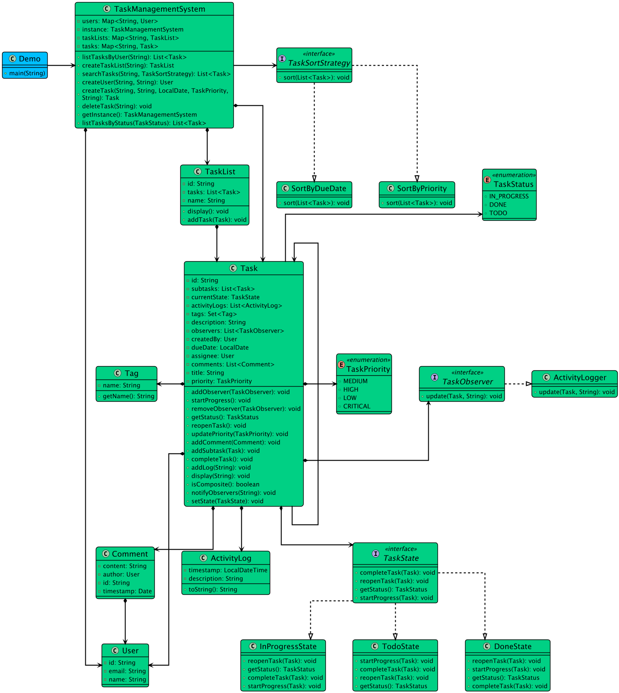

# Low-level design problem: task management system

> Copied from <https://github.com/ashishps1/awesome-low-level-design/blob/main/problems/task-management-system.md> (GPL-3.0, by Ashish Pratap Singh). Questions and answers are the source's own; nothing was answered or rewritten here.


# Designing a Task Management System

## Requirements
1. The task management system should allow users to create, update, and delete tasks.
2. Each task should have a title, description, due date, priority, and status (e.g., pending, in progress, completed).
3. Users should be able to assign tasks to other users and set reminders for tasks.
4. The system should support searching and filtering tasks based on various criteria (e.g., priority, due date, assigned user).
5. Users should be able to mark tasks as completed and view their task history.
6. The system should handle concurrent access to tasks and ensure data consistency.
7. The system should be extensible to accommodate future enhancements and new features.

## UML Class Diagram



## Implementations
#### [Java Implementation](https://github.com/ashishps1/awesome-low-level-design/blob/main/solutions/java/src/taskmanagementsystem) 
#### [Python Implementation](https://github.com/ashishps1/awesome-low-level-design/blob/main/solutions/python/taskmanagementsystem)
#### [C++ Implementation](https://github.com/ashishps1/awesome-low-level-design/blob/main/solutions/cpp/taskmanagementsystem)
#### [C# Implementation](https://github.com/ashishps1/awesome-low-level-design/blob/main/solutions/csharp/taskmanagementsystem)
#### [Go Implementation](https://github.com/ashishps1/awesome-low-level-design/blob/main/solutions/golang/taskmanagementsystem)
#### [TypeScript Implementation](https://github.com/ashishps1/awesome-low-level-design/blob/main/solutions/typescript/src/TaskManagement)

## Classes, Interfaces and Enumerations
1. The **User** class represents a user in the task management system, with properties such as id, name, and email.
2. The **TaskStatus** enum defines the possible states of a task, such as pending, in progress, and completed.
3. The **Task** class represents a task in the system, with properties like id, title, description, due date, priority, status, and assigned user.
4. The **TaskManager** class is the core of the task management system and follows the Singleton pattern to ensure a single instance of the task manager.
5. The TaskManager class uses concurrent data structures (ConcurrentHashMap and CopyOnWriteArrayList) to handle concurrent access to tasks and ensure thread safety.
6. The TaskManager class provides methods for creating, updating, deleting, searching, and filtering tasks, as well as marking tasks as completed and retrieving task history for a user.
7. The **TaskManagementSystem** class serves as the entry point of the application and demonstrates the usage of the task management system.

---

## Official solutions from the repository

<details><summary><b>java</b> (20 files)</summary>


**README.md**

```md
# Task Management System (LLD)

## Problem Statement

Design and implement a Task Management System that allows users to create, assign, update, and track tasks. The system should support task priorities, statuses, comments, and user assignment.

---

## Requirements

- **Task Creation:** Users can create tasks with a title, description, priority, and assignee.
- **Task Assignment:** Tasks can be assigned to users and reassigned as needed.
- **Task Status:** Tasks can have statuses such as TODO, IN_PROGRESS, DONE, etc.
- **Task Priority:** Tasks can have priorities such as LOW, MEDIUM, HIGH.
- **Comments:** Users can add comments to tasks.
- **Task Updates:** Tasks can be updated (status, priority, assignee, etc.).
- **Task Listing:** List all tasks, or filter by status, priority, or assignee.
- **Extensibility:** Easy to add new statuses, priorities, or features.

---

## Core Entities

- **Task:** Represents a task with title, description, status, priority, assignee, and comments.
- **User:** Represents a user who can create, assign, and be assigned tasks.
- **Comment:** Represents a comment on a task.
- **TaskStatus:** Enum for task statuses (TODO, IN_PROGRESS, DONE, etc.).
- **TaskPriority:** Enum for task priorities (LOW, MEDIUM, HIGH).
- **TaskManager:** Manages the collection of tasks and provides methods for task operations.

---

## Class Design

## UML Class Diagram


### 1. Task
- **Fields:** id, title, description, status, priority, assignee (User), List<Comment>
- **Methods:** updateStatus(TaskStatus), updatePriority(TaskPriority), assignUser(User), addComment(Comment), etc.

### 2. User
- **Fields:** id, name
- **Methods:** getId(), getName()

### 3. Comment
- **Fields:** id, content, author (User), timestamp

### 4. TaskStatus (enum)
- Values: TODO, IN_PROGRESS, DONE, etc.

### 5. TaskPriority (enum)
- Values: LOW, MEDIUM, HIGH

### 6. TaskManager
- **Fields:** List<Task>
- **Methods:** createTask(...), assignTask(...), updateTaskStatus(...), updateTaskPriority(...), addCommentToTask(...), listTasks(), listTasksByStatus(...), listTasksByAssignee(...), etc.

---

## Design Patterns Used

- **Separation of Concerns:** Each class has a single responsibility (task, user, comment, management).
- **Manager Pattern:** `TaskManager` acts as a service/manager for all task operations.

---

## Example Usage

```java
TaskManager manager = new TaskManager();
User alice = new User("Alice");
User bob = new User("Bob");

Task task = manager.createTask("Implement login", "Add login functionality", TaskPriority.HIGH, alice);
manager.assignTask(task.getId(), bob);
manager.updateTaskStatus(task.getId(), TaskStatus.IN_PROGRESS);
manager.addCommentToTask(task.getId(), new Comment("Started working on this", bob));
```

---

## Demo

See `TaskManagementSystemDemo.java` for a sample usage and simulation of the task management system.

---

## Extending the Framework

- **Add new statuses or priorities:** Update the `TaskStatus` or `TaskPriority` enums.
- **Add new features:** Such as deadlines, notifications, or task dependencies.

---
```


**TaskManagementSystem.java**

```java
package taskmanagementsystem;

import taskmanagementsystem.enums.TaskPriority;
import taskmanagementsystem.enums.TaskStatus;
import taskmanagementsystem.models.Task;
import taskmanagementsystem.models.TaskList;
import taskmanagementsystem.models.User;
import taskmanagementsystem.observer.ActivityLogger;
import taskmanagementsystem.strategy.TaskSortStrategy;

import java.time.LocalDate;
import java.util.ArrayList;
import java.util.List;
import java.util.Map;
import java.util.concurrent.ConcurrentHashMap;
import java.util.stream.Collectors;

public class TaskManagementSystem {
    private static TaskManagementSystem instance;
    private final Map<String, User> users;
    private final Map<String, Task> tasks;
    private final Map<String, TaskList> taskLists;

    private TaskManagementSystem() {
        users = new ConcurrentHashMap<>();
        tasks = new ConcurrentHashMap<>();
        taskLists = new ConcurrentHashMap<>();
    }

    public static synchronized TaskManagementSystem getInstance() {
        if (instance == null) {
            instance = new TaskManagementSystem();
        }
        return instance;
    }

    public User createUser(String name, String email) {
        User user = new User(name, email);
        users.put(user.getId(), user);
        return user;
    }

    public TaskList createTaskList(String listName) {
        TaskList taskList = new TaskList(listName);
        taskLists.put(taskList.getId(), taskList);
        return taskList;
    }

    public Task createTask(String title, String description, LocalDate dueDate,
                           TaskPriority priority, String createdByUserId) {
        User createdBy = users.get(createdByUserId);
        if (createdBy == null)
            throw new IllegalArgumentException("User not found.");

        Task task = new Task.TaskBuilder(title)
                .description(description)
                .dueDate(dueDate)
                .priority(priority)
                .createdBy(createdBy)
                .build();

        task.addObserver(new ActivityLogger());

        tasks.put(task.getId(), task);
        return task;
    }

    public List<Task> listTasksByUser(String userId) {
        User user = users.get(userId);
        return tasks.values().stream()
                .filter(task -> user.equals(task.getAssignee()))
                .toList();
    }

    public List<Task> listTasksByStatus(TaskStatus status) {
        return tasks.values().stream()
                .filter(task -> task.getStatus() == status)
                .collect(Collectors.toList());
    }

    public void deleteTask(String taskId) {
        tasks.remove(taskId);
    }

    public List<Task> searchTasks(String keyword, TaskSortStrategy sortingStrategy) {
        List<Task> matchingTasks = new ArrayList<>();
        for (Task task : tasks.values()) {
            if (task.getTitle().contains(keyword) || task.getDescription().contains(keyword)) {
                matchingTasks.add(task);
            }
        }
        sortingStrategy.sort(matchingTasks);
        return matchingTasks;
    }
}
```


**TaskManagementSystemDemo.java**

```java
package taskmanagementsystem;

import taskmanagementsystem.enums.TaskPriority;
import taskmanagementsystem.enums.TaskStatus;
import taskmanagementsystem.models.Task;
import taskmanagementsystem.models.TaskList;
import taskmanagementsystem.models.User;
import taskmanagementsystem.strategy.SortByDueDate;

import java.time.LocalDate;
import java.util.List;

public class TaskManagementSystemDemo {
    public static void main(String[] args) {
        TaskManagementSystem taskManagementSystem = TaskManagementSystem.getInstance();

        // Create users
        User user1 = taskManagementSystem.createUser("John Doe", "john@example.com");
        User user2 = taskManagementSystem.createUser("Jane Smith", "jane@example.com");

        // Create task lists
        TaskList taskList1 = taskManagementSystem.createTaskList("Enhancements");
        TaskList taskList2 = taskManagementSystem.createTaskList("Bug Fix");

        // Create tasks
        Task task1 = taskManagementSystem.createTask("Enhancement Task", "Launch New Feature",
                LocalDate.now().plusDays(2), TaskPriority.LOW, user1.getId());
        Task subtask1 = taskManagementSystem.createTask( "Enhancement sub task", "Design UI/UX",
                LocalDate.now().plusDays(1), TaskPriority.MEDIUM, user1.getId());
        Task task2 = taskManagementSystem.createTask("Bug Fix Task", "Fix API Bug",
                LocalDate.now().plusDays(3), TaskPriority.HIGH, user2.getId());

        task1.addSubtask(subtask1);

        taskList1.addTask(task1);
        taskList2.addTask(task2);

        taskList1.display();

        // Update task status
        subtask1.startProgress();

        // Assign task
        subtask1.setAssignee(user2);

        taskList1.display();

        // Search tasks
        List<Task> searchResults = taskManagementSystem.searchTasks("Task", new SortByDueDate());
        System.out.println("\nTasks with keyword Task:");
        for (Task task : searchResults) {
            System.out.println(task.getTitle());
        }

        // Filter tasks by status
        List<Task> filteredTasks = taskManagementSystem.listTasksByStatus(TaskStatus.TODO);
        System.out.println("\nTODO Tasks:");
        for (Task task : filteredTasks) {
            System.out.println(task.getTitle());
        }

        // Mark a task as done
        subtask1.completeTask();

        // Get tasks assigned to a user
        List<Task> userTaskList = taskManagementSystem.listTasksByUser(user2.getId());
        System.out.println("\nTask for " + user2.getName() + ":");
        for (Task task : userTaskList) {
            System.out.println(task.getTitle());
        }

        taskList1.display();

        // Delete a task
        taskManagementSystem.deleteTask(task2.getId());
    }
}
```


**enums/TaskPriority.java**

```java
package taskmanagementsystem.enums;

public enum TaskPriority {
    LOW,
    MEDIUM,
    HIGH,
    CRITICAL
}
```


**enums/TaskStatus.java**

```java
package taskmanagementsystem.enums;

public enum TaskStatus {
    TODO,
    IN_PROGRESS,
    DONE
}
```


**models/ActivityLog.java**

```java
package taskmanagementsystem.models;

import java.time.LocalDateTime;

public class ActivityLog {
    private final String description;
    private final LocalDateTime timestamp;

    public ActivityLog(String description) {
        this.description = description;
        this.timestamp = LocalDateTime.now();
    }

    @Override
    public String toString() {
        return "[" + timestamp + "] " + description;
    }
}
```


**models/Comment.java**

```java
package taskmanagementsystem.models;

import java.util.Date;
import java.util.UUID;

public class Comment {
    private final String id;
    private final String content;
    private final User author;
    private final Date timestamp;

    public Comment(String content, User author) {
        this.id = UUID.randomUUID().toString();
        this.content = content;
        this.author = author;
        this.timestamp = new Date();
    }

    public User getAuthor() {
        return author;
    }
}
```


**models/Tag.java**

```java
package taskmanagementsystem.models;

public class Tag {
    private final String name;

    public Tag(String name) { this.name = name; }

    public String getName() { return name; }
}
```


**models/Task.java**

```java
package taskmanagementsystem.models;

import taskmanagementsystem.enums.TaskPriority;
import taskmanagementsystem.enums.TaskStatus;
import taskmanagementsystem.observer.TaskObserver;
import taskmanagementsystem.state.TaskState;
import taskmanagementsystem.state.TodoState;

import java.time.LocalDate;
import java.util.*;

public class Task {
    private final String id;
    private String title;
    private String description;
    private LocalDate dueDate;
    private TaskPriority priority;
    private final User createdBy;
    private User assignee;
    private TaskState currentState;
    private final Set<Tag> tags;
    private final List<Comment> comments;
    private final List<Task> subtasks;
    private final List<ActivityLog> activityLogs;
    private final List<TaskObserver> observers;

    private Task(TaskBuilder builder) {
        this.id = builder.id;
        this.title = builder.title;
        this.description = builder.description;
        this.dueDate = builder.dueDate;
        this.priority = builder.priority;
        this.createdBy = builder.createdBy;
        this.assignee = builder.assignee;
        this.tags = builder.tags;
        this.currentState = new TodoState(); // Initial state
        this.comments = new ArrayList<>();
        this.subtasks = new ArrayList<>();
        this.activityLogs = new ArrayList<>();
        this.observers = new ArrayList<>();
        addLog("Task created with title: " + title);
    }

    public synchronized void setAssignee(User user) {
        this.assignee = user;
        addLog("Assigned to " + user.getName());
        notifyObservers("assignee");
    }

    public synchronized void updatePriority(TaskPriority priority) {
        this.priority = priority;
        notifyObservers("priority");
    }

    public synchronized void addComment(Comment comment) {
        comments.add(comment);
        addLog("Comment added by " + comment.getAuthor().getName());
        notifyObservers("comment");
    }

    public synchronized void addSubtask(Task subtask) {
        subtasks.add(subtask);
        addLog("Subtask added: " + subtask.getTitle());
        notifyObservers("subtask_added");
    }

    // --- State Pattern Methods ---
    public void setState(TaskState state) {
        this.currentState = state;
        addLog("Status changed to: " + state.getStatus());
        notifyObservers("status");
    }
    public void startProgress() { currentState.startProgress(this); }
    public void completeTask() { currentState.completeTask(this); }
    public void reopenTask() { currentState.reopenTask(this); }

    // --- Observer Pattern Methods ---
    public void addObserver(TaskObserver observer) { observers.add(observer); }
    public void removeObserver(TaskObserver observer) { observers.remove(observer); }
    public void notifyObservers(String changeType) {
        for (TaskObserver observer : observers) {
            observer.update(this, changeType);
        }
    }
    public void addLog(String logDescription) {
        this.activityLogs.add(new ActivityLog(logDescription));
    }

    public boolean isComposite() { return !subtasks.isEmpty(); }

    public void display(String indent) {
        System.out.println(indent + "- " + title + " [" + getStatus() + ", " + priority + ", Due: " + dueDate + "]");
        if (isComposite()) {
            for (Task subtask : subtasks) {
                subtask.display(indent + "  ");
            }
        }
    }

    // Getters and setters
    public String getId() {
        return id;
    }
    public String getTitle() {
        return title;
    }
    public String getDescription() {
        return description;
    }
    public TaskPriority getPriority() {
        return priority;
    }
    public LocalDate getDueDate() {
        return dueDate;
    }
    public User getAssignee() {
        return assignee;
    }
    public void setTitle(String title) {
        this.title = title;
    }
    public void setDescription(String description) {
        this.description = description;
    }

    public TaskStatus getStatus() {
        return currentState.getStatus();
    }

    // --- Builder Pattern ---
    public static class TaskBuilder {
        private final String id;
        private String title;
        private String description = "";
        private LocalDate dueDate;
        private TaskPriority priority;
        private User createdBy;
        private User assignee;
        private Set<Tag> tags;

        public TaskBuilder(String title) {
            this.id = UUID.randomUUID().toString();
            this.title = title;
        }

        public TaskBuilder description(String description) { this.description = description; return this; }
        public TaskBuilder dueDate(LocalDate dueDate) { this.dueDate = dueDate; return this; }
        public TaskBuilder priority(TaskPriority priority) { this.priority = priority; return this; }
        public TaskBuilder assignee(User assignee) { this.assignee = assignee; return this; }
        public TaskBuilder createdBy(User createdBy) { this.createdBy = createdBy; return this; }
        public TaskBuilder tags(Set<Tag> tags) { this.tags = tags; return this; }

        public Task build() {
            return new Task(this);
        }
    }
}
```


**models/TaskList.java**

```java
package taskmanagementsystem.models;

import java.util.ArrayList;
import java.util.List;
import java.util.UUID;
import java.util.concurrent.CopyOnWriteArrayList;

public class TaskList {
    private final String id;
    private final String name;
    private final List<Task> tasks;

    public TaskList(String name) {
        this.id = UUID.randomUUID().toString();
        this.name = name;
        this.tasks = new CopyOnWriteArrayList<>();
    }

    public void addTask(Task task) {
        this.tasks.add(task);
    }

    public List<Task> getTasks() {
        return new ArrayList<>(tasks); // Return a copy to prevent external modification
    }

    // Getters...
    public String getId() { return id; }
    public String getName() { return name; }

    public void display() {
        System.out.println("--- Task List: " + name + " ---");
        for (Task task : tasks) {
            task.display("");
        }
        System.out.println("-----------------------------------");
    }
}
```


**models/User.java**

```java
package taskmanagementsystem.models;

import java.util.UUID;

public class User {
    private final String id;
    private final String name;
    private final String email;

    public User(String name, String email) {
        this.id = UUID.randomUUID().toString();
        this.name = name;
        this.email = email;
    }

    // Getters...
    public String getId() {
        return id;
    }

    public String getEmail() {
        return email;
    }

    public String getName() {
        return name;
    }
}
```


**observer/ActivityLogger.java**

```java
package taskmanagementsystem.observer;

import taskmanagementsystem.models.Task;

public class ActivityLogger implements TaskObserver {
    @Override
    public void update(Task task, String changeType) {
        System.out.println("LOGGER: Task '" + task.getTitle() + "' was updated. Change: " + changeType);
    }
}
```


**observer/TaskObserver.java**

```java
package taskmanagementsystem.observer;

import taskmanagementsystem.models.Task;

public interface TaskObserver {
    void update(Task task, String changeType);
}
```


**state/DoneState.java**

```java
package taskmanagementsystem.state;

import taskmanagementsystem.models.Task;
import taskmanagementsystem.enums.TaskStatus;

public class DoneState implements TaskState {
    @Override
    public void startProgress(Task task) {
        System.out.println("Cannot start a completed task. Reopen it first.");
    }
    @Override
    public void completeTask(Task task) {
        System.out.println("Task is already done.");
    }
    @Override
    public void reopenTask(Task task) {
        task.setState(new TodoState());
    }
    @Override
    public TaskStatus getStatus() { return TaskStatus.DONE; }
}
```


**state/InProgressState.java**

```java
package taskmanagementsystem.state;

import taskmanagementsystem.models.Task;
import taskmanagementsystem.enums.TaskStatus;

public class InProgressState implements TaskState {
    @Override
    public void startProgress(Task task) {
        System.out.println("Task is already in progress.");
    }
    @Override
    public void completeTask(Task task) {
        task.setState(new DoneState());
    }
    @Override
    public void reopenTask(Task task) {
        task.setState(new TodoState());
    }
    @Override
    public TaskStatus getStatus() { return TaskStatus.IN_PROGRESS; }
}
```


**state/TaskState.java**

```java
package taskmanagementsystem.state;

import taskmanagementsystem.models.Task;
import taskmanagementsystem.enums.TaskStatus;

public interface TaskState {
    void startProgress(Task task);
    void completeTask(Task task);
    void reopenTask(Task task);
    TaskStatus getStatus();
}
```


**state/TodoState.java**

```java
package taskmanagementsystem.state;

import taskmanagementsystem.models.Task;
import taskmanagementsystem.enums.TaskStatus;

public class TodoState implements TaskState {
    @Override
    public void startProgress(Task task) {
        task.setState(new InProgressState());
    }
    @Override
    public void completeTask(Task task) {
        System.out.println("Cannot complete a task that is not in progress.");
    }
    @Override
    public void reopenTask(Task task) {
        System.out.println("Task is already in TO-DO state.");
    }
    @Override
    public TaskStatus getStatus() { return TaskStatus.TODO; }
}
```


**strategy/SortByDueDate.java**

```java
package taskmanagementsystem.strategy;

import taskmanagementsystem.models.Task;

import java.util.Comparator;
import java.util.List;

public class SortByDueDate implements TaskSortStrategy {
    @Override
    public void sort(List<Task> tasks) {
        tasks.sort(Comparator.comparing(Task::getDueDate));
    }
}
```


**strategy/SortByPriority.java**

```java
package taskmanagementsystem.strategy;

import taskmanagementsystem.models.Task;

import java.util.Comparator;
import java.util.List;

public class SortByPriority implements TaskSortStrategy {
    @Override
    public void sort(List<Task> tasks) {
        // Higher priority (lower enum ordinal) comes first
        tasks.sort(Comparator.comparing(Task::getPriority).reversed());
    }
}
```


**strategy/TaskSortStrategy.java**

```java
package taskmanagementsystem.strategy;

import taskmanagementsystem.models.Task;

import java.util.List;

public interface TaskSortStrategy {
    void sort(List<Task> tasks);
}
```

</details>

<details><summary><b>python</b> (14 files)</summary>


**README.md**

```md
# Designing a Task Management System

## Requirements
1. The task management system should allow users to create, update, and delete tasks.
2. Each task should have a title, description, due date, priority, and status (e.g., pending, in progress, completed).
3. Users should be able to assign tasks to other users and set reminders for tasks.
4. The system should support searching and filtering tasks based on various criteria (e.g., priority, due date, assigned user).
5. Users should be able to mark tasks as completed and view their task history.
6. The system should handle concurrent access to tasks and ensure data consistency.
7. The system should be extensible to accommodate future enhancements and new features.

## Classes, Interfaces and Enumerations
1. The **User** class represents a user in the task management system, with properties such as id, name, and email.
2. The **TaskStatus** enum defines the possible states of a task, such as pending, in progress, and completed.
3. The **Task** class represents a task in the system, with properties like id, title, description, due date, priority, status, and assigned user.
4. The **TaskManager** class is the core of the task management system and follows the Singleton pattern to ensure a single instance of the task manager.
5. The TaskManager class uses concurrent data structures (ConcurrentHashMap and CopyOnWriteArrayList) to handle concurrent access to tasks and ensure thread safety.
6. The TaskManager class provides methods for creating, updating, deleting, searching, and filtering tasks, as well as marking tasks as completed and retrieving task history for a user.
7. The **TaskManagementSystem** class serves as the entry point of the application and demonstrates the usage of the task management system.
```


**activity_log.py**

```py
from datetime import datetime

class ActivityLog:
    def __init__(self, description: str):
        self._description = description
        self._timestamp = datetime.now()
    
    def __str__(self) -> str:
        return f"[{self._timestamp}] {self._description}"
```


**comment.py**

```py
import uuid
from datetime import datetime
from user import User

class Comment:
    def __init__(self, content: str, author: User):
        self._id = str(uuid.uuid4())
        self._content = content
        self._author = author
        self._timestamp = datetime.now()
    
    @property
    def author(self) -> User:
        return self._author
```


**tag.py**

```py
class Tag:
    def __init__(self, name: str):
        self._name = name
    
    @property
    def name(self) -> str:
        return self._name
```


**task.py**

```py
import threading
from typing import List, Optional, Set
from datetime import date
import uuid
from user import User
from task_priority import TaskPriority
from task_status import TaskStatus
from comment import Comment
from activity_log import ActivityLog
from task_state import TodoState, TaskState
from task_observer import TaskObserver
from tag import Tag

class Task:
    def __init__(self, builder: 'TaskBuilder'):
        self._id = builder._id
        self._title = builder._title
        self._description = builder._description
        self._due_date = builder._due_date
        self._priority = builder._priority
        self._created_by = builder._created_by
        self._assignee = builder._assignee
        self._tags = builder._tags
        self._current_state = TodoState()  # Initial state
        self._comments: List[Comment] = []
        self._subtasks: List['Task'] = []
        self._activity_logs: List[ActivityLog] = []
        self._observers: List[TaskObserver] = []
        self._lock = threading.Lock()
        self.add_log(f"Task created with title: {self._title}")
    
    def set_assignee(self, user: User):
        with self._lock:
            self._assignee = user
            self.add_log(f"Assigned to {user.name}")
            self.notify_observers("assignee")
    
    def update_priority(self, priority: TaskPriority):
        with self._lock:
            self._priority = priority
            self.notify_observers("priority")
    
    def add_comment(self, comment: Comment):
        with self._lock:
            self._comments.append(comment)
            self.add_log(f"Comment added by {comment.author.name}")
            self.notify_observers("comment")
    
    def add_subtask(self, subtask: 'Task'):
        with self._lock:
            self._subtasks.append(subtask)
            self.add_log(f"Subtask added: {subtask.get_title()}")
            self.notify_observers("subtask_added")
    
    # State Pattern Methods
    def set_state(self, state: TaskState):
        self._current_state = state
        self.add_log(f"Status changed to: {state.get_status().value}")
        self.notify_observers("status")
    
    def start_progress(self):
        self._current_state.start_progress(self)
    
    def complete_task(self):
        self._current_state.complete_task(self)
    
    def reopen_task(self):
        self._current_state.reopen_task(self)
    
    # Observer Pattern Methods
    def add_observer(self, observer: TaskObserver):
        self._observers.append(observer)
    
    def remove_observer(self, observer: TaskObserver):
        if observer in self._observers:
            self._observers.remove(observer)
    
    def notify_observers(self, change_type: str):
        for observer in self._observers:
            observer.update(self, change_type)
    
    def add_log(self, log_description: str):
        self._activity_logs.append(ActivityLog(log_description))
    
    def is_composite(self) -> bool:
        return len(self._subtasks) > 0
    
    def display(self, indent: str = ""):
        print(f"{indent}- {self._title} [{self.get_status().value}, {self._priority.value}, Due: {self._due_date}]")
        if self.is_composite():
            for subtask in self._subtasks:
                subtask.display(indent + "  ")
    
    # Getters and setters
    def get_id(self) -> str:
        return self._id
    
    def get_title(self) -> str:
        return self._title
    
    def get_description(self) -> str:
        return self._description
    
    def get_priority(self) -> TaskPriority:
        return self._priority
    
    def get_due_date(self) -> date:
        return self._due_date
    
    def get_assignee(self) -> Optional[User]:
        return self._assignee
    
    def set_title(self, title: str):
        self._title = title
    
    def set_description(self, description: str):
        self._description = description
    
    def get_status(self) -> TaskStatus:
        return self._current_state.get_status()
    
    # Builder Pattern
    class TaskBuilder:
        def __init__(self, title: str):
            self._id = str(uuid.uuid4())
            self._title = title
            self._description = ""
            self._due_date = None
            self._priority = None
            self._created_by = None
            self._assignee = None
            self._tags = set()
        
        def description(self, description: str) -> 'Task.TaskBuilder':
            self._description = description
            return self
        
        def due_date(self, due_date: date) -> 'Task.TaskBuilder':
            self._due_date = due_date
            return self
        
        def priority(self, priority: TaskPriority) -> 'Task.TaskBuilder':
            self._priority = priority
            return self
        
        def assignee(self, assignee: User) -> 'Task.TaskBuilder':
            self._assignee = assignee
            return self
        
        def created_by(self, created_by: User) -> 'Task.TaskBuilder':
            self._created_by = created_by
            return self
        
        def tags(self, tags: Set[Tag]) -> 'Task.TaskBuilder':
            self._tags = tags
            return self
        
        def build(self) -> 'Task':
            return Task(self)
```


**task_list.py**

```py
import threading
import uuid
from typing import List
from task import Task

class TaskList:
    def __init__(self, name: str):
        self._id = str(uuid.uuid4())
        self._name = name
        self._tasks: List[Task] = []
        self._lock = threading.Lock()
    
    def add_task(self, task: Task):
        with self._lock:
            self._tasks.append(task)
    
    def get_tasks(self) -> List[Task]:
        with self._lock:
            return self._tasks.copy()  # Return a copy to prevent external modification
    
    @property
    def id(self) -> str:
        return self._id
    
    @property
    def name(self) -> str:
        return self._name
    
    def display(self):
        print(f"--- Task List: {self._name} ---")
        for task in self._tasks:
            task.display("")
        print("-----------------------------------")
```


**task_management_system.py**

```py
import threading
from typing import Dict, List
from user import User
from task import Task
from task_list import TaskList
from task_priority import TaskPriority
from task_status import TaskStatus
from task_sort_strategy import TaskSortStrategy
from task_observer import ActivityLogger
from datetime import date

class TaskManagementSystem:
    _instance = None
    _lock = threading.Lock()
    
    def __new__(cls):
        if cls._instance is None:
            with cls._lock:
                if cls._instance is None:
                    cls._instance = super().__new__(cls)
                    cls._instance._initialized = False
        return cls._instance
    
    def __init__(self):
        if not self._initialized:
            self._users: Dict[str, User] = {}
            self._tasks: Dict[str, Task] = {}
            self._task_lists: Dict[str, TaskList] = {}
            self._initialized = True
    
    @classmethod
    def get_instance(cls):
        return cls()
    
    def create_user(self, name: str, email: str) -> User:
        user = User(name, email)
        self._users[user.id] = user
        return user
    
    def create_task_list(self, list_name: str) -> TaskList:
        task_list = TaskList(list_name)
        self._task_lists[task_list.id] = task_list
        return task_list
    
    def create_task(self, title: str, description: str, due_date: date,
                   priority: TaskPriority, created_by_user_id: str) -> Task:
        created_by = self._users.get(created_by_user_id)
        if created_by is None:
            raise ValueError("User not found.")
        
        task = Task.TaskBuilder(title) \
            .description(description) \
            .due_date(due_date) \
            .priority(priority) \
            .created_by(created_by) \
            .build()
        
        task.add_observer(ActivityLogger())
        
        self._tasks[task.get_id()] = task
        return task
    
    def list_tasks_by_user(self, user_id: str) -> List[Task]:
        user = self._users.get(user_id)
        return [task for task in self._tasks.values() 
                if task.get_assignee() == user]
    
    def list_tasks_by_status(self, status: TaskStatus) -> List[Task]:
        return [task for task in self._tasks.values() 
                if task.get_status() == status]
    
    def delete_task(self, task_id: str):
        if task_id in self._tasks:
            del self._tasks[task_id]
    
    def search_tasks(self, keyword: str, sorting_strategy: TaskSortStrategy) -> List[Task]:
        matching_tasks = []
        for task in self._tasks.values():
            if (keyword in task.get_title() or 
                keyword in task.get_description()):
                matching_tasks.append(task)
        
        sorting_strategy.sort(matching_tasks)
        return matching_tasks
```


**task_management_system_demo.py**

```py
from task_management_system import TaskManagementSystem
from task_priority import TaskPriority
from task_status import TaskStatus
from datetime import date
from task_sort_strategy import SortByDueDate

class TaskManagementSystemDemo:
    @staticmethod
    def main():
        task_management_system = TaskManagementSystem.get_instance()
        
        # Create users
        user1 = task_management_system.create_user("John Doe", "john@example.com")
        user2 = task_management_system.create_user("Jane Smith", "jane@example.com")
        
        # Create task lists
        task_list1 = task_management_system.create_task_list("Enhancements")
        task_list2 = task_management_system.create_task_list("Bug Fix")
        
        # Create tasks
        task1 = task_management_system.create_task(
            "Enhancement Task", "Launch New Feature",
            date.today().replace(day=date.today().day + 2), 
            TaskPriority.LOW, user1.id
        )
        subtask1 = task_management_system.create_task(
            "Enhancement sub task", "Design UI/UX",
            date.today().replace(day=date.today().day + 1), 
            TaskPriority.MEDIUM, user1.id
        )
        task2 = task_management_system.create_task(
            "Bug Fix Task", "Fix API Bug",
            date.today().replace(day=date.today().day + 3), 
            TaskPriority.HIGH, user2.id
        )
        
        task1.add_subtask(subtask1)
        
        task_list1.add_task(task1)
        task_list2.add_task(task2)
        
        task_list1.display()
        
        # Update task status
        subtask1.start_progress()
        
        # Assign task
        subtask1.set_assignee(user2)
        
        task_list1.display()
        
        # Search tasks
        search_results = task_management_system.search_tasks("Task", SortByDueDate())
        print("\nTasks with keyword Task:")
        for task in search_results:
            print(task.get_title())
        
        # Filter tasks by status
        filtered_tasks = task_management_system.list_tasks_by_status(TaskStatus.TODO)
        print("\nTODO Tasks:")
        for task in filtered_tasks:
            print(task.get_title())
        
        # Mark a task as done
        subtask1.complete_task()
        
        # Get tasks assigned to a user
        user_task_list = task_management_system.list_tasks_by_user(user2.id)
        print(f"\nTask for {user2.name}:")
        for task in user_task_list:
            print(task.get_title())
        
        task_list1.display()
        
        # Delete a task
        task_management_system.delete_task(task2.get_id())

if __name__ == "__main__":
    TaskManagementSystemDemo.main()
```


**task_observer.py**

```py
from abc import ABC, abstractmethod
from typing import TYPE_CHECKING

if TYPE_CHECKING:
    from task import Task

class TaskObserver(ABC):
    @abstractmethod
    def update(self, task: 'Task', change_type: str):
        pass

class ActivityLogger(TaskObserver):
    def update(self, task: 'Task', change_type: str):
        print(f"LOGGER: Task '{task.get_title()}' was updated. Change: {change_type}")
```


**task_priority.py**

```py
from enum import Enum

class TaskPriority(Enum):
    LOW = "LOW"
    MEDIUM = "MEDIUM"
    HIGH = "HIGH"
    CRITICAL = "CRITICAL"
```


**task_sort_strategy.py**

```py
from abc import ABC, abstractmethod
from typing import List
from task import Task
from task_priority import TaskPriority
from datetime import date

class TaskSortStrategy(ABC):
    @abstractmethod
    def sort(self, tasks: List[Task]):
        pass

class SortByPriority(TaskSortStrategy):
    def sort(self, tasks: List[Task]):
        # Higher priority comes first (CRITICAL > HIGH > MEDIUM > LOW)
        priority_order = {TaskPriority.CRITICAL: 4, TaskPriority.HIGH: 3, 
                         TaskPriority.MEDIUM: 2, TaskPriority.LOW: 1}
        tasks.sort(key=lambda task: priority_order.get(task.get_priority(), 0), reverse=True)

class SortByDueDate(TaskSortStrategy):
    def sort(self, tasks: List[Task]):
        tasks.sort(key=lambda task: task.get_due_date() if task.get_due_date() else date.max)
```


**task_state.py**

```py
from abc import ABC, abstractmethod
from task_status import TaskStatus
from typing import TYPE_CHECKING

if TYPE_CHECKING:
    from task import Task

class TaskState(ABC):
    @abstractmethod
    def start_progress(self, task: 'Task'):
        pass
    
    @abstractmethod
    def complete_task(self, task: 'Task'):
        pass
    
    @abstractmethod
    def reopen_task(self, task: 'Task'):
        pass
    
    @abstractmethod
    def get_status(self) -> TaskStatus:
        pass

class TodoState(TaskState):
    def start_progress(self, task: 'Task'):
        task.set_state(InProgressState())
    
    def complete_task(self, task: 'Task'):
        print("Cannot complete a task that is not in progress.")
    
    def reopen_task(self, task: 'Task'):
        print("Task is already in TO-DO state.")
    
    def get_status(self) -> TaskStatus:
        return TaskStatus.TODO

class InProgressState(TaskState):
    def start_progress(self, task: 'Task'):
        print("Task is already in progress.")
    
    def complete_task(self, task: 'Task'):
        task.set_state(DoneState())
    
    def reopen_task(self, task: 'Task'):
        task.set_state(TodoState())
    
    def get_status(self) -> TaskStatus:
        return TaskStatus.IN_PROGRESS

class DoneState(TaskState):
    def start_progress(self, task: 'Task'):
        print("Cannot start a completed task. Reopen it first.")
    
    def complete_task(self, task: 'Task'):
        print("Task is already done.")
    
    def reopen_task(self, task: 'Task'):
        task.set_state(TodoState())
    
    def get_status(self) -> TaskStatus:
        return TaskStatus.DONE
```


**task_status.py**

```py
from enum import Enum

class TaskStatus(Enum):
    TODO = "TODO"
    IN_PROGRESS = "IN_PROGRESS"
    DONE = "DONE"
    BLOCKED = "BLOCKED"
```


**user.py**

```py
import uuid

class User:
    def __init__(self, name: str, email: str):
        self._id = str(uuid.uuid4())
        self._name = name
        self._email = email
    
    @property
    def id(self) -> str:
        return self._id
    
    @property
    def email(self) -> str:
        return self._email
    
    @property
    def name(self) -> str:
        return self._name
```

</details>

<details><summary><b>cpp</b> (8 files)</summary>


**README.md**

```md
# Designing a Task Management System

## Requirements
1. The task management system should allow users to create, update, and delete tasks.
2. Each task should have a title, description, due date, priority, and status (e.g., pending, in progress, completed).
3. Users should be able to assign tasks to other users and set reminders for tasks.
4. The system should support searching and filtering tasks based on various criteria (e.g., priority, due date, assigned user).
5. Users should be able to mark tasks as completed and view their task history.
6. The system should handle concurrent access to tasks and ensure data consistency.
7. The system should be extensible to accommodate future enhancements and new features.

## Classes, Interfaces and Enumerations
1. The **User** class represents a user in the task management system, with properties such as id, name, and email.
2. The **TaskStatus** enum defines the possible states of a task, such as pending, in progress, and completed.
3. The **Task** class represents a task in the system, with properties like id, title, description, due date, priority, status, and assigned user.
4. The **TaskManager** class is the core of the task management system and follows the Singleton pattern to ensure a single instance of the task manager.
5. The TaskManager class uses concurrent data structures (ConcurrentHashMap and CopyOnWriteArrayList) to handle concurrent access to tasks and ensure thread safety.
6. The TaskManager class provides methods for creating, updating, deleting, searching, and filtering tasks, as well as marking tasks as completed and retrieving task history for a user.
7. The **TaskManagementSystem** class serves as the entry point of the application and demonstrates the usage of the task management system.
```


**Task.cpp**

```cpp
#include "Task.hpp"
#include <iostream>
#include <iomanip>
#include <algorithm>

Task::Task(std::string taskId, std::string title, std::string description,
           TaskPriority priority)
    : taskId(taskId), title(title), description(description),
      status(TaskStatus::TODO), priority(priority) {
    dueDate = 0;  // No due date set
}

std::string Task::getTaskId() const { return taskId; }
std::string Task::getTitle() const { return title; }
std::string Task::getDescription() const { return description; }
std::string Task::getAssignedTo() const { return assignedTo; }
TaskStatus Task::getStatus() const { return status; }
TaskPriority Task::getPriority() const { return priority; }
std::time_t Task::getDueDate() const { return dueDate; }
const std::vector<std::string>& Task::getDependencies() const { return dependencies; }
const std::vector<std::string>& Task::getComments() const { return comments; }

void Task::setAssignedTo(const std::string& userId) {
    assignedTo = userId;
}

void Task::setStatus(TaskStatus status) {
    this->status = status;
}

void Task::setPriority(TaskPriority priority) {
    this->priority = priority;
}

void Task::setDueDate(std::time_t dueDate) {
    this->dueDate = dueDate;
}

void Task::addDependency(const std::string& taskId) {
    if (std::find(dependencies.begin(), dependencies.end(), taskId) == dependencies.end()) {
        dependencies.push_back(taskId);
    }
}

void Task::removeDependency(const std::string& taskId) {
    auto it = std::find(dependencies.begin(), dependencies.end(), taskId);
    if (it != dependencies.end()) {
        dependencies.erase(it);
    }
}

void Task::addComment(const std::string& comment) {
    comments.push_back(comment);
}

void Task::displayInfo() const {
    std::cout << "\nTask: " << title << " (ID: " << taskId << ")" << std::endl;
    std::cout << "Description: " << description << std::endl;
    std::cout << "Assigned to: " << (assignedTo.empty() ? "Unassigned" : assignedTo) << std::endl;
    
    std::cout << "Status: ";
    switch (status) {
        case TaskStatus::TODO: std::cout << "To Do"; break;
        case TaskStatus::IN_PROGRESS: std::cout << "In Progress"; break;
        case TaskStatus::COMPLETED: std::cout << "Completed"; break;
        case TaskStatus::BLOCKED: std::cout << "Blocked"; break;
    }
    std::cout << std::endl;
    
    std::cout << "Priority: ";
    switch (priority) {
        case TaskPriority::LOW: std::cout << "Low"; break;
        case TaskPriority::MEDIUM: std::cout << "Medium"; break;
        case TaskPriority::HIGH: std::cout << "High"; break;
        case TaskPriority::URGENT: std::cout << "Urgent"; break;
    }
    std::cout << std::endl;
    
    if (dueDate != 0) {
        std::cout << "Due Date: " << std::ctime(&dueDate);
    }
    
    if (!dependencies.empty()) {
        std::cout << "Dependencies: ";
        for (const auto& dep : dependencies) {
            std::cout << dep << " ";
        }
        std::cout << std::endl;
    }
    
    if (!comments.empty()) {
        std::cout << "Comments:" << std::endl;
        for (const auto& comment : comments) {
            std::cout << "- " << comment << std::endl;
        }
    }
}
```


**Task.hpp**

```hpp
#ifndef TASK_HPP
#define TASK_HPP

#include <string>
#include <vector>
#include <ctime>

enum class TaskStatus {
    TODO,
    IN_PROGRESS,
    COMPLETED,
    BLOCKED
};

enum class TaskPriority {
    LOW,
    MEDIUM,
    HIGH,
    URGENT
};

class Task {
private:
    std::string taskId;
    std::string title;
    std::string description;
    std::string assignedTo;
    TaskStatus status;
    TaskPriority priority;
    std::time_t dueDate;
    std::vector<std::string> dependencies;  // Task IDs
    std::vector<std::string> comments;

public:
    Task(std::string taskId, std::string title, std::string description,
         TaskPriority priority = TaskPriority::MEDIUM);
    
    std::string getTaskId() const;
    std::string getTitle() const;
    std::string getDescription() const;
    std::string getAssignedTo() const;
    TaskStatus getStatus() const;
    TaskPriority getPriority() const;
    std::time_t getDueDate() const;
    const std::vector<std::string>& getDependencies() const;
    const std::vector<std::string>& getComments() const;
    
    void setAssignedTo(const std::string& userId);
    void setStatus(TaskStatus status);
    void setPriority(TaskPriority priority);
    void setDueDate(std::time_t dueDate);
    void addDependency(const std::string& taskId);
    void removeDependency(const std::string& taskId);
    void addComment(const std::string& comment);
    void displayInfo() const;
};

#endif
```


**TaskManager.cpp**

```cpp
#include "TaskManager.hpp"
#include <iostream>
#include <algorithm>

TaskManager::TaskManager() : taskIdCounter(1), userIdCounter(1) {}

TaskManager::~TaskManager() {
    for (auto user : users) delete user;
    for (auto task : tasks) delete task;
}

User* TaskManager::registerUser(const std::string& username, const std::string& email) {
    std::string userId = generateUserId();
    User* user = new User(userId, username, email);
    users.push_back(user);
    return user;
}

void TaskManager::removeUser(const std::string& userId) {
    auto it = std::find_if(users.begin(), users.end(),
        [userId](User* user) { return user->getUserId() == userId; });
    
    if (it != users.end()) {
        // Unassign all tasks from this user
        for (auto task : tasks) {
            if (task->getAssignedTo() == userId) {
                task->setAssignedTo("");
            }
        }
        delete *it;
        users.erase(it);
    }
}

Task* TaskManager::createTask(const std::string& title, const std::string& description,
                            TaskPriority priority) {
    std::string taskId = generateTaskId();
    Task* task = new Task(taskId, title, description, priority);
    tasks.push_back(task);
    return task;
}

void TaskManager::removeTask(const std::string& taskId) {
    auto it = std::find_if(tasks.begin(), tasks.end(),
        [taskId](Task* task) { return task->getTaskId() == taskId; });
    
    if (it != tasks.end()) {
        // Remove task from user's assigned tasks
        if (!(*it)->getAssignedTo().empty()) {
            if (User* user = findUser((*it)->getAssignedTo())) {
                user->removeTask(taskId);
            }
        }
        
        // Remove task from dependencies
        for (auto task : tasks) {
            task->removeDependency(taskId);
        }
        
        delete *it;
        tasks.erase(it);
    }
}

bool TaskManager::assignTask(const std::string& taskId, const std::string& userId) {
    Task* task = findTask(taskId);
    User* user = findUser(userId);
    
    if (!task || !user) return false;
    
    // Remove task from previous assignee
    if (!task->getAssignedTo().empty()) {
        if (User* prevUser = findUser(task->getAssignedTo())) {
            prevUser->removeTask(taskId);
        }
    }
    
    task->setAssignedTo(userId);
    user->addTask(taskId);
    return true;
}

bool TaskManager::updateTaskStatus(const std::string& taskId, TaskStatus status) {
    Task* task = findTask(taskId);
    if (!task) return false;
    
    if (status == TaskStatus::IN_PROGRESS && !checkDependenciesMet(task)) {
        std::cout << "Cannot start task: dependencies not met" << std::endl;
        return false;
    }
    
    task->setStatus(status);
    return true;
}

bool TaskManager::addTaskDependency(const std::string& taskId, const std::string& dependencyId) {
    Task* task = findTask(taskId);
    Task* dependency = findTask(dependencyId);
    
    if (!task || !dependency || taskId == dependencyId) return false;
    
    task->addDependency(dependencyId);
    return true;
}

bool TaskManager::addTaskComment(const std::string& taskId, const std::string& comment) {
    Task* task = findTask(taskId);
    if (!task) return false;
    
    task->addComment(comment);
    return true;
}

void TaskManager::displayUserTasks(const std::string& userId) const {
    User* user = findUser(userId);
    if (!user) return;
    
    std::cout << "\nTasks assigned to " << user->getUsername() << ":" << std::endl;
    for (const auto& taskId : user->getAssignedTasks()) {
        if (Task* task = findTask(taskId)) {
            task->displayInfo();
        }
    }
}

void TaskManager::displayAllTasks() const {
    std::cout << "\nAll Tasks:" << std::endl;
    for (const auto& task : tasks) {
        task->displayInfo();
        std::cout << "------------------------" << std::endl;
    }
}

void TaskManager::displayAllUsers() const {
    std::cout << "\nAll Users:" << std::endl;
    for (const auto& user : users) {
        user->displayInfo();
        std::cout << "------------------------" << std::endl;
    }
}

std::vector<Task*> TaskManager::getTasksByStatus(TaskStatus status) const {
    std::vector<Task*> result;
    std::copy_if(tasks.begin(), tasks.end(), std::back_inserter(result),
        [status](Task* task) { return task->getStatus() == status; });
    return result;
}

std::vector<Task*> TaskManager::getTasksByPriority(TaskPriority priority) const {
    std::vector<Task*> result;
    std::copy_if(tasks.begin(), tasks.end(), std::back_inserter(result),
        [priority](Task* task) { return task->getPriority() == priority; });
    return result;
}

User* TaskManager::findUser(const std::string& userId) const {
    auto it = std::find_if(users.begin(), users.end(),
        [userId](User* user) { return user->getUserId() == userId; });
    return it != users.end() ? *it : nullptr;
}

Task* TaskManager::findTask(const std::string& taskId) const {
    auto it = std::find_if(tasks.begin(), tasks.end(),
        [taskId](Task* task) { return task->getTaskId() == taskId; });
    return it != tasks.end() ? *it : nullptr;
}

bool TaskManager::checkDependenciesMet(const Task* task) const {
    for (const auto& depId : task->getDependencies()) {
        Task* dependency = findTask(depId);
        if (!dependency || dependency->getStatus() != TaskStatus::COMPLETED) {
            return false;
        }
    }
    return true;
}

std::string TaskManager::generateTaskId() {
    return "T" + std::to_string(taskIdCounter++);
}

std::string TaskManager::generateUserId() {
    return "U" + std::to_string(userIdCounter++);
}
```


**TaskManager.hpp**

```hpp
#ifndef TASK_MANAGER_HPP
#define TASK_MANAGER_HPP

#include <vector>
#include <string>
#include "Task.hpp"
#include "User.hpp"

class TaskManager {
private:
    std::vector<Task*> tasks;
    std::vector<User*> users;
    int taskIdCounter;
    int userIdCounter;

public:
    TaskManager();
    ~TaskManager();
    
    // User management
    User* registerUser(const std::string& username, const std::string& email);
    void removeUser(const std::string& userId);
    
    // Task management
    Task* createTask(const std::string& title, const std::string& description,
                    TaskPriority priority = TaskPriority::MEDIUM);
    void removeTask(const std::string& taskId);
    bool assignTask(const std::string& taskId, const std::string& userId);
    bool updateTaskStatus(const std::string& taskId, TaskStatus status);
    bool addTaskDependency(const std::string& taskId, const std::string& dependencyId);
    bool addTaskComment(const std::string& taskId, const std::string& comment);
    
    // Display functions
    void displayUserTasks(const std::string& userId) const;
    void displayAllTasks() const;
    void displayAllUsers() const;
    std::vector<Task*> getTasksByStatus(TaskStatus status) const;
    std::vector<Task*> getTasksByPriority(TaskPriority priority) const;

private:
    User* findUser(const std::string& userId) const;
    Task* findTask(const std::string& taskId) const;
    bool checkDependenciesMet(const Task* task) const;
    std::string generateTaskId();
    std::string generateUserId();
};

#endif
```


**TaskManagerDemo.cpp**

```cpp
#include "TaskManager.hpp"
#include <iostream>

int main() {
    TaskManager manager;
    
    // Register users
    User* user1 = manager.registerUser("john_doe", "john@email.com");
    User* user2 = manager.registerUser("alice_smith", "alice@email.com");
    
    std::cout << "Initial users:" << std::endl;
    manager.displayAllUsers();
    
    // Create tasks
    Task* task1 = manager.createTask("Design Database", "Create database schema", TaskPriority::HIGH);
    Task* task2 = manager.createTask("Implement API", "Develop REST API endpoints", TaskPriority::MEDIUM);
    Task* task3 = manager.createTask("Write Tests", "Create unit tests", TaskPriority::MEDIUM);
    
    // Add dependencies
    manager.addTaskDependency(task2->getTaskId(), task1->getTaskId());  // API depends on DB
    manager.addTaskDependency(task3->getTaskId(), task2->getTaskId());  // Tests depend on API
    
    // Assign tasks
    manager.assignTask(task1->getTaskId(), user1->getUserId());
    manager.assignTask(task2->getTaskId(), user2->getUserId());
    manager.assignTask(task3->getTaskId(), user2->getUserId());
    
    // Update task status
    manager.updateTaskStatus(task1->getTaskId(), TaskStatus::IN_PROGRESS);
    manager.addTaskComment(task1->getTaskId(), "Started working on schema design");
    
    // Try to start dependent task (should fail)
    manager.updateTaskStatus(task2->getTaskId(), TaskStatus::IN_PROGRESS);
    
    // Complete first task
    manager.updateTaskStatus(task1->getTaskId(), TaskStatus::COMPLETED);
    manager.addTaskComment(task1->getTaskId(), "Database schema completed");
    
    // Now can start dependent task
    manager.updateTaskStatus(task2->getTaskId(), TaskStatus::IN_PROGRESS);
    
    // Display current state
    std::cout << "\nAll tasks:" << std::endl;
    manager.displayAllTasks();
    
    std::cout << "\nTasks by user:" << std::endl;
    manager.displayUserTasks(user1->getUserId());
    manager.displayUserTasks(user2->getUserId());
    
    // Display tasks by status
    std::cout << "\nIn Progress Tasks:" << std::endl;
    auto inProgressTasks = manager.getTasksByStatus(TaskStatus::IN_PROGRESS);
    for (const auto& task : inProgressTasks) {
        task->displayInfo();
    }
    
    return 0;
}
```


**User.cpp**

```cpp
#include "User.hpp"
#include <iostream>
#include <algorithm>

User::User(std::string userId, std::string username, std::string email)
    : userId(userId), username(username), email(email), active(true) {}

std::string User::getUserId() const { return userId; }
std::string User::getUsername() const { return username; }
std::string User::getEmail() const { return email; }
const std::vector<std::string>& User::getAssignedTasks() const { return assignedTasks; }
bool User::isActive() const { return active; }

void User::addTask(const std::string& taskId) {
    if (std::find(assignedTasks.begin(), assignedTasks.end(), taskId) == assignedTasks.end()) {
        assignedTasks.push_back(taskId);
    }
}

void User::removeTask(const std::string& taskId) {
    auto it = std::find(assignedTasks.begin(), assignedTasks.end(), taskId);
    if (it != assignedTasks.end()) {
        assignedTasks.erase(it);
    }
}

void User::setActive(bool status) {
    active = status;
}

void User::displayInfo() const {
    std::cout << "User: " << username << " (ID: " << userId << ")" << std::endl;
    std::cout << "Email: " << email << std::endl;
    std::cout << "Status: " << (active ? "Active" : "Inactive") << std::endl;
    std::cout << "Assigned Tasks: " << assignedTasks.size() << std::endl;
}
```


**User.hpp**

```hpp
#ifndef USER_HPP
#define USER_HPP

#include <string>
#include <vector>

class User {
private:
    std::string userId;
    std::string username;
    std::string email;
    std::vector<std::string> assignedTasks;  // Task IDs
    bool active;

public:
    User(std::string userId, std::string username, std::string email);
    
    std::string getUserId() const;
    std::string getUsername() const;
    std::string getEmail() const;
    const std::vector<std::string>& getAssignedTasks() const;
    bool isActive() const;
    
    void addTask(const std::string& taskId);
    void removeTask(const std::string& taskId);
    void setActive(bool status);
    void displayInfo() const;
};

#endif
```

</details>

<details><summary><b>golang</b> (6 files)</summary>


**README.md**

```md
# Designing a Task Management System

## Requirements
1. The task management system should allow users to create, update, and delete tasks.
2. Each task should have a title, description, due date, priority, and status (e.g., pending, in progress, completed).
3. Users should be able to assign tasks to other users and set reminders for tasks.
4. The system should support searching and filtering tasks based on various criteria (e.g., priority, due date, assigned user).
5. Users should be able to mark tasks as completed and view their task history.
6. The system should handle concurrent access to tasks and ensure data consistency.
7. The system should be extensible to accommodate future enhancements and new features.

## Classes, Interfaces and Enumerations
1. The **User** class represents a user in the task management system, with properties such as id, name, and email.
2. The **TaskStatus** enum defines the possible states of a task, such as pending, in progress, and completed.
3. The **Task** class represents a task in the system, with properties like id, title, description, due date, priority, status, and assigned user.
4. The **TaskManager** class is the core of the task management system and follows the Singleton pattern to ensure a single instance of the task manager.
5. The TaskManager class uses concurrent data structures (ConcurrentHashMap and CopyOnWriteArrayList) to handle concurrent access to tasks and ensure thread safety.
6. The TaskManager class provides methods for creating, updating, deleting, searching, and filtering tasks, as well as marking tasks as completed and retrieving task history for a user.
7. The **TaskManagementSystem** class serves as the entry point of the application and demonstrates the usage of the task management system.
```


**task.go**

```go
package taskmanagementsystem

import "time"

type Task struct {
	Id           string
	Title        string
	Description  string
	DueDate      time.Time
	Priority     int
	Status       TaskStatus
	AssignedUser *User
}

func NewTask(id, title, description string, dueDate time.Time, priority int, assignedUser *User) *Task {
	return &Task{
		Id:           id,
		Title:        title,
		Description:  description,
		DueDate:      dueDate,
		Priority:     priority,
		Status:       Pending,
		AssignedUser: assignedUser,
	}
}

func (t *Task) GetId() string {
	return t.Id
}

func (t *Task) GetTitle() string {
	return t.Title
}

func (t *Task) GetDescription() string {
	return t.Description
}

func (t *Task) GetDueDate() time.Time {
	return t.DueDate
}

func (t *Task) GetPriority() int {
	return t.Priority
}

func (t *Task) GetStatus() TaskStatus {
	return t.Status
}

func (t *Task) GetAssignedUser() *User {
	return t.AssignedUser
}

func (t *Task) SetTitle(title string) {
	t.Title = title
}

func (t *Task) SetDescription(description string) {
	t.Description = description
}

func (t *Task) SetDueDate(dueDate time.Time) {
	t.DueDate = dueDate
}

func (t *Task) SetPriority(priority int) {
	t.Priority = priority
}

func (t *Task) SetStatus(status TaskStatus) {
	t.Status = status
}
```


**task_management_system_demo.go**

```go
package taskmanagementsystem

import (
	"fmt"
	"time"
)

func Run() {
	taskManager := GetTaskManager()

	// Create users
	user1 := NewUser("1", "John Doe", "john@example.com")
	user2 := NewUser("2", "Jane Smith", "jane@example.com")

	// Create tasks
	task1 := NewTask("1", "Task 1", "Description 1", time.Now(), 1, user1)
	task2 := NewTask("2", "Task 2", "Description 2", time.Now(), 2, user2)
	task3 := NewTask("3", "Task 3", "Description 3", time.Now(), 1, user1)

	// Add tasks to the task manager
	taskManager.CreateTask(task1)
	taskManager.CreateTask(task2)
	taskManager.CreateTask(task3)

	// Update a task
	task2.SetDescription("Updated description")
	taskManager.UpdateTask(task2)

	// Search tasks
	searchResults := taskManager.SearchTasks("Task")
	fmt.Println("Search Results:")
	for _, task := range searchResults {
		fmt.Println(task.GetTitle())
	}

	// Filter tasks
	filteredTasks := taskManager.FilterTasks(Pending, time.Unix(0, 0), time.Now(), 1)
	fmt.Println("Filtered Tasks:")
	for _, task := range filteredTasks {
		fmt.Println(task.GetTitle())
	}

	// Mark a task as completed
	taskManager.MarkTaskAsCompleted("1")

	// Get task history for a user
	taskHistory := taskManager.GetTaskHistory(user1)
	fmt.Printf("Task History for %s:\n", user1.GetName())
	for _, task := range taskHistory {
		fmt.Println(task.GetTitle())
	}

	// Delete a task
	taskManager.DeleteTask("3")
}
```


**task_manager.go**

```go
package taskmanagementsystem

import (
	"sync"
	"time"
)

type TaskManager struct {
	tasks     map[string]*Task
	userTasks map[string][]*Task
	mu        sync.Mutex
}

var instance *TaskManager
var once sync.Once

func GetTaskManager() *TaskManager {
	once.Do(func() {
		instance = &TaskManager{
			tasks:     make(map[string]*Task),
			userTasks: make(map[string][]*Task),
		}
	})
	return instance
}

func (tm *TaskManager) CreateTask(task *Task) {
	tm.mu.Lock()
	defer tm.mu.Unlock()

	tm.tasks[task.GetId()] = task
	tm.assignTaskToUser(task.GetAssignedUser(), task)
}

func (tm *TaskManager) UpdateTask(updatedTask *Task) {
	tm.mu.Lock()
	defer tm.mu.Unlock()

	if existingTask, exists := tm.tasks[updatedTask.GetId()]; exists {
		existingTask.SetTitle(updatedTask.GetTitle())
		existingTask.SetDescription(updatedTask.GetDescription())
		existingTask.SetDueDate(updatedTask.GetDueDate())
		existingTask.SetPriority(updatedTask.GetPriority())
		existingTask.SetStatus(updatedTask.GetStatus())

		if existingTask.GetAssignedUser() != updatedTask.GetAssignedUser() {
			tm.unassignTaskFromUser(existingTask.GetAssignedUser(), existingTask)
			tm.assignTaskToUser(updatedTask.GetAssignedUser(), existingTask)
		}
	}
}

func (tm *TaskManager) DeleteTask(taskId string) {
	tm.mu.Lock()
	defer tm.mu.Unlock()

	if task, exists := tm.tasks[taskId]; exists {
		delete(tm.tasks, taskId)
		tm.unassignTaskFromUser(task.GetAssignedUser(), task)
	}
}

func (tm *TaskManager) SearchTasks(keyword string) []*Task {
	tm.mu.Lock()
	defer tm.mu.Unlock()

	var matchingTasks []*Task
	for _, task := range tm.tasks {
		if contains(task.GetTitle(), keyword) || contains(task.GetDescription(), keyword) {
			matchingTasks = append(matchingTasks, task)
		}
	}
	return matchingTasks
}

func (tm *TaskManager) FilterTasks(status TaskStatus, startDate, endDate time.Time, priority int) []*Task {
	tm.mu.Lock()
	defer tm.mu.Unlock()

	var filteredTasks []*Task
	for _, task := range tm.tasks {
		if task.GetStatus() == status &&
			task.GetDueDate().After(startDate) &&
			task.GetDueDate().Before(endDate) &&
			task.GetPriority() == priority {
			filteredTasks = append(filteredTasks, task)
		}
	}
	return filteredTasks
}

func (tm *TaskManager) MarkTaskAsCompleted(taskId string) {
	tm.mu.Lock()
	defer tm.mu.Unlock()

	if task, exists := tm.tasks[taskId]; exists {
		task.SetStatus(Completed)
	}
}

func (tm *TaskManager) GetTaskHistory(user *User) []*Task {
	tm.mu.Lock()
	defer tm.mu.Unlock()

	return tm.userTasks[user.GetId()]
}

func (tm *TaskManager) assignTaskToUser(user *User, task *Task) {
	tm.userTasks[user.GetId()] = append(tm.userTasks[user.GetId()], task)
}

func (tm *TaskManager) unassignTaskFromUser(user *User, task *Task) {
	tasks := tm.userTasks[user.GetId()]
	for i, t := range tasks {
		if t == task {
			tm.userTasks[user.GetId()] = append(tasks[:i], tasks[i+1:]...)
			break
		}
	}
}

func contains(text, substr string) bool {
	return len(text) >= len(substr) && text[:len(substr)] == substr
}
```


**task_status.go**

```go
package taskmanagementsystem

type TaskStatus string

const (
	Pending    TaskStatus = "PENDING"
	InProgress TaskStatus = "IN_PROGRESS"
	Completed  TaskStatus = "COMPLETED"
)
```


**user.go**

```go
package taskmanagementsystem

type User struct {
	Id    string
	Name  string
	Email string
}

func NewUser(id, name, email string) *User {
	return &User{Id: id, Name: name, Email: email}
}

func (u *User) GetId() string {
	return u.Id
}

func (u *User) GetName() string {
	return u.Name
}
```

</details>

<details><summary><b>csharp</b> (21 files)</summary>


**Enums/TaskPriority.cs**

```cs
enum TaskPriority
{
    LOW,
    MEDIUM,
    HIGH,
    CRITICAL
}
```


**Enums/TaskStatus.cs**

```cs
enum TaskStatus
{
    TODO,
    IN_PROGRESS,
    DONE,
    BLOCKED
}
```


**Models/ActivityLog.cs**

```cs
class ActivityLog
{
    private readonly string description;
    private readonly DateTime timestamp;

    public ActivityLog(string description)
    {
        this.description = description;
        this.timestamp = DateTime.Now;
    }

    public override string ToString()
    {
        return $"[{timestamp}] {description}";
    }
}
```


**Models/Comment.cs**

```cs
class Comment
{
    private readonly string id;
    private readonly string content;
    private readonly User author;
    private readonly DateTime timestamp;

    public Comment(string content, User author)
    {
        this.id = Guid.NewGuid().ToString();
        this.content = content;
        this.author = author;
        this.timestamp = DateTime.Now;
    }

    public User GetAuthor() => author;
}
```


**Models/Tag.cs**

```cs
class Tag
{
    private readonly string name;

    public Tag(string name)
    {
        this.name = name;
    }

    public string GetName() => name;
}
```


**Models/Task.cs**

```cs
class Task
{
    private readonly string id;
    private string title;
    private string description;
    private string dueDate;
    private TaskPriority priority;
    private readonly User createdBy;
    private User assignee;
    private TaskState currentState;
    private readonly HashSet<Tag> tags;
    private readonly List<Comment> comments;
    private readonly List<Task> subtasks;
    private readonly List<ActivityLog> activityLogs;
    private readonly List<ITaskObserver> observers;
    private readonly object taskLock = new object();

    public Task(TaskBuilder builder)
    {
        this.id = builder.Id;
        this.title = builder.Title;
        this.description = builder.Description;
        this.dueDate = builder.DueDate;
        this.priority = builder.Priority;
        this.createdBy = builder.CreatedBy;
        this.assignee = builder.Assignee;
        this.tags = builder.Tags;
        this.currentState = new TodoState(); // Initial state
        this.comments = new List<Comment>();
        this.subtasks = new List<Task>();
        this.activityLogs = new List<ActivityLog>();
        this.observers = new List<ITaskObserver>();
        AddLog($"Task created with title: {title}");
    }

    public void SetAssignee(User user)
    {
        lock (taskLock)
        {
            this.assignee = user;
            AddLog($"Assigned to {user.GetName()}");
            NotifyObservers("assignee");
        }
    }

    public void UpdatePriority(TaskPriority priority)
    {
        lock (taskLock)
        {
            this.priority = priority;
            NotifyObservers("priority");
        }
    }

    public void AddComment(Comment comment)
    {
        lock (taskLock)
        {
            comments.Add(comment);
            AddLog($"Comment added by {comment.GetAuthor().GetName()}");
            NotifyObservers("comment");
        }
    }

    public void AddSubtask(Task subtask)
    {
        lock (taskLock)
        {
            subtasks.Add(subtask);
            AddLog($"Subtask added: {subtask.GetTitle()}");
            NotifyObservers("subtask_added");
        }
    }

    // State Pattern Methods
    public void SetState(TaskState state)
    {
        this.currentState = state;
        AddLog($"Status changed to: {state.GetStatus()}");
        NotifyObservers("status");
    }

    public void StartProgress() => currentState.StartProgress(this);
    public void CompleteTask() => currentState.CompleteTask(this);
    public void ReopenTask() => currentState.ReopenTask(this);

    // Observer Pattern Methods
    public void AddObserver(ITaskObserver observer) => observers.Add(observer);
    public void RemoveObserver(ITaskObserver observer) => observers.Remove(observer);

    public void NotifyObservers(string changeType)
    {
        foreach (var observer in observers)
        {
            observer.Update(this, changeType);
        }
    }

    public void AddLog(string logDescription)
    {
        activityLogs.Add(new ActivityLog(logDescription));
    }

    public bool IsComposite() => subtasks.Count > 0;

    public void Display(string indent = "")
    {
        Console.WriteLine($"{indent}- {title} [{GetStatus()}, {priority}, Due: {dueDate}]");
        if (IsComposite())
        {
            foreach (var subtask in subtasks)
            {
                subtask.Display(indent + "  ");
            }
        }
    }

    // Getters
    public string GetId() => id;
    public string GetTitle() => title;
    public string GetDescription() => description;
    public TaskPriority GetPriority() => priority;
    public string GetDueDate() => dueDate;
    public User GetAssignee() => assignee;
    public TaskStatus GetStatus() => currentState.GetStatus();

    public void SetTitle(string title) => this.title = title;
    public void SetDescription(string description) => this.description = description;
}

// Builder Pattern
class TaskBuilder
{
    public string Id { get; private set; }
    public string Title { get; private set; }
    public string Description { get; private set; } = "";
    public string DueDate { get; private set; }
    public TaskPriority Priority { get; private set; }
    public User CreatedBy { get; private set; }
    public User Assignee { get; private set; }
    public HashSet<Tag> Tags { get; private set; } = new HashSet<Tag>();

    public TaskBuilder(string title)
    {
        this.Id = Guid.NewGuid().ToString();
        this.Title = title;
    }

    public TaskBuilder SetDescription(string description)
    {
        this.Description = description;
        return this;
    }

    public TaskBuilder SetDueDate(string dueDate)
    {
        this.DueDate = dueDate;
        return this;
    }

    public TaskBuilder SetPriority(TaskPriority priority)
    {
        this.Priority = priority;
        return this;
    }

    public TaskBuilder SetAssignee(User assignee)
    {
        this.Assignee = assignee;
        return this;
    }

    public TaskBuilder SetCreatedBy(User createdBy)
    {
        this.CreatedBy = createdBy;
        return this;
    }

    public TaskBuilder SetTags(HashSet<Tag> tags)
    {
        this.Tags = tags;
        return this;
    }

    public Task Build()
    {
        return new Task(this);
    }
}
```


**Models/TaskList.cs**

```cs
class TaskList
{
    private readonly string id;
    private readonly string name;
    private readonly List<Task> tasks;
    private readonly object listLock = new object();

    public TaskList(string name)
    {
        this.id = Guid.NewGuid().ToString();
        this.name = name;
        this.tasks = new List<Task>();
    }

    public void AddTask(Task task)
    {
        lock (listLock)
        {
            tasks.Add(task);
        }
    }

    public List<Task> GetTasks()
    {
        lock (listLock)
        {
            return new List<Task>(tasks); // Return copy
        }
    }

    public string GetId() => id;
    public string GetName() => name;

    public void Display()
    {
        Console.WriteLine($"--- Task List: {name} ---");
        foreach (var task in tasks)
        {
            task.Display("");
        }
        Console.WriteLine("-----------------------------------");
    }
}
```


**Models/User.cs**

```cs
class User
{
    private readonly string id;
    private readonly string name;
    private readonly string email;

    public User(string name, string email)
    {
        this.id = Guid.NewGuid().ToString();
        this.name = name;
        this.email = email;
    }

    public string GetId() => id;
    public string GetEmail() => email;
    public string GetName() => name;
}
```


**Observer/ActivityLogger.cs**

```cs
class ActivityLogger : ITaskObserver
{
    public void Update(Task task, string changeType)
    {
        Console.WriteLine($"LOGGER: Task '{task.GetTitle()}' was updated. Change: {changeType}");
    }
}
```


**Observer/ITaskObserver.cs**

```cs
interface ITaskObserver
{
    void Update(Task task, string changeType);
}
```


**README.md**

```md
# Designing a Task Management System

## Requirements
1. The task management system should allow users to create, update, and delete tasks.
2. Each task should have a title, description, due date, priority, and status (e.g., pending, in progress, completed).
3. Users should be able to assign tasks to other users and set reminders for tasks.
4. The system should support searching and filtering tasks based on various criteria (e.g., priority, due date, assigned user).
5. Users should be able to mark tasks as completed and view their task history.
6. The system should handle concurrent access to tasks and ensure data consistency.
7. The system should be extensible to accommodate future enhancements and new features.

## Classes, Interfaces and Enumerations
1. The **User** class represents a user in the task management system, with properties such as id, name, and email.
2. The **TaskStatus** enum defines the possible states of a task, such as pending, in progress, and completed.
3. The **Task** class represents a task in the system, with properties like id, title, description, due date, priority, status, and assigned user.
4. The **TaskManager** class is the core of the task management system and follows the Singleton pattern to ensure a single instance of the task manager.
5. The TaskManager class uses concurrent data structures (ConcurrentHashMap and CopyOnWriteArrayList) to handle concurrent access to tasks and ensure thread safety.
6. The TaskManager class provides methods for creating, updating, deleting, searching, and filtering tasks, as well as marking tasks as completed and retrieving task history for a user.
7. The **TaskManagementSystem** class serves as the entry point of the application and demonstrates the usage of the task management system.
```


**State/DoneState.cs**

```cs
class DoneState : TaskState
{
    public override void StartProgress(Task task)
    {
        Console.WriteLine("Cannot start a completed task. Reopen it first.");
    }

    public override void CompleteTask(Task task)
    {
        Console.WriteLine("Task is already done.");
    }

    public override void ReopenTask(Task task)
    {
        task.SetState(new TodoState());
    }

    public override TaskStatus GetStatus() => TaskStatus.DONE;
}
```


**State/InProgressState.cs**

```cs
class InProgressState : TaskState
{
    public override void StartProgress(Task task)
    {
        Console.WriteLine("Task is already in progress.");
    }

    public override void CompleteTask(Task task)
    {
        task.SetState(new DoneState());
    }

    public override void ReopenTask(Task task)
    {
        task.SetState(new TodoState());
    }

    public override TaskStatus GetStatus() => TaskStatus.IN_PROGRESS;
}
```


**State/TaskState.cs**

```cs
abstract class TaskState
{
    public abstract void StartProgress(Task task);
    public abstract void CompleteTask(Task task);
    public abstract void ReopenTask(Task task);
    public abstract TaskStatus GetStatus();
}
```


**State/TodoState.cs**

```cs
class TodoState : TaskState
{
    public override void StartProgress(Task task)
    {
        task.SetState(new InProgressState());
    }

    public override void CompleteTask(Task task)
    {
        Console.WriteLine("Cannot complete a task that is not in progress.");
    }

    public override void ReopenTask(Task task)
    {
        Console.WriteLine("Task is already in TO-DO state.");
    }

    public override TaskStatus GetStatus() => TaskStatus.TODO;
}
```


**Strategy/SortByDueDate.cs**

```cs
class SortByDueDate : TaskSortStrategy
{
    public override void Sort(List<Task> tasks)
    {
        tasks.Sort((a, b) => string.Compare(a.GetDueDate(), b.GetDueDate(), StringComparison.Ordinal));
    }
}
```


**Strategy/SortByPriority.cs**

```cs
class SortByPriority : TaskSortStrategy
{
    public override void Sort(List<Task> tasks)
    {
        // Higher priority comes first
        tasks.Sort((a, b) => b.GetPriority().CompareTo(a.GetPriority()));
    }
}
```


**Strategy/TaskSortStrategy.cs**

```cs
abstract class TaskSortStrategy
{
    public abstract void Sort(List<Task> tasks);
}
```


**TaskManagementSystem.cs**

```cs
class TaskManagementSystem
{
    private static TaskManagementSystem instance;
    private static readonly object lockObject = new object();
    private readonly Dictionary<string, User> users = new Dictionary<string, User>();
    private readonly Dictionary<string, Task> tasks = new Dictionary<string, Task>();
    private readonly Dictionary<string, TaskList> taskLists = new Dictionary<string, TaskList>();

    private TaskManagementSystem() { }

    public static TaskManagementSystem GetInstance()
    {
        if (instance == null)
        {
            lock (lockObject)
            {
                if (instance == null)
                {
                    instance = new TaskManagementSystem();
                }
            }
        }
        return instance;
    }

    public User CreateUser(string name, string email)
    {
        User user = new User(name, email);
        users[user.GetId()] = user;
        return user;
    }

    public TaskList CreateTaskList(string listName)
    {
        TaskList taskList = new TaskList(listName);
        taskLists[taskList.GetId()] = taskList;
        return taskList;
    }

    public Task CreateTask(string title, string description, string dueDate,
                          TaskPriority priority, string createdByUserId)
    {
        if (!users.TryGetValue(createdByUserId, out User createdBy))
        {
            throw new ArgumentException("User not found.");
        }

        Task task = new TaskBuilder(title)
                .SetDescription(description)
                .SetDueDate(dueDate)
                .SetPriority(priority)
                .SetCreatedBy(createdBy)
                .Build();

        task.AddObserver(new ActivityLogger());

        tasks[task.GetId()] = task;
        return task;
    }

    public List<Task> ListTasksByUser(string userId)
    {
        if (!users.TryGetValue(userId, out User user))
        {
            return new List<Task>();
        }

        return tasks.Values.Where(task => task.GetAssignee() == user).ToList();
    }

    public List<Task> ListTasksByStatus(TaskStatus status)
    {
        return tasks.Values.Where(task => task.GetStatus() == status).ToList();
    }

    public void DeleteTask(string taskId)
    {
        tasks.Remove(taskId);
    }

    public List<Task> SearchTasks(string keyword, TaskSortStrategy sortingStrategy)
    {
        List<Task> matchingTasks = new List<Task>();
        foreach (var task in tasks.Values)
        {
            if (task.GetTitle().Contains(keyword) || task.GetDescription().Contains(keyword))
            {
                matchingTasks.Add(task);
            }
        }
        sortingStrategy.Sort(matchingTasks);
        return matchingTasks;
    }
}
```


**TaskManagementSystemDemo.cs**

```cs
using System;
using System.Collections.Generic;
using System.Linq;
using System.Threading;

public class TaskManagementSystemDemo
{
    public static void Main()
    {
        TaskManagementSystem taskManagementSystem = TaskManagementSystem.GetInstance();

        // Create users
        User user1 = taskManagementSystem.CreateUser("John Doe", "john@example.com");
        User user2 = taskManagementSystem.CreateUser("Jane Smith", "jane@example.com");

        // Create task lists
        TaskList taskList1 = taskManagementSystem.CreateTaskList("Enhancements");
        TaskList taskList2 = taskManagementSystem.CreateTaskList("Bug Fix");

        // Create tasks
        Task task1 = taskManagementSystem.CreateTask("Enhancement Task", "Launch New Feature",
                "2024-02-15", TaskPriority.LOW, user1.GetId());
        Task subtask1 = taskManagementSystem.CreateTask("Enhancement sub task", "Design UI/UX",
                "2024-02-14", TaskPriority.MEDIUM, user1.GetId());
        Task task2 = taskManagementSystem.CreateTask("Bug Fix Task", "Fix API Bug",
                "2024-02-16", TaskPriority.HIGH, user2.GetId());

        task1.AddSubtask(subtask1);

        taskList1.AddTask(task1);
        taskList2.AddTask(task2);

        taskList1.Display();

        // Update task status
        subtask1.StartProgress();

        // Assign task
        subtask1.SetAssignee(user2);

        taskList1.Display();

        // Search tasks
        List<Task> searchResults = taskManagementSystem.SearchTasks("Task", new SortByDueDate());
        Console.WriteLine("\nTasks with keyword Task:");
        foreach (Task task in searchResults)
        {
            Console.WriteLine(task.GetTitle());
        }

        // Filter tasks by status
        List<Task> filteredTasks = taskManagementSystem.ListTasksByStatus(TaskStatus.TODO);
        Console.WriteLine("\nTODO Tasks:");
        foreach (Task task in filteredTasks)
        {
            Console.WriteLine(task.GetTitle());
        }

        // Mark a task as done
        subtask1.CompleteTask();

        // Get tasks assigned to a user
        List<Task> userTaskList = taskManagementSystem.ListTasksByUser(user2.GetId());
        Console.WriteLine($"\nTask for {user2.GetName()}:");
        foreach (Task task in userTaskList)
        {
            Console.WriteLine(task.GetTitle());
        }

        taskList1.Display();

        // Delete a task
        taskManagementSystem.DeleteTask(task2.GetId());
    }
}
```


**taskmanagementsystem.csproj**

```csproj
<Project Sdk="Microsoft.NET.Sdk">

  <PropertyGroup>
    <OutputType>Exe</OutputType>
    <TargetFramework>net8.0</TargetFramework>
    <ImplicitUsings>enable</ImplicitUsings>
    <Nullable>enable</Nullable>
  </PropertyGroup>

</Project>
```

</details>
