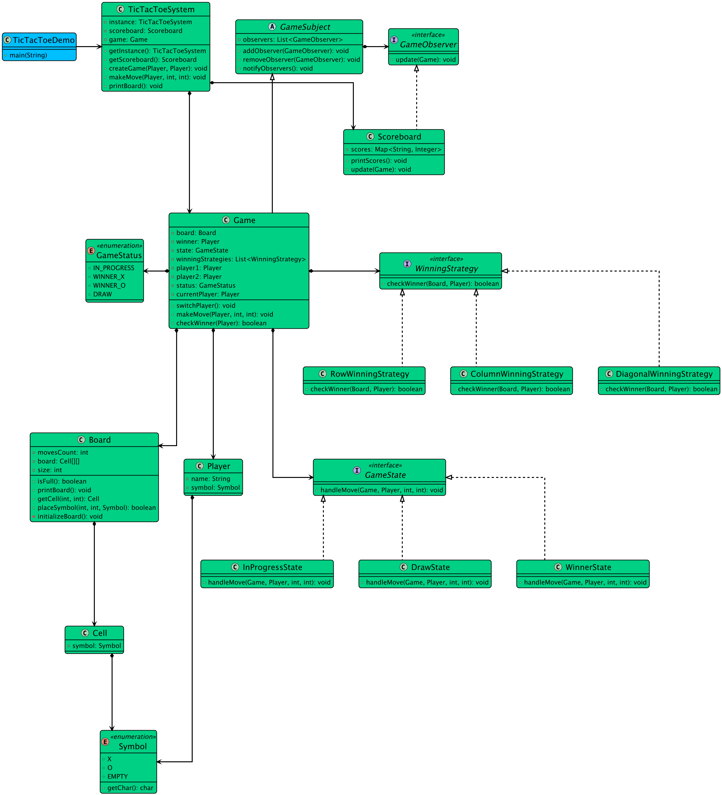

# Low-level design problem: tic tac toe

> Copied from <https://github.com/ashishps1/awesome-low-level-design/blob/main/problems/tic-tac-toe.md> (GPL-3.0, by Ashish Pratap Singh). Questions and answers are the source's own; nothing was answered or rewritten here.


# Designing a Tic Tac Toe Game

## Requirements
1. The Tic-Tac-Toe game should be played on a 3x3 grid.
2. Two players take turns marking their symbols (X or O) on the grid.
3. The first player to get three of their symbols in a row (horizontally, vertically, or diagonally) wins the game.
4. If all the cells on the grid are filled and no player has won, the game ends in a draw.
5. The game should have a user interface to display the grid and allow players to make their moves.
6. The game should handle player turns and validate moves to ensure they are legal.
7. The game should detect and announce the winner or a draw at the end of the game.

## UML Class Diagram



## Implementations
#### [Java Implementation](https://github.com/ashishps1/awesome-low-level-design/blob/main/solutions/java/src/tictactoe) 
#### [Python Implementation](https://github.com/ashishps1/awesome-low-level-design/blob/main/solutions/python/tictactoe)
#### [C++ Implementation](https://github.com/ashishps1/awesome-low-level-design/blob/main/solutions/cpp/tictactoe)
#### [C# Implementation](https://github.com/ashishps1/awesome-low-level-design/blob/main/solutions/csharp/tictactoe)
#### [Go Implementation](https://github.com/ashishps1/awesome-low-level-design/blob/main/solutions/golang/tictactoe)

## Classes, Interfaces and Enumerations
1. The **Player** class represents a player in the game, with a name and a symbol (X or O).
2. The **Board** class represents the game board, which is a 3x3 grid. It provides methods to make moves, check for a winner, and check if the board is full.
3. The **Game** class manages the game flow and player interactions. It handles player turns, validates moves, and determines the winner or a draw.
4. The **TicTacToe** class is the entry point of the application and creates instances of the players and the game.

---

## Official solutions from the repository

<details><summary><b>java</b> (21 files)</summary>


**Game.java**

```java
package tictactoe;

import tictactoe.enums.GameStatus;
import tictactoe.models.Board;
import tictactoe.models.Player;
import tictactoe.observer.GameSubject;
import tictactoe.state.GameState;
import tictactoe.state.InProgressState;
import tictactoe.strategy.ColumnWinningStrategy;
import tictactoe.strategy.DiagonalWinningStrategy;
import tictactoe.strategy.RowWinningStrategy;
import tictactoe.strategy.WinningStrategy;

import java.util.List;

public class Game extends GameSubject {
    private final Board board;
    private final Player player1;
    private final Player player2;
    private Player currentPlayer;
    private Player winner;
    private GameStatus status;
    private GameState state;
    private final List<WinningStrategy> winningStrategies;

    public Game(Player player1, Player player2) {
        this.board = new Board(3);
        this.player1 = player1;
        this.player2 = player2;
        this.currentPlayer = player1; // Player 1 starts
        this.status = GameStatus.IN_PROGRESS;
        this.state = new InProgressState();
        this.winningStrategies = List.of(
                new RowWinningStrategy(),
                new ColumnWinningStrategy(),
                new DiagonalWinningStrategy()
        );
    }

    public void makeMove(Player player, int row, int col) {
        state.handleMove(this, player, row, col);
    }

    public boolean checkWinner(Player player) {
        for (WinningStrategy strategy : winningStrategies) {
            if (strategy.checkWinner(board, player)) {
                return true;
            }
        }
        return false;
    }

    public void switchPlayer() {
        this.currentPlayer = (currentPlayer == player1) ? player2 : player1;
    }

    public Board getBoard() { return board; }
    public Player getCurrentPlayer() { return currentPlayer; }
    public Player getWinner() { return winner; }
    public void setWinner(Player winner) { this.winner = winner; }
    public GameStatus getStatus() { return status; }
    public void setState(GameState state) { this.state = state; }
    public void setStatus(GameStatus status) {
        this.status = status;
        // Notify observers when the status changes to a finished state
        if (status != GameStatus.IN_PROGRESS) {
            notifyObservers();
        }
    }
}
```


**README.md**

```md
# Tic Tac Toe (LLD)

## Problem Statement

Design and implement a Tic Tac Toe game that allows two players to play on a NxN board, alternating turns, and determines the winner or a draw.

---

## Requirements

- **Two Players:** The game is played between two players.
- **Board:** The game uses a NxN board.
- **Turns:** Players take turns to place their symbol (X or O) on the board.
- **Win Condition:** The game detects when a player has won (three in a row, column, or diagonal).
- **Draw Condition:** The game detects when the board is full and the game is a draw.
- **Input Validation:** The game prevents moves to already occupied cells.
- **Extensibility:** Easy to change the board size or add new features.

---

## Core Entities

- **Game:** Manages the game flow, player turns, and game status.
- **Board:** Represents the NxN grid and provides methods to update and check the board.
- **Cell:** Represents a single cell on the board.
- **Player:** Represents a player with a name and symbol.
- **Symbol:** Enum for X and O.
- **GameStatus:** Enum for IN_PROGRESS, DRAW, WIN.

---

## Class Design

## UML Class Diagram


### 1. Game
- **Fields:** Board board, Player[] players, int currentPlayerIndex, GameStatus status
- **Methods:** play(), makeMove(int row, int col), checkWin(), checkDraw(), switchPlayer(), getCurrentPlayer()

### 2. Board
- **Fields:** Cell[][] grid, int size
- **Methods:** isCellEmpty(int row, int col), setCell(int row, int col, Symbol), printBoard(), isFull(), checkWin(Symbol)

### 3. Cell
- **Fields:** int row, int col, Symbol symbol
- **Methods:** getSymbol(), setSymbol(Symbol)

### 4. Player
- **Fields:** String name, Symbol symbol

### 5. Symbol (enum)
- Values: X, O

### 6. GameStatus (enum)
- Values: IN_PROGRESS, DRAW, WIN

---

## Example Usage

```java
Player p1 = new Player("Alice", Symbol.X);
Player p2 = new Player("Bob", Symbol.O);
Game game = new Game(p1, p2);
game.play();
```

---

## Demo

See `TicTacToeDemo.java` for a sample usage and simulation of the Tic Tac Toe game.

---

## Extending the Design

- **Change board size:** Update the `Board` class to support different sizes.
- **Add AI player:** Implement a computer player for single-player mode.
- **Add GUI:** Build a graphical interface for the game.

---
```


**TicTacToeDemo.java**

```java
package tictactoe;

import tictactoe.enums.Symbol;
import tictactoe.models.Player;

public class TicTacToeDemo {
    public static void main(String[] args) {
        TicTacToeSystem system = TicTacToeSystem.getInstance();

        Player alice = new Player("Alice", Symbol.X);
        Player bob = new Player("Bob", Symbol.O);

        // --- GAME 1: Alice wins ---
        System.out.println("--- GAME 1: Alice (X) vs. Bob (O) ---");
        system.createGame(alice, bob);
        system.printBoard();

        system.makeMove(alice, 0, 0);
        system.makeMove(bob, 1, 0);
        system.makeMove(alice, 0, 1);
        system.makeMove(bob, 1, 1);
        system.makeMove(alice, 0, 2); // Alice wins, scoreboard is notified
        System.out.println("----------------------------------------\n");

        // --- GAME 2: Bob wins ---
        System.out.println("--- GAME 2: Alice (X) vs. Bob (O) ---");
        system.createGame(alice, bob); // A new game instance
        system.printBoard();

        system.makeMove(alice, 0, 0);
        system.makeMove(bob, 1, 0);
        system.makeMove(alice, 0, 1);
        system.makeMove(bob, 1, 1);
        system.makeMove(alice, 2, 2);
        system.makeMove(bob, 1, 2); // Bob wins, scoreboard is notified
        System.out.println("----------------------------------------\n");

        // --- GAME 3: A Draw ---
        System.out.println("--- GAME 3: Alice (X) vs. Bob (O) - Draw ---");
        system.createGame(alice, bob);
        system.printBoard();

        system.makeMove(alice, 0, 0);
        system.makeMove(bob, 0, 1);
        system.makeMove(alice, 0, 2);
        system.makeMove(bob, 1, 1);
        system.makeMove(alice, 1, 0);
        system.makeMove(bob, 1, 2);
        system.makeMove(alice, 2, 1);
        system.makeMove(bob, 2, 0);
        system.makeMove(alice, 2, 2); // Draw, scoreboard is not notified of a winner
        System.out.println("----------------------------------------\n");

        // --- Final Scoreboard ---
        // We get the scoreboard from the system and print its final state
        system.printScoreBoard();
    }
}
```


**TicTacToeSystem.java**

```java
package tictactoe;

import tictactoe.exceptions.InvalidMoveException;
import tictactoe.models.Player;
import tictactoe.observer.Scoreboard;

public class TicTacToeSystem {
    private static volatile TicTacToeSystem instance;
    private Game game;
    private final Scoreboard scoreboard; // The system now manages a scoreboard

    private TicTacToeSystem() {
        this.scoreboard = new Scoreboard(); // Create the scoreboard on initialization
    }

    public static synchronized TicTacToeSystem getInstance() {
        if (instance == null) {
            instance = new TicTacToeSystem();
        }
        return instance;
    }

    public void createGame(Player player1, Player player2) {
        this.game = new Game(player1, player2);
        // Register the scoreboard as an observer for this new game
        this.game.addObserver(this.scoreboard);

        System.out.printf("Game started between %s (X) and %s (O).%n", player1.getName(), player2.getName());
    }

    public void makeMove(Player player, int row, int col) {
        if (game == null) {
            System.out.println("No game in progress. Please create a game first.");
            return;
        }
        try {
            System.out.printf("%s plays at (%d, %d)%n", player.getName(), row, col);
            game.makeMove(player, row, col);
            printBoard();
            System.out.println("Game Status: " + game.getStatus());
            if (game.getWinner() != null) {
                System.out.println("Winner: " + game.getWinner().getName());
            }
        } catch (InvalidMoveException e) {
            System.out.println("Error: " + e.getMessage());
        }
    }

    public void printBoard() {
        game.getBoard().printBoard();
    }

    public void printScoreBoard() {
        scoreboard.printScores();
    }
}
```


**enums/GameStatus.java**

```java
package tictactoe.enums;

public enum GameStatus {
    IN_PROGRESS,
    WINNER_X,
    WINNER_O,
    DRAW
}
```


**enums/Symbol.java**

```java
package tictactoe.enums;

public enum Symbol {
    X('X'),
    O('O'),
    EMPTY('_');

    private final char symbol;

    Symbol(char symbol) {
        this.symbol = symbol;
    }

    public char getChar() {
        return symbol;
    }
}
```


**exceptions/InvalidMoveException.java**

```java
package tictactoe.exceptions;

public class InvalidMoveException extends RuntimeException {
    public InvalidMoveException(String message) {
        super(message);
    }
}
```


**models/Board.java**

```java
package tictactoe.models;

import tictactoe.enums.Symbol;
import tictactoe.exceptions.InvalidMoveException;

public class Board {
    private final int size;
    private int movesCount;
    private final Cell[][] board;

    public Board(int size) {
        this.size = size;
        this.board = new Cell[size][size];
        movesCount = 0;
        initializeBoard();
    }

    private void initializeBoard() {
        for (int row = 0; row < size; row++) {
            for (int col = 0; col < size; col++) {
                board[row][col] = new Cell();
            }
        }
    }

    public boolean placeSymbol(int row, int col, Symbol symbol) {
        if (row < 0 || row >= size || col < 0 || col >= size) {
            throw new InvalidMoveException("Invalid position: out of bounds.");
        }
        if (board[row][col].getSymbol() != Symbol.EMPTY) {
            throw new InvalidMoveException("Invalid position: cell is already occupied.");
        }
        board[row][col].setSymbol(symbol);
        movesCount++;
        return true;
    }

    public Cell getCell(int row, int col) {
        if (row < 0 || row >= size || col < 0 || col >= size) {
            return null;
        }
        return board[row][col];
    }

    public boolean isFull() {
        return movesCount == size * size;
    }

    public void printBoard() {
        System.out.println("-------------");
        for (int i = 0; i < size; i++) {
            System.out.print("| ");
            for (int j = 0; j < size; j++) {
                Symbol symbol = board[i][j].getSymbol();
                System.out.print(symbol.getChar() + " | ");
            }
            System.out.println("\n-------------");
        }
    }

    public int getSize() {
        return size;
    }
}
```


**models/Cell.java**

```java
package tictactoe.models;

import tictactoe.enums.Symbol;

public class Cell {
    private Symbol symbol;

    public Cell() {
        this.symbol = Symbol.EMPTY;
    }

    public Symbol getSymbol() {
        return symbol;
    }

    public void setSymbol(Symbol symbol) {
        this.symbol = symbol;
    }
}
```


**models/Player.java**

```java
package tictactoe.models;

import tictactoe.enums.Symbol;

public class Player {
    private final String name;
    private final Symbol symbol;

    public Player(String name, Symbol symbol) {
        this.name = name;
        this.symbol = symbol;
    }

    public String getName() {
        return name;
    }

    public Symbol getSymbol() {
        return symbol;
    }
}
```


**observer/GameObserver.java**

```java
package tictactoe.observer;

import tictactoe.Game;

public interface GameObserver {
    void update(Game game);
}
```


**observer/GameSubject.java**

```java
package tictactoe.observer;

import tictactoe.Game;

import java.util.ArrayList;
import java.util.List;

public abstract class GameSubject {
    private final List<GameObserver> observers = new ArrayList<>();

    public void addObserver(GameObserver observer) {
        observers.add(observer);
    }

    public void removeObserver(GameObserver observer) {
        observers.remove(observer);
    }

    public void notifyObservers() {
        for (GameObserver observer : observers) {
            // Pass 'this' which is the Game instance
            observer.update((Game) this);
        }
    }
}
```


**observer/Scoreboard.java**

```java
package tictactoe.observer;

import tictactoe.Game;

import java.util.Map;
import java.util.concurrent.ConcurrentHashMap;

public class Scoreboard implements GameObserver {
    private final Map<String, Integer> scores;

    public Scoreboard() {
        this.scores = new ConcurrentHashMap<>();
    }

    @Override
    public void update(Game game) {
        // The scoreboard only cares about finished games with a winner
        if (game.getWinner() != null) {
            String winnerName = game.getWinner().getName();
            scores.put(winnerName, scores.getOrDefault(winnerName, 0) + 1);
            System.out.printf("[Scoreboard] %s wins! Their new score is %d.%n", winnerName, scores.get(winnerName));
        }
    }

    public void printScores() {
        System.out.println("\n--- Overall Scoreboard ---");
        if (scores.isEmpty()) {
            System.out.println("No games with a winner have been played yet.");
            return;
        }
        scores.forEach((playerName, score) ->
                System.out.printf("Player: %-10s | Wins: %d%n", playerName, score)
        );
        System.out.println("--------------------------\n");
    }
}
```


**state/DrawState.java**

```java
package tictactoe.state;

import tictactoe.Game;
import tictactoe.exceptions.InvalidMoveException;
import tictactoe.models.Player;

public class DrawState implements GameState {
    @Override
    public void handleMove(Game game, Player player, int row, int col) {
        throw new InvalidMoveException("Game is already over. It was a draw.");
    }
}
```


**state/GameState.java**

```java
package tictactoe.state;

import tictactoe.Game;
import tictactoe.models.Player;

public interface GameState {
    void handleMove(Game game, Player player, int row, int col);
}
```


**state/InProgressState.java**

```java
package tictactoe.state;

import tictactoe.Game;
import tictactoe.enums.GameStatus;
import tictactoe.enums.Symbol;
import tictactoe.exceptions.InvalidMoveException;
import tictactoe.models.Player;

public class InProgressState implements GameState {
    @Override
    public void handleMove(Game game, Player player, int row, int col) {
        if (game.getCurrentPlayer() != player) {
            throw new InvalidMoveException("Not your turn!");
        }

        // Place the piece on the board
        game.getBoard().placeSymbol(row, col, player.getSymbol());

        // Check for a winner or a draw
        if (game.checkWinner(player)) {
            game.setWinner(player);
            game.setStatus(player.getSymbol() == Symbol.X ? GameStatus.WINNER_X : GameStatus.WINNER_O);
            game.setState(new WinnerState());
        } else if (game.getBoard().isFull()) {
            game.setStatus(GameStatus.DRAW);
            game.setState(new DrawState());
        } else {
            // If the game is still in progress, switch players
            game.switchPlayer();
        }
    }
}
```


**state/WinnerState.java**

```java
package tictactoe.state;

import tictactoe.Game;
import tictactoe.exceptions.InvalidMoveException;
import tictactoe.models.Player;

public class WinnerState implements GameState {
    @Override
    public void handleMove(Game game, Player player, int row, int col) {
        throw new InvalidMoveException("Game is already over. " + game.getWinner().getName() + " has won.");
    }
}
```


**strategy/ColumnWinningStrategy.java**

```java
package tictactoe.strategy;

import tictactoe.models.Board;
import tictactoe.models.Player;

public class ColumnWinningStrategy implements WinningStrategy {
    @Override
    public boolean checkWinner(Board board, Player player) {
        for (int col = 0; col < board.getSize(); col++) {
            boolean colWin = true;
            for (int row = 0; row < board.getSize(); row++) {
                if (board.getCell(row, col).getSymbol() != player.getSymbol()) {
                    colWin = false;
                    break;
                }
            }
            if (colWin) return true;
        }
        return false;
    }
}
```


**strategy/DiagonalWinningStrategy.java**

```java
package tictactoe.strategy;

import tictactoe.models.Board;
import tictactoe.models.Player;

public class DiagonalWinningStrategy implements WinningStrategy {
    @Override
    public boolean checkWinner(Board board, Player player) {
        // Main diagonal
        boolean mainDiagWin = true;
        for (int i = 0; i < board.getSize(); i++) {
            if (board.getCell(i, i).getSymbol() != player.getSymbol()) {
                mainDiagWin = false;
                break;
            }
        }
        if (mainDiagWin) return true;

        // Anti-diagonal
        boolean antiDiagWin = true;
        for (int i = 0; i < board.getSize(); i++) {
            if (board.getCell(i, board.getSize() - 1 - i).getSymbol() != player.getSymbol()) {
                antiDiagWin = false;
                break;
            }
        }
        return antiDiagWin;
    }
}
```


**strategy/RowWinningStrategy.java**

```java
package tictactoe.strategy;

import tictactoe.models.Board;
import tictactoe.models.Player;

public class RowWinningStrategy implements WinningStrategy {
    @Override
    public boolean checkWinner(Board board, Player player) {
        for (int row = 0; row < board.getSize(); row++) {
            boolean rowWin = true;
            for (int col = 0; col < board.getSize(); col++) {
                if (board.getCell(row, col).getSymbol() != player.getSymbol()) {
                    rowWin = false;
                    break;
                }
            }
            if (rowWin) return true;
        }
        return false;
    }
}
```


**strategy/WinningStrategy.java**

```java
package tictactoe.strategy;

import tictactoe.models.Board;
import tictactoe.models.Player;

public interface WinningStrategy {
    boolean checkWinner(Board board, Player player);
}
```

</details>

<details><summary><b>python</b> (15 files)</summary>


**README.md**

```md
# Designing a Tic Tac Toe Game

## Requirements
1. The Tic-Tac-Toe game should be played on a 3x3 grid.
2. Two players take turns marking their symbols (X or O) on the grid.
3. The first player to get three of their symbols in a row (horizontally, vertically, or diagonally) wins the game.
4. If all the cells on the grid are filled and no player has won, the game ends in a draw.
5. The game should have a user interface to display the grid and allow players to make their moves.
6. The game should handle player turns and validate moves to ensure they are legal.
7. The game should detect and announce the winner or a draw at the end of the game.

## Classes, Interfaces and Enumerations
1. The **Player** class represents a player in the game, with a name and a symbol (X or O).
2. The **Board** class represents the game board, which is a 3x3 grid. It provides methods to make moves, check for a winner, and check if the board is full.
3. The **Game** class manages the game flow and player interactions. It handles player turns, validates moves, and determines the winner or a draw.
4. The **TicTacToe** class is the entry point of the application and creates instances of the players and the game.
```


**board.py**

```py
from cell import Cell
from symbol import Symbol
from invalid_move_exception import InvalidMoveException
from typing import Optional

class Board:
    def __init__(self, size: int):
        self.size = size
        self.moves_count = 0
        self.board = []
        self.initialize_board()
    
    def initialize_board(self):
        for row in range(self.size):
            board_row = []
            for col in range(self.size):
                board_row.append(Cell())
            self.board.append(board_row)
    
    def place_symbol(self, row: int, col: int, symbol: Symbol) -> bool:
        if row < 0 or row >= self.size or col < 0 or col >= self.size:
            raise InvalidMoveException("Invalid position: out of bounds.")
        if self.board[row][col].get_symbol() != Symbol.EMPTY:
            raise InvalidMoveException("Invalid position: cell is already occupied.")
        
        self.board[row][col].set_symbol(symbol)
        self.moves_count += 1
        return True
    
    def get_cell(self, row: int, col: int) -> Optional[Cell]:
        if row < 0 or row >= self.size or col < 0 or col >= self.size:
            return None
        return self.board[row][col]
    
    def is_full(self) -> bool:
        return self.moves_count == self.size * self.size
    
    def print_board(self):
        print("-------------")
        for i in range(self.size):
            print("| ", end="")
            for j in range(self.size):
                symbol = self.board[i][j].get_symbol()
                print(f"{symbol.get_char()} | ", end="")
            print("\n-------------")
    
    def get_size(self):
        return self.size
```


**cell.py**

```py
from symbol import Symbol

class Cell:
    def __init__(self):
        self.symbol = Symbol.EMPTY
    
    def get_symbol(self):
        return self.symbol
    
    def set_symbol(self, symbol: Symbol):
        self.symbol = symbol
```


**game.py**

```py
from game_subject import GameSubject
from game_state import InProgressState
from game_status import GameStatus
from player import Player
from board import Board
from winning_strategy import RowWinningStrategy, ColumnWinningStrategy, DiagonalWinningStrategy
from game_state import GameState

class Game(GameSubject):
    def __init__(self, player1: Player, player2: Player):
        super().__init__()
        self.board = Board(3)
        self.player1 = player1
        self.player2 = player2
        self.current_player = player1  # Player 1 starts
        self.winner = None
        self.status = GameStatus.IN_PROGRESS
        self.state = InProgressState()
        self.winning_strategies = [
            RowWinningStrategy(),
            ColumnWinningStrategy(),
            DiagonalWinningStrategy()
        ]
    
    def make_move(self, player: Player, row: int, col: int):
        self.state.handle_move(self, player, row, col)
    
    def check_winner(self, player: Player) -> bool:
        for strategy in self.winning_strategies:
            if strategy.check_winner(self.board, player):
                return True
        return False
    
    def switch_player(self):
        self.current_player = self.player2 if self.current_player == self.player1 else self.player1
    
    def get_board(self):
        return self.board
    
    def get_current_player(self):
        return self.current_player
    
    def get_winner(self):
        return self.winner
    
    def set_winner(self, winner: Player):
        self.winner = winner
    
    def get_status(self):
        return self.status
    
    def set_state(self, state: GameState):
        self.state = state
    
    def set_status(self, status: GameStatus):
        self.status = status
        # Notify observers when the status changes to a finished state
        if status != GameStatus.IN_PROGRESS:
            self.notify_observers()
```


**game_observer.py**

```py
from abc import ABC, abstractmethod

class GameObserver(ABC):
    @abstractmethod
    def update(self, game):
        pass
```


**game_state.py**

```py
from abc import ABC, abstractmethod
from player import Player
from invalid_move_exception import InvalidMoveException
from game_status import GameStatus
from symbol import Symbol

class GameState(ABC):
    @abstractmethod
    def handle_move(self, game, player: Player, row: int, col: int):
        pass

class InProgressState(GameState):
    def handle_move(self, game, player: Player, row: int, col: int):
        if game.get_current_player() != player:
            raise InvalidMoveException("Not your turn!")
        
        # Place the piece on the board
        game.get_board().place_symbol(row, col, player.get_symbol())
        
        # Check for a winner or a draw
        if game.check_winner(player):
            game.set_winner(player)
            game.set_status(GameStatus.WINNER_X if player.get_symbol() == Symbol.X else GameStatus.WINNER_O)
            game.set_state(WinnerState())
        elif game.get_board().is_full():
            game.set_status(GameStatus.DRAW)
            game.set_state(DrawState())
        else:
            # If the game is still in progress, switch players
            game.switch_player()


class DrawState(GameState):
    def handle_move(self, game, player: Player, row: int, col: int):
        raise InvalidMoveException("Game is already over. It was a draw.")


class WinnerState(GameState):
    def handle_move(self, game, player: Player, row: int, col: int):
        raise InvalidMoveException(f"Game is already over. {game.get_winner().get_name()} has won.")
```


**game_status.py**

```py
from enum import Enum

class GameStatus(Enum):
    IN_PROGRESS = "IN_PROGRESS"
    WINNER_X = "WINNER_X"
    WINNER_O = "WINNER_O"
    DRAW = "DRAW"
```


**game_subject.py**

```py
from abc import ABC, abstractmethod
from game_observer import GameObserver

class GameSubject(ABC):
    def __init__(self):
        self.observers = []
    
    def add_observer(self, observer: GameObserver):
        self.observers.append(observer)
    
    def remove_observer(self, observer: GameObserver):
        self.observers.remove(observer)
    
    def notify_observers(self):
        for observer in self.observers:
            observer.update(self)
```


**invalid_move_exception.py**

```py
class InvalidMoveException(Exception):
    def __init__(self, message):
        super().__init__(message)
```


**player.py**

```py
from symbol import Symbol

class Player:
    def __init__(self, name: str, symbol: Symbol):
        self.name = name
        self.symbol = symbol
    
    def get_name(self):
        return self.name
    
    def get_symbol(self):
        return self.symbol
```


**scoreboard.py**

```py
from game_observer import GameObserver

class Scoreboard(GameObserver):
    def __init__(self):
        self.scores = {}
    
    def update(self, game):
        # The scoreboard only cares about finished games with a winner
        if game.get_winner() is not None:
            winner_name = game.get_winner().get_name()
            self.scores[winner_name] = self.scores.get(winner_name, 0) + 1
            print(f"[Scoreboard] {winner_name} wins! Their new score is {self.scores[winner_name]}.")
    
    def print_scores(self):
        print("\n--- Overall Scoreboard ---")
        if not self.scores:
            print("No games with a winner have been played yet.")
            return
        
        for player_name, score in self.scores.items():
            print(f"Player: {player_name:<10} | Wins: {score}")
        print("--------------------------\n")
```


**symbol.py**

```py
from enum import Enum

class Symbol(Enum):
    X = 'X'
    O = 'O'
    EMPTY = '_'
    
    def get_char(self):
        return self.value
```


**tictactoe_demo.py**

```py
from tictactoesystem import TicTacToeSystem
from player import Player
from symbol import Symbol

class TicTacToeDemo:
    @staticmethod
    def main():
        system = TicTacToeSystem.get_instance()
        
        alice = Player("Alice", Symbol.X)
        bob = Player("Bob", Symbol.O)
        
        # --- GAME 1: Alice wins ---
        print("--- GAME 1: Alice (X) vs. Bob (O) ---")
        system.create_game(alice, bob)
        system.print_board()
        
        system.make_move(alice, 0, 0)
        system.make_move(bob, 1, 0)
        system.make_move(alice, 0, 1)
        system.make_move(bob, 1, 1)
        system.make_move(alice, 0, 2)  # Alice wins, scoreboard is notified
        print("----------------------------------------\n")
        
        # --- GAME 2: Bob wins ---
        print("--- GAME 2: Alice (X) vs. Bob (O) ---")
        system.create_game(alice, bob)  # A new game instance
        system.print_board()
        
        system.make_move(alice, 0, 0)
        system.make_move(bob, 1, 0)
        system.make_move(alice, 0, 1)
        system.make_move(bob, 1, 1)
        system.make_move(alice, 2, 2)
        system.make_move(bob, 1, 2)  # Bob wins, scoreboard is notified
        print("----------------------------------------\n")
        
        # --- GAME 3: A Draw ---
        print("--- GAME 3: Alice (X) vs. Bob (O) - Draw ---")
        system.create_game(alice, bob)
        system.print_board()
        
        system.make_move(alice, 0, 0)
        system.make_move(bob, 0, 1)
        system.make_move(alice, 0, 2)
        system.make_move(bob, 1, 1)
        system.make_move(alice, 1, 0)
        system.make_move(bob, 1, 2)
        system.make_move(alice, 2, 1)
        system.make_move(bob, 2, 0)
        system.make_move(alice, 2, 2)  # Draw, scoreboard is not notified of a winner
        print("----------------------------------------\n")
        
        # --- Final Scoreboard ---
        # We get the scoreboard from the system and print its final state
        system.print_score_board()


if __name__ == "__main__":
    TicTacToeDemo.main()
```


**tictactoesystem.py**

```py
import threading
from scoreboard import Scoreboard
from game import Game
from player import Player
from invalid_move_exception import InvalidMoveException

class TicTacToeSystem:
    _instance = None
    _lock = threading.Lock()
    
    def __new__(cls):
        if cls._instance is None:
            with cls._lock:
                if cls._instance is None:
                    cls._instance = super().__new__(cls)
        return cls._instance
    
    def __init__(self):
        if not hasattr(self, 'initialized'):
            self.game = None
            self.scoreboard = Scoreboard()  # The system now manages a scoreboard
            self.initialized = True
    
    @classmethod
    def get_instance(cls):
        return cls()
    
    def create_game(self, player1: Player, player2: Player):
        self.game = Game(player1, player2)
        # Register the scoreboard as an observer for this new game
        self.game.add_observer(self.scoreboard)
        
        print(f"Game started between {player1.get_name()} (X) and {player2.get_name()} (O).")
    
    def make_move(self, player: Player, row: int, col: int):
        if self.game is None:
            print("No game in progress. Please create a game first.")
            return
        
        try:
            print(f"{player.get_name()} plays at ({row}, {col})")
            self.game.make_move(player, row, col)
            self.print_board()
            print(f"Game Status: {self.game.get_status().value}")
            if self.game.get_winner() is not None:
                print(f"Winner: {self.game.get_winner().get_name()}")
        except InvalidMoveException as e:
            print(f"Error: {e}")
    
    def print_board(self):
        self.game.get_board().print_board()
    
    def print_score_board(self):
        self.scoreboard.print_scores()
```


**winning_strategy.py**

```py
from abc import ABC, abstractmethod
from board import Board
from player import Player

class WinningStrategy(ABC):
    @abstractmethod
    def check_winner(self, board: Board, player: Player) -> bool:
        pass

class RowWinningStrategy(WinningStrategy):
    def check_winner(self, board: Board, player: Player) -> bool:
        for row in range(board.get_size()):
            row_win = True
            for col in range(board.get_size()):
                if board.get_cell(row, col).get_symbol() != player.get_symbol():
                    row_win = False
                    break
            if row_win:
                return True
        return False

class ColumnWinningStrategy(WinningStrategy):
    def check_winner(self, board: Board, player: Player) -> bool:
        for col in range(board.get_size()):
            col_win = True
            for row in range(board.get_size()):
                if board.get_cell(row, col).get_symbol() != player.get_symbol():
                    col_win = False
                    break
            if col_win:
                return True
        return False

class DiagonalWinningStrategy(WinningStrategy):
    def check_winner(self, board: Board, player: Player) -> bool:
        # Main diagonal
        main_diag_win = True
        for i in range(board.get_size()):
            if board.get_cell(i, i).get_symbol() != player.get_symbol():
                main_diag_win = False
                break
        if main_diag_win:
            return True
        
        # Anti-diagonal
        anti_diag_win = True
        for i in range(board.get_size()):
            if board.get_cell(i, board.get_size() - 1 - i).get_symbol() != player.get_symbol():
                anti_diag_win = False
                break
        return anti_diag_win
```

</details>

<details><summary><b>cpp</b> (8 files)</summary>


**Board.cpp**

```cpp
#include "Board.hpp"
#include <iostream>
#include <iomanip>

Board::Board(int size) : size(size), EMPTY('-') {
    reset();
}

int Board::getSize() const { return size; }

char Board::getCell(int row, int col) const {
    return grid[row][col];
}

bool Board::isEmpty(int row, int col) const {
    return grid[row][col] == EMPTY;
}

bool Board::isValidPosition(int row, int col) const {
    return row >= 0 && row < size && col >= 0 && col < size;
}

bool Board::makeMove(int row, int col, char symbol) {
    if (!isValidPosition(row, col) || !isEmpty(row, col)) {
        return false;
    }
    grid[row][col] = symbol;
    return true;
}

bool Board::isFull() const {
    for (int i = 0; i < size; i++) {
        for (int j = 0; j < size; j++) {
            if (isEmpty(i, j)) return false;
        }
    }
    return true;
}

bool Board::checkWin(char symbol) const {
    return checkRows(symbol) || checkColumns(symbol) || checkDiagonals(symbol);
}

void Board::display() const {
    std::cout << "\nCurrent Board:" << std::endl;
    for (int i = 0; i < size; i++) {
        for (int j = 0; j < size; j++) {
            std::cout << std::setw(3) << grid[i][j];
        }
        std::cout << std::endl;
    }
    std::cout << std::endl;
}

void Board::reset() {
    grid.resize(size, std::vector<char>(size, EMPTY));
}

bool Board::checkRows(char symbol) const {
    for (int i = 0; i < size; i++) {
        bool win = true;
        for (int j = 0; j < size; j++) {
            if (grid[i][j] != symbol) {
                win = false;
                break;
            }
        }
        if (win) return true;
    }
    return false;
}

bool Board::checkColumns(char symbol) const {
    for (int j = 0; j < size; j++) {
        bool win = true;
        for (int i = 0; i < size; i++) {
            if (grid[i][j] != symbol) {
                win = false;
                break;
            }
        }
        if (win) return true;
    }
    return false;
}

bool Board::checkDiagonals(char symbol) const {
    // Check main diagonal
    bool win = true;
    for (int i = 0; i < size; i++) {
        if (grid[i][i] != symbol) {
            win = false;
            break;
        }
    }
    if (win) return true;
    
    // Check other diagonal
    win = true;
    for (int i = 0; i < size; i++) {
        if (grid[i][size-1-i] != symbol) {
            win = false;
            break;
        }
    }
    return win;
}
```


**Board.hpp**

```hpp
#ifndef BOARD_HPP
#define BOARD_HPP

#include <vector>
#include <string>

class Board {
private:
    std::vector<std::vector<char>> grid;
    const int size;
    const char EMPTY;

public:
    Board(int size = 3);
    
    int getSize() const;
    char getCell(int row, int col) const;
    bool isEmpty(int row, int col) const;
    bool isValidPosition(int row, int col) const;
    bool makeMove(int row, int col, char symbol);
    bool isFull() const;
    bool checkWin(char symbol) const;
    void display() const;
    void reset();

private:
    bool checkRows(char symbol) const;
    bool checkColumns(char symbol) const;
    bool checkDiagonals(char symbol) const;
};

#endif
```


**Game.cpp**

```cpp
#include "Game.hpp"
#include <iostream>
#include <limits>
#include <cstdlib>
#include <ctime>

Game::Game(int boardSize) : board(boardSize), gameOver(false) {
    player1 = nullptr;
    player2 = nullptr;
    currentPlayer = nullptr;
    std::srand(static_cast<unsigned int>(std::time(nullptr)));
}

Game::~Game() {
    delete player1;
    delete player2;
}

void Game::initializePlayers(const std::string& p1Name, const std::string& p2Name) {
    player1 = new Player(p1Name, 'X');
    player2 = new Player(p2Name, 'O', false);  // Computer player
    currentPlayer = player1;
}

void Game::play() {
    while (!gameOver) {
        board.display();
        
        if (currentPlayer->isHumanPlayer()) {
            int row, col;
            std::cout << currentPlayer->getName() << "'s turn (symbol: "
                      << currentPlayer->getSymbol() << ")" << std::endl;
            std::cout << "Enter row (0-" << board.getSize()-1 << "): ";
            std::cin >> row;
            std::cout << "Enter column (0-" << board.getSize()-1 << "): ";
            std::cin >> col;
            
            makeMove(row, col);
        } else {
            std::cout << "Computer's turn..." << std::endl;
            computerMove();
        }
    }
    
    displayResult();
}

void Game::makeMove(int row, int col) {
    if (!board.isValidPosition(row, col)) {
        std::cout << "Invalid position!" << std::endl;
        return;
    }
    
    if (!board.isEmpty(row, col)) {
        std::cout << "Position already taken!" << std::endl;
        return;
    }
    
    board.makeMove(row, col, currentPlayer->getSymbol());
    
    if (board.checkWin(currentPlayer->getSymbol())) {
        gameOver = true;
        return;
    }
    
    if (board.isFull()) {
        gameOver = true;
        currentPlayer = nullptr;
        return;
    }
    
    switchPlayer();
}

void Game::switchPlayer() {
    currentPlayer = (currentPlayer == player1) ? player2 : player1;
}

void Game::displayResult() const {
    board.display();
    if (currentPlayer) {
        std::cout << currentPlayer->getName() << " wins!" << std::endl;
    } else {
        std::cout << "It's a draw!" << std::endl;
    }
}

bool Game::isGameOver() const {
    return gameOver;
}

Player* Game::getCurrentPlayer() const {
    return currentPlayer;
}

void Game::computerMove() {
    auto [row, col] = findBestMove();
    makeMove(row, col);
}

std::pair<int, int> Game::findBestMove() const {
    int bestScore = std::numeric_limits<int>::min();
    std::pair<int, int> bestMove = {0, 0};
    
    for (int i = 0; i < board.getSize(); i++) {
        for (int j = 0; j < board.getSize(); j++) {
            if (board.isEmpty(i, j)) {
                Board tempBoard = board;  // Create a copy
                tempBoard.makeMove(i, j, player2->getSymbol());
                
                int score = minimax(false, 0);
                if (score > bestScore) {
                    bestScore = score;
                    bestMove = {i, j};
                }
            }
        }
    }
    
    return bestMove;
}

int Game::minimax(bool isMax, int depth) const {
    if (board.checkWin(player2->getSymbol())) return 10 - depth;
    if (board.checkWin(player1->getSymbol())) return depth - 10;
    if (board.isFull()) return 0;
    
    int bestScore = isMax ? std::numeric_limits<int>::min() : std::numeric_limits<int>::max();
    
    for (int i = 0; i < board.getSize(); i++) {
        for (int j = 0; j < board.getSize(); j++) {
            if (board.isEmpty(i, j)) {
                Board tempBoard = board;  // Create a copy
                tempBoard.makeMove(i, j, isMax ? player2->getSymbol() : player1->getSymbol());
                
                int score = minimax(!isMax, depth + 1);
                bestScore = isMax ? std::max(score, bestScore) : std::min(score, bestScore);
            }
        }
    }
    
    return bestScore;
}
```


**Game.hpp**

```hpp
#ifndef GAME_HPP
#define GAME_HPP

#include "Board.hpp"
#include "Player.hpp"

class Game {
private:
    Board board;
    Player* player1;
    Player* player2;
    Player* currentPlayer;
    bool gameOver;

public:
    Game(int boardSize = 3);
    ~Game();
    
    void initializePlayers(const std::string& p1Name, const std::string& p2Name);
    void play();
    void makeMove(int row, int col);
    void switchPlayer();
    void displayResult() const;
    bool isGameOver() const;
    Player* getCurrentPlayer() const;

private:
    void computerMove();
    std::pair<int, int> findBestMove() const;
    int minimax(bool isMax, int depth) const;
};

#endif
```


**Player.cpp**

```cpp
#include "Player.hpp"

Player::Player(std::string name, char symbol, bool isHuman)
    : name(name), symbol(symbol), isHuman(isHuman) {}

std::string Player::getName() const { return name; }
char Player::getSymbol() const { return symbol; }
bool Player::isHumanPlayer() const { return isHuman; }
```


**Player.hpp**

```hpp
#ifndef PLAYER_HPP
#define PLAYER_HPP

#include <string>

class Player {
private:
    std::string name;
    char symbol;
    bool isHuman;

public:
    Player(std::string name, char symbol, bool isHuman = true);
    
    std::string getName() const;
    char getSymbol() const;
    bool isHumanPlayer() const;
};

#endif
```


**README.md**

```md
# Designing a Tic Tac Toe Game

## Requirements
1. The Tic-Tac-Toe game should be played on a 3x3 grid.
2. Two players take turns marking their symbols (X or O) on the grid.
3. The first player to get three of their symbols in a row (horizontally, vertically, or diagonally) wins the game.
4. If all the cells on the grid are filled and no player has won, the game ends in a draw.
5. The game should have a user interface to display the grid and allow players to make their moves.
6. The game should handle player turns and validate moves to ensure they are legal.
7. The game should detect and announce the winner or a draw at the end of the game.

## Classes, Interfaces and Enumerations
1. The **Player** class represents a player in the game, with a name and a symbol (X or O).
2. The **Board** class represents the game board, which is a 3x3 grid. It provides methods to make moves, check for a winner, and check if the board is full.
3. The **Game** class manages the game flow and player interactions. It handles player turns, validates moves, and determines the winner or a draw.
4. The **TicTacToe** class is the entry point of the application and creates instances of the players and the game.
```


**TicTacToeDemo.cpp**

```cpp
#include "Game.hpp"
#include <iostream>

int main() {
    std::cout << "Welcome to Tic Tac Toe!" << std::endl;
    
    Game game;
    game.initializePlayers("Human", "Computer");
    game.play();
    
    return 0;
}
```

</details>

<details><summary><b>golang</b> (5 files)</summary>


**README.md**

```md
# Designing a Tic Tac Toe Game

## Requirements
1. The Tic-Tac-Toe game should be played on a 3x3 grid.
2. Two players take turns marking their symbols (X or O) on the grid.
3. The first player to get three of their symbols in a row (horizontally, vertically, or diagonally) wins the game.
4. If all the cells on the grid are filled and no player has won, the game ends in a draw.
5. The game should have a user interface to display the grid and allow players to make their moves.
6. The game should handle player turns and validate moves to ensure they are legal.
7. The game should detect and announce the winner or a draw at the end of the game.

## Classes, Interfaces and Enumerations
1. The **Player** class represents a player in the game, with a name and a symbol (X or O).
2. The **Board** class represents the game board, which is a 3x3 grid. It provides methods to make moves, check for a winner, and check if the board is full.
3. The **Game** class manages the game flow and player interactions. It handles player turns, validates moves, and determines the winner or a draw.
4. The **TicTacToe** class is the entry point of the application and creates instances of the players and the game.
```


**board.go**

```go
package tictactoe

import "fmt"

type Board struct {
	Grid       [3][3]rune
	MovesCount int
}

func NewBoard() *Board {
	board := &Board{}
	board.InitializeBoard()
	return board
}

func (b *Board) InitializeBoard() {
	for row := 0; row < 3; row++ {
		for col := 0; col < 3; col++ {
			b.Grid[row][col] = '-'
		}
	}
	b.MovesCount = 0
}

func (b *Board) MakeMove(row, col int, symbol rune) error {
	if row < 0 || row >= 3 || col < 0 || col >= 3 || b.Grid[row][col] != '-' {
		return fmt.Errorf("invalid move!")
	}
	b.Grid[row][col] = symbol
	b.MovesCount++
	return nil
}

func (b *Board) IsFull() bool {
	return b.MovesCount == 9
}

func (b *Board) HasWinner() bool {
	// Check rows
	for row := 0; row < 3; row++ {
		if b.Grid[row][0] != '-' && b.Grid[row][0] == b.Grid[row][1] && b.Grid[row][1] == b.Grid[row][2] {
			return true
		}
	}

	// Check columns
	for col := 0; col < 3; col++ {
		if b.Grid[0][col] != '-' && b.Grid[0][col] == b.Grid[1][col] && b.Grid[1][col] == b.Grid[2][col] {
			return true
		}
	}

	// Check diagonals
	if b.Grid[0][0] != '-' && b.Grid[0][0] == b.Grid[1][1] && b.Grid[1][1] == b.Grid[2][2] {
		return true
	}
	return b.Grid[0][2] != '-' && b.Grid[0][2] == b.Grid[1][1] && b.Grid[1][1] == b.Grid[2][0]
}

func (b *Board) PrintBoard() {
	for row := 0; row < 3; row++ {
		for col := 0; col < 3; col++ {
			fmt.Print(string(b.Grid[row][col]) + " ")
		}
		fmt.Println()
	}
	fmt.Println()
}
```


**game.go**

```go
package tictactoe

import (
	"bufio"
	"fmt"
	"os"
	"strconv"
)

type Game struct {
	Player1       *Player
	Player2       *Player
	Board         *Board
	CurrentPlayer *Player
}

func NewGame(player1, player2 *Player) *Game {
	return &Game{
		Player1:       player1,
		Player2:       player2,
		Board:         NewBoard(),
		CurrentPlayer: player1,
	}
}

func (g *Game) Play() {
	g.Board.PrintBoard()

	for !g.Board.IsFull() && !g.Board.HasWinner() {
		fmt.Printf("%s's turn.\n", g.CurrentPlayer.Name)
		row := g.getValidInput("Enter row (0-2): ")
		col := g.getValidInput("Enter column (0-2): ")

		err := g.Board.MakeMove(row, col, g.CurrentPlayer.Symbol)
		if err != nil {
			fmt.Println(err.Error())
			continue
		}

		g.Board.PrintBoard()
		g.switchPlayer()
	}

	if g.Board.HasWinner() {
		g.switchPlayer() // Switch back to the winner
		fmt.Printf("%s wins!\n", g.CurrentPlayer.Name)
	} else {
		fmt.Println("It's a draw!")
	}
}

func (g *Game) switchPlayer() {
	if g.CurrentPlayer == g.Player1 {
		g.CurrentPlayer = g.Player2
	} else {
		g.CurrentPlayer = g.Player1
	}
}

func (g *Game) getValidInput(prompt string) int {
	scanner := bufio.NewScanner(os.Stdin)
	for {
		fmt.Print(prompt)
		scanner.Scan()
		input, err := strconv.Atoi(scanner.Text())
		if err == nil && input >= 0 && input <= 2 {
			return input
		}
		fmt.Println("Invalid input! Please enter a number between 0 and 2.")
	}
}
```


**player.go**

```go
package tictactoe

type Player struct {
	Name   string
	Symbol rune
}

func NewPlayer(name string, symbol rune) *Player {
	return &Player{Name: name, Symbol: symbol}
}
```


**tictactoe_demo.go**

```go
package tictactoe

func Run() {
	player1 := NewPlayer("Player 1", 'X')
	player2 := NewPlayer("Player 2", 'O')

	game := NewGame(player1, player2)
	game.Play()
}
```

</details>

<details><summary><b>csharp</b> (22 files)</summary>


**Enums/GameStatus.cs**

```cs
enum GameStatus
{
    IN_PROGRESS,
    WINNER_X,
    WINNER_O,
    DRAW
}
```


**Enums/Symbol.cs**

```cs
enum Symbol
{
    X,
    O,
    EMPTY
}
```


**Exceptions/InvalidMoveException.cs**

```cs
class InvalidMoveException : Exception
{
    public InvalidMoveException(string message) : base(message) { }
}
```


**Models/Board.cs**

```cs
using System;


class Board
{
    private readonly int size;
    private int movesCount;
    private readonly Cell[,] board;

    public Board(int size)
    {
        this.size = size;
        this.board = new Cell[size, size];
        movesCount = 0;
        InitializeBoard();
    }

    private void InitializeBoard()
    {
        for (int row = 0; row < size; row++)
        {
            for (int col = 0; col < size; col++)
            {
                board[row, col] = new Cell();
            }
        }
    }

    public bool PlaceSymbol(int row, int col, Symbol symbol)
    {
        if (row < 0 || row >= size || col < 0 || col >= size)
        {
            throw new InvalidMoveException("Invalid position: out of bounds.");
        }
        if (board[row, col].GetSymbol() != Symbol.EMPTY)
        {
            throw new InvalidMoveException("Invalid position: cell is already occupied.");
        }

        board[row, col].SetSymbol(symbol);
        movesCount++;
        return true;
    }

    public Cell GetCell(int row, int col)
    {
        if (row < 0 || row >= size || col < 0 || col >= size)
        {
            return null;
        }
        return board[row, col];
    }

    public bool IsFull() { return movesCount == size * size; }

    public void PrintBoard()
    {
        Console.WriteLine("-------------");
        for (int i = 0; i < size; i++)
        {
            Console.Write("| ");
            for (int j = 0; j < size; j++)
            {
                Console.Write(board[i, j].GetSymbolChar() + " | ");
            }
            Console.WriteLine();
            Console.WriteLine("-------------");
        }
    }

    public int GetSize() => size;
}
```


**Models/Cell.cs**

```cs
class Cell
{
    private Symbol symbol;

    public Cell()
    {
        symbol = Symbol.EMPTY;
    }

    public Symbol GetSymbol() { return symbol; }
    public void SetSymbol(Symbol symbol) { this.symbol = symbol; }

    public char GetSymbolChar()
    {
        switch (symbol)
        {
            case Symbol.X: return 'X';
            case Symbol.O: return 'O';
            case Symbol.EMPTY: return '_';
            default: return '_';
        }
    }
}
```


**Models/Game.cs**

```cs
using System;

class Game : GameSubject
{
    private readonly Board board;
    private readonly Player player1;
    private readonly Player player2;
    private Player currentPlayer;
    private Player winner;
    private GameStatus status;
    private IGameState state;
    private readonly List<IWinningStrategy> winningStrategies;

    public Game(Player player1, Player player2)
    {
        board = new Board(3);
        this.player1 = player1;
        this.player2 = player2;
        currentPlayer = player1; // Player 1 starts
        winner = null;
        status = GameStatus.IN_PROGRESS;
        state = new InProgressState();
        winningStrategies = new List<IWinningStrategy>
        {
            new RowWinningStrategy(),
            new ColumnWinningStrategy(),
            new DiagonalWinningStrategy()
        };
    }

    public void MakeMove(Player player, int row, int col)
    {
        state.HandleMove(this, player, row, col);
    }

    public bool CheckWinner(Player player)
    {
        foreach (var strategy in winningStrategies)
        {
            if (strategy.CheckWinner(board, player))
            {
                return true;
            }
        }
        return false;
    }

    public void SwitchPlayer()
    {
        if (currentPlayer == player1)
        {
            currentPlayer = player2;
        }
        else
        {
            currentPlayer = player1;
        }        
    }

    public Board GetBoard() => board;
    public Player GetCurrentPlayer() => currentPlayer;
    public Player GetWinner() => winner;
    public void SetWinner(Player winner) => this.winner = winner;
    public GameStatus GetStatus() => status;
    public void SetState(IGameState state) => this.state = state;
    public void SetStatus(GameStatus status)
    {
        this.status = status;
        // Notify observers when the status changes to a finished state
        if (status != GameStatus.IN_PROGRESS)
        {
            NotifyObservers();
        }
    }
}
```


**Models/Player.cs**

```cs
class Player
{
    private readonly string name;
    private readonly Symbol symbol;

    public Player(string name, Symbol symbol)
    {
        this.name = name;
        this.symbol = symbol;
    }

    public string GetName() { return name; }
    public Symbol GetSymbol() { return symbol; }

    public char GetSymbolChar()
    {
        switch (symbol)
        {
            case Symbol.X: return 'X';
            case Symbol.O: return 'O';
            case Symbol.EMPTY: return '_';
            default: return '_';
        }
    }
}
```


**Observer/GameSubject.cs**

```cs
abstract class GameSubject
{
    private readonly List<IGameObserver> observers = new List<IGameObserver>();

    public void AddObserver(IGameObserver observer)
    {
        observers.Add(observer);
    }

    public void RemoveObserver(IGameObserver observer)
    {
        observers.Remove(observer);
    }

    public void NotifyObservers()
    {
        foreach (var observer in observers)
        {
            observer.Update((Game)this);
        }
    }
}
```


**Observer/IGameObserver.cs**

```cs
interface IGameObserver
{
    void Update(Game game);
}
```


**Observer/Scoreboard.cs**

```cs
using System.Collections.Concurrent;

class Scoreboard : IGameObserver
{
    private readonly ConcurrentDictionary<string, int> scores;

    public Scoreboard()
    {
        scores = new ConcurrentDictionary<string, int>();
    }

    public void Update(Game game)
    {
        // The scoreboard only cares about finished games with a winner
        if (game.GetWinner() != null)
        {
            string winnerName = game.GetWinner().GetName();
            scores.AddOrUpdate(winnerName, 1, (key, value) => value + 1);
            Console.WriteLine("[Scoreboard] " + winnerName + " wins! Their new score is " + scores[winnerName] + ".");
        }
    }

    public void PrintScores()
    {
        Console.WriteLine("\n--- Overall Scoreboard ---");
        if (scores.IsEmpty)
        {
            Console.WriteLine("No games with a winner have been played yet.");
            return;
        }

        foreach (var kvp in scores)
        {
            Console.WriteLine("Player: " + kvp.Key + " | Wins: " + kvp.Value);
        }
        Console.WriteLine("--------------------------\n");
    }
}
```


**README.md**

```md
# Designing a Tic Tac Toe Game

## Requirements
1. The Tic-Tac-Toe game should be played on a 3x3 grid.
2. Two players take turns marking their symbols (X or O) on the grid.
3. The first player to get three of their symbols in a row (horizontally, vertically, or diagonally) wins the game.
4. If all the cells on the grid are filled and no player has won, the game ends in a draw.
5. The game should have a user interface to display the grid and allow players to make their moves.
6. The game should handle player turns and validate moves to ensure they are legal.
7. The game should detect and announce the winner or a draw at the end of the game.

## Classes, Interfaces and Enumerations
1. The **Player** class represents a player in the game, with a name and a symbol (X or O).
2. The **Board** class represents the game board, which is a 3x3 grid. It provides methods to make moves, check for a winner, and check if the board is full.
3. The **Game** class manages the game flow and player interactions. It handles player turns, validates moves, and determines the winner or a draw.
4. The **TicTacToe** class is the entry point of the application and creates instances of the players and the game.
```


**States/DrawState.cs**

```cs
class DrawState : IGameState
{
    public void HandleMove(Game game, Player player, int row, int col)
    {
        throw new InvalidMoveException("Game is already over. It was a draw.");
    }
}
```


**States/IGameState.cs**

```cs
interface IGameState
{
    void HandleMove(Game game, Player player, int row, int col);
}
```


**States/InProgressState.cs**

```cs
class InProgressState : IGameState
{
    public void HandleMove(Game game, Player player, int row, int col)
    {
        if (game.GetCurrentPlayer() != player)
        {
            throw new InvalidMoveException("Not your turn!");
        }

        // Place the piece on the board
        game.GetBoard().PlaceSymbol(row, col, player.GetSymbol());

        // Check for a winner or a draw
        if (game.CheckWinner(player))
        {
            game.SetWinner(player);
            if (player.GetSymbol() == Symbol.X)
            {
                game.SetStatus(GameStatus.WINNER_X);
            }
            else
            {
                game.SetStatus(GameStatus.WINNER_O);
            }            
            game.SetState(new WinnerState());
        }
        else if (game.GetBoard().IsFull())
        {
            game.SetStatus(GameStatus.DRAW);
            game.SetState(new DrawState());
        }
        else
        {
            // If the game is still in progress, switch players
            game.SwitchPlayer();
        }
    }
}
```


**States/WinnerState.cs**

```cs
class WinnerState : IGameState
{
    public void HandleMove(Game game, Player player, int row, int col)
    {
        throw new InvalidMoveException("Game is already over. " + game.GetWinner().GetName() + " has won.");
    }
}
```


**Strategy/ColumnWinningStrategy.cs**

```cs
class ColumnWinningStrategy : IWinningStrategy
{
    public bool CheckWinner(Board board, Player player)
    {
        for (int col = 0; col < board.GetSize(); col++)
        {
            bool colWin = true;
            for (int row = 0; row < board.GetSize(); row++)
            {
                if (board.GetCell(row, col).GetSymbol() != player.GetSymbol())
                {
                    colWin = false;
                    break;
                }
            }
            if (colWin) return true;
        }
        return false;
    }
}
```


**Strategy/DiagonalWinningStrategy.cs**

```cs
class DiagonalWinningStrategy : IWinningStrategy
{
    public bool CheckWinner(Board board, Player player)
    {
        // Main diagonal
        bool mainDiagWin = true;
        for (int i = 0; i < board.GetSize(); i++)
        {
            if (board.GetCell(i, i).GetSymbol() != player.GetSymbol())
            {
                mainDiagWin = false;
                break;
            }
        }
        if (mainDiagWin) return true;

        // Anti-diagonal
        bool antiDiagWin = true;
        for (int i = 0; i < board.GetSize(); i++)
        {
            if (board.GetCell(i, board.GetSize() - 1 - i).GetSymbol() != player.GetSymbol())
            {
                antiDiagWin = false;
                break;
            }
        }
        return antiDiagWin;
    }
}
```


**Strategy/IWinningStrategy.cs**

```cs
interface IWinningStrategy
{
    bool CheckWinner(Board board, Player player);
}
```


**Strategy/RowWinningStrategy.cs**

```cs
class RowWinningStrategy : IWinningStrategy
{
    public bool CheckWinner(Board board, Player player)
    {
        for (int row = 0; row < board.GetSize(); row++)
        {
            bool rowWin = true;
            for (int col = 0; col < board.GetSize(); col++)
            {
                if (board.GetCell(row, col).GetSymbol() != player.GetSymbol())
                {
                    rowWin = false;
                    break;
                }
            }
            if (rowWin) return true;
        }
        return false;
    }
}
```


**TicTacToeDemo.cs**

```cs
using System;
using System.Collections.Generic;

public class TicTacToeDemo
{
    public static void Main()
    {
        TicTacToeSystem system = TicTacToeSystem.GetInstance();

        Player alice = new Player("Alice", Symbol.X);
        Player bob = new Player("Bob", Symbol.O);

        // --- GAME 1: Alice wins ---
        Console.WriteLine("--- GAME 1: Alice (X) vs. Bob (O) ---");
        system.CreateGame(alice, bob);
        system.PrintBoard();

        system.MakeMove(alice, 0, 0);
        system.MakeMove(bob, 1, 0);
        system.MakeMove(alice, 0, 1);
        system.MakeMove(bob, 1, 1);
        system.MakeMove(alice, 0, 2); // Alice wins, scoreboard is notified
        Console.WriteLine("----------------------------------------\n");

        // --- GAME 2: Bob wins ---
        Console.WriteLine("--- GAME 2: Alice (X) vs. Bob (O) ---");
        system.CreateGame(alice, bob); // A new game instance
        system.PrintBoard();

        system.MakeMove(alice, 0, 0);
        system.MakeMove(bob, 1, 0);
        system.MakeMove(alice, 0, 1);
        system.MakeMove(bob, 1, 1);
        system.MakeMove(alice, 2, 2);
        system.MakeMove(bob, 1, 2); // Bob wins, scoreboard is notified
        Console.WriteLine("----------------------------------------\n");

        // --- GAME 3: A Draw ---
        Console.WriteLine("--- GAME 3: Alice (X) vs. Bob (O) - Draw ---");
        system.CreateGame(alice, bob);
        system.PrintBoard();

        system.MakeMove(alice, 0, 0);
        system.MakeMove(bob, 0, 1);
        system.MakeMove(alice, 0, 2);
        system.MakeMove(bob, 1, 1);
        system.MakeMove(alice, 1, 0);
        system.MakeMove(bob, 1, 2);
        system.MakeMove(alice, 2, 1);
        system.MakeMove(bob, 2, 0);
        system.MakeMove(alice, 2, 2); // Draw, scoreboard is not notified of a winner
        Console.WriteLine("----------------------------------------\n");

        // --- Final Scoreboard ---
        // We get the scoreboard from the system and print its final state
        system.PrintScoreBoard();
    }
}
```


**TicTacToeSystem.cs**

```cs
class TicTacToeSystem
{
    private static volatile TicTacToeSystem instance;
    private static readonly object lockObject = new object();
    private Game game;
    private readonly Scoreboard scoreboard; // The system now manages a scoreboard

    private TicTacToeSystem()
    {
        scoreboard = new Scoreboard(); // Create the scoreboard on initialization
    }

    public static TicTacToeSystem GetInstance()
    {
        if (instance == null)
        {
            lock (lockObject)
            {
                if (instance == null)
                {
                    instance = new TicTacToeSystem();
                }
            }
        }
        return instance;
    }

    public void CreateGame(Player player1, Player player2)
    {
        game = new Game(player1, player2);
        // Register the scoreboard as an observer for this new game
        game.AddObserver(scoreboard);

        Console.WriteLine("Game started between " + player1.GetName() + " (X) and " + player2.GetName() + " (O).");
    }

    public void MakeMove(Player player, int row, int col)
    {
        if (game == null)
        {
            Console.WriteLine("No game in progress. Please create a game first.");
            return;
        }

        try
        {
            Console.WriteLine(player.GetName() + " plays at (" + row + ", " + col + ")");
            game.MakeMove(player, row, col);
            PrintBoard();
            Console.WriteLine("Game Status: " + game.GetStatus());
            if (game.GetWinner() != null)
            {
                Console.WriteLine("Winner: " + game.GetWinner().GetName());
            }
        }
        catch (InvalidMoveException e)
        {
            Console.WriteLine("Error: " + e.Message);
        }
    }

    public void PrintBoard()
    {
        game.GetBoard().PrintBoard();
    }

    public void PrintScoreBoard()
    {
        scoreboard.PrintScores();
    }
}
```


**tictactoe.csproj**

```csproj
<Project Sdk="Microsoft.NET.Sdk">

  <PropertyGroup>
    <OutputType>Exe</OutputType>
    <TargetFramework>net8.0</TargetFramework>
    <ImplicitUsings>enable</ImplicitUsings>
    <Nullable>enable</Nullable>
  </PropertyGroup>

</Project>
```

</details>
