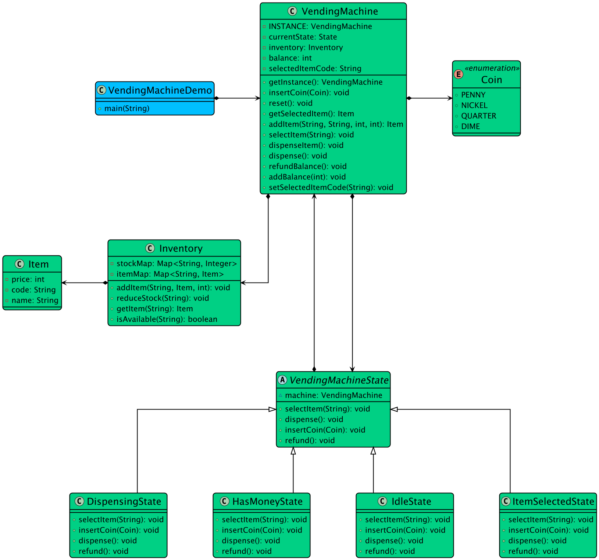
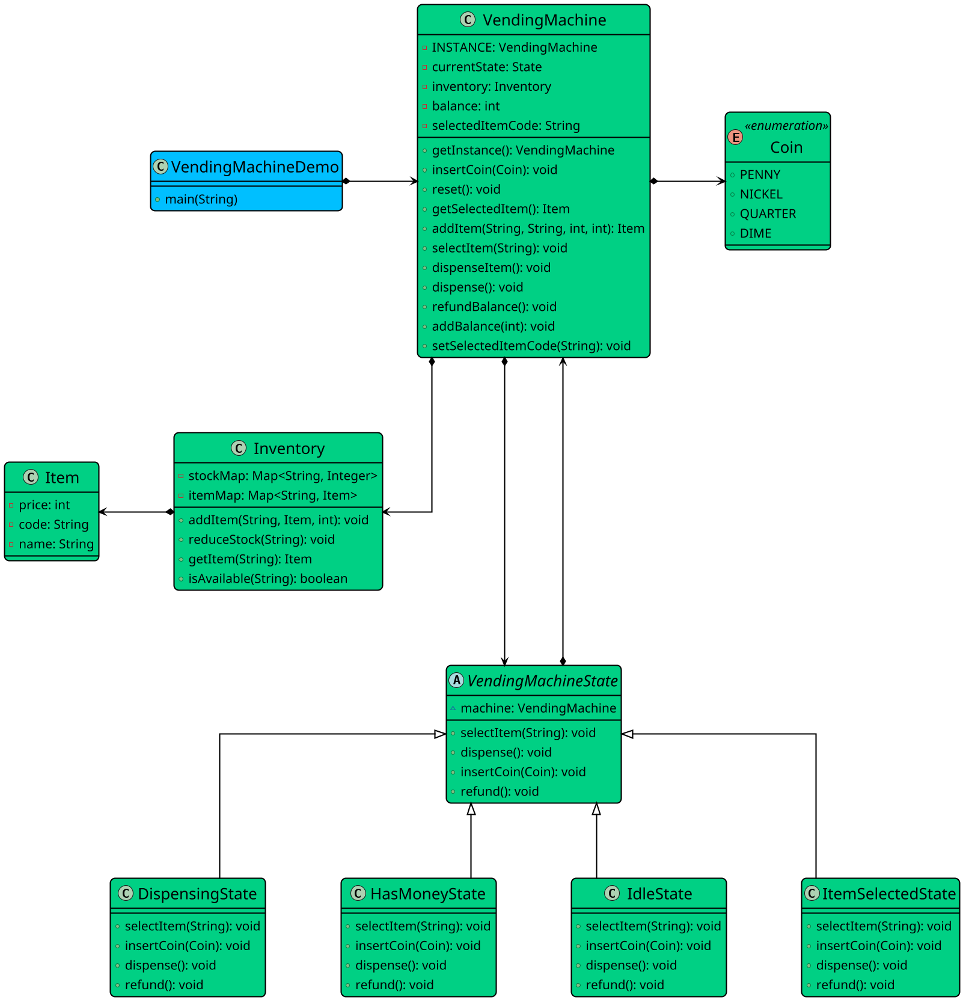

# Low-level design problem: vending machine

> Copied from <https://github.com/ashishps1/awesome-low-level-design/blob/main/problems/vending-machine.md> (GPL-3.0, by Ashish Pratap Singh). Questions and answers are the source's own; nothing was answered or rewritten here.


# Designing a Vending Machine

## Requirements
1. The vending machine should support multiple products with different prices and quantities.
1. The machine should accept coins and notes of different denominations.
1. The machine should dispense the selected product and return change if necessary.
1. The machine should keep track of the available products and their quantities.
1. The machine should handle multiple transactions concurrently and ensure data consistency.
1. The machine should provide an interface for restocking products and collecting money.
1. The machine should handle exceptional scenarios, such as insufficient funds or out-of-stock products.

## UML Class Diagram



## Implementations
#### [Java Implementation](https://github.com/ashishps1/awesome-low-level-design/blob/main/solutions/java/src/vendingmachine) 
#### [Python Implementation](https://github.com/ashishps1/awesome-low-level-design/blob/main/solutions/python/vendingmachine)
#### [C++ Implementation](https://github.com/ashishps1/awesome-low-level-design/blob/main/solutions/cpp/vendingmachine)
#### [C# Implementation](https://github.com/ashishps1/awesome-low-level-design/blob/main/solutions/csharp/vendingmachine)
#### [Go Implementation](https://github.com/ashishps1/awesome-low-level-design/blob/main/solutions/golang/vending_machine)
#### [TypeScript Implementation](https://github.com/ashishps1/awesome-low-level-design/blob/main/solutions/typescript/src/VendingMachine)

## Classes, Interfaces and Enumerations
1. The **Product** class represents a product in the vending machine, with properties such as name and price.
2. The **Coin** and **Note** enums represent the different denominations of coins and notes accepted by the vending machine.
3. The **Inventory** class manages the available products and their quantities in the vending machine. It uses a concurrent hash map to ensure thread safety.
4. The **VendingMachineState** interface defines the behavior of the vending machine in different states, such as idle, ready, and dispense.
5. The **IdleState**, **ReadyState**, and **DispenseState** classes implement the VendingMachineState interface and define the specific behaviors for each state.
6. The **VendingMachine** class is the main class that represents the vending machine. It follows the Singleton pattern to ensure only one instance of the vending machine exists.
7. The VendingMachine class maintains the current state, selected product, total payment, and provides methods for state transitions and payment handling.
8. The **VendingMachineDemo** class demonstrates the usage of the vending machine by adding products to the inventory, selecting products, inserting coins and notes, dispensing products, and returning change.

---

## Official solutions from the repository

<details><summary><b>java</b> (12 files)</summary>


**README.md**

```md
# Vending Machine (LLD)

## Problem Statement

Design and implement a Vending Machine system that allows users to select products, insert coins/notes, dispense products, and return change. The system should manage inventory, handle payments, and use the State design pattern for its operations.

---

## Requirements

- **Product Management:** The system manages a catalog of products, each with a price and available quantity.
- **Inventory Management:** The system tracks the quantity of each item and prevents dispensing if out of stock.
- **Payment Handling:** The system accepts coins and notes, tracks total payment, and returns change if necessary.
- **State Management:** The system uses the State design pattern to manage its operational states (Idle, Ready, Dispense, ReturnChange).
- **User Interaction:** Users can select products, insert coins/notes, and receive products and change.
- **Extensibility:** Easy to add new item types, payment methods, or states.

---

## Core Entities

- **VendingMachine:** Main class that manages inventory, vendingMachineState transitions, item selection, and payment.
- **Product:** Represents a item with a name and price.
- **Inventory:** Manages the stock of products.
- **Coin / Note:** Represents accepted denominations for payment.
- **VendingMachineState (interface):** Interface for different machine states.
- **IdleState, ReadyState, DispenseState, ReturnChangeState:** Concrete states implementing VendingMachineState.
- **Singleton Pattern:** VendingMachine is implemented as a singleton.

---

## Class Design

## UML Class Diagram


### 1. VendingMachine
- **Fields:** Inventory inventory, VendingMachineState idleState, readyState, dispenseState, returnChangeState, currentState, Product selectedProduct, double totalPayment
- **Methods:** addProduct(String, double, int), selectProduct(Product), insertCoin(Coin), insertNote(Note), dispenseProduct(), returnChange(), setState(VendingMachineState), getInstance(), etc.

### 2. Product
- **Fields:** String name, double price

### 3. Inventory
- **Fields:** Map<Product, Integer> productQuantities
- **Methods:** addProduct(Product, int), getQuantity(Product), reduceQuantity(Product), isAvailable(Product)

### 4. Coin / Note
- **Fields:** double value
- **Methods:** getValue()

### 5. VendingMachineState (interface)
- **Methods:** selectProduct(Product), insertCoin(Coin), insertNote(Note), dispenseProduct(), returnChange()

### 6. IdleState, ReadyState, DispenseState, ReturnChangeState
- **Implements:** VendingMachineState
- **Behavior:** Each vendingMachineState handles allowed operations and transitions.

---

## Example Usage

```java
VendingMachine machine = VendingMachine.getInstance();
Product chips = machine.addProduct("Chips", 1.5, 10);
machine.selectProduct(chips);
machine.insertCoin(new Coin(1.0));
machine.insertCoin(new Coin(0.5));
machine.dispenseProduct();
machine.returnChange();
```

---

## Demo

See your main or demo class for a sample usage and simulation of the vending machine.

---

## Extending the Framework

- **Add new payment methods:** Support for cards, mobile payments, etc.
- **Add new states:** Maintenance, OutOfOrder, etc.
- **Add item categories:** Snacks, drinks, etc.

---

## Design Patterns Used

- **State Pattern:** For managing machine states and transitions.
- **Singleton Pattern:** For ensuring a single instance of the VendingMachine.

---
```


**VendingMachine.java**

```java
package vendingmachine;

import vendingmachine.entity.Inventory;
import vendingmachine.entity.Item;
import vendingmachine.enums.Coin;
import vendingmachine.state.*;

public class VendingMachine {
    private final static VendingMachine INSTANCE = new VendingMachine();
    private final Inventory inventory = new Inventory();
    private VendingMachineState currentVendingMachineState;
    private int balance = 0;
    private String selectedItemCode;

    public VendingMachine() {
        currentVendingMachineState = new IdleState(this);
    }

    public static VendingMachine getInstance() {
        return INSTANCE;
    }

    public void insertCoin(Coin coin) {
        currentVendingMachineState.insertCoin(coin);
    }

    public Item addItem(String code, String name, int price, int quantity) {
        Item item = new Item(code, name, price);
        inventory.addItem(code, item, quantity);
        return item;
    }

    public void selectItem(String code) {
        currentVendingMachineState.selectItem(code);
    }

    public void dispense() {
        currentVendingMachineState.dispense();
    }

    public void dispenseItem() {
        Item item = inventory.getItem(selectedItemCode);
        if (balance >= item.getPrice()) {
            inventory.reduceStock(selectedItemCode);
            balance -= item.getPrice();
            System.out.println("Dispensed: " + item.getName());
            if (balance > 0) {
                System.out.println("Returning change: " + balance);
            }
        }
        reset();
        setState(new IdleState(this));
    }

    public void refundBalance() {
        System.out.println("Refunding: " + balance);
        balance = 0;
    }

    public void reset() {
        selectedItemCode = null;
        balance = 0;
    }

    public void addBalance(int value) {
        balance += value;
    }

    public Item getSelectedItem() {
        return inventory.getItem(selectedItemCode);
    }

    public void setSelectedItemCode(String code) {
        this.selectedItemCode = code;
    }

    public void setState(VendingMachineState vendingMachineState) {
        this.currentVendingMachineState = vendingMachineState;
    }

    // Getters for states and inventory
    public Inventory getInventory() { return inventory; }
    public int getBalance() { return balance; }
}
```


**VendingMachineDemo.java**

```java
package vendingmachine;

import vendingmachine.enums.Coin;

public class VendingMachineDemo {
    public static void main(String[] args) {
        VendingMachine vendingMachine = VendingMachine.getInstance();

        // Add products to the inventory
        vendingMachine.addItem("A1", "Coke", 25, 3);
        vendingMachine.addItem("A2", "Pepsi", 25, 2);
        vendingMachine.addItem("B1", "Water", 10, 5);

        // Select a product
        System.out.println("\n--- Step 1: Select an item ---");
        vendingMachine.selectItem("A1");

        // Insert coins
        System.out.println("\n--- Step 2: Insert coins ---");
        vendingMachine.insertCoin(Coin.DIME); // 10
        vendingMachine.insertCoin(Coin.DIME); // 10
        vendingMachine.insertCoin(Coin.NICKEL); // 5

        // Dispense the product
        System.out.println("\n--- Step 3: Dispense item ---");
        vendingMachine.dispense(); // Should dispense Coke

        // Select another item
        System.out.println("\n--- Step 4: Select another item ---");
        vendingMachine.selectItem("B1");

        // Insert more amount
        System.out.println("\n--- Step 5: Insert more than needed ---");
        vendingMachine.insertCoin(Coin.QUARTER); // 25

        // Try to dispense the product
        System.out.println("\n--- Step 6: Dispense and return change ---");
        vendingMachine.dispense();
    }
}
```


**diagrams/vendingmachine-class-diagram-light.puml**




**entity/Inventory.java**

```java
package vendingmachine.entity;

import java.util.HashMap;
import java.util.Map;

public class Inventory {
    private final Map<String, Item> itemMap = new HashMap<>();
    private final Map<String, Integer> stockMap = new HashMap<>();

    public void addItem(String code, Item item, int quantity) {
        itemMap.put(code, item);
        stockMap.put(code, quantity);
    }

    public Item getItem(String code) {
        return itemMap.get(code);
    }

    public boolean isAvailable(String code) {
        return stockMap.getOrDefault(code, 0) > 0;
    }

    public void reduceStock(String code) {
        stockMap.put(code, stockMap.get(code) - 1);
    }
}
```


**entity/Item.java**

```java
package vendingmachine.entity;

public class Item {
    private String code;
    private String name;
    private int price;

    public Item(String code, String name, int price) {
        this.code = code;
        this.name = name;
        this.price = price;
    }

    public String getName() {
        return name;
    }

    public int getPrice() {
        return price;
    }
}
```


**enums/Coin.java**

```java
package vendingmachine.enums;

public enum Coin {
    PENNY(1),
    NICKEL(5),
    DIME(10),
    QUARTER(25);

    private final int value;

    Coin(int value) {
        this.value = value;
    }

    public int getValue() {
        return value;
    }
}
```


**state/DispensingState.java**

```java
package vendingmachine.state;

import vendingmachine.enums.Coin;
import vendingmachine.VendingMachine;

public class DispensingState extends VendingMachineState {
    public DispensingState(VendingMachine machine) {
        super(machine);
    }

    @Override
    public void insertCoin(Coin coin) {
        System.out.println("Currently dispensing. Please wait.");
    }

    @Override
    public void selectItem(String code) {
        System.out.println("Currently dispensing. Please wait.");
    }

    @Override
    public void dispense() {
        // already triggered by HasMoneyState
    }

    @Override
    public void refund() {
        System.out.println("Dispensing in progress. Refund not allowed.");
    }
}
```


**state/HasMoneyState.java**

```java
package vendingmachine.state;

import vendingmachine.enums.Coin;
import vendingmachine.VendingMachine;

public class HasMoneyState extends VendingMachineState {
    public HasMoneyState(VendingMachine machine) {
        super(machine);
    }

    @Override
    public void insertCoin(Coin coin) {
        System.out.println("Already received full amount.");
    }

    @Override
    public void selectItem(String code) {
        System.out.println("Item already selected.");
    }

    @Override
    public void dispense() {
        machine.setState(new DispensingState(machine));
        machine.dispenseItem();
    }

    @Override
    public void refund() {
        machine.refundBalance();
        machine.reset();
        machine.setState(new IdleState(machine));
    }
}
```


**state/IdleState.java**

```java
package vendingmachine.state;

import vendingmachine.enums.Coin;
import vendingmachine.VendingMachine;

public class IdleState extends VendingMachineState {
    public IdleState(VendingMachine machine) {
        super(machine);
    }

    @Override
    public void insertCoin(Coin coin) {
        System.out.println("Please select an item before inserting money.");
    }

    @Override
    public void selectItem(String code) {
        if (!machine.getInventory().isAvailable(code)) {
            System.out.println("Item not available.");
            return;
        }
        machine.setSelectedItemCode(code);
        machine.setState(new ItemSelectedState(machine));
        System.out.println("Item selected: " + code);
    }

    @Override
    public void dispense() {
        System.out.println("No item selected.");
    }

    @Override
    public void refund() {
        System.out.println("No money to refund.");
    }
}
```


**state/ItemSelectedState.java**

```java
package vendingmachine.state;

import vendingmachine.enums.Coin;
import vendingmachine.VendingMachine;

public class ItemSelectedState extends VendingMachineState {
    public ItemSelectedState(VendingMachine machine) {
        super(machine);
    }

    @Override
    public void insertCoin(Coin coin) {
        machine.addBalance(coin.getValue());
        System.out.println("Coin Inserted: " + coin.getValue());
        int price = machine.getSelectedItem().getPrice();
        if (machine.getBalance() >= price) {
            System.out.println("Sufficient money received.");
            machine.setState(new HasMoneyState(machine));
        }
    }

    @Override
    public void selectItem(String code) {
        System.out.println("Item already selected.");
    }

    @Override
    public void dispense() {
        System.out.println("Please insert sufficient money.");
    }

    @Override
    public void refund() {
        machine.reset();
        machine.setState(new IdleState(machine));
    }
}
```


**state/VendingMachineState.java**

```java
package vendingmachine.state;

import vendingmachine.enums.Coin;
import vendingmachine.VendingMachine;

public abstract class VendingMachineState {
    VendingMachine machine;

    VendingMachineState(VendingMachine machine) {
        this.machine = machine;
    }

    public abstract void insertCoin(Coin coin);
    public abstract void selectItem(String code);
    public abstract void dispense();
    public abstract void refund();
}
```

</details>

<details><summary><b>python</b> (7 files)</summary>


**README.md**

```md
# Designing a Vending Machine

## Requirements
1. The vending machine should support multiple products with different prices and quantities.
1. The machine should accept coins and notes of different denominations.
1. The machine should dispense the selected product and return change if necessary.
1. The machine should keep track of the available products and their quantities.
1. The machine should handle multiple transactions concurrently and ensure data consistency.
1. The machine should provide an interface for restocking products and collecting money.
1. The machine should handle exceptional scenarios, such as insufficient funds or out-of-stock products.

## Classes, Interfaces and Enumerations
1. The **Product** class represents a product in the vending machine, with properties such as name and price.
2. The **Coin** and **Note** enums represent the different denominations of coins and notes accepted by the vending machine.
3. The **Inventory** class manages the available products and their quantities in the vending machine. It uses a concurrent hash map to ensure thread safety.
4. The **VendingMachineState** interface defines the behavior of the vending machine in different states, such as idle, ready, and dispense.
5. The **IdleState**, **ReadyState**, and **DispenseState** classes implement the VendingMachineState interface and define the specific behaviors for each state.
6. The **VendingMachine** class is the main class that represents the vending machine. It follows the Singleton pattern to ensure only one instance of the vending machine exists.
7. The VendingMachine class maintains the current state, selected product, total payment, and provides methods for state transitions and payment handling.
8. The **VendingMachineDemo** class demonstrates the usage of the vending machine by adding products to the inventory, selecting products, inserting coins and notes, dispensing products, and returning change.
```


**coin.py**

```py
from enum import Enum

class Coin(Enum):
    PENNY = 1
    NICKEL = 5
    DIME = 10
    QUARTER = 25

    def get_value(self) -> int:
        return self.value
```


**inventory.py**

```py
from typing import Dict, Optional
from item import Item

class Inventory:
    def __init__(self):
        self.item_map: Dict[str, Item] = {}
        self.stock_map: Dict[str, int] = {}

    def add_item(self, code: str, item: Item, quantity: int) -> None:
        self.item_map[code] = item
        self.stock_map[code] = quantity

    def get_item(self, code: str) -> Optional[Item]:
        return self.item_map.get(code)

    def is_available(self, code: str) -> bool:
        return self.stock_map.get(code, 0) > 0

    def reduce_stock(self, code: str) -> None:
        self.stock_map[code] = self.stock_map[code] - 1
```


**item.py**

```py
class Item:
    def __init__(self, code: str, name: str, price: int):
        self.code = code
        self.name = name
        self.price = price

    def get_name(self) -> str:
        return self.name

    def get_price(self) -> int:
        return self.price
```


**states.py**

```py
from abc import ABC, abstractmethod
from typing import TYPE_CHECKING
from coin import Coin

if TYPE_CHECKING:
    from .vending_machine import VendingMachine


class VendingMachineState(ABC):
    """Abstract base class for all vending machine states."""
    
    def __init__(self, machine: 'VendingMachine'):
        self.machine = machine
    
    @abstractmethod
    def insert_coin(self, coin: Coin):
        """Handle coin insertion."""
        pass
    
    @abstractmethod
    def select_item(self, code: str):
        """Handle item selection."""
        pass
    
    @abstractmethod
    def dispense(self):
        """Handle dispense request."""
        pass
    
    @abstractmethod
    def refund(self):
        """Handle refund request."""
        pass


class IdleState(VendingMachineState):
    """State when machine is waiting for user interaction."""
    
    def insert_coin(self, coin: Coin):
        print("Please select an item before inserting money.")
    
    def select_item(self, code: str):
        if not self.machine.get_inventory().is_available(code):
            print("Item not available.")
            return
        
        self.machine.set_selected_item_code(code)
        # Import here to avoid circular dependency
        from states import ItemSelectedState
        self.machine.set_state(ItemSelectedState(self.machine))
        print(f"Item selected: {code}")
    
    def dispense(self):
        print("No item selected.")
    
    def refund(self):
        print("No money to refund.")


class ItemSelectedState(VendingMachineState):
    """State when an item has been selected but insufficient money inserted."""
    
    def insert_coin(self, coin: Coin):
        self.machine.add_balance(coin.get_value())
        print(f"Coin inserted: {coin.get_value()}¢ ({coin.name})")
        
        selected_item = self.machine.get_selected_item()
        if selected_item and self.machine.get_balance() >= selected_item.get_price():
            print("Sufficient money received.")
            # Import here to avoid circular dependency
            from states import HasMoneyState
            self.machine.set_state(HasMoneyState(self.machine))
    
    def select_item(self, code: str):
        print("Item already selected. Please insert money or request refund to select a different item.")
    
    def dispense(self):
        print("Please insert sufficient money.")
    
    def refund(self):
        self.machine.refund_balance()
        self.machine.reset()
        # Import here to avoid circular dependency
        from states import IdleState
        self.machine.set_state(IdleState(self.machine))


class HasMoneyState(VendingMachineState):
    """State when sufficient money has been inserted."""
    
    def insert_coin(self, coin: Coin):
        # Allow more coins (will be returned as change)
        self.machine.add_balance(coin.get_value())
        print(f"Additional coin inserted: {coin.get_value()}¢ ({coin.name}) - will be returned as change.")
    
    def select_item(self, code: str):
        print("Item already selected. Please dispense or request refund to select a different item.")
    
    def dispense(self):
        # Import here to avoid circular dependency
        from states import DispensingState
        self.machine.set_state(DispensingState(self.machine))
        self.machine.dispense_item()
    
    def refund(self):
        self.machine.refund_balance()
        self.machine.reset()
        # Import here to avoid circular dependency
        from states import IdleState
        self.machine.set_state(IdleState(self.machine))


class DispensingState(VendingMachineState):
    """State when item is being dispensed - blocks all user input."""
    
    def insert_coin(self, coin: Coin):
        print("Currently dispensing. Please wait.")
    
    def select_item(self, code: str):
        print("Currently dispensing. Please wait.")
    
    def dispense(self):
        # Already triggered by HasMoneyState
        print("Dispensing in progress...")
    
    def refund(self):
        print("Dispensing in progress. Refund not allowed.")
```


**vending_machine.py**

```py
from inventory import Inventory
from coin import Coin
from item import Item
from states import VendingMachineState, IdleState

class VendingMachine:
    _instance = None

    def __new__(cls):
        if cls._instance is None:
            cls._instance = super(VendingMachine, cls).__new__(cls)
            cls._instance._initialized = False
        return cls._instance

    def __init__(self):
        if not hasattr(self, '_initialized') or not self._initialized:
            self.inventory = Inventory()
            self.current_state = IdleState(self)
            self.balance = 0
            self.selected_item_code = None
            self._initialized = True

    @classmethod
    def get_instance(cls):
        return cls()

    def insert_coin(self, coin: Coin) -> None:
        self.current_state.insert_coin(coin)

    def add_item(self, code: str, name: str, price: int, quantity: int) -> Item:
        item = Item(code, name, price)
        self.inventory.add_item(code, item, quantity)
        return item

    def select_item(self, code: str) -> None:
        self.current_state.select_item(code)

    def dispense(self) -> None:
        self.current_state.dispense()

    def dispense_item(self) -> None:
        item = self.inventory.get_item(self.selected_item_code)
        if self.balance >= item.get_price():
            self.inventory.reduce_stock(self.selected_item_code)
            self.balance -= item.get_price()
            print(f"Dispensed: {item.get_name()}")
            if self.balance > 0:
                print(f"Returning change: {self.balance}")
        self.reset()
        self.set_state(IdleState(self))

    def refund_balance(self) -> None:
        print(f"Refunding: {self.balance}")
        self.balance = 0

    def reset(self) -> None:
        self.selected_item_code = None
        self.balance = 0

    def add_balance(self, value: int) -> None:
        self.balance += value

    def get_selected_item(self) -> Item:
        return self.inventory.get_item(self.selected_item_code)

    def set_selected_item_code(self, code: str) -> None:
        self.selected_item_code = code

    def set_state(self, state: VendingMachineState) -> None:
        self.current_state = state

    # Getters for states and inventory
    def get_inventory(self) -> Inventory:
        return self.inventory

    def get_balance(self) -> int:
        return self.balance
```


**vending_machine_demo.py**

```py
from vending_machine import VendingMachine
from coin import Coin

class VendingMachineDemo:
    @staticmethod
    def main():
        vending_machine = VendingMachine.get_instance()

        # Add products to the inventory
        vending_machine.add_item("A1", "Coke", 25, 3)
        vending_machine.add_item("A2", "Pepsi", 25, 2)
        vending_machine.add_item("B1", "Water", 10, 5)

        # Select a product
        print("\n--- Step 1: Select an item ---")
        vending_machine.select_item("A1")

        # Insert coins
        print("\n--- Step 2: Insert coins ---")
        vending_machine.insert_coin(Coin.DIME)  # 10
        vending_machine.insert_coin(Coin.DIME)  # 10
        vending_machine.insert_coin(Coin.NICKEL)  # 5

        # Dispense the product
        print("\n--- Step 3: Dispense item ---")
        vending_machine.dispense()  # Should dispense Coke

        # Select another item
        print("\n--- Step 4: Select another item ---")
        vending_machine.select_item("B1")

        # Insert more amount
        print("\n--- Step 5: Insert more than needed ---")
        vending_machine.insert_coin(Coin.QUARTER)  # 25

        # Try to dispense the product
        print("\n--- Step 6: Dispense and return change ---")
        vending_machine.dispense()


if __name__ == "__main__":
    VendingMachineDemo.main()
```

</details>

<details><summary><b>cpp</b> (8 files)</summary>


**Product.cpp**

```cpp
#include "Product.hpp"
#include <iostream>
#include <iomanip>

Product::Product(std::string productId, std::string name, double price, int quantity)
    : productId(productId), name(name), price(price), quantity(quantity), available(true) {}

std::string Product::getProductId() const { return productId; }
std::string Product::getName() const { return name; }
double Product::getPrice() const { return price; }
int Product::getQuantity() const { return quantity; }
bool Product::isAvailable() const { return available && quantity > 0; }

void Product::setPrice(double price) {
    this->price = price;
}

void Product::setQuantity(int quantity) {
    this->quantity = quantity;
}

void Product::setAvailable(bool status) {
    available = status;
}

void Product::addQuantity(int amount) {
    quantity += amount;
}

bool Product::removeQuantity(int amount) {
    if (amount <= quantity) {
        quantity -= amount;
        return true;
    }
    return false;
}

void Product::displayInfo() const {
    std::cout << "Product: " << name << " (ID: " << productId << ")" << std::endl;
    std::cout << "Price: $" << std::fixed << std::setprecision(2) << price << std::endl;
    std::cout << "Quantity: " << quantity << std::endl;
    std::cout << "Status: " << (isAvailable() ? "Available" : "Not Available") << std::endl;
}
```


**Product.hpp**

```hpp
#ifndef PRODUCT_HPP
#define PRODUCT_HPP

#include <string>

class Product {
private:
    std::string productId;
    std::string name;
    double price;
    int quantity;
    bool available;

public:
    Product(std::string productId, std::string name, double price, int quantity = 0);
    
    std::string getProductId() const;
    std::string getName() const;
    double getPrice() const;
    int getQuantity() const;
    bool isAvailable() const;
    
    void setPrice(double price);
    void setQuantity(int quantity);
    void setAvailable(bool status);
    void addQuantity(int amount);
    bool removeQuantity(int amount);
    void displayInfo() const;
};

#endif
```


**README.md**

```md
# Designing a Vending Machine

## Requirements
1. The vending machine should support multiple products with different prices and quantities.
1. The machine should accept coins and notes of different denominations.
1. The machine should dispense the selected product and return change if necessary.
1. The machine should keep track of the available products and their quantities.
1. The machine should handle multiple transactions concurrently and ensure data consistency.
1. The machine should provide an interface for restocking products and collecting money.
1. The machine should handle exceptional scenarios, such as insufficient funds or out-of-stock products.

## Classes, Interfaces and Enumerations
1. The **Product** class represents a product in the vending machine, with properties such as name and price.
2. The **Coin** and **Note** enums represent the different denominations of coins and notes accepted by the vending machine.
3. The **Inventory** class manages the available products and their quantities in the vending machine. It uses a concurrent hash map to ensure thread safety.
4. The **VendingMachineState** interface defines the behavior of the vending machine in different states, such as idle, ready, and dispense.
5. The **IdleState**, **ReadyState**, and **DispenseState** classes implement the VendingMachineState interface and define the specific behaviors for each state.
6. The **VendingMachine** class is the main class that represents the vending machine. It follows the Singleton pattern to ensure only one instance of the vending machine exists.
7. The VendingMachine class maintains the current state, selected product, total payment, and provides methods for state transitions and payment handling.
8. The **VendingMachineDemo** class demonstrates the usage of the vending machine by adding products to the inventory, selecting products, inserting coins and notes, dispensing products, and returning change.
```


**Transaction.cpp**

```cpp
#include "Transaction.hpp"
#include <iostream>
#include <iomanip>

Transaction::Transaction(std::string transactionId, std::string productId, int quantity, double amount)
    : transactionId(transactionId), productId(productId), quantity(quantity), amount(amount),
      successful(false) {
    timestamp = std::time(nullptr);
}

std::string Transaction::getTransactionId() const { return transactionId; }
std::string Transaction::getProductId() const { return productId; }
int Transaction::getQuantity() const { return quantity; }
double Transaction::getAmount() const { return amount; }
std::time_t Transaction::getTimestamp() const { return timestamp; }
bool Transaction::isSuccessful() const { return successful; }

void Transaction::setSuccessful(bool status) {
    successful = status;
}

void Transaction::displayInfo() const {
    std::cout << "Transaction " << transactionId << ":" << std::endl;
    std::cout << "Product ID: " << productId << std::endl;
    std::cout << "Quantity: " << quantity << std::endl;
    std::cout << "Amount: $" << std::fixed << std::setprecision(2) << amount << std::endl;
    std::cout << "Status: " << (successful ? "Successful" : "Failed") << std::endl;
    std::cout << "Time: " << std::ctime(&timestamp);
}
```


**Transaction.hpp**

```hpp
#ifndef TRANSACTION_HPP
#define TRANSACTION_HPP

#include <string>
#include <ctime>

class Transaction {
private:
    std::string transactionId;
    std::string productId;
    int quantity;
    double amount;
    std::time_t timestamp;
    bool successful;

public:
    Transaction(std::string transactionId, std::string productId, int quantity, double amount);
    
    std::string getTransactionId() const;
    std::string getProductId() const;
    int getQuantity() const;
    double getAmount() const;
    std::time_t getTimestamp() const;
    bool isSuccessful() const;
    
    void setSuccessful(bool status);
    void displayInfo() const;
};

#endif
```


**VendingMachine.cpp**

```cpp
#include "VendingMachine.hpp"
#include <iostream>
#include <iomanip>
#include <algorithm>

VendingMachine::VendingMachine(std::string machineId)
    : machineId(machineId), cashBalance(0.0), operational(true),
      productIdCounter(1), transactionIdCounter(1) {}

VendingMachine::~VendingMachine() {
    for (auto product : products) delete product;
    for (auto transaction : transactions) delete transaction;
}

std::string VendingMachine::getMachineId() const { return machineId; }
double VendingMachine::getCashBalance() const { return cashBalance; }
bool VendingMachine::isOperational() const { return operational; }

Product* VendingMachine::addProduct(const std::string& name, double price, int quantity) {
    std::string productId = generateProductId();
    Product* product = new Product(productId, name, price, quantity);
    products.push_back(product);
    return product;
}

void VendingMachine::removeProduct(const std::string& productId) {
    auto it = std::find_if(products.begin(), products.end(),
        [productId](Product* product) { return product->getProductId() == productId; });
    
    if (it != products.end()) {
        delete *it;
        products.erase(it);
    }
}

bool VendingMachine::restockProduct(const std::string& productId, int quantity) {
    Product* product = findProduct(productId);
    if (!product) return false;
    
    product->addQuantity(quantity);
    return true;
}

bool VendingMachine::updatePrice(const std::string& productId, double price) {
    Product* product = findProduct(productId);
    if (!product) return false;
    
    product->setPrice(price);
    return true;
}

Transaction* VendingMachine::purchaseProduct(const std::string& productId, int quantity, double payment) {
    if (!operational) return nullptr;
    
    Product* product = findProduct(productId);
    if (!product || !product->isAvailable() || product->getQuantity()<quantity) return nullptr;
    
    double totalCost = product->getPrice() * quantity;
    if (payment < totalCost) return nullptr;
    
    std::string transactionId = generateTransactionId();
    Transaction* transaction = new Transaction(transactionId, productId, quantity, totalCost);
    
    if (product->removeQuantity(quantity)) {
        cashBalance += totalCost;
        transaction->setSuccessful(true);
        transactions.push_back(transaction);
        return transaction;
    }
    
    delete transaction;
    return nullptr;
}

void VendingMachine::addCash(double amount) {
    cashBalance += amount;
}

bool VendingMachine::withdrawCash(double amount) {
    if (amount <= cashBalance) {
        cashBalance -= amount;
        return true;
    }
    return false;
}

void VendingMachine::setOperational(bool status) {
    operational = status;
}

void VendingMachine::displayInventory() const {
    std::cout << "\nCurrent Inventory:" << std::endl;
    for (const auto& product : products) {
        product->displayInfo();
        std::cout << "------------------------" << std::endl;
    }
}

void VendingMachine::displayTransactions() const {
    std::cout << "\nTransaction History:" << std::endl;
    for (const auto& transaction : transactions) {
        transaction->displayInfo();
        std::cout << "------------------------" << std::endl;
    }
}

void VendingMachine::displayMachineInfo() const {
    std::cout << "\nVending Machine Info:" << std::endl;
    std::cout << "ID: " << machineId << std::endl;
    std::cout << "Status: " << (operational ? "Operational" : "Out of Service") << std::endl;
    std::cout << "Cash Balance: $" << std::fixed << std::setprecision(2) << cashBalance << std::endl;
    std::cout << "Products Available: " << products.size() << std::endl;
    std::cout << "Total Transactions: " << transactions.size() << std::endl;
}

Product* VendingMachine::findProduct(const std::string& productId) const {
    auto it = std::find_if(products.begin(), products.end(),
        [productId](Product* product) { return product->getProductId() == productId; });
    return it != products.end() ? *it : nullptr;
}

std::string VendingMachine::generateProductId() {
    return "P" + std::to_string(productIdCounter++);
}

std::string VendingMachine::generateTransactionId() {
    return "T" + std::to_string(transactionIdCounter++);
}
```


**VendingMachine.hpp**

```hpp
#ifndef VENDING_MACHINE_HPP
#define VENDING_MACHINE_HPP

#include <vector>
#include <string>
#include "Product.hpp"
#include "Transaction.hpp"

class VendingMachine {
private:
    std::string machineId;
    std::vector<Product*> products;
    std::vector<Transaction*> transactions;
    double cashBalance;
    bool operational;
    int productIdCounter;
    int transactionIdCounter;

public:
    VendingMachine(std::string machineId);
    ~VendingMachine();
    
    std::string getMachineId() const;
    double getCashBalance() const;
    bool isOperational() const;
    
    Product* addProduct(const std::string& name, double price, int quantity = 0);
    void removeProduct(const std::string& productId);
    bool restockProduct(const std::string& productId, int quantity);
    bool updatePrice(const std::string& productId, double price);
    Transaction* purchaseProduct(const std::string& productId, int quantity, double payment);
    void addCash(double amount);
    bool withdrawCash(double amount);
    void setOperational(bool status);
    
    void displayInventory() const;
    void displayTransactions() const;
    void displayMachineInfo() const;

private:
    Product* findProduct(const std::string& productId) const;
    std::string generateProductId();
    std::string generateTransactionId();
};

#endif
```


**VendingMachineDemo.cpp**

```cpp
#include "VendingMachine.hpp"
#include <iostream>

int main() {
    VendingMachine machine("VM001");
    
    // Add products
    Product* cola = machine.addProduct("Cola", 2.50, 10);
    Product* chips = machine.addProduct("Chips", 1.50, 15);
    Product* candy = machine.addProduct("Candy", 1.00, 20);
    
    // Display initial inventory
    std::cout << "Initial machine status:" << std::endl;
    machine.displayMachineInfo();
    machine.displayInventory();
    
    // Make some purchases
    std::cout << "\nMaking purchases..." << std::endl;
    Transaction* t1 = machine.purchaseProduct(cola->getProductId(), 2, 5.00);
    Transaction* t2 = machine.purchaseProduct(chips->getProductId(), 3, 5.00);
    
    // Display transactions
    machine.displayTransactions();
    
    // Restock a product
    std::cout << "\nRestocking Cola..." << std::endl;
    machine.restockProduct(cola->getProductId(), 5);
    
    // Update price
    std::cout << "\nUpdating Candy price..." << std::endl;
    machine.updatePrice(candy->getProductId(), 1.25);
    
    // Display final status
    std::cout << "\nFinal machine status:" << std::endl;
    machine.displayMachineInfo();
    machine.displayInventory();
    
    return 0;
}
```

</details>

<details><summary><b>golang</b> (8 files)</summary>


**README.md**

```md
# Designing a Vending Machine

## Requirements
1. The vending machine should support multiple products with different prices and quantities.
1. The machine should accept coins and notes of different denominations.
1. The machine should dispense the selected product and return change if necessary.
1. The machine should keep track of the available products and their quantities.
1. The machine should handle multiple transactions concurrently and ensure data consistency.
1. The machine should provide an interface for restocking products and collecting money.
1. The machine should handle exceptional scenarios, such as insufficient funds or out-of-stock products.

## Classes, Interfaces and Enumerations
1. The **Product** class represents a product in the vending machine, with properties such as name and price.
2. The **Coin** and **Note** enums represent the different denominations of coins and notes accepted by the vending machine.
3. The **Inventory** class manages the available products and their quantities in the vending machine. It uses a concurrent hash map to ensure thread safety.
4. The **VendingMachineState** interface defines the behavior of the vending machine in different states, such as idle, ready, and dispense.
5. The **IdleState**, **ReadyState**, and **DispenseState** classes implement the VendingMachineState interface and define the specific behaviors for each state.
6. The **VendingMachine** class is the main class that represents the vending machine. It follows the Singleton pattern to ensure only one instance of the vending machine exists.
7. The VendingMachine class maintains the current state, selected product, total payment, and provides methods for state transitions and payment handling.
8. The **VendingMachineDemo** class demonstrates the usage of the vending machine by adding products to the inventory, selecting products, inserting coins and notes, dispensing products, and returning change.
```


**coin.go**

```go
package vending_machine

type Coin float64

const (
	PENNY   Coin = 0.01
	NICKEL  Coin = 0.05
	DIME    Coin = 0.10
	QUARTER Coin = 0.25
)
```


**inventory.go**

```go
package vending_machine

type Inventory struct {
	products map[*Product]int
}

func NewInventory() *Inventory {
	return &Inventory{products: make(map[*Product]int)}
}

func (inv *Inventory) AddProduct(product *Product, quantity int) {
	inv.products[product] = quantity
}

func (inv *Inventory) IsAvailable(product *Product) bool {
	qty, exists := inv.products[product]
	return exists && qty > 0
}
```


**note.go**

```go
package vending_machine

type Note int

const (
	ONE    Note = 1
	FIVE   Note = 5
	TEN    Note = 10
	TWENTY Note = 20
)
```


**product.go**

```go
package vending_machine

type Product struct {
	name  string
	price float64
}

func NewProduct(name string, price float64) *Product {
	return &Product{name: name, price: price}
}
```


**state.go**

```go
package vending_machine

import "fmt"

type VendingMachineState interface {
	SelectProduct(product *Product)
	InsertCoin(coin Coin)
	InsertNote(note Note)
	DispenseProduct()
	ReturnChange()
}

// IdleState struct
type IdleState struct {
	vendingMachine *VendingMachine
}

func (s *IdleState) SelectProduct(product *Product) {
	if s.vendingMachine.inventory.IsAvailable(product) {
		s.vendingMachine.selectedProduct = product
		s.vendingMachine.SetState(s.vendingMachine.readyState)
		fmt.Println("Product selected:", product.name)
	} else {
		fmt.Println("Product not available:", product.name)
	}
}

func (s *IdleState) InsertCoin(coin Coin) { fmt.Println("Please select a product first.") }
func (s *IdleState) InsertNote(note Note) { fmt.Println("Please select a product first.") }
func (s *IdleState) DispenseProduct()     { fmt.Println("Please select a product and make payment.") }
func (s *IdleState) ReturnChange()        { fmt.Println("No change to return.") }

// ReadyState struct
type ReadyState struct {
	vendingMachine *VendingMachine
}

func (s *ReadyState) SelectProduct(product *Product) {
	fmt.Println("Product already selected. Please make payment.")
}

func (s *ReadyState) InsertCoin(coin Coin) {
	s.vendingMachine.totalPayment += float64(coin)
	fmt.Println("Coin inserted:", coin)
	s.checkPaymentStatus()
}

func (s *ReadyState) InsertNote(note Note) {
	s.vendingMachine.totalPayment += float64(note)
	fmt.Println("Note inserted:", note)
	s.checkPaymentStatus()
}

func (s *ReadyState) DispenseProduct() { fmt.Println("Please make payment first.") }
func (s *ReadyState) ReturnChange() {
	change := s.vendingMachine.totalPayment - s.vendingMachine.selectedProduct.price
	if change > 0 {
		fmt.Printf("Change returned: $%.2f\n", change)
		s.vendingMachine.ResetPayment()
	} else {
		fmt.Println("No change to return.")
	}
	s.vendingMachine.SetState(s.vendingMachine.idleState)
}

func (s *ReadyState) checkPaymentStatus() {
	if s.vendingMachine.totalPayment >= s.vendingMachine.selectedProduct.price {
		s.vendingMachine.SetState(s.vendingMachine.dispenseState)
	}
}

// DispenseState struct
type DispenseState struct {
	vendingMachine *VendingMachine
}

func (s *DispenseState) SelectProduct(product *Product) { fmt.Println("Product already selected.") }
func (s *DispenseState) InsertCoin(coin Coin)           { fmt.Println("Please collect the product.") }
func (s *DispenseState) InsertNote(note Note)           { fmt.Println("Please collect the product.") }
func (s *DispenseState) DispenseProduct() {
	fmt.Println("Product dispensed:", s.vendingMachine.selectedProduct.name)
	s.vendingMachine.SetState(s.vendingMachine.returnChangeState)
}

func (s *DispenseState) ReturnChange() { fmt.Println("Please collect the product first.") }

// ReturnChangeState struct
type ReturnChangeState struct {
	vendingMachine *VendingMachine
}

func (s *ReturnChangeState) SelectProduct(product *Product) {
	fmt.Println("Please collect the change first.")
}
func (s *ReturnChangeState) InsertCoin(coin Coin) { fmt.Println("Please collect the change first.") }
func (s *ReturnChangeState) InsertNote(note Note) { fmt.Println("Please collect the change first.") }
func (s *ReturnChangeState) DispenseProduct() {
	fmt.Println("Product already dispensed. Please collect the change.")
}
func (s *ReturnChangeState) ReturnChange() {
	change := s.vendingMachine.totalPayment - s.vendingMachine.selectedProduct.price
	if change > 0 {
		fmt.Printf("Change returned: $%.2f\n", change)
		s.vendingMachine.ResetPayment()
	} else {
		fmt.Println("No change to return.")
	}
	s.vendingMachine.ResetSelectedProduct()
	s.vendingMachine.SetState(s.vendingMachine.idleState)
}
```


**vending_machine.go**

```go
package vending_machine

type VendingMachine struct {
	inventory         *Inventory
	idleState         VendingMachineState
	readyState        VendingMachineState
	dispenseState     VendingMachineState
	returnChangeState VendingMachineState
	currentState      VendingMachineState
	selectedProduct   *Product
	totalPayment      float64
}

func NewVendingMachine() *VendingMachine {
	vm := &VendingMachine{
		inventory: NewInventory(),
	}
	vm.idleState = &IdleState{vm}
	vm.readyState = &ReadyState{vm}
	vm.dispenseState = &DispenseState{vm}
	vm.returnChangeState = &ReturnChangeState{vm}
	vm.currentState = vm.idleState
	return vm
}

func (vm *VendingMachine) SelectProduct(product *Product) {
	vm.currentState.SelectProduct(product)
}

func (vm *VendingMachine) InsertCoin(coin Coin) {
	vm.currentState.InsertCoin(coin)
}

func (vm *VendingMachine) InsertNote(note Note) {
	vm.currentState.InsertNote(note)
}

func (vm *VendingMachine) DispenseProduct() {
	vm.currentState.DispenseProduct()
}

func (vm *VendingMachine) ReturnChange() {
	vm.currentState.ReturnChange()
}

func (vm *VendingMachine) SetState(state VendingMachineState) {
	vm.currentState = state
}

func (vm *VendingMachine) ResetPayment() {
	vm.totalPayment = 0
}

func (vm *VendingMachine) ResetSelectedProduct() {
	vm.selectedProduct = nil
}
```


**vending_machine_demo.go**

```go
package vending_machine

import "fmt"

// Run demonstrates the Vending Machine functionality.
func Run() {
	// Initialize the vending machine
	vm := NewVendingMachine()

	// Create some products
	coke := NewProduct("Coke", 1.5)
	pepsi := NewProduct("Pepsi", 1.5)
	water := NewProduct("Water", 1.0)

	// Add products to the inventory
	vm.inventory.AddProduct(coke, 5)
	vm.inventory.AddProduct(pepsi, 3)
	vm.inventory.AddProduct(water, 2)

	// Demonstrate a transaction
	fmt.Println("Starting Vending Machine Demo")

	fmt.Println("\nSelecting Coke")
	vm.SelectProduct(coke)

	fmt.Println("Inserting coins")
	vm.InsertCoin(QUARTER)
	vm.InsertCoin(QUARTER)
	vm.InsertCoin(QUARTER)
	vm.InsertCoin(QUARTER)

	fmt.Println("Dispensing product")
	vm.DispenseProduct()

	fmt.Println("Returning change")
	vm.ReturnChange()

	// Another example with insufficient funds
	fmt.Println("\nSelecting Pepsi with insufficient funds")
	vm.SelectProduct(pepsi)
	vm.InsertCoin(QUARTER)

	fmt.Println("Trying to dispense Pepsi")
	vm.DispenseProduct()

	fmt.Println("Adding more coins for Pepsi")
	vm.InsertCoin(QUARTER)
	vm.InsertCoin(QUARTER)
	vm.InsertCoin(QUARTER)
	vm.InsertCoin(QUARTER)

	fmt.Println("Dispensing product")
	vm.DispenseProduct()

	fmt.Println("Returning change")
	vm.ReturnChange()
}
```

</details>

<details><summary><b>csharp</b> (12 files)</summary>


**Enum/Coin.cs**

```cs
enum Coin
{
    PENNY = 1,
    NICKEL = 5,
    DIME = 10,
    QUARTER = 25
}
```


**Models/Inventory.cs**

```cs
class Inventory
{
    private readonly Dictionary<string, Item> itemMap = new Dictionary<string, Item>();
    private readonly Dictionary<string, int> stockMap = new Dictionary<string, int>();

    public void AddItem(string code, Item item, int quantity)
    {
        itemMap[code] = item;
        stockMap[code] = quantity;
    }

    public Item GetItem(string code)
    {
        return itemMap.GetValueOrDefault(code);
    }

    public bool IsAvailable(string code)
    {
        return stockMap.GetValueOrDefault(code, 0) > 0;
    }

    public void ReduceStock(string code)
    {
        if (stockMap.ContainsKey(code))
        {
            stockMap[code] = stockMap[code] - 1;
        }
    }
}
```


**Models/Item.cs**

```cs
class Item
{
    private string code;
    private string name;
    private int price;

    public Item(string code, string name, int price)
    {
        this.code = code;
        this.name = name;
        this.price = price;
    }

    public string GetName()
    {
        return name;
    }

    public int GetPrice()
    {
        return price;
    }
}
```


**README.md**

```md
# Designing a Vending Machine

## Requirements
1. The vending machine should support multiple products with different prices and quantities.
1. The machine should accept coins and notes of different denominations.
1. The machine should dispense the selected product and return change if necessary.
1. The machine should keep track of the available products and their quantities.
1. The machine should handle multiple transactions concurrently and ensure data consistency.
1. The machine should provide an interface for restocking products and collecting money.
1. The machine should handle exceptional scenarios, such as insufficient funds or out-of-stock products.

## Classes, Interfaces and Enumerations
1. The **Product** class represents a product in the vending machine, with properties such as name and price.
2. The **Coin** and **Note** enums represent the different denominations of coins and notes accepted by the vending machine.
3. The **Inventory** class manages the available products and their quantities in the vending machine. It uses a concurrent hash map to ensure thread safety.
4. The **VendingMachineState** interface defines the behavior of the vending machine in different states, such as idle, ready, and dispense.
5. The **IdleState**, **ReadyState**, and **DispenseState** classes implement the VendingMachineState interface and define the specific behaviors for each state.
6. The **VendingMachine** class is the main class that represents the vending machine. It follows the Singleton pattern to ensure only one instance of the vending machine exists.
7. The VendingMachine class maintains the current state, selected product, total payment, and provides methods for state transitions and payment handling.
8. The **VendingMachineDemo** class demonstrates the usage of the vending machine by adding products to the inventory, selecting products, inserting coins and notes, dispensing products, and returning change.
```


**States/DispensingState.cs**

```cs
class DispensingState : VendingMachineState
{
    public DispensingState(VendingMachine machine) : base(machine)
    {
    }

    public override void InsertCoin(Coin coin)
    {
        Console.WriteLine("Currently dispensing. Please wait.");
    }

    public override void SelectItem(string code)
    {
        Console.WriteLine("Currently dispensing. Please wait.");
    }

    public override void Dispense()
    {
        // already triggered by HasMoneyState
    }

    public override void Refund()
    {
        Console.WriteLine("Dispensing in progress. Refund not allowed.");
    }
}
```


**States/HasMoneyState.cs**

```cs
class HasMoneyState : VendingMachineState
{
    public HasMoneyState(VendingMachine machine) : base(machine)
    {
    }

    public override void InsertCoin(Coin coin)
    {
        Console.WriteLine("Already received full amount.");
    }

    public override void SelectItem(string code)
    {
        Console.WriteLine("Item already selected.");
    }

    public override void Dispense()
    {
        machine.SetState(new DispensingState(machine));
        machine.DispenseItem();
    }

    public override void Refund()
    {
        machine.RefundBalance();
        machine.Reset();
        machine.SetState(new IdleState(machine));
    }
}
```


**States/IdleState.cs**

```cs
class IdleState : VendingMachineState
{
    public IdleState(VendingMachine machine) : base(machine)
    {
    }

    public override void InsertCoin(Coin coin)
    {
        Console.WriteLine("Please select an item before inserting money.");
    }

    public override void SelectItem(string code)
    {
        if (!machine.GetInventory().IsAvailable(code))
        {
            Console.WriteLine("Item not available.");
            return;
        }
        machine.SetSelectedItemCode(code);
        machine.SetState(new ItemSelectedState(machine));
        Console.WriteLine("Item selected: " + code);
    }

    public override void Dispense()
    {
        Console.WriteLine("No item selected.");
    }

    public override void Refund()
    {
        Console.WriteLine("No money to refund.");
    }
}
```


**States/ItemSelectedState.cs**

```cs
class ItemSelectedState : VendingMachineState
{
    public ItemSelectedState(VendingMachine machine) : base(machine)
    {
    }

    public override void InsertCoin(Coin coin)
    {
        machine.AddBalance((int)coin);
        Console.WriteLine("Coin Inserted: " + (int)coin);
        int price = machine.GetSelectedItem().GetPrice();
        if (machine.GetBalance() >= price)
        {
            Console.WriteLine("Sufficient money received.");
            machine.SetState(new HasMoneyState(machine));
        }
    }

    public override void SelectItem(string code)
    {
        Console.WriteLine("Item already selected.");
    }

    public override void Dispense()
    {
        Console.WriteLine("Please insert sufficient money.");
    }

    public override void Refund()
    {
        machine.Reset();
        machine.SetState(new IdleState(machine));
    }
}
```


**States/VendingMachineState.cs**

```cs
abstract class VendingMachineState
{
    protected VendingMachine machine;

    public VendingMachineState(VendingMachine machine)
    {
        this.machine = machine;
    }

    public abstract void InsertCoin(Coin coin);
    public abstract void SelectItem(string code);
    public abstract void Dispense();
    public abstract void Refund();
}
```


**VendingMachine.cs**

```cs
class VendingMachine
{
    private static readonly VendingMachine INSTANCE = new VendingMachine();
    private readonly Inventory inventory = new Inventory();
    private VendingMachineState currentState;
    private int balance = 0;
    private string selectedItemCode;

    public VendingMachine()
    {
        currentState = new IdleState(this);
    }

    public static VendingMachine GetInstance()
    {
        return INSTANCE;
    }

    public void InsertCoin(Coin coin)
    {
        currentState.InsertCoin(coin);
    }

    public Item AddItem(string code, string name, int price, int quantity)
    {
        Item item = new Item(code, name, price);
        inventory.AddItem(code, item, quantity);
        return item;
    }

    public void SelectItem(string code)
    {
        currentState.SelectItem(code);
    }

    public void Dispense()
    {
        currentState.Dispense();
    }

    public void DispenseItem()
    {
        Item item = inventory.GetItem(selectedItemCode);
        if (balance >= item.GetPrice())
        {
            inventory.ReduceStock(selectedItemCode);
            balance -= item.GetPrice();
            Console.WriteLine("Dispensed: " + item.GetName());
            if (balance > 0)
            {
                Console.WriteLine("Returning change: " + balance);
            }
        }
        Reset();
        SetState(new IdleState(this));
    }

    public void RefundBalance()
    {
        Console.WriteLine("Refunding: " + balance);
        balance = 0;
    }

    public void Reset()
    {
        selectedItemCode = null;
        balance = 0;
    }

    public void AddBalance(int value)
    {
        balance += value;
    }

    public Item GetSelectedItem()
    {
        return inventory.GetItem(selectedItemCode);
    }

    public void SetSelectedItemCode(string code)
    {
        this.selectedItemCode = code;
    }

    public void SetState(VendingMachineState state)
    {
        this.currentState = state;
    }

    public Inventory GetInventory() { return inventory; }
    public int GetBalance() { return balance; }
}
```


**VendingMachineDemo.cs**

```cs
using System;
using System.Collections.Generic;

public class VendingMachineDemo
{
    public static void Main()
    {
        VendingMachine vendingMachine = VendingMachine.GetInstance();

        // Add products to the inventory
        vendingMachine.AddItem("A1", "Coke", 25, 3);
        vendingMachine.AddItem("A2", "Pepsi", 25, 2);
        vendingMachine.AddItem("B1", "Water", 10, 5);

        // Select a product
        Console.WriteLine("\n--- Step 1: Select an item ---");
        vendingMachine.SelectItem("A1");

        // Insert coins
        Console.WriteLine("\n--- Step 2: Insert coins ---");
        vendingMachine.InsertCoin(Coin.DIME); // 10
        vendingMachine.InsertCoin(Coin.DIME); // 10
        vendingMachine.InsertCoin(Coin.NICKEL); // 5

        // Dispense the product
        Console.WriteLine("\n--- Step 3: Dispense item ---");
        vendingMachine.Dispense(); // Should dispense Coke

        // Select another item
        Console.WriteLine("\n--- Step 4: Select another item ---");
        vendingMachine.SelectItem("B1");

        // Insert more amount
        Console.WriteLine("\n--- Step 5: Insert more than needed ---");
        vendingMachine.InsertCoin(Coin.QUARTER); // 25

        // Try to dispense the product
        Console.WriteLine("\n--- Step 6: Dispense and return change ---");
        vendingMachine.Dispense();
    }
}
```


**vendingmachine.csproj**

```csproj
<Project Sdk="Microsoft.NET.Sdk">

  <PropertyGroup>
    <OutputType>Exe</OutputType>
    <TargetFramework>net8.0</TargetFramework>
    <ImplicitUsings>enable</ImplicitUsings>
    <Nullable>enable</Nullable>
  </PropertyGroup>

</Project>
```

</details>

<details><summary><b>typescript</b> (11 files)</summary>


**Coin.ts**

```ts
export enum Coin {
  PENNY = 1,
  NICKEL = 5,
  DIME = 10,
  QUARTER = 25,
}
```


**Inventory.ts**

```ts
import Item from "./Item";

export default class Inventory {
  private itemMap: Map<string, Item>;
  private stockMap: Map<string, number>;

  constructor() {
    this.itemMap = new Map();
    this.stockMap = new Map();
  }

  addItem(code: string, item: Item, quantity: number) {
    this.itemMap.set(code, item);
    this.stockMap.set(code, quantity);
  }

  getItem(code: string) {
    return this.itemMap.get(code);
  }

  isAvailable(code: string) {
    return (this.stockMap.get(code) ?? 0) > 0;
  }

  reduceStock(code: string) {
    const stock = this.stockMap.get(code);
    if (!stock || stock == 0) throw new Error("No Stock");

    this.stockMap.set(code, stock - 1);
  }
}
```


**Item.ts**

```ts
export default class Item {
  private code: string;
  private name: string;
  private price: number;

  constructor(code: string, name: string, price: number) {
    this.code = code;
    this.name = name;
    this.price = price;
  }

  getName() {
    return this.name;
  }

  getPrice() {
    return this.price;
  }
}
```


**README.md**

```md
# Vending Machine (LLD)

## Problem Statement

Design and implement a Vending Machine system that allows users to select products, insert coins/notes, dispense products, and return change. The system should manage inventory, handle payments, and use the State design pattern for its operations.

---

## Requirements

- **Product Management:** The system manages a catalog of products, each with a price and available quantity.
- **Inventory Management:** The system tracks the quantity of each item and prevents dispensing if out of stock.
- **Payment Handling:** The system accepts coins and notes, tracks total payment, and returns change if necessary.
- **State Management:** The system uses the State design pattern to manage its operational states (Idle, Ready, Dispense, ReturnChange).
- **User Interaction:** Users can select products, insert coins/notes, and receive products and change.
- **Extensibility:** Easy to add new item types, payment methods, or states.

---

## Core Entities

- **VendingMachine:** Main class that manages inventory, state transitions, item selection, and payment.
- **Product:** Represents a item with a name and price.
- **Inventory:** Manages the stock of products.
- **Coin / Note:** Represents accepted denominations for payment.
- **VendingMachineState (interface):** Interface for different machine states.
- **IdleState, ReadyState, DispenseState, ReturnChangeState:** Concrete states implementing VendingMachineState.
- **Singleton Pattern:** VendingMachine is implemented as a singleton.

---

## Class Design

### UML Class Diagram


### 1. VendingMachine
- **Fields:** Inventory inventory, VendingMachineState idleState, readyState, dispenseState, returnChangeState, currentState, Product selectedProduct, double totalPayment
- **Methods:** addProduct(String, double, int), selectProduct(Product), insertCoin(Coin), insertNote(Note), dispenseProduct(), returnChange(), setState(VendingMachineState), getInstance(), etc.

### 2. Product
- **Fields:** String name, double price

### 3. Inventory
- **Fields:** Map<Product, Integer> productQuantities
- **Methods:** addProduct(Product, int), getQuantity(Product), reduceQuantity(Product), isAvailable(Product)

### 4. Coin / Note
- **Fields:** double value
- **Methods:** getValue()

### 5. VendingMachineState (interface)
- **Methods:** selectProduct(Product), insertCoin(Coin), insertNote(Note), dispenseProduct(), returnChange()

### 6. IdleState, ReadyState, DispenseState, ReturnChangeState
- **Implements:** VendingMachineState
- **Behavior:** Each state handles allowed operations and transitions.

---

## Example Usage

```ts
const machine = VendingMachine.getInstance();
const chips = machine.addItem("A1","Chips", 15, 10);
machine.selectItem("A1");
machine.insertCoin(COIN.DIME);
machine.insertCoin(COIN.NICKEL);
machine.dispense();
```

---

## Demo

See `VendingMachineDemo` class for a sample usage and simulation of the vending machine.

---

## Extending the Framework

- **Add new payment methods:** Support for cards, mobile payments, etc.
- **Add new states:** Maintenance, OutOfOrder, etc.
- **Add item categories:** Snacks, drinks, etc.

---

## Design Patterns Used

- **State Pattern:** For managing machine states and transitions.
- **Singleton Pattern:** For ensuring a single instance of the VendingMachine.

---
```


**VendingMachine.ts**

```ts
import { Coin } from "./Coin";
import Inventory from "./Inventory";
import Item from "./Item";
import DispensingState from "./VendingMachineState/DispensingState";
import HasMoneyState from "./VendingMachineState/HasMoneyState";
import IdleState from "./VendingMachineState/IdleState";
import ItemSelectedState from "./VendingMachineState/ItemSelectedState";
import VendingMachineState from "./VendingMachineState/VendingMachineState";

export default class VendingMachine {
  private static instance: VendingMachine | null;

  private inventory: Inventory;
  private selectedItemCode: string | null;
  private balance: number;

  private currentState: VendingMachineState;
  private idleState: VendingMachineState;
  private itemSelectedState: VendingMachineState;
  private hasMoneyState: VendingMachineState;
  private dispensingState: VendingMachineState;

  private constructor() {
    this.inventory = new Inventory();
    this.idleState = new IdleState(this);
    this.itemSelectedState = new ItemSelectedState(this);
    this.hasMoneyState = new HasMoneyState(this);
    this.dispensingState = new DispensingState(this);
    this.currentState = this.idleState;
    this.balance = 0;
    this.selectedItemCode = null;
  }

  static getInstance() {
    if (VendingMachine.instance == null) {
      VendingMachine.instance = new VendingMachine();
    }
    return VendingMachine.instance;
  }

  insertCoin(coin: Coin) {
    this.currentState.insertCoin(coin);
  }

  addItem(code: string, name: string, price: number, quantity: number) {
    const item = new Item(code, name, price);
    this.inventory.addItem(code, item, quantity);
    return item;
  }

  selectItem(code: string) {
    this.currentState.selectItem(code);
  }

  dispense() {
    this.currentState.dispense();
  }

  dispenseItem() {
    if (!this.selectedItemCode) {
      throw new Error("No Item Selected Yet");
    }

    const item = this.inventory.getItem(this.selectedItemCode);
    if (!item) {
      throw new Error("Item Not In Inventory");
    }

    if (this.balance >= item.getPrice()) {
      this.inventory.reduceStock(this.selectedItemCode);
      this.balance -= item.getPrice();
      console.log("Dispensed: " + item.getName());
      if (this.balance > 0) {
        console.log("Returning change: " + this.balance);
      }
    }
    this.resetToIdleState();
    this.setState(this.getIdleState());
  }

  refundBalance() {
    console.log("Refunding: " + this.balance);
    this.balance = 0;
  }

  resetToIdleState() {
    this.selectedItemCode = null;
    this.balance = 0;
  }

  addBalance(value: number) {
    this.balance += value;
  }

  //Getter, Setters
  getIdleState() {
    return this.idleState;
  }

  getItemSelectedState() {
    return this.itemSelectedState;
  }

  getHasMoneyState() {
    return this.hasMoneyState;
  }

  getDispensingState() {
    return this.dispensingState;
  }

  getInventory() {
    return this.inventory;
  }

  getSelectedItem() {
    if (!this.selectedItemCode) {
      throw new Error("No Item Selected Yet");
    }
    return this.inventory.getItem(this.selectedItemCode);
  }

  setSelectedItemCode(code: string) {
    this.selectedItemCode = code;
  }

  getBalance() {
    return this.balance;
  }

  setState(state: VendingMachineState) {
    this.currentState = state;
  }
}
```


**VendingMachineDemo.ts**

```ts
import { Coin } from "./Coin";
import VendingMachine from "./VendingMachine";

export default class VendingMachineDemo{
  static run(){
    const vendingMachine = VendingMachine.getInstance();

    // Add products to the inventory
    vendingMachine.addItem("A1", "Coke", 25, 3);
    vendingMachine.addItem("A2", "Pepsi", 25, 2);
    vendingMachine.addItem("B1", "Water", 10, 5);

    // Select a product
    console.log("\n--- Step 1: Select an item ---");
    vendingMachine.selectItem("A1");

    // Insert coins
    console.log("\n--- Step 2: Insert coins ---");
    vendingMachine.insertCoin(Coin.DIME); // 10
    vendingMachine.insertCoin(Coin.DIME); // 10
    vendingMachine.insertCoin(Coin.NICKEL); // 5

    // Dispense the product
    console.log("\n--- Step 3: Dispense item ---");
    vendingMachine.dispense(); // Should dispense Coke

    // Select another item
    console.log("\n--- Step 4: Select another item ---");
    vendingMachine.selectItem("B1");

    // Insert more amount
    console.log("\n--- Step 5: Insert more than needed ---");
    vendingMachine.insertCoin(Coin.QUARTER); // 25

    // Try to dispense the product
    console.log("\n--- Step 6: Dispense and return change ---");
    vendingMachine.dispense();
  }
}
```


**VendingMachineState/DispensingState.ts**

```ts
import VendingMachine from "../VendingMachine";
import VendingMachineState from "./VendingMachineState";

export default class DispensingState implements VendingMachineState {
  private machine: VendingMachine;

  constructor(machine: VendingMachine) {
    this.machine = machine;
  }

  insertCoin(): void {
    console.log("Currently dispensing. Please wait.");
  }

  selectItem() {
    console.log("Currently dispensing. Please wait.");
  }

  dispense() {
    // already triggered by HasMoneyState
  }

  refund() {
    console.log("Dispensing in progress. Refund not allowed.");
  }
}
```


**VendingMachineState/HasMoneyState.ts**

```ts
import VendingMachine from "../VendingMachine";
import VendingMachineState from "./VendingMachineState";

export default class HasMoneyState implements VendingMachineState {
  private machine: VendingMachine;

  constructor(machine: VendingMachine) {
    this.machine = machine;
  }

  insertCoin() {
    console.log("Already received full amount.");
  }

  selectItem() {
    console.log("Item already selected.");
  }

  dispense() {
    this.machine.setState(this.machine.getDispensingState());
    this.machine.dispenseItem();
  }

  refund() {
    this.machine.refundBalance();
    this.machine.resetToIdleState();
    this.machine.setState(this.machine.getIdleState());
  }
}
```


**VendingMachineState/IdleState.ts**

```ts
import VendingMachine from "../VendingMachine";
import VendingMachineState from "./VendingMachineState";

export default class IdleState implements VendingMachineState {
  private machine: VendingMachine;

  constructor(machine: VendingMachine) {
    this.machine = machine;
  }

  selectItem(code: string): void {
    if (!this.machine.getInventory().isAvailable(code)) {
      console.log("Item not available.");
      return;
    }

    this.machine.setSelectedItemCode(code);
    this.machine.setState(this.machine.getItemSelectedState());
    console.log("Item Selected = ", code);
  }

  insertCoin(): void {
    console.log("Please select the product first");
  }

  dispense(): void {
    console.log("Please select the product first");
  }

  refund(): void {
    console.log("Please select the product first");
  }
}
```


**VendingMachineState/ItemSelectedState.ts**

```ts
import { Coin } from "../Coin";
import VendingMachine from "../VendingMachine";
import VendingMachineState from "./VendingMachineState";

export default class ItemSelectedState implements VendingMachineState {
    private machine: VendingMachine;

    constructor(machine: VendingMachine) {
        this.machine = machine;
    }

    insertCoin(coin: Coin) {
        const price = this.machine.getSelectedItem()?.getPrice();
        if (!price) {
            throw new Error("Item Not Selected Yet.");
        }

        this.machine.addBalance(coin);
        console.log("Coin Inserted: " + coin);

        if (this.machine.getBalance() >= price) {
            console.log("Sufficient money received.");
            this.machine.setState(this.machine.getHasMoneyState());
        }
    }

    selectItem() {
        console.log("Item already selected.");
    }

    dispense() {
        console.log("Please insert sufficient money.");
    }

    refund() {
        this.machine.resetToIdleState();
        this.machine.setState(this.machine.getIdleState());
    }
}
```


**VendingMachineState/VendingMachineState.ts**

```ts
import { Coin } from "../Coin";

export default interface VendingMachineState {
  insertCoin(coin: Coin): void;
  selectItem(code: string): void;
  dispense(): void;
  refund(): void;
}
```

</details>
