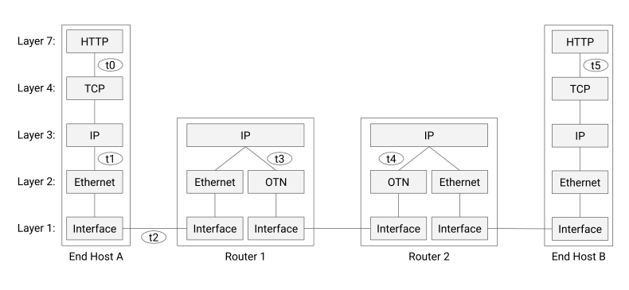
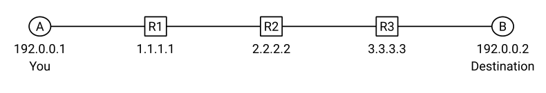
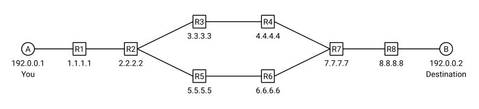

# Berkeley CS168 Spring 2025: Discussion 1: Questions

> Copied from the original: <https://sp25.cs168.io/>. Text and figures are taken from the PDF as is; nothing was answered or rewritten. The original PDF is in this folder.

---

**Page 1**

CS 168   Layers, Design, Traceroute 
Spring 2025 
&emsp;&emsp;&emsp;&emsp;&emsp;&emsp;&emsp;&emsp;Discussion 1

1   Internet Layers 
In this question, we’ll explore what headers are on the packet as it travels through different layers and 
protocols of the network. Consider the diagram below, which shows Host A sending a packet to Host B. 
Along the way, the packet is forwarded by intermediate routers R1 and R2. 
At each of the labeled time steps, fill in the boxes to describe which headers are attached to the payload. 
Not all boxes may be used. The headers at 𝑡= 2 are filled in for you as an example.

t0   Payload

t1   Payload

t2   Ethernet   IP   TCP   HTTP   Payload

t3   Payload

t4   Payload

t5   Payload

&emsp;&emsp;&emsp;&emsp;&emsp;&emsp;&emsp;&emsp;1

---

**Page 2**

2    Layers, Design, Traceroute 
2   Design Philosophy (Clark Paper) 
Today’s Internet architecture derives its core design principles from the ARPANET. The ARPANET was 
the first packet-switched network, developed by DARPA¹ in the 1970s and 1980s. 
The core design objectives of the ARPANET are described in the paper The design philosophy of the DARPA 
internet protocols (1988), by David Clark. Clark was a chief protocol architect for the Internet in the 1980s. 
Link to the paper: https://dl.acm.org/doi/10.1145/52325.52336 
According to the paper, the DARPA architecture has one fundamental goal, and several secondary goals: 
1\. Fundamental Goal: The Internet must offer an “effective” technique for multiplexed utilization of 
existing interconnected networks (e.g. autonomous systems). 
Specifically, the Internet should be a packet-switched communications facility that interconnects indi- 
vidual networks through packet switches called gateways, where such interconnection still preserves 
the individual networks as separately administrated, relatively autonomous entities. 
2\. Secondary Goal: Internet communication must continue despite loss of networks or gateways. 
3\. Secondary Goal: The Internet must support multiple types of communications service. 
4\. Secondary Goal: The Internet architecture must accommodate a variety of networks (e.g. autonomous 
systems). 
5\. Secondary Goal: The Internet architecture must permit distributed management of its resources. 
6\. Secondary Goal: The Internet architecture must be cost effective. 
7\. Secondary Goal: The Internet architecture must permit host attachment with a low level of effort. 
8\. Secondary Goal: The resources used in the Internet architecture must be accountable.

¹Defense Advanced Research Projects Agency

&emsp;&emsp;&emsp;&emsp;&emsp;&emsp;&emsp;&emsp;2

---

**Page 3**

&emsp;&emsp;&emsp;&emsp;&emsp;&emsp;&emsp;&emsp;Layers, Design, Traceroute    3

&emsp;For each of the following proposals, determine whether it is in violation of the goals listed above. If a 
&emsp;proposal is in violation, also indicate which of the above goals the proposal violates. 
&emsp;Also, for subparts 2.2 and 2.4, determine whether the proposals violate the end-to-end principle. 
&emsp;Note: This question is open-ended, and our answers are subjective and open to debate. 
2.1   The routers of all Internet carriers must accommodate circuit switching. 
&emsp;Recall circuit switching: End hosts can reserve capacity in the network in advance.

2.2   When forwarding packets, all routers must also perform additional communication to ensure that the 
&emsp;packet is received by the next router.

2.3   All Internet carriers must routinely advertise the state of their network to a centralized network 
&emsp;controller. Carriers must rely solely on the controller for commands to update their state.

2.4   Due to abnormal radio interference at the Berkeley lab (LBNL), routers on LBNL’s network must 
&emsp;implement reliable delivery when forwarding packets.

2.5   To improve connection stability, the routers of all Internet carriers can only update their state during a 
&emsp;two-hour window of each day.

2.6   The Amazon network devises a more efficient mechanism for load-balancing network traffic. All the 
&emsp;routers in Amazon’s network subscribe to Amazon’s in-house network controller for updating their state.

2.7   The Stanford network blocks packets that it suspects are coming from the UC Berkeley network.

&emsp;&emsp;&emsp;&emsp;&emsp;&emsp;&emsp;&emsp;3

---

**Page 4**

&emsp;4    Layers, Design, Traceroute 
&emsp;3   A Gentle Intro to Traceroute 
&emsp;Traceroute is a utility that attempts to discover the intermediate routers on the network path between 
&emsp;you and a given destination host. 
&emsp;This problem provides a basic walkthrough of traceroute, and shows how traceroute exploits the TTL field 
&emsp;in IP packets, and the ICMP protocol. 
3.1   IP Time-to-Live: Layer 3 (IP) packets have a header field called Time-to-Live (TTL). When a packet is 
&emsp;first sent out of an end host, its TTL field is initialized to a high number (e.g. 64). Every time a packet is 
&emsp;forwarded by an intermediate router to the next-hop router, the TTL field is decremented by 1. 
&emsp;Why might having a TTL field be useful? 
&emsp;Hint: What if packets are mistakenly forwarded in a loop? What should routers do if the packet TTL is 
&emsp;decremented to 0?

3.2   ICMP: Network devices can use the Internet Control Message Protocol (ICMP) to communicate various 
&emsp;error messages and operational status messages. ICMP is built on top of IP. 
&emsp;For example, intermediate routers can send an ICMP-over-IP packet to an end host to indicate a network 
&emsp;error (e.g. “you tried to send a packet to an unreachable destination”). 
&emsp;ICMP packets consist of a header and a payload: 
&emsp;• The ICMP header has two fields (type and code) that indicate the status that the sender wants to 
&emsp;&emsp;communicate (e.g. “unreachable destination”, or “this is a response to an **echo** request”). 
&emsp;• The ICMP payload includes a copy of the IP header of the original packet that triggered the error, as 
&emsp;&emsp;well as the first 8 bytes of the original packet’s IP payload. 
&emsp;In the traceroute project, the original packets you send will be UDP-over-IP packets. You will receive 
&emsp;ICMP packets in response, and the ICMP payload will contain the original packet’s IPv4 and UDP headers. 
&emsp;Why do the ICMP packets you receive contain this specific payload? 
&emsp;In general, why might ICMP packets include a copy of the original packet’s header and part of the original 
&emsp;packet’s payload?

&emsp;&emsp;&emsp;&emsp;&emsp;&emsp;&emsp;&emsp;4

---

**Page 5**

&emsp;&emsp;&emsp;&emsp;&emsp;&emsp;&emsp;&emsp;Layers, Design, Traceroute    5

3.3   ICMP Status Types: In the traceroute project, we are interested in two particular status types: 
&emsp;• Time Exceeded: Suppose an intermediate router receives a packet, decrements the TTL, and the 
&emsp;&emsp;resulting TTL is 0. The router drops the packet and sends an ICMP Time Exceeded response to the 
&emsp;&emsp;original sender of the packet. 
&emsp;• Destination Unreachable: Suppose an intermediate router receives a packet with an unknown 
&emsp;&emsp;destination (i.e. the router doesn’t know where the destination is). The router drops the packet and 
&emsp;&emsp;sends an ICMP Destination Unreachable response to the original sender of the packet. 
&emsp;• Destination Unreachable: Here’s another scenario where this type is used. Suppose a destination 
&emsp;&emsp;host receives a packet with a UDP destination port that the host is not listening on. The host drops the 
&emsp;&emsp;packet and sends an ICMP Destination Unreachable response to the original sender of the packet. 
&emsp;How do intermediate routers know who to send the ICMP packet to? 
&emsp;Hint: What header field should the router look at?

3.4   If an intermediate router generates an ICMP Time Exceeded response to a packet, what value does the 
&emsp;router set in the TTL field of the new ICMP-over-IP packet? 
&emsp;What is the value of the TTL set in the copy of the original packet’s IPv4 header (inside the ICMP 
&emsp;payload)?

&emsp;Motivating Traceroute: Now, let’s see how we can send UDP packets and leverage ICMP Time Exceeded 
&emsp;responses to reveal information about intermediate routers that are forwarding our packets. 
&emsp;Consider the following network topology. We are end host A, and we wish to perform traceroute to 
&emsp;discover the routers along the path to end host B.

&emsp;For each outgoing UDP packet we send, describe the packet we will receive from other devices in the 
&emsp;network. Do we receive an ICMP-over-IP packet, a UDP-over-IP packet, or something else? What are the 
&emsp;header fields (e.g. source/destination IP, ICMP type) in the packet we receive? 
&emsp;For now, assume all routers work as intended, with no router or network errors (e.g. no packets are 
&emsp;dropped).

&emsp;&emsp;&emsp;&emsp;&emsp;&emsp;&emsp;&emsp;5

---

**Page 6**

&emsp;6    Layers, Design, Traceroute

3.5   You send a UDP-over-IP packet with: 
&emsp;• Source IP = A 
&emsp;• Destination IP = B 
&emsp;• Source Port = 53201 
&emsp;• Destination Port = 33434 
&emsp;• TTL = 1

3.6   You send a UDP-over-IP packet with: 
&emsp;• Source IP = A 
&emsp;• Destination IP = B 
&emsp;• Source Port = 53201 
&emsp;• Destination Port = 33434 
&emsp;• TTL = 2

3.7   You send a UDP-over-IP packet with: 
&emsp;• Source IP = A 
&emsp;• Destination IP = B 
&emsp;• Source Port = 53201 
&emsp;• Destination Port = 33434 
&emsp;• TTL = 3

3.8   You send a UDP-over-IP packet with: 
&emsp;• Source IP = A 
&emsp;• Destination IP = B 
&emsp;• Source Port = 53201 
&emsp;• Destination Port = 33434 
&emsp;• TTL = 4

&emsp;&emsp;&emsp;&emsp;&emsp;&emsp;&emsp;&emsp;6

---

**Page 7**

&emsp;&emsp;&emsp;&emsp;&emsp;&emsp;&emsp;&emsp;Layers, Design, Traceroute    7

&emsp;You should have observed in the previous part that the packets we received in response to our outgoing 
&emsp;“probes” reveal the IP addresses of the intermediate routers along the path to B. This observation forms 
&emsp;the basis of traceroute’s design! 
&emsp;Here’s some high-level pseudocode for traceroute. It iterates through increasing TTL values, and sends 3 
&emsp;probes for each TTL. It then receives responses to the probes, and logs any relevant results.

**1**   **for ttl in range(1, 65):** 
**2**     **ttl\_result = \[\]  # empty set to log responses** 
**3**     **for \_ in range(3):** 
**4**       **send packet to dst\_ip with TTL=ttl** 
**5**       **wait for a corresponding valid/relevant response** 
**6** 
**7**       **if no valid/relevant response received:** 
**8**         **add an empty address to ttl\_result** 
**9** 
**10**       **if valid/relevant ICMP Time Exceeded response received:** 
**11**         **add source IP of that packet to ttl\_result** 
**12** 
**13**       **if valid/relevant ICMP Destination Unreachable received:** 
**14**         **add dst\_ip to ttl\_result** 
**15**         **exit outer loop** 
**16** 
**17**     **print ttl\_result  # responses to all probes at this TTL** 
&emsp;Consider running the pseudocode above on the network below.

&emsp;You are host A, and you run traceroute with a destination of host B. 
&emsp;For now, assume all routers work as intended, with no router or network errors (e.g. no packets are 
&emsp;dropped), with the following exceptions: 
&emsp;• When R2 receives packets from A, it alternates between forwarding the packet to R3, forwarding the 
&emsp;packet to R5, and dropping the packet. 
&emsp;• R4 is configured to not send any ICMP responses.

&emsp;&emsp;&emsp;&emsp;&emsp;&emsp;&emsp;&emsp;7

---

**Page 8**

&emsp;8    Layers, Design, Traceroute

3.9   In the table below, fill in the IP addresses discovered at each TTL. If no response is received for a specific 
&emsp;probe, write **\*** in the box.

&emsp;**TTL**Probe 1   Probe 2   Probe 3

&emsp;&emsp;1

&emsp;&emsp;2

&emsp;&emsp;3

&emsp;&emsp;4

&emsp;&emsp;5

&emsp;&emsp;6

&emsp;Note on network errors: In the above examples, we assumed that packets would never be delayed, 
&emsp;corrupted, or duplicated in-transit. In real life, these errors could happen. 
&emsp;In the traceroute project, your job is to ensure that when reporting results for TTL 𝑖, your code ignores 
&emsp;ICMP responses that were not generated in response to the probes sent at TTL 𝑖. 
&emsp;A question for you to consider: Traceroute probes and responses from earlier TTLs (i.e. TTL ≤𝑖−1) can 
&emsp;be delayed or duplicated. How can we check that each ICMP response we receive at TTL 𝑖 is actually 
&emsp;generated in response to probes sent at TTL 𝑖, and not in response to probes sent at earlier TTLs? 
&emsp;It is not sufficient to check if the entire ICMP payload is a duplicate of an earlier ICMP payload. It’s possible 
&emsp;that you send two duplicate probes, but receive two distinct ICMP responses. This could happen if, for 
&emsp;example, the probes are forwarded along different paths in the network. (Question for you to consider: 
&emsp;What header fields end up different in this case?)

&emsp;&emsp;&emsp;&emsp;&emsp;&emsp;&emsp;&emsp;8

