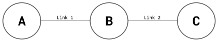
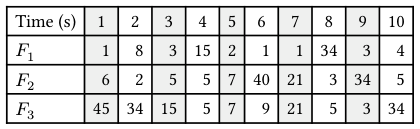

# Berkeley CS168 Spring 2025: Discussion 2: Questions

> Copied from the original: <https://sp25.cs168.io/>. Text and figures are taken from the PDF as is; nothing was answered or rewritten. The original PDF is in this folder.

---

**Page 1**

&emsp;CS 168   Packets in Flight 
&emsp;Spring 2025 
&emsp;&emsp;&emsp;&emsp;&emsp;&emsp;&emsp;&emsp;Discussion 2

&emsp;1   True or False 
1.1   On a fast cross-continental link (~100Gbps), propagation delay usually dominates end-to-end packet 
&emsp;delay (Most messages are smaller than 100MB).

1.2   On the same cross-continental link (~100Gbps), when transferring a 100GB file, propagation delay still 
&emsp;dominates end-to-end file delivery.

1.3   On-demand circuit-switching is adopted by the Internet.

1.4   The aggregate (i.e., sum) of peaks is usually much larger than peak of aggregates in terms of bandwidth 
&emsp;usage.

1.5   Bursty traffic (i.e., when packet arrivals are not evenly spaced in time) always leads to queuing delays.

&emsp;&emsp;&emsp;&emsp;&emsp;&emsp;&emsp;&emsp;1

---

**Page 2**

&emsp;2    Packets in Flight 
&emsp;2   End-to-End Delay 
&emsp;Consider the diagram below. Link 1 has length 𝐿1 m (where m stands for meters) and allows packets to 
&emsp;sec, while Link 2 has length 𝐿2 m but it only allows packets to be propagatedbe propagated at speed 𝑆1𝑚 
&emsp;sec (because the two links are made of different materials). Link 1 has transmission rate 𝑇1at speed 𝑆2𝑚   bits 
&emsp;&emsp;&emsp;&emsp;&emsp;&emsp;&emsp;&emsp;sec 
&emsp;sec .and Link 2 has transmission rate 𝑇2   bits

&emsp;Assuming nodes can send and receive bits at full rate and ignoring processing delay, consider the following 
&emsp;scenarios: 
2.1   How long would it take to send a packet of 500 Bytes from Node 𝐴 to Node 𝐵 given 𝑇1 = 10000, 𝐿1 = 
&emsp;100000, and 𝑆1 = 2.5 ∗108?

2.2   Compute RTT (round trip time) for a packet of 𝐵 Bytes sent from Node 𝐴 to Node 𝐶 (packet gets 
&emsp;transmitted back from Node 𝐶 immediately after Node 𝐶 receives it).

2.3   At time 0, Node 𝐴 sends packet 𝑃1 with 𝐷1 Bytes and then it sends another packet 𝑃2 with 𝐷2 Bytes 
&emsp;immediately after it pushes all bits of 𝑃1 onto Link 1. When will Node 𝐶 receive the last bit of 𝑃2?

2.4   Find the variable relations that need to be satisfied in order to have no queueing delays for part (c).

&emsp;&emsp;&emsp;&emsp;&emsp;&emsp;&emsp;&emsp;2

---

**Page 3**

&emsp;&emsp;&emsp;&emsp;&emsp;&emsp;&emsp;&emsp;Packets in Flight    3 
&emsp;3   Statistical Multi-What? 
&emsp;Consider three flows (𝐹1, 𝐹2, 𝐹3) sending packets over a single link. The sending pattern of each flow is 
&emsp;described by how many packets it sends within each one-second interval; the table below shows these 
&emsp;numbers for the first ten intervals. A perfectly smooth (i.e., non-bursty) flow would send the same number 
&emsp;of packets in each interval, but our three flows are very bursty, with highly varying numbers of packets 
&emsp;in each interval:

3.1   What is the peak rate of 𝐹1? 𝐹2? 𝐹3? What is the sum of the peak rates?

3.2   Now consider all packets to be in the same aggregate flow. What is the peak rate of this aggregate flow?

3.3   Which is higher - the sum of the peaks, or the peak of the aggregate?

&emsp;&emsp;&emsp;&emsp;&emsp;&emsp;&emsp;&emsp;3

