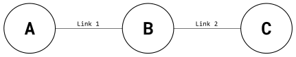
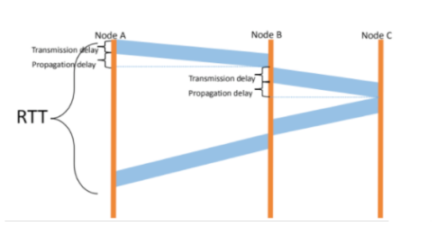
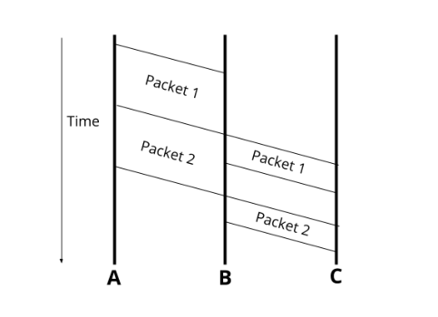
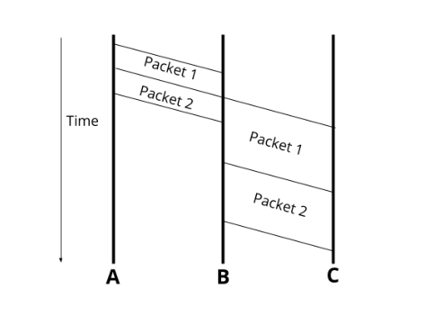
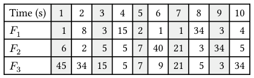
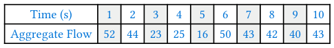

# Berkeley CS168 Spring 2025: Discussion 2: Official solutions

> Copied from the original: <https://sp25.cs168.io/>. Text and figures are taken from the PDF as is; nothing was answered or rewritten. The original PDF is in this folder.

---

**Page 1**

&emsp;CS 168   Packets in Flight 
&emsp;Spring 2025 
&emsp;&emsp;&emsp;&emsp;&emsp;&emsp;&emsp;&emsp;Discussion 2

&emsp;Solutions last updated: February 03, 2025 
&emsp;1   True or False 
1.1   On a fast cross-continental link (~100Gbps), propagation delay usually dominates end-to-end packet 
&emsp;delay (Most messages are smaller than 100MB). 
&emsp;True. On a 100Gbps link, even a 100MB file download would only take 0.008 seconds to get on the 
&emsp;wire, compared to 0.02 seconds propagation delay from New York to London (in the best case). Most 
&emsp;communications (web page, emails) don’t come close to this size. 
1.2   On the same cross-continental link (~100Gbps), when transferring a 100GB file, propagation delay still 
&emsp;dominates end-to-end file delivery. 
&emsp;False. Sending a 100GB file over a 100Gbps link will have at least 8 seconds transmission delay. 
1.3   On-demand circuit-switching is adopted by the Internet. 
&emsp;False. Circuit-switching shares bandwidth through reservation. Packet-switching shares bandwidth on 
&emsp;demand. Packet-switching is adopted by the Internet. 
1.4   The aggregate (i.e., sum) of peaks is usually much larger than peak of aggregates in terms of bandwidth 
&emsp;usage. 
&emsp;True. Statistical multiplexing leverages this to use available scarce resources more effectively. 
1.5   Bursty traffic (i.e., when packet arrivals are not evenly spaced in time) always leads to queuing delays. 
&emsp;False. Queuing delay happens when arrival rate is larger than transmission rate (ignoring processing 
&emsp;delays). Bursty traffic does not necessarily imply arrival rate is larger than transmission rate. Queuing 
&emsp;delay depends on traffic patterns, router internals, and link properties. 
&emsp;2   End-to-End Delay 
&emsp;Consider the diagram below. Link 1 has length 𝐿1 m (where m stands for meters) and allows packets to 
&emsp;sec, while Link 2 has length 𝐿2 m but it only allows packets to be propagatedbe propagated at speed 𝑆1𝑚 
&emsp;sec (because the two links are made of different materials). Link 1 has transmission rate 𝑇1at speed 𝑆2   𝑚   bits 
&emsp;&emsp;&emsp;&emsp;&emsp;&emsp;&emsp;&emsp;sec 
&emsp;sec .and Link 2 has transmission rate 𝑇2bits

&emsp;&emsp;&emsp;&emsp;&emsp;&emsp;&emsp;&emsp;1

---

**Page 2**

&emsp;2    Packets in Flight

&emsp;Assuming nodes can send and receive bits at full rate and ignoring processing delay, consider the following 
&emsp;scenarios: 
2.1   How long would it take to send a packet of 500 Bytes from Node 𝐴 to Node 𝐵 given 𝑇1 = 10000, 𝐿1 = 
&emsp;100000, and 𝑆1 = 2.5 ∗108? 
&emsp;&emsp;The total time needed is the sum of the transmission delay to push the packet onto Link 1 and the 
&emsp;&emsp;propagation delay for the packet to travel from Node A to Node B. 
&emsp;&emsp;&emsp;&emsp;&emsp;&emsp;&emsp;&emsp;𝑡{total} = 𝑡{transmission} + 𝑡{propagation} 
&emsp;&emsp;&emsp;&emsp;&emsp;&emsp;&emsp;&emsp;transmission rate of Link 1 + distance between A and Bpacket size 
&emsp;&emsp;&emsp;&emsp;&emsp;&emsp;𝑡{total} = 
&emsp;&emsp;&emsp;&emsp;&emsp;&emsp;&emsp;&emsp;propagation speed 
&emsp;&emsp;&emsp;&emsp;&emsp;&emsp;&emsp;&emsp;𝑡{total} = 500𝐵∗8 𝑏 
&emsp;&emsp;&emsp;&emsp;&emsp;&emsp;&emsp;&emsp;\+ 100000𝑚 
&emsp;&emsp;&emsp;&emsp;&emsp;&emsp;&emsp;&emsp;𝐵 
&emsp;&emsp;&emsp;&emsp;&emsp;&emsp;&emsp;&emsp;10000 𝑏2.5 ∗108 𝑚 
&emsp;&emsp;&emsp;&emsp;&emsp;&emsp;&emsp;&emsp;𝑠𝑠 
&emsp;&emsp;&emsp;&emsp;&emsp;&emsp;&emsp;&emsp;𝑡{total} = 0.4𝑠+ 0.0004𝑠= 0.4004s 
&emsp;&emsp;Notice that transmission delay dominates more than 99.9% in this case. 
2.2   Compute RTT (round trip time) for a packet of 𝐵 Bytes sent from Node 𝐴 to Node 𝐶 (packet gets 
&emsp;transmitted back from Node 𝐶 immediately after Node 𝐶 receives it). 
&emsp;There is only one packet, so no need to worry about queuing delays. Consider the diagram below:

&emsp;Note the sequence of delays the packet experiences during its route from 𝐴 to 𝐶: 
&emsp;(a) Transmission delay to push the packet onto Link 1. 
&emsp;(b) Propagation delay as the packet travels from Node 𝐴 to Node 𝐵. 
&emsp;(c) Transmission delay to push the packet onto Link 2. 
&emsp;(d) Propagation delay as the packet travels from Node 𝐵 to Node 𝐶. 
&emsp;(e) Transmission delay to push the packet onto Link 2. 
&emsp;(f) Propagation delay as the packet travels from Node 𝐶 to Node 𝐵. 
&emsp;(g) Transmission delay to push the packet onto Link 1. 
&emsp;(h) Propagation delay as the packet travels from Node 𝐵 to Node 𝐴.

&emsp;&emsp;&emsp;&emsp;&emsp;&emsp;&emsp;&emsp;2

---

**Page 3**

&emsp;&emsp;&emsp;&emsp;&emsp;&emsp;&emsp;&emsp;Packets in Flight    3

&emsp;Summing these delays yields the total RTT: 
&emsp;&emsp;𝑆2 + 8𝐵𝑆2 + 8𝐵𝑆1 + 8𝐵8𝐵𝑇1 + 𝐿1   𝑇2 + 𝐿2   𝑇2 + 𝐿2   𝑇1 + 𝐿1 
&emsp;&emsp;&emsp;&emsp;&emsp;&emsp;&emsp;&emsp;𝑆1

2.3   At time 0, Node 𝐴 sends packet 𝑃1 with 𝐷1 Bytes and then it sends another packet 𝑃2 with 𝐷2 Bytes 
&emsp;immediately after it pushes all bits of 𝑃1 onto Link 1. When will Node 𝐶 receive the last bit of 𝑃2? 
&emsp;There are two packets, so we might need to consider queueing delays. 
&emsp;There will be a queueing delay at Node 𝐵 if 𝑃2 arrives at 𝐵 before 𝑃1 is finished being pushed onto 
&emsp;Link 2. 
&emsp;𝑇1 secondsLet’s start by computing the time at which 𝑃1 finishes being pushed onto Link 2. 𝑃1 takes 8𝐷1 
&emsp;𝑇2 seconds to𝑆1 seconds to propagate from Node 𝐴 to Node 𝐵, and then 8𝐷1to be pushed onto Link 1, 𝐿1 
&emsp;be pushed onto Link 2. Hence 𝑃1 leaves Node 𝐵 at time: 
&emsp;&emsp;&emsp;&emsp;&emsp;&emsp;&emsp;&emsp;𝑆1 + 8𝐷1𝑇1 + 𝐿1𝑡1 = 8𝐷1 
&emsp;&emsp;&emsp;&emsp;&emsp;&emsp;&emsp;&emsp;𝑇2 
&emsp;𝑇1 seconds for 𝑃1 to beNext, let’s figure out the time when 𝑃2 arrives at Node 𝐵. It first waits 8𝐷1 
&emsp;𝑇1 seconds of transmission delay to be pushed onto Linkcompletely pushed onto Link 1, then takes 8𝐷2 
&emsp;𝑆1 seconds of propagation delay to reach Node 𝐵. With this, we know1 itself, before finally needing 𝐿1 
&emsp;that 𝑃2 reaches Node 𝐵 at time: 
&emsp;&emsp;&emsp;&emsp;&emsp;&emsp;&emsp;&emsp;𝑇1 + 𝐿1𝑇1 + 8𝐷2𝑡2 = 8𝐷1 
&emsp;&emsp;&emsp;&emsp;&emsp;&emsp;&emsp;&emsp;𝑆1 
&emsp;There’s queueing delay if 𝑡1 \> 𝑡2, and the length of the delay can be expressed as: 
&emsp;&emsp;&emsp;&emsp;&emsp;&emsp;&emsp;&emsp;𝑇2 - 8𝐷2𝑆1 ) = 8𝐷1𝑇1 + 𝐿1𝑇1 + 8𝐷2𝑇2 ) - (8𝐷1𝑆1 + 8𝐷1𝑇1 + 𝐿1𝑡1 - 𝑡2 = (8𝐷1 
&emsp;&emsp;&emsp;&emsp;&emsp;&emsp;&emsp;&emsp;𝑇1 
&emsp;With this analysis in hand, we can express the time at which Node 𝐶 receives the last bit of 𝑃2 as 
&emsp;follows: 
&emsp;&emsp;&emsp;&emsp;&emsp;&emsp;&emsp;𝑇2 + 𝐿2𝑇1 ), 0) + 8𝐷2𝑇2 −8𝐷2𝑆1 + max((8𝐷1𝑇1 + 𝐿1𝑇1 + 8𝐷2𝑡{total} = 8𝐷1 
&emsp;&emsp;&emsp;&emsp;&emsp;&emsp;&emsp;&emsp;𝑆2 
&emsp;From left to right, the terms in this sum are: 
&emsp;(a) The transmission delay to push 𝑃1 onto Link 1. 
&emsp;(b) The transmission delay to push 𝑃2 onto Link 1. 
&emsp;(c) The propagation delay as 𝑃2 travels from Node 𝐴 to Node 𝐵. 
&emsp;(d) The queueing delay at Node 𝐵. Note that the use of the max operator allows us to express the two 
&emsp;&emsp;cases when there is and when there isn’t queueing delay compactly. 
&emsp;(e) The transmission delay to push 𝑃2 onto Link 2. 
&emsp;(f) The propagation delay as 𝑃2 travels from Node 𝐵 to Node 𝐶.

&emsp;&emsp;&emsp;&emsp;&emsp;&emsp;&emsp;&emsp;3

---

**Page 4**

&emsp;4    Packets in Flight

&emsp;Below is the time-graph of a packet in flight without queueing delay:

&emsp;And with queueing delay:

2.4   Find the variable relations that need to be satisfied in order to have no queueing delays for part (c). 
&emsp;From the analysis we conducted in part (c), we know there will be queueing delays if 𝑡1 \> 𝑡2, or 8𝐷1 
&emsp;&emsp;&emsp;&emsp;&emsp;&emsp;&emsp;&emsp;𝑇2 \> 
&emsp;𝑇1 After simplifying, we see the relation that must𝑇2 ≤8𝐷2𝑇1 . Hence, there are no queueing delays if: 8𝐷18𝐷2 
&emsp;be satisfied is: 
&emsp;&emsp;&emsp;&emsp;&emsp;&emsp;&emsp;&emsp;𝑇2 ≤𝐷2𝐷1 
&emsp;&emsp;&emsp;&emsp;&emsp;&emsp;&emsp;&emsp;𝑇1

&emsp;&emsp;&emsp;&emsp;&emsp;&emsp;&emsp;&emsp;4

---

**Page 5**

&emsp;&emsp;&emsp;&emsp;&emsp;&emsp;&emsp;&emsp;Packets in Flight    5 
&emsp;3   Statistical Multi-What? 
&emsp;Consider three flows (𝐹1, 𝐹2, 𝐹3) sending packets over a single link. The sending pattern of each flow is 
&emsp;described by how many packets it sends within each one-second interval; the table below shows these 
&emsp;numbers for the first ten intervals. A perfectly smooth (i.e., non-bursty) flow would send the same number 
&emsp;of packets in each interval, but our three flows are very bursty, with highly varying numbers of packets 
&emsp;in each interval:

3.1   What is the peak rate of 𝐹1? 𝐹2? 𝐹3? What is the sum of the peak rates? 
&emsp;The peak rate is the highest the flow gets throughout the whole period. The peak rate of 𝐹1 is 34, the 
&emsp;peak rate of 𝐹2 is 40, and the peak rate of 𝐹3 is 45. 
&emsp;The sum of their peaks is 34 + 40 + 45 = 119. 
3.2   Now consider all packets to be in the same aggregate flow. What is the peak rate of this aggregate flow? 
&emsp;Summing the flows together, we get the following values for an aggregate flow:

&emsp;The peak of the aggregate flow happens at 1s, where it is 52. 
3.3   Which is higher - the sum of the peaks, or the peak of the aggregate? 
&emsp;The sum of the peaks is 119, whereas the peak of the aggregate is 52, so the sum of the peaks is much 
&emsp;higher. This is the insight from Statistical Multiplexing! The peak of the aggregate can only be at most 
&emsp;the sum of the peaks, but that only happens in the case that all of the peaks happen at the same time. 
&emsp;This is very unlikely, so usually, the peak of the aggregate is much lower than the sum of the peaks.

&emsp;&emsp;&emsp;&emsp;&emsp;&emsp;&emsp;&emsp;5

