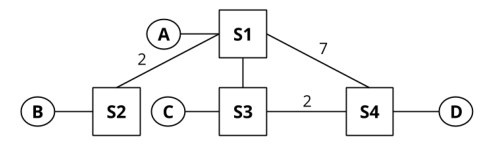

# Berkeley CS168 Spring 2025: Discussion 3: Questions

> Copied from the original: <https://sp25.cs168.io/>. Text and figures are taken from the PDF as is; nothing was answered or rewritten. The original PDF is in this folder.

---

**Page 1**

&emsp;CS 168   Routing I 
&emsp;Spring 2025 
&emsp;&emsp;&emsp;&emsp;&emsp;&emsp;&emsp;&emsp;Discussion 3

&emsp;1   Distance-Vector Routing

&emsp;The nodes in the above network share routes with each other using distance-vector routing. Below are 
&emsp;the initial routing tables for each node, and a table showing the costs for each of their neighboring links. 
&emsp;Links without a distance provided have an implicit distance of 1. 
&emsp;&emsp;&emsp;&emsp;Table 1: S1   Table 2: S2   Table 3: S3   Table 4: S4 
&emsp;&emsp;Dest.   Hop, Dist.   Dest.   Hop, Dist.   Dest.   Hop, Dist.   Dest.   Hop, Dist. 
&emsp;&emsp;&emsp;A   Direct, 1   B   Direct, 1   C   Direct, 1   D   Direct, 1

&emsp;The following questions indicate events that happen consecutively. You can assume that no other events 
&emsp;occur other than the ones specified. Note that all blanks may not be necessary. 
&emsp;EVENT: S3 advertises its routes to S1 and S4. 
1.1   What do the routing tables for S1 and S4 look like after receiving S3′s routes? (You may not need to fill 
&emsp;in all the rows) 
&emsp;&emsp;&emsp;&emsp;&emsp;&emsp;&emsp;Table 5: Routing Table for S1   Table 6: Routing Table for S4 
&emsp;&emsp;&emsp;&emsp;&emsp;&emsp;&emsp;&emsp;Dest.   NextHop, Dist.   Dest.   NextHop, Dist. 
&emsp;&emsp;&emsp;&emsp;&emsp;&emsp;&emsp;&emsp;A   Direct, 1   D   Direct, 1

1.2   Which nodes among S1 and S4 are expected to advertise their routes after receiving S3′s routes? 
&emsp;(Assuming the advertising routes on a routing table change optimization is being used)

&emsp;&emsp;&emsp;&emsp;&emsp;&emsp;&emsp;&emsp;1

---

**Page 2**

&emsp;2    Routing I

&emsp;EVENT: S1 advertises its routes to S2, S3, and S4. 
1.3   What do the routing tables for S2, S3, and S4 look like after receiving S1′s routes? (You may not need to 
&emsp;fill in all columns.) 
&emsp;&emsp;Table 7: Routing Table for S2   Table 8: Routing Table for S3   Table 9: Routing Table for S4 
&emsp;&emsp;&emsp;Dest.   NextHop, Dist.   Dest.   NextHop, Dist.   Dest.   NextHop, Dist. 
&emsp;&emsp;&emsp;&emsp;B   Direct, 1   C   Direct, 1   D   Direct, 1

&emsp;EVENT: S4 advertises its routes to S1 and S3. EVENT: S1 advertises its routes to S2, S3, and S4. 
1.4   At this point, what path does S2 use to reach D, and what is the cost?

1.5   EVENT: S3 advertises its routes to S1 and S4. 
&emsp;What do the routing tables for S1 and S2 look like now? 
&emsp;&emsp;&emsp;&emsp;&emsp;&emsp;&emsp;Table 10: Routing Table for S1   Table 11: Routing Table for S2 
&emsp;&emsp;&emsp;&emsp;&emsp;&emsp;&emsp;&emsp;Dest.   NextHop, Dist.   Dest.   NextHop, Dist. 
&emsp;&emsp;&emsp;&emsp;&emsp;&emsp;&emsp;&emsp;A   Direct, 1   B   Direct, 1

&emsp;&emsp;&emsp;&emsp;&emsp;&emsp;&emsp;&emsp;2

---

**Page 3**

&emsp;&emsp;&emsp;&emsp;&emsp;&emsp;&emsp;&emsp;Routing I    3 
&emsp;2   Split Horizon and Poisoned Reverse

&emsp;All unlabeled links have a cost of 1. The parts of the question do not build on each other. 
2.1   Assume that the routers use split horizon. Say that S4 advertises (A: 2, C : 1) to S3. Assuming that S3 
&emsp;has received no other advertisements, what does S3 now tell S4 about S3′s path to A?

2.2   Assume that the routers use poisoned reverse. Routing tables have not converged and S3 believes its 
&emsp;shortest path to A is through S1 (this path is S3-S1-S2 of length 4). S3 advertises its routes to S4. Now, 
&emsp;S4 advertises to S3. S4 bases this advertisement off of its routing table which has: (B: 2, A: 2, C : 1). After 
&emsp;recomputing its routes, S3 advertises its routes to S4. What is the advertised distance to A?

2.3   Consider the simple topology (𝐴-S1-S2-S3). After the routing tables have converged, link S1-S2 goes 
&emsp;down. When S2 advertises to S3 (𝐴: ∞), is this an act of poisoning a route or poisoned reverse?

2.4   Poisoning a route and poisoned reverse might sound similar, but actually we can think of one of them 
&emsp;as being “honest” while the other one is “lying.” Which one tells the truth, and which one tells a white 
&emsp;lie to keep the network functioning?

&emsp;&emsp;&emsp;&emsp;&emsp;&emsp;&emsp;&emsp;3

---

**Page 4**

&emsp;4    Routing I 
&emsp;3   Count to Infinity

&emsp;For part 1 of this question there is no split-horizon or poisoned reverse, and advertisements are only sent 
&emsp;periodically (aka when it is explicitly stated). 
3.1   What do the routing tables look like once S1, S2 and S3 converge? 
&emsp;&emsp;Table 12: Routing Table for S1   Table 13: Routing Table for S2   Table 14: Routing Table for S3 
&emsp;&emsp;&emsp;Dest.   NextHop, Dist.   Dest.   NextHop, Dist.   Dest.   NextHop, Dist. 
&emsp;&emsp;&emsp;A   Direct, 1   B   Direct, 1

&emsp;What periodic advertisement will S1 and S2 send to each other? (One such message is given as an 
&emsp;example) 
&emsp;&emsp;&emsp;&emsp;&emsp;&emsp;&emsp;&emsp;From   To   (Destination, Distance) 
&emsp;&emsp;&emsp;&emsp;&emsp;&emsp;&emsp;&emsp;S1   S2   (A, 1)

&emsp;EVENT: The link between S2 and S3 goes down. 
&emsp;What will S1 and S2 send to each other? 
&emsp;&emsp;&emsp;&emsp;&emsp;&emsp;&emsp;&emsp;From   To   (Destination, Distance)

&emsp;EVENT: S2′s route to **𝐵** finally expires. 
&emsp;After S1 and S2 exchange advertisements again, what will their routing tables look like?

&emsp;&emsp;&emsp;&emsp;&emsp;&emsp;&emsp;&emsp;4

---

**Page 5**

&emsp;&emsp;&emsp;&emsp;&emsp;&emsp;&emsp;&emsp;Routing I    5

&emsp;&emsp;&emsp;&emsp;&emsp;&emsp;&emsp;Table 15: Routing Table for S1   Table 16: Routing Table for S2 
&emsp;&emsp;&emsp;&emsp;&emsp;&emsp;&emsp;&emsp;Dest.   NextHop, Dist.   Dest.   NextHop, Dist. 
&emsp;&emsp;&emsp;&emsp;&emsp;&emsp;&emsp;&emsp;A   Direct, 1

&emsp;EVENT: S1′s route to **𝐵** expires. 
&emsp;After S1 and S2 exchange advertisements again, what will their routing tables look like? 
&emsp;&emsp;&emsp;&emsp;&emsp;&emsp;&emsp;Table 17: Routing Table for S1   Table 18: Routing Table for S2 
&emsp;&emsp;&emsp;&emsp;&emsp;&emsp;&emsp;&emsp;Dest.   NextHop, Dist.   Dest.   NextHop, Dist. 
&emsp;&emsp;&emsp;&emsp;&emsp;&emsp;&emsp;&emsp;A   Direct, 1

&emsp;Is this good?

&emsp;For part 2 of this question, there is split-horizon, but no poisoned reverse, and advertisements are only 
&emsp;sent periodically (i.e., when it is explicitly stated). Also, all dropped links are back up, and the routing 
&emsp;state starts out converged! 
3.2   What will S1 and S2 send to each other after everything has converged? 
&emsp;&emsp;&emsp;&emsp;&emsp;&emsp;&emsp;&emsp;From   To   (Destination, Distance)

&emsp;EVENT: The link between S2 and S3 goes down. 
&emsp;What will S1 and S2 send to each other? 
&emsp;&emsp;&emsp;&emsp;&emsp;&emsp;&emsp;&emsp;From   To   (Destination, Distance)

&emsp;EVENT: S2′s route to 𝐵 finally expires.

&emsp;&emsp;&emsp;&emsp;&emsp;&emsp;&emsp;&emsp;5

---

**Page 6**

6    Routing I

After S1 and S2 exchange advertisements again, what will their routing tables look like? 
&emsp;&emsp;&emsp;&emsp;&emsp;Table 19: Routing Table for S1   Table 20: Routing Table for S2 
&emsp;&emsp;&emsp;&emsp;&emsp;&emsp;Dest.   NextHop, Dist.   Dest.   NextHop, Dist. 
&emsp;&emsp;&emsp;&emsp;&emsp;&emsp;&emsp;A   Direct, 1

Will this end well?

&emsp;&emsp;&emsp;&emsp;&emsp;&emsp;&emsp;&emsp;6

