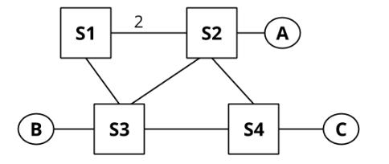
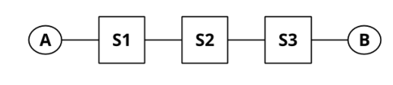

# Berkeley CS168 Spring 2025: Discussion 3: Official solutions

> Copied from the original: <https://sp25.cs168.io/>. Text and figures are taken from the PDF as is; nothing was answered or rewritten. The original PDF is in this folder.

---

**Page 1**

&emsp;CS 168   Routing I 
&emsp;Spring 2025 
&emsp;&emsp;&emsp;&emsp;&emsp;&emsp;&emsp;&emsp;Discussion 3

&emsp;1   Distance-Vector Routing

&emsp;The nodes in the above network share routes with each other using distance-vector routing. Below are 
&emsp;the initial routing tables for each node, and a table showing the costs for each of their neighboring links. 
&emsp;Links without a distance provided have an implicit distance of 1. 
&emsp;&emsp;&emsp;&emsp;Table 1: S1   Table 2: S2   Table 3: S3   Table 4: S4 
&emsp;&emsp;Dest.   Hop, Dist.   Dest.   Hop, Dist.   Dest.   Hop, Dist.   Dest.   Hop, Dist. 
&emsp;&emsp;&emsp;A   Direct, 1   B   Direct, 1   C   Direct, 1   D   Direct, 1

&emsp;The following questions indicate events that happen consecutively. You can assume that no other events 
&emsp;occur other than the ones specified. Note that all blanks may not be necessary. 
&emsp;EVENT: S3 advertises its routes to S1 and S4. 
1.1   What do the routing tables for S1 and S4 look like after receiving S3′s routes? (You may not need to fill 
&emsp;in all the rows) 
&emsp;&emsp;&emsp;&emsp;&emsp;&emsp;&emsp;Table 5: Routing Table for S1   Table 6: Routing Table for S4 
&emsp;&emsp;&emsp;&emsp;&emsp;&emsp;&emsp;&emsp;Dest.   NextHop, Dist.   Dest.   NextHop, Dist. 
&emsp;&emsp;&emsp;&emsp;&emsp;&emsp;&emsp;&emsp;A   Direct, 1   D   Direct, 1 
&emsp;&emsp;&emsp;&emsp;&emsp;&emsp;&emsp;&emsp;C   S3, 2   C   S3, 3

1.2   Which nodes among S1 and S4 are expected to advertise their routes after receiving S3′s routes? 
&emsp;(Assuming the advertising routes on a routing table change optimization is being used) 
&emsp;Since both S1 and S4 updated their shortest paths, they will both advertise their routing tables. 
&emsp;EVENT: S1 advertises its routes to S2, S3, and S4.

&emsp;&emsp;&emsp;&emsp;&emsp;&emsp;&emsp;&emsp;1

---

**Page 2**

&emsp;2    Routing I

1.3   What do the routing tables for S2, S3, and S4 look like after receiving S1′s routes? (You may not need to 
&emsp;fill in all columns.) 
&emsp;&emsp;Table 7: Routing Table for S2   Table 8: Routing Table for S3   Table 9: Routing Table for S4 
&emsp;&emsp;&emsp;Dest.   NextHop, Dist.   Dest.   NextHop, Dist.   Dest.   NextHop, Dist. 
&emsp;&emsp;&emsp;&emsp;B   Direct, 1   C   Direct, 1   D   Direct, 1 
&emsp;&emsp;&emsp;&emsp;A   S1, 3   A   S1, 2   C   S3, 3 
&emsp;&emsp;&emsp;&emsp;C   S1, 4   A   S1, 8

&emsp;EVENT: S4 advertises its routes to S1 and S3. EVENT: S1 advertises its routes to S2, S3, and S4. 
1.4   At this point, what path does S2 use to reach D, and what is the cost? 
&emsp;S2 → S1 → S4 with a cost of 10. 
&emsp;S1 has only heard about a route to D from S4. S1 in turn advertises this route to S2. 
1.5   EVENT: S3 advertises its routes to S1 and S4. 
&emsp;What do the routing tables for S1 and S2 look like now? 
&emsp;&emsp;&emsp;&emsp;&emsp;&emsp;&emsp;Table 10: Routing Table for S1   Table 11: Routing Table for S2 
&emsp;&emsp;&emsp;&emsp;&emsp;&emsp;&emsp;&emsp;Dest.   NextHop, Dist.   Dest.   NextHop, Dist. 
&emsp;&emsp;&emsp;&emsp;&emsp;&emsp;&emsp;&emsp;A   Direct, 1   B   Direct, 1 
&emsp;&emsp;&emsp;&emsp;&emsp;&emsp;&emsp;&emsp;C   S3, 2   A   S1, 3 
&emsp;&emsp;&emsp;&emsp;&emsp;&emsp;&emsp;&emsp;D   S3, 4   C   S1, 4 
&emsp;&emsp;&emsp;&emsp;&emsp;&emsp;&emsp;&emsp;D   S1, 10

&emsp;S2 has not heard about S3′s routing update to S1 about a lower cost route to D yet. 
&emsp;2   Split Horizon and Poisoned Reverse

&emsp;&emsp;&emsp;&emsp;&emsp;&emsp;&emsp;&emsp;2

---

**Page 3**

&emsp;&emsp;&emsp;&emsp;&emsp;&emsp;&emsp;&emsp;Routing I    3

&emsp;All unlabeled links have a cost of 1. The parts of the question do not build on each other. 
2.1   Assume that the routers use split horizon. Say that S4 advertises (A: 2, C : 1) to S3. Assuming that S3 
&emsp;has received no other advertisements, what does S3 now tell S4 about S3′s path to A? 
&emsp;Nothing. Split Horizon means that we never tell a neighbor about paths that go through that neighbor. 
&emsp;So in this case, S3 doesn’t tell S4 about its path to A. 
2.2   Assume that the routers use poisoned reverse. Routing tables have not converged and S3 believes its 
&emsp;shortest path to A is through S1 (this path is S3-S1-S2 of length 4). S3 advertises its routes to S4. Now, 
&emsp;S4 advertises to S3. S4 bases this advertisement off of its routing table which has: (B: 2, A: 2, C : 1). After 
&emsp;recomputing its routes, S3 advertises its routes to S4. What is the advertised distance to A? 
&emsp;S3 will tell S4 that its distance to 𝐴 is infinitely long, because S3′s new shortest route goes through S4. 
2.3   Consider the simple topology (𝐴-S1-S2-S3). After the routing tables have converged, link S1-S2 goes 
&emsp;down. When S2 advertises to S3 (𝐴: ∞), is this an act of poisoning a route or poisoned reverse? 
&emsp;S2 is poisoning a route. Namely, it tells S3 that its distance is float.inf, not because S2′s new path goes 
&emsp;through S3, but because S2 actually has no route now.

2.4   Poisoning a route and poisoned reverse might sound similar, but actually we can think of one of them 
&emsp;as being “honest” while the other one is “lying.” Which one tells the truth, and which one tells a white 
&emsp;lie to keep the network functioning? 
&emsp;Poisoned reverse encourages routers to tell a white lie. With poisoned reverse, we tell a neighbor that 
&emsp;we have no path to a certain destination if our path goes through that neighbor. Since we actually do 
&emsp;have a path, our message is not strictly true. On the other hand, poisoning a route happens when a 
&emsp;link goes down, and we actually lose our path to some destination. Thus, we’re telling the truth when 
&emsp;we advertise a distance of float.inf to this destination (given that an infinitely long path is equivalent to 
&emsp;no path). 
&emsp;3   Count to Infinity

&emsp;For part 1 of this question there is no split-horizon or poisoned reverse, and advertisements are only sent 
&emsp;periodically (aka when it is explicitly stated). 
3.1   What do the routing tables look like once S1, S2 and S3 converge?

&emsp;&emsp;&emsp;&emsp;&emsp;&emsp;&emsp;&emsp;3

---

**Page 4**

4    Routing I

Table 12: Routing Table for S1   Table 13: Routing Table for S2   Table 14: Routing Table for S3 
&emsp;Dest.   NextHop, Dist.   Dest.   NextHop, Dist.   Dest.   NextHop, Dist. 
&emsp;&emsp;A   Direct, 1   B   Direct, 1 
&emsp;&emsp;&emsp;&emsp;&emsp;&emsp;&emsp;&emsp;A   S1, 2 
&emsp;&emsp;B   S2, 3   A   S2, 3 
&emsp;&emsp;&emsp;&emsp;&emsp;&emsp;&emsp;&emsp;B   S3, 2

What periodic advertisement will S1 and S2 send to each other? (One such message is given as an 
example) 
&emsp;&emsp;&emsp;&emsp;&emsp;&emsp;&emsp;&emsp;From   To   (Destination, Distance) 
&emsp;&emsp;&emsp;&emsp;&emsp;&emsp;&emsp;&emsp;S1   S2   (A, 1) 
&emsp;&emsp;&emsp;&emsp;&emsp;&emsp;&emsp;&emsp;S1   S2   (B, 3) 
&emsp;&emsp;&emsp;&emsp;&emsp;&emsp;&emsp;&emsp;S2   S1   (A, 2) 
&emsp;&emsp;&emsp;&emsp;&emsp;&emsp;&emsp;&emsp;S2   S1   (B, 2) 
EVENT: The link between S2 and S3 goes down. 
What will S1 and S2 send to each other? 
&emsp;&emsp;&emsp;&emsp;&emsp;&emsp;&emsp;&emsp;From   To   (Destination, Distance) 
&emsp;&emsp;&emsp;&emsp;&emsp;&emsp;&emsp;&emsp;S1   S2   (A, 1) 
&emsp;&emsp;&emsp;&emsp;&emsp;&emsp;&emsp;&emsp;S1   S2   (B, 3) 
&emsp;&emsp;&emsp;&emsp;&emsp;&emsp;&emsp;&emsp;S2   S1   (A, 2) 
&emsp;&emsp;&emsp;&emsp;&emsp;&emsp;&emsp;&emsp;S2   S1   (B, 2)

The tables did not change because no routes have expired yet. 
EVENT: S2′s route to **𝐵** finally expires. 
After S1 and S2 exchange advertisements again, what will their routing tables look like? 
&emsp;&emsp;&emsp;&emsp;&emsp;Table 15: Routing Table for S1   Table 16: Routing Table for S2 
&emsp;&emsp;&emsp;&emsp;&emsp;&emsp;Dest.   NextHop, Dist.   Dest.   NextHop, Dist. 
&emsp;&emsp;&emsp;&emsp;&emsp;&emsp;&emsp;A   Direct, 1   A   S1, 2 
&emsp;&emsp;&emsp;&emsp;&emsp;&emsp;&emsp;B   S2, 3 
&emsp;&emsp;&emsp;&emsp;&emsp;&emsp;&emsp;&emsp;B   S1, 4

EVENT: S1′s route to **𝐵** expires. 
After S1 and S2 exchange advertisements again, what will their routing tables look like?

&emsp;&emsp;&emsp;&emsp;&emsp;&emsp;&emsp;&emsp;4

---

**Page 5**

&emsp;&emsp;&emsp;&emsp;&emsp;&emsp;&emsp;&emsp;Routing I    5

&emsp;&emsp;&emsp;&emsp;&emsp;&emsp;&emsp;Table 17: Routing Table for S1   Table 18: Routing Table for S2 
&emsp;&emsp;&emsp;&emsp;&emsp;&emsp;&emsp;&emsp;Dest.   NextHop, Dist.   Dest.   NextHop, Dist. 
&emsp;&emsp;&emsp;&emsp;&emsp;&emsp;&emsp;&emsp;A   Direct, 1 
&emsp;&emsp;&emsp;&emsp;&emsp;&emsp;&emsp;&emsp;A   S1, 2 
&emsp;&emsp;&emsp;&emsp;&emsp;&emsp;&emsp;&emsp;B   S2, 5 
&emsp;&emsp;&emsp;&emsp;&emsp;&emsp;&emsp;&emsp;B   S1, 4

&emsp;Is this good? 
&emsp;NO! This is called count to infinity. Both switches think they have a path to **𝐵** for a long time 
&emsp;after the path ceases to exist. 
&emsp;For part 2 of this question, there is split-horizon, but no poisoned reverse, and advertisements are only 
&emsp;sent periodically (i.e., when it is explicitly stated). Also, all dropped links are back up, and the routing 
&emsp;state starts out converged! 
3.2   What will S1 and S2 send to each other after everything has converged? 
&emsp;&emsp;&emsp;&emsp;&emsp;&emsp;&emsp;&emsp;From   To   (Destination, Distance) 
&emsp;&emsp;&emsp;&emsp;&emsp;&emsp;&emsp;&emsp;S1   S2   (A, 1) 
&emsp;&emsp;&emsp;&emsp;&emsp;&emsp;&emsp;&emsp;S2   S1   (B, 2)

&emsp;EVENT: The link between S2 and S3 goes down. 
&emsp;What will S1 and S2 send to each other? 
&emsp;&emsp;&emsp;&emsp;&emsp;&emsp;&emsp;&emsp;From   To   (Destination, Distance) 
&emsp;&emsp;&emsp;&emsp;&emsp;&emsp;&emsp;&emsp;S1   S2   (A, 1) 
&emsp;&emsp;&emsp;&emsp;&emsp;&emsp;&emsp;&emsp;S2   S1   (B, 2)

&emsp;EVENT: S2′s route to 𝐵 finally expires. 
&emsp;After S1 and S2 exchange advertisements again, what will their routing tables look like? 
&emsp;&emsp;&emsp;&emsp;&emsp;&emsp;&emsp;Table 19: Routing Table for S1   Table 20: Routing Table for S2 
&emsp;&emsp;&emsp;&emsp;&emsp;&emsp;&emsp;&emsp;Dest.   NextHop, Dist.   Dest.   NextHop, Dist. 
&emsp;&emsp;&emsp;&emsp;&emsp;&emsp;&emsp;&emsp;A   Direct, 1   A   S1, 2 
&emsp;&emsp;&emsp;&emsp;&emsp;&emsp;&emsp;&emsp;B   S2, 3

&emsp;&emsp;&emsp;&emsp;&emsp;&emsp;&emsp;&emsp;5

---

**Page 6**

6    Routing I

Will this end well? 
Yes! S1′s route to 𝐵 will expire because it has not been updated in a while.

&emsp;&emsp;&emsp;&emsp;&emsp;&emsp;&emsp;&emsp;6

