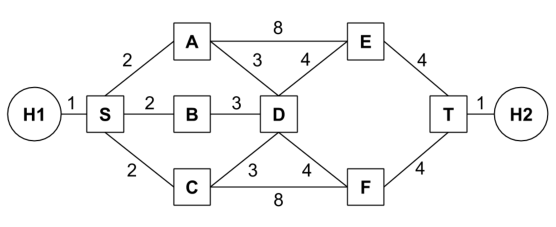
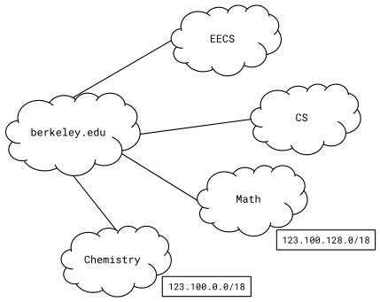
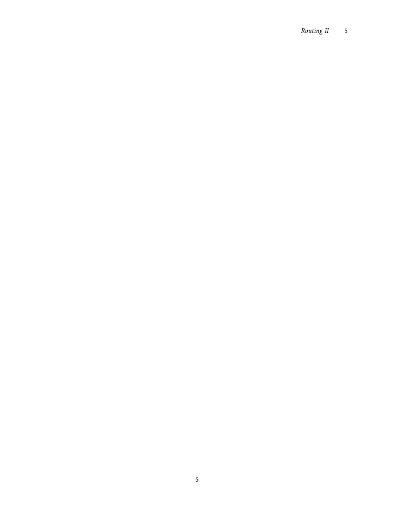

# Berkeley CS168 Spring 2025: Discussion 4: Questions

> Copied from the original: <https://sp25.cs168.io/>. Text and figures are taken from the PDF as is; nothing was answered or rewritten. The original PDF is in this folder.

---

**Page 1**

&emsp;CS 168   Routing II 
&emsp;Spring 2025 
&emsp;&emsp;&emsp;&emsp;&emsp;&emsp;&emsp;&emsp;Discussion 4

&emsp;1   Link-State Routing

&emsp;For this problem, assume the network is running a link-state routing protocol, minimizing total route 
&emsp;latency. The following questions indicate events that happen consecutively. 
1.1   After convergence, what route does D think its packet will take to Host H1?

&emsp;EVENT: Link GH goes down. 
1.2   G and H have recomputed their routes but have not yet sent updates to other routers. What route does 
&emsp;D think its packet will take to Host H1?

1.3   What route does it actually take?

&emsp;&emsp;&emsp;&emsp;&emsp;&emsp;&emsp;&emsp;1

---

**Page 2**

&emsp;2    Routing II

1.4   Assume all nodes are now aware of the new network state and have recomputed their routes. What route 
&emsp;does a packet take from B to Host H2?

&emsp;EVENT: The cost of link AI increases to 100. 
1.5   A and I recompute their routes but have not yet sent updates to other routers. What route does A think 
&emsp;its packet will take to Host H2?

1.6   What route does it actually take?

1.7   Which additional routers must receive the routing updates and recompute their routes for all routers to 
&emsp;be able to successfully send packets to Host H2?

1.8   All routers except B have received the routing updates and recomputed their routes. Which routers can 
&emsp;successfully send packets to Host H2?

&emsp;&emsp;&emsp;&emsp;&emsp;&emsp;&emsp;&emsp;2

---

**Page 3**

&emsp;&emsp;&emsp;&emsp;&emsp;&emsp;&emsp;&emsp;Routing II    3 
&emsp;2   More L3 Link State

2.1   After convergence, what is the path cost from H1 to H2, and what are all the possible paths with this cost?

2.2   Suppose that a control message (a message used by the routing algorithm) takes 1 second to propagate 
&emsp;along a link, regardless of link cost. What individual link failure inside the network would cause the 
&emsp;longest delay to reconvergence, and what is that delay?

2.3   Suppose you have the ability to take down individual nodes. Which nodes would you take down in 
&emsp;order to partition the network? If you can’t partition the network, which nodes would you take down to 
&emsp;increase path costs from H1 to H2 maximally? 
&emsp;In each part, suppose you can take down: 
&emsp;(a) A single node (excluding S and T).

&emsp;(b) Two nodes (excluding S and T).

2.4   Which single link’s cost (if any) should you double in order to increase the path cost from H1 to H2?

&emsp;&emsp;&emsp;&emsp;&emsp;&emsp;&emsp;&emsp;3

---

**Page 4**

&emsp;4    Routing II 
&emsp;3   IP Addressing 
&emsp;Suppose berkeley.edu is the Provider AS for EECS, CS, Math, and Chemistry, and needs to assign IPv4 
&emsp;addresses to them. 
&emsp;Assume that the CIDR (Classless InterDomain Routing) addressing scheme is used, and that berkeley.edu 
&emsp;has the **123.100.0.0/16** prefix reserved.

3.1   Which addresses are included in the Math department’s prefix? How many addresses are in this range?

3.2   **123.100.192.0/18** is reserved for EECS and CS. Assign equal halves of this address space to the two 
&emsp;departments.

3.3   You want to start a new department, Floriology, and assign it an unused address range. You foresee that 
&emsp;no more than 50 people will enroll. Assuming one address per person, what prefix would you assign 
&emsp;to it?

&emsp;&emsp;&emsp;&emsp;&emsp;&emsp;&emsp;&emsp;4

---

**Page 5**

