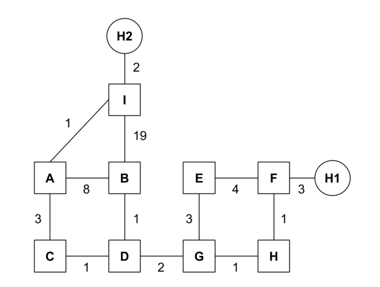
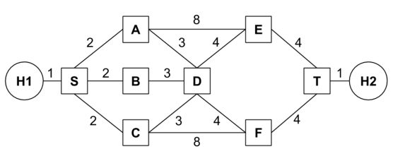
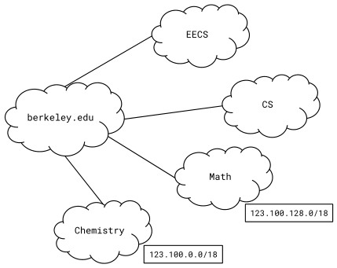

# Berkeley CS168 Spring 2025: Discussion 4: Official solutions

> Copied from the original: <https://sp25.cs168.io/>. Text and figures are taken from the PDF as is; nothing was answered or rewritten. The original PDF is in this folder.

---

**Page 1**

&emsp;CS 168   Routing II 
&emsp;Spring 2025 
&emsp;&emsp;&emsp;&emsp;&emsp;&emsp;&emsp;&emsp;Discussion 4

&emsp;1   Link-State Routing

&emsp;For this problem, assume the network is running a link-state routing protocol, minimizing total route 
&emsp;latency. The following questions indicate events that happen consecutively. 
1.1   After convergence, what route does D think its packet will take to Host H1? 
&emsp;D → G → H → F → H1 
&emsp;EVENT: Link GH goes down. 
1.2   G and H have recomputed their routes but have not yet sent updates to other routers. What route does 
&emsp;D think its packet will take to Host H1? 
&emsp;Same, D → G → H → F → H1 
1.3   What route does it actually take? 
&emsp;D → G → E → F → H1 
1.4   Assume all nodes are now aware of the new network state and have recomputed their routes. What route 
&emsp;does a packet take from B to Host H2?

&emsp;&emsp;&emsp;&emsp;&emsp;&emsp;&emsp;&emsp;1

---

**Page 2**

&emsp;2    Routing II

&emsp;B → D → C → A → I → H2 
&emsp;EVENT: The cost of link AI increases to 100. 
1.5   A and I recompute their routes but have not yet sent updates to other routers. What route does A think 
&emsp;its packet will take to Host H2? 
&emsp;A → C → D → B → I → H2 
1.6   What route does it actually take? 
&emsp;A → C → A (loop) 
1.7   Which additional routers must receive the routing updates and recompute their routes for all routers to 
&emsp;be able to successfully send packets to Host H2? 
&emsp;B, C, D 
1.8   All routers except B have received the routing updates and recomputed their routes. Which routers can 
&emsp;successfully send packets to Host H2? 
&emsp;None of the routers (except I) 
&emsp;2   More L3 Link State

2.1   After convergence, what is the path cost from H1 to H2, and what are all the possible paths with this cost? 
&emsp;The cost is 15. All paths are H1 → S → \[A, B, C\] → D → \[E, F\] → T → H2. 
2.2   Suppose that a control message (a message used by the routing algorithm) takes 1 second to propagate 
&emsp;along a link, regardless of link cost. What individual link failure inside the network would cause the 
&emsp;longest delay to reconvergence, and what is that delay? 
&emsp;A link SB failure would cause a 3-second delay. The last node that learns about the failure is node T, and 
&emsp;the update must traverse through at least 3 links to get to T, which will take 3 seconds. Any other link 
&emsp;failure within the network can propagate to every other node in less than 3 seconds. Host links could 
&emsp;also take 3 seconds to propagate.

&emsp;&emsp;&emsp;&emsp;&emsp;&emsp;&emsp;&emsp;2

---

**Page 3**

&emsp;&emsp;&emsp;&emsp;&emsp;&emsp;&emsp;&emsp;Routing II    3

2.3   Suppose you have the ability to take down individual nodes. Which nodes would you take down in 
&emsp;order to partition the network? If you can’t partition the network, which nodes would you take down to 
&emsp;increase path costs from H1 to H2 maximally? 
&emsp;In each part, suppose you can take down: 
&emsp;(a) A single node (excluding S and T). 
&emsp;D. Can’t partition, and removing D increases path costs the most (by 1). 
&emsp;(b) Two nodes (excluding S and T). 
&emsp;E and F. Removing them will partition T from the network. 
2.4   Which single link’s cost (if any) should you double in order to increase the path cost from H1 to H2? 
&emsp;Doubling the cost of H1-S or T-H2 will increase the total path cost by 1. It’s not possible with any other 
&emsp;link, since there is always an alternate, cheaper path (see part 1). 
&emsp;3   IP Addressing 
&emsp;Suppose berkeley.edu is the Provider AS for EECS, CS, Math, and Chemistry, and needs to assign IPv4 
&emsp;addresses to them. 
&emsp;Assume that the CIDR (Classless InterDomain Routing) addressing scheme is used, and that berkeley.edu 
&emsp;has the **123.100.0.0/16** prefix reserved.

3.1   Which addresses are included in the Math department’s prefix? How many addresses are in this range?

&emsp;&emsp;&emsp;&emsp;&emsp;&emsp;&emsp;&emsp;3

---

**Page 4**

&emsp;4    Routing II

&emsp;Math’s address prefix, in binary (with the prefix bolded), is: 
&emsp;01111011 . 01100100 . 10 000000 . 00000000 
&emsp;The range of allowed addresses is thus: 
&emsp;01111011 . 01100100 . 10 000000 . 00000000 
&emsp;… 
&emsp;01111011 . 01100100 . 10 111111 . 11111111 
&emsp;which in decimal is \[123.100.128.0, 123.100.191.255\]. 
&emsp;If Math’s prefix is 18 bits long, and IPv4 addresses are 32 bits long, then there are 32 - 18 = 14 bits 
&emsp;available to uniquely identify hosts, so this prefix contains 2¹⁴ addresses. 
3.2   **123.100.192.0/18** is reserved for EECS and CS. Assign equal halves of this address space to the two 
&emsp;departments. 
&emsp;This address space has the prefix: 01111011 . 01100100 . 11 000000 . 00000000 
&emsp;To divide this **/18** prefix in two, we can assign one **/19** prefix to each department: 
&emsp;EECS: 01111011 . 01100100 . 11 0 00000 . 00000000 123.100.192.0/19 
&emsp;CS: 01111011 . 01100100 . 11 1 00000 . 00000000 123.100.224.0/19 (or vice versa) 
3.3   You want to start a new department, Floriology, and assign it an unused address range. You foresee that 
&emsp;no more than 50 people will enroll. Assuming one address per person, what prefix would you assign 
&emsp;to it? 
&emsp;A 64-address prefix will hold enough addresses for Floriology, which requires 6 bits for hosts. Thus, 
&emsp;we need a (32 - 6) = /26 prefix. 
&emsp;We have to assign a prefix that is currently unclaimed. If EECS/CS claimed 123.100.192.0/18, Math 
&emsp;claimed 123.100.128.0/18, and Chemistry claimed 123.100.0.0/18, then only the 123.100.64.0/18 prefix 
&emsp;is unclaimed. 
&emsp;Any **/26** prefix in 123.100.64.0/18 will work, such as 123.100.64.0/26.

&emsp;&emsp;&emsp;&emsp;&emsp;&emsp;&emsp;&emsp;4

