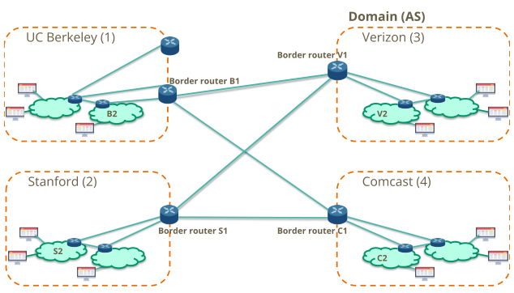
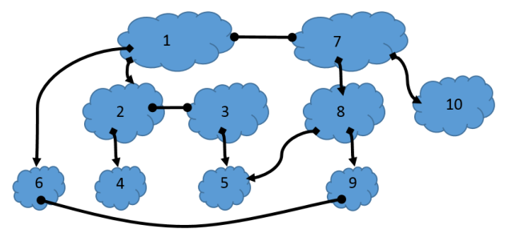
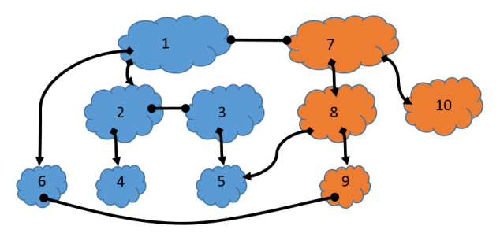

# Berkeley CS168 Spring 2025: Discussion 5: Questions

> Copied from the original: <https://sp25.cs168.io/>. Text and figures are taken from the PDF as is; nothing was answered or rewritten. The original PDF is in this folder.

---

**Page 1**

&emsp;CS 168   Border Gateway Protocol 
&emsp;Spring 2025 
&emsp;&emsp;&emsp;&emsp;&emsp;&emsp;&emsp;&emsp;Discussion 5

&emsp;1   True/False 
1.1   iBGP is used for intradomain routing.

1.2   Avoiding loops is one reason why BGP uses path vector.

1.3   BGP always advertises a shortest path.

1.4   BGP route advertisements use classless addressing.

&emsp;&emsp;&emsp;&emsp;&emsp;&emsp;&emsp;&emsp;1

---

**Page 2**

&emsp;2    Border Gateway Protocol 
&emsp;2   Interdomain vs Intradomain

&emsp;Consider the four ASes in the diagram above. ASes Berkeley, Verizon, Stanford, and Comcast have border 
&emsp;routers B1, V1, S1, and C1 respectively, and internal routers B2, V2, S2, and C2 respectively. 
&emsp;Berkeley and Stanford both use Comcast’s and Verizon’s services. The (fake) cost metrics are 10/MB for 
&emsp;using Comcast’s bandwidth and 20/MB for using Verizon’s bandwidth. 
&emsp;Please answer the following questions with the assumption made in lecture: a border router establishes 
&emsp;iBGP sessions to all other routers within its AS. 
2.1   Which one of eBGP, iBGP, and IGP distributes externally learned routes internally, and which routers, 
&emsp;if any, speak it?

2.2   Which one of eBGP, iBGP, and IGP learns routes to external destinations, and which routers, if any, 
&emsp;speak it?

2.3   Which one of eBGP, iBGP, and IGP provides internal reachability, and which routers, if any, speak it?

2.4   Which AS would Berkeley use to reach Stanford, in terms of cost-effectiveness?

2.5   Given that Comcast now knows Berkeley and Stanford don’t get along with each other, it doesn’t 
&emsp;advertise its route of Berkeley to Stanford, or the other way around. However, Verizon remains neutral. 
&emsp;Which AS would Berkeley use to reach Stanford now?

&emsp;&emsp;&emsp;&emsp;&emsp;&emsp;&emsp;&emsp;2

---

**Page 3**

&emsp;&emsp;&emsp;&emsp;&emsp;&emsp;&emsp;&emsp;Border Gateway Protocol    3 
&emsp;3   BGP 
&emsp;Consider the following configuration of autonomous systems and their relationships.

&emsp;A square-triangle line indicates a provider-customer relationship, and a circle-circle line indicates a peer 
&emsp;relationship. We have two tier 1 providers (1 and 7). 
&emsp;Assume we are using the following selection and export rules for all ASes: 
&emsp;Selection: Prefer to send data through customers \> peers \> providers in order to minimize costs. Export: 
&emsp;To customers, advertise all paths. To all other ASes, advertise only paths to customers (and paths to your 
&emsp;own AS, of course). 
3.1   A user in AS 4 tries to send data to a friend in AS 5. What path (if any) would the data take to get to 
&emsp;the friend?

3.2   A user in AS 6 tries to send data to a friend in AS 5. What path (if any) would the data take to get to 
&emsp;the friend?

3.3   A user in AS 1 tries to send data to another user in AS 9. What path (if any) would the data take?

&emsp;&emsp;&emsp;&emsp;&emsp;&emsp;&emsp;&emsp;3

---

**Page 4**

&emsp;4    Border Gateway Protocol

&emsp;Now assume all autonomous systems are using the same selection policy but also adopting new export 
&emsp;rules because they are part of nation states in an information war. Autonomous systems ranging from 1 
&emsp;to 6 form a group of allies, and autonomous systems ranging from 7 to 10 form another group of allies: 
&emsp;Export: 
&emsp;(a) To a customer AS that is an ally, advertise all paths. 
&emsp;(b) To all other ASes that are allies, advertise only paths to customers. 
&emsp;(c) Advertise nothing to ASes that are not allies. 
3.4   A user in AS 6 tries to send data to their friend in AS 5. Will the friend receive the data?

3.5   Will a user in AS 9 be able to receive data from another in AS 1?

3.6   Imagine AS 10 set up a deal with AS 1 in which AS 1 is to act as a spy for AS 10′s alliance. AS 1 will 
&emsp;advertise all customer paths to AS 7. With this new agreement, AS 10 now wants to report its findings 
&emsp;to AS 5. Will the data be able to get from AS 10 to AS 5? If so, what path would the data take?

&emsp;&emsp;&emsp;&emsp;&emsp;&emsp;&emsp;&emsp;4

