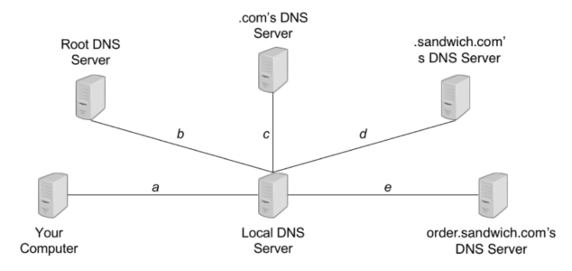

# Berkeley CS168 Spring 2025: Discussion 7: Questions

> Copied from the original: <https://sp25.cs168.io/>. Text and figures are taken from the PDF as is; nothing was answered or rewritten. The original PDF is in this folder.

---

**Page 1**

&emsp;CS 168   Congestion Control 
&emsp;Spring 2025 
&emsp;&emsp;&emsp;&emsp;&emsp;&emsp;&emsp;&emsp;Discussion 7

&emsp;1   True/False 
1.1   UDP uses congestion control.

1.2   Flow control slows down the sender when the network is congested.

1.3   For TCP timer implementations, every time the sender receives an ACK for a previously unACKed packet, 
&emsp;it will recalculate ETO.

1.4   CWND (congestion window) is usually smaller than RWND (receiver window).

1.5   AIMD is the only “fair” option among MIMD, AIAD, MIAD, and AIMD.

&emsp;&emsp;&emsp;&emsp;&emsp;&emsp;&emsp;&emsp;1

---

**Page 2**

&emsp;2    Congestion Control 
&emsp;2   Impact of Fast Recovery 
&emsp;Consider a TCP connection, which is currently in Congestion Avoidance (AIMD): 
&emsp;• The last ACK sequence number was 101. 
&emsp;• The CWND size is 10 (in packets). 
&emsp;• The packets 101−110 were sent at t = 0, 0.1, …, 0.9 (sec), respectively. 
&emsp;• The packet 102 is lost only for its first transmission. 
&emsp;• RTT is 1 second. 
2.1   Without fast recovery: 
&emsp;• On new ACK, CWND +=    1 
&emsp;&emsp;&emsp;&emsp;&emsp;&emsp;&emsp;&emsp;⌊CWND⌋ 
&emsp;• On triple dupACKs, SSTHRESH = ⌊CWND   ⌋, then CWND = SSTHRESH. 
&emsp;&emsp;&emsp;&emsp;&emsp;&emsp;&emsp;&emsp;2 
&emsp;&emsp;Time (sec)   Receive ACK (due to)   CWND   Transmit Seq # (mark retransmits) 
&emsp;&emsp;&emsp;&emsp;10 = 10.11.0   102 (101)   10 + 1   111 
&emsp;&emsp;&emsp;&emsp;1.2   102 (103)   10.1   / 
&emsp;&emsp;&emsp;&emsp;1.3   102 (104)   10.1   / 
&emsp;&emsp;&emsp;&emsp;1.4 
&emsp;&emsp;&emsp;&emsp;1.5 
&emsp;&emsp;&emsp;&emsp;1.6 
&emsp;&emsp;&emsp;&emsp;1.7 
&emsp;&emsp;&emsp;&emsp;1.8 
&emsp;&emsp;&emsp;&emsp;1.9 
&emsp;&emsp;&emsp;&emsp;2.0 
&emsp;&emsp;&emsp;&emsp;2.4

&emsp;&emsp;&emsp;&emsp;&emsp;&emsp;&emsp;&emsp;2

---

**Page 3**

&emsp;&emsp;&emsp;&emsp;&emsp;&emsp;&emsp;&emsp;Congestion Control    3

2.2   With fast recovery: 
&emsp;• On triple dupACKs, SSTHRESH = ⌊CWND   ⌋, then CWND = SSTHRESH + 3, enter fast recovery. 
&emsp;&emsp;&emsp;&emsp;&emsp;&emsp;&emsp;&emsp;2 
&emsp;• In fast recovery, CWND += 1 on every dupACK. 
&emsp;• On new ACK, exit fast recovery, CWND = SSTHRESH. 
&emsp;&emsp;Time (sec)   Receive ACK (due to)   CWND   Transmit Seq # (mark retransmits) 
&emsp;&emsp;&emsp;&emsp;10 = 10.11.0   102 (101)   10 + 1   111 
&emsp;&emsp;&emsp;&emsp;1.2   102 (103)   10.1   / 
&emsp;&emsp;&emsp;&emsp;1.3   102 (104)   10.1   / 
&emsp;&emsp;&emsp;&emsp;1.4 
&emsp;&emsp;&emsp;&emsp;1.5 
&emsp;&emsp;&emsp;&emsp;1.6 
&emsp;&emsp;&emsp;&emsp;1.7 
&emsp;&emsp;&emsp;&emsp;1.8 
&emsp;&emsp;&emsp;&emsp;1.9 
&emsp;&emsp;&emsp;&emsp;2.0 
&emsp;&emsp;&emsp;&emsp;2.4

&emsp;&emsp;&emsp;&emsp;&emsp;&emsp;&emsp;&emsp;3

---

**Page 4**

&emsp;4    Congestion Control 
&emsp;3   AIMD Throughput

&emsp;Consider a generalized version of AIMD, where: 
&emsp;• For every window of data ACK\_ed, the window size increases by a constant 𝐴. 
&emsp;• When the window size reaches 𝑊, a loss occurs, and the window size is multiplied by a constant 𝑀\< 1. 
&emsp;For simplicity, assume that 𝑊(1 −𝑀) is divisible by 𝐴. Thus, the window sizes will cycle through the 
&emsp;following: WM, WM + A, WM + 2A, … W. Let the RTT denote the packet round trip time. A graph of 
&emsp;window size versus time is referenced in the figure above. 
3.1   What is the average throughput? Express your answers in the number of packets, so we do not need to 
&emsp;consider MSS.

3.2   Calculate the loss probability 𝑝, using 𝑊 and 𝑀.

3.3   Derive the formula for throughput in part (a) when 𝑀= 0.5 and 𝐴= 1, using only 𝑝 and RTT.

&emsp;&emsp;&emsp;&emsp;&emsp;&emsp;&emsp;&emsp;4

---

**Page 5**

&emsp;&emsp;&emsp;&emsp;&emsp;&emsp;&emsp;&emsp;Congestion Control    5 
&emsp;4   Domain Name System

&emsp;A sandwich ordering website **www.order.sandwich.com** is accepting online orders for the next 𝑇 
&emsp;minutes. Consider the following setup of DNS servers, with annotated latencies between servers. 
&emsp;Assume that: 
&emsp;• The latency between your computer and the website’s server is 𝑡. 
&emsp;• Once you send an order for a sandwich, you must wait for a confirmation response from the website 
&emsp;&emsp;before issuing another. 
&emsp;• Your computer does not cache the website’s IP address. 
4.1   Your local DNS server doesn’t cache any information.

4.2   Your local DNS server caches responses, with a time-to-live 𝐿≥𝑇.

4.3   Let 𝑇= 600 seconds and 𝑎= 𝑏= 𝑐= 𝑑= 𝑒= 𝑡= 1 second. Your local DNS server caches responses 
&emsp;with a finite TTL of 30 seconds.

&emsp;&emsp;&emsp;&emsp;&emsp;&emsp;&emsp;&emsp;5

