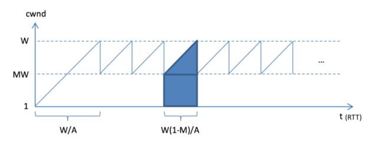

# Berkeley CS168 Spring 2025: Discussion 7: Official solutions

> Copied from the original: <https://sp25.cs168.io/>. Text and figures are taken from the PDF as is; nothing was answered or rewritten. The original PDF is in this folder.

---

**Page 1**

&emsp;CS 168   Congestion Control 
&emsp;Spring 2025 
&emsp;&emsp;&emsp;&emsp;&emsp;&emsp;&emsp;&emsp;Discussion 7

&emsp;1   True/False 
1.1   UDP uses congestion control. 
&emsp;False, TCP uses congestion control. 
1.2   Flow control slows down the sender when the network is congested. 
&emsp;False, flow control ensures the sender doesn’t overflow the receiver’s buffer. 
1.3   For TCP timer implementations, every time the sender receives an ACK for a previously unACKed packet, 
&emsp;it will recalculate ETO. 
&emsp;False, only clean samples are used. For example, ACKs on a packet that have been retransmitted are not 
&emsp;used since the sender cannot be sure which version the ACK is from. 
1.4   CWND (congestion window) is usually smaller than RWND (receiver window). 
&emsp;True. 
1.5   AIMD is the only “fair” option among MIMD, AIAD, MIAD, and AIMD. 
&emsp;True. 
&emsp;2   Impact of Fast Recovery 
&emsp;Consider a TCP connection, which is currently in Congestion Avoidance (AIMD): 
&emsp;• The last ACK sequence number was 101. 
&emsp;• The CWND size is 10 (in packets). 
&emsp;• The packets 101−110 were sent at t = 0, 0.1, …, 0.9 (sec), respectively. 
&emsp;• The packet 102 is lost only for its first transmission. 
&emsp;• RTT is 1 second. 
2.1   Without fast recovery: 
&emsp;• On new ACK, CWND += 1 
&emsp;&emsp;&emsp;&emsp;&emsp;&emsp;&emsp;&emsp;⌊CWND⌋ 
&emsp;• On triple dupACKs, SSTHRESH = ⌊CWND   ⌋, then CWND = SSTHRESH. 
&emsp;&emsp;&emsp;&emsp;&emsp;&emsp;&emsp;&emsp;2 
&emsp;&emsp;Time (sec)   Receive ACK (due to)   CWND   Transmit Seq # (mark retransmits) 
&emsp;&emsp;&emsp;&emsp;10 = 10.1102 (101)1.010 + 1   111 
&emsp;&emsp;&emsp;&emsp;1.2   102 (103)   10.1   / 
&emsp;&emsp;&emsp;&emsp;1.3   102 (104)   10.1   /

&emsp;&emsp;&emsp;&emsp;&emsp;&emsp;&emsp;&emsp;1

---

**Page 2**

&emsp;2    Congestion Control

&emsp;&emsp;Time (sec)   Receive ACK (due to)   CWND   Transmit Seq # (mark retransmits) 
&emsp;&emsp;&emsp;&emsp;1.4 
&emsp;&emsp;&emsp;&emsp;&emsp;&emsp;&emsp;&emsp;2 ⌋= 5102 (105)   ⌊10.1   102 (Rx) 
&emsp;&emsp;&emsp;&emsp;1.5 
&emsp;&emsp;&emsp;&emsp;&emsp;&emsp;&emsp;&emsp;102 (106)   5   / 
&emsp;&emsp;&emsp;&emsp;1.6 
&emsp;&emsp;&emsp;&emsp;&emsp;&emsp;&emsp;&emsp;102 (107)   5   / 
&emsp;&emsp;&emsp;&emsp;1.7 
&emsp;&emsp;&emsp;&emsp;&emsp;&emsp;&emsp;&emsp;102 (108)   5   / 
&emsp;&emsp;&emsp;&emsp;1.8 
&emsp;&emsp;&emsp;&emsp;&emsp;&emsp;&emsp;&emsp;102 (109)   5   / 
&emsp;&emsp;&emsp;&emsp;1.9 
&emsp;&emsp;&emsp;&emsp;&emsp;&emsp;&emsp;&emsp;102 (110)   5   / 
&emsp;&emsp;&emsp;&emsp;2.0 
&emsp;&emsp;&emsp;&emsp;&emsp;&emsp;&emsp;&emsp;102 (111)   5   / 
&emsp;&emsp;&emsp;&emsp;2.4 
&emsp;&emsp;&emsp;&emsp;&emsp;&emsp;&emsp;&emsp;5 = 5.2112 (102)   5 + 1   112 - 116

2.2   With fast recovery: 
&emsp;• On triple dupACKs, SSTHRESH = ⌊CWND   ⌋, then CWND = SSTHRESH + 3, enter fast recovery. 
&emsp;&emsp;&emsp;&emsp;&emsp;&emsp;&emsp;&emsp;2 
&emsp;• In fast recovery, CWND += 1 on every dupACK. 
&emsp;• On new ACK, exit fast recovery, CWND = SSTHRESH. 
&emsp;&emsp;Time (sec)   Receive ACK (due to)   CWND   Transmit Seq # (mark retransmits) 
&emsp;&emsp;&emsp;&emsp;10 = 10.11.0   102 (101)   10 + 1   111 
&emsp;&emsp;&emsp;&emsp;1.2   102 (103)   10.1   / 
&emsp;&emsp;&emsp;&emsp;1.3   102 (104)   10.1   / 
&emsp;&emsp;&emsp;&emsp;1.4 
&emsp;&emsp;&emsp;&emsp;&emsp;&emsp;&emsp;&emsp;2 ⌋+ 3 = 8102 (105)   ⌊10.1   102 (Rx) 
&emsp;&emsp;&emsp;&emsp;1.5 
&emsp;&emsp;&emsp;&emsp;&emsp;&emsp;&emsp;&emsp;102 (106)   9   / 
&emsp;&emsp;&emsp;&emsp;1.6 
&emsp;&emsp;&emsp;&emsp;&emsp;&emsp;&emsp;&emsp;102 (107)   10   / 
&emsp;&emsp;&emsp;&emsp;1.7 
&emsp;&emsp;&emsp;&emsp;&emsp;&emsp;&emsp;&emsp;102 (108)   11   112 
&emsp;&emsp;&emsp;&emsp;1.8 
&emsp;&emsp;&emsp;&emsp;&emsp;&emsp;&emsp;&emsp;102 (109)   12   113 
&emsp;&emsp;&emsp;&emsp;1.9 
&emsp;&emsp;&emsp;&emsp;&emsp;&emsp;&emsp;&emsp;102 (110)   13   114 
&emsp;&emsp;&emsp;&emsp;2.0 
&emsp;&emsp;&emsp;&emsp;&emsp;&emsp;&emsp;&emsp;102 (111)   14   115 
&emsp;&emsp;&emsp;&emsp;2.4 
&emsp;&emsp;&emsp;&emsp;&emsp;&emsp;&emsp;&emsp;112 (102)   SSTHRESH = 5   116

&emsp;Note: Three dupACKs = 1 regular ACK + 3 ACKs of a sequence number that have been ACKed before already, 
&emsp;so we retransmit on the 4th ACK of seq 102.

&emsp;&emsp;&emsp;&emsp;&emsp;&emsp;&emsp;&emsp;2

---

**Page 3**

&emsp;&emsp;&emsp;&emsp;&emsp;&emsp;&emsp;&emsp;Congestion Control    3 
&emsp;3   AIMD Throughput

&emsp;Consider a generalized version of AIMD, where: 
&emsp;• For every window of data ACK\_ed, the window size increases by a constant 𝐴. 
&emsp;• When the window size reaches 𝑊, a loss occurs, and the window size is multiplied by a constant 𝑀\< 1. 
&emsp;For simplicity, assume that 𝑊(1 −𝑀) is divisible by 𝐴. Thus, the window sizes will cycle through the 
&emsp;following: WM, WM + A, WM + 2A, … W. Let the RTT denote the packet round trip time. A graph of 
&emsp;window size versus time is referenced in the figure above. 
3.1   What is the average throughput? Express your answers in the number of packets, so we do not need to 
&emsp;consider MSS. 
&emsp;2× RTT = 𝑊(𝑀+1)Throughput = Average number of packets in flight    = (MW+𝑊) 
&emsp;&emsp;&emsp;&emsp;&emsp;&emsp;&emsp;&emsp;RTT   2× RTT 
3.2   Calculate the loss probability 𝑝, using 𝑊 and 𝑀. 
&emsp;We have one drop out of every 𝑊(1−𝑀)   × MW+𝑊    packets sent (the area of the shaded trapezoid in the 
&emsp;&emsp;&emsp;&emsp;&emsp;&emsp;&emsp;&emsp;𝐴   2 
&emsp;plot). Thus, the loss probability is: 
&emsp;𝑝= =1   2𝐴 
&emsp;&emsp;&emsp;×MW +𝑊𝑊(1−𝑀)𝑊2(1−𝑀2) 
&emsp;&emsp;&emsp;&emsp;𝐴   2 
3.3   Derive the formula for throughput in part (a) when 𝑀= 0.5 and 𝐴= 1, using only 𝑝 and RTT. 
&emsp;Throughput = 𝑊(𝑀+1)   3𝑊 
&emsp;&emsp;&emsp;&emsp;&emsp;&emsp;2× RTT = 
&emsp;&emsp;&emsp;&emsp;&emsp;&emsp;&emsp;&emsp;4× RTT 
&emsp;0.75𝑊2 =𝑊2(1−𝑀2) =p = 2𝐴   2   8 
&emsp;&emsp;&emsp;&emsp;&emsp;&emsp;&emsp;&emsp;3𝑊2 
&emsp;3𝑝 from the loss probability 𝑝, and plug this into the throughput equation:We get 𝑊= √8 
&emsp;&emsp;&emsp;&emsp;&emsp;&emsp;&emsp;&emsp;3×√8 
&emsp;RTT =4× RTT = √3𝑝4× RTT =Throughput = RTT√33𝑊   9×8   1   1 
&emsp;&emsp;&emsp;&emsp;&emsp;&emsp;&emsp;&emsp;16×3×𝑝   2𝑝

&emsp;&emsp;&emsp;&emsp;&emsp;&emsp;&emsp;&emsp;3

---

**Page 4**

&emsp;4    Congestion Control 
&emsp;4   Domain Name System

&emsp;A sandwich ordering website **www.order.sandwich.com** is accepting online orders for the next 𝑇 
&emsp;minutes. Consider the following setup of DNS servers, with annotated latencies between servers. 
&emsp;Assume that: 
&emsp;• The latency between your computer and the website’s server is 𝑡. 
&emsp;• Once you send an order for a sandwich, you must wait for a confirmation response from the website 
&emsp;&emsp;before issuing another. 
&emsp;• Your computer does not cache the website’s IP address. 
4.1   Your local DNS server doesn’t cache any information. 
&emsp;Your computer begins by issuing a DNS query for **www.order.sandwich.com** to its local DNS server, 
&emsp;which takes time 𝑎. Your local DNS server then iteratively queries the root DNS server, **.com**’s DNS 
&emsp;server, **.sandwich.com**’s DNS server, and **order.sandwich.com**’s DNS server, which takes time 2𝑏+ 
&emsp;2𝑐+ 2𝑑+ 2𝑒. It then returns the result of the query to you, which takes time 𝑎. 
&emsp;After obtaining the IP address, your computer issues a sandwich request to **www.order.sandwich.** 
&emsp;**com**, which responds with an order confirmation, taking time 2𝑡. 
&emsp;The total time per sandwich order is: **2𝑎+ 2𝑏+ 2𝑐+ 2𝑑+ 2𝑒+ 2𝑡** 
&emsp;**2𝑎+2𝑏+2𝑐+2𝑑+2𝑒+2𝑡⌋**Thus, the total number of sandwiches that can be ordered in time 𝑇 is: **⌊**   **𝑇**

&emsp;&emsp;&emsp;&emsp;&emsp;&emsp;&emsp;&emsp;4

---

**Page 5**

&emsp;&emsp;&emsp;&emsp;&emsp;&emsp;&emsp;&emsp;Congestion Control    5

4.2   Your local DNS server caches responses, with a time-to-live 𝐿≥𝑇. 
&emsp;If 𝐿≥𝑇, once the result of the DNS query for **www.order.sandwich.com** is cached, it remains cached 
&emsp;in our local DNS server until the website’s server ultimately goes down. 
&emsp;• The first query takes the same amount of time as before: 2𝑎+ 2𝑏+ 2𝑐+ 2𝑑+ 2𝑒+ 2𝑡 
&emsp;• Subsequent queries take only **2𝑎+ 2𝑡**, since the local DNS server can now provide the IP imme- 
&emsp;&emsp;diately. 
&emsp;Thus, the total number of sandwiches we can order is: 
&emsp;&emsp;&emsp;&emsp;&emsp;&emsp;&emsp;{1 + ⌊𝑇−(2𝑎+2𝑏+2𝑐+2𝑑+2𝑒+2𝑡) 
&emsp;&emsp;&emsp;&emsp;&emsp;&emsp;&emsp;&emsp;⌋if 𝑇≥2𝑎+ 2𝑏+ 2𝑐+ 2𝑑+ 2𝑒+ 2𝑡 
&emsp;&emsp;&emsp;&emsp;&emsp;&emsp;&emsp;&emsp;2𝑎+2𝑡 
&emsp;&emsp;&emsp;&emsp;&emsp;&emsp;&emsp;0 otherwise

4.3   Let 𝑇= 600 seconds and 𝑎= 𝑏= 𝑐= 𝑑= 𝑒= 𝑡= 1 second. Your local DNS server caches responses 
&emsp;with a finite TTL of 30 seconds. 
&emsp;When the first DNS query is made, the response gets cached in the local DNS server at: 
&emsp;𝑎+ 2𝑏+ 2𝑐+ 2𝑑+ 2𝑒= 9 seconds 
&emsp;This response remains cached for 30 seconds, expiring at time 39 seconds. 
&emsp;• The first order is completed at time: 12 seconds (9𝑠+ 𝑎+ 2𝑡) 
&emsp;• Additional orders can be placed from time 12 to 39, each taking 4 seconds (2𝑎+ 2𝑡). 
&emsp;• The number of orders made during this cached period is: ⌈39−12   ⌉= 7 
&emsp;&emsp;&emsp;&emsp;&emsp;&emsp;&emsp;&emsp;4 
&emsp;40 = 15• The pattern repeats every 40 seconds (𝑇= 600 allows for 15 cycles): 600 
&emsp;• Total sandwiches ordered: 15 × (7 + 1) = 120 
&emsp;Not bad!

&emsp;&emsp;&emsp;&emsp;&emsp;&emsp;&emsp;&emsp;5

