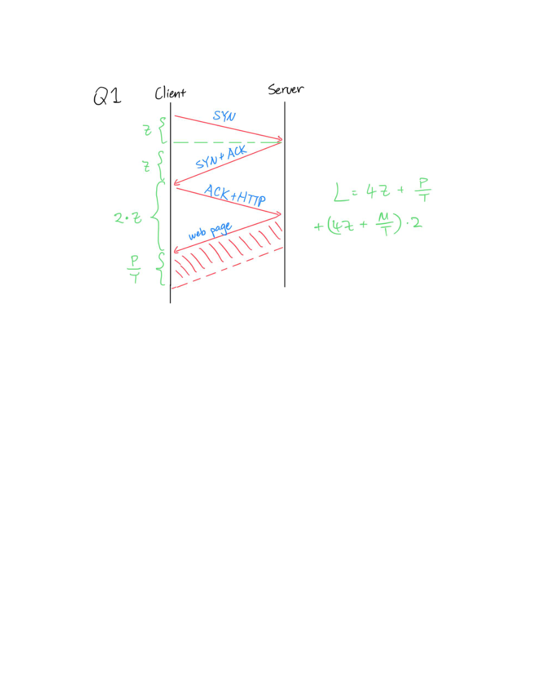
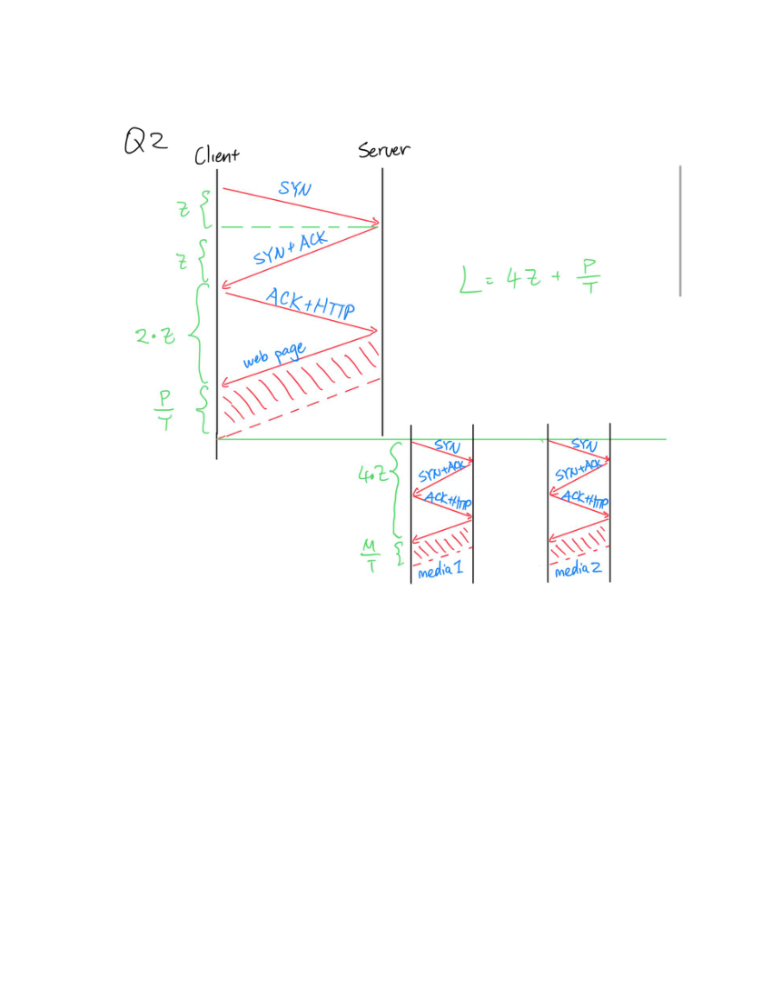
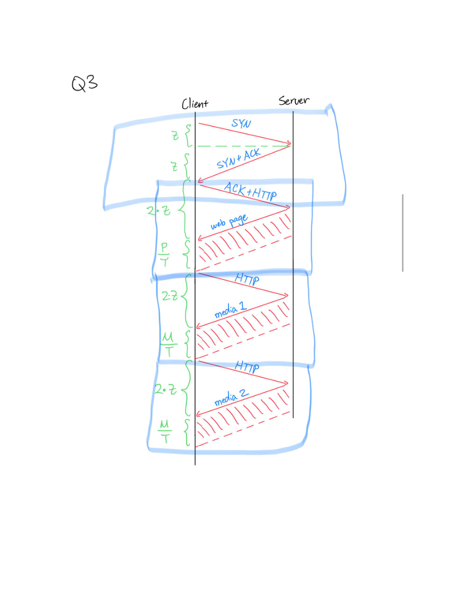
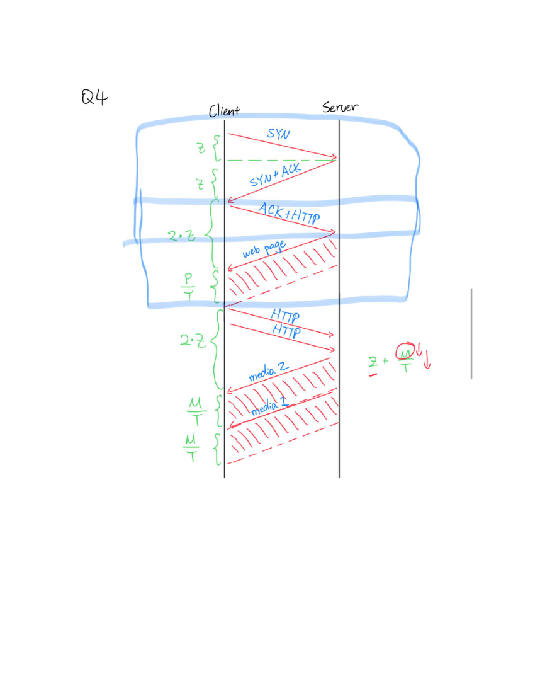
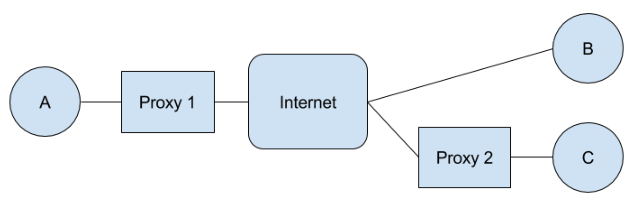
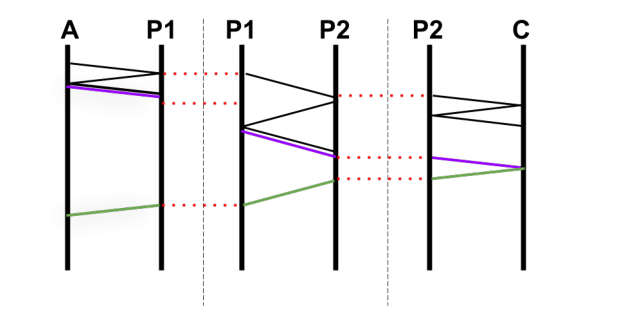
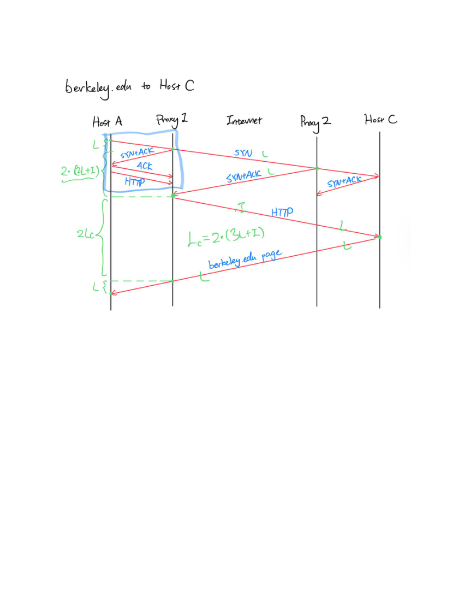
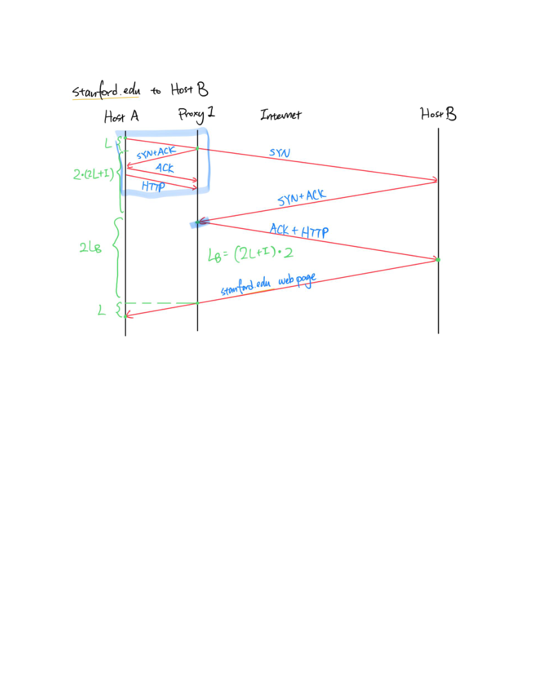
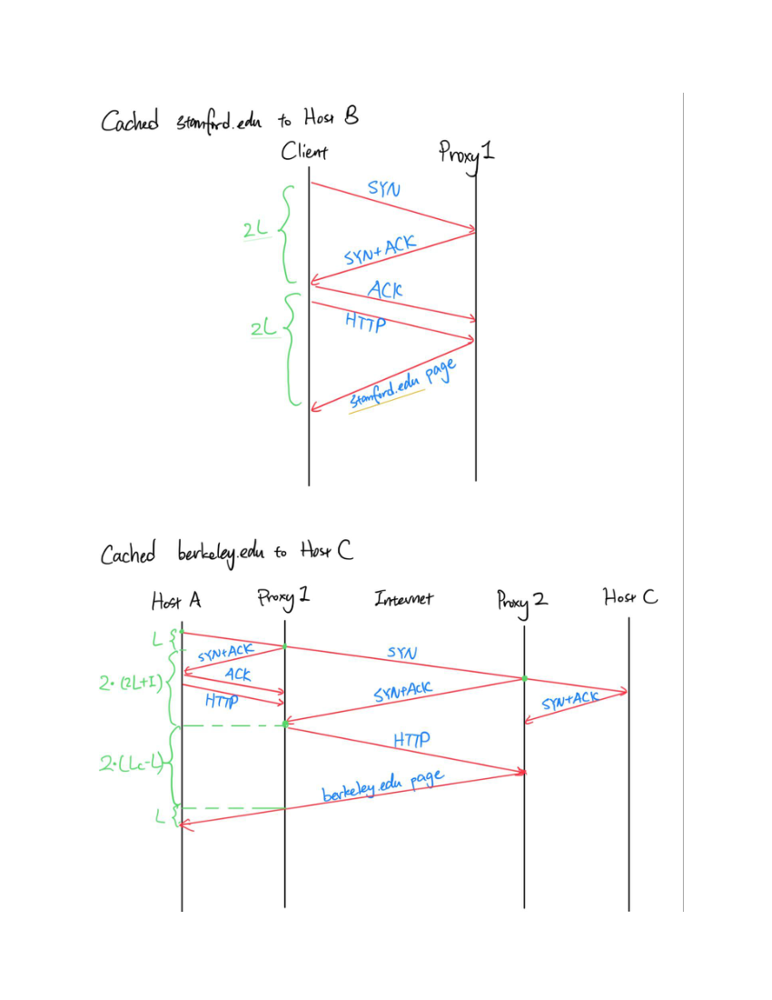

# Berkeley CS168 Spring 2025: Discussion 8: Official solutions

> Copied from the original: <https://sp25.cs168.io/>. Text and figures are taken from the PDF as is; nothing was answered or rewritten. The original PDF is in this folder.

---

**Page 1**

&emsp;CS 168   DNS, HTTP, Ethernet 
&emsp;Spring 2025 
&emsp;&emsp;&emsp;&emsp;&emsp;&emsp;&emsp;&emsp;Discussion 8 
&emsp;1   True/False 
1.1   Pipelined connections are frequently used in practice. 
&emsp;False. Pipelined connections are not commonly used because of (a) bugs and (b) head-of-line blocking. 
&emsp;HTTP2 uses multiplexing which avoids these shortcomings. 
1.2   Hosts usually perform the iterative DNS resolution process themselves. 
&emsp;False; hosts use local DNS servers to perform DNS lookup. 
1.3   Every zone always has at least 2 name servers. 
&emsp;True. 
1.4   When looking up a root server, BGP will use unicast to find the correct root server. 
&emsp;False; BGP uses anycast to find the closest root server. 
1.5   A client can establish a TCP connection with a root server. 
&emsp;False; TCP requires keeping the state, but anycast does not guarantee all the packets of the same 
&emsp;connection are sent to the same root server. 
1.6   Most queries to DNS root servers are for nonexistent TLDs. 
&emsp;True. 
&emsp;2   Domain Name System

&emsp;&emsp;&emsp;&emsp;&emsp;&emsp;&emsp;&emsp;1

---

**Page 2**

&emsp;2 
&emsp;&emsp;&emsp;DNS, HTTP, Ethernet 
&emsp;A sandwich ordering website **www.order.sandwich.com** is accepting online orders for the next 𝑇 
&emsp;minutes. Consider the following setup of DNS servers, with annotated latencies between servers. 
&emsp;Assume that: 
&emsp;• The latency between your computer and the website’s server is 𝑡. 
&emsp;• Once you send an order for a sandwich, you must wait for a confirmation response from the website 
&emsp;&emsp;before issuing another. 
&emsp;• Your computer does not cache the website’s IP address. 
2.1   Your local DNS server doesn’t cache any information. 
&emsp;Your computer begins by issuing a DNS query for **www.order.sandwich.com** to its local DNS server, 
&emsp;which takes time 𝑎. Your local DNS server then iteratively queries the root DNS server, **.com**’s DNS 
&emsp;server, **.sandwich.com**’s DNS server, and **order.sandwich.com**’s DNS server, which takes time 2𝑏+ 
&emsp;2𝑐+ 2𝑑+ 2𝑒. It then returns the result of the query to you, which takes time 𝑎. 
&emsp;After obtaining the IP address, your computer issues a sandwich request to **www.order.sandwich.** 
&emsp;**com**, which responds with an order confirmation, taking time 2𝑡. 
&emsp;The total time per sandwich order is: **2𝑎+ 2𝑏+ 2𝑐+ 2𝑑+ 2𝑒+ 2𝑡** 
&emsp;Thus, the total number of sandwiches that can be ordered in time 𝑇 is: **⌊**   **𝑇** 
&emsp;&emsp;&emsp;&emsp;&emsp;&emsp;&emsp;&emsp;**2𝑎+2𝑏+2𝑐+2𝑑+2𝑒+2𝑡⌋** 
2.2   Your local DNS server caches responses, with a time-to-live 𝐿≥𝑇. 
&emsp;If 𝐿≥𝑇, once the result of the DNS query for **www.order.sandwich.com** is cached, it remains cached 
&emsp;in our local DNS server until the website’s server ultimately goes down. 
&emsp;• The first query takes the same amount of time as before: 2𝑎+ 2𝑏+ 2𝑐+ 2𝑑+ 2𝑒+ 2𝑡 
&emsp;• Subsequent queries take only **2𝑎+ 2𝑡**, since the local DNS server can now provide the IP imme- 
&emsp;&emsp;diately. 
&emsp;Thus, the total number of sandwiches we can order is: 
&emsp;&emsp;&emsp;&emsp;&emsp;&emsp;&emsp;{1 + ⌊𝑇−(2𝑎+2𝑏+2𝑐+2𝑑+2𝑒+2𝑡) 
&emsp;&emsp;&emsp;&emsp;&emsp;&emsp;&emsp;&emsp;⌋if 𝑇≥2𝑎+ 2𝑏+ 2𝑐+ 2𝑑+ 2𝑒+ 2𝑡 
&emsp;&emsp;&emsp;&emsp;&emsp;&emsp;&emsp;&emsp;2𝑎+2𝑡 
&emsp;&emsp;&emsp;&emsp;&emsp;&emsp;&emsp;0 otherwise

&emsp;&emsp;&emsp;&emsp;&emsp;&emsp;&emsp;&emsp;2

---

**Page 3**

&emsp;&emsp;&emsp;&emsp;&emsp;&emsp;&emsp;&emsp;DNS, HTTP, Ethernet    3 
2.3   Let 𝑇= 600 seconds and 𝑎= 𝑏= 𝑐= 𝑑= 𝑒= 𝑡= 1 second. Your local DNS server caches responses 
&emsp;with a finite TTL of 30 seconds. 
&emsp;When the first DNS query is made, the response gets cached in the local DNS server at: 
&emsp;𝑎+ 2𝑏+ 2𝑐+ 2𝑑+ 2𝑒= 9 seconds 
&emsp;This response remains cached for 30 seconds, expiring at time 39 seconds. 
&emsp;• The first order is completed at time: 12 seconds (9𝑠+ 𝑎+ 2𝑡) 
&emsp;• Additional orders can be placed from time 12 to 39, each taking 4 seconds (2𝑎+ 2𝑡). 
&emsp;• The number of orders made during this cached period is: ⌈39−12 
&emsp;&emsp;&emsp;&emsp;&emsp;&emsp;&emsp;&emsp;⌉= 7 
&emsp;&emsp;&emsp;&emsp;&emsp;&emsp;&emsp;&emsp;4 
&emsp;• The pattern repeats every 40 seconds (𝑇= 600 allows for 15 cycles): 600 
&emsp;&emsp;&emsp;&emsp;&emsp;&emsp;&emsp;&emsp;40 = 15 
&emsp;• Total sandwiches ordered: 15 × (7 + 1) = 120 
&emsp;Not bad! 
&emsp;3   Performance 
&emsp;We want to download a webpage. We must first download the HTML (size 𝑃). This HTML includes URLs 
&emsp;for two embedded images of size 𝑀 which need to then be loaded. Assume the following: 
&emsp;• SYN, ACK, SYNACK, and HTTP request packets are small and take time 𝑧 to reach their destination in 
&emsp;&emsp;either direction. 
&emsp;• Each of our HTTP connections can achieve throughput 𝑇 for sending files and web pages across the 
&emsp;&emsp;network unless there are concurrent connections, in which case each connection’s throughput is divided 
&emsp;&emsp;by the number of concurrent connections. 
&emsp;• You never need to wait for TCP connections to terminate. 
&emsp;For each of the following scenarios, compute the total time to download the web page and both media files. 
3.1   Sequential requests with non-persistent TCP connections. 
&emsp;𝑇+ 𝑧) (actual webpage)(a) 2𝑧 (SYN + SYNACK) +𝑧 (ACK/HTTP request) +(𝑃 
&emsp;𝑇+ 𝑧) (first media file)(b) 2𝑧 (SYN + SYNACK) +𝑧 (ACK/HTTP request) +(𝑀 
&emsp;𝑇+ 𝑧) (second media file)(c) 2𝑧 (SYN + SYNACK) +𝑧 (ACK/HTTP request) +(𝑀 
&emsp;𝑇+ 2𝑀Total = 12𝑧+ 𝑃 
&emsp;&emsp;&emsp;&emsp;&emsp;&emsp;&emsp;&emsp;𝑇 
3.2   Concurrent requests with non-persistent TCP connections. 
&emsp;𝑇+ 𝑧) (actual webpage)(a) 2𝑧 (SYN + SYNACK) +𝑧 (ACK/HTTP request) +(𝑃 
&emsp;(b) 2𝑧 (SYNs + SYNACKs) +𝑧 (ACKs/HTTP requests) +( 𝑀 
&emsp;&emsp;&emsp;&emsp;&emsp;&emsp;&emsp;&emsp;2 ) + 𝑧) 
&emsp;&emsp;&emsp;&emsp;&emsp;&emsp;&emsp;&emsp;(𝑇 
&emsp;𝑇+ 2𝑀Total = 8𝑧+ 𝑃 
&emsp;&emsp;&emsp;&emsp;&emsp;&emsp;&emsp;&emsp;𝑇

&emsp;&emsp;&emsp;&emsp;&emsp;&emsp;&emsp;&emsp;3

---

**Page 4**

&emsp;4 
&emsp;&emsp;&emsp;DNS, HTTP, Ethernet 
3.3   Sequential requests with a single persistent TCP connection. 
&emsp;𝑇+ 𝑧) (actual webpage)(a) 2𝑧 (SYN + SYNACK) +𝑧 (ACK / HTTP request) +(𝑃 
&emsp;𝑇+ 𝑧) (first media file)(b) 𝑧 (HTTP request) +(𝑀 
&emsp;𝑇+ 𝑧) (second media file)(c) 𝑧 (HTTP request) +(𝑀 
&emsp;𝑇+ 2𝑀Total = 8𝑧+ 𝑃 
&emsp;&emsp;&emsp;&emsp;&emsp;&emsp;&emsp;&emsp;𝑇 
3.4   Pipelined requests within a single persistent TCP connection. 
&emsp;𝑇+ 𝑧) (actual webpage)(a) 2𝑧 (SYN + SYNACK) +𝑧 (ACK / HTTP request) +(𝑃 
&emsp;(b) 𝑧 (Both HTTP requests) 
&emsp;(c)   𝑇 (first media file) 
&emsp;&emsp;&emsp;𝑀 
&emsp;𝑇+ 𝑧) (second media file)(d) (𝑀 
&emsp;𝑇+ 2𝑀Total = 6𝑧+ 𝑃   𝑇 Note: The second media file can begin to be sent immediately after the first is 
&emsp;pushed onto the wire; hence, we don’t need to account for the propagation delay of the first file in our 
&emsp;calculation. 
3.5   We have been assuming that the throughput for sending media files is 𝑇 for a single connection, and 
&emsp;𝑇𝑛 for 𝑛 concurrent connections. Remember that the throughput for sending the media files depends on 
&emsp;both its transmission delay and propagation delay. So far we ignored this finer granularity division but 
&emsp;depending on the size of the media files, we can make more inferences about how fast we can send the 
&emsp;media files. If the media files are very small, what kind of delay would dominate the time it would take 
&emsp;to send them? What if the files are very large? 
&emsp;If the media files are very small, then transmission delay is small, so propagation delay dominates. If 
&emsp;the media files are very large, then transmission delay is large, and so dominates. 
&emsp;Takeaway: Adding concurrency, re-using existing TCP connections, and pipelining all help to speed 
&emsp;up end-to-end page loads.

&emsp;&emsp;&emsp;&emsp;&emsp;&emsp;&emsp;&emsp;4

---

**Page 5**

---

**Page 6**

---

**Page 7**

---

**Page 8**

---

**Page 9**

&emsp;&emsp;&emsp;&emsp;&emsp;&emsp;&emsp;&emsp;DNS, HTTP, Ethernet    5 
&emsp;4   HTTP

&emsp;Consider the (abstracted) network topology above. Hosts A and C are connected to HTTP proxies that 
&emsp;cache the results of the last two HTTP requests they’ve seen to improve performance. The proxy will 
&emsp;perform any TCP handshakes or teardowns with the client and server concurrently. That is, when it gets 
&emsp;a SYN from a client, it will respond and immediately send a SYN to the server, and similarly for other 
&emsp;messages. 
&emsp;As an example, let’s suppose that A sends a request to B. A sends a SYN to B, which is intercepted by the 
&emsp;proxy. The proxy sees the request is going to B, and initiates its own TCP handshake with B, all the while 
&emsp;completing the original, separate handshake with A. By the time this has completed, there will be 2 TCP 
&emsp;sessions: the first between A and the proxy, and the second between the proxy and B. When A sends a 
&emsp;request, the proxy will forward it to B if it is not cached, or respond if it is cached. A similar process to 
&emsp;the handshake is followed when A tears the connection down. 
&emsp;For the purposes of this problem, assume that the latency on each link is 𝐿, and the latency through the 
&emsp;internet is 𝐼. Processing delay at all points and packet size is assumed to be negligible (don’t consider 
&emsp;transmission and processing delay). Assume that TCP connections use the 3-message teardown, and that 
&emsp;no data is sent in ACK packets. 
&emsp;Suppose that Host A issues the following list of requests (in order): 
&emsp;• berkeley.edu to Host C 
&emsp;• eecs.berkeley.edu to Host C 
&emsp;• stanford.edu to Host B 
&emsp;• mit.edu to Host B 
&emsp;• stanford.edu to Host B 
&emsp;• berkeley.edu to Host C 
4.1   What is the total time to complete all requests if they are issued one at a time? That is, each completes 
&emsp;before the next is started with a separate TCP session (no need to wait for the session to be torn down).

&emsp;&emsp;&emsp;&emsp;&emsp;&emsp;&emsp;&emsp;5

---

**Page 10**

6 
&emsp;&emsp;DNS, HTTP, Ethernet 
To set up a connection to B, A will initiate a TCP connection with P1, which will establish a connection 
to B. The total time to establish the connection is the time for the SYN to reach P1 plus the time it takes 
P1 to establish a connection to B: 𝐿+ 2(2𝐿+ 𝐼) 
Since the proxy will send the request from A right after sending the ACK. Note: The SYNACK from P1 
to A and SYN from P1 to B occurs concurrently, so we could write the term 2(2𝐿+ 𝐼) in the equation 
&emsp;&emsp;&emsp;&emsp;&emsp;&emsp;&emsp;&emsp;max(𝐿, 
2(2𝐿+ 𝐼)), but that is equivalent to 2(2𝐿+ 𝐼).above more precisely as 
To set up a connection to C, A will initiate a TCP connection with P1, which will do so with P2 (who it 
thinks is C), which will then do so with C. Similarly to before, the time this takes is: 𝐿+ 2(2𝐿+ 𝐼) 
Since the longest delay is between the two proxies, that’s all we need to consider. Since this time is the 
same for both servers, we’ll call it 𝑆, the setup time. 
In all cases, A will complete its handshake with its proxy before the proxy finishes its handshake with 
the server. Therefore, the HTTP request from Host A will have already arrived at P1 and will be sent 
immediately after the proxy P1 finishes its handshake. This means that in the total request time for 
requests to B and C, the latency from A to P1 doesn’t matter. This total request time is only affected by 
the latency from P1 to hosts B and C. 
The latency from P1 to B is: 2𝐿+ 𝐼 We’ll call this 𝐿𝐵. 
The latency from P1 to C is: 3𝐿+ 𝐼 We’ll call this 𝐿𝐶. 
Even though they share the same subdomain base, the first request (berkeley.edu) and the second request 
(eecs.berkeley.edu) go to different servers (since eecs.berkeley.edu is hosted in a different place than 
berkeley.edu)—so they won’t be helped by the cache. Therefore, they take: 𝑆+ 2𝐿𝐶+ 𝐿 time each. 
The third and fourth requests are similar, taking: 𝑆+ 2𝐿𝐵+ 𝐿 time each. 
The fifth request hits P1’s cache, only taking: 2𝐿+ 2𝐿 time. 
The sixth request hits P2’s cache, taking: 𝑆+ 2(𝐿𝐶−𝐿) + 𝐿 time. 
Therefore, the total time is: 2(𝑆+ 2𝐿𝐶+ 𝐿) + 2(𝑆+ 2𝐿𝐵+ 𝐿) + 4𝐿+ 𝑆+ 2(𝐿𝐶−𝐿) + 𝐿= 2𝑆+ 
4𝐿𝐶+ 2𝐿+ 2𝑆+ 4𝐿𝐵+ 2𝐿+ 4𝐿+ 𝑆+ 2𝐿𝐶−2𝐿+ 𝐿= 5𝑆+ 6𝐿𝐶+ 4𝐿𝐵+ 7𝐿= 5(5𝐿+ 2𝐼) + 
6(3𝐿+ 𝐼) + 4(2𝐿+ 𝐼) + 7𝐿= 25𝐿+ 10𝐼+ 18𝐿+ 6𝐼+ 8𝐿+ 4𝐼+ 7𝐿= 58𝐿+ 20𝐼

&emsp;&emsp;&emsp;&emsp;&emsp;&emsp;&emsp;&emsp;6

---

**Page 11**

&emsp;&emsp;&emsp;&emsp;&emsp;&emsp;&emsp;&emsp;DNS, HTTP, Ethernet    7 
4.2   What is the total time to complete all requests if they are performed concurrently such that everything 
&emsp;is done in parallel and there is no possibility for caching? 
&emsp;Since all the requests occur concurrently, there is no opportunity for caching by the proxies. Therefore, 
&emsp;the total time is just the max of all the times for the individual requests, which is the first request. It 
&emsp;takes: 𝑆+ 2𝐿𝐶+ 𝐿= 5𝐿+ 2𝐼+ 2(3𝐿+ 𝐼) + 𝐿= 5𝐿+ 2𝐼+ 6𝐿+ 2𝐼+ 𝐿= 12𝐿+ 4𝐼

&emsp;&emsp;&emsp;&emsp;&emsp;&emsp;&emsp;&emsp;7

---

**Page 12**

---

**Page 13**

---

**Page 14**

