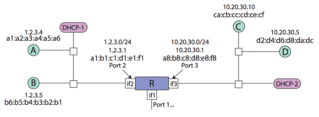

# Berkeley CS168 Spring 2025: Discussion 9: Questions

> Copied from the original: <https://sp25.cs168.io/>. Text and figures are taken from the PDF as is; nothing was answered or rewritten. The original PDF is in this folder.

---

**Page 1**

&emsp;CS 168   ARP, DHCP, NAT 
&emsp;Spring 2025 
&emsp;&emsp;&emsp;&emsp;&emsp;&emsp;&emsp;&emsp;Discussion 9

&emsp;1   Multiple Choice 
1.1   NAT allows multiple hosts to share the same IP address in a way that conforms to the E2E principle.

1.2   Port numbers are used to multiplex among hosts behind the same NAT.

1.3   Which protocol does a host use to learn its own IP address? 
&emsp;(a) DHCP    (d) ICMP 
&emsp;(b) DNS    (e) None of these 
&emsp;(c) ARP

1.4   Which protocol does a host use to learn its own MAC address? 
&emsp;(a) DHCP    (d) ICMP 
&emsp;(b) DNS    (e) None of these 
&emsp;(c) ARP

1.5   Which protocol does a host use to learn the MAC address of another host on the same network? 
&emsp;(a) DHCP    (d) ICMP 
&emsp;(b) DNS    (e) None of these 
&emsp;(c) ARP

1.6   DHCP is a protocol in which of the following layers?

&emsp;&emsp;&emsp;&emsp;&emsp;&emsp;&emsp;&emsp;1

---

**Page 2**

&emsp;2    ARP, DHCP, NAT

&emsp;(a) Physical    (d) Transport 
&emsp;(b) Datalink    (e) Application 
&emsp;(c) Network

1.7   ARP is a protocol in which of the following layers? 
&emsp;(a) Physical    (d) Transport 
&emsp;(b) Datalink    (e) Application 
&emsp;(c) Network

1.8   Which of the following can a host learn with DHCP? Select all that apply. 
&emsp;(a) Its own MAC address.    (b) Its own IP address. 
&emsp;(c) The MAC address of another host.    (d) The IP address of another host. 
&emsp;(e) The IP address of its first-hop router.    (f) The MAC address of its first-hop router. 
&emsp;(g) Its own subnet mask.

&emsp;&emsp;&emsp;&emsp;&emsp;&emsp;&emsp;&emsp;2

---

**Page 3**

&emsp;&emsp;&emsp;&emsp;&emsp;&emsp;&emsp;&emsp;ARP, DHCP, NAT    3 
&emsp;2   Host-to-Host

&emsp;Consider the above topology. Here, two networks are connected through router 𝑅. 𝑅 has three interfaces, 
&emsp;each associated with a port, MAC address, IP address, and subnet. 
&emsp;We are going to consider what happens when 𝐴 sends a packet to 𝐶. Assume that 𝐴 just attached to the 
&emsp;network, but already knows the IP address of 𝐶 (10.20.30.10). No hosts or routers have sent any previous 
&emsp;ARP requests. 
2.1   First 𝐴 needs to learn its own IP address, subnet mask, and the IP of its first-hop router by using DHCP. 
&emsp;For each of the following DHCP messages, indicate the message’s timing in the packet exchange (1 is 
&emsp;first, 4 is last), who sends the message, and whether the message is broadcast or unicast. 
&emsp;&emsp;&emsp;&emsp;&emsp;&emsp;&emsp;&emsp;Message   Order   Sender   Message Type 
&emsp;&emsp;&emsp;&emsp;&emsp;&emsp;&emsp;&emsp;DHCP request

&emsp;&emsp;&emsp;&emsp;&emsp;&emsp;&emsp;&emsp;DHCP ACK

&emsp;&emsp;&emsp;&emsp;&emsp;&emsp;&emsp;&emsp;DHCP discovery

&emsp;&emsp;&emsp;&emsp;&emsp;&emsp;&emsp;&emsp;DHCP offer

2.2   Using this information, how does 𝐴 determine if 𝐶 is on the same subnet?

&emsp;&emsp;&emsp;&emsp;&emsp;&emsp;&emsp;&emsp;3

---

**Page 4**

&emsp;4    ARP, DHCP, NAT

2.3   Given that 𝐶 is not on the same subnet as 𝐴, 𝐴 must send the packet to its first hop router 𝑅. Which 
&emsp;requests and responses are exchanged before this can happen? 
&emsp;&emsp;&emsp;&emsp;&emsp;Request   Response 
&emsp;&emsp;&emsp;&emsp;&emsp;ARP request for 1.2.3.4   ARP response: 1.2.3.4 
&emsp;&emsp;&emsp;&emsp;&emsp;ARP request for 1.2.3.1   ARP response: 1.2.3.1 
&emsp;&emsp;&emsp;&emsp;&emsp;ARP request for 10.20.30.10   ARP response: 10.20.30.10 
&emsp;&emsp;&emsp;&emsp;&emsp;ARP request for a1:a2:a3:a4:a5:a6   ARP response: a1:a2:a3:a4:a5:a6 
&emsp;&emsp;&emsp;&emsp;&emsp;ARP request for a1:b1:c1:d1:e1:f1   ARP response: a1:b1:c1:d1:e1:f1 
&emsp;&emsp;&emsp;&emsp;&emsp;ARP request for ca:cb:cc:cd:ce:cf    ARP response: ca:cb:cc:cd:ce:cf

2.4   Is the ARP request broadcast or unicast? What about the ARP response?

2.5   In the packet 𝐴 now sends to 𝑅, what are the source and destination IP and MAC addresses?

2.6   How does 𝑅 know which interface to forward 𝐴’s packet on?

2.7   Now 𝑅 has the packet. List all remaining packets that are exchanged until 𝐶 receives the packet from 
&emsp;𝐴.

&emsp;&emsp;&emsp;&emsp;&emsp;&emsp;&emsp;&emsp;4

---

**Page 5**

&emsp;&emsp;&emsp;&emsp;&emsp;&emsp;&emsp;&emsp;ARP, DHCP, NAT    5

2.8   What are the source and destination IP and MAC addresses for the packet that 𝑅 sends to 𝐶? 
&emsp;Source IP:

&emsp;Source MAC:

&emsp;Destination IP:

&emsp;Destination MAC:

&emsp;&emsp;&emsp;&emsp;&emsp;&emsp;&emsp;&emsp;5

---

**Page 6**

&emsp;6    ARP, DHCP, NAT 
&emsp;3   Network Address Translation 
&emsp;Consider a host A behind a NAT, trying to communicate with a remote host B. When a packet headed for 
&emsp;B leaves host A, its source port is 56789, destination port is 443, source IP is 192.168.1.10, destination IP is 
&emsp;8.8.8.8. When a packet headed for A leaves host B, its source port is 443, destination port is 60000, source 
&emsp;IP is 8.8.8.8, destination IP is 203.0.113.5. Based on the information above, answer the following questions: 
3.1   The packet from host A to host B arrives at the NAT. What are the fields in the packet after the NAT has 
&emsp;altered it? 
&emsp;Source IP:

&emsp;Source Port:

&emsp;Destination IP:

&emsp;Destination Port:

3.2   The packet from host B to host A arrives at the NAT. What are the fields in the packet after the NAT has 
&emsp;altered it? 
&emsp;Source IP:

&emsp;Source Port:

&emsp;Destination IP:

&emsp;Destination Port:

&emsp;&emsp;&emsp;&emsp;&emsp;&emsp;&emsp;&emsp;6

