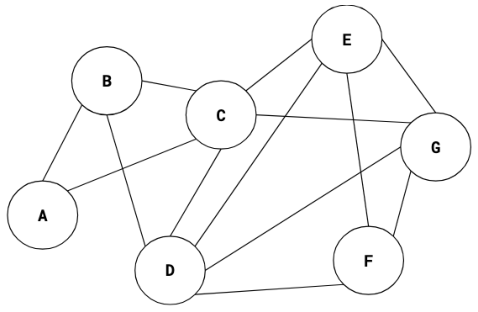
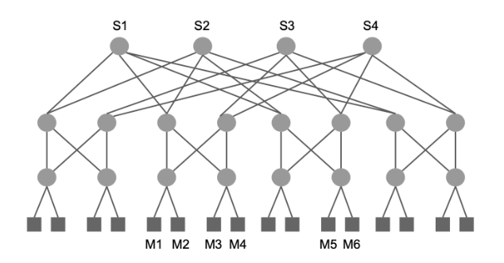
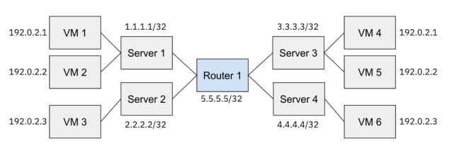

# Berkeley CS168 Spring 2025: Discussion 10: Questions

> Copied from the original: <https://sp25.cs168.io/>. Text and figures are taken from the PDF as is; nothing was answered or rewritten. The original PDF is in this folder.

---

**Page 1**

&emsp;CS 168   Datacenters & SDN 
&emsp;Spring 2025 
&emsp;&emsp;&emsp;&emsp;&emsp;&emsp;&emsp;&emsp;Discussion 10

&emsp;1   True/False 
1.1   Achieving low latency for small jobs (mice) is critical for datacenter networks.

1.2   Clos topology enables the use of commodity hardware in datacenter networks.

1.3   ECMP leads to reordering of packets in the same flow.

1.4   Over-subscription is the ratio of worst-case achievable aggregate bandwidth between end-hosts to total 
&emsp;bisection bandwidth.

&emsp;&emsp;&emsp;&emsp;&emsp;&emsp;&emsp;&emsp;1

---

**Page 2**

&emsp;2    Datacenters & SDN 
&emsp;2   STP

&emsp;The diagram above shows a L2 network where all links have equal cost. We want to apply the Spanning 
&emsp;Tree Protocol. Choose the switch with the lowest alphabetical ID as the root, and when there are multiple 
&emsp;shortest paths to the root, choose the path that uses the neighbor switch with the lowest alphabetical ID. 
2.1   Let XY denote the link that connects switch(“X”) and switch(“Y”). List all links that are a part of the 
&emsp;spanning tree after the STP protocol converges.

2.2   Assume that at some point during STP, switch(“F”) believes that switch(“A”) is the root and switch(“D”) 
&emsp;believes that switch(“B”) is the root. Is it possible that switch(“C”) also believes that switch(“B”) is the 
&emsp;root?

2.3   After the STP protocol has converged, switch(“A”) and all links directly connected to switch(“A”) go 
&emsp;down. List all links that are a part of the new spanning tree after the STP protocol converges again.

2.4   switch(“A”) and all links connected to switch(“A”) finally come back up, and the STP protocol begins to 
&emsp;run again. However, switch(“F”) forgets to send any update messages to its neighbors. After the protocol 
&emsp;converges, does the resulting set of links form a valid spanning tree?

&emsp;&emsp;&emsp;&emsp;&emsp;&emsp;&emsp;&emsp;2

---

**Page 3**

&emsp;&emsp;&emsp;&emsp;&emsp;&emsp;&emsp;&emsp;Datacenters & SDN    3 
&emsp;3   Clos-based Topology & ECMP

&emsp;Given the datacenter network above: 
3.1   How many paths from an arbitrary server upward to an arbitrary root switch? Consider only minimal- 
&emsp;length paths.

3.2   How many paths can be set up between M1 to M3 in this topology? M1 to M5? Consider only minimal- 
&emsp;length paths.

3.3   How many of the M1 to M5 paths go through switch S2?

&emsp;Consider the same network topology in Q3. Assume all links have capacity 10 Gbps and ECMP 
&emsp;is used for multipath routing. 
3.4   What is the bisection bandwidth of this topology?

3.5   Assume ECMP makes the best possible hashing/load balancing. If switch S1 and S3 fail, what is the 
&emsp;available aggregate bandwidth from each four-server Pod to any other such Pod (a Pod contains four 
&emsp;servers closest to each other)?

3.6   Assume M1, M2 are sending flows to M5; and M3, M4 are sending flows to M6. TCP makes optimal use of 
&emsp;the available bandwidth and ECMP makes the worst possible hashing. What is the approximate average 
&emsp;data rate server M1 can send to server M5?

&emsp;&emsp;&emsp;&emsp;&emsp;&emsp;&emsp;&emsp;3

---

**Page 4**

&emsp;4    Datacenters & SDN 
&emsp;4   Encapsulation

4.1   If routing a packet from VM 1 to VM 6, what is the expected path?

4.2   What encapsulation and decapsulation should the servers/router on the path from VM 1 to VM 6 perform 
&emsp;(if any)? Fill in the following table with the destination address (both overlay and underlay) of the packets 
&emsp;at each step. 
&emsp;&emsp;&emsp;&emsp;&emsp;Server/Router   Adds/Deletes Header   Overlay Address   Underlay Address 
&emsp;&emsp;&emsp;&emsp;&emsp;&emsp;Server 1

&emsp;&emsp;&emsp;&emsp;&emsp;&emsp;Router 1

&emsp;&emsp;&emsp;&emsp;&emsp;&emsp;Server 4

4.3   How many destinations does Router 1 have to keep track of without encapsulation? How about with 
&emsp;encapsulation? Consider how this isolation impacts VM scalability in a data center!

&emsp;&emsp;&emsp;&emsp;&emsp;&emsp;&emsp;&emsp;4

