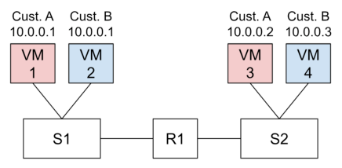
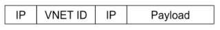

# Berkeley CS168 Spring 2025: Discussion 11: Questions

> Copied from the original: <https://sp25.cs168.io/>. Text and figures are taken from the PDF as is; nothing was answered or rewritten. The original PDF is in this folder.

---

**Page 1**

&emsp;CS 168   Host Networking 
&emsp;Spring 2025 
&emsp;&emsp;&emsp;&emsp;&emsp;&emsp;&emsp;&emsp;Discussion 11

&emsp;1   Multiple Choice 
1.1   Which of the following is true of datacenters? 
&emsp;(a) Many applications that run in datacenters have extreme performance requirements. 
&emsp;(b) The hardware cost of the network is more expensive than that of the compute. 
&emsp;(c) CPU cycles are especially important since a cloud provider may rent them to customers for additional 
&emsp;profit. 
&emsp;(d) Datacenter operators have full administrative control over their datacenters.

1.2   Why would one use kernel bypass? 
&emsp;(a) To customize networking behavior 
&emsp;(b) To avoid making changes to kernel code 
&emsp;(c) For performance optimization 
&emsp;(d) To save money on hardware

1.3   T/F: Stateless offloads are easier to implement since all information needed is contained in each individual 
&emsp;packet. 
&emsp;(a) True    (b) False

1.4   T/F: NIC offloads can be easily changed. 
&emsp;(a) True    (b) False

1.5   T/F: Segmentation offload is a stateless offload. 
&emsp;(a) True    (b) False

&emsp;&emsp;&emsp;&emsp;&emsp;&emsp;&emsp;&emsp;1

---

**Page 2**

&emsp;2    Host Networking

1.6   Which of the following are true of congestion control signals? 
&emsp;(a) ECN contains more information than loss. 
&emsp;(b) ECN contains more information than delay. 
&emsp;(c) Delay can be difficult to measure at high precision. 
&emsp;(d) Receive rate (bandwidth) contains more information than ECN.

1.7   Which of the following are true of QoS? 
&emsp;(a) It only matters when a link is at 100% utilization. 
&emsp;(b) Only one flow can be in each class. 
&emsp;(c) It is used to prioritize some types of traffic. 
&emsp;(d) The queue can enforce the policy with weighted fair queueing.

&emsp;&emsp;&emsp;&emsp;&emsp;&emsp;&emsp;&emsp;2

---

**Page 3**

&emsp;&emsp;&emsp;&emsp;&emsp;&emsp;&emsp;&emsp;Host Networking    3 
&emsp;2   Software-Defined Networking 
&emsp;You are a chief network engineer at CS168DB, a company that specializes in databases. Currently, your 
&emsp;networking infrastructure still relies on hardware switches that converge on routing with various L2/L3 
&emsp;protocols. You have tens of thousands of servers that need to communicate with each other. As the chief 
&emsp;network engineer, you are thinking about making the switch to software-defined networking. 
2.1   What are your current control plane abstractions?

2.2   What are the required control plane’s abstractions if you make the switch to SDN?

2.3   What happens when a link goes down in your new SDN setup?

2.4   Is OpenFlow equivalent to SDN?

&emsp;&emsp;&emsp;&emsp;&emsp;&emsp;&emsp;&emsp;3

---

**Page 4**

&emsp;4    Host Networking 
&emsp;3   Network Virtualization Offload 
&emsp;Suppose you are a cloud provider implementing network virtualization. You want to allow a single server 
&emsp;to host multiple VMs with potentially the same private IP addresses. In order for the servers hosting VMs 
&emsp;to know which VM to send a packet to if there are, the packets must have some sort of identifier other than 
&emsp;the destination IP. Accordingly, you want to add a virtual network header to each packet to distinguish it 
&emsp;from other customer’s virtual networks. 
3.1   Why would you want to allow this addressing overlap?

3.2   Where could you implement this functionality?

3.3   Assume the setup below. What rules should your SDN controller program into S1 in order for the below 
&emsp;network to be routable? Fill in the table with the necessary match-action rules.

&emsp;Assume the packets in the underlay network look like the one below. The virtual network header has 
&emsp;one field, the ID, which has the name of the customer in it.

&emsp;&emsp;&emsp;&emsp;&emsp;&emsp;&emsp;&emsp;Header Field   Value   Action 
&emsp;&emsp;&emsp;&emsp;&emsp;&emsp;&emsp;&emsp;Virtual Network ID

3.4   What other functionality might you put in this MA table? 
&emsp;(a) Bandwidth limiting 
&emsp;(b) HTTP caching 
&emsp;(c) Access control 
&emsp;(d) Accounting

&emsp;&emsp;&emsp;&emsp;&emsp;&emsp;&emsp;&emsp;4

---

**Page 5**

&emsp;&emsp;&emsp;&emsp;&emsp;&emsp;&emsp;&emsp;Host Networking    5 
&emsp;4   RDMA 
&emsp;Assume your application is about to use RDMA to transfer some data. In this question, we will walk 
&emsp;through the steps to complete the process. Assume that we will use the RDMA Send operation discussed 
&emsp;in lecture. 
4.1   First, what benefits come from using RDMA? 
&emsp;(a) Reduce complexity 
&emsp;(b) Better performance 
&emsp;(c) Save CPU cycles 
&emsp;(d) Faster design iteration

4.2   Which sides must register buffers before the transfer?

4.3   How does the sender application start the transfer?

4.4   Does the receiver have to do anything for the transfer to work? If so, what?

4.5   Which component of each host creates a completion queue entry?

4.6   How does the application know that the transfer is complete?

&emsp;&emsp;&emsp;&emsp;&emsp;&emsp;&emsp;&emsp;5

