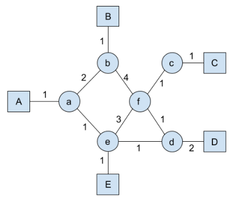
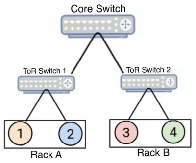
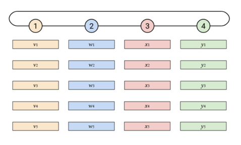
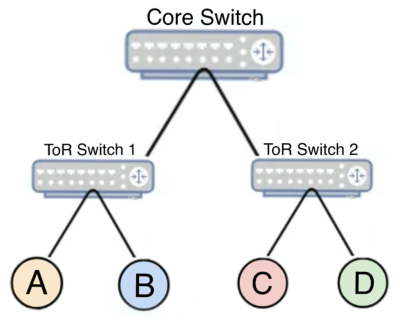

# Berkeley CS168 Spring 2025: Discussion 12: Questions

> Copied from the original: <https://sp25.cs168.io/>. Text and figures are taken from the PDF as is; nothing was answered or rewritten. The original PDF is in this folder.

---

**Page 1**

&emsp;CS 168   Multicast and Collectives 
&emsp;Spring 2025 
&emsp;&emsp;&emsp;&emsp;&emsp;&emsp;&emsp;&emsp;Discussion 12

&emsp;1   True or False 
1.1   IP multicast is widely deployed across different domains for global Internet communication.

1.2   In the DVMRP protocol, the multicast forwarding table requires one entry per source, per multicast 
&emsp;group.

1.3   Core-Based Trees (CBT) guarantee that packets are forwarded along the least-cost paths to all group 
&emsp;members.

1.4   Overlay multicast requires routers to implement specialized multicast protocols, unlike IP multicast.

1.5   The AllReduce collective operation can be implemented efficiently using a ring topology, where each 
&emsp;node sends and receives data to/from its neighbors.

1.6   The stretch factor in overlay multicast measures the ratio of the overlay path cost to the underlay path 
&emsp;cost, with lower stretch indicating better performance.

1.7   Collective operations in AI training, such as Broadcast and Reduce, are unrelated and cannot be combined 
&emsp;to form other operations like AllReduce.

&emsp;&emsp;&emsp;&emsp;&emsp;&emsp;&emsp;&emsp;1

---

**Page 2**

&emsp;2    Multicast and Collectives 
&emsp;2   Multicast

&emsp;Consider the network topology above for both parts of this question. Hosts are squares with capital letters, 
&emsp;routers are circles with lower case letters. Link cost is latency in seconds. 
&emsp;DVMRP 
&emsp;All parts of this section are cumulative. At the start, A and E are members of group 1. 
2.1   (a) A sends a multicast packet to Group 1. After all Non-Membership Reports (NMRs) have propagated, 
&emsp;&emsp;which links remain active (i.e., used for forwarding packets) in the source-specific multicast tree for 
&emsp;&emsp;(Source A, Group 1)?

&emsp;(b) Suppose C adds itself to group 1. Immediately after this, who knows C joined group 1?

&emsp;(c) E sends a message to group 1. Which links remain active for (Source E, Group 1)?

&emsp;(d) B sends a message to group 1, is this possible?

&emsp;(e) What is the route that the packet takes from B to E?

&emsp;&emsp;&emsp;&emsp;&emsp;&emsp;&emsp;&emsp;2

---

**Page 3**

&emsp;&emsp;&emsp;&emsp;&emsp;&emsp;&emsp;&emsp;Multicast and Collectives    3

&emsp;(f) How long does it take for B’s message to reach all members of group 1?

&emsp;(g) Suppose that the pruning information expires. A, B, and D form a new group 2. A then sends messages 
&emsp;&emsp;to groups 1 and 2, B sends a message to group 2, and D sends a message to group 1. What state does 
&emsp;&emsp;router f have? (Give a list of (Source x, Group y)).

&emsp;(h) What message(s) took the longest to send?

&emsp;(i) What message(s) took the least time to send?

&emsp;CBT 
&emsp;All parts of this section are cumulative, but independent from the previous section. a is the core 
&emsp;for group 1. 
2.2   (a) C decides to join group 1. What routers does its request go through?

&emsp;(b) D decides to join group 1. What routers does its request go through?

&emsp;(c) B sends a message to group 1. How long does it take to reach all members?

&emsp;(d) C sends a message to group 1. How long does it take to reach all members?

&emsp;(e) The link between A and a goes down, but no other changes in control plane state occur. Who can 
&emsp;&emsp;still send/receive messages to/from group 1, if any?

&emsp;&emsp;&emsp;&emsp;&emsp;&emsp;&emsp;&emsp;3

---

**Page 4**

&emsp;4    Multicast and Collectives 
&emsp;3   Collective 
&emsp;You are designing a distributed AI training system in a datacenter with 4 GPUs (nodes 1, 2, 3, 4) performing 
&emsp;collective operations. Each node holds a 4-element vector of data (total size 𝐷 bytes). The datacenter uses 
&emsp;a Clos topology, with nodes 1 and 2 in Rack A, and nodes 3 and 4 in Rack B, connected via a core switch. 
&emsp;Intra-rack links (e.g., 1↔2) have 1 hop (stretch = 1); inter-rack links (e.g., 1↔3) have 3 hops (stretch = 
&emsp;3). Assume intra-rack links have unlimited bandwidth, inter-rack links have a bandwidth capacity of 𝐵 
&emsp;bytes per time step, and nodes can send/receive on all links simultaneously unless otherwise specified.

&emsp;The Clos topology has nodes 1 and 2 in Rack A, nodes 3 and 4 in Rack B, connected via a core switch. 
&emsp;Intra-rack links have 1 hop (stretch = 1); inter-rack links have 3 hops (stretch = 3). 
&emsp;Part A: Full-Mesh AllReduce Analysis 
&emsp;Consider an AllReduce operation where each node computes the element-wise sum of all vectors and 
&emsp;receives the sum vector. 
3.1   (a) Explain why a full-mesh topology is suitable for AllReduce in AI training, and discuss its scalability 
&emsp;&emsp;limitations for large 𝑝.

&emsp;(b) Calculate the total bandwidth and number of steps for a full-mesh AllReduce with 𝑝= 4. If inter- 
&emsp;&emsp;rack link bandwidth is limited to 𝐵= 𝐷 bytes per time step and intra-rack links have unlimited 
&emsp;&emsp;bandwidth, how many time steps are required?

&emsp;&emsp;&emsp;&emsp;&emsp;&emsp;&emsp;&emsp;4

---

**Page 5**

&emsp;&emsp;&emsp;&emsp;&emsp;&emsp;&emsp;&emsp;Multicast and Collectives    5

&emsp;Part B: Naive Ring AllReduce 
&emsp;Assume a naive ring-based AllReduce (e.g., Node 1 → Node 2 → Node 3 → Node 4 → Node 1).

&emsp;The ring topology connects nodes 1→2→3→4→1 in a closed loop. 
3.2   (a) How many steps are required for a naive ring AllReduce with 𝑝= 4? Describe the data exchange 
&emsp;&emsp;process.

&emsp;(b) Calculate the total bandwidth and bandwidth per node per step. If inter-rack links are limited to 𝐵= 
&emsp;&emsp;2 bytes per step, how does this affect the number of steps?𝐷

&emsp;Part C: Optimized Ring vs. Tree-Based AllReduce 
&emsp;Compare naive ring, optimized ring, and tree-based AllReduce implementations for 𝑝= 16. 
3.3   (a) For an optimized ring AllReduce, describe how it differs from the naive ring and calculate its total 
&emsp;&emsp;bandwidth and steps for 𝑝= 16.

&emsp;(b) For a tree-based AllReduce, calculate the total bandwidth and steps for 𝑝= 16, assuming a balanced 
&emsp;&emsp;binary tree.

&emsp;(c) Compare the three implementations (naive ring, optimized ring, tree-based) for 𝑝= 16, discussing 
&emsp;&emsp;trade-offs for AI training.

&emsp;&emsp;&emsp;&emsp;&emsp;&emsp;&emsp;&emsp;5

---

**Page 6**

&emsp;6    Multicast and Collectives

&emsp;Part D: Overlay Topology Optimization 
&emsp;Optimize an overlay ring for AllReduce over the Clos network, with nodes A, B in Rack A, and C, D in 
&emsp;Rack B.

&emsp;Nodes A and B are in Rack A, nodes C and D are in Rack B, with intra-rack links (stretch = 1) and inter- 
&emsp;rack links (stretch = 3). 
3.4   (a) Propose an overlay ring topology by numbering nodes (A, B, C, D) as Nodes 1, 2, 3, 4 to minimize 
&emsp;&emsp;the average stretch factor. Calculate the stretch for each link and the average.

&emsp;(b) Consider two alternative topologies: (i) A→C→D→B→A, and (ii) A→C→B→D→A. Calculate 
&emsp;&emsp;their average stretches and compare to your proposed topology. If inter-rack links have bandwidth 
&emsp;&emsp;4 bytes per step, which topology minimizes total latency for an optimized ring AllReduce,𝐵= 𝐷 
&emsp;&emsp;assuming each hop adds 1 time unit of latency?

&emsp;&emsp;&emsp;&emsp;&emsp;&emsp;&emsp;&emsp;6

---

**Page 7**

&emsp;&emsp;&emsp;&emsp;&emsp;&emsp;&emsp;&emsp;Multicast and Collectives    7

&emsp;Part E: ReduceScatter Implementation 
&emsp;Consider a ReduceScatter operation, where each node receives one summed element of the AllReduce 
&emsp;output. 
3.5   (a) Explain how ReduceScatter differs from AllReduce and how it can be implemented using a naive ring 
&emsp;&emsp;for 𝑝= 4. Calculate the total bandwidth and steps.

&emsp;(b) If you implement ReduceScatter using the optimized ring topology from Part D.1 
&emsp;&emsp;4 , calculate the total latency (in steps) and(A→B→C→D→A) with inter-rack bandwidth 𝐵= 𝐷 
&emsp;&emsp;compare to the naive ring.

&emsp;&emsp;&emsp;&emsp;&emsp;&emsp;&emsp;&emsp;7

