# GeeksforGeeks: Networking interview questions

> Copied from <https://www.geeksforgeeks.org/blogs/networking-interview-questions/>. Questions and answers are the source's own; nothing was answered or rewritten here. Each answer is written right under its question, as on the site.

[Computer Network](https://www.geeksforgeeks.org/computer-networks/computer-network-tutorials/) is the study of connecting devices so they can communicate and share data over wired or wireless networks. It enables computers, servers, smartphones, and IoT devices to exchange information using standard communication protocols.

- A network allows devices to share resources such as files, printers, internet connections, and applications.
- Networking improves communication, scalability, reliability, and centralized management of data and services.
- Examples: LAN, WAN, Wi‑Fi networks, Ethernet networks, and the Internet.

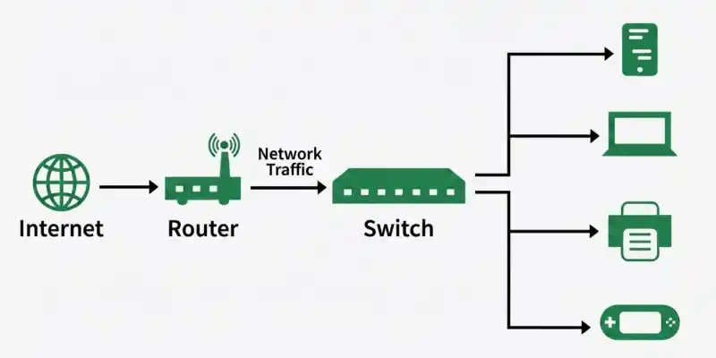

### 1. What are network devices? Explain their types.

[Network devices](https://www.geeksforgeeks.org/computer-networks/basics-computer-networking/) are hardware components that connect computers and other devices in a network. They enable data to be transmitted, received, and managed between connected devices. These devices ensure efficient, reliable, and secure communication across local and wide-area networks.

- Connect multiple devices to form a computer network.
- Control and direct the flow of data between devices.
- Improve network communication, performance, and connectivity.

### 2. What are the different types of computer networks?

A computer network is a collection of interconnected devices that share data and resources. Based on the area they cover, networks are classified into different types. The main types are PAN, LAN, MAN, and WAN.

- **PAN (Personal Area Network):** Covers a small area around a person.
- **LAN (Local Area Network):** Connects devices within a home, school, or office.
- **MAN (Metropolitan Area Network):** Connects multiple LANs across a city.
- **WAN (Wide Area Network):** Connects networks over large geographical areas, such as the Internet.

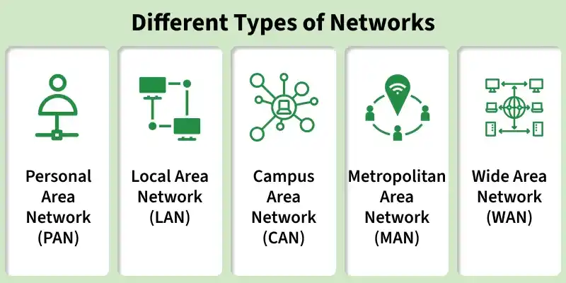

### 3. Name of the software layers or User support layer in the OSI model.

- [Application layer](https://www.geeksforgeeks.org/computer-networks/application-layer-in-osi-model/) - Provides network services directly to end-user applications.
- [Presentation layer](https://www.geeksforgeeks.org/computer-networks/presentation-layer-in-osi-model/) - Translates, encrypts, and compresses data for the application layer.
- [Session layer](https://www.geeksforgeeks.org/computer-networks/session-layer-in-osi-model/) - Establishes, manages, and terminates communication sessions between devices.

### 4. Name the hardware layers or network support layers in the OSI model.

- [Network layer](https://www.geeksforgeeks.org/computer-networks/network-layer-services-packetizing-routing-and-forwarding/) - Determines the best path and routes packets between networks.
- [Datalink layer](https://www.geeksforgeeks.org/computer-networks/data-link-layer/) - Ensures reliable data transfer between directly connected devices using frames and MAC addresses.
- [Physical layer](https://www.geeksforgeeks.org/computer-networks/physical-layer-in-osi-model/) - Transmits raw bits over the physical transmission medium such as cables or wireless signals.

### 5. What is a network topology? Explain its types.

A [**network topology**](https://www.geeksforgeeks.org/computer-networks/types-of-network-topology/) is the physical or logical arrangement of devices in a computer network. It defines how devices are connected and how data is transmitted between them. A proper network topology improves communication, performance, and reliability..

- **Bus Topology:** All devices are connected to a single shared cable (backbone).
- **Star Topology:** All devices are connected to a central hub or switch.
- **Ring Topology:** Devices are connected in a circular loop, where data travels from one device to the next.
- **Mesh Topology:** Every device is connected to one or more other devices, providing multiple communication paths.
- **Tree Topology:** A hierarchical topology that combines multiple star networks connected through a central backbone.

### 6. Explain the OSI model, its seven layers, the devices used at each layer, and how it differs from the TCP/IP model.

The OSI (Open Systems Interconnection) model is a 7-layer reference model that standardizes network communication between devices. Each layer performs a specific function, and different networking devices operate at different layers. The TCP/IP model is a 4-layer practical model that is widely used for Internet communication.

- The [OSI](https://www.geeksforgeeks.org/computer-networks/open-systems-interconnection-model-osi/) model consists of 7 layers: Physical, Data Link, Network, Transport, Session, Presentation, and Application.
- Devices used include Hub/Repeater (Physical), Switch/Bridge (Data Link), Router (Network), and Gateway/Firewall (Transport–Application).
- OSI is a reference model with 7 layers, whereas TCP/IP is a practical model with 4 layers.

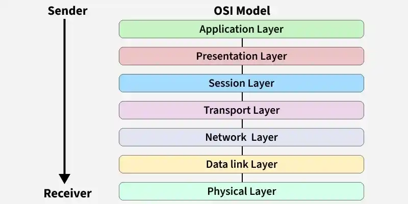

### 7. What happens to a data packet as it moves through the OSI model?

As a data packet moves through the OSI model, it passes through all seven layers. At the sender's side, each layer adds its own header to the data, while at the receiver's side, each layer removes the corresponding header. These processes ensure reliable communication between devices.

- Encapsulation: Each layer adds its own header as data moves from the Application layer to the Physical layer.
- Decapsulation: Each layer removes its corresponding header as data moves from the Physical layer to the Application layer.
- These processes help ensure accurate and reliable data transmission across the network.

### 8. What is a VPN ? Explain its types.

A [**VPN (Virtual Private Network)**](https://www.geeksforgeeks.org/computer-networks/what-is-vpn-how-it-works-types-of-vpn/) creates a secure and encrypted connection over the Internet, allowing users to safely access a private network. It protects data during transmission and enables secure communication between users or networks. VPNs are commonly used for remote access and secure networking.

- Provides a secure and encrypted connection over the Internet.
- Protects data and enables safe remote access.
- Used by individuals and organizations for secure communication.

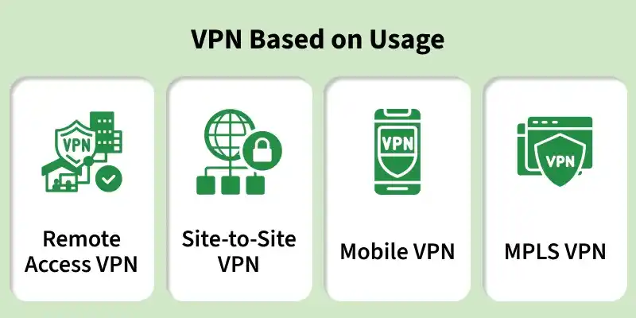

### Types of VPN

**1. Remote Access VPN**

- Connects individual users to a private network over the Internet.
- Commonly used by employees working remotely.

**2. Site-to-Site VPN**

- Connects two or more private networks over the Internet.
- It is of two types:
  1. **Intranet VPN:** Connects branches of the same organization.
  2. **Extranet VPN:** Connects an organization with partners or customers.

### 9. Explain the TCP three-way handshake and why TCP uses three handshakes instead of two.

The TCP three-way handshake is the process used to establish a reliable connection between a client and a server before data transmission begins. It ensures that both devices are ready to communicate and can exchange data reliably. The connection is established using three steps: SYN, SYN-ACK, and ACK.

- Step 1 (SYN): The client sends a SYN packet to request a connection.
- Step 2 (SYN-ACK): The server replies with a SYN-ACK packet to acknowledge the request.
- Step 3 (ACK): The client sends an ACK packet, completing the connection.

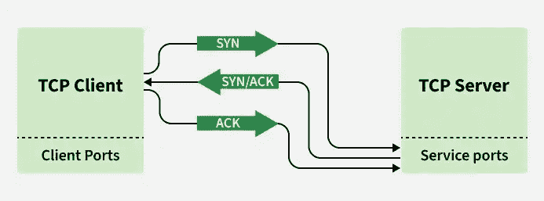

**Why does TCP use Three Handshakes instead of two?**

The third ACK confirms that the client has received the server's response.

- It ensures that both client and server are ready for communication.
- It prevents duplicate or delayed connection requests from creating invalid connections.

### 10. Explain TCP connection termination, the TIME\_WAIT state, and what happens if the final ACK is lost.

TCP connection termination uses a four-way handshake because each direction of communication is closed independently. The client and server exchange FIN and ACK packets to close the connection gracefully. After sending the final ACK, the client enters the TIME\_WAIT state to ensure reliable connection termination.

- TCP Connection Termination: The client sends FIN, the server replies with ACK, then sends FIN, and the client responds with the final ACK.
- TIME\_WAIT State: The client waits for a short period to allow delayed packets to expire and to retransmit the final ACK if required.
- If the Final ACK is Lost: The server retransmits its FIN, and the client sends the ACK again before both sides close the connection.

### 11. What are TCP sequence numbers and acknowledgment numbers? How do they prevent duplicate packets?

TCP sequence numbers identify the position of each byte of data sent by the sender, while acknowledgment numbers indicate the next byte the receiver expects. Together, they ensure reliable and ordered data transmission. They also help detect missing and duplicate packets.

- **Sequence Number:** Identifies the position of each byte in the transmitted data.
- **Acknowledgment Number:** Indicates the next byte expected by the receiver.
- **Prevents Duplicate Packets:** TCP discards packets with sequence numbers that have already been received, ensuring reliable and ordered communication.

### 12. Explain ARP.

ARP (Address Resolution Protocol) is used to map an IP address to a MAC address within a local network.

- A device knows the destination IP address.
- It sends an ARP broadcast asking “Who has this IP address?”
- The destination device replies with its MAC address.
- The sender stores the mapping in the ARP cache for future communication.

Example: If a PC wants to sen d o data to 192.168.1.5, ARP finds the MAC address of that device before the frame is transmitted.

### . What is the difference between MAC address and IP address?

A MAC address is a hardware address assigned to a network interface card, while an IP address is a logical address used for communication across networks.

- **MAC address:** Physical identifier, works at the Data Link layer, usually fixed.
- **IP address:** Logical identifier, works at the Network layer, can change.

The MAC address identifies a device on a local network, while the IP address identifies its location in a network.

### 12. Explain TCP retransmission, Retransmission Timeout (RTO), Fast Retransmit, and Fast Recovery.

TCP retransmission is the process of resending lost packets to ensure reliable data delivery. A packet is retransmitted either when the Retransmission Timeout (RTO) expires or when Fast Retransmit detects packet loss through duplicate ACKs. Fast Recovery helps maintain network performance by avoiding a complete restart of congestion control.

- **Retransmission Timeout (RTO):** Retransmits a packet if an acknowledgment is not received within the calculated timeout period.
- **Fast Retransmit:** Retransmits a lost packet immediately after receiving three duplicate ACKs, without waiting for the RTO.
- **Fast Recovery:** Continues data transmission after packet loss without restarting from Slow Start, improving performance.

### 13. What is the difference between the congestion window (cwnd) and the receive window (rwnd)?

The congestion window (cwnd) and receive window (rwnd) control the amount of data a sender can transmit. The cwnd is managed by the sender based on network congestion, while the rwnd is managed by the receiver based on available buffer space. The sender transmits data up to the smaller of the two values.

- **Congestion Window (cwnd):** Controlled by the sender to avoid network congestion.
- **Receive Window (rwnd):** Advertised by the receiver based on available buffer space.
- **Data Sent = min(cwnd, rwnd):** The sender can transmit only up to the smaller of these two windows.

### 14. Explain TCP congestion control, including Slow Start, Congestion Avoidance, and AIMD.

[TCP congestion control](https://www.geeksforgeeks.org/computer-networks/tcp-congestion-control/) prevents network congestion by adjusting the amount of data sent over the network. It begins with Slow Start, switches to Congestion Avoidance as the network stabilizes, and uses AIMD (Additive Increase Multiplicative Decrease) to respond to congestion. This improves network efficiency and reliability.

- **Slow Start:** Increases the congestion window (**cwnd**) exponentially to quickly utilize available bandwidth.
- **Congestion Avoidance:** Increases **cwnd** linearly after reaching the threshold to avoid congestion.
- **AIMD:** Gradually increases **cwnd** during normal operation and reduces it significantly when packet loss is detected.

### 15. What is Explicit Congestion Notification (ECN)? How does it improve network performance?

Explicit Congestion Notification (ECN) is a TCP congestion control mechanism that allows routers to mark packets instead of dropping them when congestion is detected. The receiver notifies the sender about the marked packets, and the sender reduces its transmission rate before packet loss occurs. This improves network efficiency and reduces unnecessary retransmissions.

- ECN marks packets instead of dropping them when congestion begins.
- The sender reduces its transmission rate after receiving the congestion notification.

**Advantages:** Improves throughput, reduces retransmissions, and lowers network latency.

### 16. Compare Tahoe, Reno, New Reno, and Cubic TCP

TCP Tahoe, Reno, New Reno, and Cubic are congestion control algorithms used to improve network performance. Each algorithm differs in how it detects packet loss and recovers from congestion. Newer algorithms provide faster recovery and better utilization of network bandwidth.

- **Tahoe:** Uses Slow Start and Fast Retransmit, but always restarts from Slow Start after packet loss.
- **Reno & New Reno:** Recover faster using Fast Recovery.
- **Cubic:** Uses a cubic window growth function for better performance in high-speed and long-distance networks.

### 17. How does TCP distinguish between packet loss caused by congestion and wireless transmission errors?

Traditional TCP assumes that all packet losses are caused by network congestion and reduces its transmission rate. However, in wireless networks, packets may also be lost due to signal interference or transmission errors. Modern TCP uses advanced mechanisms to better identify the cause of packet loss and improve performance.

- Traditional TCP treats all packet losses as a sign of congestion.
- Wireless packet loss can occur due to signal interference or transmission errors.
- Modern TCP uses ECN, SACK, and link-layer error recovery to distinguish the cause of packet loss and improve performance.

### 18. Compare Stop-and-Wait, Go-Back-N, and Selective Repeat protocols.

Stop-and-Wait, Go-Back-N, and Selective Repeat are Automatic Repeat reQuest (ARQ) protocols used to ensure reliable data transmission. They differ in how they send data frames and handle packet loss. Selective Repeat is the most efficient because it retransmits only the lost frames.

- **Stop-and-Wait:** Simple but less efficient.
- **Go-Back-N:** Improves efficiency by allowing multiple outstanding frames.
- **Selective Repeat:** Most efficient because it retransmits only lost frames.

### 19. Why must the Selective Repeat window size be at most half the sequence number space?

Selective Repeat ARQ, both the sender and receiver maintain separate windows for reliable communication. If the window size is greater than half of the sequence number space, old delayed packets may be mistaken for new packets with the same sequence number. Limiting the window size prevents this ambiguity and ensures correct packet delivery.

- Both the sender and receiver maintain separate transmission windows.
- A window larger than half the sequence number space can cause old and new packets to have the same sequence number.
- Limiting the window size to half the sequence number space prevents ambiguity and ensures reliable communication.

### 20. What is the Bandwidth-Delay Product (BDP), and How Does Pipelining Improve Network Performance?

The Bandwidth-Delay Product (BDP) is the amount of data that can be in transit before an acknowledgment is received. It is calculated as Bandwidth × Round-Trip Time (RTT). Pipelining improves performance by allowing multiple packets to be transmitted without waiting for acknowledgments.

- **BDP = Bandwidth × RTT.**
- A higher BDP allows more data to be in transit.
- **Pipelining** improves bandwidth utilization and reduces idle time.

### 21. Compare Distance Vector and Link-State Routing Protocols

Distance Vector and Link-State are routing protocols used to determine the best path for data transmission. Distance Vector shares routing information with neighboring routers, while Link-State maintains a complete network map. Link-State protocols converge faster and are better suited for large networks.

- **Distance Vector:** Simple but slower convergence.
- **Link-State:** Faster and more scalable.
- **Examples:** RIP (Distance Vector), OSPF (Link-State).

### 22. Why Does RIP Suffer from the Count-to-Infinity Problem, and How Do Split Horizon and Route Poisoning Solve It?

The count-to-infinity problem occurs when routers continuously increase the hop count for an unreachable destination, creating routing loops. Split Horizon prevents routes from being advertised back on the interface from which they were learned. Route Poisoning marks failed routes with an infinite metric to quickly inform neighboring routers.

- Count-to-infinity creates routing loops.
- Split Horizon prevents routes from being advertised back to the source.
- Route Poisoning marks failed routes as unreachable.

### 23. Why Does OSPF Converge Faster Than RIP? Explain the Dijkstra Algorithm Used in OSPF.

OSPF converges faster than RIP because it uses a Link-State approach and updates only changed routing information. It maintains a complete network map and applies the Dijkstra (Shortest Path First) algorithm to calculate the shortest path. This enables faster and more efficient routing.

- OSPF uses the Link-State routing method.
- Uses Dijkstra's Shortest Path First (SPF) algorithm.
- Converges faster by updating only changed information.

### 24. What is route flapping, and how do routing protocols minimize its impact?

Route flapping occurs when a route repeatedly changes between available and unavailable states in a short period.

Effects:

- Excessive routing updates.
- Increased CPU usage.
- Frequent reconvergence.

Routing protocols reduce its impact using:

- BGP temporarily ignores unstable routes for some time.
- Hold-down timers wait before accepting frequent route changes.
- OSPF reduces how often it recalculates routes when changes happen repeatedly.

These mechanisms improve network stability by suppressing unstable routes.

### 25. Explain BGP and Why It Is Called a Path-Vector Protocol.

[Border Gateway Protocol (BGP](https://www.geeksforgeeks.org/computer-networks/border-gateway-protocol-bgp/)) is used to exchange routing information between different Autonomous Systems (AS) on the Internet. It advertises the complete AS path for each route, helping prevent routing loops and apply routing policies. Therefore, BGP is called a path-vector protocol.

- Used for routing between different Autonomous Systems (AS).
- Advertises the complete AS path of a route.
- Prevents routing loops and supports routing policies.

### 26. What are CIDR (Route Aggregation) and Equal-Cost Multi-Path (ECMP), and Why Are They Useful?

CIDR (Classless Inter-Domain Routing) combines multiple network prefixes into a single route to reduce routing table size. Equal-Cost Multi-Path (ECMP) distributes traffic across multiple paths with equal routing cost. Together, they improve scalability, bandwidth utilization, and reliability.

- **CIDR:** Reduces routing table size through route aggregation.
- **ECMP:** Balances traffic across multiple equal-cost paths.
- Improves scalability, performance, and reliability.

### 27. Differentiate Between Interior Gateway Protocols (IGPs) and Exterior Gateway Protocols (EGPs)

**IGP (Interior Gateway Protocol)**

- Used for routing within a single Autonomous System (AS).
- Mainly used for internal routing inside an organization or network.
- Provides faster route calculation and convergence.
- Examples: RIP, OSPF, EIGRP, IS-IS.

**EGP (Exterior Gateway Protocol)**

- Used for routing between different Autonomous Systems (ASs).
- Mainly used for Internet or inter-domain routing.
- Focuses on routing policies and exchange of routes between networks.
- Example: BGP (Border Gateway Protocol).

### 28. What is route redistribution in computer networks?

Route redistribution is the process of sharing routes learned by one routing protocol with another routing protocol.

- Used when multiple routing protocols run in the same network.
- Allows routers using different protocols to exchange routing information.
- Common combinations include OSPF with EIGRP or OSPF with RIP.
- Incorrect redistribution can create routing loops, so route filtering and metrics must be configured carefully.

Example: An enterprise network running OSPF in one region and EIGRP in another can use redistribution to provide connectivity between both regions.

### 29. Why Are Private IP Addresses Not Routable on the Internet?

[Private IP addresses](https://www.geeksforgeeks.org/computer-networks/private-ip-addresses-in-networking/) are reserved for use within local networks and are not globally unique. Internet routers do not forward these addresses over the public Internet. To access the Internet, private IP addresses must be translated into public IP addresses using Network Address Translation (NAT).

- Private IP addresses are used only in local networks.
- Internet routers do not route private IP addresses.
- NAT converts private IP addresses into public IP addresses for Internet communication.

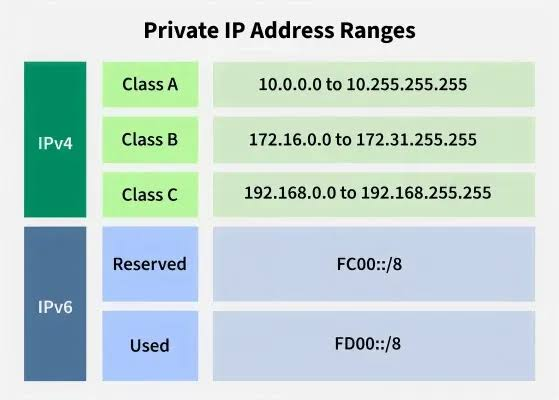

### 30. What is a Default Gateway?

A default gateway is the router that forwards packets from a local network to other networks or the Internet.

- Devices send local traffic directly to other local devices.
- Traffic destined for other networks is sent to the gateway.
- The gateway decides the next hop and forwards the packet.

**Example:** A PC with IP 192.168.1.10 and gateway 192.168.1.1 sends Internet traffic to 192.168.1.1

### 31. Explain NAT and its limitations.

[Network Address Translation (NAT)](https://www.geeksforgeeks.org/computer-networks/network-address-translation-nat/) is a technique that converts private IP addresses into public IP addresses, allowing multiple devices to share a single public IP. It helps conserve IPv4 addresses, improves security by hiding internal network details, and reduces the need for public IP addresses. However, NAT can complicate peer-to-peer communication, VoIP, online gaming, and some applications that require direct end-to-end connectivity.

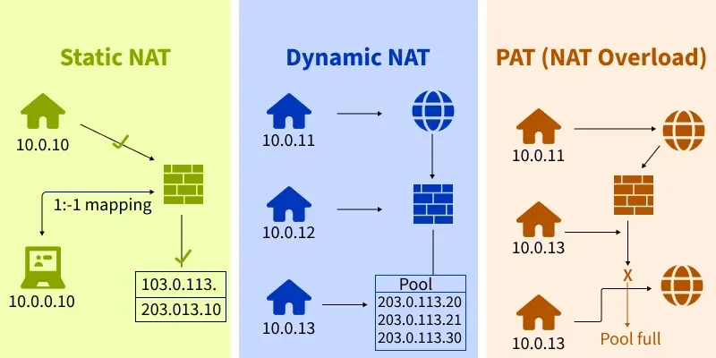

### 32. What is DHCP and explain the DORA process.

DHCP (Dynamic Host Configuration Protocol) automatically assigns IP addresses and other network settings to devices.

The address assignment process is called DORA:

- **Discover:** Client broadcasts a request for an IP address.
- **Offer:** DHCP server offers an available IP address.
- **Request:** Client requests the offered address.
- **Acknowledge:** Server confirms the allocation.

After this process, the client receives an IP address, subnet mask, gateway, and DNS settings.

### 33. What is APIPA and why is it important?

APIPA (Automatic Private IP Addressing) is a feature that automatically assigns an IP address in the range 169.254.0.0/16 when a device cannot obtain an address from a DHCP server.

- Enables communication within the local network.
- Useful for troubleshooting DHCP failures.
- Does not provide Internet access.

If a computer shows an address such as 169.254.x.x, it usually indicates a DHCP problem.

### 34. Why Does IPv6 Eliminate the Need for NAT?

IPv6 uses 128-bit addresses, providing a vast number of unique IP addresses. This allows every device to have its own public IP address, eliminating the need for Network Address Translation (NAT). As a result, end-to-end communication becomes simpler and more efficient.

- Provides a 128-bit address space with a huge number of IP addresses.
- Allows every device to have a unique public IP address.
- Eliminates NAT, improving communication and network performance.

### 35. Explain IPv6 Neighbor Discovery and How It Replaces ARP

Neighbor Discovery Protocol (NDP) is an IPv6 protocol that replaces ARP used in IPv4. It uses ICMPv6 messages to discover neighboring devices, resolve IPv6 addresses to MAC addresses, and identify routers. NDP also supports automatic address configuration.

- Replaces ARP in IPv6.
- Uses ICMPv6 for address resolution and router discovery.
- Supports automatic address configuration and duplicate address detection.

### 36. Compare CIDR and VLSM

**CIDR**

- CIDR combines multiple networks into a single route.
- It helps in reducing the size of routing tables.
- It is mainly used for route aggregation or route summarization.
- CIDR improves routing efficiency in large networks and on the Internet.

**VLSM**

- VLSM divides a network into subnets of different sizes.
- It provides better utilization of IP addresses.
- It is mainly used for subnetting according to host requirements.
- VLSM allows flexible network design and reduces IP address wastage.

### 36. How Does a Switch Learn MAC Addresses, and What Happens with an Unknown Destination MAC Address?

A switch learns MAC addresses by reading the source MAC address of incoming frames and storing it in its MAC address table. If the destination MAC address is unknown, the switch floods the frame to all ports except the incoming port. After receiving a reply, it updates its MAC table.

- Learns MAC addresses from the source MAC address.
- Stores MAC addresses in the MAC address table.
- Floods frames with unknown destination MAC addresses.

### 37. Differentiate between store-and-forward switching and cut-through switching.

Store-and-forward switching receives the entire Ethernet frame, checks it using CRC, and then forwards it. It provides better error handling but adds more latency.

Cut-through switching starts forwarding the frame as soon as the destination MAC address is read. It offers very low latency but may forward corrupted frames.

- Store-and-forward → reliable, higher latency.
- Cut-through → faster, lower latency.

Example: Enterprise LANs usually prefer store-and-forward, while low-latency environments may use cut-through.

### 38. What is the difference between a hub, switch, and router?

1. A hub broadcasts data to all connected devices and works at the Physical layer (Layer 1).
2. A switch forwards data only to the destination device using MAC addresses and works at the Data Link layer (Layer 2).
3. A router connects different networks and forwards packets using IP addresses and works at the Network layer (Layer 3).

### 39. How do Layer 3 switches differ from routers, and when would you choose one over the other?

A Layer 3 switch performs routing in hardware (ASICs) and is optimized for high-speed routing inside LANs, such as inter-VLAN routing.

A router supports advanced features such as BGP, MPLS, VPN, NAT, and WAN connectivity.

- L3 switch → high speed, low latency, LAN/data center use.
- Router → advanced routing policies and WAN/Internet connectivity.

Choose an L3 switch for campus or data-center networks and a router for Internet edge or WAN environments.

### 40. What is a collision domain and a broadcast domain?

A collision domain is a network segment where devices compete for the same transmission medium, so simultaneous transmissions can collide.

A broadcast domain is a set of devices that receive the same broadcast frame.

- A switch creates a separate collision domain for each port.
- A router separates broadcast domains.
- Modern switched Ethernet networks usually eliminate collisions but still have broadcast domains.

Example: A 24-port switch has 24 collision domains, but all ports belong to one broadcast domain unless VLANs are configured.

### 41. Explain the Spanning Tree Protocol (STP) and the Role of the Root Bridge

Spanning Tree Protocol (STP) is a Layer 2 protocol that prevents switching loops by creating a loop-free network topology. It elects one switch as the Root Bridge, which serves as the reference point for selecting the shortest path. Backup paths are activated automatically if the active path fails.

- Prevents switching loops in Layer 2 networks.
- Elects one switch as the Root Bridge.
- Activates backup paths if the primary path fails.

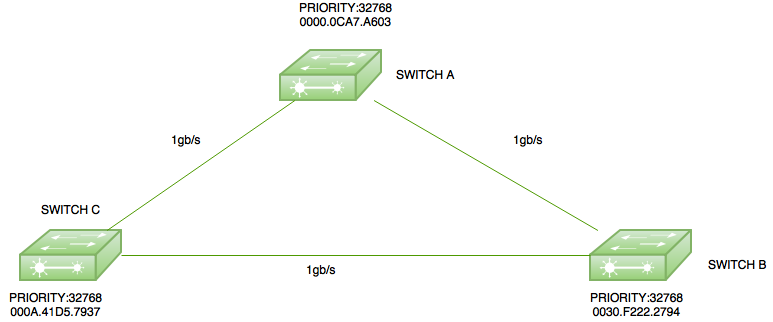

### 42. What is VLAN Tagging (IEEE 802.1Q), and Why Is It Used?

VLAN tagging is defined by the IEEE 802.1Q standard and adds a VLAN identifier to Ethernet frames. It allows multiple VLANs to share the same physical network while keeping their traffic separate. This improves network security and management.

- Adds a VLAN ID to Ethernet frames.
- Allows multiple VLANs over a single trunk link.
- Improves security and network efficiency.

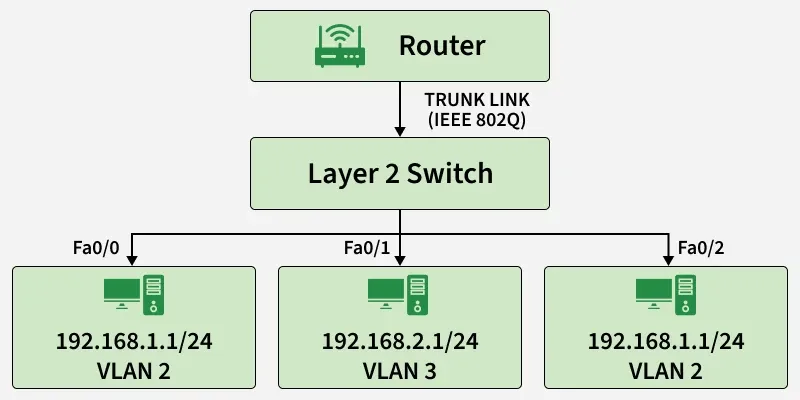

### 43. What is PoE (Power over Ethernet)?

- Power over Ethernet (PoE) is a technology that allows a single Ethernet cable to carry both data and electrical power.
- Eliminates the need for separate power cables.
- Commonly used for IP phones, wireless access points, and IP cameras.
- Simplifies installation and reduces wiring cost.
- Standard Ethernet cables can provide both network connectivity and power.

**Example:** An IP camera can receive power and network connection through one Cat6 cable.

### 44. Why Is DNS Hierarchical Instead of Centralized?

DNS uses a hierarchical structure to improve scalability, reliability, and performance. It distributes domain information among Root, TLD, and Authoritative DNS servers instead of relying on one central server. This reduces server load and eliminates a single point of failure.

- Improves scalability and reliability.
- Uses Root, TLD, and Authoritative DNS servers.
- Reduces server load and avoids a single point of failure.

### 45. What is DNS cache poisoning and how can it be prevented?

DNS cache poisoning occurs when an attacker inserts a fake DNS record into a DNS cache, causing users to be redirected to a malicious website.

Prevention methods:

- Use DNSSEC (Domain Name System Security Extensions).
- Use trusted DNS servers.
- Keep cache entries updated.
- Clear suspicious DNS cache entries.

This attack targets the DNS caching mechanism and can affect many users if the poisoned entry is widely used.

### 46. Explain What Happens When You Enter a URL in a Browser

When a URL is entered, the browser first resolves the domain name using DNS. It then establishes a TCP connection and performs a TLS handshake if HTTPS is used. Finally, it sends an HTTP request, receives the webpage, and renders it.

- Resolves the domain name using DNS.
- Establishes a TCP/TLS connection.
- Downloads and displays the webpage.

### 47. Why Does HTTPS Use TLS Instead of Plain HTTP?

HTTPS uses TLS (Transport Layer Security) to encrypt communication between the client and server. During the TLS handshake, certificates are verified and encryption keys are generated. This ensures secure communication, unlike plain HTTP, which sends data in readable text.

- Encrypts data using TLS.
- Verifies the server through digital certificates.
- Ensures confidentiality, integrity, and authentication.

### 48. Compare HTTP/1.1, HTTP/2, and HTTP/3

**HTTP/1.1**

- Uses the TCP protocol for communication.
- Requests are processed mostly in a sequential manner.
- It is slower compared to newer versions.
- Head-of-line blocking can reduce performance when many requests are sent.

**HTTP/2**

- Also uses the TCP protocol.
- Supports multiplexing, so multiple requests can travel over one connection.
- It is faster than HTTP/1.1.
- It improves bandwidth usage and reduces page loading time.

**HTTP/3**

- Uses QUIC over UDP instead of TCP.
- Supports multiplexing through QUIC with independent streams.
- It provides the fastest performance among the three versions.
- It offers lower latency and better performance on unstable or mobile networks.

### 49. Why Does ICMP Not Use TCP?

ICMP (Internet Control Message Protocol) is a Network Layer protocol used for error reporting and diagnostics. It does not use TCP because it sends small control messages rather than application data. Using TCP would add unnecessary connection overhead.

- Used for error reporting and diagnostics.
- Operates at the Network Layer.
- Does not require TCP's connection and reliability features.

### 50. Compare Packet Switching and Circuit Switching

**Circuit Switching**

- A dedicated communication path is established before data transfer starts.
- Bandwidth remains fixed and reserved for the entire connection.
- It provides continuous and predictable communication during the session.
- Network resources may remain unused when no data is being sent, so it is less efficient.

**Packet Switching**

- Data is divided into small packets that travel independently through the network.
- Network bandwidth is shared dynamically among many users.
- Packets may take different routes and are reassembled at the destination.
- It uses network resources more effectively, so it is more efficient and suitable for the Internet.

### 51. Differentiate between synchronous and asynchronous transmission.

Synchronous transmission sends data as a continuous stream using a common clock between sender and receiver. It is efficient for large data transfers.

Asynchronous transmission sends data character by character using start and stop bits. It is simpler but less efficient because of extra overhead.

- Synchronous: higher speed, better efficiency, requires synchronization.
- Asynchronous: simpler hardware, suitable for bursty communication.

Example: Ethernet uses synchronous transmission, while a keyboard sending characters to a computer is an asynchronous example.

### 52. What are MTU and Path MTU Discovery (PMTUD)?

[MTU (Maximum Transmission Unit)](https://www.geeksforgeeks.org/computer-networks/what-is-mtumaximum-transmission-unit/) is the largest packet size that can be transmitted without fragmentation. Path MTU Discovery (PMTUD) identifies the smallest MTU along the communication path. This reduces fragmentation and improves network performance.

- MTU defines the maximum packet size.
- PMTUD finds the smallest MTU along the path.
- Reduces fragmentation and improves efficiency.

### 53. Why is Manchester encoding called self-clocking? Compare it with NRZ.

Manchester encoding has a guaranteed signal transition in the middle of every bit, so the receiver can recover clock timing directly from the signal. This is why it is called self-clocking.

- Better synchronization and error detection.
- Requires more bandwidth.

NRZ uses constant voltage levels and is more bandwidth efficient, but long sequences of identical bits can cause synchronization loss.

Example: Early Ethernet (10BASE‑T) used Manchester encoding.

### 54. What is RTT (Round Trip Time)?

Round Trip Time (RTT) is the total time taken for a packet to travel from the sender to the receiver and for the acknowledgment or response to return.

- Measured in milliseconds (ms).
- Lower RTT means lower network latency.
- Used to evaluate network performance and responsiveness.
- Commonly measured using the ping command.

Example: If a ping reply returns in 20 ms, the RTT is 20 ms.

### 55. What is propagation delay and transmission delay? How do they affect network latency?

Propagation delay is the time taken for a signal to travel through the medium.

Transmission delay is the time required to place all bits of a packet onto the link.

- Propagation delay depends mainly on distance.
- Transmission delay depends on packet size and link bandwidth.

Total network latency includes propagation delay, transmission delay, processing delay, and queuing delay. Long-distance links are usually affected more by propagation delay, while low-bandwidth links are affected more by transmission delay.

### 56. Why Is UDP Preferred for Streaming and Online Gaming Despite Being Unreliable?

[UDP (User Datagram Protocol)](https://www.geeksforgeeks.org/computer-networks/user-datagram-protocol-udp/) is preferred for real-time applications because it offers low latency and minimal overhead. It does not establish a connection or retransmit lost packets, allowing faster communication. Small packet losses are acceptable in streaming and online gaming.

- Provides low latency and fast communication.
- Does not retransmit lost packets.
- Ideal for streaming, VoIP, and online gaming.

### 57. Differentiate between Bluetooth, Wi-Fi, and ZigBee.

- **Bluetooth:** A short-range, low-power wireless technology used to connect personal devices like headphones, keyboards, and smartphones.
- **Wi-Fi:** A high-speed wireless networking technology used to provide internet access and connect devices over a local network.
- **ZigBee:** A low-power, low-data-rate wireless technology designed for IoT devices, sensor networks, and home automation.

### 58. What are Symmetric and Asymmetric Encryption?

[Symmetric and Asymmetric Encryption](https://www.geeksforgeeks.org/computer-networks/difference-between-symmetric-and-asymmetric-key-encryption/) are techniques used to secure data during transmission. Symmetric encryption uses the same key for encryption and decryption, while asymmetric encryption uses two different keys: a public key and a private key. Asymmetric encryption is more secure but slower.

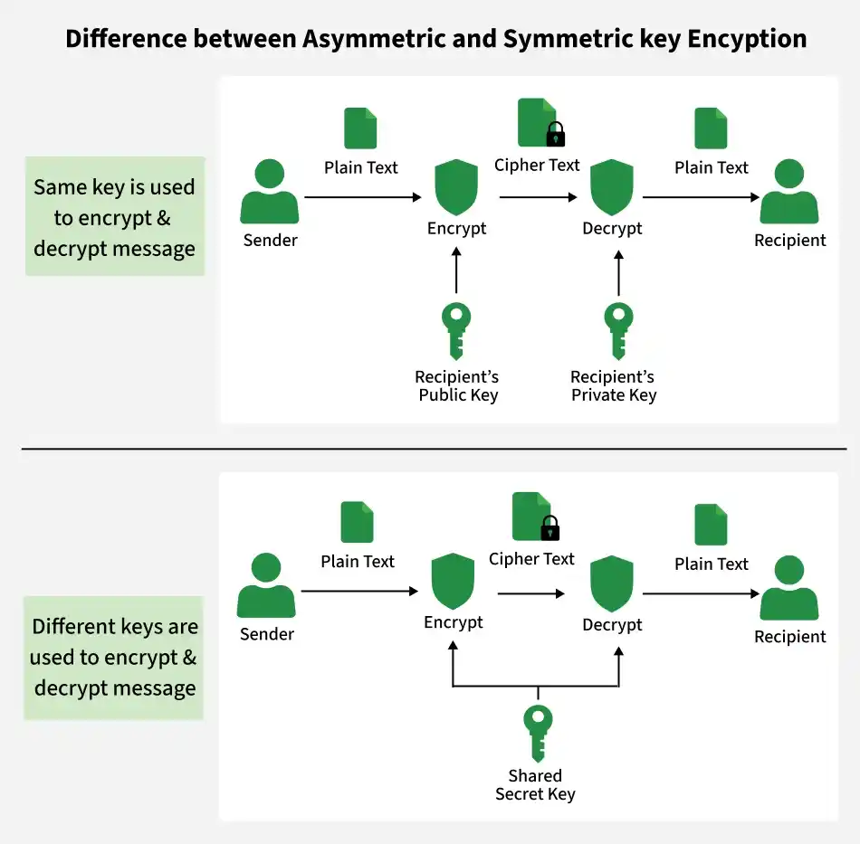

### 59. What is a firewall?

A firewall is a security system that monitors and controls incoming and outgoing network traffic based on predefined rules.

- Blocks unauthorized access.
- Allows legitimate traffic.
- Can be hardware-based or software-based.
- Acts as a barrier between trusted and untrusted networks.

### 60. What are the Advantages of Fiber Optics?

Fiber optic cables transmit data using light signals, providing faster and more reliable communication than copper cables. They support long-distance communication with minimal signal loss. Fiber optics are also secure and resistant to interference.

- High bandwidth and faster data transmission.
- Supports long-distance communication with low signal loss.
- Immune to electromagnetic interference (EMI) and more secure.

### 61. Can IP Multicast Be Load-Balanced?

IP multicast is not load-balanced because traffic from a single source follows only one network path. Although multiple paths may exist, multicast traffic is not distributed across them. This ensures consistent delivery to all receivers.

- IP multicast traffic uses only one path.
- Does not distribute traffic across multiple paths.
- Ensures consistent multicast delivery.

### 62. What is CGMP (Cisco Group Management Protocol)?

CGMP (Cisco Group Management Protocol) is a Cisco protocol that helps switches manage multicast traffic. Routers send CGMP messages, and switches use them to determine which ports should receive multicast packets. This reduces unnecessary multicast traffic.

- Used to manage multicast traffic.
- Routers send CGMP messages; switches process them.
- Reduces unnecessary multicast packet flooding.

### 63. Why Do We Need the POP3 Protocol for E-mail?

POP3 (Post Office Protocol version 3) is used to download emails from a mail server to a user's device. Once downloaded, emails can be read even without an Internet connection. It is widely supported by email clients.

- Downloads emails from the mail server.
- Allows offline access to downloaded emails.
- Supported by most email applications.

### 64. Define the Term Jitter

Jitter is the variation in the delay of data packets during transmission. High jitter can affect real-time applications such as voice calls and video streaming. It is measured in milliseconds (ms).

- Variation in packet delivery delay.
- Affects voice and video quality.
- Measured in milliseconds (ms).

### 65. Differentiate Between TCP and UDP

**TCP**

- TCP is a connection-oriented protocol, so a connection is established before data transfer.
- It provides reliable communication with error checking, acknowledgments, and retransmission.
- TCP is generally slower because of connection setup and reliability mechanisms.
- It is commonly used for web browsing, email, FTP, and file transfer applications.

**UDP**

- UDP is a connectionless protocol, so data is sent without establishing a connection.
- It provides unreliable communication and does not guarantee delivery or ordering.
- UDP is generally faster because it has very little protocol overhead.
- It is commonly used for video/audio streaming, online gaming, DNS, and real-time applications.

### 66. What is the role of port numbers in transport-layer communication, and what are ephemeral ports?

Port numbers identify specific applications or services running on a device. They allow multiple applications to use the network at the same time.

- HTTP uses port 80.
- HTTPS uses port 443.
- DNS uses port 53.

Ephemeral ports are temporary ports automatically assigned by the operating system for outgoing client connections. They are released after the connection ends.

Example: When a browser connects to a website, it uses a temporary source port and connects to destination port 443.

### 67. What is the TCP Sliding Window? How Does It Improve Throughput?

The [TCP Sliding Window](https://www.geeksforgeeks.org/computer-networks/sliding-window-protocol-set-1/) is a flow control mechanism that allows multiple packets to be sent before receiving acknowledgments. As acknowledgments arrive, the window moves forward, allowing continuous data transmission. This improves throughput and bandwidth utilization.

- Allows multiple packets to be sent without waiting.
- The window slides forward as ACKs are received.
- Improves throughput and reduces idle time.

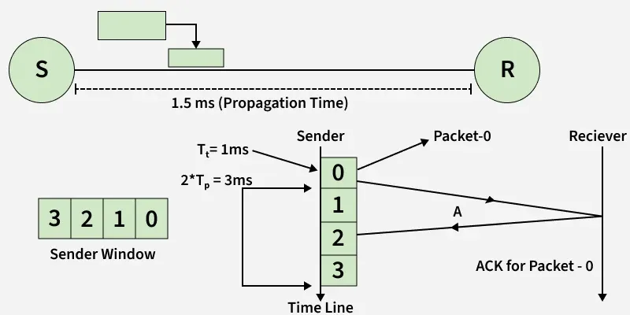

### 68. What is Nagle’s algorithm and when can it reduce performance?

Nagle’s algorithm reduces network congestion by combining many small TCP packets into fewer larger packets before sending them.

**Advantages:**

- Reduces the number of packets.
- Improves bandwidth efficiency.

**Disadvantages:**

- Adds delay while waiting for acknowledgments.
- Can reduce performance in interactive applications such as online gaming, VoIP, and real-time communication.

Nagle’s algorithm is useful for applications sending many small messages but may be disabled for low-latency applications.

### 69. Differentiate Between Flow Control and Congestion Control

**Flow Control**

- Flow control is used to protect the receiver from getting too much data.
- It controls the data rate according to the receiver’s buffer capacity.
- It mainly uses the receive window (rwnd) value.
- It prevents receiver buffer overflow during communication.

**Congestion Control**

- Congestion control is used to protect the network from becoming overloaded.
- It controls the sending rate according to the network traffic condition.
- It mainly uses the congestion window (cwnd) value.
- It prevents network congestion and packet loss in the network.
