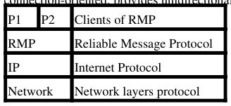

# Berkeley CS162 Spring 1990: Midterm 2: Questions

> Copied from the original: <https://hkn.eecs.berkeley.edu/exams/course/cs/162>. Text and figures are taken from the PDF as is; nothing was answered or rewritten. The original PDF is in this folder.

---

**Page 1**

&emsp;&emsp;&emsp;&emsp;&emsp;&emsp;&emsp;&emsp;CS162 Spring 1990, MT2 
&emsp;&emsp;&emsp;&emsp;&emsp;&emsp;&emsp;&emsp;**CS 162, Spring 1990** 
&emsp;&emsp;&emsp;&emsp;&emsp;&emsp;&emsp;&emsp;**Midterm #2** 
&emsp;&emsp;&emsp;&emsp;&emsp;&emsp;&emsp;&emsp;**Professor David Anderson**

**Problem #1 (10 points)** 
true/false 
-I/O buffering can increase CPU utilization. 
-The two "sides" of a UNIX pseudo-tty are equivelent. 
-Shortest CPU burst first process scheduling minimizes average turnaround time. 
-Sun NFS client caches are always consistent 
-Data can flow both up and down between adjacent protocol layers.

**Problem #2 (10 points)** 
a) List three input functions and one output function of the BSD UNIX line discipline in cooked mode 
b) Would system performance increase or decrease if line disciplines were moved from the kernel to the user 
level? Explain.

**Problem #3 (10 points)** 
a) What does it mean to say that access to a resource is "fair"? 
b) What is "aging"? Under what circumstances does aging provide fairness and why? 
c) The "fair share scheduler" used in some versions of UNIX provides a different kind of fairness. Describe 
as precisely as you can this notion of "fairness"? 
d) Describe, in words or in pseudocode, what the sending side of RMP does to deliver a client message. 
When should the client call (to send the message) return? 
e) Describe, in words or in pseudocode, what the receiving side of RMP does to handle an incoming 
datagram. 
f) Is RMP appropriate for wide-area networks? Explain.

**Problem #4 (15 points)** 
Not available

**Problem #5 (15 points)** 
Not available.

**Problem #6 (15 points)** 
Acne's computers use a BSD UNIX-based operating system. Noah Tall has complained that the following 
pair of calls run slower than they should:

fd = open("/a/b", O\_RDONLY, 0); 
read(fd, buf, l);

CS 162, Spring 1990 Midterm #2 Professor David Anderson   1

---

**Page 2**

&emsp;&emsp;&emsp;&emsp;&emsp;&emsp;&emsp;&emsp;CS162 Spring 1990, MT2 
where /a/b is any existing file, and the buffer and inode caches are initially empty.

a) Explain to Noah why this is slow (tell him about all the disk operations that are needed. 
b) Propose a reasonable way to change the UNIX file system disk layout to reduce the number of disk 
operations in the above case.

**Problem #7 (25 points)** 
Your next assignment at Acne is to design a transport protocol. The "Reliable Message Protocol" (RMP) is

RMP client messages may be larger than the 64KB limit on IP datagrams. RMP will be used across networks 
that can damage, lose, reorder, and delay packets. 
You're in charge of the data-transfer part of RMP; another group is handling connection establishment. For 
simplicity, you decide that RMP will use a "stop-and-wait" protocol (i.e., a send window siize of 1).

&emsp;**Posted by HKN (Electrical Engineering and Computer Science Honor Society)** 
&emsp;&emsp;&emsp;&emsp;&emsp;&emsp;&emsp;&emsp;**University of California at Berkeley** 
&emsp;&emsp;&emsp;&emsp;&emsp;&emsp;**If you have any questions about these online exams** 
&emsp;&emsp;&emsp;&emsp;&emsp;&emsp;&emsp;**please contact**  **examfile@hkn.eecs.berkeley.edu.**

Problem #6 (15 points)   2

