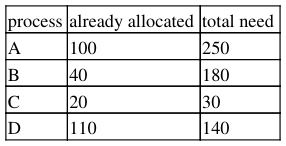

# Berkeley CS162 Spring 1991: Midterm 1: Questions

> Copied from the original: <https://hkn.eecs.berkeley.edu/exams/course/cs/162>. Text and figures are taken from the PDF as is; nothing was answered or rewritten. The original PDF is in this folder.

---

**Page 1**

&emsp;&emsp;&emsp;&emsp;&emsp;&emsp;&emsp;&emsp;CS 162, Midterm #1, Fall 1991 
&emsp;&emsp;&emsp;&emsp;&emsp;&emsp;&emsp;&emsp;**CS162, Fall 1991** 
&emsp;&emsp;&emsp;&emsp;&emsp;&emsp;&emsp;&emsp;**Midterm #1** 
&emsp;&emsp;&emsp;&emsp;&emsp;&emsp;&emsp;&emsp;**Professor Alan Smith** 
**Problem #1** 
When a compiler compiles a program and produces the corresponding object module(s), it also produces 
some information (in tables) to be used by the linker/loader. Please list and describe all such information, and 
explain why the linker/loader needs it. (15)

**Problem #2** 
What advantages (if any) are there in having different quantum sizes on different levels of a multilevel 
scheduling queueing algorithm. (10)

**Problem #3** 
What is the meaning of the term "busy waiting?" What other kinds of waiting are there? Can busy waiting be 
avoided altogether, assuming a machine with a "swap" instruction for synchronizaion. Explain. (12)

**Problem #4** 
Simulate the banker's algorithm to get a safe sequence for the following: 
There are 15 units currently free (available). (10)

**Problem #5** 
The following questions are true/false or multiple choice. Please enter the appropriate answer: (33) 
a. Test-and-set is an atomic operation (T/F): \_\_\_\_

b. The use of Test-and-set in synchronization problems precludes busy-waiting (T/F): \_\_\_\_

c. In a uniprocessing system, one must be able to disable interrupts in order to correctly implement P() and 
V() (T/F): \_\_\_\_

d. In a multiprocessing system, it is sufficient to disable interrupts in order to implement P() and V() (T/F): 
\_\_\_\_

e. When running the Banker's Algorithm, a safe state could not possible lead to deadlock (T/F): \_\_\_\_

f. When running the Banker's Algorithm, if there are two processes whose requests can be granted fully with

CS162, Fall 1991 Midterm #1 Professor Alan Smith   1

---

**Page 2**

&emsp;&emsp;&emsp;&emsp;&emsp;&emsp;&emsp;&emsp;CS 162, Midterm #1, Fall 1991 
the available resources, it doesn't matter, in terms of correctness, which one's requests are granted first (T/F): 
\_\_\_\_

g. A circular allocated-resource graph is a necessary ingredient for deadlock (T/F): \_\_\_\_

h. If the resources in a system are of different types, and there is only one instance of each resource type, 
deadlock is not possible (T/F): \_\_\_\_

The following kinds of jobs should be assigned to F or B in a system with foreground/background 
scheduling: 
i. CPU intensive (F/B)? \_\_\_\_

j. Interactive (F/B)? \_\_\_\_

k. Newly arrived (F/B)? \_\_\_\_

**Problem #6** 
A barbershop consists of a waiting room with n chairs, and the barber room with one barber chair. If there are 
no customers to be served, the barber goes to sleep. If a customer enters the barbershop and all chairs are 
occupied, then the customer leaves the shop. If the barber is busy, but chairs are available, then the customer 
sits in one of the free chairs. If the barber is asleep, the customer wakes up the barber. Write a program (using 
P's and V's) to coordinate the barber and the customers. (20)

&emsp;**Posted by HKN (Electrical Engineering and Computer Science Honor Society)** 
&emsp;&emsp;&emsp;&emsp;&emsp;&emsp;&emsp;&emsp;**University of California at Berkeley** 
&emsp;&emsp;&emsp;&emsp;&emsp;&emsp;**If you have any questions about these online exams** 
&emsp;&emsp;&emsp;&emsp;&emsp;&emsp;&emsp;**please contact**  **examfile@hkn.eecs.berkeley.edu.**

Problem #5   2

