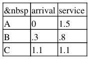
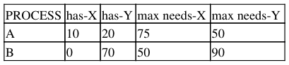
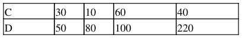

# Berkeley CS162 Spring 1998: Midterm 1: Questions

> Copied from the original: <https://hkn.eecs.berkeley.edu/exams/course/cs/162>. Text and figures are taken from the PDF as is; nothing was answered or rewritten. The original PDF is in this folder.

---

**Page 1**

&emsp;&emsp;&emsp;&emsp;&emsp;&emsp;&emsp;&emsp;CS 162, Midterm #1, Spring 1998 
&emsp;&emsp;&emsp;&emsp;&emsp;&emsp;&emsp;&emsp;**CS162, Spring 1998** 
&emsp;&emsp;&emsp;&emsp;&emsp;&emsp;&emsp;&emsp;**Midterm #1** 
&emsp;&emsp;&emsp;&emsp;&emsp;&emsp;&emsp;&emsp;**Professor Alan Smith**

**Problem #1** 
Explain the difference between a process and a thread. Define both. What are the tradeoffs between using one 
and using the other? (14)

**Problem #2** 
We discussed two mathematical quantities that are reasonable targets for optimization in scheduling: 
minimizing ave(f(i)) and minimizing ave(f(i)/s(i)). Please explain what each is, and explain why we would 
like to minimize it. (14)

**Problem #3** 
Please provide code (of the same sort used in class) that will implement P & V using the "swap" operation 
described in class. (18)

**Problem #4** 
What is the difference between an interrupt and a trap? Define both. Please give at least two examples of 
each. (12)

**Problem #5** 
Why does rollback usually require checkpoints? Please define both terms and explain. (11)

**Problem #6** 
For each of FIFO, SRPT, and RR (Q=.25), and for the following set of arrival and service times, please show 
a time line for which process is executing, and compute the mean flow time. Show your computations. (We 
might give partial credit, if you made a simple and obvious error; we're not going to try to decode your 
calculations if they aren't obvious.) (15)

**Problem #7** 
For the following two cases, please either show a complete safe sequence or show that there isn't one. (16)

CS162, Spring 1998 Midterm #1 Professor Alan Smith   1

---

**Page 2**

&emsp;&emsp;&emsp;&emsp;&emsp;&emsp;&emsp;&emsp;CS 162, Midterm #1, Spring 1998

a. available: X: 40 Y: 40 
b. available: X: 40 Y: 35

&emsp;**Posted by HKN (Electrical Engineering and Computer Science Honor Society)** 
&emsp;&emsp;&emsp;&emsp;&emsp;&emsp;&emsp;&emsp;**University of California at Berkeley** 
&emsp;&emsp;&emsp;&emsp;&emsp;&emsp;**If you have any questions about these online exams** 
&emsp;&emsp;&emsp;&emsp;&emsp;&emsp;&emsp;**please contact**  **examfile@hkn.eecs.berkeley.edu.**

Problem #7   2

