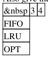

# Berkeley CS162 Spring 1998: Midterm 2: Questions

> Copied from the original: <https://hkn.eecs.berkeley.edu/exams/course/cs/162>. Text and figures are taken from the PDF as is; nothing was answered or rewritten. The original PDF is in this folder.

---

**Page 1**

&emsp;&emsp;&emsp;&emsp;&emsp;&emsp;&emsp;&emsp;CS162, Midterm #2, Spring 1998 
&emsp;&emsp;&emsp;&emsp;&emsp;&emsp;&emsp;&emsp;**CS162, Spring 1998** 
&emsp;&emsp;&emsp;&emsp;&emsp;&emsp;&emsp;&emsp;**Midterm 2** 
&emsp;&emsp;&emsp;&emsp;&emsp;&emsp;&emsp;&emsp;**Professor Alan Smith**

**Problem #1** 
What is the relocation table? What is in it? How does the loader use it? (10)

**Problem #2** 
Suppose we have hardware that supports segmentation. Could we use it to support paging instead? Why or 
why not? (10)

**Problem #3** 
Could we do page replacement in main memory on a set associative basis? Why or why not? How would it 
work? What are the tradeoffs? (10)

**Problem #4** 
Given that the following cylinders have I/O requests pending, that the requests arrived in the order shown, 
that the disk head is currently at track 9, and that the last two requests serviced were on cylinders 8 and 9 (in 
that order), show the sequence in which the I/O requests are serviced (by listing their cylinder numbers) for 
each of the following scheduling algorithms. (12) 
4 19 20 2 10 21 7 1 26 3 9 11 
a) FIFO 
b) SSTF 
c) SCAN 
d) CSCAN

**Problem #5** 
Give the number of page faults for LRU, FIFO, OPT for the following reference string, for memories of size 
3 and 4. (no partial credit...) (14) 
5 4 3 2 5 4 6 5 4 3 2 6 
Also give the number of page faults if the working set parameter is 3.5.

Working Set:

**Problem #6** 
The following questions are true/false. No partial credit will be given for missing answers. The questions you 
answer will be graded (right-wrong). (44)

\_\_\_a. According to the "fast file system for unix" paper, the randomization of disk blocks over the disk

CS162, Spring 1998 Midterm 2 Professor Alan Smith   1

---

**Page 2**

&emsp;&emsp;&emsp;&emsp;&emsp;&emsp;&emsp;&emsp;CS162, Midterm #2, Spring 1998 
surface, as files were created and deleted, lead to a drop in read bandwidth by more than a factor of five, 
compared to a 'new' file system. 
\_\_\_b. A page frame is a fixed size portion of a process's address space. 
\_\_\_c. A page fault is a type of interrupt. 
\_\_\_d. Internal fragmentation is a problem for segmentation (as implemented without paging). 
\_\_\_e. The STBR points to the page table for a process. 
\_\_\_f. In the absence of paging, segments cannot exceed the physical memory size. 
\_\_\_g. A plausible MTBF for a disk is 30,000 days. 
\_\_\_h. In the absence of paging, the sum of the sizes of all segments cannot exceed the physical memory size. 
\_\_\_i. The 'memory map' is another name for the page table. 
\_\_\_j. Putting the user process page tables in the OS virtual memory avoids having to do a two step translation 
from virtual address to real address. 
\_\_\_k. When a page table is implemented as a hash table, it is called "an indirect page table". 
\_\_\_l. One solution to the problem of I/O buffers that span virtual addresses which map to non-contiguous 
page frames is to prevent those pages from being paged out during I/O. 
\_\_\_m. "ATC" and "DLAT" are synonyms for "TLB" (depending on which manufacturer we are considering.) 
\_\_\_n. The set in the TLB is typically selected using the high order virtual address bits. 
\_\_\_o. 'Working set restoration' is a page placement algorithm. 
\_\_\_p. MIN and LRU are both stack algorithms. 
\_\_\_q. The clock algorithm is also called "FINUFO". 
\_\_\_r. A plausible power dissipation for a disk is 3 watts. 
\_\_\_s. A compact disk can hold more data than a twelve inch reel of 9-track tape. 
\_\_\_t. There are current disks that spin at approximately 5000rps. 
\_\_\_u. A unix i-node has the file name in it. 
\_\_\_v. A unix i-node has a field showing the number of bytes in the file.

&emsp;**Posted by HKN (Electrical Engineering and Computer Science Honor Society)** 
&emsp;&emsp;&emsp;&emsp;&emsp;&emsp;&emsp;&emsp;**University of California at Berkeley** 
&emsp;&emsp;&emsp;&emsp;&emsp;&emsp;**If you have any questions about these online exams** 
&emsp;&emsp;&emsp;&emsp;&emsp;&emsp;&emsp;**please contact**  **examfile@hkn.eecs.berkeley.edu.**

Problem #6   2

