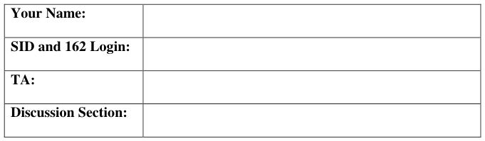

# Berkeley CS162 Fall 1999: Midterm 1: Questions

> Copied from the original: <https://hkn.eecs.berkeley.edu/exams/course/cs/162>. Text and figures are taken from the PDF as is; nothing was answered or rewritten. The original PDF is in this folder.

---

**Page 1**

&emsp;&emsp;&emsp;&emsp;&emsp;&emsp;&emsp;&emsp;University of California, Berkeley 
&emsp;&emsp;&emsp;&emsp;&emsp;&emsp;&emsp;&emsp;College of Engineering 
&emsp;&emsp;&emsp;&emsp;&emsp;&emsp;&emsp;&emsp;Computer Science Division – EECS 
Fall 1999                                     Anthony D. Joseph 
&emsp;&emsp;&emsp;&emsp;&emsp;&emsp;&emsp;&emsp;**Midterm Exam #1** 
&emsp;&emsp;&emsp;&emsp;&emsp;&emsp;&emsp;&emsp;September 29, 1999 
&emsp;&emsp;&emsp;&emsp;&emsp;&emsp;&emsp;&emsp;CS162 Operating Systems

General Information: 
This is a **closed book** examination. You have two hours to answer as many questions as possible. 
The number in parentheses at the beginning of each question indicates the number of points given 
to the question; there are 100 points in all. You should read **all** of the questions before starting the 
exam, as some of the questions are substantially more time consuming. 
Write all of your answers directly on this paper.  Make your answers as concise as possible. If there 
is something in a question that you believe is open to interpretation, then please ask us about it! 
&emsp;&emsp;&emsp;&emsp;&emsp;&emsp;&emsp;&emsp;**Good Luck!!**

Page 1/10

---

**Page 2**

CS 162 Fall 1999 Midterm Exam #1        September 29, 1999

1\. Threads – Good or bad? (12 points total): 
&emsp;a. (6 points) List two reasons why **overuse** of threads is bad (i.e., using too many 
&emsp;&emsp;threads for different tasks). Be explicit in your answers. 
&emsp;&emsp;i)

&emsp;&emsp;ii)

&emsp;b. (6 points) List two reasons why threads are useful/important. 
&emsp;&emsp;i)

&emsp;&emsp;ii)

Page 2/10

---

**Page 3**

CS 162 Fall 1999 Midterm Exam #1        September 29, 1999

2\. (15 points) For each of the following thread state transitions, say whether the transition 
&emsp;is legal **and** how the transition occurs or why it cannot. Assume Mesa-style monitors. 
&emsp;a. Change from thread state **BLOCKED** to thread state **RUNNING**.

&emsp;b. Change from thread state **RUNNING** to thread state **BLOCKED**.

&emsp;c. Change from thread state **RUNNABLE** to thread state **BLOCKED**.

3\. (9 points) You're hired by AB Computers to improve the performance of their system. 
&emsp;They point out that their applications only use 10 of the CPU's 32 registers; so to 
&emsp;improve the performance of the applications, they suggest that you change the OS's 
&emsp;context switch routine so it only saves the 10 registers used by the applications. 
&emsp;Assume that you can correctly change the context switch routine. Is this a good or bad 
&emsp;idea? Why?

Page 3/10

---

**Page 4**

CS 162 Fall 1999 Midterm Exam #1        September 29, 1999

4\. (24 points) Concurrency control: 
&emsp;You’ve been hired by the HAL computer company to review their code for a large 
&emsp;application. In the application you find the **atomic swap** procedure. Say whether it 
&emsp;either (i) works, (ii) doesn’t work, or (iii) is dangerous – that is, sometimes works and 
&emsp;sometimes doesn’t.  If the implementation does not work or is dangerous, explain why 
&emsp;(there may be several errors) and rewrite the code to fix it so it does work. 
&emsp;The problem statement is as follows: The **atomic swap** routine pops an item from each 
&emsp;of two stacks and pushes the items onto the opposite stack. If either stack does not 
&emsp;contain an item, the swap fails and the stacks are left as before the swap was attempted. 
&emsp;The swap must appear to occur atomically: there should be no interval of time during 
&emsp;which an external thread can determine that an item has been removed from one stack 
&emsp;but not yet pushed onto another one. In addition, the implementation must be highly 
&emsp;concurrent – it must allow multiple swaps between unrelated stacks to happen in 
&emsp;parallel.  You may assume that stack1 and stack2 never refer to the same stack. 
&emsp;&emsp;`void AtomicSwap (Stack *stack1, *stack2) {` 
&emsp;&emsp;&emsp;&emsp;&emsp;`Item thing1; /* First thing being transferred */` 
&emsp;&emsp;&emsp;&emsp;&emsp;`Item thing2; /* Second thing being transferred */`

&emsp;&emsp;&emsp;&emsp;&emsp;`stack1->lock.Acquire();` 
&emsp;&emsp;&emsp;&emsp;&emsp;`thing1 = stack1->Pop();` 
&emsp;&emsp;&emsp;&emsp;&emsp;`if (thing1 != NULL) {` 
&emsp;&emsp;&emsp;&emsp;&emsp;&emsp;&emsp;`stack2->lock.Acquire();` 
&emsp;&emsp;&emsp;&emsp;&emsp;&emsp;&emsp;`thing2 = stack2->Pop();` 
&emsp;&emsp;&emsp;&emsp;&emsp;&emsp;&emsp;`if (thing2 != NULL) {` 
&emsp;&emsp;&emsp;&emsp;&emsp;&emsp;&emsp;&emsp;`stack2->Push(thing1);` 
&emsp;&emsp;&emsp;&emsp;&emsp;&emsp;&emsp;&emsp;`stack1->Push(thing2);` 
&emsp;&emsp;&emsp;&emsp;&emsp;&emsp;&emsp;&emsp;`stack2->lock.Release();` 
&emsp;&emsp;&emsp;&emsp;&emsp;&emsp;&emsp;&emsp;`stack1->lock.Release();` 
&emsp;&emsp;&emsp;&emsp;&emsp;&emsp;&emsp;`}` 
&emsp;&emsp;&emsp;&emsp;&emsp;`}` 
&emsp;&emsp;`}`

Page 4/10

---

**Page 5**

CS 162 Fall 1999 Midterm Exam #1        September 29, 1999

(Additional space for question 4)

Page 5/10

---

**Page 6**

CS 162 Fall 1999 Midterm Exam #1        September 29, 1999

5\. Concurrency problem (30 points total): 
&emsp;A particular river crossing is shared by both Linux Hackers and Microsoft employees. 
&emsp;A boat is used to cross the river, but it only seats **four** people, and must always carry 
&emsp;a full load.  In order to guarantee the safety of the hackers, you cannot put three 
&emsp;employees and one hacker in the same boat (because the employees would gang up 
&emsp;and convert the hacker).  Similarly, you cannot put three hackers in the same boat as 
&emsp;an employee (because the hackers would gang up and convert the employee).  All 
&emsp;other combinations are safe. 
&emsp;Two procedures are needed: HackerArrives and EmployeeArrives, called by a hacker 
&emsp;or employee when he/she arrives at the river bank.  The procedures arrange the 
&emsp;arriving hackers and employees into safe boatloads; once the boat is full, one thread 
&emsp;calls Rowboat and only after the call to Rowboat, the four threads representing the 
&emsp;people in the boat can return. 
&emsp;You can use either semaphores or condition variables to implement the solution.  Any 
&emsp;order is acceptable and there should be no busy-waiting and no undue waiting – 
&emsp;hackers and employees should not wait if there are enough of them for a safe 
&emsp;boatload. Your code should be clearly commented, in particular, you should comment 
&emsp;each semaphore or condition variable operation to specify how correctness 
&emsp;properties are preserved. 
&emsp;a. Specify the correctness properties for your solution:

&emsp;b. Your solution:

Page 6/10

---

**Page 7**

CS 162 Fall 1999 Midterm Exam #1        September 29, 1999

(Additional space for question 5)

Page 7/10

---

**Page 8**

CS 162 Fall 1999 Midterm Exam #1        September 29, 1999

No Credit – Problem X: (000000000000 points)

&emsp;&emsp;Runner up for the 1999 Darwin Awards (don’t try this at home) 
In rural Carbon County, PA, a group of men were drinking beer and discharging firearms 
from the rear deck of a home owned by Irving Michaels, age 27. The men were firing at a 
raccoon that was wandering by, but the beer apparently impaired their aim and, despite 
the estimated 35 shots the group fired, the animal escaped into a 3 foot diameter drainage 
pipe some 100 feet away from Mr .Michaels’ deck. 
Determined to terminate the animal, Mr. Michaels retrieved a can of gasoline and poured 
some down the pipe, intending to smoke the animal out. After several unsuccessful 
attempts to ignite the fuel, Michaels emptied the entire 5-gallon fuel can down the pipe 
and tried to ignite it again, to no avail. Not one to admit defeat by wildlife, the 
determined Mr. Michaels proceeded to slide feet-first approximately 15 feet down the 
sloping pipe to toss the match. 
The subsequent rapidly expanding fireball propelled Mr. Michaels back the way he had 
come, although at a much higher rate of speed. He exited the angled pipe “like a Polaris 
missile leaves a submarine,” according to witness Joseph McFadden, 31. Mr. Michaels 
was launched directly over his own home, right over the heads of his astonished friends, 
onto his front lawn. In all, he traveled over 200 feet through the air. “There was a 
Doppler Effect to his scream as he flew over us,” McFadden reported, “followed by a 
loud thud.” Amazingly, he suffered only minor injuries. “It was actually pretty cool,” 
Michaels said, “Like when they shoot someone out of a cannon at the circus. I’d do it 
again if I was sure I wouldn’t get hurt.”

Page 8/10

---

**Page 9**

CS 162 Fall 1999 Midterm Exam #1        September 29, 1999

6\. (10 points) Deadlock: 
Consider a computer system that runs 5000 jobs per month with no deadlock-prevention 
or deadlock-avoidance scheme. Deadlocks occur about twice a month, and the operator (a 
salaried employee) must terminate and rerun about 10 jobs per deadlock. The operator 
notices immediately when deadlock has occurred because their screen shows the 
computer’s running processes. Each job is worth about $2 (in CPU time), and the jobs 
terminated tend to be about half-done when they are aborted. 
A system programmer has estimated that a deadlock-avoidance algorithm (like the 
banker’s algorithm) could be installed in the system with an increase in the average 
execution time per job of about 10 percent. Since the machine currently has a 30 percent 
idle time, all 5000 jobs per month could still be run. 
Should the company install the algorithm? List the reasons why or why not.

Page 9/10

---

**Page 10**

CS 162 Fall 1999 Midterm Exam #1        September 29, 1999

(This page intentionally left blank)

Page 10/10

