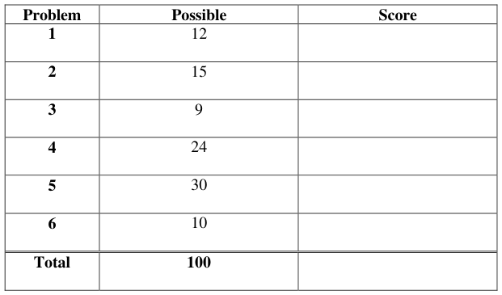

# Berkeley CS162 Fall 1999: Midterm 1: Official solutions

> Copied from the original: <https://hkn.eecs.berkeley.edu/exams/course/cs/162>. Text and figures are taken from the PDF as is; nothing was answered or rewritten. The original PDF is in this folder.

---

**Page 1**

&emsp;&emsp;&emsp;&emsp;&emsp;&emsp;&emsp;&emsp;University of California, Berkeley 
&emsp;&emsp;&emsp;&emsp;&emsp;&emsp;&emsp;&emsp;College of Engineering 
&emsp;&emsp;&emsp;&emsp;&emsp;&emsp;&emsp;&emsp;Computer Science Division – EECS 
Fall 1999                                     Anthony D. Joseph 
&emsp;&emsp;&emsp;&emsp;&emsp;&emsp;&emsp;&emsp;**Midterm Exam #1 Solutions** 
&emsp;&emsp;&emsp;&emsp;&emsp;&emsp;&emsp;&emsp;September 29, 1999 
&emsp;&emsp;&emsp;&emsp;&emsp;&emsp;&emsp;&emsp;CS162 Operating Systems

General Information: 
This is a **closed book** examination. You have two hours to answer as many questions as possible. 
The number in parentheses at the beginning of each question indicates the number of points given 
to the question; there are 100 points in all. You should read **all** of the questions before starting the 
exam, as some of the questions are substantially more time consuming. 
Write all of your answers directly on this paper.  Make your answers as concise as possible. If there 
is something in a question that you believe is open to interpretation, then please ask us about it! 
&emsp;&emsp;&emsp;&emsp;&emsp;&emsp;&emsp;&emsp;**Good Luck!!**

Page 1/1

---

**Page 2**

CS 162 Fall 1999 Midterm Exam #1        September 29, 1999 
Solutions

1\. Threads – Good or bad? (12 points total): 
&emsp;a. (6 points) List two reasons why **overuse** of threads is bad (i.e., using too many 
&emsp;&emsp;threads for different tasks). Be explicit in your answers. 
&emsp;&emsp;i) 
&emsp;&emsp;&emsp;&emsp;&emsp;3 points. “Threads are cheap, but they’re not free.” Too many threads will 
&emsp;&emsp;&emsp;&emsp;&emsp;cause a system to spend lots of time context switching and not doing useful 
&emsp;&emsp;&emsp;&emsp;&emsp;work. 
&emsp;&emsp;&emsp;&emsp;&emsp;Each thread requires memory for stack space and TCBs. Too many 
&emsp;&emsp;&emsp;&emsp;&emsp;threads and these memory uses will dominate overall memory use. 
&emsp;&emsp;ii) 
&emsp;&emsp;&emsp;&emsp;&emsp;3 points. Having many threads makes synchronization more complicated 
&emsp;&emsp;&emsp;&emsp;&emsp;as you have more and more simultaneous tasks. Also, debugging is more 
&emsp;&emsp;&emsp;&emsp;&emsp;difficult due to non-deterministic and non-reproducible execution. 
&emsp;&emsp;&emsp;&emsp;&emsp;We did not give credit for answers that were scheduling issues (e.g., too 
&emsp;&emsp;&emsp;&emsp;&emsp;many threads could cause starvation), since these issues also affect 
&emsp;&emsp;&emsp;&emsp;&emsp;processes.

&emsp;b. (6 points) List two reasons why threads are useful/important. 
&emsp;&emsp;i) 
&emsp;&emsp;&emsp;&emsp;&emsp;3 points for each of two reasons. Many reasons, including: 
&emsp;&emsp;&emsp;&emsp;&emsp;&emsp;&emsp;• More efficient operation: overlap I/O and computation 
&emsp;&emsp;&emsp;&emsp;&emsp;&emsp;&emsp;• Easier to share data between threads in the same address 
&emsp;&emsp;&emsp;&emsp;&emsp;&emsp;&emsp;&emsp;space than between processes 
&emsp;&emsp;&emsp;&emsp;&emsp;&emsp;&emsp;• Modularity: A complex task can be decomposed into smaller 
&emsp;&emsp;&emsp;&emsp;&emsp;&emsp;&emsp;&emsp;pieces 
&emsp;&emsp;&emsp;&emsp;&emsp;&emsp;&emsp;• Reduced latency on multiprocessors 
&emsp;&emsp;&emsp;&emsp;&emsp;&emsp;&emsp;• Faster to switch between threads than between processes 
&emsp;&emsp;&emsp;&emsp;&emsp;We did not give credit for saying that threads give you concurrency, since 
&emsp;&emsp;&emsp;&emsp;&emsp;processes also provide concurrency. 
&emsp;&emsp;ii)

Page 2/2

---

**Page 3**

CS 162 Fall 1999 Midterm Exam #1        September 29, 1999 
Solutions

2\. (15 points) For each of the following thread state transitions, say whether the transition 
&emsp;is legal **and** how the transition occurs or why it cannot. Assume Mesa-style monitors. 
&emsp;a. Change from thread state **BLOCKED** to thread state **RUNNING**. 
&emsp;&emsp;&emsp;&emsp;&emsp;5 points, 3 for correct answer and 2 for justification. Illegal. Threads must 
&emsp;&emsp;&emsp;&emsp;&emsp;first be inserted into the ready queue (i.e., moved to the RUNNABLE state) 
&emsp;&emsp;&emsp;&emsp;&emsp;before they can be executed (moved to the RUNNING state). With Mesa- 
&emsp;&emsp;&emsp;&emsp;&emsp;style monitors, threads are placed onto the ready queue, while with 
&emsp;&emsp;&emsp;&emsp;&emsp;Hoare-style monitors, they are immediately given the CPU (moved to the 
&emsp;&emsp;&emsp;&emsp;&emsp;RUNNING state).

&emsp;b. Change from thread state **RUNNING** to thread state **BLOCKED**. 
&emsp;&emsp;&emsp;&emsp;&emsp;5 points, 3 for correct answer and 2 for justification. Legal. A thread that 
&emsp;&emsp;&emsp;&emsp;&emsp;sleeps, joins with another thread, or waits on I/O will transition from the 
&emsp;&emsp;&emsp;&emsp;&emsp;RUNNING state to the BLOCKED state.

&emsp;c. Change from thread state **RUNNABLE** to thread state **BLOCKED**. 
&emsp;&emsp;&emsp;&emsp;&emsp;5 points, 3 for correct answer and 2 for justification. Illegal. A thread 
&emsp;&emsp;&emsp;&emsp;&emsp;can’t change from the RUNNABLE state to the BLOCKED state without 
&emsp;&emsp;&emsp;&emsp;&emsp;first being scheduled and taking an action that causes it to block (e.g., the 
&emsp;&emsp;&emsp;&emsp;&emsp;actions listed in b).

3\. (9 points) You're hired by AB Computers to improve the performance of their system. 
&emsp;They point out that their applications only use 10 of the CPU's 32 registers; so to 
&emsp;improve the performance of the applications, they suggest that you change the OS's 
&emsp;context switch routine so it only saves the 10 registers used by the applications. 
&emsp;Assume that you can correctly change the context switch routine. Is this a good or bad 
&emsp;idea? Why? 
&emsp;&emsp;This is a very bad idea (correct answer 3 points). Up to 6 points for justification. 
&emsp;&emsp;Examples: Long-term implications, such as problems with changes to 
&emsp;&emsp;applications or the use of future applications and the intermittent problems that 
&emsp;&emsp;will result; also, issues with legacy applications. 
&emsp;&emsp;We subtracted 3 points for justifications that only focused on the operating system 
&emsp;&emsp;and ignored the long-term issues.

Page 3/3

---

**Page 4**

CS 162 Fall 1999 Midterm Exam #1        September 29, 1999 
Solutions

4\. (24 points) Concurrency control: 
&emsp;You’ve been hired by the HAL computer company to review their code for a large 
&emsp;application. In the application you find the **atomic swap** procedure. Say whether it 
&emsp;either (i) works, (ii) doesn’t work, or (iii) is dangerous  that is, sometimes works and 
&emsp;sometimes doesn’t.  If the implementation does not work or is dangerous, explain why 
&emsp;(there may be several errors) and rewrite the code to fix it so it does work. 
&emsp;The problem statement is as follows: The **atomic swap** routine pops an item from each 
&emsp;of two stacks and pushes the items onto the opposite stack. If either stack does not 
&emsp;contain an item, the swap fails and the stacks are left as before the swap was attempted. 
&emsp;The swap must appear to occur atomically: there should be no interval of time during 
&emsp;which an external thread can determine that an item has been removed from one stack 
&emsp;but not yet pushed onto another one. In addition, the implementation must be highly 
&emsp;concurrent – it must allow multiple swaps between unrelated stacks to happen in 
&emsp;parallel.  You may assume that stack1 and stack2 never refer to the same stack. 
&emsp;&emsp;`void AtomicSwap (Stack *stack1, *stack2) {` 
&emsp;&emsp;&emsp;&emsp;&emsp;`Item thing1; /* First thing being transferred */` 
&emsp;&emsp;&emsp;&emsp;&emsp;`Item thing2; /* Second thing being transferred */`

&emsp;&emsp;&emsp;&emsp;&emsp;`stack1->lock.Acquire();` 
&emsp;&emsp;&emsp;&emsp;&emsp;`thing1 = stack1->Pop();` 
&emsp;&emsp;&emsp;&emsp;&emsp;`if (thing1 != NULL) {` 
&emsp;&emsp;&emsp;&emsp;&emsp;&emsp;&emsp;`stack2->lock.Acquire();` 
&emsp;&emsp;&emsp;&emsp;&emsp;&emsp;&emsp;`thing2 = stack2->Pop();` 
&emsp;&emsp;&emsp;&emsp;&emsp;&emsp;&emsp;`if (thing2 != NULL) {` 
&emsp;&emsp;&emsp;&emsp;&emsp;&emsp;&emsp;&emsp;`stack2->Push(thing1);` 
&emsp;&emsp;&emsp;&emsp;&emsp;&emsp;&emsp;&emsp;`stack1->Push(thing2);` 
&emsp;&emsp;&emsp;&emsp;&emsp;&emsp;&emsp;&emsp;`stack2->lock.Release();` 
&emsp;&emsp;&emsp;&emsp;&emsp;&emsp;&emsp;&emsp;`stack1->lock.Release();` 
&emsp;&emsp;&emsp;&emsp;&emsp;&emsp;&emsp;`}` 
&emsp;&emsp;&emsp;&emsp;&emsp;`}` 
&emsp;&emsp;`}`

&emsp;&emsp;This routine is (iii) dangerous (correct answer worth 3 points) for three reasons 
&emsp;&emsp;(each reason is worth 3 points): 
&emsp;&emsp;&emsp;1\. Deadlock could occur because there is no resource ordering during lock acquisition. 
&emsp;&emsp;&emsp;2\. The routine fails to release the locks if either stack is empty. 
&emsp;&emsp;&emsp;3\. The routine does not leave stack1 unchanged if stack two is empty (it fails 
&emsp;&emsp;&emsp;&emsp;&emsp;to repush thing1). 
&emsp;&emsp;We subtracted 3 points if you claimed that the routine is not atomic – an outside 
&emsp;&emsp;application cannot see whether something has been removed from one stack and 
&emsp;&emsp;not yet pushed onto another stack (this includes the error that fails to repush

Page 4/4

---

**Page 5**

CS 162 Fall 1999 Midterm Exam #1        September 29, 1999 
Solutions 
&emsp;&emsp;thing1. It does not release the lock on stack1, so the error is not externally 
&emsp;&emsp;visible).

Page 5/5

---

**Page 6**

CS 162 Fall 1999 Midterm Exam #1        September 29, 1999 
Solutions 
(Additional space for question 4) 
&emsp;The code solution is worth 12 points total: 3 points for fixing each error and 3 points 
&emsp;for the overall implementation quality (if deadlock is fixed). We subtracted 6 points 
&emsp;for solutions that used a global lock (where the lock was held for the entire swap 
&emsp;routine) and subtracted 3 points for solutions that used a global lock around lock 
&emsp;acquisition (where the lock was only held while each lock was acquired). 
&emsp;&emsp;`void AtomicSwap (Stack *stack1, *stack2) {` 
&emsp;&emsp;&emsp;&emsp;&emsp;`Item thing1; /* First thing being transferred */` 
&emsp;&emsp;&emsp;&emsp;&emsp;`Item thing2; /* Second thing being transferred */`

&emsp;&emsp;&emsp;&emsp;&emsp;`if (stack1 > stack2) {` 
&emsp;&emsp;&emsp;&emsp;&emsp;&emsp;&emsp;`stack1->lock.Acquire();` 
&emsp;&emsp;&emsp;&emsp;&emsp;&emsp;&emsp;`stack2->lock.Acquire();` 
&emsp;&emsp;&emsp;&emsp;&emsp;`} else {` 
&emsp;&emsp;&emsp;&emsp;&emsp;&emsp;&emsp;`stack2->lock.Acquire();` 
&emsp;&emsp;&emsp;&emsp;&emsp;&emsp;&emsp;`stack1->lock.Acquire();` 
&emsp;&emsp;&emsp;&emsp;&emsp;`}` 
&emsp;&emsp;&emsp;&emsp;&emsp;`thing1 = stack1->Pop();` 
&emsp;&emsp;&emsp;&emsp;&emsp;`if (thing1 != NULL) {` 
&emsp;&emsp;&emsp;&emsp;&emsp;&emsp;&emsp;`thing2 = stack2->Pop();` 
&emsp;&emsp;&emsp;&emsp;&emsp;&emsp;&emsp;`if (thing2 != NULL) {` 
&emsp;&emsp;&emsp;&emsp;&emsp;&emsp;&emsp;&emsp;`stack2->Push(thing1);` 
&emsp;&emsp;&emsp;&emsp;&emsp;&emsp;&emsp;&emsp;`stack1->Push(thing2);` 
&emsp;&emsp;&emsp;&emsp;&emsp;&emsp;&emsp;`} else {` 
&emsp;&emsp;&emsp;&emsp;&emsp;&emsp;&emsp;&emsp;`stack1->Push(thing1);` 
&emsp;&emsp;&emsp;&emsp;&emsp;&emsp;&emsp;`}` 
&emsp;&emsp;&emsp;&emsp;&emsp;`}` 
&emsp;&emsp;&emsp;&emsp;&emsp;`stack2->lock.Release();` 
&emsp;&emsp;&emsp;&emsp;&emsp;`stack1->lock.Release();` 
&emsp;&emsp;`}`

Page 6/6

---

**Page 7**

CS 162 Fall 1999 Midterm Exam #1        September 29, 1999 
Solutions

5\. Concurrency problem (30 points total): 
&emsp;A particular river crossing is shared by both Linux Hackers and Microsoft employees. 
&emsp;A boat is used to cross the river, but it only seats **four** people, and must always carry 
&emsp;a full load.  In order to guarantee the safety of the hackers, you cannot put three 
&emsp;employees and one hacker in the same boat (because the employees would gang up 
&emsp;and convert the hacker).  Similarly, you cannot put three hackers in the same boat as 
&emsp;an employee (because the hackers would gang up and convert the employee).  All 
&emsp;other combinations are safe. 
&emsp;Two procedures are needed: HackerArrives and EmployeeArrives, called by a hacker 
&emsp;or employee when he/she arrives at the river bank.  The procedures arrange the 
&emsp;arriving hackers and employees into safe boatloads; once the boat is full, one thread 
&emsp;calls Rowboat and only after the call to Rowboat, the four threads representing the 
&emsp;people in the boat can return. 
&emsp;You can use either semaphores or condition variables to implement the solution.  Any 
&emsp;order is acceptable and there should be no busy-waiting and no undue waiting – 
&emsp;hackers and employees should not wait if there are enough of them for a safe 
&emsp;boatload. Your code should be clearly commented, in particular, you should comment 
&emsp;each semaphore or condition variable operation to specify how correctness 
&emsp;properties are preserved. 
&emsp;a. Specify the correctness properties for your solution: 
&emsp;&emsp;1\. People enter boats either based upon the number already in the boat 
&emsp;&emsp;&emsp;(resulting in undue waiting) or they enter the boat in groups of two or four. 
&emsp;&emsp;2\. The boat is launched when it contains four people (this action is done by one 
&emsp;&emsp;&emsp;of the people threads). 
&emsp;&emsp;3\. Only one person (or representative of two or four people) can check the state 
&emsp;&emsp;&emsp;of the boat (i.e., the number of people). 
&emsp;&emsp;We awarded five points for the correctness properties (a base of two points plus 
&emsp;&emsp;one point for each correctness property). We subtracted one point for each 
&emsp;&emsp;property that was a performance and not a correctness property (e.g., saying that 
&emsp;&emsp;there should not be undue waiting 
&emsp;b. Your solution: 
&emsp;&emsp;The solution is worth 25 points. An entirely wrong solution was awarded no 
&emsp;&emsp;points. 
&emsp;&emsp;• We subtracted 8 points if there were no comments, four points if the comments 
&emsp;&emsp;&emsp;were weak or useless. 
&emsp;&emsp;• For solutions that did not use semaphores or condition variables, we 
&emsp;&emsp;&emsp;subtracted 15 points.

Page 7/7

---

**Page 8**

CS 162 Fall 1999 Midterm Exam #1        September 29, 1999 
Solutions 
(Additional space for question 5) 
&emsp;&emsp;• We subtracted 2 points for each minor error, up to 8 points. 
&emsp;&emsp;&emsp;&emsp;&emsp;• Not defining or initializing variables 
&emsp;&emsp;&emsp;&emsp;&emsp;• Gratuitous checks. For example, checking if the boat contained four 
&emsp;&emsp;&emsp;&emsp;&emsp;&emsp;people, even if the condition is never visible to other threads. 
&emsp;&emsp;• We subtracted 4 points for each major error, up to 12 points: 
&emsp;&emsp;&emsp;&emsp;&emsp;• Signaling/waiting outside a critical region (or using a semaphore inside one) 
&emsp;&emsp;&emsp;&emsp;&emsp;• Busy waiting 
&emsp;&emsp;&emsp;&emsp;&emsp;• Failing to wait for Rowboat to be called before a thread returns 
&emsp;&emsp;&emsp;&emsp;&emsp;• A non-symmetric solution where the HackerArrives and 
&emsp;&emsp;&emsp;&emsp;&emsp;&emsp;EmployeeArrives procedures were different 
&emsp;&emsp;&emsp;&emsp;&emsp;• Undue waiting caused by loading one person at a time instead of two 
&emsp;&emsp;&emsp;&emsp;&emsp;&emsp;or four: loading one at a time is bad because you could have a string 
&emsp;&emsp;&emsp;&emsp;&emsp;&emsp;of three hackers followed by a long string of employees, all of whom 
&emsp;&emsp;&emsp;&emsp;&emsp;&emsp;would be forced to wait for another hacker. Loading two or four at a 
&emsp;&emsp;&emsp;&emsp;&emsp;&emsp;time would avoid such a situation. 
&emsp;&emsp;int WH = 0, WE = 0;     // shared variables tracking waiting people 
&emsp;&emsp;Lock mutex = FREE;     // Lock to enforce correctness property 
&emsp;&emsp;Condition Hacker;        // Used to wait for enough people to cross river 
&emsp;&emsp;Condition Employee     // Same as Hacker 
&emsp;&emsp;void HackerArrives() { 
&emsp;&emsp;&emsp;&emsp;&emsp;mutex-\>Acquire();    // Enter the critical section so we can check state vars 
&emsp;&emsp;&emsp;&emsp;&emsp;if (WH == 3) {    // We’ve already got three waiting hackers. Lets go! 
&emsp;&emsp;&emsp;&emsp;&emsp;&emsp;&emsp;Hacker-\>signal(mutex);    // Wake three hackers (any three) 
&emsp;&emsp;&emsp;&emsp;&emsp;&emsp;&emsp;Hacker-\>signal(mutex); 
&emsp;&emsp;&emsp;&emsp;&emsp;&emsp;&emsp;Hacker-\>signal(mutex); 
&emsp;&emsp;&emsp;&emsp;&emsp;&emsp;&emsp;WH –= 3;    // Decrement state vars (this must be done here, not later) 
&emsp;&emsp;&emsp;&emsp;&emsp;&emsp;&emsp;Rowboat();    // Cross the river 
&emsp;&emsp;&emsp;&emsp;&emsp;} else if ((WH \>= 1) && (WE \>= 2) {    // 1 other hacker, 2 employees 
&emsp;&emsp;&emsp;&emsp;&emsp;&emsp;&emsp;Hacker-\>signal(mutex);    // Wake up one hacker, two employees 
&emsp;&emsp;&emsp;&emsp;&emsp;&emsp;&emsp;Employee-\>signal(mutex); 
&emsp;&emsp;&emsp;&emsp;&emsp;&emsp;&emsp;Employee-\>signal(mutex); 
&emsp;&emsp;&emsp;&emsp;&emsp;&emsp;&emsp;WH – –;    // Decrement state vars 
&emsp;&emsp;&emsp;&emsp;&emsp;&emsp;&emsp;WE –= 2; 
&emsp;&emsp;&emsp;&emsp;&emsp;&emsp;&emsp;Rowboat(); 
&emsp;&emsp;&emsp;&emsp;&emsp;} else { 
&emsp;&emsp;&emsp;&emsp;&emsp;&emsp;&emsp;WH++;    // Wait for more Hackers to arrive 
&emsp;&emsp;&emsp;&emsp;&emsp;&emsp;&emsp;Hacker-\>wait(mutex);    // No need to check state vars 
&emsp;&emsp;&emsp;&emsp;&emsp;} 
&emsp;&emsp;&emsp;&emsp;&emsp;mutex-\>Release();    // Done with critical section 
&emsp;&emsp;} 
&emsp;&emsp;The solution for EmployeeArrives is symmetric.

Page 8/8

---

**Page 9**

CS 162 Fall 1999 Midterm Exam #1        September 29, 1999 
Solutions 
&emsp;&emsp;Although condition variables are the preferred mechanism for solving the problem, 
&emsp;&emsp;semaphores can also be used: 
&emsp;&emsp;Semaphore Hackers = 0;        // Start with zero hackers 
&emsp;&emsp;Semaphore Employees = 0;     // Start with zero employees 
&emsp;&emsp;int HackerCount = 0;         // Count of waiting hackers 
&emsp;&emsp;int EmployeeCount = 0;        // Count of waiting employees 
&emsp;&emsp;Semaphore Mutex = 1;        // Semaphore for critical region (checking counts) 
&emsp;&emsp;Semaphore Rowing =0;        // Semaphore to prevent riders from returning from 
&emsp;&emsp;//   Hacker/Employee Arrival call until Rowboat call 
&emsp;&emsp;void HackerArrives() { 
&emsp;&emsp;&emsp;&emsp;&emsp;Mutex.P();            // Acquire lock for rider variables 
&emsp;&emsp;&emsp;&emsp;&emsp;if (HackerCount == 3) {    // Three other waiting hackers 
&emsp;&emsp;&emsp;&emsp;&emsp;&emsp;&emsp;HackerCount –= 3;    // Decrement count of waiters 
&emsp;&emsp;&emsp;&emsp;&emsp;&emsp;&emsp;Mutex.V();        // Release lock 
&emsp;&emsp;&emsp;&emsp;&emsp;&emsp;&emsp;Hackers.V();     // Wake up three other waiting hackers 
&emsp;&emsp;&emsp;&emsp;&emsp;&emsp;&emsp;Hackers.V(); 
&emsp;&emsp;&emsp;&emsp;&emsp;&emsp;&emsp;Hackers.V(); 
&emsp;&emsp;&emsp;&emsp;&emsp;} else if ((HackerCount \>= 1) && (EmployeeCount \>=2)) { 
&emsp;&emsp;&emsp;&emsp;&emsp;&emsp;&emsp;HackerCount –= 1    // Decrement count of waiters; 
&emsp;&emsp;&emsp;&emsp;&emsp;&emsp;&emsp;EmployeeCount –= 2; 
&emsp;&emsp;&emsp;&emsp;&emsp;&emsp;&emsp;Mutex.V();        // Release lock 
&emsp;&emsp;&emsp;&emsp;&emsp;&emsp;&emsp;Hackers.V(); 
&emsp;&emsp;&emsp;&emsp;&emsp;&emsp;&emsp;Employees.V(); 
&emsp;&emsp;&emsp;&emsp;&emsp;&emsp;&emsp;Employees.V(); 
&emsp;&emsp;&emsp;&emsp;&emsp;} else { 
&emsp;&emsp;&emsp;&emsp;&emsp;&emsp;&emsp;HackerCount += 1; // New waiting hacker 
&emsp;&emsp;&emsp;&emsp;&emsp;&emsp;&emsp;Mutex.V();        // Release lock 
&emsp;&emsp;&emsp;&emsp;&emsp;&emsp;&emsp;Hackers.P();     // Go to sleep until other riders arrive to fill boat 
&emsp;&emsp;&emsp;&emsp;&emsp;&emsp;&emsp;Rowing.P();        // Wait for Rowboat, once we get in the boat 
&emsp;&emsp;&emsp;&emsp;&emsp;&emsp;&emsp;return; 
&emsp;&emsp;&emsp;&emsp;&emsp;} 
&emsp;&emsp;&emsp;&emsp;&emsp;// Only the rider that fills the boat (didn’t sleep) makes it to this point 
&emsp;&emsp;&emsp;&emsp;&emsp;RowBoat(); 
&emsp;&emsp;&emsp;&emsp;&emsp;Rowing.V();            // Wake up waiting boat occupants 
&emsp;&emsp;&emsp;&emsp;&emsp;Rowing.V(); 
&emsp;&emsp;&emsp;&emsp;&emsp;Rowing.V(); 
&emsp;&emsp;} 
&emsp;&emsp;The solution for EmployeesArrive is symmetric.

Page 9/9

---

**Page 10**

CS 162 Fall 1999 Midterm Exam #1        September 29, 1999 
Solutions 
No Credit – Problem X: (000000000000 points)

&emsp;&emsp;Runner up for the 1999 Darwin Awards (don’t try this at home) 
In rural Carbon County, PA, a group of men were drinking beer and discharging firearms 
from the rear deck of a home owned by Irving Michaels, age 27. The men were firing at a 
raccoon that was wandering by, but the beer apparently impaired their aim and, despite 
the estimated 35 shots the group fired, the animal escaped into a 3 foot diameter drainage 
pipe some 100 feet away from Mr .Michaels’ deck. 
Determined to terminate the animal, Mr. Michaels retrieved a can of gasoline and poured 
some down the pipe, intending to smoke the animal out. After several unsuccessful 
attempts to ignite the fuel, Michaels emptied the entire 5-gallon fuel can down the pipe 
and tried to ignite it again, to no avail. Not one to admit defeat by wildlife, the 
determined Mr. Michaels proceeded to slide feet-first approximately 15 feet down the 
sloping pipe to toss the match. 
The subsequent rapidly expanding fireball propelled Mr. Michaels back the way he had 
come, although at a much higher rate of speed. He exited the angled pipe “like a Polaris 
missile leaves a submarine,” according to witness Joseph McFadden, 31. Mr. Michaels 
was launched directly over his own home, right over the heads of his astonished friends, 
onto his front lawn. In all, he traveled over 200 feet through the air. “There was a 
Doppler Effect to his scream as he flew over us,” McFadden reported, “followed by a 
loud thud.” Amazingly, he suffered only minor injuries. “It was actually pretty cool,” 
Michaels said, “Like when they shoot someone out of a cannon at the circus. I’d do it 
again if I was sure I wouldn’t get hurt.”

Page 10/10

---

**Page 11**

CS 162 Fall 1999 Midterm Exam #1        September 29, 1999 
Solutions 
6\. (10 points) Deadlock: 
Consider a computer system that runs 5000 jobs per month with no deadlock-prevention 
or deadlock-avoidance scheme. Deadlocks occur about twice a month, and the operator (a 
salaried employee) must terminate and rerun about 10 jobs per deadlock. The operator 
notices immediately when deadlock has occurred because their screen shows the 
computer’s running processes. Each job is worth about $2 (in CPU time), and the jobs 
terminated tend to be about half-done when they are aborted. 
A system programmer has estimated that a deadlock-avoidance algorithm (like the 
banker’s algorithm) could be installed in the system with an increase in the average 
execution time per job of about 10 percent. Since the machine currently has a 30 percent 
idle time, all 5000 jobs per month could still be run. 
Should the company install the algorithm? List the reasons why or why not. 
&emsp;&emsp;The answer to this question was subjective; as such, we looked for answers that 
&emsp;&emsp;showed that you thought through your decision. 
&emsp;&emsp;Arguments against the algorithm: 
&emsp;&emsp;&emsp;1\. The cost of deadlocks is: 
&emsp;&emsp;&emsp;&emsp;&emsp;&emsp;&emsp;$2/job x 10 jobs x ½ complete = $20/month 
&emsp;&emsp;&emsp;&emsp;&emsp;versus the cost of additional CPU time used the deadlock-avoidance 
&emsp;&emsp;&emsp;&emsp;&emsp;algorithm: 
&emsp;&emsp;&emsp;&emsp;&emsp;&emsp;&emsp;10% of 5000 jobs x $2/job = $1000/month 
&emsp;&emsp;&emsp;2\. There is less available idle time for future use when the deadlock- 
&emsp;&emsp;&emsp;&emsp;&emsp;avoidance algorithm is used. 
&emsp;&emsp;&emsp;3\. Finally, the algorithm delays the common case for only a few deadlocks. 
&emsp;&emsp;Arguments in favor of the algorithm: 
&emsp;&emsp;&emsp;1\. More reliable execution times (since no jobs are aborted and re-run). 
&emsp;&emsp;&emsp;2\. Less need for the operator (the operator could be assigned additional / 
&emsp;&emsp;&emsp;&emsp;&emsp;alternate tasks) 
&emsp;&emsp;&emsp;3\. Running more jobs in the future may result in more deadlocks. 
&emsp;&emsp;Overall, the arguments against the algorithm are strongest. 
&emsp;&emsp;We awarded 5 points if you provided a reasonable argument (e.g., providing an 
&emsp;&emsp;answer with a few of the listed arguments). We awarded more or less points based 
&emsp;&emsp;upon the number and strengths of your arguments.

Page 11/11

---

**Page 12**

CS 162 Fall 1999 Midterm Exam #1        September 29, 1999 
Solutions 
(This page intentionally left blank)

Page 12/12

