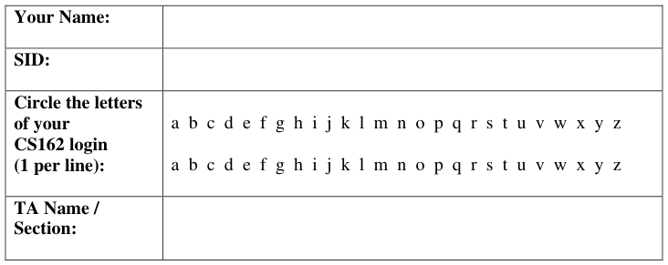
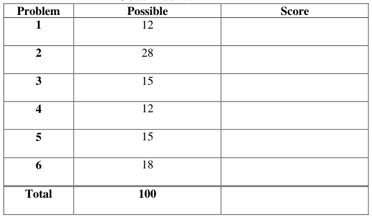
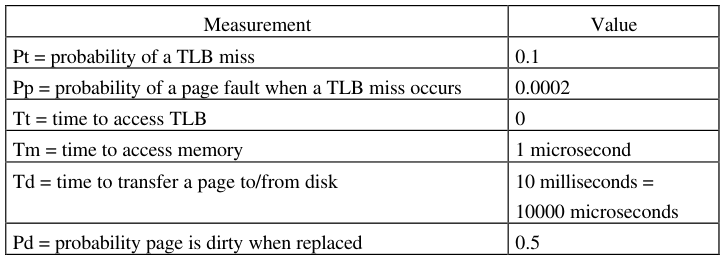
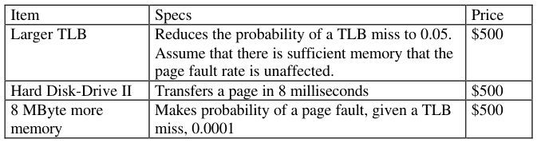
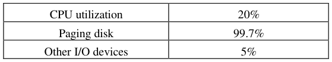
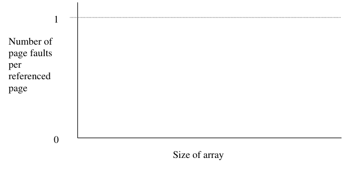
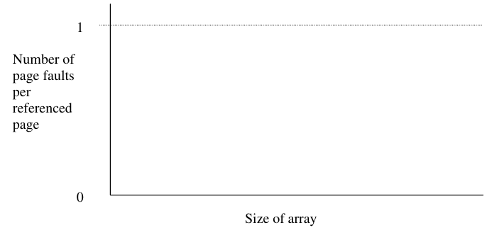
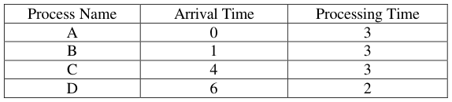
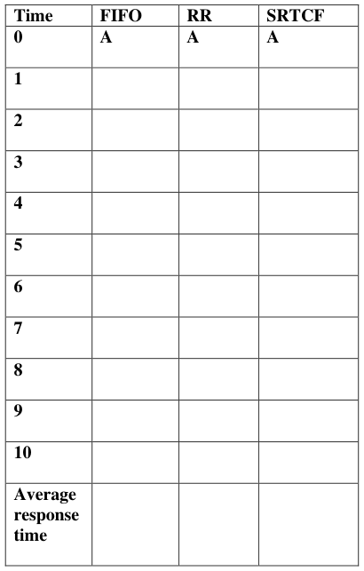

# Berkeley CS162 Fall 1999: Midterm 2: Questions

> Copied from the original: <https://hkn.eecs.berkeley.edu/exams/course/cs/162>. Text and figures are taken from the PDF as is; nothing was answered or rewritten. The original PDF is in this folder.

---

**Page 1**

&emsp;&emsp;&emsp;&emsp;&emsp;&emsp;&emsp;&emsp;University of California, Berkeley 
&emsp;&emsp;&emsp;&emsp;&emsp;&emsp;&emsp;&emsp;College of Engineering 
&emsp;&emsp;&emsp;&emsp;&emsp;&emsp;&emsp;&emsp;Computer Science Division – EECS 
Fall 1999                                     Anthony D. Joseph 
&emsp;&emsp;&emsp;&emsp;&emsp;&emsp;&emsp;&emsp;**Midterm Exam #2** 
&emsp;&emsp;&emsp;&emsp;&emsp;&emsp;&emsp;&emsp;November 10, 1999 
&emsp;&emsp;&emsp;&emsp;&emsp;&emsp;&emsp;&emsp;CS162 Operating Systems

This is a **closed book** examination. You have two hours to answer as many questions as possible. 
The number in parentheses at the beginning of each question indicates the number of points given 
to the question; there are 100 points in all. You should read **all** of the questions before starting the 
exam, as some of the questions are substantially more time consuming. 
Write all of your answers directly on this paper.  Make your answers as concise as possible. If there 
is something in a question that you believe is open to interpretation, then please ask us about it! 
&emsp;&emsp;&emsp;&emsp;&emsp;&emsp;&emsp;&emsp;**Good Luck!!**

Page 1/12

---

**Page 2**

CS 162 Fall 1999 Midterm Exam #2        November 10, 1999

1\. (12 points total) True / False and **Why**. Circle the correct answer and provide a **short** 
&emsp;reason for your answer: 
&emsp;a. Doubling the block size in the UNIX 4.2 BSD file system will exactly double the 
&emsp;&emsp;maximum file size. 
&emsp;&emsp;&emsp;&emsp;&emsp;True         /        False 
&emsp;&emsp;Why:

&emsp;b. A direct mapped cache can sometimes have a higher hit rate than a fully associative 
&emsp;&emsp;cache with an LRU replacement policy (on the same reference pattern). 
&emsp;&emsp;&emsp;&emsp;&emsp;True         /        False 
&emsp;&emsp;Why:

&emsp;c. Virtual memory address translation is useful even if the total size of virtual 
&emsp;&emsp;memory (summed over all programs) is guaranteed to be smaller than physical 
&emsp;&emsp;memory. 
&emsp;&emsp;&emsp;&emsp;&emsp;True         /        False 
&emsp;&emsp;Why:

Page 2/12

---

**Page 3**

CS 162 Fall 1999 Midterm Exam #2        November 10, 1999

2\. (26 points total) File system buffer cache management. 
&emsp;a. (12 points) Unix systems use a 30 second write-behind policy for file system data. 
&emsp;&emsp;List the advantages and disadvantages 
&emsp;&emsp;i) Name **two** advantages of this policy.

&emsp;&emsp;ii) Name **one** disadvantage of this policy.

Page 3/12

---

**Page 4**

CS 162 Fall 1999 Midterm Exam #2        November 10, 1999

&emsp;b. (14 points) Specify how you implement a write-behind policy. Assume a write- 
&emsp;&emsp;behind occurs every 30 seconds. Assume that a file is only opened by one process 
&emsp;&emsp;at a time. You do not have to show how you would modify the read operation. 
&emsp;&emsp;i) List the data structures, methods, or classes you would either use or modify:

&emsp;&emsp;ii) Provide the algorithm for the policy in pseudocode form. Your solution should 
&emsp;&emsp;&emsp;take less than twenty lines of pseudocode. No optimizations are necessary, 
&emsp;&emsp;&emsp;however your solution should handle any synchronization issues. You can use 
&emsp;&emsp;&emsp;any Nachos functions that you would need (if they’re not standard, or are from 
&emsp;&emsp;&emsp;your own project phases, explain their operation).

Page 4/12

---

**Page 5**

CS 162 Fall 1999 Midterm Exam #2        November 10, 1999

(This page intentionally left blank)

Page 5/12

---

**Page 6**

CS 162 Fall 1999 Midterm Exam #2        November 10, 1999

3\. (15 points total) One of your friends has a little extra money to spare and has decided 
&emsp;to upgrade their HAL Junior HAL-Z4u computer.  The HAL Junior has a simple 
&emsp;paged virtual memory system (with no segments).  First you measure the system to 
&emsp;find out why it is running so slow. You discover the following values:

The TLB is refilled automatically by the hardware on a miss (the TLB is only accessed 
once per reference).  The page tables are kept in physical memory, so looking up a page 
table entry incurs one memory access. Assume that the costs of the page replacement 
algorithm and updates to the page table are included in the Td measurement. 
&emsp;a. (10 points) What is the average memory access time (the time for an application 
&emsp;&emsp;program to do one memory reference) on the HAL Junior? Express your answer 
&emsp;&emsp;symbolically and compute the result to two significant digits. Show all steps of the 
&emsp;&emsp;computation.

Page 6/12

---

**Page 7**

CS 162 Fall 1999 Midterm Exam #2        November 10, 1999

&emsp;b. (5 points) The HAL Junior price sheet looks like this:

&emsp;&emsp;Suppose your friend has $1000. Which components should they buy if they want 
&emsp;&emsp;to maximize the performance of their HAL Junior? State the reasoning behind 
&emsp;&emsp;your choices.

Page 7/12

---

**Page 8**

CS 162 Fall 1999 Midterm Exam #2        November 10, 1999

No Credit – Problem X: (000000000000 points)

The news is not very good for Bill Gates. On Friday, the judge in the antitrust trial of 
Microsoft ruled that the software company has monopoly power in PC operating systems 
and that it has used that power to crush potential threats from competitors. 
&emsp;&emsp;&emsp;&emsp;&emsp;&emsp;The Top 10 Things on Bill Gates's To-Do List 
&emsp;&emsp;10\. Change menacing cackle to more of a charming titter. 
&emsp;&emsp;9\. Stop payment on Satan's check. 
&emsp;&emsp;8\. Search JobOptions.com: 
&emsp;&emsp;&emsp;&emsp;&emsp;Field = "Technology" 
&emsp;&emsp;&emsp;&emsp;&emsp;Salary \> $25 Billion 
&emsp;&emsp;7\. Put somebody else in charge temporarily; take the winter off and find Rosebud. 
&emsp;&emsp;6\. Push own "Start" button.  At prompt, choose "Shut Down" and then "Re-start 
&emsp;&emsp;Ego." 
&emsp;&emsp;5\. Create new corporate division in charge of sending flowers and candy to Sandy 
&emsp;&emsp;O'Connor. 
&emsp;&emsp;4\. Send message to mother ship:  "My job here is done." 
&emsp;&emsp;3\. Dedicate my life to finding the \*real\* monopolists. 
&emsp;&emsp;2\. See how quickly the government can prepare for the "11/10/99 Bug." 
&emsp;&emsp;1\. Halt global economy by taking all my money and going home.

Page 8/12

---

**Page 9**

CS 162 Fall 1999 Midterm Exam #2        November 10, 1999

4\. (12 points total) Consider a demand paging system, where a dedicated disk is used for 
&emsp;paging, and file system activity uses other disks. The measured utilizations of the 
&emsp;various system components, in terms of **time**, not space, are as follows:

&emsp;For each of the following changes, say what its most likely impact will be on CPU 
&emsp;utilization: (**+**)increase, (**0**) no effect, or (**–**)decrease, and **why**. 
&emsp;a. Get a larger capacity paging disk

&emsp;b. Increase the degree of multiprogramming

&emsp;c. Get more physical memory

Page 9/12

---

**Page 10**

CS 162 Fall 1999 Midterm Exam #2        November 10, 1999

5\. (15 points total) Virtual memory page replacement policies. 
&emsp;You are given a program that **repeatedly** scans through the elements of a very large 
&emsp;array in virtual memory. For example, if the array is 4 pages long, then its page 
&emsp;reference pattern is ABCDABCDABCD... 
&emsp;For each of the following page replacement algorithms, sketch a graph showing the 
&emsp;paging behavior. Assume that the program has been running for several iterations 
&emsp;through the array. 
&emsp;The y-axis of each graph is the number of page faults per referenced page, varying 
&emsp;from 0 to 1; the x-axis is the size of the array being scanned, varying from smaller 
&emsp;than physical memory to much larger than physical memory. **Label any interesting** 
&emsp;**points on the graph on both the x and y axes.** 
&emsp;a. **FIFO**

&emsp;b. **LRU**

Page 10/12

---

**Page 11**

CS 162 Fall 1999 Midterm Exam #2        November 10, 1999

&emsp;c. **MIN**

Page 11/12

---

**Page 12**

CS 162 Fall 1999 Midterm Exam #2        November 10, 1999

6\. (18 points total) Consider the following processes, arrival times, and CPU processing 
&emsp;requirements:

&emsp;For each of the following scheduling algorithms, fill in the table with the process that 
&emsp;is running on the CPU (for timeslice-based algorithms, assume a 1 unit timeslice). 
&emsp;For RR, assume that an arriving thread is run at the beginning of its arrival time. 
&emsp;All processes produce output only at the end of their execution.

Page 12/12

