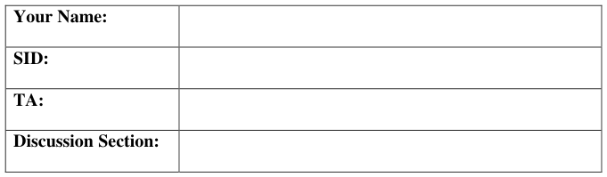
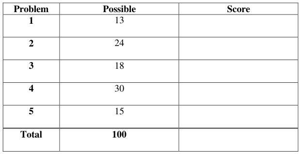
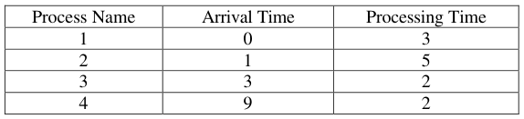
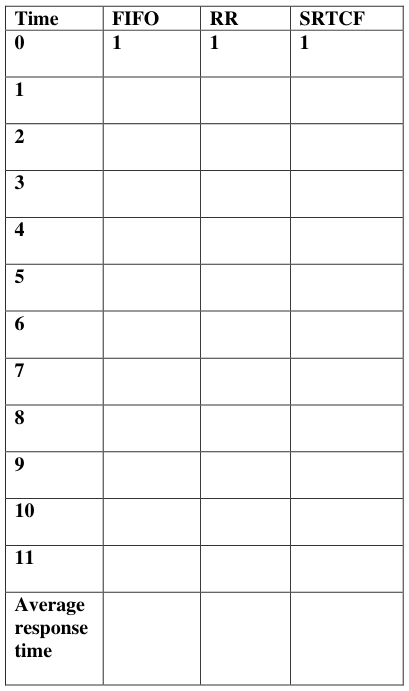
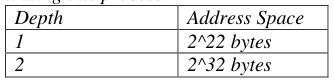
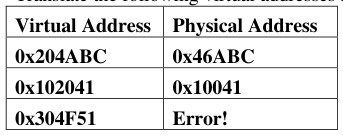
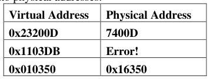
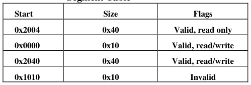
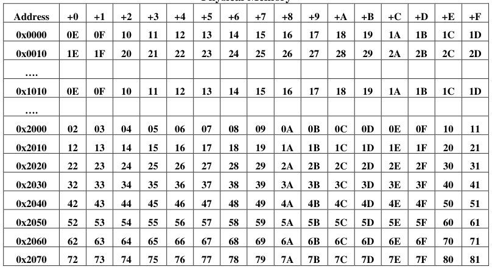
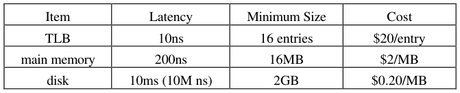

# Berkeley CS162 Spring 1999: Midterm 1: Questions

> Copied from the original: <https://hkn.eecs.berkeley.edu/exams/course/cs/162>. Text and figures are taken from the PDF as is; nothing was answered or rewritten. The original PDF is in this folder.

---

**Page 1**

&emsp;&emsp;&emsp;&emsp;&emsp;&emsp;&emsp;&emsp;University of California, Berkeley 
&emsp;&emsp;&emsp;&emsp;&emsp;&emsp;&emsp;&emsp;College of Engineering 
&emsp;&emsp;&emsp;&emsp;&emsp;&emsp;&emsp;&emsp;Computer Science Division – EECS 
Spring 1999                                     Anthony D. Joseph 
&emsp;&emsp;&emsp;&emsp;&emsp;&emsp;&emsp;&emsp;**Midterm Exam** 
&emsp;&emsp;&emsp;&emsp;&emsp;&emsp;&emsp;&emsp;March 3, 1999 
&emsp;&emsp;&emsp;&emsp;&emsp;&emsp;&emsp;&emsp;CS162 Operating Systems

General Information: 
This is a **closed book** examination. You have two hours to answer as many questions as possible. 
The number in parentheses at the beginning of each question indicates the number of points given 
to the question; there are 100 points in all. You should read **all** of the questions before starting the 
exam, as some of the questions are substantially more time consuming. 
Write all of your answers directly on this paper.  Make your answers as concise as possible (you 
needn't cover every available nano-acre with writing). If there is something in a question that you 
believe is open to interpretation, then please go ahead and interpret, **but** state your assumptions in 
your answer. 
&emsp;&emsp;&emsp;&emsp;&emsp;&emsp;&emsp;&emsp;**Good Luck!!**

Page 1/1

---

**Page 2**

CS 162 Spring 1999 Midterm Exam        March 3, 1999

1\. Threads (13 points total): 
&emsp;a. (6 points) What state does a thread share with other threads in a process and what 
&emsp;&emsp;state is private/specific to a thread? Be explicit in your answer.

&emsp;&emsp;i) Contents of memory (global variables, heap) 
&emsp;&emsp;ii) I/O state (file system) 
&emsp;&emsp;iii) CPU registers (including, program counter) 
&emsp;&emsp;iv) Execution stack 
&emsp;b. (7 points) Draw a picture of the three states of a thread and label the transitions 
&emsp;&emsp;between the states:

2\. Context switching and CPU scheduling (24 points total): 
&emsp;a. (3 points) What state is saved on a context switch between threads?

&emsp;&emsp;CPU registers (including, program counter and stack pointer) 
&emsp;b. (6 points) List two reasons why Nachos disables interrupts when a thread/process sleeps, 
&emsp;&emsp;yields, or switches to a new thread/process?

Page 2/2

---

**Page 3**

CS 162 Spring 1999 Midterm Exam        March 3, 1999

Page 3/3

---

**Page 4**

CS 162 Spring 1999 Midterm Exam        March 3, 1999

&emsp;c. (15 points) Consider the following processes, arrival times, and CPU processing 
&emsp;&emsp;requirements:

&emsp;For each of the following scheduling algorithms, fill in the table with the process that 
&emsp;is running on the CPU (for timeslice-based algorithms, assume a 1 unit timeslice): 
&emsp;For RR, assume that an arriving thread is scheduled to run at the beginning of its 
&emsp;arrival time.

Page 4/4

---

**Page 5**

CS 162 Spring 1999 Midterm Exam        March 3, 1999

3\. Concurrency control (18 points total): 
&emsp;a. (6 points) Match the terms in column A with the most appropriate definition from 
&emsp;&emsp;column B.

&emsp;&emsp;&emsp;Column A    Column B 
&emsp;&emsp;&emsp;1\. Synchronization    a. Piece of code that only one 
&emsp;&emsp;&emsp;&emsp;&emsp;&emsp;&emsp;&emsp;thread can execute at once 
&emsp;&emsp;&emsp;2\. Mutual exclusion    b. Ensuring that only one thread 
&emsp;&emsp;&emsp;&emsp;&emsp;&emsp;&emsp;&emsp;does a particular thing at a time 
&emsp;&emsp;&emsp;3\. Critical section    c. Isolating program faults to an 
&emsp;&emsp;&emsp;&emsp;&emsp;&emsp;&emsp;&emsp;address space 
&emsp;&emsp;&emsp;d. Using atomic operations to 
&emsp;&emsp;&emsp;&emsp;&emsp;&emsp;&emsp;&emsp;ensure cooperation between 
&emsp;&emsp;&emsp;&emsp;&emsp;&emsp;&emsp;&emsp;threads 
&emsp;&emsp;1. 
&emsp;&emsp;2. 
&emsp;&emsp;3.

Page 5/5

---

**Page 6**

CS 162 Spring 1999 Midterm Exam        March 3, 1999

&emsp;b. (12 points) For the following implementation of a banking application, say whether 
&emsp;&emsp;it either (i) works, (ii) doesn’t work, or (iii) is dangerous  that is, sometimes 
&emsp;&emsp;works and sometimes doesn’t.  If the implementation does not work or is 
&emsp;&emsp;dangerous, explain why (there maybe several errors) and show how to fix it so it 
&emsp;&emsp;does work. Note that `ThreadFork` does the obvious thing.

&emsp;&emsp;BankServer() { 
&emsp;&emsp;&emsp;&emsp;&emsp;while (TRUE) { 
&emsp;&emsp;&emsp;&emsp;&emsp;&emsp;&emsp;ReceiveRequest(&op, &acctId1, &acctId2, &amount); 
&emsp;&emsp;&emsp;&emsp;&emsp;&emsp;&emsp;if (op == transfer) ThreadFork(Transfer(acctId1, acctId2, amount)); 
&emsp;&emsp;&emsp;&emsp;&emsp;&emsp;&emsp;else if … 
&emsp;&emsp;&emsp;&emsp;&emsp;} 
&emsp;&emsp;} 
&emsp;&emsp;Transfer(acctId1, acctId2, amount) { 
&emsp;&emsp;&emsp;&emsp;&emsp;account\[acctId1\]-\>Lock(); 
&emsp;&emsp;&emsp;&emsp;&emsp;acct1 = GetAccount(acctId1); /\* May involve disk I/O \*/ 
&emsp;&emsp;&emsp;&emsp;&emsp;account\[acctId2\]-\>Lock(); 
&emsp;&emsp;&emsp;&emsp;&emsp;acct2 = GetAccount(acctId2); /\* May involve disk I/O \*/ 
&emsp;&emsp;&emsp;&emsp;&emsp;if (acct1-\>balance \< amount) return ERROR; 
&emsp;&emsp;&emsp;&emsp;&emsp;acct1-\>balance -= amount; acct2-\>balance += amount; 
&emsp;&emsp;&emsp;&emsp;&emsp;StoreAccount(acct1); /\* Involves disk I/O \*/ 
&emsp;&emsp;&emsp;&emsp;&emsp;StoreAccount(acct2); /\* Involves disk I/O \*/ 
&emsp;&emsp;&emsp;&emsp;&emsp;account\[acctId1\]-\>Unlock(); account\[acctId2\]-\>Unlock(); 
&emsp;&emsp;&emsp;&emsp;&emsp;return OK; 
&emsp;&emsp;}

Page 6/6

---

**Page 7**

CS 162 Spring 1999 Midterm Exam        March 3, 1999

&emsp;&emsp;Transfer is broken: Deadlock! I/O between lock acquires. Also, failure to release 
&emsp;&emsp;lock, when an error occurs. Solution: Compare acctIDs and change order of lock 
&emsp;&emsp;acquisition. 
&emsp;&emsp;`Transfer(acctId1, acctId2, amount) {` 
&emsp;&emsp;&emsp;&emsp;&emsp;`if (acct1 > acct2) {` 
&emsp;&emsp;&emsp;&emsp;&emsp;&emsp;&emsp;`account[acctId2]->Lock();` 
&emsp;&emsp;&emsp;&emsp;&emsp;&emsp;&emsp;`account[acctId1]->Lock();` 
&emsp;&emsp;&emsp;&emsp;&emsp;`} else {` 
&emsp;&emsp;&emsp;&emsp;&emsp;&emsp;&emsp;`account[acctId1]->Lock();` 
&emsp;&emsp;&emsp;&emsp;&emsp;&emsp;&emsp;`account[acctId2]->Lock();` 
&emsp;&emsp;&emsp;&emsp;&emsp;`}` 
&emsp;&emsp;&emsp;&emsp;&emsp;`acct1 = GetAccount(acctId1); /* May involve disk I/O */` 
&emsp;&emsp;&emsp;&emsp;&emsp;`acct2 = GetAccount(acctId2); /* May involve disk I/O */` 
&emsp;&emsp;&emsp;&emsp;&emsp;`if (acct1->balance < amount) {` 
&emsp;&emsp;&emsp;&emsp;&emsp;&emsp;&emsp;`account[acctId1]->Release();` 
&emsp;&emsp;&emsp;&emsp;&emsp;&emsp;&emsp;`account[acctId2]->Release();` 
&emsp;&emsp;&emsp;&emsp;&emsp;&emsp;&emsp;`return ERROR;` 
&emsp;&emsp;&emsp;&emsp;&emsp;`}` 
&emsp;&emsp;&emsp;&emsp;&emsp;`acct1->balance -= amount;` 
&emsp;&emsp;&emsp;&emsp;&emsp;`acct2->balance += amount;` 
&emsp;&emsp;&emsp;&emsp;&emsp;`StoreAccount(acct1); /* Involves disk I/O */` 
&emsp;&emsp;&emsp;&emsp;&emsp;`StoreAccount(acct2); /* Involves disk I/O */` 
&emsp;&emsp;&emsp;&emsp;&emsp;`account[acctId1]->Release();` 
&emsp;&emsp;&emsp;&emsp;&emsp;`account[acctId2]->Release();` 
&emsp;&emsp;&emsp;&emsp;&emsp;`return OK;` 
&emsp;&emsp;`}` 
4\. Memory management (30 points total): 
&emsp;a. (6 points) Consider a memory system with a cache access time of 100ns and a 
&emsp;&emsp;memory access time of 1200ns. If the effective access time is 10% greater than 
&emsp;&emsp;the cache access time, what is the hit ratio H? (fractional answers are OK)

&emsp;&emsp;&emsp;&emsp;&emsp;1.1 x T1 = T1 + (1-H)T2 
&emsp;&emsp;&emsp;&emsp;&emsp;(0.1)(100) = (1-H)(1200) 
&emsp;&emsp;&emsp;&emsp;&emsp;H = 1190/1200

Page 7/7

---

**Page 8**

CS 162 Spring 1999 Midterm Exam        March 3, 1999

&emsp;b. (6 points) Assuming a page size of 4 KB and that page table entry takes 4 bytes, 
&emsp;&emsp;how many levels of page tables would be required to map a 32-bit address space 
&emsp;&emsp;if every page table fits into a single page? Be explicit in your explanation. 
&emsp;&emsp;Since each PTE is 4 bytes and each page contains 4KB, then a one-page page 
&emsp;&emsp;table would point to 1024 or 2^10 pages, addressing a total of 2^10 \* 2^12 = 
&emsp;&emsp;2^22 bytes. Continuing this process:

Page 8/8

---

**Page 9**

CS 162 Spring 1999 Midterm Exam        March 3, 1999

&emsp;c. (18 points) Consider a multi-level memory management using the following virtual 
&emsp;&emsp;addresses: 
&emsp;&emsp;&emsp;&emsp;&emsp;&emsp;&emsp;&emsp;Virtual seg #    Virtual Page #    Offset 
&emsp;&emsp;Each virtual address has 2 bits of virtual segment #, 8 bits of virtual page #, and 
&emsp;&emsp;12 bits of offset. Page table entries are 8 bits. All values are in hexadecimal.

&emsp;&emsp;Translate the following virtual addresses into physical addresses:

&emsp;&emsp;&emsp;&emsp;&emsp;&emsp;&emsp;&emsp;**Segment Table**

&emsp;&emsp;&emsp;&emsp;&emsp;&emsp;&emsp;&emsp;**Physical Memory**

Page 9/9

---

**Page 10**

CS 162 Spring 1999 Midterm Exam        March 3, 1999

5\. Design tradeoffs (15 points total): 
&emsp;A hardware designer asks for your input on the design of a new processor and 
&emsp;computer. You can spend $1500 dollars on the following components:

&emsp;&emsp;The page size is fixed at 16KB. Assume you want to run 3 – 4 applications 
&emsp;&emsp;simultaneously. Each application has an overall maximum size of 64 MB and a 
&emsp;&emsp;working set size of 256KB. TLB entries do not have Process Identifiers. Discuss 
&emsp;&emsp;how you would divide the available funds across the various items to optimize 
&emsp;&emsp;performance.

Page 10/10

