# Berkeley CS162 Spring 1999: Midterm 1: Official solutions

> Copied from the original: <https://hkn.eecs.berkeley.edu/exams/course/cs/162>. Text and figures are taken from the PDF as is; nothing was answered or rewritten. The original PDF is in this folder.

---

**Page 1**

&emsp;&emsp;&emsp;&emsp;&emsp;&emsp;&emsp;&emsp;University of California, Berkeley 
&emsp;&emsp;&emsp;&emsp;&emsp;&emsp;&emsp;&emsp;College of Engineering 
&emsp;&emsp;&emsp;&emsp;&emsp;&emsp;&emsp;&emsp;Computer Science Division – EECS 
Spring 1999        Anthony D. Joseph 
&emsp;&emsp;&emsp;&emsp;**Midterm Exam Solutions and Grading Guidelines** 
&emsp;&emsp;&emsp;&emsp;&emsp;&emsp;&emsp;&emsp;March 3, 1999 
&emsp;&emsp;&emsp;&emsp;&emsp;&emsp;&emsp;&emsp;CS162 Operating Systems

General Information: 
This is a **closed book** examination. You have two hours to answer as many questions as possible. 
The number in parentheses at the beginning of each question indicates the number of points given 
to the question; there are 100 points in all. You should read **all** of the questions before starting the 
exam, as some of the questions are substantially more time consuming. 
Write all of your answers directly on this paper.  Make your answers as concise as possible (you 
needn't cover every available nano-acre with writing). If there is something in a question that you 
believe is open to interpretation, then please go ahead and interpret, **but** state your assumptions in 
your answer. 
&emsp;&emsp;&emsp;&emsp;&emsp;&emsp;&emsp;&emsp;**Good Luck!!**

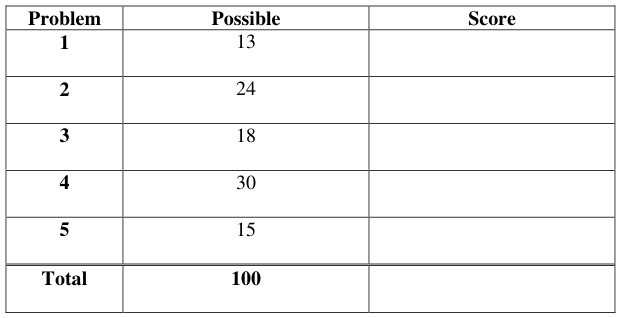

&emsp;&emsp;&emsp;&emsp;&emsp;&emsp;&emsp;&emsp;Page 1/8

---

**Page 2**

CS 162 Spring 1999 Midterm Exam   March 3, 1999

1\. Threads (13 points total): 
&emsp;a. (6 points) What state does a thread share with other threads in a process and what 
&emsp;&emsp;state is private/specific to a thread? Be explicit in your answer. 
&emsp;&emsp;Shared state: 
&emsp;&emsp;&emsp;(1) Contents of memory (global variables, heap) 
&emsp;&emsp;&emsp;(2) I/O state (file system) 
&emsp;&emsp;Having both answers is worth 3 points. Having one answer is worth 2 points. 
&emsp;&emsp;Private state: 
&emsp;&emsp;&emsp;(1) CPU registers (including, program counter and stack pointer) 
&emsp;&emsp;&emsp;(2) Execution stack 
&emsp;&emsp;Having both answers is worth 3 points. Having one answer is worth 2 points. 
&emsp;b. (7 points) Draw a picture of the three states of a thread and label the transitions 
&emsp;&emsp;between the states:

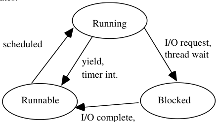

&emsp;&emsp;&emsp;&emsp;&emsp;&emsp;&emsp;&emsp;thread signal 
&emsp;&emsp;Each state and each arc is worth 1 point. 
2\. Context switching and CPU scheduling (24 points total): 
&emsp;a. (3 points) What state is saved on a context switch between threads? 
&emsp;&emsp;CPU registers, program counter, and stack pointer. 
&emsp;&emsp;Each answer is worth 1 point. 
&emsp;b. (6 points) List two reasons why Nachos disables interrupts when a thread/process sleeps, 
&emsp;&emsp;yields, or switches to a new thread/process? 
&emsp;&emsp;Interrupts are disabled for two reasons: 
&emsp;&emsp;&emsp;(1) To prevent context switching from occurring while registers are being 
&emsp;&emsp;&emsp;&emsp;&emsp;saved/restored. 
&emsp;&emsp;&emsp;(2) To enable a thread/process to add itself to a queue (e.g., a wait queue) 
&emsp;&emsp;&emsp;&emsp;&emsp;without allowing another thread to interrupt the action. 
&emsp;&emsp;Each answer is worth 3 points. If the answer was not specific about the potential 
&emsp;&emsp;conflict that could occur, we deducted 1 point.

&emsp;&emsp;&emsp;&emsp;&emsp;&emsp;&emsp;&emsp;Page 2/8

---

**Page 3**

CS 162 Spring 1999 Midterm Exam   March 3, 1999

&emsp;c. (15 points) Consider the following processes, arrival times, and CPU processing 
&emsp;&emsp;requirements:

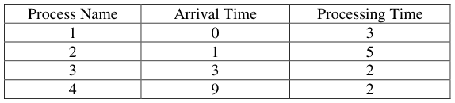

&emsp;For each of the following scheduling algorithms, fill in the table with the process that 
&emsp;is running on the CPU (for timeslice-based algorithms, assume a 1 unit timeslice): 
&emsp;For RR, assume that an arriving thread is scheduled to run at the beginning of its 
&emsp;arrival time.

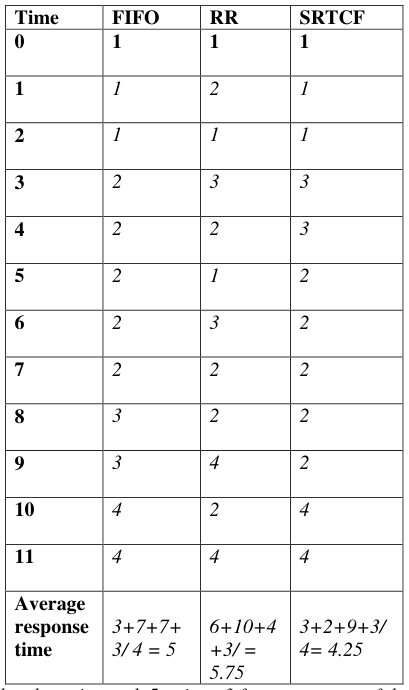

&emsp;&emsp;Each column is worth 5 points: 3 for correctness of the schedule (we deducted 
&emsp;&emsp;1/2/3 points if you made minor/intermediate/major mistakes), and 2 for the 
&emsp;&emsp;average response time (1 point was deducted for minor errors).

&emsp;&emsp;&emsp;&emsp;&emsp;&emsp;&emsp;&emsp;Page 3/8

---

**Page 4**

CS 162 Spring 1999 Midterm Exam   March 3, 1999

3\. Concurrency control (18 points total): 
&emsp;c. (6 points) Match the terms in column A with the most appropriate definition from 
&emsp;&emsp;column B.

&emsp;&emsp;&emsp;Column A   Column B 
&emsp;&emsp;&emsp;1\. Synchronization   a. Piece of code that only one 
&emsp;&emsp;&emsp;&emsp;&emsp;&emsp;&emsp;&emsp;thread can execute at once 
&emsp;&emsp;&emsp;2\. Mutual exclusion   b. Ensuring that only one thread 
&emsp;&emsp;&emsp;&emsp;&emsp;&emsp;&emsp;&emsp;does a particular thing at a time 
&emsp;&emsp;&emsp;3\. Critical section   c. Isolating program faults to an 
&emsp;&emsp;&emsp;&emsp;&emsp;&emsp;&emsp;&emsp;address space 
&emsp;&emsp;&emsp;&emsp;&emsp;&emsp;&emsp;&emsp;d. Using atomic operations to 
&emsp;&emsp;&emsp;&emsp;&emsp;&emsp;&emsp;&emsp;ensure cooperation between 
&emsp;&emsp;&emsp;&emsp;&emsp;&emsp;&emsp;&emsp;threads 
&emsp;&emsp;1\. d 
&emsp;&emsp;2\. b 
&emsp;&emsp;3\. a 
&emsp;&emsp;Each answer is worth 2 points.

&emsp;&emsp;&emsp;&emsp;&emsp;&emsp;&emsp;&emsp;Page 4/8

---

**Page 5**

CS 162 Spring 1999 Midterm Exam   March 3, 1999

&emsp;d. (12 points) For the following implementation of a banking application, say whether 
&emsp;&emsp;it either (i) works, (ii) doesn’t work, or (iii) is dangerous – that is, sometimes 
&emsp;&emsp;works and sometimes doesn’t.  If the implementation does not work or is 
&emsp;&emsp;dangerous, explain why (there maybe several errors) and show how to fix it so it 
&emsp;&emsp;does work. Note that `ThreadFork` does the obvious thing. 
&emsp;&emsp;`BankServer() {` 
&emsp;&emsp;&emsp;&emsp;&emsp;`while (TRUE) {` 
&emsp;&emsp;&emsp;&emsp;&emsp;&emsp;&emsp;`ReceiveRequest(&op, &acctId1, &acctId2, &amount);` 
&emsp;&emsp;&emsp;&emsp;&emsp;&emsp;&emsp;`if (op == transfer) ThreadFork(Transfer(acctId1, acctId2, amount));` 
&emsp;&emsp;&emsp;&emsp;&emsp;&emsp;&emsp;`else if …` 
&emsp;&emsp;&emsp;&emsp;&emsp;`}` 
&emsp;&emsp;`}` 
&emsp;&emsp;`Transfer(acctId1, acctId2, amount) {` 
&emsp;&emsp;&emsp;&emsp;&emsp;`account[acctId1]->Lock();` 
&emsp;&emsp;&emsp;&emsp;&emsp;`acct1 = GetAccount(acctId1); /* May involve disk I/O */` 
&emsp;&emsp;&emsp;&emsp;&emsp;`account[acctId2]->Lock();` 
&emsp;&emsp;&emsp;&emsp;&emsp;`acct2 = GetAccount(acctId2); /* May involve disk I/O */` 
&emsp;&emsp;&emsp;&emsp;&emsp;`if (acct1->balance < amount) return ERROR;` 
&emsp;&emsp;&emsp;&emsp;&emsp;`acct1->balance -= amount; acct2->balance += amount;` 
&emsp;&emsp;&emsp;&emsp;&emsp;`StoreAccount(acct1); /* Involves disk I/O */` 
&emsp;&emsp;&emsp;&emsp;&emsp;`StoreAccount(acct2); /* Involves disk I/O */` 
&emsp;&emsp;&emsp;&emsp;&emsp;`account[acctId1]->Unlock(); account[acctId2]->Unlock();` 
&emsp;&emsp;&emsp;&emsp;&emsp;`return OK;` 
&emsp;&emsp;`}` 
&emsp;&emsp;This implementation is (iii) dangerous, it will work sometimes (2 pts for this answer). Two 
&emsp;&emsp;problems: I/O may occur while the second account is being retrieved, leading to deadlock if there 
&emsp;&emsp;is a cycle of simultaneous transfers (A-\>B and B-\>A). Deadlock may also occur when an ERROR 
&emsp;&emsp;occurs, since the locks are not released (2 pts for describing each error). Solution: Acquire locks 
&emsp;&emsp;in the order of acctId values and release locks upon error. Each good solution is worth 3 pts. We 
&emsp;&emsp;deducted: 1 pt for solutions that used a global lock around the acquisition of both locks (it 
&emsp;&emsp;serializes the start of all transfers), 2 pts for solutions that used a global lock around the entire 
&emsp;&emsp;transfer (very inefficient). Adding a check to ensure that the acctId’s are not identical was worth 1 
&emsp;&emsp;pt of extra credit. No extra credit was given for performance improvements. 
&emsp;&emsp;`Transfer(acctId1, acctId2, amount) {` 
&emsp;&emsp;&emsp;&emsp;&emsp;`If (acctId1 > acctId2) {` 
&emsp;&emsp;&emsp;&emsp;&emsp;&emsp;&emsp;`account[acctId1]->Lock();` 
&emsp;&emsp;&emsp;&emsp;&emsp;&emsp;&emsp;`account[acctId2]->Lock();` 
&emsp;&emsp;&emsp;&emsp;&emsp;`} else {` 
&emsp;&emsp;&emsp;&emsp;&emsp;&emsp;&emsp;`account[acctId2]->Lock();` 
&emsp;&emsp;&emsp;&emsp;&emsp;&emsp;&emsp;`account[acctId1]->Lock();` 
&emsp;&emsp;&emsp;&emsp;&emsp;`}` 
&emsp;&emsp;&emsp;&emsp;&emsp;`acct1 = GetAccount(acctId1); /* May involve disk I/O */` 
&emsp;&emsp;&emsp;&emsp;&emsp;`acct2 = GetAccount(acctId2); /* May involve disk I/O */` 
&emsp;&emsp;&emsp;&emsp;&emsp;`if (acct1->balance < amount) {` 
&emsp;&emsp;&emsp;&emsp;&emsp;&emsp;&emsp;`account[acctId1]->Unlock(); account[acctId2]->Unlock();` 
&emsp;&emsp;&emsp;&emsp;&emsp;&emsp;&emsp;`return ERROR;` 
&emsp;&emsp;&emsp;&emsp;&emsp;`}` 
&emsp;&emsp;&emsp;&emsp;&emsp;`acct1->balance -= amount; acct2->balance += amount;` 
&emsp;&emsp;&emsp;&emsp;&emsp;`StoreAccount(acct1); /* Involves disk I/O */` 
&emsp;&emsp;&emsp;&emsp;&emsp;`StoreAccount(acct2); /* Involves disk I/O */` 
&emsp;&emsp;&emsp;&emsp;&emsp;`account[acctId1]->Unlock(); account[acctId2]->Unlock();` 
&emsp;&emsp;&emsp;&emsp;&emsp;`return OK;` 
&emsp;&emsp;`}` 
4\. Memory management (30 points total): 
&emsp;a. (6 points) Consider a memory system with a cache access time of 100ns and a 
&emsp;&emsp;memory access time of 1200ns. If the effective access time is 10% greater than 
&emsp;&emsp;the cache access time, what is the hit ratio H? (fractional answers are OK) 
&emsp;&emsp;Effective Access Time: Te = H % Tc + (1 – H)(Tm + Tc), 
&emsp;&emsp;&emsp;&emsp;&emsp;where Tc = 100ns, Te = 1.1 % Tc , and Tm = 1200ns.

&emsp;&emsp;&emsp;&emsp;&emsp;&emsp;&emsp;&emsp;Page 5/8

---

**Page 6**

CS 162 Spring 1999 Midterm Exam   March 3, 1999

&emsp;&emsp;Thus,    (1.1)(100) = 100H + (1 – H)(1200 + 100) 
&emsp;&emsp;&emsp;&emsp;&emsp;110 = 100H + 1300 – 1300H 
&emsp;&emsp;&emsp;&emsp;&emsp;H = 119/120 
&emsp;We awarded 3 pts for the correct formula and 3 pts for the correct answer. Many 
&emsp;students missed the fact that the miss time includes **both** the memory access time and 
&emsp;the cache access time. If the formula was missing the cache access time, we deducted 
&emsp;two points – if the answer based upon this incorrect formula was correct, we did not 
&emsp;deduct any additional points.

&emsp;b. (6 points) Assuming a page size of 4 KB and that page table entry takes 4 bytes, 
&emsp;&emsp;how many levels of page tables would be required to map a 32-bit address space 
&emsp;&emsp;if every page table fits into a single page? Be explicit in your explanation. 
&emsp;&emsp;A 1-page page table contains 1024 or 210 PTEs, pointing to 210 pages (addressing 
&emsp;&emsp;a total of 210 % 212 = 222 bytes). Adding another level yields another 210 pages of 
&emsp;&emsp;page tables, addressing 210 % 210 % 212 = 232 bytes. So, we need 2 levels. 
&emsp;&emsp;The correct answer is worth 2 pts. Correct reasoning is worth up to 4 pts (1 pt for 
&emsp;&emsp;identifying that there are 210 PTEs per page, 1 pt for describing how page tables 
&emsp;&emsp;are nested, and 2 pts based upon the quality of the argument). 
&emsp;&emsp;&emsp;&emsp;&emsp;&emsp;&emsp;10 bit page   10 bit page   12 bit offset

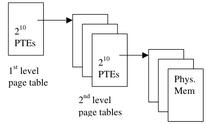

&emsp;c. (18 points) Consider a multi-level memory management using the following virtual 
&emsp;&emsp;addresses: 
&emsp;&emsp;&emsp;&emsp;&emsp;&emsp;&emsp;&emsp;Virtual seg #   Virtual Page #   Offset 
&emsp;&emsp;Each virtual address has 2 bits of virtual segment #, 8 bits of virtual page #, and 
&emsp;&emsp;12 bits of offset. Page table entries are 8 bits. All values are in hexadecimal. 
&emsp;&emsp;Translate the following virtual addresses into physical addresses:

&emsp;&emsp;&emsp;&emsp;&emsp;&emsp;&emsp;&emsp;Page 6/8

---

**Page 7**

CS 162 Spring 1999 Midterm Exam   March 3, 1999

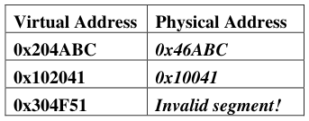

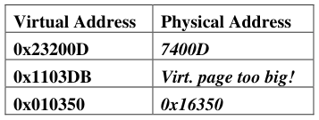

&emsp;&emsp;Each correct translation is worth 3 pts. For answers that listed a translation 
&emsp;&emsp;when it is invalid, we deducted 1 pt.

&emsp;&emsp;&emsp;&emsp;&emsp;&emsp;&emsp;&emsp;**Segment Table**

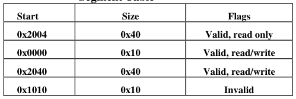

&emsp;&emsp;&emsp;&emsp;&emsp;&emsp;&emsp;&emsp;**Physical Memory**

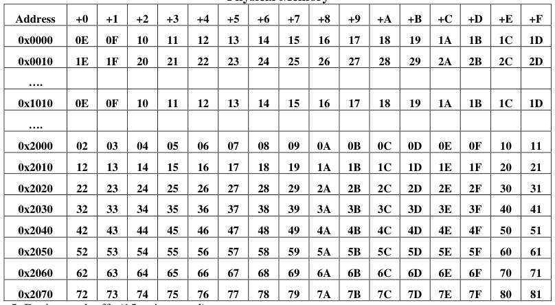

5\. Design tradeoffs (15 points total): 
&emsp;A hardware designer asks for your input on the design of a new processor and 
&emsp;computer. You can spend $1500 dollars on the following components:

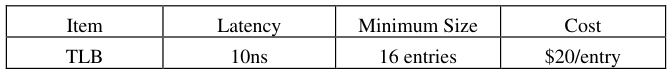

&emsp;&emsp;&emsp;&emsp;&emsp;&emsp;&emsp;&emsp;Page 7/8

---

**Page 8**

CS 162 Spring 1999 Midterm Exam   March 3, 1999

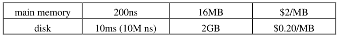

&emsp;&emsp;The page size is fixed at 16KB. Assume you want to run 3 – 4 applications 
&emsp;&emsp;simultaneously. Each application has an overall maximum size of 64 MB and a 
&emsp;&emsp;working set size of 256KB. TLB entries do not have Process Identifiers. Discuss 
&emsp;&emsp;how you would divide the available funds across the various items to optimize 
&emsp;&emsp;performance. 
&emsp;&emsp;We start with the disk. Since the disk is the slowest component of the system, we 
&emsp;&emsp;take the minimum size, 2048MB or $410, leaving us with $1,090. Since the TLB 
&emsp;&emsp;does not contain process identifiers, we only need the minimum number of entries 
&emsp;&emsp;to map the working set – 256KB / 16KB = 16 entries or $320, leaving us with 
&emsp;&emsp;$770. With the remaining money, we could buy 385 MB. However, we will only 
&emsp;&emsp;ever need to have 4 % 64MB = 256 MB of memory or $512. So, we could spend 
&emsp;&emsp;the leftover $258 on another 12 TLB entries ($240). Increasing the TLB by this 
&emsp;&emsp;amount will improve performance somewhat, since the working set will change 
&emsp;&emsp;over time. It does not make sense to increase the TLB any more, since that would 
&emsp;&emsp;require that we decrease the memory size below the requirements for the 
&emsp;&emsp;applications; a situation that will cause the system to start paging. 
&emsp;&emsp;We awarded 3 points per choice, based upon the reasonableness of the choices. 
&emsp;&emsp;We used the following table:

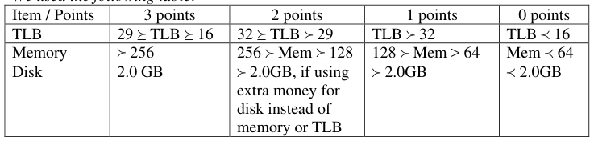

&emsp;&emsp;We awarded another 3 points if the TLB answer was based upon an analysis of 
&emsp;&emsp;the applications’ working set size (i.e., only 16 entries are necessary, since they 
&emsp;&emsp;will map the working set and the TLB does not include process identifiers). 
&emsp;&emsp;We awarded an additional three points based upon the overall reasonableness of 
&emsp;&emsp;the answer. For example, a system with a small amount of paging would lose a 
&emsp;&emsp;point, while a system with a significant amount of paging (e.g., only 128 MB of 
&emsp;&emsp;memory), would lose two points.

&emsp;&emsp;&emsp;&emsp;&emsp;&emsp;&emsp;&emsp;Page 8/8

