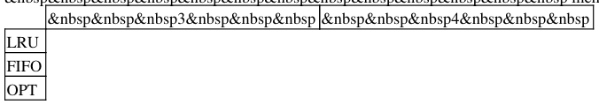

# Berkeley CS162 Fall 2000: Midterm 2: Questions

> Copied from the original: <https://hkn.eecs.berkeley.edu/exams/course/cs/162>. Text and figures are taken from the PDF as is; nothing was answered or rewritten. The original PDF is in this folder.

---

**Page 1**

&emsp;&emsp;&emsp;&emsp;&emsp;&emsp;&emsp;&emsp;CS 162, Midterm #2, Fall 2000 
&emsp;&emsp;&emsp;&emsp;&emsp;&emsp;&emsp;&emsp;**CS 162, FA00** 
&emsp;&emsp;&emsp;&emsp;&emsp;&emsp;&emsp;&emsp;**Midterm #2** 
&emsp;&emsp;&emsp;&emsp;&emsp;&emsp;&emsp;&emsp;**Professor A. Smith**

You have until the time announced for this exam. The exam is **closed book and closed notes.** All answers 
should be written on the exam paper. Anything that we can't read or understand won't get credit. Any question 
for which you give no answer at all will receive 25% partial credit. Please answer in standard English; 
illiterate or illegible answers to essay questions will lose credit. Partial credit will be given for 
"computation-type" problems only if your errors are obvious to the grader; we are not going to spend a 
significant time debugging your solution. If necessary, you may continue on the back of a page. You should 
put your name on every page at the top (in the space provided) and copy the sequence number from part 1 to 
part 2 of this exam. (Every missing name or sequence number entry will cost you one point.) Please watch the 
front board for corrections and other information. This exam has 6 questions on 6 pages and is in two parts.

&emsp;&emsp;&emsp;&emsp;&emsp;&emsp;&emsp;&emsp;TOILET 
**Part I** 
**Problem #1** 
Assume that the mean job processing time is 10, and that the task switching overhead is 0.5. (I.e. at the end of 
every interval of length Q, the CPU experiences a task switching event.) Assume round robin scheduling. 
Assume that Q (the round robin quantum) ranges from .001 to 1000. Plot the shape of the mean flow time as a 
function of Q and explain. (No credit unless your explanation matches your plot.)

**Problem #2** 
Suppose we have a disk with 512 cylinders, and the disk is currently at cylinder 110 (and has previously just 
processed a request for cylinder 105) and the disk queue contains read/write requests for sectors on cylinders 
84, 302, 103, 96, 407 and 113.

a. How far must the head travel to satisfy the requests in the queue using SSTF scheduling? (If the arm goes 
from cylinder 10 to 20 to 14, that is a total of 16 cylinders moved.)

b. How far must the head travel to satisfy the requests in the queue using the FIFO arm scheduling strategy?

c. How far must the head travel to satisfy the requests in the queue using SCAN scheduling?

d. How far must the head travel to satisfy the requests in the queue using the CSAN arm scheduling strategy?

e. Assuming no further arrivals, what is the optimal order (i.e. sequence of cylinder numbers) in which to 
service the requests, and how far does the head travel?

**Part II**

CS 162, FA00 Midterm #2 Professor A. Smith   1

---

**Page 2**

&emsp;&emsp;&emsp;&emsp;&emsp;&emsp;&emsp;&emsp;CS 162, Midterm #2, Fall 2000 
**Problem #3** 
Describe and explain at least two reasons why disabling interrupts to implement synchronization primitives is 
not sufficient to provide mutual exclusion. Is disabling interrupts necessary? Is it useful? Explain your 
answers.

**Problem #4** 
a. What is the TLB and what is it used for?

b. Three ways that a TLB can be designed are fully associative, set associative, and direct mapped. Explain all 
3 (including the tradeoffs between them). Use diagrams.

**Problem #5** 
For the following page reference string, please show the number of page faults for a memory of size 3 page 
frames, and for a memory of size 4 page frames, using LRU, FIFO and OPT replacement. Please show your 
work

&emsp;`7&nbsp&nbsp&nbsp 6&nbsp&nbsp&nbsp 5&nbsp&nbsp&nbsp 4&nbsp&nbsp&nbsp` 
&emsp;`7&nbsp&nbsp&nbsp 6&nbsp&nbsp&nbsp 8&nbsp&nbsp&nbsp 7&nbsp&nbsp&nbsp` 
&emsp;&emsp;&emsp;&emsp;&emsp;`6&nbsp&nbsp&nbsp 5&nbsp&nbsp&nbsp 4&nbsp&nbsp&nbsp 8`

&nbsp&nbsp&nbsp&nbsp&nbsp&nbsp&nbsp&nbsp&nbsp&nbsp&nbsp&nbsp&nbsp mem size

**Problem #6** 
a. What is a stack algorithm? What is the advantage of a paging algorithm being a stack algorithm?

b. Is LRU a stack algorithm? Prove or disprove.

c. Is FIFO a stack algorithm? Prove or disprove.

**Solutions!**

Problem #3   2

---

**Page 3**

&emsp;&emsp;&emsp;&emsp;&emsp;&emsp;&emsp;&emsp;CS 162, Midterm #2, Fall 2000 
&emsp;**Posted by HKN (Electrical Engineering and Computer Science Honor Society)** 
&emsp;&emsp;&emsp;&emsp;&emsp;&emsp;&emsp;&emsp;**University of California at Berkeley** 
&emsp;&emsp;&emsp;&emsp;&emsp;&emsp;**If you have any questions about these online exams** 
&emsp;&emsp;&emsp;&emsp;&emsp;&emsp;&emsp;**please contact**  **examfile@hkn.eecs.berkeley.edu.**

3Posted by HKN (Electrical Engineering and Computer Science Honor Society) University of California at Berkeley If y

