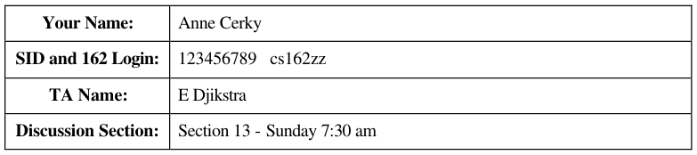
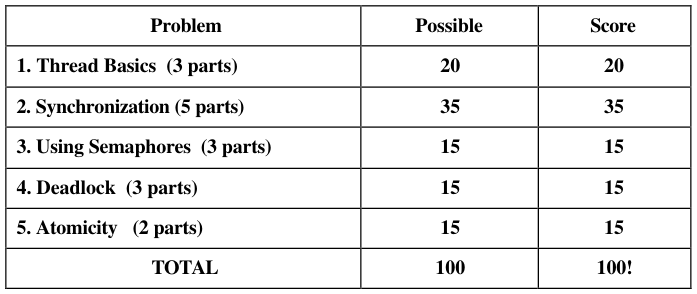
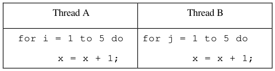
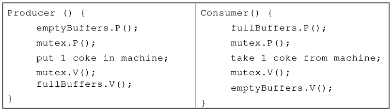
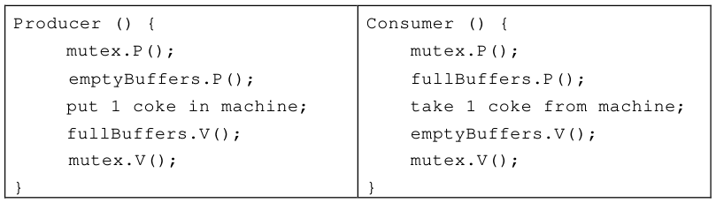
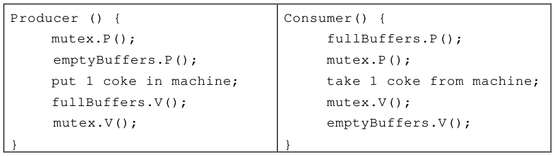
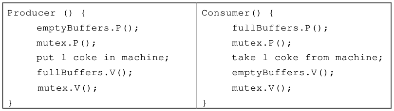

# Berkeley CS162 Spring 2000: Midterm 1: Official solutions

> Copied from the original: <https://hkn.eecs.berkeley.edu/exams/course/cs/162>. Text and figures are taken from the PDF as is; nothing was answered or rewritten. The original PDF is in this folder.

---

**Page 1**

&emsp;&emsp;&emsp;&emsp;&emsp;&emsp;&emsp;&emsp;**University of California, Berkeley** 
&emsp;&emsp;&emsp;&emsp;&emsp;&emsp;&emsp;&emsp;**College of Engineering** 
&emsp;&emsp;&emsp;&emsp;&emsp;&emsp;&emsp;&emsp;**Computer Science Division – EECS** 
Spring 2000                                               Prof. Michael J. Franklin 
&emsp;&emsp;&emsp;&emsp;&emsp;&emsp;&emsp;&emsp;**Midterm Exam #1** 
&emsp;&emsp;&emsp;&emsp;&emsp;&emsp;&emsp;&emsp;**SOLUTIONS** 
&emsp;&emsp;&emsp;&emsp;&emsp;&emsp;&emsp;&emsp;February 28, 2000 
&emsp;&emsp;&emsp;&emsp;&emsp;&emsp;&emsp;&emsp;CS 162 Operating Systems

General Information: 
This is a **closed book** examination.  You have 1 hour and 20 minutes to answer as many 
questions as possible.  Partial credit will be given.  There are 100 points in all.  You should read 
**all** of the questions before starting the exam, as some of the questions are substantially more 
time-consuming than others. 
Write all of your answers directly on this paper.  Be sure to **clearly indicate** your final answer 
for each question.  Also, be sure to state any assumptions that you are making in your answers. 
Please try to be as **concise as possible**.

&emsp;&emsp;&emsp;&emsp;&emsp;&emsp;&emsp;&emsp;**GOOD LUCK!!!**

---

**Page 2**

CS 162 Spring 2000, Midterm Exam #1           February 28, 2000

### **Question 1 \[ 3 parts, 20 points total\]:  Thread Basics**

(Assume Mesa-style monitors throughout unless explicitly stated otherwise) 
**a)  (4  points)**  Because personal computers were intended to be used by a single person at a 
time, early PC operating systems such as MSDOS provided only a single thread of control and a 
single address space.   Even assuming only one person uses the computer at a time, **briefly** state 
a problem or limitation resulting from this approach.

&emsp;&emsp;The two most popular correct answers were: 
&emsp;&emsp;1\. Can’t do more than one task at a time which means either users have to 
&emsp;&emsp;wait for one task to finish before working on another (e.g., can’t read email while 
&emsp;&emsp;printing) or resources would be used inefficiently (can’t overlap I/O and CPU).

&emsp;&emsp;2\. Single address space leads to protection problems --- user program can 
&emsp;&emsp;overwrite parts of the operating system.

&emsp;&emsp;Partial credit was given if no implication was stated.

**b)  (10 points)**  Given the three thread states: running, runnable (i.e., ready), and waiting, state 
which of the six possible thread transitions are allowed **and** give an example of why a thread 
would follow such a transition.

&emsp;&emsp;Runnable (Ready) à Running;    //Chosen to run by OS Scheduler 
&emsp;&emsp;Running à Runnable (Ready);    //Time-sliced out or called Yield() 
&emsp;&emsp;Runningà Waiting;     // Requests I/O, lock, or wait on another thread 
&emsp;&emsp;Waiting à Runnable (Ready)     //Event completion

&emsp;&emsp;1 point for each correct transition plus 1 point for each correct example.  1 Point 
&emsp;&emsp;each for not listing the two illegal transitions. 
**c)  (6 points)** What state information do you need to save/restore about threads when performing 
a context switch? 
&emsp;&emsp;Program Counter, Registers, and Stack (2 points each) 
&emsp;&emsp;-1 point if said “stack” instead of stack pointer; -2 points if listed both stack 
&emsp;&emsp;and SP; -2 points for additional unnecessary information (that does not need to 
&emsp;&emsp;be restored).

&emsp;&emsp;&emsp;&emsp;&emsp;&emsp;&emsp;&emsp;Page 2 of 2

---

**Page 3**

CS 162 Spring 2000, Midterm Exam #1           February 28, 2000

### **Question 2 \[ 5 parts, 35 points total\]:  Synchronization**

**a)  (5 points)**  Consider the following implementation of Locks:

`Lock::Acquire() {disable_interrupts();}` 
`Lock::Release() {enable_interrupts();}`

For a **single-processor system** state whether this implementation is: i) correct and reasonable 
(i.e., is a good way to do it), ii) incorrect (i.e., it may produce incorrect executions), or iii) 
dangerous (i.e., it may work but it could cause problems in practice).   **Briefly, but explicitly** 
**justify your answer.** 
&emsp;&emsp;2 pts if answered Incorrect or Dangerous.  3 pts for a good reason; some 
&emsp;&emsp;examples: 
&emsp;&emsp;&emsp;§ does not work for multiple locks (enable\_ints vs restore\_ints) 
&emsp;&emsp;&emsp;§ user program may not release for a long time.. effectively halts machine 
&emsp;&emsp;&emsp;§ does not maintain the "acquired" state of the lock across a context switch 
&emsp;&emsp;&emsp;&emsp;&emsp;&emsp;&emsp;(yield())

**b)  (5 points)** Answer the question in part “a” above, but this time for a **multi-processor system.** 
Again, briefly but explicitly justify your answer.

&emsp;&emsp;2 pts for Incorrect / Dangerous;    3 pts for a reason (any of the above, or:) 
&emsp;&emsp;&emsp;&emsp;&emsp;does not block other processors from accessing the critical section  (if they 
&emsp;&emsp;&emsp;&emsp;&emsp;said this would halt all processors without EXPLICITLY stating that disable 
&emsp;&emsp;&emsp;&emsp;&emsp;interrupts affected every processor, they got no credit)

**c)  (10 points)** Consider the following two threads, to be run concurrently in a shared memory 
(all variables are shared between the two threads).

Assuming a single-processor system, that load and store are atomic,  that x is initialized to 0,  and 
that x must be loaded into a register before being incremented (and stored back to memory 
afterwards), what are **all the possible values** for x after both threads have completed?

&emsp;&emsp;&emsp;&emsp;&emsp;&emsp;&emsp;&emsp;Page 3 of 3

---

**Page 4**

CS 162 Spring 2000, Midterm Exam #1           February 28, 2000

&emsp;&emsp;The correct answer is 2 through 10 inclusive.  Grading was assigned as follows: 
&emsp;&emsp;&emsp;&emsp;&emsp;&emsp;&emsp;4 pts for  2, 3, 4 
&emsp;&emsp;&emsp;&emsp;&emsp;2 pts for  5 
&emsp;&emsp;&emsp;&emsp;&emsp;3 pts for  6, 7, 8 
&emsp;&emsp;&emsp;&emsp;&emsp;1 pt  for  10 
&emsp;&emsp;&emsp;&emsp;&emsp;-1 pt for each extra number 
&emsp;&emsp;&emsp;&emsp;&emsp;-8 for listing all values, 1 through 10

**d)  (10 points)**  Show in pseudocode how to implement semaphores (just the P() and V() 
operations) using mesa-style monitors. 
Solution: 
P() { 
mutex.acquire();       //2 pts for correct acquire / release 
while (count == 0) {   //2 pts for while loop / cond. var. 
c.wait(); 
} 
count--;               //1 pt for decrementing counter 
mutex.release(); 
} 
V() { 
mutex.acquire();       //2 pts for correct acquire / releas 
count++;               //1 pt for incrementing counter 
c.signal();            //2 pts for signalling 
mutex.release(); 
}

&emsp;No credit was given if monitors were not used as that was specifically 
&emsp;required in the question.  Any correct solution was given full credit.

&emsp;&emsp;&emsp;&emsp;&emsp;&emsp;&emsp;&emsp;Page 4 of 4

---

**Page 5**

CS 162 Spring 2000, Midterm Exam #1           February 28, 2000

**e)  (5 points)**  Recall that semaphores can be used to implement mutual exclusion or thread 
scheduling dependencies.   Show in pseudocode how  a semaphore can be used to implement the 
join operation on a thread.  Be sure to indicate the initial value of the semaphore.

`Thread::Thread() {` 
`…` 
`if (joinable) {` 
`______________   //``Your code goes here` 
`}` 
`…` 
`}`

`void Thread::Join() {` 
`ASSERT(joinable);` 
`____________   //``Your code goes here` 
`delete this;` 
`}`

`void Thread::Finish() {` 
`kernel->interrupt->SetLevel(IntOff);` 
`__________  //``Your code goes here` 
`if (joinable)` 
`Sleep(FALSE);` 
`else` 
`Sleep(TRUE);` 
`}`

&emsp;First missing statement (2 pts) is "sema = 0" / must initialize the semaphore 
&emsp;&emsp;&emsp;&emsp;&emsp;correctly 
Second missing statement (1.5 pts) is  "sema.P() / sema.wait()" 
Thirds missing statement (1.5 pts ) is "sema.V() / sema.signal()"

&emsp;&emsp;&emsp;&emsp;&emsp;&emsp;&emsp;&emsp;Page 5 of 5

---

**Page 6**

CS 162 Spring 2000, Midterm Exam #1           February 28, 2000

### **Question 3 \[3 parts, 15 points total\]:  Using Semaphores**

In class we discussed a solution to the bounded-buffer problem for a Coke machine using three 
semaphores (mutex, emptyBuffers, and fullBuffers):

Given each of the following variations, say whether it is correct or incorrect.  If you say correct, 
**explain any of the advantages and disadvantages of the new code**.  If you say incorrect, 
**explain what could go wrong** (i.e., trace through an example where it does not behave 
properly).

&emsp;&emsp;The entire problem was worth 15 points Each of the 3 parts was out of 5 points:

&emsp;&emsp;5 points if for getting whether the code is correct/incorrect and with the 
&emsp;&emsp;appropriate justification/explanation.  3 points if for getting whether the code is 
&emsp;&emsp;correct/incorrect but without good explanation.   0 points otherwise.

**a)  (5 points)**

&emsp;&emsp;This code is incorrect.  It can lead to deadlock.  Consider the case where the 
&emsp;&emsp;coke machine is initially full.  Suppose a Producer comes and grabs the mutex 
&emsp;&emsp;and then waits for emptyBuffers.  A consumer then hangs on mutex and no one 
&emsp;&emsp;will ever consume a coke to empty a buffer.  An analogous example is the case

&emsp;&emsp;&emsp;&emsp;&emsp;&emsp;&emsp;&emsp;Page 6 of 6

---

**Page 7**

CS 162 Spring 2000, Midterm Exam #1           February 28, 2000

&emsp;&emsp;where the coke machine is initially empty and a Consumer grabs the mutex and 
&emsp;&emsp;waits for fullBuffers. 
**b)  (5 points)**

&emsp;&emsp;&emsp;This code is incorrect.  It can lead to deadlock.  The problem is exactly as the 
&emsp;&emsp;&emsp;first case of deadlock mentioned in part a.  Consider the case where the coke 
&emsp;&emsp;&emsp;machine is initially full.  Suppose a Producer comes and grabs the mutex and 
&emsp;&emsp;&emsp;then waits for emptyBuffers.  A consumer then hangs on mutex and no one 
&emsp;&emsp;&emsp;will ever consume a coke to empty a buffer.

**c)  (5 points)**

&emsp;&emsp;&emsp;This code is correct.  As mentioned in lecture, this code allows more 
&emsp;&emsp;&emsp;concurrency which is the advantage to coding in this manner.  Since the 
&emsp;&emsp;&emsp;mutex immediately surrounds both the Producer and Consumer actions of 
&emsp;&emsp;&emsp;putting a coke and taking a code from the machine, if we release the mutex 
&emsp;&emsp;&emsp;quickly, we achieve better concurrency.

&emsp;&emsp;&emsp;&emsp;&emsp;&emsp;&emsp;&emsp;Page 7 of 7

---

**Page 8**

CS 162 Spring 2000, Midterm Exam #1           February 28, 2000

### **Question 4 \[3 parts, 15 points total\]:  Deadlock**

**a) (5 points)** Recall that there are four conditions that must hold in order for a deadlock to be 
possible.  Name one of these conditions that is always present when using synchronization 
primitives for **mutual exclusion** and **state why the condition must hold.**

&emsp;&emsp;&emsp;The limited access (mutual exclusion) condition must hold.  This is by definition 
&emsp;&emsp;&emsp;since limited access must be present for mutual exclusion to be achieved.

&emsp;&emsp;&emsp;&emsp;&emsp;2 points for a correct deadlock condition 
&emsp;&emsp;&emsp;&emsp;&emsp;3 additional points for a correct explanation 
&emsp;&emsp;&emsp;&emsp;&emsp;If you said no preemption, you only lost 1 point for the correct 
&emsp;&emsp;&emsp;&emsp;&emsp;deadlock condition.

**b)  (5 points)** Name one of the deadlock conditions that is **not** necessarily present when using 
synchronization primitives for mutual exclusion and describe a way that deadlock can be avoided 
by preventing that condition from occurring in a system where locks are the only resource that 
can deadlock. 
2 points for a correct deadlock condition 
3 additional points for a correct explanation

&emsp;&emsp;&emsp;Circular wait, hold and wait, and no preemption (assuming you didn't say this 
&emsp;&emsp;&emsp;for part a) were all correct answers. 
&emsp;&emsp;&emsp;&emsp;&emsp;2 points for a correct deadlock condition 
&emsp;&emsp;&emsp;&emsp;&emsp;3 additional points for a correct explanation 
&emsp;&emsp;&emsp;&emsp;&emsp;For example, if you said circular wait, you could say that you use resource 
&emsp;&emsp;&emsp;&emsp;&emsp;ordering to prevent this circular wait condition.

&emsp;&emsp;&emsp;&emsp;&emsp;&emsp;&emsp;&emsp;Page 8 of 8

---

**Page 9**

CS 162 Spring 2000, Midterm Exam #1           February 28, 2000

**c)  (5  points) Dining Aliens --- CS 162 meets the X-files**

Consider a scenario where all philosophers have been mysteriously replaced by multi-armed 
beings from another planet. Initially there are m chopsticks in the middle of the table.   An alien 
must pick up n chopsticks (where n is specified by each alien as an argument and may change 
each time that alien has dinner) before it can eat.  After eating the alien puts the chopsticks back 
down.    Describe a rule for taking chopsticks that avoids deadlock but allows concurrency and 
allows aliens to acquire their chopsticks incrementally.

&emsp;&emsp;One answer is that we can use the modified Banker's Algorithm as presented in 
&emsp;&emsp;class.  The rule is that we can allocate the chopstick if the total number of 
&emsp;&emsp;chopsticks - those chopsticks in use \>= the number of chopsticks still needed by 
&emsp;&emsp;the alien.   In other words, if the number of chopsticks in the middle of the table is 
&emsp;&emsp;greater than or equal to the number of chopsticks an alien \*still\* needs, then the 
&emsp;&emsp;alien is granted a chopstick. 
&emsp;&emsp;Grading was done as follows: 
&emsp;&emsp;&emsp;&emsp;&emsp;5 points for a plausible answer 
&emsp;&emsp;&emsp;&emsp;&emsp;3 if answer was incomplete/incorrect but had a glimmer of hope 
&emsp;&emsp;&emsp;&emsp;&emsp;1 not incremental solution, or any other attempt at a solution 
&emsp;&emsp;&emsp;&emsp;&emsp;0 no effort made

&emsp;&emsp;It is possible to score between these numbers if we felt your answer 
&emsp;&emsp;was in between two of these categories.

&emsp;&emsp;&emsp;&emsp;&emsp;&emsp;&emsp;&emsp;Page 9 of 9

---

**Page 10**

CS 162 Spring 2000, Midterm Exam #1           February 28, 2000

### **Question 5 \[2 part, 15 points total\]:  Atomicity**

**a) (10 points)** The original Nachos implementation of condition variables relies  on semaphores. 
Recall that one of the requirements of Condition::Wait is that it atomically release the lock and 
wait on the semaphore. Is the following implementation of condition variables correct? If so, 
explain why Wait is effectively atomic. If not, state the smallest change you could make to make 
it atomic. 
`class Condition {` 
`Lock* conditionLock;` 
`List<Semaphore*>* waitQueue;` 
`void Wait() {` 
`waiter = new Semaphore(0);` 
`waitQueue->Append(waiter);` 
`conditionLock->Release();` 
`waiter->P();` 
`conditionLock->Acquire();` 
`delete waiter;` 
`}` 
`void Signal() {` 
`if (!waitQueue->IsEmpty())` 
`waitQueue->RemoveFront()->V();` 
`}` 
`};`

&emsp;&emsp;This implementation is correct. Even if a context switch occurs after releasing the 
&emsp;&emsp;lock before waiting on the semaphore, the semaphore is already on the wait 
&emsp;&emsp;queue, so if a signal occurs,  the semaphore will be V()'d. Then when the waiting 
&emsp;&emsp;thread callsP(), it will not actually sleep; i.e. it still caught the signal.

&emsp;&emsp;4 points for saying correct. 6 points for good explanation. 2 points for explanation 
&emsp;&emsp;on the right track, but missing key points about the semaphore wait queue. 0 
&emsp;&emsp;points for explanations that do not talk about context switches between release() 
&emsp;&emsp;and P().  5 points for saying not atomic but placing 1 disable-ints/restore-ints pair 
&emsp;&emsp;in wait(); -1 point for each additional pair.

&emsp;&emsp;&emsp;&emsp;&emsp;&emsp;&emsp;&emsp;Page 10 of 10

---

**Page 11**

CS 162 Spring 2000, Midterm Exam #1           February 28, 2000

**b) (5 points)** Why is it dangerous to acquire a lock in an interrupt handler?

&emsp;&emsp;The key thing to note here is that interrupts can occur in ANY thread. When a 
&emsp;&emsp;processor receives an interrupt, and interrupts are enabled, the current thread 
&emsp;&emsp;makes a forced procedure call to the interrupt handler. If an interrupt handler 
&emsp;&emsp;blocks while trying to acquire a lock, it could be forcing a high priority thread to 
&emsp;&emsp;sleep waiting for a completely unrelated thread. Worse yet, the current thread 
&emsp;&emsp;might already hold the lock, in which case you get a single-thread deadlock.

&emsp;&emsp;A lot of people said waiting in interrupt handlers is bad. This is true, but waiting a 
&emsp;&emsp;bit isn't as bad as blocking an arbitrary thread. It just results in inefficiency, and 
&emsp;&emsp;perhaps makes the associated I/O device unusable. Note that disabling interrupts 
&emsp;&emsp;does NOT prevent context switches. For example, in Nachos, Thread::Sleep() is 
&emsp;&emsp;always called with interrupts disabled, but that doesn't stop it from giving up the 
&emsp;&emsp;processor to another thread. Also note that each thread tracks its own interrupt 
&emsp;&emsp;state, so that when it gets to run, it sets interrupts to the state it wants (this is 
&emsp;&emsp;done in Thread::Yield and in Semaphore::P and ::V,  for example). Disabling 
&emsp;&emsp;interrupts and context switching does not force the next thread to run with 
&emsp;&emsp;interrupts disabled 
&emsp;&emsp;5 points were given for the following kinds of answers: 
&emsp;&emsp;&emsp;&emsp;&emsp;-lock already held =\> deadlock / could wait forever 
&emsp;&emsp;&emsp;&emsp;&emsp;-lock already held, handler sleeps =\> could get another instance of 
&emsp;&emsp;handler, atomicity lost

&emsp;&emsp;2 points for these: 
&emsp;&emsp;&emsp;&emsp;&emsp;-lock already held, another interrupt happens, deadlock 
&emsp;&emsp;&emsp;&emsp;&emsp;-interrupts off =\> deadlock 
&emsp;&emsp;&emsp;&emsp;&emsp;-lock never gets released =\> deadlock 
&emsp;&emsp;&emsp;&emsp;&emsp;-lock already held =\> interrupt handler waits/gets put to sleep 
&emsp;&emsp;&emsp;&emsp;&emsp;-lock already held by current thread =\> defeats purpose of  interrupt 
&emsp;&emsp;handler

&emsp;&emsp;And no points for these (most of the class): 
&emsp;&emsp;&emsp;&emsp;&emsp;-might forget to release lock 
&emsp;&emsp;&emsp;&emsp;&emsp;-lock::acquire disables interrupts =\> interrupt handler stops 
&emsp;&emsp;&emsp;&emsp;&emsp;-lock already held and interrupts off =\> can't context switch 
&emsp;&emsp;&emsp;&emsp;&emsp;-lock already held, another interrupt might happen 
&emsp;&emsp;&emsp;&emsp;&emsp;-interrupts handled in kernel mode, security problem

&emsp;&emsp;&emsp;&emsp;&emsp;&emsp;&emsp;&emsp;Page 11 of 11

