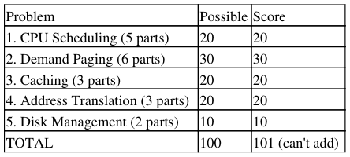
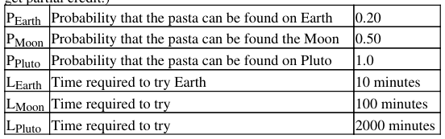
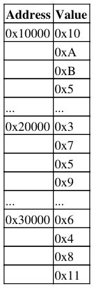

# Berkeley CS162 Spring 2000: Midterm 2: Questions

> Copied from the original: <https://hkn.eecs.berkeley.edu/exams/course/cs/162>. Text and figures are taken from the PDF as is; nothing was answered or rewritten. The original PDF is in this folder.

---

**Page 1**

&emsp;&emsp;&emsp;&emsp;&emsp;&emsp;&emsp;&emsp;CS 162, Midterm #2, Spring 2000, SOLUTIONS 
&emsp;&emsp;&emsp;&emsp;&emsp;**CS 162, Spring 2000 (April 10, 2000) SOLUTIONS** 
&emsp;&emsp;&emsp;&emsp;&emsp;&emsp;&emsp;&emsp;**Midterm #2** 
&emsp;&emsp;&emsp;&emsp;&emsp;&emsp;&emsp;&emsp;**Prof. Michael J. Franklin**

General Information: 
This is a **closed book** examination. You have 1 hour and 20 minutes to answer as many questions as possible. 
Partial credit will be given. There are 100 points in all. You should read **all** of the questions before starting the 
exam, as some of the questions are substantially more time-consuming than others.

Write all of your answers directly on this paper. Be sure to **clearly indicate** your final answer for each 
question. Also, be sure to state any assumptions that you are making in your answers.

Please try to be as **concise as possible**.

**Problem #1 \[5 parts, 20 points total\]: CPU Scheduling**

a) (4 points) Assume that 3 processes all with requirements of 1 second of CPU time each and no I/O arrive 
at the same time. What will be the average response time (i.e., average time to completion) for the processes 
under FIFO scheduling?

b) (4 points) Answer part "a" for Round Robin (RR) scheduling assuming a timeslice of 0.1 sec and no 
overhead for context switches (i.e., context switches are free).

c) (4 points) Answer part "a" for Shortest Job Finish (SJF) scheduling.

d) (4 points) Multilevel Feedback Queue Scheduling (MFQS) is a fairly good, general CPU scheduling 
algorithm, but as initially described in class, can lead to starvation under certain circumstances. Briefly 
describe how starvation can occur using MFQS and how to modify MFQS so that starvation can be avoided.

e) (4 points) What advantage is there in having different time-quantum (i.e. timeslice) sizes on different 
levels of the MFQS approach?

**Problem #2 \[6 parts, 30 points total\]: Demand Paging**

a) (3 points) Consider a demand paging system that use 4 KByte pages. In such a system, does a Least 
Recently Used (LRU) page replacement policy exploring temporal locality? If so, then how? If not, why not?

b) (3 points) Consider a demand paging system that use 4 KByte pages. In such a system, does a Least

CS 162, Spring 2000 (April 10, 2000) SOLUTIONS Midterm #2 Prof. Michael J. Franklin   1

---

**Page 2**

&emsp;&emsp;&emsp;&emsp;&emsp;&emsp;&emsp;&emsp;CS 162, Midterm #2, Spring 2000, SOLUTIONS 
Recently Used (LRU) page replacement policy exploit spatial locality? If so, then how? If not, why not?

c) (6 points) Consider a demand paging system with four physical memory frames and the following 
reference string over seven pages: 
1, 2, 3, 4, 2, 1, 5, 6, 2, 1, 2, 3, 7, 6 Assuming that memory starts empty, how many page faults will occur and 
what will be the final contents of memory under the FIFO page replacement policy? Circle your answers.

d) (6 points) Answer the problem of part "c" for the LRU policy. Recall that the reference string is: 1, 2, 3, 4, 
2, 1, 5, 6, 2, 1, 2, 3, 7, 6. Circle your answers.

e) (6 points) Answer the problem of part "c" for the MIN (i.e., optimal) policy. Recall that the reference string 
is: 1, 2, 3, 4, 2, 1, 5, 6, 2, 1, 2, 3, 7, 6. Circle your answers.

f) (6 points) Suppose that you want to use a paging algorithm that requires a reference bit (such as clock or 
working set) for each frame but the hardware for which you are implementing your operating system does not 
provide one. Briefly describe how you could simulate one and state (in general terms) what the main costs of 
your approach would be.

**Problem #3 \[3 parts, 20 points total\]: Caching -- Hungry Aliens Revisited**

(Use the following parameter values to answer the parts of this question. Clearly show your work in order to 
get partial credit.)

a) (6 points) Earth and Pluto -- Assume an alien has arrived on earth looking to eat his favorite type of Pasta 
(no need to worry about how many arms the alien has). He starts looking on Earth, if he can't find it there, he 
flies his space shit to Pluto where he knows they always have that kinda of pasta (in this case, if the pasta is 
not on Earth, it will take 2010 minutes for the Alien to get the pasta). On average, how long should it take for 
the Alien to find his pasta?

b) (6 points) Add the moon -- Now consider the case where the pasta may also be located on the moon 
(according to the probabilities and miss penalties shown above). In this case, how long should it take for the 
Alien to find his pasta (assuming he goes from Earth to the Moon, and then to Pluto if necessary)?

c) (8 points) For the problem in part "b" above, for what values (if any) of LMoon would it make sense for the 
Alien to skip searching the moon and go straight to Pluto?

**Problem #4 \[3 parts, 20 points total\]: Address Translation**

Problem #2 \[6 parts, 30 points total\]: Demand Paging   2

---

**Page 3**

&emsp;&emsp;&emsp;&emsp;&emsp;&emsp;&emsp;&emsp;CS 162, Midterm #2, Spring 2000, SOLUTIONS

a) (5 points) Suppose we have a 40-bit virtual address separated into an x-bit virtual page number and (40 - x) 
-bit page offset. Using basic single page table scheme, what is the maximum number of entries in the page 
table and what is the size of each page (in bytes)?

b) (5 points) Briefly describe what an Inverted Page Table is. List one advantage and one disadvantage of 
Inverted tables compared to traditional page tables.

c) (10 points) Consider an architecture combining segmentation and page with 32-bit addresses divided into 
fields as follows: 
4-bit seg id 12 bit page number 16 bit offset into page

Given the contents of physical memory shown on the left \[bottom in the case of this html file\] and the 
segment table above, what is the physical address do the following virtual addresses map to (if a virtual 
address is invalid, stat why) (2 points a piece): 
0x00001234 = 
0x100001234 = 
0x11111234 = 
0x20021234 = 
0x30031234 =

Problem #4 \[3 parts, 20 points total\]: Address Translation   3

---

**Page 4**

&emsp;&emsp;&emsp;&emsp;&emsp;&emsp;&emsp;&emsp;CS 162, Midterm #2, Spring 2000, SOLUTIONS 
...   ...

**Problem #5 \[2 parts, 10 points total\]: Disk Management**

a) (5 points) Compare the performance of the FAT structure used by MS-DOS (where file blocks are linked 
in an external structure) to that of the basic "linked allocation" techniqu (where file blocks are linked together 
via points in each block) in terms of sequential access and random access. Be sure to state any assumptions 
you are making in terms of what if anything is memory resident.

b) (5 points) The UNIX BSD 4.1 inode structure is intended to support both small files (e.g., several KBytes) 
and large files (e.g. up to some number of GBytes) efficiently. Briefly describe the mechanism employed to 
achieve this and state a potential problem of the approach for performance when accessing large files.

&emsp;**Posted by HKN (Electrical Engineering and Computer Science Honor Society)** 
&emsp;&emsp;&emsp;&emsp;&emsp;&emsp;&emsp;&emsp;**University of California at Berkeley** 
&emsp;&emsp;&emsp;&emsp;&emsp;&emsp;**If you have any questions about these online exams** 
&emsp;&emsp;&emsp;&emsp;&emsp;&emsp;&emsp;**please contact**  **examfile@hkn.eecs.berkeley.edu.**

Problem #5 \[2 parts, 10 points total\]: Disk Management   4

