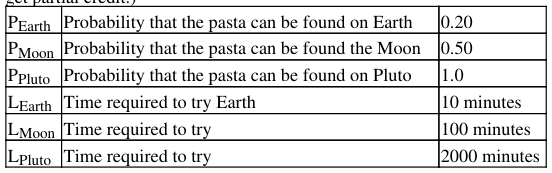
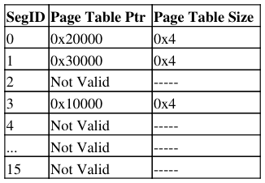

# Berkeley CS162 Spring 2000: Midterm 2: Official solutions

> Copied from the original: <https://hkn.eecs.berkeley.edu/exams/course/cs/162>. Text and figures are taken from the PDF as is; nothing was answered or rewritten. The original PDF is in this folder.

---

**Page 1**

&emsp;&emsp;&emsp;&emsp;&emsp;&emsp;&emsp;&emsp;CS 162, Midterm #2, Spring 2000, SOLUTIONS 
&emsp;&emsp;&emsp;&emsp;&emsp;**CS 162, Spring 2000 (April 10, 2000) SOLUTIONS** 
&emsp;&emsp;&emsp;&emsp;&emsp;&emsp;&emsp;&emsp;**Midterm #2** 
&emsp;&emsp;&emsp;&emsp;&emsp;&emsp;&emsp;&emsp;**Prof. Michael J. Franklin**

General Information: 
This is a **closed book** examination. You have 1 hour and 20 minutes to answer as many questions as possible. 
Partial credit will be given. There are 100 points in all. You should read **all** of the questions before starting the 
exam, as some of the questions are substantially more time-consuming than others.

Write all of your answers directly on this paper. Be sure to **clearly indicate** your final answer for each 
question. Also, be sure to state any assumptions that you are making in your answers.

Please try to be as **concise as possible**.

**Problem #1 \[5 parts, 20 points total\]: CPU Scheduling**

a) (4 points) Assume that 3 processes all with requirements of 1 second of CPU time each and no I/O arrive 
at the same time. What will be the average response time (i.e., average time to completion) for the processes 
under FIFO scheduling?

ANSWER: 2 seconds, no partial credit

b) (4 points) Answer part "a" for Round Robin (RR) scheduling assuming a timeslice of 0.1 sec and no 
overhead for context switches (i.e., context switches are free).

ANSWER: 2.9 seconds, no partial credit

c) (4 points) Answer part "a" for Shortest Job Finish (SJF) scheduling.

ANSWER: 2 seconds, no partial credit

d) (4 points) Multilevel Feedback Queue Scheduling (MFQS) is a fairly good, general CPU scheduling 
algorithm, but as initially described in class, can lead to starvation under certain circumstances. Briefly 
describe how starvation can occur using MFQS and how to modify MFQS so that starvation can be avoided.

ANSWER: Long jobs on low-priority queues can starve if a continuous stream of short jobs keep the 
high-priority queues full. Soln: hold a lottery among the QUEUES, weighted in favor of short queues 
OR 
implement aging, so that jobs that remain on low-priority queues for a long time are promoted.

CS 162, Spring 2000 (April 10, 2000) SOLUTIONS Midterm #2 Prof. Michael J. Franklin   1

---

**Page 2**

&emsp;&emsp;&emsp;&emsp;&emsp;&emsp;&emsp;&emsp;CS 162, Midterm #2, Spring 2000, SOLUTIONS 
2 pts for starvation explanation 
2 pts for correct solution

e) (4 points) What advantage is there in having different time-quantum (i.e. timeslice) sizes on different 
levels of the MFQS approach?

ANSWER: 
1\) different time quanta help differentiate between long and short jobs 
2\) for long jobs, short quanta mean unnecessary context switches (so different time quanta improve 
throughput) 
3\) Introduces more fairness 
The first two answers received full credit. 
Fairness received 2 points

**Problem #2 \[6 parts, 30 points total\]: Demand Paging**

a) (3 points) Consider a demand paging system that use 4 KByte pages. In such a system, does a Least 
Recently Used (LRU) page replacement policy exploring temporal locality? If so, then how? If not, why not?

ANSWER: 
Yes, LRU keeps recently used pages in memory and temporal locality says that these pages are likely to be 
accessed in the near future. 
1 point for yes + 2 points for a good justification (-1 point for a flaky or waffling answer).

b) (3 points) Consider a demand paging system that use 4 KByte pages. In such a system, does a Least 
Recently Used (LRU) page replacement policy exploit spatial locality? If so, then how? If not, why not?

ANSWER: 
Yes. It exploits temporal locality within a page by bringing in 4KBytes at a time and keeping the most 
recently accessed page in memory. Temporal locality says that other bytes in that page are likely to be 
accessed in the near future. (grading note: not all replacement policies support temporal locality even if large 
pages are used--for example, MRU does not exploit it.) 
1 point for yes + 2 points for a good justification (-1 point for a flaky or waffling answer).

c) (6 points) Consider a demand paging system with four physical memory frames and the following 
reference string over seven pages: 
1, 2, 3, 4, 2, 1, 5, 6, 2, 1, 2, 3, 7, 6 Assuming that memory starts empty, how many page faults will occur and 
what will be the final contents of memory under the FIFO page replacement policy? Circle your answers.

ANSWER: 
1,3,6,7 in memory and 11 page faults 
3 points for right memory contents and 3 points for right fault count. 
-2 if made a simple mistake in one of these, -3 or -4 if additional simple mistakes. -1 or -2 if you didn't follow 
directions and made have \[sic\] to hunt for your answer.

d) (6 points) Answer the problem of part "c" for the LRU policy. Recall that the reference string is: 1, 2, 3, 4, 
2, 1, 5, 6, 2, 1, 2, 3, 7, 6. Circle your answers.

ANSWER: 
2,3,6,7 in memory and 9 page faults

Problem #1 \[5 parts, 20 points total\]: CPU Scheduling   2

---

**Page 3**

&emsp;&emsp;&emsp;&emsp;&emsp;&emsp;&emsp;&emsp;CS 162, Midterm #2, Spring 2000, SOLUTIONS 
Same grading as "c".

e) (6 points) Answer the problem of part "c" for the MIN (i.e., optimal) policy. Recall that the reference string 
is: 1, 2, 3, 4, 2, 1, 5, 6, 2, 1, 2, 3, 7, 6. Circle your answers.

ANSWER: 
Several valid answers for contents -- 6, plus any 3 of 1,2,3,7 was possible. 7 page faults. 
Same grading as "c".

f) (6 points) Suppose that you want to use a paging algorithm that requires a reference bit (such as clock or 
working set) for each frame but the hardware for which you are implementing your operating system does not 
provide one. Briefly describe how you could simulate one and state (in general terms) what the main costs of 
your approach would be.

ANSWER: 
The main idea here was to have the operation system maintain its own array of reference bits (that's the easy 
part) the tricky part is that the OS must somehow learn about the accesses made to pages. The best way to do 
this was to mark pages as invalid so that an access to the page causes a trap to the OS, which can do the 
bookkeeping (of course, the OS must keep extra information around to be able to tell which page table entries 
are truly invalid). The clock algorithm could reset the invalid bit when it checked an accessed page. The extra 
costs are additional traps to the OS just for normal references (depend on how fast your clock moves) and 
extra complexity in the OS. 
Grading: -4 if you didn't say how the OS could learn about accesses. Note that setting the page permission to 
read-only doesn't work here, because we want to trap on reads. -2 if you didn't say what the costs of your 
solution were, or your costs were wrong.

**Problem #3 \[3 parts, 20 points total\]: Caching -- Hungry Aliens Revisited**

(Use the following parameter values to answer the parts of this question. Clearly show your work in order to 
get partial credit.)

a) (6 points) Earth and Pluto -- Assume an alien has arrived on earth looking to eat his favorite type of Pasta 
(no need to worry about how many arms the alien has). He starts looking on Earth, if he can't find it there, he 
flies his space shit to Pluto where he knows they always have that kinda of pasta (in this case, if the pasta is 
not on Earth, it will take 2010 minutes for the Alien to get the pasta). On average, how long should it take for 
the Alien to find his pasta?

ANSWER: 
Ave. Access Time = L\_earth + (1-P\_Earth) \* L\_Pluto 
= 10 + (1 = 0.2) \* 2000 
= 1610 minutes 
6 points for correct solution 
5 points for correct formula but incorrect numerical answer

Problem #2 \[6 parts, 30 points total\]: Demand Paging   3

---

**Page 4**

&emsp;&emsp;&emsp;&emsp;&emsp;&emsp;&emsp;&emsp;CS 162, Midterm #2, Spring 2000, SOLUTIONS 
2 points for incorrect solution (e.g. forgot L\_Earth is required regardless of hit or miss) 
0 otherwise

b) (6 points) Add the moon -- Now consider the case where the pasta may also be located on the moon 
(according to the probabilities and miss penalties shown above). In this case, how long should it take for the 
Alien to find his pasta (assuming he goes from Earth to the Moon, and then to Pluto if necessary)?

ANSWER: 
Ave. Access Time 
= L\_Earth + (1 - P\_Earth) \[L\_Moon + (1 - P\_Moon)(L\_Pluto)\] 
= 10 + (1 - 0.2)\[100 + (1 - 0.5)(2000)\] 
= 890 minutes 
6 points for correct solution 
5 points for correct formula but incorrect numerical answer 
2 points for incorrect solution (e.g. forgot L\_Earth is required regardless of hit or miss) 
0 otherwise

c) (8 points) For the problem in part "b" above, for what values (if any) of LMoon would it make sense for the 
Alien to skip searching the moon and go straight to Pluto?

ANSWER: 
The alien should skip the moon if the part from part b is larger than the answer from part a. 
That is: 
L\_earth + (1 - P\_Earth)\[L\_Moon + (1 - P\_Moon)(L\_Pluto)\] \> 1610 
10 + (1 - 0.2) \[L\_Moon + (1 - 0.5)(2000)\] \> 1610 
L\_Moon \> 1000 minutes 
8 points for correct solution 
-2 if you forgot or made an error with the \> or \>= sign 
-2 if you clearly set up the problem correctly but got the answer wrong due to error from previous part 
-6 if you didn't set up the problem correctly 
-2 if you solved for P\_Moon instead of L\_Moon

**Problem #4 \[3 parts, 20 points total\]: Address Translation**

a) (5 points) Suppose we have a 40-bit virtual address separated into an x-bit virtual page number and (40 - x) 
-bit page offset. Using basic single page table scheme, what is the maximum number of entries in the page 
table and what is the size of each page (in bytes)?

ANSWER: 
2^x page table entries (2 points) 
2^(40-x) bytes per page (3 points) 
1 point for saying 2^(40-x) page table entries and 2^x bytes per page

b) (5 points) Briefly describe what an Inverted Page Table is. List one advantage and one disadvantage of 
Inverted tables compared to traditional page tables.

ANSWER: 
1 point for identifying that the inverted page table translates virtual page numbers for physical page numbers. 
1 point for acknowledging the importance of the process ID in looking up entries in an inverted page table. 
1 point for recalling that a hash table or other secondary index is always used to make look-ups more

Problem #3 \[3 parts, 20 points total\]: Caching -- Hungry Aliens Revisited   4

---

**Page 5**

&emsp;&emsp;&emsp;&emsp;&emsp;&emsp;&emsp;&emsp;CS 162, Midterm #2, Spring 2000, SOLUTIONS 
efficient. 
1 point for identifying a valid advantage (e.g. fixed table size, global, never needs to be paged, handles sparse 
address spaces well). fast is NOT an advantage, because inverted page tables are being compared to 
traditional page tables, which are faster. 
1 point for identifying a valid disadvantage (e.g. slower, complex, difficult to implement in hardware, harder 
to map multiple virtual pages to a single physical page, need additional per-process tables, synchronization 
problems of using a global page table).

c) (10 points) Consider an architecture combining segmentation and page with 32-bit addresses divided into 
fields as follows: 
4-bit seg id 12 bit page number 16 bit offset into page

Given the contents of physical memory shown on the left \[bottom in the case of this html file\] and the 
segment table above, what is the physical address do the following virtual addresses map to (if a virtual 
address is invalid, stat why) (2 points a piece): 
0x00001234 = 
0x100001234 = 
0x11111234 = 
0x20021234 = 
0x30031234 =

Problem #4 \[3 parts, 20 points total\]: Address Translation   5

---

**Page 6**

&emsp;&emsp;&emsp;&emsp;&emsp;&emsp;&emsp;&emsp;CS 162, Midterm #2, Spring 2000, SOLUTIONS 
...   ...

ANSWER: 
0x31234 
0x61234 
invalid - virtual page num. exceeds size of segment 
segment 2 does \[sic\] is not valid 
0x51234 
(valid: 2 points for right address; 
invalid: 1 pt for saying invalid; 1 pt for reason)

**Problem #5 \[2 parts, 10 points total\]: Disk Management**

a) (5 points) Compare the performance of the FAT structure used by MS-DOS (where file blocks are linked 
in an external structure) to that of the basic "linked allocation" techniqu (where file blocks are linked together 
via points in each block) in terms of sequential access and random access. Be sure to state any assumptions 
you are making in terms of what if anything is memory resident.

ANSWER: 
For random access, the FAT structure will have fewer number of I/Os than the basic linked allocation 
technique. For the FAT structure at most 2 I/Os are needed to find a random page. The basic linked allocation 
technique will require reading N-1 pages to access the Nth page.

For the sequential access, the basic linked allocation technique will have fewer number of I/O requests than 
the FAT structure. The basic linked allocation will follow the pointer on a page to find the next page. the 
FAT structure will need to access the FAT and the actual page for every page request. 
3 pts for random 
2 pts for sequential 
For sequential access, we also accept the assumption that FAT is in memory, so the FAT structure will have 
about the same number of I/O requests as the basic link allocation technique. But the assumption will have to 
be stated in the answer.

b) (5 points) The UNIX BSD 4.1 inode structure is intended to support both small files (e.g., several KBytes) 
and large files (e.g. up to some number of GBytes) efficiently. Briefly describe the mechanism employed to 
achieve this and state a potential problem of the approach for performance when accessing large files.

ANSWER: 
The file structure consists of a file header which contains 13 pointers. The first 10 pointers are pointing to 
actual data pages of the file. The 11th pointer is a singly linked pointer. It is a pointer to a page of 256 
pointers, which point to actual data pages. The 12th pointer is a doubly linked pointer and the 13th pointer is 
a triply linked pointer. Small files will utilized these first 10 points. Large files will need to use the 11th, 
12th, or possibly the 13 pointer.

so a potential performance problem with the large files is following the triply linked pointer before reading 
the actual data page. This requires extra I/Os for following links.

3 pts for getting the structure correct 
-1 for having some numbers wrong 
-1 for not describing the linked structure

Problem #5 \[2 parts, 10 points total\]: Disk Management   6

---

**Page 7**

&emsp;&emsp;&emsp;&emsp;&emsp;&emsp;&emsp;&emsp;CS 162, Midterm #2, Spring 2000, SOLUTIONS

2 pts for a valid problem with large files

&emsp;**Posted by HKN (Electrical Engineering and Computer Science Honor Society)** 
&emsp;&emsp;&emsp;&emsp;&emsp;&emsp;&emsp;&emsp;**University of California at Berkeley** 
&emsp;&emsp;&emsp;&emsp;&emsp;&emsp;**If you have any questions about these online exams** 
&emsp;&emsp;&emsp;&emsp;&emsp;&emsp;&emsp;**please contact**  **examfile@hkn.eecs.berkeley.edu.**

7Posted by HKN (Electrical Engineering and Computer Science Honor Society) University of California at Berkeley If y

