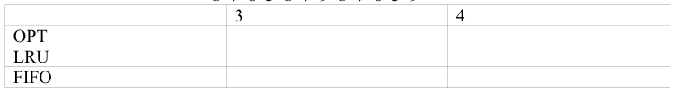

# Berkeley CS162 Fall 2001: Midterm 2: Questions

> Copied from the original: <https://hkn.eecs.berkeley.edu/exams/course/cs/162>. Text and figures are taken from the PDF as is; nothing was answered or rewritten. The original PDF is in this folder.

---

**Page 1**

Subject: CS162, 2001 
CS162, Fall, 2001 
Midterm 2, November 7, 2001 (Note this is a closed book and closed notes examination) 
&emsp;1\. Please show an implementation for P(S) and V(S), written as a monitor. (Such an 
&emsp;&emsp;implementation was shown in the Hoare article in the assigned readings.  Please 
&emsp;&emsp;write something similar.)  You may continue the answer on the back of the page. 
&emsp;&emsp;(14)

&emsp;2\. Assume a disk of 500 cylinders (numbered 0 to 449), the head currently at 
&emsp;&emsp;cylinder 50, having most recently read blocks at cylinders 40 and 50, and requests 
&emsp;&emsp;pending, in a queue in the following order, to read one block each from the 
&emsp;&emsp;following cylinders: 
&emsp;&emsp;85   123   48   275   15   480   306   22   5 
&emsp;&emsp;For each of the following disk arm scheduling algorithms, please give the 
&emsp;&emsp;sequence in which the blocks are read, and the total number of cylinders that the 
&emsp;&emsp;head moves. (Partial credit will be given only for obvious and trivial errors.) (12) 
&emsp;&emsp;FIFO, SSTF, SCAN, CSCAN

&emsp;3\. Define a “stack algorithm.”  For each of OPT, FIFO and LRU, prove which is or 
&emsp;&emsp;is not a stack algorithm. (14)

&emsp;4\. Describe and explain ALL of the complications and issues that arise if we are 
&emsp;&emsp;doing I/O in a computer system in which virtual memory is used.(12)

&emsp;5\. Given a standard Unix file system, such as was discussed in class, how many 
&emsp;&emsp;reads must be made to read all of a 64 Kbyte (65536 byte) file residing in / 
&emsp;&emsp;usr/home/cs162-aa/homework.txt? Assume a 1024 byte disk block, that only one 
&emsp;&emsp;block can be read at a time, that there are no symbolic links, and that all 
&emsp;&emsp;directories are their minimum size.  Please explain your answer.  Include ALL 
&emsp;&emsp;reads.  Assume no blocks in the disk cache.  Assume that each read only gets on 
&emsp;&emsp;“thing” at a time. (12)

&emsp;6\. For the following page reference string, please compute the number of pages 
&emsp;&emsp;faults when using FIFO, LRU, and OPT replacement, and for memory sizes of 3 
&emsp;&emsp;and 4 page frames, and enter the results in the table. (18) 
&emsp;&emsp;8  7  6  5  8  7  9  8  7  6  5  9

---

**Page 2**

7\. Please select an answer and enter in the indicated space. (No credit left if blank.) 
&emsp;(18) 
&emsp;&emsp;i.   Which of these is a reasonable rotational speed for a magnetic disk? 
&emsp;&emsp;&emsp;&emsp;&emsp;a) 100000 rpm 
&emsp;&emsp;&emsp;&emsp;&emsp;b) 10000 rps 
&emsp;&emsp;&emsp;&emsp;&emsp;c) 7200 rpm 
&emsp;&emsp;&emsp;&emsp;&emsp;d) 25000 rpm 
&emsp;&emsp;&emsp;&emsp;&emsp;e) 3600 rps 
&emsp;&emsp;ii.   Which of these is a reasonable price for a (cheap) 50 GB disk at 
&emsp;&emsp;&emsp;&emsp;&emsp;today’s prices? 
&emsp;&emsp;&emsp;&emsp;&emsp;a) 500 
&emsp;&emsp;&emsp;&emsp;&emsp;b) 1000 
&emsp;&emsp;&emsp;&emsp;&emsp;c) 3000 
&emsp;&emsp;&emsp;&emsp;&emsp;d) 10 
&emsp;&emsp;&emsp;&emsp;&emsp;e) 30 
&emsp;&emsp;&emsp;&emsp;&emsp;f)   150 
&emsp;&emsp;iii.   Which of these is a reasonable media data rate for a modern high end 
&emsp;&emsp;&emsp;&emsp;&emsp;magnetic disk? 
&emsp;&emsp;&emsp;&emsp;&emsp;a) 50 MB/sec 
&emsp;&emsp;&emsp;&emsp;&emsp;b) 500 MB/sec 
&emsp;&emsp;&emsp;&emsp;&emsp;c) 500 KB/sec 
&emsp;&emsp;&emsp;&emsp;&emsp;d) 3MB/sec 
&emsp;&emsp;&emsp;&emsp;&emsp;e) 10MB/sec 
&emsp;&emsp;iv.   Which of these would be a typical power consumption for a disk in a 
&emsp;&emsp;&emsp;&emsp;&emsp;desktop computer? 
&emsp;&emsp;&emsp;&emsp;&emsp;a) 1000W 
&emsp;&emsp;&emsp;&emsp;&emsp;b) 10 KW 
&emsp;&emsp;&emsp;&emsp;&emsp;c) 100 KW 
&emsp;&emsp;&emsp;&emsp;&emsp;d) 1W 
&emsp;&emsp;&emsp;&emsp;&emsp;e) 10W 
&emsp;&emsp;&emsp;&emsp;&emsp;f)   100W 
&emsp;&emsp;v.   Which of these is a typical claimed (advertised) MTBF for a modern 
&emsp;&emsp;&emsp;&emsp;&emsp;disk? 
&emsp;&emsp;&emsp;&emsp;&emsp;a) 5 years 
&emsp;&emsp;&emsp;&emsp;&emsp;b) 100 years 
&emsp;&emsp;&emsp;&emsp;&emsp;c) 1000 hours 
&emsp;&emsp;&emsp;&emsp;&emsp;d) 80000 hours 
&emsp;&emsp;&emsp;&emsp;&emsp;e) 300000 hours 
&emsp;&emsp;vi.   What is the approximate areal bit density of a standard 9-track tape, 
&emsp;&emsp;&emsp;&emsp;&emsp;using the highest density(bpsi = bits per square inch)? 
&emsp;&emsp;&emsp;&emsp;&emsp;a) 100,000,000 
&emsp;&emsp;&emsp;&emsp;&emsp;b) 1,000,000,000 
&emsp;&emsp;&emsp;&emsp;&emsp;c) 100,000 
&emsp;&emsp;&emsp;&emsp;&emsp;d) 1,000,000 
&emsp;&emsp;&emsp;&emsp;&emsp;e) 10,000,000

---

**Page 3**

&emsp;&emsp;&emsp;vii.   A typical average seek time for a modern disk would be? 
&emsp;&emsp;&emsp;&emsp;&emsp;&emsp;&emsp;a) 500 ms 
&emsp;&emsp;&emsp;&emsp;&emsp;&emsp;&emsp;b) 1 second 
&emsp;&emsp;&emsp;&emsp;&emsp;&emsp;&emsp;c) 5 microseconds 
&emsp;&emsp;&emsp;&emsp;&emsp;&emsp;&emsp;d) 500 microseconds 
&emsp;&emsp;&emsp;&emsp;&emsp;&emsp;&emsp;e) 5 ms 
&emsp;&emsp;&emsp;&emsp;&emsp;&emsp;&emsp;f)   50 ms 
&emsp;&emsp;&emsp;viii.   The standard block or sector size on a modern disk is: 
&emsp;&emsp;&emsp;&emsp;&emsp;&emsp;&emsp;a) 2048 B 
&emsp;&emsp;&emsp;&emsp;&emsp;&emsp;&emsp;b) 4096 B 
&emsp;&emsp;&emsp;&emsp;&emsp;&emsp;&emsp;c) 16384 B 
&emsp;&emsp;&emsp;&emsp;&emsp;&emsp;&emsp;d) 64 B 
&emsp;&emsp;&emsp;&emsp;&emsp;&emsp;&emsp;e) 128 B 
&emsp;&emsp;&emsp;&emsp;&emsp;&emsp;&emsp;f)   256 B 
&emsp;&emsp;&emsp;&emsp;&emsp;&emsp;&emsp;g) 512 B 
&emsp;&emsp;&emsp;&emsp;&emsp;&emsp;&emsp;h) 1024 B 
&emsp;&emsp;&emsp;ix.   The approximate areal bit density of the highest capacity IBM 
&emsp;&emsp;&emsp;&emsp;&emsp;&emsp;Microdrive is approximately: (mb = megabits, si = square inch) 
&emsp;&emsp;&emsp;&emsp;&emsp;&emsp;&emsp;a) 15 mb/si 
&emsp;&emsp;&emsp;&emsp;&emsp;&emsp;&emsp;b) 150 mb/si 
&emsp;&emsp;&emsp;&emsp;&emsp;&emsp;&emsp;c) 1500 mb/si 
&emsp;&emsp;&emsp;&emsp;&emsp;&emsp;&emsp;d) 15000 mb/si 
&emsp;&emsp;&emsp;&emsp;&emsp;&emsp;&emsp;e) 0.5mb/si 
&emsp;&emsp;&emsp;&emsp;&emsp;&emsp;&emsp;f)   1.5mb/si 
---------------------------------------------------------------------------------------------------------- 
solutions to the last problem: 
c, f, d, e, e, c , e, g, o.

