# Berkeley CS162 Spring 2001: Final: Questions

> Copied from the original: <https://hkn.eecs.berkeley.edu/exams/course/cs/162>. Text and figures are taken from the PDF as is; nothing was answered or rewritten. The original PDF is in this folder.

---

**Page 1**

&emsp;&emsp;&emsp;&emsp;&emsp;&emsp;&emsp;&emsp;CS162 Final, Spring 2001 
**CS 162 Final Spring 01**

### **Problem 1**. (22 points total) Short Answer.

a. T/F and **Why** (9 points)

Circle the correct answer and provide a short, one-sentence reason for your answer.

i)  Adding a cache never hurts performance.

ii) Unlike public key encryption, using private key encryption requires that the two communicating parties 
sharing a secret key ahead of time.

iii) The optimal place on the disk for directory blocks in the innermost cylinder of the disk.

b. (9 points)  Assume the queue of disk blocks that the file system must write out contains blocks located on 
the following cylinders: **45, 18, 20, 10, 50**

Assume the disk head just wrote a block on cylinder 15 and is currently over cylinder 16.  List the order will 
blocks be written out with:

i) FIFO:

ii) Shortest Seek Time First:

iii) SCAN / Elevator:

c. (4 points) network file systems use server-callback or client-poll validation schemes for cached data.

i) Which one does NFS use?

ii) Which one does AFS use?

### **Problem 2**. (18 points total) Networking.

a. (10 points) Shown below is network configuration for each router's table.  The network link marked with an 
X becomes unavailable.  Fill in the final state for each router's table that results after multiple rounds of 
exchange between the routers.

&emsp;&emsp;&emsp;&emsp;&emsp;&emsp;&emsp;&emsp;1

---

**Page 2**

&emsp;&emsp;&emsp;&emsp;&emsp;&emsp;&emsp;&emsp;CS162 Final, Spring 2001

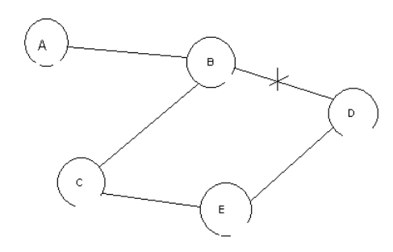

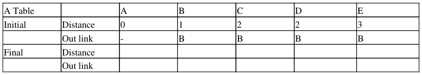

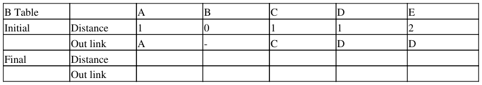

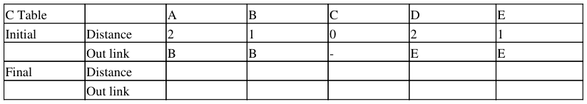

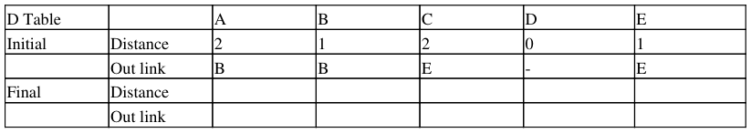

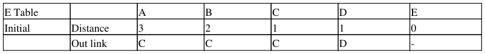

&emsp;&emsp;&emsp;&emsp;&emsp;&emsp;&emsp;&emsp;2

---

**Page 3**

&emsp;&emsp;&emsp;&emsp;&emsp;&emsp;&emsp;&emsp;CS162 Final, Spring 2001

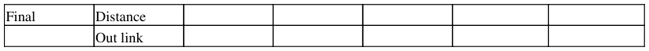

b. (8 points).  Your new boss at Megasoft Corporation proposes a new sliding window-based reliable network 
transport protocol.

The protocol works as follows: instead of sending an acknowledgement for eery packet, it only sends an 
acknowledgement for every 4 packets (by sequence number).  Thus ACK #1 is sent when packets with 
sequence numbers 0-3 have been received.  ACK #2 is sent when packets with sequence 4-7 have been 
received.

Acknowledgements do not cover packets from earlier sequence numbers and can be sent out of order (i.e., 
ACK #2 can be sent when packets with sequence numbers 4-7 have been received successfully, even if 
packets with sequence numbers 0-3 have not been received).  The protocol also uses a retransmission timer for 
each packet.

List a one sentence advantage and one sentence disadvantage of using this new protocol.

i) Advantage:

ii) Disadvantage:

### **Problem 3**.  (18 points) Multi-level Virtual Memory Management.

Consider a multi-level memory management using the following virtual addresses:

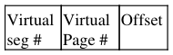

Each virtual address has 2 bits of virtual segment #, 8 bits of virtual page #, and 12 bits of offset.  Page table 
entries are 8 bits.  All values are in hexadecimal.

Translate the following virtual addresses into physical addresses, or write INVALID if the virtual address is 
invalid:

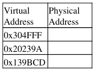

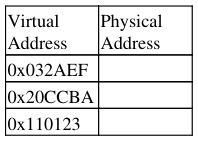

**Segment Table**

&emsp;&emsp;&emsp;&emsp;&emsp;&emsp;&emsp;&emsp;3

---

**Page 4**

&emsp;&emsp;&emsp;&emsp;&emsp;&emsp;&emsp;&emsp;CS162 Final, Spring 2001

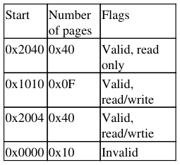

**Contents of Physical Memory**

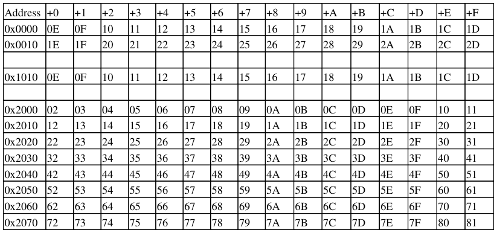

### **Problem 4**. (27 points total) Filesystems.

a. (6 points) Two machines, A and B, are sharing files over the network.  Describe the contents of **B's cache**, 
immediately after the following sequence of file operations, all of which occur within a one second span:

`B opens X; reads file; closes file`

`A opens X; writes new version; closes file`

`B opens Y; reads file`

`A opens y; writes new version; closes file`

Define the old version of the files as X.OLD and Y.OLD, and the new versions as X.NEW and Y.NEW.

i) State the contents of B's cache using NFS and state why in one sentence:

&emsp;&emsp;&emsp;&emsp;&emsp;&emsp;&emsp;&emsp;4

---

**Page 5**

&emsp;&emsp;&emsp;&emsp;&emsp;&emsp;&emsp;&emsp;CS162 Final, Spring 2001 
ii) State the contents of B's cache using AFS and state why in one sentence:

b. (6 points)  Assume that the number of disk blocks read to read the first block of a file is R.  In terms of R, 
give a formula for the average time to read the first block of the file.  Assume the following constants:

Ty - CPU cycle time in nanoseconds

Ts - Average disk seek time in seconds

F - File size in bytes

Tr - Average disk rotational latency in seconds

BWd - Disk bandwidth in bytes/second

B - Block size in bytes (equivalent to one disk sector)

To - CPU overhead to initiate a one block disk read in seconds

Explain your formula to ensure that you get partial credit.

c. (6 points) Remote user-level NFS server:

Using NFS, a client can send a single request to an NFS server to read the first data block from a remote file.

Assume the network is reliable (no acknowledgements are used), B is smaller than the network's maximum 
packet size, and the following constants:

Ty - CPU cycle time in nanoseconds

Trblk - Average time to read a single disk block at the remote server

F - File size in bytes

R - Number of disk blocks accessed to read the first block of a file on the remote server

B - Filesystem block size in bytes

To - CPU overhead of reading or writing a packet in seconds

Tn - Latency of the network between the client and server in seconds

BWn - Network bandwidth between the client and server in bytes/second

Sr - The size of the block read request sent to the remote machine)

Using the above constants, specify the time to read the first data block from a remote user-level NFS 
filesystem?

d. (9 points) Local versus Remote Disk Access:

&emsp;&emsp;&emsp;&emsp;&emsp;&emsp;&emsp;&emsp;5

---

**Page 6**

&emsp;&emsp;&emsp;&emsp;&emsp;&emsp;&emsp;&emsp;CS162 Final, Spring 2001 
This problem explores and compares the read-only performance of local file access using a memory cache for 
the disk, with a remote fileserver with a memory cache.

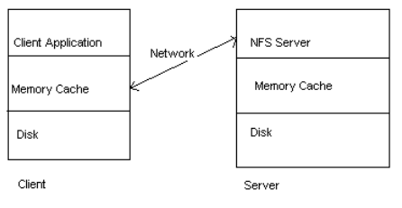

Use the following costs for actions (assume there is no overhead to check the cache):

&emsp;•   Time to read a block from the client machine memory cache is 1 millisecond 
&emsp;•   Time to read a block from the client machine disk is 20 ms 
&emsp;•   Client machine hit rate for reading blocks from cache is 50% 
&emsp;•   Time to read a block from the memory cache at the server machine is 1 ms 
&emsp;•   Time to read a block from the disk at the server is 20 ms 
&emsp;•   Time for either the client or the server to send a message on the network is 2.5 ms 
&emsp;•   Time to receive am message at the client or server is 0 ms 
&emsp;•   Server hit rate for reading blocks from the cache is Hr

i) Determine Tc the average time for the client application to read a single block using only the client machine 
memory cache and disk:

ii) Using the following access hierarchy, determine Tcs, the average time to read a single block:

&emsp;•   Check client machine memory cache 
&emsp;•   If not present in cache, contact remote server 
&emsp;•   At remote server, check memory cache 
&emsp;•   If not present in cache, retrieve from disk and return block to client

iii) Compute the minimum value of Hr that makes the remote access faster than local filesystem accesses (ie 
determine Hr such that Tcs = Tc):

### **Problem 5**. (15 points total) Security and Two-Phase Commit.

Suppose that CIA headquarters in Washington (W) communicates with branch offices in Moscow (M) and 
Beijing (B) using private-key-encrypted, reliable messages.  Suppose furthermore that the encryption key used 
is changed each day; every evening the new encryption key that is to be used the next day is sent from 
Washington to the two branch offices.  Two-phased commit is used in order to ensure that, despite computer 
crashes, either (a) everyone eventually switches to the new encryption key, NEWKEY, or (b) no one switches 
to the new encryption key and everyone continues using OLDKEY.  Assume that a machine takes some time 
to reboot and recover after a crash.

&emsp;&emsp;&emsp;&emsp;&emsp;&emsp;&emsp;&emsp;6

---

**Page 7**

&emsp;&emsp;&emsp;&emsp;&emsp;&emsp;&emsp;&emsp;CS162 Final, Spring 2001 
The steps involved in implementing two-phased committ are listed below, in time order:

&emsp;1\. W: write "begin transaction" to its log 
&emsp;2\. W -\> M: "New key is NEWKEY." (-\> means W sends message to M) 
&emsp;3\. M: write "new key is NEWKEY." to its log 
&emsp;4\. M -\> W: "Prepared to committ" 
&emsp;5\. W -\> B: "New key is NEWKEY." 
&emsp;6\. B: write "New key is NEWKEY." to its log 
&emsp;7\. B -\> W: "Prepared to commit" 
&emsp;8\. W: write "New key is NEWKEY." to its log 
&emsp;9\. W: write "commit" to its log 
&emsp;10\. W -\> M: "commit" 
&emsp;11\. M: write "got commit" to its log 
&emsp;12\. M: Key = NEWKEY 
&emsp;13\. M -\> W: "ok" 
&emsp;14\. W -\> B: "commit" 
&emsp;15\. B: write "got commit" to its log 
&emsp;16\. B: Key = NEWKEY 
&emsp;17\. B -\> W: "ok" 
&emsp;18\. W: Key = NEWKEY

a. (3 points) If W crashes after step 9 and no one else fails, what key will everyone end up using, once W 
reboots and recovers?  Give the reason why.

b. (3 points) If M crashes after step 4 and no one else fails, what key will everyone end up using, once M 
reboots and recovers?  Give the reason why.

c. (3 points) If B crashes after step 4 and no one else fails, what key will everyone end up using, once B 
reboots and recovers?  Give the reason why.

d. (3 points) If M crashes after step 10, what recovery steps must it take after it reboots in order to achieve the 
correct global state with respect to which encryption key to use?

e. (3 points) If W crashes after step 11, what recovery steps must it take after it reboots in order to achieve the 
correct global state with respect to which encryption key to use?

&emsp;&emsp;&emsp;&emsp;&emsp;&emsp;&emsp;&emsp;7

