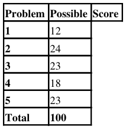
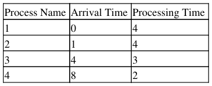
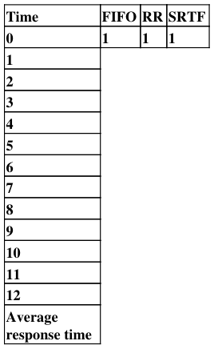
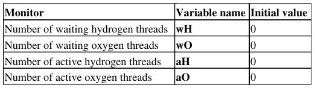
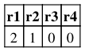
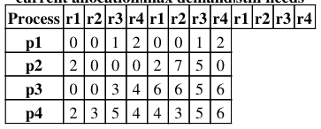

# Berkeley CS162 Spring 2001: Midterm 1: Questions

> Copied from the original: <https://hkn.eecs.berkeley.edu/exams/course/cs/162>. Text and figures are taken from the PDF as is; nothing was answered or rewritten. The original PDF is in this folder.

---

**Page 1**

&emsp;&emsp;&emsp;&emsp;&emsp;&emsp;&emsp;&emsp;Spring 2001 Midterm Exam, Anthony D. Joseph 
**Midterm Exam** 
**March 7, 2001** 
**Anthony D. Joseph** 
**CS162 Operating Systems**

General Information: 
This is a **closed book and note** examination. You have ninety minutes to answer as many questions as 
possible. The number in parentheses at the beginning of each question indicated the number of points given to 
the question; there are 100 points in all. You should read **all** of the questions before starting the exam, as some 
of the questions are substantially more time consuming.

Write all of your answersdirectly on this paper **Make your answers as concise as possible.** If there is 
something in a question that you believe is open to interpretation, then please ask us about it!

**Good Luck!!**

1.(12 points total) "Lightweight" versus Heavyweight processes - Pros and Cons: 
a.(4 points) List one advantage of running several single-threaded applications as "heavyweight" processes 
over running the aplications as multiple "lightweight" processes, all in one address space. Be explicit, but 
concise, in your answers. 
i)

b.(8 points) List two reasons why lightweight processes are better than heavyweight ones. 
i)

ii)

2.(24 points total) Suppose that we have a multiprogrammed computer in whihc each job has identical 
characteristics. In one computation period, T, for a job, half the time is spent in I/O and the other half in 
processor activity. Each job runs for a total of N periods. Assume that a simple round-robin scheduling

Midterm Exam March 7, 2001 Anthony D. Joseph CS162 Operating Systems   1

---

**Page 2**

&emsp;&emsp;&emsp;&emsp;&emsp;&emsp;&emsp;&emsp;Spring 2001 Midterm Exam, Anthony D. Joseph 
scheme is used and that I/O operations can overlap with processor operation. We define the following 
quantities:

Turnaround time = actual time to complete job

Processor utilization = percentage of time that the processor is active (not waiting).

For large N, compute approximate values for these quantities for one, two, and four simultaneous jobs, 
assuming that the period T is distributed in each of the following ways:

a.(15 points) I/O first half, processor second half.

i) 1 job, Turnaround time and Processor utilization:

ii) 2 jobs, Turnaround time and Processor utilization:

ii) 4 jobs, Turnaround time and Processor utilization:

b.(9 points) I/O first and fourth quarters, processor second and third quarters.

i) 1 job, Turnaround time and Processor utilization:

ii) 2 jobs, Turnaround time and Processor utilization:

ii) 4 jobs, Turnaround time and Processor utilization:

3.(23 points total) CPU scheduling.

a.(8 points) Given CPU-bound tasks and a choice between FIFO amd Round-Robin scheduling algorithms, 
choose the best algortihm for each of the following systems and specify why you chose the algorithm. 
i)Multiprogrammed batch system:

Good Luck!!   2

---

**Page 3**

&emsp;&emsp;&emsp;&emsp;&emsp;&emsp;&emsp;&emsp;Spring 2001 Midterm Exam, Anthony D. Joseph

ii)Interactive time-sharing system:

b.(15 points) Consider the following processes, arrival times and CPU processing requirements:

For each of the following scheduling algorithms, fill in the table with the process that is running on the CPU. 
Assume a 1 unit timeslice for timeslice-based algorithms. For RR, assume that an arriving thread runs at the 
beginning of its arival time.

4.(18 points total) Concurrency problem: Building H2O.

&emsp;&emsp;The goal of this exercise os for you to create a monitor with methods Hydrogen() and Oxygen(), 
&emsp;&emsp;which wait until a water molecule can be formed and then return. Don't worry about actually creating 
&emsp;&emsp;the water molecule; instead only need to wait until two hydrogen threads and one oxygen thread can 
&emsp;&emsp;be grouped together. For example, if two threads call Hydrogen, and then a third thread calls Oxygen, 
&emsp;&emsp;the third thread should wake up the first two threads amd they should all then return.

Good Luck!!   3

---

**Page 4**

&emsp;&emsp;&emsp;&emsp;&emsp;&emsp;&emsp;&emsp;Spring 2001 Midterm Exam, Anthony D. Joseph

&emsp;&emsp;a.(6 points) Specify the correctness constraints. Be succinct and explicint in your answer

&emsp;&emsp;b.(12 points) Observe that there is only one condition any thread will wait for(i.e., a water molecule 
&emsp;&emsp;being formed). However, it will be necessary to signal hydrogen and oxygen threads independently, 
&emsp;&emsp;so we choose to use two condition variables, waitingH and waitingO.

You start with the following code:

`Hydrogen(){` 
`wH++;` 
`lock.acquire();` 
`while(aH ==0){` 
`if(wH>=2 && wO >=1) {` 
`wH-=2; aH+=2;` 
`wO-=1; aO=+1;` 
`waitingH.broadcast();` 
`waitingO.signal();` 
`} else {` 
`lock.release();` 
`waitingH.wait();` 
`lock.acquire();` 
`}` 
`}` 
`lock.release();` 
`aH--;` 
`}`

`Oxygen() {` 
`wO++;` 
`while(aO ==0){` 
`if(wH >=2 && wO >= 1){` 
`wH-=2; aH+=2;` 
`wO-=1; aO=+1;` 
`waitingH.signal();` 
`waitingH.signal();` 
`} else {` 
`waitingO.broadcast();` 
`}`

Good Luck!!   4

---

**Page 5**

&emsp;&emsp;&emsp;&emsp;&emsp;&emsp;&emsp;&emsp;Spring 2001 Midterm Exam, Anthony D. Joseph 
`}` 
`aO--;` 
`}`

For each method, say whether the implementation either (i) works, (ii) doesn't work, or (iii) is dangerous - that 
is, sometimes works and sometimes doesn't. If the implementation does not work or is dangerous, explain why 
(there maybe several errors) and show how to fix it so it does work. Also list and fix any inefficiencies.

i. Hydrogen()

ii. Oxygen()

5\. (23 points) Deadlock:

Consider the following snapshot of a system with five processes(p1,...p5) and four resources (r1,...r4). There 
are no current outstanding queued unsatisfied requests.

&emsp;&emsp;&emsp;&emsp;&emsp;&emsp;&emsp;&emsp;**currently available resources**

&emsp;&emsp;&emsp;&emsp;&emsp;&emsp;&emsp;&emsp;**current allocation\|max demand\|still needs**

Good Luck!!   5

---

**Page 6**

&emsp;&emsp;&emsp;&emsp;&emsp;&emsp;&emsp;&emsp;Spring 2001 Midterm Exam, Anthony D. Joseph 
&emsp;&emsp;&emsp;&emsp;&emsp;&emsp;&emsp;&emsp;**p5**   0 3 3 2 0 6 5 2

a. (5 points) Compute what each process still might request and fill in the "still needs" columns.

b. (8 points) Is this system currently deadlocked, or will any process become deadlocked? Why or why not? If 
not, give an execution order.

c. (10 points) If a request from p3 arrives for (0,1,0,0), can that request be safely granted immediately? In 
what state (deadlocked, safe, unsafe) would immediately granting the whole request leave the system? Which 
processes, if any, are or may become deadlocked if this whole request is granted immediately?

Good Luck!!   6

